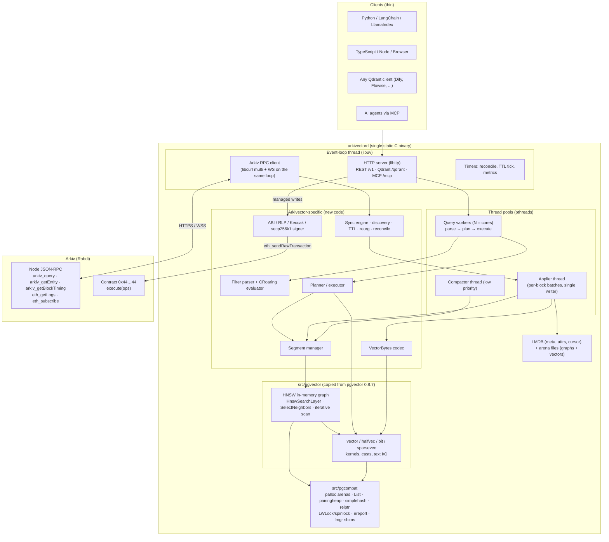
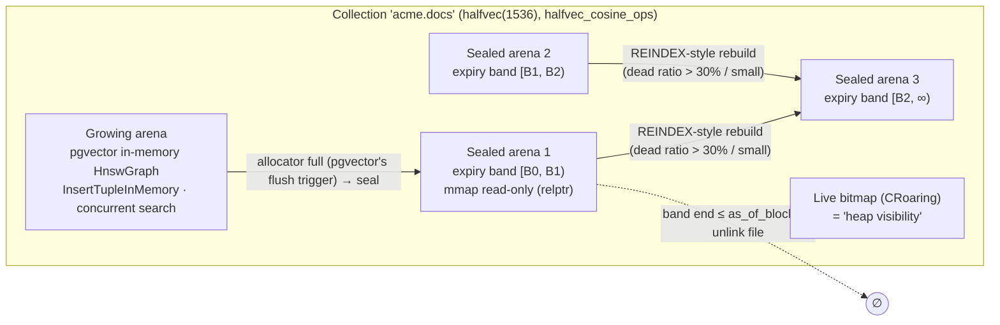
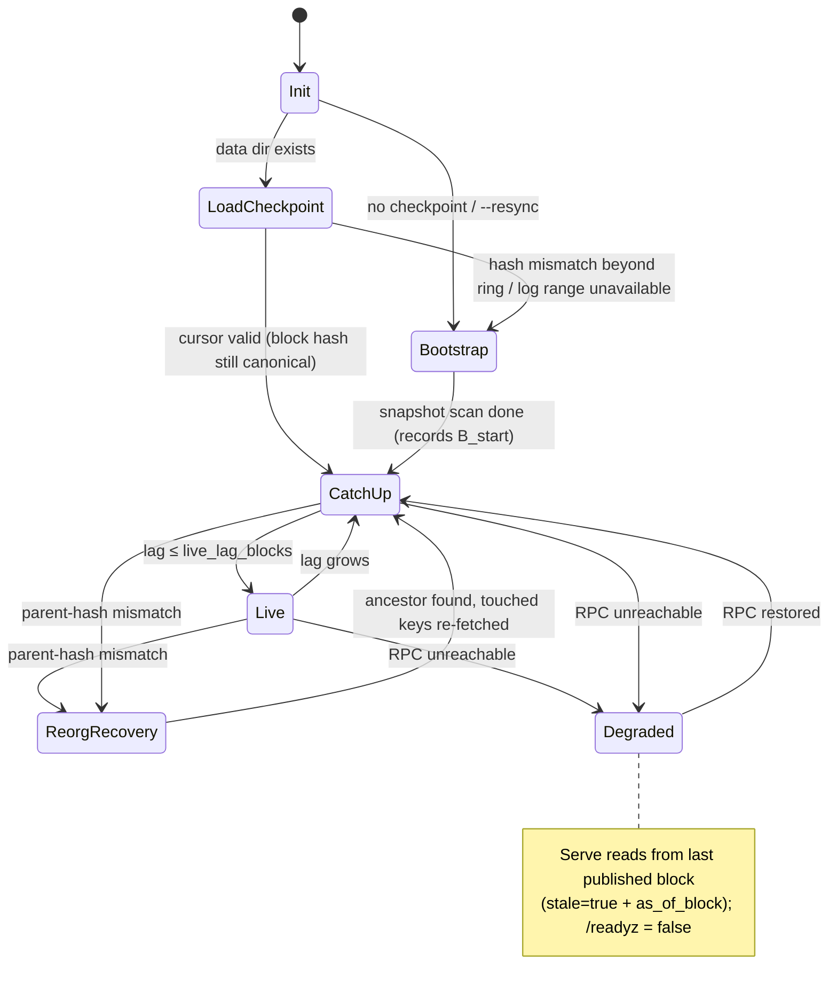
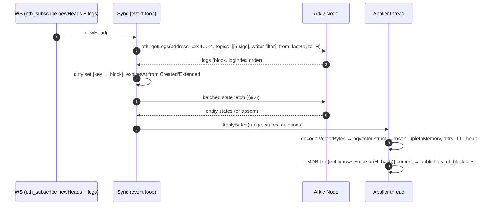
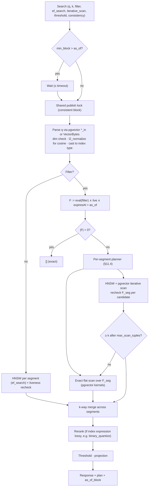
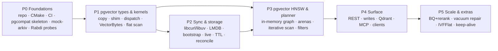

# Arkivector — Architecture & Implementation Plan

> **"pgvector for Arkiv"**: an off-chain vector co-processor, **written in C and built on pgvector's own code**, that turns Arkiv entities into a filtered, low-latency, approximate-nearest-neighbour (ANN) search surface. Arkiv remains the single source of truth.

| | |
| :--- | :--- |
| **Status** | Draft v2 (C / pgvector-derived architecture) |
| **Inputs** | [`QUESTION.md`](QUESTION.md), [`RESEARCH/arkiv-docs/`](RESEARCH/arkiv-docs/README.md), [`RESEARCH/pgvector/`](RESEARCH/pgvector/README.md), pgvector source in [`pgvector/`](pgvector/) (**v0.8.7**) |
| **Substrate** | Arkiv Rabdi testnet (chain `7794095`, 2 s blocks, contract `0x44…44`) |
| **Deliverable** | One self-contained binary, `arkivectord` (static, per OS/arch), plus a Docker image |

---

## Table of Contents

0. [TL;DR: The Decisions](#0-tldr-the-decisions)
1. [Goals, Non-Goals, Design Principles](#1-goals-non-goals-design-principles)
2. [Six Insights That Shape the Design](#2-six-insights-that-shape-the-design)
3. [System Overview](#3-system-overview)
4. [Technology Stack: C, and Why](#4-technology-stack-c-and-why)
5. [The pgvector Reuse Strategy](#5-the-pgvector-reuse-strategy)
6. [On-Chain Data Model](#6-on-chain-data-model)
7. [`VectorBytes`: pgvector's Memory Layout on Chain](#7-vectorbytes-pgvectors-memory-layout-on-chain)
8. [Local Storage & Index Layout](#8-local-storage--index-layout)
9. [Synchronization & State Recovery Engine](#9-synchronization--state-recovery-engine)
10. [TTL: Liveness & the Passive Pruning Scheduler](#10-ttl-liveness--the-passive-pruning-scheduler)
11. [Hybrid Query Planner & Filter Engine](#11-hybrid-query-planner--filter-engine)
12. [Write Path (Optional Signer)](#12-write-path-optional-signer)
13. [API Specification](#13-api-specification)
14. [Polyglot Client Strategy](#14-polyglot-client-strategy)
15. [Security, Trust & Verifiability](#15-security-trust--verifiability)
16. [Build, Packaging, Operations & Observability](#16-build-packaging-operations--observability)
17. [Implementation Roadmap](#17-implementation-roadmap)
18. [Test & Benchmark Strategy](#18-test--benchmark-strategy)
19. [Open Questions & Risks](#19-open-questions--risks)

---

## 0. TL;DR: The Decisions

| Area | Decision | One-line rationale |
| :--- | :--- | :--- |
| Daemon language | **C (C11)**, GCC/Clang | pgvector is C. Its kernels, types, and HNSW graph code can be **copied directly** instead of re-implemented. |
| Code reuse | pgvector **v0.8.7** vendored under `src/pgvector/` with upstream file names. Each file is used **verbatim**, **verbatim + shim**, or as an **algorithm port** ([§5](#5-the-pgvector-reuse-strategy)). A thin **`pgcompat/` layer** provides the few PostgreSQL APIs the code expects (`palloc`, `List`, `pairingheap`, `LWLock`, `ereport`, `fmgr`). | Maximises copy-paste, keeps upstream diffs small, and lets us merge future pgvector fixes. |
| Data types | Exactly pgvector's four: **`vector`**, **`halfvec`**, **`bit`**, **`sparsevec`**, with pgvector's limits (16,000 dims, 64,000 bits, 16,000 nnz). | Same structs, same kernels, same semantics. All limits fit in Arkiv's 128 KiB `bytes`. |
| Operators / opclasses | pgvector's: `<->` L2, `<#>` neg. inner product, `<=>` cosine, `<+>` L1, `<~>` Hamming, `<%>` Jaccard. Index opclasses `vector_l2_ops`, `halfvec_cosine_ops`, `bit_hamming_ops`, … | Users and docs transfer 1:1 from pgvector. |
| ANN index | **pgvector's HNSW, in-memory path** (`hnswutils.c` + in-memory half of `hnswbuild.c`), relative-pointer (`relptr`) arena. Disk pages, WAL, and the buffer manager are dropped. | pgvector's in-memory build graph is already a complete, concurrent, position-independent HNSW. An arena file can be mmapped as-is. |
| Tuning knobs | pgvector names and defaults: `m=16`, `ef_construction=64`, `ef_search=40`, `iterative_scan`, `max_scan_tuples=20000`, `scan_mem_multiplier`. | Zero relearning for pgvector users. |
| Iterative scan | pgvector's **resumable `discarded`-heap iterative scan** (`GetScanItems`/`ResumeScanItems`), ported with the I/O replaced. | The proven answer to filtered-ANN starvation, reused instead of reinvented. |
| Index topology | **Segments**: one growing arena plus sealed, mmapped arenas. Deletes are tombstone bitmaps (the "heap visibility" check). Compaction is a REINDEX-style rebuild, **expiry-banded**. | Arkiv TTL churn is constant. Grouping by expiry lets whole segments be dropped at once. |
| Persistence | **LMDB** (metadata, attributes, sync cursor) plus **arena files** (graph + vectors) | Both mmap-native C. LMDB is ACID with a single writer. All of it is a cache: the chain is the truth. |
| Filtering | **Mirror every attribute locally** in CRoaring bitmaps and sorted indexes. Evaluate in-process. Arkiv pushdown only in "lite mode". | `arkiv_query` returns ≤ 100 rows per call, so pushdown costs O(\|F\|/100) round trips per search. |
| Planner | **Exact \|F\|** from bitmaps. Exact flat scan when \|F\| < γ·√(m·ef·N); otherwise HNSW with pgvector iterative scan and bitmap recheck. Exact fallback **guarantees k results**. | Exact selectivity beats pgvector's estimated selectivity. |
| Sync model | State-based: logs are invalidation hints, `arkiv_query` is the authority, applies are monotonic by `updatedAt`. **WS is the doorbell, `eth_getLogs` is the ledger.** | Idempotent replay and trivial reorg recovery. |
| TTL | Correctness via an implicit `expiresAt > as_of_block` predicate. Reclamation via a lazy min-heap and segment drops. | Arkiv emits no expiry event, so nothing must depend on one. |
| Wire format | `VectorBytes` = **pgvector's in-memory struct**, with the 4-byte varlena header replaced by an Arkivector header (`'A' 'V' ver|type flags`). Native little-endian. | Decoding is `memcpy` + `SET_VARSIZE`, which yields a real `Vector *` / `HalfVector *` / `VarBit *` / `SparseVector *`. |
| Networking | **libuv** event loop, **llhttp** HTTP server, **libcurl** (multi + WebSocket) for Arkiv, **yyjson** | Mature, permissive (MIT-style), embeddable C libraries. A single event loop. |
| Ethereum | **libsecp256k1** (signing), vendored Keccak, hand-written ABI/RLP (~600 LOC total) | Only `execute(ops)` and five events are needed, so a full Ethereum library would be wasted weight. |
| API | REST/JSON on `:8080`, **Qdrant-compatible subset**, **MCP** endpoint. gRPC deferred (no first-class C server) and offered later via a transcoding sidecar. | Qdrant compatibility plugs LangChain, LlamaIndex, Dify, and Flowise in today. |
| Distribution | Static binary per target: `linux-x86_64` (musl), `linux-aarch64`, `darwin-arm64`. x86 kernels are **multi-compiled** (baseline / v3 / v4) and dispatched at startup with pgvector's own CPUID+`xgetbv` checks. | `target_clones` needs glibc IFUNC, so a static musl binary needs explicit dispatch. The kernel source stays verbatim. |

---

## 1. Goals, Non-Goals, Design Principles

### Goals
1. **k-NN / ANN search** over vectors stored in Arkiv `bytes` attributes, with **pgvector-identical** types, operators, and distance results.
2. **Filtered ANN** with Arkiv-style predicates (`=`, `!=`, `<`, `<=`, `>`, `>=`, `BETWEEN`, `STARTSWITH`, `EXISTS`, `TYPEOF`, `AND`/`OR`/`NOT`) and predictable recall at any selectivity.
3. **Sub-5 ms p50 / sub-15 ms p99** search for ≤ 1M × 1536-d `halfvec` on a commodity 8-core host (target, to be benchmarked).
4. **Stateless with respect to consensus**: delete the data dir, restart, and the daemon rebuilds an identical index from Arkiv.
5. **TTL-faithful**: never return an entity Arkiv considers expired at the reported block.
6. **Polyglot by HTTP**: any language integrates via REST or the Qdrant protocol.
7. **One binary**: no runtime dependencies, no PostgreSQL install.

### Non-Goals (v1)
- No custom smart contract and no validator plugin.
- **Not a PostgreSQL extension and not a PostgreSQL server.** We reuse pgvector's *code*, not PostgreSQL's process model, SQL, WAL, or buffer manager.
- No trustless *completeness* proofs for top-k ([§15](#15-security-trust--verifiability)).
- No embedding generation in the core (optional hook later).
- No distributed sharding. Read scaling is done by running replicas, since each one syncs independently.

### Design Principles
- **Arkiv is the source of truth. Everything local is a disposable cache.**
- **Copy pgvector before writing new code.** New code is justified only where pgvector's design is bound to PostgreSQL (pages, WAL, SQL planner) or where Arkiv needs something pgvector never had (sync, TTL, chain I/O).
- **Correctness from invariants, efficiency from background work.** This applies to TTL, deletes, and reorgs alike.
- **As-of-block semantics everywhere.** Every response carries the `block_number` its state reflects.
- **Minimise RPC.** Hub access keys are metered in Cost Units.
- **C safety by construction**: arenas instead of ad-hoc `malloc`/`free`, bounded parsers, sanitizers and fuzzers in CI ([§16.2](#162-c-hardening)).

---

## 2. Six Insights That Shape the Design

### Insight 1: pgvector's in-memory HNSW graph is already a standalone engine
pgvector builds HNSW in two phases: an **in-memory graph** (`hnswbuild.c`), then a flush to disk pages. The in-memory phase is a complete HNSW implementation:
- Elements, neighbor arrays, and values are allocated from an `HnswAllocator` into one memory area addressed through **`HnswPtr` unions that are either raw pointers or `relptr` offsets from a `base`**. That makes the graph **position-independent**: a file containing the area can be mmapped at any address and traversed.
- `HnswSearchLayer(base, …, index = NULL, …)` takes an explicit `inMemory` path (`HnswLoadUnvisitedFromMemory`).
- Concurrent insertion is already supported (built for parallel DSM workers). Readers copy a neighborhood under `LW_SHARED` element locks, and writers update under `LW_EXCLUSIVE`.
- Duplicate vectors collapse into one element with up to `HNSW_HEAPTIDS` (10) tuple ids (`FindDuplicateInMemory`).

So the core ANN engine is **copied, not written**. We keep the in-memory path, drop the on-disk path, and provide a dozen PostgreSQL primitives in `pgcompat/`.

### Insight 2: Make the on-chain bytes *be* pgvector's in-memory struct
pgvector's `Vector` is `{int32 vl_len_; int16 dim; int16 unused; float x[]}`. If our on-chain blob uses the same layout and puts our 4-byte header where `vl_len_` lives, then a fetched blob becomes a valid `Vector *` by overwriting 4 bytes. Every pgvector function (kernels, casts, `binary_quantize`, `subvector`, norms) then operates on chain data with **zero conversion code**.

### Insight 3: The daemon already has every attribute, so filter locally
The daemon must fetch each entity to get its vector, and that same fetch returns all attributes. Query-time pushdown to Arkiv, by contrast, is expensive: pages are capped at **100 rows** (200 sequential calls for 20k matches), Arkiv evaluates at a different block than our index, and `$createdAt`/`$updatedAt`/unindexed attributes can't be filtered there at all. Local filtering is the default. Pushdown is a fallback ([§11.7](#117-lite-mode-remote-pushdown-fallback)).

### Insight 4: TTL correctness ≠ TTL cleanup
No expiry event exists. Every search therefore applies `expiresAt > as_of_block` as an implicit predicate, much as pgvector relies on heap visibility rather than on the index to hide dead tuples. Memory reclamation (heap plus segment drops) can lag without ever producing wrong results.

### Insight 5: Sync state, not events; discovery is the hard part
Events carry no attributes, so every event triggers a state fetch anyway. Treating logs as dirty-key hints and applying state monotonically by `updatedAt` gives idempotent replay and trivial reorg recovery. Separately, `EntityCreated` fires for **every app on the chain** with no schema tag in the log. **Writer-scoped collections** (log filter on the owner topic) solve discovery cheaply and are also what Arkiv's security model recommends against tag spoofing.

### Insight 6: Exact selectivity is free, which is better than pgvector's planner
pgvector's `hnswcostestimate` *estimates* selectivity, and its iterative scan may still return fewer than `LIMIT` rows (bounded by `max_scan_tuples`). Our bitmaps give **exact |F|**, so the planner chooses between exact scan and graph traversal from a closed-form model ([§11.4](#114-the-cost-model--crossover-heuristic)). Because F is known, we can always finish with an exact scan over F: **if |F| ≥ k we return k results.**

---

## 3. System Overview



### Threading model

| Thread | Work | Notes |
| :--- | :--- | :--- |
| Event loop (1) | HTTP accept/parse/respond, all Arkiv HTTP/WS I/O (`curl_multi_socket_action` driven by `uv_poll`), timers | Never runs CPU-heavy work. Hands requests to pools via lock-free queues and wakes with `uv_async_send`. |
| Query workers (N) | Filter evaluation, planning, HNSW/flat search, JSON encoding of results | Intra-query parallelism splits across segments on the same pool. |
| Applier (1) | Decode entities, insert into growing arena, update attribute index and TTL heap, commit LMDB txn, publish block | The single writer, which keeps it simple and makes LMDB's single-writer model a natural fit. |
| Compactor (1) | Seal, rebuild (REINDEX) and expiry-band segments | Uses the pgvector in-memory build path, optionally with parallel inserters. |

### Repository layout

```
arkivector/
├── CMakeLists.txt                 # single build; presets: dev, asan, tsan, release-static
├── src/
│   ├── pgvector/                  # ← COPIED from pgvector v0.8.7 (upstream file names kept)
│   │   ├── vector.h  halfvec.h  bitvec.h  sparsevec.h  hnsw.h
│   │   ├── halfutils.c/.h  bitutils.c/.h            (verbatim)
│   │   ├── vector_kernels.c  halfvec_kernels.c  sparsevec_kernels.c  bitvec_kernels.c
│   │   │                                            (function-level copies from vector.c, halfvec.c, …)
│   │   ├── vector_io.c                               (vector_in/out, halfvec_in/out, sparsevec_in/out parsers)
│   │   ├── hnswutils.c                               (in-memory paths; disk paths #ifndef ARKIVECTOR)
│   │   ├── hnswbuild_mem.c                           (InsertTupleInMemory, UpdateGraphInMemory, … from hnswbuild.c)
│   │   ├── hnswscan_mem.c                            (GetScanItems / ResumeScanItems ported to base-pointer graphs)
│   │   ├── ivfkmeans.c                               (Phase 5: IVFFlat)
│   │   ├── LICENSE.pgvector  PROVENANCE.md           (per-file upstream path, tag, and local delta)
│   ├── pgcompat/                  # minimal PostgreSQL surface the copied code needs
│   │   ├── postgres.h  c.h        # int16/uint32/Size/Datum/bool, MAXALIGN, Assert, likely/unlikely
│   │   ├── palloc.c  memutils.h   # MemoryContext = bump arenas; palloc/palloc0/repalloc/pfree
│   │   ├── elog.c  elog.h         # ereport/elog(ERROR) → sigsetjmp/siglongjmp to request boundary
│   │   ├── pg_list.h  list.c      # copied from PostgreSQL (List, lappend, foreach, list_sort)
│   │   ├── pairingheap.c/.h       # copied from PostgreSQL
│   │   ├── simplehash.h  relptr.h # copied from PostgreSQL
│   │   ├── lwlock.c/.h  spin.h    # compact atomic RW lock / spinlock (4 bytes), no-op mode for sealed arenas
│   │   ├── fmgr.c/.h              # FmgrInfo = function pointer; FunctionCall2Coll; PG_GETARG_* subset
│   │   ├── varatt.h               # SET_VARSIZE / VARSIZE as plain 4-byte length
│   │   └── LICENSE.postgresql
│   ├── codec/        vectorbytes.c         # §7
│   ├── arkiv/        rpc.c ws.c query_builder.c logs.c abi.c rlp.c tx.c keccak.c signer.c
│   ├── store/        lmdb_store.c arena_file.c checkpoint.c
│   ├── index/        segment.c flat.c compact.c attr_index.c (CRoaring)
│   ├── filter/       lexer.c parser.c json_filter.c eval.c
│   ├── sync/         syncer.c bootstrap.c discovery.c apply.c ttl.c reorg.c reconcile.c
│   ├── query/        planner.c executor.c rerank.c
│   ├── server/       http.c router.c rest.c qdrant.c mcp.c auth.c metrics.c
│   └── main.c        config.c (TOML) log.c
├── third_party/      # vendored, pinned: libuv, llhttp, curl, yyjson, CRoaring, lmdb,
│                     #   secp256k1, tiny-keccak, tomlc99, (OpenSSL/mbedTLS for static builds)
├── tools/pgvector-sync.sh   # 3-way merge helper for new pgvector tags (see §5.4)
├── test/             # unit (C), fuzz (libFuzzer), integration (Python harness), pgvector-parity
├── testkit/mock-arkiv/      # deterministic Arkiv simulator (Python), see §18
├── clients/python/  clients/typescript/
├── docs/            openspec/
```

---

## 4. Technology Stack: C, and Why

### 4.1 Language decision: C11

The deciding factor is **reuse**. pgvector is about 15k lines of mature, heavily benchmarked C. Its distance kernels, half-precision conversion, popcount dispatch, sparse merge kernels, text parsers, and HNSW graph algorithms can be lifted directly. In any other language we would *re-derive* and *re-validate* all of it. In C we inherit it, and we can keep merging upstream improvements.

| Concern | How C is made to work |
| :--- | :--- |
| Memory safety | Arena allocation everywhere (pgvector's own `palloc`/`MemoryContext` discipline: allocate freely, free the whole context at request end). Bounded parsers. ASan/UBSan/TSan builds, libFuzzer targets, and `clang-tidy`/`cppcheck` in CI ([§16.2](#162-c-hardening)). |
| SIMD | Exactly pgvector's approach: auto-vectorization with `-ftree-vectorize -fassociative-math -fno-signed-zeros -fno-trapping-math -ffp-contract=fast`, `__attribute__((target("avx,f16c,fma")))` for F16C half kernels, AVX-512 VPOPCNTDQ for bits, and CPUID + `_xgetbv` OS-state gating. All copied. |
| Concurrency | pthreads + C11 `<stdatomic.h>`. pgvector's in-memory graph locking protocol is reused unchanged on top of our `LWLock` shim. |
| Networking / async | libuv (the event loop behind Node.js) + llhttp (Node's HTTP parser) + libcurl multi (HTTP/2, TLS, WebSocket ≥ 8.11). |
| Binary distribution | Static linking. A musl build for Linux, multi-compiled kernels for x86 dispatch ([§16.1](#161-build--distribution)). |

### 4.2 Third-party libraries (all vendored and pinned)

| Purpose | Library | License |
| :--- | :--- | :--- |
| Event loop, threads helpers | libuv | MIT |
| HTTP/1.1 server parsing | llhttp | MIT |
| HTTPS / HTTP/2 / WebSocket client | libcurl (+ OpenSSL 3 or mbedTLS) | curl (MIT-style) / Apache-2.0 |
| JSON | yyjson | MIT |
| Bitmaps | CRoaring (amalgamation) | Apache-2.0 / MIT |
| Embedded KV store | LMDB | OpenLDAP Public License (BSD-style) |
| ECDSA secp256k1 | libsecp256k1 (with recovery module) | MIT |
| Keccak-256 | tiny Keccak implementation (e.g. `tiny_sha3` with Keccak padding) | MIT |
| Config | tomlc99 | MIT |
| pgvector, PostgreSQL helpers | pgvector 0.8.7, selected PostgreSQL `src/` files | PostgreSQL License (BSD-style) |

Libraries with LGPL/GPL terms (libmicrohttpd, mongoose, liburcu) are deliberately avoided so that a static binary has no license complications. **The PostgreSQL License allows copying with the copyright notice retained.** `LICENSE.pgvector` and `LICENSE.postgresql` ship in the source tree and in the binary's `--licenses` output.

### 4.3 Why not keep PostgreSQL itself?

An alternative is to run real PostgreSQL + pgvector and sync Arkiv into it. That would bring a second stateful server, `shared_buffers` tuning, WAL that duplicates the chain's durability, SQL planning we can't make TTL- or as-of-block-aware, and no single-binary story. We take pgvector's **code** and leave PostgreSQL's **process** behind. We do run real pgvector in CI as a **parity oracle** ([§18](#18-test--benchmark-strategy)).

---

## 5. The pgvector Reuse Strategy

### 5.1 Reuse map

Four reuse modes:
- **V**: verbatim (file compiles unmodified against `pgcompat`).
- **F**: function-level copy (functions copied unmodified into a new file, SQL wrappers left behind).
- **S**: copy + shim (unmodified logic; disk/SQL branches compiled out with `#ifndef ARKIVECTOR`, a few lines marked `/* ARKIVECTOR: … */`).
- **P**: algorithm port (same algorithm and structure, I/O layer rewritten).

| Upstream file | What we take | Mode | Notes |
| :--- | :--- | :---: | :--- |
| `src/vector.h`, `halfvec.h`, `sparsevec.h`, `bitvec.h` | Structs, `*_MAX_DIM`, size macros, dispatch macros | **V** | `USE_DISPATCH` / `USE_TARGET_CLONES` / `F16C_SUPPORT` logic kept as-is. |
| `src/halfutils.c/.h` | `HalfToFloat4`, `Float4ToHalf`, `Halfvec{L2Squared,InnerProduct,CosineSimilarity,L1}Distance{Default,F16c}`, CPUID/`xgetbv` dispatch | **V** | Asymmetric precision (FP16 storage, FP32 accumulate) comes for free. |
| `src/bitutils.c/.h` | `BitHammingDistance*`, `BitJaccardDistance*`, AVX-512 VPOPCNTDQ dispatch | **V** | |
| `src/vector.c` | `VectorL2SquaredDistance`, `VectorInnerProduct`, `VectorCosineSimilarity`, `VectorL1Distance`; `vector_in`/`vector_out` parsing; `binary_quantize`, `subvector`, `l2_normalize`, `halfvec_to_vector` | **F** | SQL wrappers (`PG_FUNCTION_ARGS`) compile against the `fmgr` shim where convenient. `ArrayType`/`StringInfo`/send-recv code is **not** taken. |
| `src/halfvec.c` | `halfvec_in`/`out`, `vector_to_halfvec`, `halfvec_l2_normalize`, distance wrappers | **F** | |
| `src/sparsevec.c` | `SparsevecL2SquaredDistance`, `SparsevecInnerProduct`, cosine/L1 two-pointer merges, `sparsevec_in`/`out`, validation (sorted, unique, nonzero) | **F** | |
| `src/bitvec.c` | Hamming/Jaccard wrappers | **F** | `VarBit` struct and macros reproduced in `pgcompat/varbit.h`. |
| `src/hnsw.h` | `HnswElementData`, `HnswNeighborArray`, `HnswCandidate`, `HnswSearchCandidate`, `HnswGraph`, `HnswAllocator`, `HnswPtr*` macros, `HNSW_DEFAULT_*` constants | **S** | Page/tuple structs remain but are unused. `HNSW_MAX_DIM` (2,000, a page-size limit) is lifted to `VECTOR_MAX_DIM`. |
| `src/hnswutils.c` | `HnswInitElement`, `HnswInitNeighbors`, `HnswAlloc`, `GetElementDistance`, candidate comparators, visited hash, `HnswLoadUnvisitedFromMemory`, **`HnswSearchLayer`**, `SelectNeighbors`, `CheckElementCloser`, `HnswUpdateConnection`, **`HnswFindElementNeighbors`**, `HnswGetDistance` | **S** | Every call site passes `index = NULL`, so only the in-memory branch executes. Disk branches (`HnswLoadElementImpl`, `HnswSearchNextBuffer`, ReadStream) are compiled out. |
| `src/hnswbuild.c` | `InitGraph`, `InitAllocator`, `AddElementInMemory`, `FindDuplicateInMemory`, `AddDuplicateInMemory`, `UpdateNeighborsInMemory`, `UpdateGraphInMemory`, `InsertTupleInMemory` | **S** | Becomes `hnswbuild_mem.c`. The "memory full → flush to disk" trigger becomes our **seal** trigger. DSM parallel build → pthreads inserting into the same arena (same locks). |
| `src/hnswscan.c` | `GetScanItems`, `ResumeScanItems`, iterative scan modes (`off`, `relaxed_order`, `strict_order`), `max_scan_tuples`, memory cap | **P** | `Relation`/`IndexScanDesc` replaced by a `HnswScanState { base, graph, q, discarded, tuples, … }`. The algorithm is unchanged. |
| `src/hnswvacuum.c` | `RepairGraphElement`, `RepairGraphEntryPoint` logic | **P** (Phase 5) | v1 removes deletes via tombstones plus REINDEX-style compaction. In-place repair is an optimization. |
| `src/hnsw.c` | Parameter names, defaults, ranges (`ef_search` 1..1000, `m` 2..100, …) | **F** (constants) | `hnswcostestimate` informs, but is replaced by, our exact-selectivity planner. |
| `src/ivfkmeans.c`, `ivfscan.c` | Elkan k-means, probe selection | **P** (Phase 5) | Optional IVFFlat for low-RAM / fast-build collections. |
| `src/hnswinsert.c`, `ivf*` page code, WAL, AM handler, `sql/*.sql` | — | ✗ | Bound to PostgreSQL pages/catalog. Not used. |
| PostgreSQL `src/backend/lib/pairingheap.c`, `include/lib/pairingheap.h`, `simplehash.h`, `utils/relptr.h`, `nodes/pg_list.h` + `list.c` | Data structures pgvector depends on | **V** | Copied from the PostgreSQL release matching pgvector's CI baseline. |

Rough proportions: the vector types, kernels, and HNSW graph logic (a large majority of the *algorithmic* code we need) are V/F/S. What is genuinely new is everything Arkiv-specific: sync, TTL, discovery, chain I/O, filters, planner, HTTP.

### 5.2 The `pgcompat` shim layer

The copied code expects a small PostgreSQL surface. Each piece maps to something simple:

| PostgreSQL API | Shim | Detail |
| :--- | :--- | :--- |
| `postgres.h`, `c.h` types | Typedefs | `int16`, `int32`, `uint8`, `uint32`, `uint64`, `Size`, `Datum` (= `uintptr_t`), `Pointer`, `bool`, `MAXALIGN`, `Assert`, `likely`, `FLEXIBLE_ARRAY_MEMBER`, `pg_attribute_*`. |
| `palloc`, `palloc0`, `repalloc`, `pfree`, `MemoryContext*` | **Bump arenas** | Thread-local `CurrentMemoryContext`. Every request and every search runs in its own context and is reset at the end. This matches pgvector's "allocate, never free in hot loops" assumption, so no leaks are possible across requests. `pfree` is a no-op unless the context is a heap context. |
| `ereport` / `elog(ERROR)` | `sigsetjmp`/`siglongjmp` | `PG_TRY`/`PG_CATCH`-style boundary at the request/apply-unit level, with an error code and message captured. Held `LWLock`s are tracked per thread and released on unwind (exactly what PostgreSQL's `LWLockReleaseAll` does). `WARNING`/`NOTICE` go to the log. |
| `LWLock`, `LWLockAcquire/Release` (`LW_SHARED`/`LW_EXCLUSIVE`) | 4-byte atomic reader-writer lock | Small enough to keep `HnswElementData` compact (vs 56-byte `pthread_rwlock_t`). **Sealed arenas are immutable**: a thread-local "read-only arena" flag set by the executor turns acquire/release into no-ops, so read-only mmapped pages are never written. |
| `slock_t`, `SpinLockAcquire` | `atomic_flag` spinlock | |
| `FmgrInfo`, `FunctionCall2Coll`, `PG_FUNCTION_ARGS`, `PG_GETARG_POINTER`, `PG_RETURN_FLOAT8` | Function-pointer table | `HnswSupport.procinfo` points at the opclass distance function. `HnswGetDistance` stays unmodified. |
| `List`, `lappend`, `foreach`, `list_sort` | PostgreSQL's own `list.c` | Copied. |
| `pairingheap_*` | PostgreSQL's own `pairingheap.c` | Copied. |
| `simplehash.h` (visited hash: `tidhash`, `pointerhash`, `offsethash`) | PostgreSQL's own header | Copied. Hashing uses pgvector's `murmurhash64`. |
| `relptr.h` | PostgreSQL's own header | Copied. This is what makes arenas position-independent. |
| `ItemPointerData` (heap TID) | 6-byte struct | **Encodes our `DocId`** (block = high 32 bits, offset = low 16 bits). This keeps `heaptids[]` and pgvector's duplicate handling unchanged. |
| `varlena` `SET_VARSIZE`/`VARSIZE` | Plain 4-byte length | Our structs are always 4-byte-header, never TOASTed or compressed. |
| `CHECK_FOR_INTERRUPTS()` | Cancellation check | Polls a per-request deadline flag, so long iterative scans honour request timeouts. |

### 5.3 How a pgvector function runs inside Arkivector

```c
/* Example: search one sealed segment with pgvector code, unchanged */
MemoryContext qctx = AvContextCreate("search", 64 * 1024);
MemoryContext old = MemoryContextSwitchTo(qctx);
av_lwlock_readonly_arena = seg->sealed;                 /* no-op locks on mmapped sealed graphs */

HnswQuery q = { .value = PointerGetDatum(query_halfvec) };   /* a real HalfVector * */
List *ep = list_make1(HnswEntryCandidate(seg->base, seg->graph->entryPoint, &q,
                                         NULL /* index */, &seg->support, true));
for (int lc = seg->graph->entryPoint->level; lc >= 1; lc--)
    ep = HnswSearchLayer(seg->base, &q, ep, 1, lc, NULL, &seg->support, seg->m,
                         false, NULL, NULL, NULL, true, NULL, &state);
List *w = HnswSearchLayer(seg->base, &q, ep, ef_search, 0, NULL, &seg->support, seg->m,
                          false, NULL, NULL, &scan->discarded /* iterative scan */, true,
                          &scan->tuples, &state);
/* … recheck bitmap F / liveness, resume via ResumeScanItems() if needed … */

MemoryContextSwitchTo(old);
MemoryContextDelete(qctx);                              /* frees everything pgvector palloc'd */
```

### 5.4 Keeping in sync with upstream pgvector

- `src/pgvector/PROVENANCE.md` records, per file: upstream path, upstream tag (`v0.8.7`), the commit hash, the reuse mode, and the list of `ARKIVECTOR:` deltas.
- Local modifications are **only** `#ifndef ARKIVECTOR` guards around disk/SQL code and clearly marked shim calls. There are no reformatting or style changes (pgvector uses `pgindent` style, and we keep it in this directory).
- `tools/pgvector-sync.sh vX.Y.Z` fetches the new tag and performs a 3-way merge (`old upstream`, `new upstream`, `ours`) per file, then runs the parity suite ([§18](#18-test--benchmark-strategy)). Upstream bug fixes and kernel speedups flow in with a reviewable diff.
- Compiler flags for `src/pgvector/` match pgvector's Makefile (`-ftree-vectorize -fassociative-math -fno-signed-zeros -fno-trapping-math -ffp-contract=fast`). Strict warnings (`-Werror -Wconversion`) apply to **our** code only, so the vendored directory compiles with zero modifications.

---

## 6. On-Chain Data Model

### 6.1 Vector entity layout

One Arkiv entity is one vector (for RAG, one chunk):

| Attribute | Type (id) | Indexed? | Purpose |
| :--- | :--- | :---: | :--- |
| `arkiv.schema` | `str` (`0x88`) | ✅ | Collection tag, e.g. `arkivector.v1.acme.docs` (≤ 128 B). |
| `av.vec` | `bytes` (`0x07`) | ❌ (illegal) | `VectorBytes` payload: a `vector`/`halfvec`/`bit`/`sparsevec` ([§7](#7-vectorbytes-pgvectors-memory-layout-on-chain)). |
| `av.id` | `str` (`0x88`) | ✅ | Stable external id (LangChain/Qdrant document id). Enables upsert-by-id. |
| `av.doc` | `bytes` (`0x07`) | ❌ | Optional chunk text / JSON payload (UTF-8). Shares the 128 KiB `bytes` budget. |
| *user metadata* | any scalar or `str` | user's choice | Up to **29** attributes (32 − schema − vec − id). `av.doc` takes one more slot if used. |

- Indexing on Arkiv (`0x80`) is for *other* Arkiv clients. The daemon indexes **all** mirrored attributes locally.
- Byte budget: a 1536-d `halfvec` is 3,080 B, which leaves about 125 KiB for `av.doc`.
- Attributes are sorted by `bytes32` name in each operation. The encoder enforces this.

### 6.2 Collection manifest entity (optional, recommended)

The collection definition mirrors pgvector DDL: `CREATE TABLE … (embedding halfvec(1536))` plus `CREATE INDEX … USING hnsw (embedding halfvec_cosine_ops) WITH (m = 16, ef_construction = 64)`.

| Attribute | Type | Example |
| :--- | :--- | :--- |
| `arkiv.schema` | `str` idx | `arkivector.v1.manifest` |
| `av.name` | `str` idx | `acme.docs` |
| `av.tag` | `str` idx | `arkivector.v1.acme.docs` |
| `av.coltype` | `str` | `halfvec(1536)`: pgvector type + typmod |
| `av.index` | `str` | `hnsw (halfvec_cosine_ops) with (m = 16, ef_construction = 64)` |
| `av.model` | `str` | `openai/text-embedding-3-small` |
| `av.writers` | `bytes` | Packed 20-byte addresses (allowlist) |
| `av.attrs` | `bytes` | JSON `{name: type}` schema of user metadata, used to type JSON filters |

A manifest is identified by its **entity key** (or `name@creator`), never by name alone, since names are spoofable.

### 6.3 Collection identity & trust

```
collection := (schema_tag, writer_set, coltype, index_def)
membership(e) := e.arkiv.schema == schema_tag
                 AND (writer_set = * OR e.$creator ∈ writer_set [or $owner, configurable])
                 AND valid(VectorBytes(e.av.vec), coltype)
```

- **Curated** collections (non-empty `writer_set`) are the recommended mode: spoof-proof and cheap to sync ([§9.5](#95-discovery-which-entities-belong-to-my-collection)).
- **Open** collections accept anyone. They are flagged in responses as vulnerable to vector poisoning.
- An invalid `av.vec` means the entity is **quarantined** (metric, excluded, never fatal).

---

## 7. `VectorBytes`: pgvector's Memory Layout on Chain

### 7.1 Principle

Every pgvector type begins with a 4-byte varlena length header. We **replace only those 4 bytes** with an Arkivector header and keep the rest of the struct **byte-identical to pgvector's in-memory representation** (native little-endian, the same field order, the same padding rules).

```
pgvector in memory:   [ int32 vl_len_ ][ type-specific header ][ payload … ]
VectorBytes on chain: [ 'A' 'V' vt fl ][ type-specific header ][ payload … ]   ← identical from byte 4
```

Decoding = validate, `memcpy` into an aligned buffer, then `SET_VARSIZE(buf, len)`. The result is a genuine `Vector *` / `HalfVector *` / `VarBit *` / `SparseVector *` that every copied pgvector function accepts.

### 7.2 Common 4-byte header

| Byte | Field | Value |
| :---: | :--- | :--- |
| 0 | magic[0] | `0x41` (`'A'`) |
| 1 | magic[1] | `0x56` (`'V'`) |
| 2 | `vt` | high nibble = format version (`0x1`); low nibble = type: `0x1` vector, `0x2` halfvec, `0x3` bit, `0x4` sparsevec |
| 3 | `fl` | bit 0 `NORMALIZED` (writer claims ‖v‖₂ = 1); bits 1–7 must be 0 |

### 7.3 Per-type layouts (bytes 4+ equal pgvector's structs)

```
vector     (pgvector Vector, vector.h)
 0      4        6          8
 ┌──────┬────────┬──────────┬──────────────────────────────┐
 │ AVhdr│int16   │int16     │ float4 x[dim]  (IEEE-754 LE) │   len = 8 + 4·dim
 │      │dim     │unused = 0│                              │
 └──────┴────────┴──────────┴──────────────────────────────┘

halfvec    (pgvector HalfVector, halfvec.h)
 │ AVhdr│int16 dim│int16 unused=0│ half x[dim] (binary16 LE) │   len = 8 + 2·dim

bit        (PostgreSQL VarBit, as used by pgvector bitvec)
 │ AVhdr│int32 bit_len│ uint8 bit_dat[⌈bit_len/8⌉]  (MSB-first, pad bits = 0) │   len = 8 + ⌈bit_len/8⌉

sparsevec  (pgvector SparseVector, sparsevec.h)
 │ AVhdr│int32 dim│int32 nnz│int32 unused=0│ int32 indices[nnz] │ float4 values[nnz] │   len = 16 + 8·nnz
        (indices 0-based, strictly ascending, < dim; values nonzero; SoA layout, as in pgvector)
```

### 7.4 Validation (decoder MUST enforce, in this order)

1. `len ≥ 8`, magic is `"AV"`, version is `1`, type is known, unknown flag bits are 0.
2. Type-header sanity: `unused == 0`. pgvector limits: `1 ≤ dim ≤ VECTOR_MAX_DIM` (16,000) for vector/halfvec, `1 ≤ bit_len ≤ BITVEC_MAX_DIM` (64,000), and `1 ≤ dim ≤ SPARSEVEC_MAX_DIM`, `0 ≤ nnz ≤ min(dim, SPARSEVEC_MAX_NNZ)` (16,000) for sparsevec.
3. **Exact length** per the formulas above. Trailing bytes are rejected. (The chain already guarantees integrity, so no checksum is needed. The exact-length rule catches encoder bugs.)
4. Finite values only (no NaN/±Inf). This is pgvector's own `CheckElement` rule, copied.
5. sparsevec: indices strictly ascending and in range, values nonzero (pgvector's binary-input rules).
6. bit: padding bits are zero (PostgreSQL `VarBit` invariant).
7. Collection check: the type and dim match the collection's `coltype` (e.g. `halfvec(1536)`).
8. `NORMALIZED`: verified (|‖v‖ − 1| ≤ 1e-3). Otherwise the flag is ignored. Cosine opclasses normalise at insert (pgvector's `HnswNormValue` with `l2_normalize`), so the flag is only an optimization hint.

All limits fit Arkiv's 131,072-byte cap: the max `vector` is 64,008 B, the max `sparsevec` is 128,016 B, and the max `bit` is 8,008 B.

### 7.5 Sizes for common models

| Model (dims) | `vector` | `halfvec` | `bit` (binary-quantized) |
| :--- | ---: | ---: | ---: |
| MiniLM (384) | 1,544 B | 776 B | 56 B |
| BGE / nomic (768) | 3,080 B | 1,544 B | 104 B |
| OpenAI 3-small / ada-002 (1536) | 6,152 B | **3,080 B** | 200 B |
| OpenAI 3-large (3072) | 12,296 B | 6,152 B | 392 B |

**Default on-chain type: `halfvec`.** It halves gas and bandwidth relative to `vector` with negligible recall loss, which is pgvector's own recommendation for high-dimensional models.

### 7.6 Relationship to pgvector's other wire formats

- pgvector's **binary send/recv** (`>HH` + big-endian floats, used by `psycopg` binary COPY) is a *network* format. We deliberately use the **in-memory** layout instead, because it decodes with `memcpy` and no byte swapping. The thin clients' encoder is about 10 lines ([§14](#14-polyglot-client-strategy)).
- pgvector's **text format** (`'[1,2,3]'`, `'{1:1.5,3:2}/5'`, `'101'`) is accepted everywhere the API takes a vector. It is parsed with the copied `vector_in`/`halfvec_in`/`sparsevec_in` code, so error behaviour matches pgvector exactly.

Golden test vectors (hex) for every type live in `test/golden/vectorbytes/` and are shared by the C, Python, and TypeScript suites.

---

## 8. Local Storage & Index Layout

### 8.1 Identifiers

- Each vector version gets a monotonically increasing **`DocId` (u32)** per collection. `CREATE` or a vector-changing `PATCH` assigns a new `DocId` and tombstones the old one. An attribute-only `PATCH` keeps the `DocId`.
- `DocId` is stored in pgvector's `ItemPointerData heaptids[]` ([§5.2](#52-the-pgcompat-shim-layer)). Identical vectors share one graph element with several `DocId`s, which is pgvector's duplicate handling, inherited.
- Maps: `key32 → DocId` (LMDB + in-memory hash), `DocId → key32` (dense array).

### 8.2 Segments = pgvector in-memory graph arenas



- **Growing arena**: a pgvector `HnswGraph` plus `HnswAllocator` over a file-backed `mmap` region **reserved up front** for `seal_max_vectors` (default 64k) elements. The base address is stable, so `relptr`s stay valid. When `HnswAlloc` would exceed the region (exactly the point where pgvector switches from in-memory to on-disk build), the arena is **sealed**.
- **Sealed arena**: the same bytes `msync`'d, plus a footer `{magic, pgvector tag, opclass, m, ef_construction, dims, entryPoint relptr, element count, DocId range}`. Loading is `mmap(PROT_READ)` with no deserialization. `relptr` makes the address irrelevant. Locks are no-ops in read-only mode.
- **Vectors live in the arena**, as in pgvector (`HnswElementData.value`). There is no second copy. Flat scans gather through `DocId → element → value`.
- **Deletes**: the live bitmap is our "heap visibility" check. pgvector's index also returns dead TIDs that the heap then rejects. Tombstoned elements still help navigation, exactly as pgvector's not-yet-vacuumed elements do.
- **Compaction = REINDEX**: re-insert live vectors into a fresh arena using the pgvector in-memory build, optionally with parallel inserters (the DSM-parallel design re-hosted on pthreads). While rebuilding, vectors are **partitioned by `expiresAt` into absolute block bands** (default 7 days = 302,400 blocks, so ≤ 27 bands across `MAX_LIFETIME`), merged adaptively to keep ≤ `max_segments` (16). When a band's end ≤ `as_of_block`, its file is unlinked.
- **Restart**: sealed arenas mmap in milliseconds. The growing arena is file-backed too: after a clean shutdown it is reused; after a crash it is rebuilt from LMDB entity rows that hold the decoded vector bytes since the last seal.

### 8.3 Attribute index

For every `(name, type)` including `$owner`, `$creator`, `$expiresAt`:

| Structure | Supports |
| :--- | :--- |
| Sorted value array / B-tree → `roaring_bitmap_t` | `=`, `<`, `<=`, `>`, `>=`, `BETWEEN`, `STARTSWITH` (prefix range on `str`) |
| `exists[name]` bitmap | `EXISTS(name)` |
| `typed[(name,type)]` bitmap | `TYPEOF`, and Arkiv's `!=` (*set, same type, not equal*) |

Values use exact canonical encodings: `dec` as signed 256-bit scaled by 10¹⁸ (never floats), `u256` as 256-bit, `addr`/`key` as bytes. Comparison semantics replicate Arkiv's.

### 8.4 Concurrency & snapshot semantics

- Graph insertion into the growing arena uses **pgvector's own locking protocol** (element `LWLock`s, `entryLock`, `entryWaitLock`, `allocatorLock`), so searches can run concurrently with inserts.
- A newly inserted `DocId` is invisible until its bit is set in the live bitmap.
- Per collection, a `pthread_rwlock_t` guards the **publish step**. Queries hold it shared for their duration. The applier takes it exclusive only to swap the live bitmap, update attribute postings, change the segment list, and set `as_of_block` (microseconds of work, once per block). Every query therefore sees one consistent block.

### 8.5 Memory sizing (1M vectors × 1536 d, m = 16)

| Component | Size |
| :--- | ---: |
| `halfvec` values in arenas | 3.1 GB (mmap; hot set in page cache) |
| `HnswElementData` (~100 B with heaptids, compact locks) | ≈ 0.1 GB |
| Neighbor arrays, layer 0 (2m × `HnswCandidate` ≈ 16 B) | ≈ 0.5 GB |
| Attribute index (10 attrs) | ≈ 0.1–0.4 GB |

For beyond-RAM collections, use pgvector's documented pattern: **index `binary_quantize(embedding)` with `bit_hamming_ops` and rerank** with the full `halfvec` (Phase 5). That cuts graph values to 200 B per vector at 1536-d.

---

## 9. Synchronization & State Recovery Engine

### 9.1 State machine



### 9.2 Bootstrap: parallel key-range snapshot scan

Entity keys are uniformly distributed keccak hashes, so the key space is split into `P` ranges (default 8), each scanned with key-cursor pagination as concurrent curl-multi transfers:

```
B_start := arkiv_getBlockTiming().current_block
for each range [lo, hi] in parallel:
    cursor := lo
    loop:
        page := arkiv_query(
            "arkiv.schema = str('<tag>') [AND ($creator = addr(..) OR ...)]
             AND $key > key(<cursor>) AND $key <= key(<hi>) ORDER BY $key ASC",
            { select: {key, owner, creator, createdAt, updatedAt, expiresAt, attributes: true},
              limit: 0x64 })
        enqueue page.data → applier (monotonic upsert, §9.6)
        if len(page.data) < 100: break
        cursor := last(page.data).key
→ CatchUp from B_start (not from B_end)
```

**Convergence:** any mutation during the scan emits a log in `[B_start, B_end]`, and catch-up replays from `B_start` with fresh state fetches. Expirations during the scan are hidden by liveness ([§10](#10-ttl-liveness--the-passive-pruning-scheduler)). Monotonic apply prevents stale pages from overwriting newer state.

Cost for 100k × 1536-d `halfvec`: about 1,000 pages of ~650 KB hex JSON. With P = 8 that is about 20–30 s and ~650 MB transferred. If a `$creator` OR-chain exceeds query limits (`-32004`), writers are chunked into groups.

### 9.3 Catch-up & live loop: "WS is the doorbell, `eth_getLogs` is the ledger"



- `newHeads` drives TTL even in blocks without logs.
- Log ranges are chunked by `max_log_range` during catch-up.
- WS log pushes are only latency hints. The `eth_getLogs` range scan is authoritative, so there are no gaps.

### 9.4 Event → action table

| Event (topic0) | Data used | Action |
| :--- | :--- | :--- |
| `EntityCreated` `0xb282d7c4…56a5` | key, owner, `expiresAt`, flags | Discovery check → fetch → insert. |
| `EntityPatched` `0xe986ee22…34fe` | key, owner | Known key: fetch → diff. Vector changed → new `DocId`; attributes only → postings. Unknown key (open collection): discovery check, since a patch can add the tag. |
| `ExpiryExtended` `0x10dc3526…5d4b` | key, new `expiresAt` | Update locally **without a fetch**. New heap entry. Band move at next compaction. |
| `OwnershipTransferred` `0x0b659dcc…bf83` | key, prev/new owner | Update `$owner`. Re-evaluate owner-based membership. |
| `EntityDeleted` `0x4059b76c…0cc3` | key | Tombstone and delete the row. No fetch. |
| *(natural expiry)* | — | Liveness + TTL scheduler. |

### 9.5 Discovery: which entities belong to my collection?

| Strategy | When | Mechanism |
| :--- | :--- | :--- |
| **A. Writer-scoped log filter** (default) | `writers` non-empty | `eth_getLogs` with `topic2 ∈ writers`, plus `OwnershipTransferred` with `topic3 ∈ writers`. Only our events are ever seen. |
| **B. Calldata decoding** | Open collection | For blocks with unknown-key creates/patches, fetch the block's txs. If `to == 0x44…44`, ABI-decode `execute(ops)` (our `abi.c`) and read `arkiv.schema` from the op attributes. Log *i* ↔ op *i*. |
| **C. Batched membership probe** | Fallback for B (internal calls, op/log mismatch) | `arkiv_query("arkiv.schema = str('<tag>') AND ($key = key(k1) OR … )", {select:{key}})`, chunk n adaptive (start 32, halve on `-32004`). |

Not-mine keys are cached until their `expiresAt`. A later patch re-checks them.

### 9.6 State fetch & monotonic apply

- **Batched fetch**: OR-of-keys `arkiv_query` selecting `{key, owner, creator, updatedAt, expiresAt, attributes: true}`, with `arkiv_getEntity` for singletons. A missing key means deleted or expired, so it is tombstoned.
- **Monotonic rule**: apply state `s` for key `k` only if `s.updatedAt ≥ local[k].updatedAt`. This makes replays, overlaps, and out-of-order completions safe.
- **Vector diff**: compare `av.vec` bytes by hash, so a graph re-insert happens only on change.
- **Atomicity**: entity rows and cursor `{block, hash}` commit in one LMDB write txn per block batch, and the publish happens after commit. A crash resumes from the last cursor, and replay is idempotent.

### 9.7 Reorg handling

Keep a ring of the last `K = 128` `(number, hash)` pairs, plus the keys touched per block. On a `parentHash` mismatch, walk back to the common ancestor, mark keys touched in orphaned blocks dirty, re-fetch, and re-apply (no inverse ops needed). An optional `confirmations = c` processes up to `head − c`. A reorg deeper than `K` triggers Bootstrap.

### 9.8 Reconciliation (anti-entropy)

1. **Count probe** (every 60 s, 1 call): headless `count` of the membership predicate with `$expiresAt > u64(as_of)`, compared with the local live count.
2. **Key sweep** (on mismatch or every 6 h): a parallel key-range scan selecting only `{key, updatedAt, expiresAt}`, diffed against local state to fetch missing keys, tombstone extras, and refresh stale ones. Any divergence increments `arkivector_reconcile_divergence_total`, which is a bug signal.

### 9.9 RPC budget & resilience

A token bucket limits RPC rate (`rpc_budget_per_sec`) and there is a per-method CU estimator. Retries use jittered backoff and apply only to transport errors, 429, and 5xx. **Never retry** `-32003`/`-32004`/`-32602`, which are deterministic. Multiple endpoints get health-based failover. The access key is sent via the `X-API-KEY` header and redacted in logs.

---

## 10. TTL: Liveness & the Passive Pruning Scheduler

### 10.1 Liveness invariant

```
live(e, B) := e ∈ collection ∧ ¬deleted(e) ∧ e.expiresAt > B
```

This is evaluated as an implicit conjunct of every query, using the live bitmap plus a range lookup on the `$expiresAt` sorted index. Results match what `arkiv_query` would return at `as_of_block` (the last fully applied block), even if the pruner has not run. A wall-clock head estimate from `arkiv_getBlockTiming` is used only for lag metrics and read-your-writes waits.

### 10.2 Reclamation scheduler

```c
/* binary min-heap of (expires_at, doc_id, generation); lazy deletion */
on_insert_or_extend(k, exp):  gen[k]++; heap_push(exp, doc_id(k), gen[k]);
on_block_published(B):
    while (heap_peek().expires_at <= B && budget--) {         /* bounded slice per tick */
        e = heap_pop();
        if (e.gen != gen[e.id] || e.expires_at != expires_at[e.id]) continue;  /* stale */
        tombstone(e.id); delete_row(e.id); drop_postings(e.id);
    }
    unlink sealed arenas whose expiry band end <= B;
```

The heap is rebuilt from LMDB on start (O(n)) and is not persisted. Mass expiry is processed in bounded slices, and correctness doesn't depend on the slices finishing.

### 10.3 Optional keep-alive (Phase 5)

For entities owned by the daemon's signer, or created with `permissionlessExtension`, an opt-in policy batches `EXTEND_EXPIRY` for entities within `renew_window` that match a filter.

---

## 11. Hybrid Query Planner & Filter Engine

### 11.1 Filter languages (one AST)

1. **Arkiv query language** (same grammar as `arkiv_query`, parsed locally): `"where": "category = str('finance') AND score >= dec(4.0)"`
2. **JSON filter AST**, typed from the collection's `av.attrs` schema or with explicit tags:

```json
{ "and": [
    { "eq":  { "category": "finance" } },
    { "gte": { "score": { "dec": "4.0" } } },
    { "or": [ { "startswith": { "region": "eu-" } }, { "not": { "exists": "archived" } } ] }
] }
```

Supported: `and`, `or`, `not`, `eq`, `ne`, `lt`, `lte`, `gt`, `gte`, `between`, `startswith`, `exists`, `typeof`, and the system fields `$owner`, `$creator`, `$expiresAt`, `$key`. Limits are depth ≤ 16 and ≤ 256 leaves.

### 11.2 Query pipeline



### 11.3 Distance semantics (pgvector-identical)

| Operator | Opclasses | Kernel (copied) | `distance` returned | `score` |
| :---: | :--- | :--- | :--- | :--- |
| `<->` | `vector_l2_ops`, `halfvec_l2_ops`, `sparsevec_l2_ops` | `*L2SquaredDistance` (sqrt applied at output, as pgvector's `l2_distance`) | √Σ(uᵢ−vᵢ)² | −distance |
| `<#>` | `*_ip_ops` | `*InnerProduct` | −(u·v) | u·v |
| `<=>` | `*_cosine_ops` | normalised at insert, `*CosineSimilarity` / IP | 1 − cos | cos |
| `<+>` | `vector_l1_ops`, `halfvec_l1_ops`, `sparsevec_l1_ops` | `*L1Distance` | Σ\|uᵢ−vᵢ\| | −distance |
| `<~>` | `bit_hamming_ops` | `BitHammingDistance` (AVX-512 VPOPCNTDQ) | popcount(u⊕v) | −distance |
| `<%>` | `bit_jaccard_ops` | `BitJaccardDistance` | 1 − \|u∧v\|/\|u∨v\| | −distance |

**Index expressions** (pgvector patterns, using copied functions): `halfvec` cast of a `vector` column, `binary_quantize(v)` with `bit_hamming_ops` plus rerank, and `subvector(v, 1, 512)` for Matryoshka embeddings.

### 11.4 The cost model & crossover heuristic

Per segment: `N` live vectors, exact `|F|`, `s = |F|/N`, `m`, `ef = ef_search`, `c_d` = one distance evaluation.

- Exact flat scan (sequential gather, parallel over P workers): $C_{flat} = |F|\cdot c_d / P$
- HNSW with recheck: reaching `ef` qualifying candidates expands ≈ `ef/s` nodes × ≈ `m` neighbours, with a random-access penalty ρ (≈ 2–4): $C_{graph} \approx \rho\, c_d\, m\, ef\, N / |F|$

Flat is cheaper iff

$$\boxed{|F| < T = \gamma\sqrt{m \cdot ef \cdot N}}\qquad \gamma=\sqrt{\rho}\ \text{(calibrated; default 1.7)}$$

| N (segment) | T at pgvector defaults (m = 16, ef_search = 40) | Equivalent selectivity |
| ---: | ---: | ---: |
| 10,000 | 4,300 | 43% |
| 100,000 | 13,600 | 13.6% |
| 1,000,000 | 43,000 | 4.3% |
| 10,000,000 | 136,000 | 1.4% |

A 1536-d `halfvec` F16C distance costs about 100–150 ns, so a 43k flat scan is about 5 ms on one core and under 1 ms on 8, with **100% recall**.

Guards: `|F| ≤ k_floor` (2,048) → flat. `s < s_min` (0.5%) → flat (graph starvation). `exact: true` → flat. γ and `c_d` are calibrated at startup and refined online (EWMA of observed per-strategy latency), and the choice is reported in `plan`.

### 11.5 Execution strategies

| Strategy | When | Recall | Implementation |
| :--- | :--- | :--- | :--- |
| **S0: HNSW** | No user filter | ≈ pgvector at same `ef_search` | `GetScanItems` (copied algorithm) with liveness recheck. Iterative resume only to replace tombstoned hits. |
| **S1: Exact flat** | \|F\| < T or guards | **100%** | Iterate set bits of F, then `DocId → element → value`, copied kernel, bounded max-heap of k. Parallel chunks. Equivalent to pgvector's sequential scan + sort. |
| **S2: HNSW + iterative scan** | \|F\| ≥ T | ≈ 95–99% | pgvector's iterative scan: candidates in distance order, each **rechecked against F** (as PostgreSQL rechecks the heap `WHERE`). Resumes from the `discarded` pairing heap until k matches or `max_scan_tuples` (20,000) / memory cap (`scan_mem_multiplier`). Default `iterative_scan = relaxed_order`, plus **one extra resume batch** after reaching k and a final sort, which gives strict ordering of returned results at negligible cost. `strict_order` is available per query. The initial `ef` is raised to `min(1000, max(ef_search, 1.5·k/s))`. |
| **S2 → S1 fallback** | S2 ends with < k | **guaranteed min(k, \|F\|)** | Exact flat over F. |
| **S3: Remote post-filter** | Lite mode only ([§11.7](#117-lite-mode-remote-pushdown-fallback)) | depends | Same iterative scan, recheck via batched Arkiv probes. |

Strategies run **per segment in parallel** and are k-way merged. With lossy index expressions (`binary_quantize`), the top `k × rerank_factor` (default 4) are reranked with the stored full-precision value, mirroring pgvector's documented rerank query.

*Phase-5 option:* an in-traversal filter hook in `HnswSearchLayer` (skip non-matching nodes for the result set but still traverse them), carried as a single marked `ARKIVECTOR` patch, adopted only if benchmarks beat S2.

### 11.6 Thresholds & pagination

`max_distance` / `min_score` are applied after rerank. ANN `offset` is supported up to `offset + k ≤ 1,000`. Deep enumeration uses `scroll` (key-ordered).

### 11.7 Lite mode: remote pushdown fallback

Lite mode mirrors only vectors and system fields (memory-constrained hosts). Filters on unmirrored attributes then consult Arkiv:

| Approach | Cost | Use when |
| :--- | :--- | :--- |
| Remote pre-filter: headless `count` → if ≤ `remote_prefilter_max` (1,000), enumerate keys (≤ 10 parallel pages) → ∩ local live → S1 | `1 + ⌈count/100⌉` calls (~0.3–1 s) | Selective filters |
| Remote post-filter (S3): iterative scan batches of 32 candidates → membership probe per batch | `⌈visited/32⌉` calls | Broad filters |

Both report Arkiv's block and ours. The latency (hundreds of ms) is why lite mode is opt-in.

---

## 12. Write Path (Optional Signer)

The daemon is **read-only unless a signer is configured**.

| Mode | Who signs | Flow |
| :--- | :--- | :--- |
| **Direct** (recommended for dApps) | User wallet | The client encodes `VectorBytes` and writes with `@arkiv-network/sdk` or any Arkiv client. The daemon picks it up via sync. |
| **Prepare** | User wallet / KMS | `POST …/entities:prepare` returns unsigned `execute(ops)` calldata plus predicted keys. |
| **Managed** | Daemon signer (encrypted keystore / env / remote signer over HTTP, e.g. Web3Signer) | Encode → batch → sign → broadcast → receipt. |

Managed upsert:
1. Parse the vector (JSON array, pgvector text literal, or raw), validate it with the pgvector rules, cast it to the collection type (`vector_to_halfvec`), set `NORMALIZED` after `l2_normalize` for cosine, encode `VectorBytes`, and sort attributes.
2. **Upsert-by-id**: if `av.id → key` exists and the signer owns it, emit `PATCH` (changed attributes only). Otherwise emit `CREATE` (random 128-bit salt). TTL comes from `ttl_blocks`/`ttl_days`/`expires_at`, mapped to `(expiresAt, minLifetime)` like the SDK's `ExpirationTime`.
3. Pack ops into `execute((uint8,bytes)[])` calldata (`abi.c`), with batches bounded by `max_tx_bytes`/`max_ops_per_tx`. Build an EIP-1559 tx (`rlp.c`, `tx.c`), estimate gas (`eth_estimateGas`), sign with libsecp256k1 (Keccak-256 sighash), and broadcast. Nonces are tracked locally so multiple txs can be in flight.
4. Map `EntityCreated` logs to ops by `logIndex` to get keys. **Write-through** to the local index at the receipt block, which sync later confirms idempotently.
5. Return `{keys, tx_hashes, block_number}`, so the next search can use `min_block`.

Deletes map to `DELETE`, and TTL extension maps to `EXTEND_EXPIRY`.

---

## 13. API Specification

### 13.1 REST endpoints (`/v1`, JSON, `application/problem+json` errors)

| Method & Path | Purpose |
| :--- | :--- |
| `POST /v1/collections` | Create a collection (optionally publish a manifest). |
| `POST /v1/collections:follow` | Follow an existing collection (`manifest_key` or inline definition). |
| `GET /v1/collections` · `GET /v1/collections/{name}` | List / describe (sync state, counts, `as_of_block`, quarantine). |
| `DELETE /v1/collections/{name}` | Stop following and drop local data (chain untouched). |
| `POST /v1/collections/{name}/entities` | Upsert batch (managed signer). |
| `POST /v1/collections/{name}/entities:prepare` | Unsigned calldata. |
| `GET /v1/collections/{name}/entities/{key_or_id}` | Point lookup (`?verify=true` cross-checks Arkiv). |
| `DELETE /v1/collections/{name}/entities/{key_or_id}` | Delete (managed signer). |
| `POST /v1/collections/{name}/entities:extend` | Extend TTL (managed signer). |
| `POST /v1/collections/{name}/search` · `/search:batch` | Similarity search. |
| `POST /v1/collections/{name}/scroll` · `/count` | Filtered enumeration / exact count. |
| `GET /v1/sync` · `/healthz` · `/readyz` · `/metrics` | Ops. |

### 13.2 Core schemas

**Create collection**: this is pgvector DDL, expressed as JSON.

```json
{
  "name": "acme.docs",
  "schema_tag": "arkivector.v1.acme.docs",
  "column": { "type": "halfvec", "dimensions": 1536 },
  "index": {
    "method": "hnsw",
    "opclass": "halfvec_cosine_ops",
    "with": { "m": 16, "ef_construction": 64 }
  },
  "writers": ["0xd8dA6BF26964aF9D7eEd9e03E53415D37aA96045"],
  "membership": "creator",
  "attributes": { "category": "str", "score": "dec", "published": "bool" },
  "default_ttl": { "days": 30 },
  "publish_manifest": true,
  "model": "openai/text-embedding-3-small"
}
```

Equivalent pgvector SQL, for orientation:

```sql
CREATE TABLE acme_docs (embedding halfvec(1536), category text, score numeric, published bool);
CREATE INDEX ON acme_docs USING hnsw (embedding halfvec_cosine_ops) WITH (m = 16, ef_construction = 64);
```

**Upsert**

```json
{
  "entities": [
    {
      "id": "doc-42#chunk-3",
      "vector": [0.0123, -0.044, "…"],
      "document": "Q3 revenue grew 14% …",
      "attributes": { "category": "finance", "score": { "dec": "4.5" }, "published": true },
      "ttl": { "days": 30 }
    }
  ],
  "wait": "receipt"
}
```

`vector` accepts a JSON number array, a **pgvector text literal** (`"[0.0123,-0.044,…]"`, `"{1:0.5,7:1.2}/30522"`, `"1010…"`), or `vector_b64` (raw little-endian payload of the column type). Thin clients use the raw form by default.

**Search**

```json
{
  "vector_b64": "AACAPwAAAEA…",
  "k": 5,
  "operator": "<=>",
  "where": "category = str('finance') AND score >= dec(4.0)",
  "ef_search": 40,
  "iterative_scan": "relaxed_order",
  "max_scan_tuples": 20000,
  "max_distance": 0.35,
  "exact": false,
  "include": ["attributes", "document"],
  "consistency": { "min_block": 582150, "timeout_ms": 4000 },
  "explain": true
}
```

`operator` defaults to the opclass's operator. A mismatching operator falls back to exact flat scan, just as pgvector falls back to a sequential scan when no index matches.

```json
{
  "as_of_block": 582151,
  "sync_state": "live",
  "results": [
    {
      "key": "0x9f2c8d1e…b6a9",
      "id": "doc-42#chunk-3",
      "distance": 0.1182,
      "score": 0.8818,
      "owner": "0xd8dA…6045",
      "creator": "0xd8dA…6045",
      "expires_at": 1878143,
      "attributes": { "category": "finance", "score": "4.500000000000000000", "published": true },
      "document": "Q3 revenue grew 14% …"
    }
  ],
  "plan": {
    "strategy": "exact_flat", "candidates": 3112, "selectivity": 0.0031,
    "segments": [ { "id": 1, "strategy": "exact_flat", "candidates": 3112 } ],
    "exact": true, "kernel": "halfvec_f16c", "elapsed_ms": 0.9
  }
}
```

Errors: `collection_not_found` (404), `dimension_mismatch` / `invalid_vector` (422, with pgvector's exact error message, e.g. *"expected 1536 dimensions, not 768"*), `invalid_filter` (422, with position), `write_disabled` (403), `consistency_timeout` (504), `not_ready` (503 + `Retry-After`), `arkiv_rpc_error` (502), `rate_limited` (429).

### 13.3 Consistency (read-your-writes)

Every response has `as_of_block`. `consistency.min_block` waits until the applier has published that block, or returns `consistency_timeout`. Writes return the receipt block.

### 13.4 Drop-in compatibility

**Qdrant REST subset** at `/qdrant` (LangChain `QdrantVectorStore`, LlamaIndex, Dify, Flowise, Haystack, n8n):

| Qdrant | Arkivector mapping |
| :--- | :--- |
| `PUT /collections/{c}` (`vectors: {size, distance}`) | Create (`Cosine`→`halfvec_cosine_ops`, `Euclid`→`*_l2_ops`, `Dot`→`*_ip_ops`, `Manhattan`→`*_l1_ops`) |
| `GET /collections/{c}`, `GET /collections` | Describe / list |
| `PUT /collections/{c}/points` | Upsert (`id` → `av.id`, `payload` → attributes / `av.doc`) |
| `POST …/points/search`, `…/points/query` | Search |
| `POST …/points` (retrieve), `…/scroll`, `…/count`, `…/delete` | Get / scroll / count / delete |
| `must` / `should` / `must_not`, `match`, `match.any`, `range`, `is_empty` | `and` / `or` / `not`, `eq`, OR-of-`eq`, range ops, `not exists` |

Unsupported Qdrant features return `501`.

**gRPC: deferred.** There is no first-class, maintained gRPC *server* library for plain C. Rather than pull in C++, v1 ships REST plus raw-binary vector bodies (`application/x-arkivector-vector`) for throughput. gRPC can be added later through an Envoy gRPC-JSON transcoder sidecar driven by `proto/arkivector/v1/*.proto`, with no daemon changes.

**OpenAI Vector Stores API: declined** (file-centric, server-side chunking/embedding). It belongs to the optional embedder hook.

**MCP** (`/mcp`, JSON-RPC over streamable HTTP): tools `arkivector_search`, `arkivector_get`, `arkivector_list_collections`, plus `arkivector_upsert` when a signer is configured.

---

## 14. Polyglot Client Strategy

### 14.1 Why no thick SDKs

Everything expensive (kernels, graph, sync, TTL, planning) lives in the daemon. Clients only speak HTTP and serialise vectors, the same split pgvector-python and pgvector-node use. To keep the *models* familiar, the clients expose **the same value classes as pgvector-python/pgvector-node**: `Vector`, `HalfVector`, `SparseVector`, `Bit`, with the same constructors and `to_list()` / `to_text()`. They add `to_vectorbytes()`.

### 14.2 Python: `arkivector` (≤ 200 LOC core, stdlib only, numpy lazily)

```python
# arkivector/types.py: mirrors pgvector-python's classes
class HalfVector:
    def __init__(self, value): self._value = array('e', value)          # or numpy float16, lazily
    def to_text(self): return "[" + ",".join(map(repr, self._value)) + "]"   # pgvector text format
    def to_vectorbytes(self, normalized=False) -> bytes:                 # §7 layout
        d = len(self._value)
        return b"AV" + bytes([0x12, 1 if normalized else 0]) + struct.pack("<hh", d, 0) + self._value.tobytes()

# arkivector/client.py
class Arkivector:
    def __init__(self, url="http://localhost:8080", api_key=None, timeout=10): ...
    def create_collection(self, name, column, index, **opts) -> dict: ...
    def upsert(self, collection, entities, wait="receipt") -> dict: ...
    def search(self, collection, vector, k=10, where=None, filter=None, operator=None,
               ef_search=None, iterative_scan=None, max_distance=None,
               include=("attributes",), min_block=None) -> list[Hit]: ...
    def get(self, collection, key_or_id): ...
    def delete(self, collection, ids): ...
```

If `pgvector` (pgvector-python) is installed, its `Vector`/`HalfVector`/`SparseVector`/`Bit` objects are accepted directly.

```python
# arkivector/langchain.py
class ArkivectorVectorStore(VectorStore):
    def __init__(self, client, collection, embedding: Embeddings): ...
    def add_texts(self, texts, metadatas=None, ids=None, **kw) -> list[str]:
        vecs = self.embedding.embed_documents(list(texts))
        ents = [{"id": i or uuid4().hex, "vector": v, "document": t, "attributes": m or {}}
                for t, v, m, i in zip(texts, vecs, metadatas or [{}]*len(texts), ids or [None]*len(texts))]
        return [r["id"] for r in self.client.upsert(self.collection, ents)["results"]]
    def similarity_search_with_score(self, query, k=4, filter=None, **kw):
        hits = self.client.search(self.collection, self.embedding.embed_query(query), k=k,
                                  filter=filter, include=("attributes", "document"))
        return [(Document(page_content=h.document, metadata={**h.attributes, "key": h.key}), h.distance)
                for h in hits]
    def similarity_search(self, query, k=4, **kw):
        return [d for d, _ in self.similarity_search_with_score(query, k, **kw)]
    def delete(self, ids=None, **kw): self.client.delete(self.collection, ids); return True
    @classmethod
    def from_texts(cls, texts, embedding, metadatas=None, *, client, collection, **kw): ...
```

A LlamaIndex `BasePydanticVectorStore` adapter is about 60 LOC. Zero-code alternative: the frameworks' Qdrant integrations pointed at `/qdrant`.

### 14.3 TypeScript: `@arkivector/client` (zero deps, ESM, `fetch`)

```ts
export { Vector, HalfVector, SparseVector, Bit } from "./types"   // mirrors pgvector-node naming
export class Arkivector {
  constructor(opts: { url?: string; apiKey?: string } = {}) {}
  search(collection: string, q: {
    vector: Float32Array | number[] | HalfVector | SparseVector | Bit; k?: number;
    where?: string; filter?: Filter; operator?: "<->" | "<#>" | "<=>" | "<+>" | "<~>" | "<%>";
    efSearch?: number; iterativeScan?: "off" | "relaxed_order" | "strict_order";
    maxDistance?: number; include?: ("attributes" | "document")[]; minBlock?: number;
  }): Promise<SearchResponse>;
  upsert(collection: string, entities: EntityInput[]): Promise<UpsertResponse>;
}
export function encodeVectorBytes(v: Vector | HalfVector | SparseVector | Bit,
                                  opts?: { normalized?: boolean }): Uint8Array;
```

Direct write with the official Arkiv SDK (no daemon signer):

```ts
await walletClient.createEntity(Docs, {
  "av.id": "doc-42#chunk-3",
  "av.vec": encodeVectorBytes(new HalfVector(embedding)),
  category: "finance", score: dec("4.5"),
}, { expiration: ExpirationTime.fromDays(30) })
```

A LangChain.js `VectorStore` ships as the subpath export `@arkivector/client/langchain`.

### 14.4 Go, Rust, C, others

They use REST or existing Qdrant clients. A thin client in any language is ≤ 150 LOC. The `VectorBytes` spec plus golden vectors make encoders verifiable. A C client header (`arkivector_client.h`) can reuse the daemon's codec directly.

---

## 15. Security, Trust & Verifiability

| Threat | Mitigation |
| :--- | :--- |
| Schema-tag spoofing / poisoning | Writer allowlist, manifest-by-key identity, open collections flagged. |
| Malformed or hostile vectors | pgvector validation rules + `VectorBytes` exact-length checks → quarantine. Decoder is fuzzed. |
| Memory-safety bugs (C) | Arenas, bounded parsers, sanitizers, fuzzing, hardening flags ([§16.2](#162-c-hardening)). Untrusted inputs (chain data, HTTP bodies) are parsed only by fuzzed code. |
| Hubness / adversarial vectors | Per-writer metrics, optional per-writer quotas, optional max-results-per-writer. |
| API abuse | `k ≤ 1000`, `ef_search ≤ 1000` (pgvector's max), `max_scan_tuples` cap, filter depth/leaf limits, body size limits, rate limits, timeouts via `CHECK_FOR_INTERRUPTS`. |
| Unauthorized writes | Signer off by default. Scoped API keys (`read`/`write`/`admin`). Binds `127.0.0.1` by default. TLS via reverse proxy. |
| Key leakage | The Arkiv access key stays server-side (header, redacted). The signing key lives in an encrypted keystore or a remote signer and is never logged. Key buffers are wiped with `explicit_bzero`. |
| Stale data | `as_of_block`, `sync_state`, `/readyz`, `min_block`. |

### Verifiability model

**Soundness is verifiable.** With `verify: true`, clients call `arkiv_getEntity(key)` per hit, check existence, attributes, and liveness, and recompute `distance(q, decode(av.vec))` locally (k cheap distances).

**Completeness is not**, short of the full dataset. Mitigations: run your own daemon (it rebuilds deterministically from chain), or cross-check two daemons. Determinism caveat inherited from pgvector's `-fassociative-math`: exact-mode distances may differ in the last ULP across **kernel tiers** (baseline vs AVX2 vs AVX-512). Daemons on the same tier, at the same `as_of_block` with `exact: true`, return identical results. Ties are broken by `$key` for stable ordering.

---

## 16. Build, Packaging, Operations & Observability

### 16.1 Build & distribution

- **Build system**: CMake (≥ 3.20) with presets `dev`, `asan`, `ubsan`, `tsan`, `fuzz`, `release-static`. All third-party code is vendored under `third_party/` and pinned, so offline builds are reproducible.
- **Kernel dispatch for portable binaries.** pgvector defaults to `-march=native` and uses `target_clones` (glibc IFUNC only). A redistributable static binary needs more than that, so:
  1. `src/pgvector/*_kernels.c` are compiled **three times** on x86-64: baseline (`-march=x86-64`), `-march=x86-64-v3` (AVX2/FMA/F16C), and `-march=x86-64-v4` (AVX-512), with symbol-suffix macros. The source files stay verbatim.
  2. At startup, the **copied pgvector CPUID + `_xgetbv` checks** (from `halfutils.c`/`bitutils.c`) select the tier and fill the function-pointer table.
  3. `halfutils.c`/`bitutils.c` keep their own internal F16C / AVX-512 POPCNT dispatch (function pointers, which work on musl).
  4. AArch64: the NEON baseline is mandatory in ARMv8, so a single build relies on auto-vectorization.
  5. A `-DAV_NATIVE=ON` build mirrors pgvector's `-march=native` for self-compilers.
- **Artifacts**: `arkivectord-<ver>-linux-x86_64` (static musl), `-linux-aarch64` (static musl), `-darwin-arm64`, a distroless/`scratch` Docker image (multi-arch), and SHA-256 sums plus a signed SBOM. `arkivectord --version` prints the pgvector tag and active kernel tier. `--licenses` prints the bundled notices.

### 16.2 C hardening

- Our code: `-std=c11 -Wall -Wextra -Wpedantic -Wconversion -Wshadow -Werror`. Vendored code: upstream flags only, so it stays unmodified.
- Release: `-O2 -fstack-protector-strong -D_FORTIFY_SOURCE=3 -fPIE -pie -Wl,-z,relro,-z,now -fno-plt`, with CET/BTI where supported.
- CI matrix: ASan+UBSan (full test suite), TSan (concurrency tests: concurrent insert/search, publish lock, applier vs compactor), Valgrind memcheck (nightly), `clang-tidy` + `cppcheck` (our code), and **libFuzzer** targets: `VectorBytes` decoder, pgvector text parsers (`vector_in` & co.), Arkiv query parser, JSON filter parser, HTTP request parsing, JSON-RPC response parsing, ABI log/calldata decoder.
- Coding rules: no unbounded `strcpy`/`sprintf`. Every length from the network is validated before allocation. Per-request arenas with hard size caps (pgvector's `scan_mem_multiplier` idea, generalized).

### 16.3 Configuration (`arkivector.toml`)

```toml
[server]
http_addr = "127.0.0.1:8080"
api_keys_file = "/etc/arkivector/keys.toml"

[arkiv]
rpc_http = ["https://rpc.rabdi.db-chain.testnet.arkiv.network"]
rpc_ws   = "wss://rpc.rabdi.db-chain.testnet.arkiv.network"
access_key_env = "ARKIV_ACCESS_KEY"
chain_id = 7794095
confirmations = 0
rpc_budget_per_sec = 20
max_log_range = 2000

[storage]
data_dir = "/var/lib/arkivector"
lmdb_map_size_gb = 64

[hnsw]                           # pgvector GUC names and defaults
ef_search = 40
iterative_scan = "relaxed_order"
max_scan_tuples = 20000
scan_mem_multiplier = 1.0

[signer]                         # omit => read-only daemon
kind = "keystore"                # keystore | env | remote
path = "/etc/arkivector/signer.json"

[[collections]]
name = "acme.docs"
follow = { manifest_key = "0x…" }
```

### 16.4 Metrics (Prometheus text exposition, hand-rolled)

- Sync: `arkivector_sync_lag_blocks`, `arkivector_as_of_block`, `arkivector_events_applied_total{type}`, `arkivector_reorgs_total`, `arkivector_reconcile_divergence_total`, `arkivector_quarantined_total{reason}`.
- RPC: `arkivector_rpc_requests_total{method,status}`, `arkivector_rpc_latency_seconds{method}`, `arkivector_rpc_budget_exhausted_total`.
- Query: `arkivector_search_latency_seconds{strategy}`, `arkivector_planner_decisions_total{strategy}`, `arkivector_iterative_scan_tuples`, `arkivector_kernel_tier{tier}`.
- Index: `arkivector_live_vectors`, `arkivector_segments`, `arkivector_tombstone_ratio`, `arkivector_ttl_pruned_total`, `arkivector_segments_dropped_total`, `arkivector_arena_bytes`.
- **Recall canary**: periodically re-run sampled queries with `exact: true` and export `arkivector_recall_at_k`.

---

## 17. Implementation Roadmap



### Phase 0: Foundations & de-risking
- CMake skeleton, `third_party/` vendoring, `openspec init`, `docs/` mirror convention.
- GitHub Actions on every branch and PR, in two phases. **Phase 1:** build (gcc + clang, x86-64 + aarch64), `clang-format --dry-run` on our code, `clang-tidy`, `cppcheck`, client lint/typecheck. **Phase 2:** unit + ASan/UBSan + integration tests against `mock-arkiv`, plus the pgvector parity suite. The green tick requires both.
- `pgcompat` skeleton. Compile `halfutils.c` and `bitutils.c` **verbatim** as the first proof that the shim approach works.
- `mock-arkiv` v0 (TTL, logs, reorg/drop/429 injection).
- Rabdi probes for every item in [§19](#19-open-questions--risks).
- **Exit:** verbatim pgvector files compile and pass kernel tests. CI green. Probes recorded in `docs/rabdi-facts.md`.

### Phase 1: pgvector types, kernels & `VectorBytes`
- Copy the kernels, text I/O, casts, `binary_quantize`, `subvector`, and `l2_normalize` per the reuse map, and write `PROVENANCE.md`.
- Multi-tier kernel compilation plus startup dispatch.
- `VectorBytes` codec, golden vectors, fuzzers. Python/TS encoders.
- Exact flat scan engine with bitmap gather.
- **Exit:** the **parity suite** passes: for random vectors of all four types and all six operators, our distances equal real pgvector's (same build flags, same tier) to 0 ULP / ≤ 1e-6 relative across tiers. Text-format parse and error messages match pgvector's regression outputs (`test/sql/*.sql` expected files).

### Phase 2: Arkiv sync & storage
- `arkiv/`: libcurl-multi on libuv, WS, query builder (literal escaping), log decoding, ABI.
- `store/`: LMDB schema, cursor + hash ring, atomic per-block commits.
- `sync/`: state machine, parallel bootstrap, live loop, discovery A (B/C behind flag), monotonic apply, reorg recovery, reconciler, TTL heap + liveness.
- The index is **flat-only** at this phase, which is already useful for ≤ 100k vectors.
- **Exit:** a 24 h Rabdi soak (synthetic creates/patches/deletes/extends, short TTLs) with **zero reconcile divergence**. Random `kill -9` + restart yields an identical live-set hash.

### Phase 3: pgvector HNSW, segments & hybrid planner
- Copy the `hnswutils.c` in-memory paths and the `hnswbuild.c` in-memory insert into arenas. Port `GetScanItems`/`ResumeScanItems`.
- Arena files: reserve/grow/seal/mmap. Read-only lock mode. Compaction (REINDEX + expiry bands).
- Filter parser (Arkiv grammar conformance fixtures) + CRoaring evaluator.
- Planner (cost model, guards, calibration), S0/S1/S2 + fallback, segment-parallel merge, rerank.
- **Exit:** pgvector's TAP recall thresholds reproduced in our harness (build/insert recall for `vector`, `halfvec`, `bit`, `sparsevec`; duplicates). 1M × 1536 `halfvec`: recall@10 ≥ 0.95 at p99 ≤ 15 ms. Filtered sweep (s ∈ {0.1, 1, 5, 20, 50}%): recall@10 ≥ 0.95 at every s. TSan clean under concurrent insert + search.

### Phase 4: Gateway, writes & ecosystem
- HTTP server, router, problem+json, auth, rate limits, `explain`, consistency waits.
- Managed signer (EIP-1559, libsecp256k1), `:prepare`, write-through.
- Qdrant router plus a conformance suite using the official `qdrant-client`. MCP endpoint.
- Python/TS clients (pgvector-style types), LangChain (Py/JS), LlamaIndex. Release pipeline for static binaries + Docker.
- **Exit:** the LangChain RAG quickstart works end-to-end on Rabdi via both the native adapter and `QdrantVectorStore`.

### Phase 5: Scale & extras
- `binary_quantize` + rerank collections. In-place vacuum repair (port of `hnswvacuum.c`). IVFFlat (port of `ivfkmeans.c` + probes). Optional in-traversal filter patch. Sparse+dense hybrid with RRF. Snapshot export/import for fast replica bootstrap. Keep-alive policies. Embedder hook. gRPC via transcoding sidecar.

---

## 18. Test & Benchmark Strategy

| Layer | What | How |
| :--- | :--- | :--- |
| **pgvector parity** (unique to this design) | Our copied code behaves exactly like pgvector | CI starts the official `pgvector/pgvector` Docker image (same tag, v0.8.7). A Python harness generates random vectors and filters, runs `SELECT a <=> b`, `ORDER BY … LIMIT k` (exact, `enable_indexscan = off`), and text-literal casts in PostgreSQL, and compares against the daemon's `exact: true` results, distances, and error messages. Runs on every PR and after every `tools/pgvector-sync.sh`. |
| **Ported pgvector tests** | Regression semantics + recall | Translate `test/sql/{vector_type,halfvec,bit,sparsevec,hnsw_*}.sql` expected outputs into C unit tests (inputs, limits, error text). Re-implement the TAP recall tests (`012`–`031`: build/insert/vacuum recall, duplicates) against our HNSW with the same thresholds. |
| **Unit** | Codec, filter parser, bitmap evaluator, planner math, TTL heap, monotonic apply, ABI/RLP/Keccak (Ethereum test vectors), pgcompat (arenas, longjmp unwind releases locks) | CTest + a small C test framework (e.g. `greatest.h`). Property tests with seeded random generators against naive oracles. |
| **Fuzz** | All untrusted-input parsers ([§16.2](#162-c-hardening)) | libFuzzer + ASan, corpus in repo. A continuous OSS-Fuzz-style nightly job. |
| **Deterministic simulation** | Sync under adversity | `mock-arkiv`: seeded random op streams, short TTLs, WS drops, 429s, latency spikes, reorgs (depth 1–10), crash points. **Invariant after every block:** daemon `search(exact=true, filter)` equals brute force over the mock's live state at `as_of_block`. |
| **Differential (Arkiv semantics)** | Local filter = Arkiv filter | Random filters: the local candidate set equals the `arkiv_query` key set at the same block (mock), plus a sampled nightly run on Rabdi. |
| **Integration (Rabdi)** | Real RPC, real txs, real TTL | Nightly job (secrets: access key, faucet wallet). Write vectors with 2–5 min TTLs and assert visibility, patch/delete propagation, and disappearance within 1 block of `expiresAt`. |
| **Compatibility** | Qdrant, LangChain, LlamaIndex | Upstream client test flows against the daemon. |
| **Benchmarks** | Recall vs latency | SIFT-1M (128d L2), GloVe-100 (angular), DBpedia-OpenAI-1M (1536d cosine). Same `m`/`ef_construction`/`ef_search` as pgvector to compare like-for-like against real pgvector. Filtered selectivity sweeps calibrate γ, `s_min`, `k_floor`. Kernel micro-benchmarks per tier gate PRs (fail on > 10% regression). |
| **Soak** | Stability | 24 h Rabdi soak (Phase 2 exit), Valgrind nightly on a reduced soak. |

---

## 19. Open Questions & Risks

> **Resolved 2026-11-06:** the owner chose the optimistic path. Development uses the defaults below against `mock-arkiv`, and Rabdi measurements move to the end (daemon phase D6). The HNSW in-memory risk is tested by a spike in D0. See [`PLAN_DAEMON.md` → Decisions](PLAN_DAEMON.md#decisions-on-open-questions-2026-11-06-owner-approved-take-the-best-most-optimistic-path).

### To measure on Rabdi (daemon phase D6; defaults used until then)

| # | Question | Affects | Default assumption |
| :---: | :--- | :--- | :--- |
| 1 | Finality / max observed reorg depth | `confirmations`, ring `K` | Rare, shallow; K = 128 |
| 2 | `eth_getLogs` max block range / result cap | `max_log_range` | 2,000 blocks |
| 3 | JSON-RPC batch arrays on the Hub gateway? | Fetch fan-out | Not assumed (OR-of-keys queries) |
| 4 | Max `arkiv_query` length / AST depth (`-32004`) | OR-chunk sizes | Adaptive (32, halve on error) |
| 5 | Gas per `bytes` byte vs lifetime | Default type (`halfvec` vs `bit`), `max_tx_bytes` | `halfvec` |
| 6 | `eth_subscribe` (`logs`, `newHeads`) on Rabdi WS with access keys | Live loop | Yes, with 1 s polling fallback |
| 7 | CU cost per method | Discovery choice, budget | Measure |
| 8 | Does `arkiv_getEntity` return `updatedAt`/`expiresAt`? | Singleton monotonic apply | Use `arkiv_query` projection if not |
| 9 | Visibility exactly at block `expiresAt` | `>` vs `≥` in liveness | `live ⇔ expiresAt > B` |
| 10 | `bytes` returned verbatim as hex for 128 KiB values | Bootstrap decoding | Yes per docs |

### Engineering risks

| Risk | Mitigation |
| :--- | :--- |
| **Shim fidelity**: copied code depends on subtle PostgreSQL semantics (memory-context lifetimes, `ereport` unwinding while holding locks, `List` behaviour) | Copy PostgreSQL's own `list.c`/`pairingheap.c`/`simplehash.h` instead of re-implementing. Track held locks for unwind. Run copied code under ASan/TSan from Phase 0. Parity suite against real pgvector. |
| **In-memory path assumptions**: pgvector's in-memory graph was built for *build time* (bounded by `maintenance_work_mem`, then flushed), not as a long-lived serving structure | Arena sized per segment and sealed at the same "memory full" point pgvector uses. Searches on sealed graphs are read-only (no-op locks). TSan stress tests of concurrent insert + search on the growing arena in Phase 3. |
| **`HNSW_MAX_DIM` lift** (2,000 → 16,000): pgvector never exercised HNSW above 2,000 dims (`vector`) / 4,000 (`halfvec`) because of page size | Recall/latency benchmarks at 3072-d and 8192-d in Phase 3. Document any limits found. |
| **C memory-safety bugs on untrusted chain data** | Fuzzing, sanitizers, bounded parsers, quarantine instead of crash, and a single trusted decode path (`VectorBytes` → pgvector struct). |
| **Upstream drift**: pgvector refactors in-memory build code | Pin the tag. `pgvector-sync.sh` 3-way merges. Parity + recall suites gate every bump. |
| **Hub CU quotas vs open-collection discovery** | Curated collections by default, plus calldata decoding. |
| **Arkiv query-semantics drift** | Versioned parser/evaluator. Nightly differential tests on Rabdi. |

---

*End of document. Changes to this architecture are proposed as OpenSpec change specs under `openspec/changes/` and reflected back here.*
