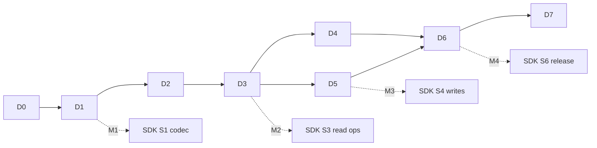

# PLAN_DAEMON.md: Daemon Implementation Plan (`arkivectord`, C11)

> **Who executes this:** the *daemon lead* agent, orchestrating the subagents named in each phase.
> **Read first:** [`AGENTS.md`](AGENTS.md) (rules), [`ARCHITECTURE.md`](ARCHITECTURE.md) (design), [`docs/api/`](docs/api/README.md) + [`spec/`](spec/) (contract you must satisfy), [`CODEBASE.md`](CODEBASE.md) (file map).
> **Parallel track:** the SDK track ([`PLAN_SDK.md`](PLAN_SDK.md)) builds clients at the same time, against the same contract. You integrate with it **only** through the contract and the milestones M1–M4.

---

## Decisions on open questions (2026-11-06, owner-approved: "take the best, most optimistic path")

| # | Question | Decision | Consequence for this plan |
| :---: | :--- | :--- | :--- |
| Q1 | On-chain format (VectorBytes v1 header, LE, pgvector layout) and attribute names `av.vec`/`av.id`/`av.doc` | **Frozen as specified** in `docs/api/vectors.md` and `collections.md §4` | No changes. Treat them as irreversible once data exists on Rabdi |
| Q2 | API response shapes (TypedValue attributes, error codes) | **Frozen as specified** in `spec/` | No changes |
| Q3 | Is pgvector's in-memory HNSW usable as a long-lived, concurrently searched, mmapped index? | **Assume yes, but prove it on day one.** The HNSW in-memory spike moves into **D0** (§4.4 step 7) | D0 copies the HNSW files early. D4 builds on the spike instead of starting cold. Fallback only if the spike fails: port the same algorithms (mode P) into our own structs, with the same API (`av_segment_search_hnsw`) |
| Q4 | HNSW above 2,000 dims | **Lift to 16,000** (`VECTOR_MAX_DIM`). Benchmark 3072-d in D4 | No changes (D4 already includes it) |
| Q5 | Unmeasured Arkiv facts (reorg depth, getLogs range, query length, WS, gas/byte) | **Use the documented defaults** (ARCHITECTURE §19 table) and develop entirely against `mock-arkiv` configured with those defaults. **Rabdi probes and the Rabdi soak run at the end (D6)** | D0 has no Rabdi work. `RABDI_FACTS.md` is filled in D6, and config defaults are adjusted then |
| Q6 | `halfvec` default vs gas cost | **Keep `halfvec`** as the default | No changes |
| Q7 | Open-collection discovery cost | **Keep curated (writer-scoped) collections as the default**. Discovery B/C stays in D5 | No changes |
| Q8 | Project licence | **Deferred** by the owner. Upstream notices (`LICENSE.pgvector`, `LICENSE.postgresql`) are still copied in D0 because they are required. No root `LICENSE` and no licence fields in package metadata until the owner decides | D6 release builds leave the licence placeholder |
| Q9 | Subagent backend model ids may not resolve | **Assume they work.** If `agy` rejects the model, run `agy models` and pick the closest Gemini flash/pro model. If `agy` is unavailable, fall back to `test-writer` (tests) / `code-reviewer` (review) | See AGENTS.md §5 fallback note |
| Q10 | GitHub owner handle | `@DikshitRJ` | Used in `.github/CODEOWNERS` (already written) |

---

## 0. How to execute a phase (the loop)

For **every** phase Dn:

```
 1. git switch main && git pull && git switch -c daemon/d<n>-<topic>
 2. Read the "Read first" list of the phase (use an `explorer` subagent for long research docs if needed).
 3. Store the phase brief in MemPalace (mempalace_task_create) → keep the task id for subagent prompts.
 4. Implement step by step. After each step:
      - build (cmake --build --preset dev), run unit tests (ctest --preset dev), and run the ASan preset for C changes
      - commit with the exact message listed in the phase "Commits" table (adjust only if the step changed)
      - for steps marked [VERIFY], spawn gemini-integration-tester in the background (AGENTS.md §5.2)
 5. When all steps are done: spawn gemini-reviewer on the branch diff (plus security-reviewer where listed).
 6. Fix verified findings → commit `fix(<scope>): address review findings for D<n>`.
 7. Spawn opencode-docs for every changed daemon file (AGENTS.md §5.2) → it commits `docs(daemon): generated docs for D<n>`.
 8. Wait for the background integration-test report. Fix real bugs it found; it commits its own test files.
 9. Open the PR (template), make CI green, merge. Tag a milestone if the phase completes one.
10. Tick the phase checkboxes in §11 (Status log) of this file and write the MemPalace phase summary.
```

Commit rules: Conventional Commits with the scopes listed in AGENTS.md §4. Commits for copied code state the upstream path, tag, and mode. Subagent-produced commits use their own scope (`test(daemon)`, `docs(daemon)`).

---

## 1. Daemon subagent roster

| Subagent | Spawn when | Runs | Writes |
| :--- | :--- | :--- | :--- |
| `opencode-docs` | End of every phase (step 7) | foreground | `docs/daemon/**` only |
| `gemini-integration-tester` | After every step marked [VERIFY] and at the phase end | **background** | `daemon/test/integration/**`, `daemon/test/parity/**`, `daemon/test/contract/**` |
| `gemini-reviewer` | End of every phase (step 5) | foreground | nothing (report) |
| `security-reviewer` | D1 (decoder + text parsers), D2 (RPC/JSON parsing, HTTP server), D5 (signer, tx, abi), D6 (auth, qdrant, mcp) | foreground | nothing (report) |
| `ci-cd-engineer` | D0 (workflows), D6 (release pipeline) | foreground | `.github/**` |
| `dependency-auditor` | D0 (initial vendoring), D6 (pre-release) | foreground | report; the lead updates `VENDORED.lock` |
| `performance-profiler` | D1 (kernel tiers), D4 (planner calibration, recall/latency) | foreground | report + `daemon/bench/` results |
| `backend-implementer` (isolation `worktree`) | Parallel lanes marked **[LANE]** | background | only the files named in the lane |
| `explorer` | Optional, to summarise long research docs | foreground | nothing |

The prompt templates are in AGENTS.md §5.2. Each phase below lists the **phase-specific** content to put into them.

---

## 2. Phase overview

| Phase | Title | Depends on | Milestone | Capabilities added | Arch. ref |
| :---: | :--- | :--- | :---: | :--- | :--- |
| **D0** | Foundations: build, CI, pgcompat skeleton, **HNSW in-memory spike**, mock-arkiv | — | — | — | §16, §17 P0 |
| **D1** | pgvector types, kernels, dispatch, VectorBytes, text I/O | D0 | **M1** | — | §5, §7, §11.3 |
| **D2** | Core runtime, Arkiv client, storage, sync, TTL, HTTP skeleton | D1 | — | (ops endpoints implemented) | §8, §9, §10 |
| **D3** | Filter engine, exact executor, REST read API, dev-up | D2 | **M2** | ops.*, collections.read/write/follow, entities.read, search.exact, search.filter.json/where, search.explain, scroll, count, consistency.min_block | §11, §13 |
| **D4** | pgvector HNSW arenas, segments, compaction, planner, iterative scan | D3 | — | search.hnsw, search.batch | §5.3, §8.2, §11.4–5 |
| **D5** | Write path: ABI/RLP/tx/signer, managed upsert, prepare, idempotency, discovery B/C | D3 (D4 optional) | **M3** | entities.write, entities.prepare, idempotency, collections.manifest | §12 |
| **D6** | Hardening & surface: auth, rate limit, Qdrant, MCP, verify, release builds, **Rabdi probes + soak** | D4, D5 | **M4** | auth.api_keys, qdrant, mcp, entities.verify | §15, §16, §19 |
| **D7** | Post-v1: BQ+rerank, vacuum repair, IVFFlat, lite mode, keep-alive, snapshots | D6 | — | (new capabilities via CCR) | §11.7, §17 P5 |

> Re-sequencing note vs ARCHITECTURE §17: the HTTP read API moves **before** HNSW (D3 before D4), so the SDK track can integrate against a real daemon early (M2). The search API is unchanged when HNSW lands. Only `plan.strategy` changes.



---

## 3. Internal interfaces (stable across lanes; change only with a note in the PR)

These headers are the seams between daemon modules, so parallel lanes can code against them. Implement them **exactly**. Additions are fine. Renames need a lead decision.

```c
/* core/arena.h */
typedef struct av_arena av_arena;
av_arena *av_arena_create(const char *name, size_t block_size, size_t hard_cap);  /* hard_cap 0 = unlimited */
void     *av_arena_alloc(av_arena *a, size_t n, size_t align);                    /* NULL when hard_cap hit */
void      av_arena_reset(av_arena *a);
void      av_arena_destroy(av_arena *a);

/* core/status: in log.h */
typedef enum { AV_OK = 0, AV_ERR = 1 } av_status;
typedef struct { char code[40]; char vb_error[32]; char field[128]; int position; uint64_t as_of_block; char msg[512]; } av_err;
void av_err_set(av_err *e, const char *code, const char *fmt, ...);   /* code ∈ spec/error-codes.json */

/* codec/vectorbytes.h  (M1) */
typedef enum { AV_VT_VECTOR = 1, AV_VT_HALFVEC = 2, AV_VT_BIT = 3, AV_VT_SPARSEVEC = 4 } av_vtype;
typedef struct { av_vtype type; uint8_t flags; int32_t dim; int32_t nnz; } av_vb_info;
/* Validate per docs/api/vectors.md §3.3; on failure returns AV_ERR, e->code="invalid_vector", e->vb_error="VB_*". */
av_status av_vb_validate(const uint8_t *buf, size_t len, av_vb_info *info, av_err *e);
/* Decode into a pgvector struct (Vector*/HalfVector*/VarBit*/SparseVector*) allocated from arena. */
av_status av_vb_decode(const uint8_t *buf, size_t len, av_arena *a, void **pgvec, av_vb_info *info, av_err *e);
/* Encode a pgvector struct; returns malloc'd or arena buffer. */
av_status av_vb_encode(const void *pgvec, av_vtype t, bool normalized, av_arena *a, uint8_t **out, size_t *len, av_err *e);

/* kernels/opclass.h */
typedef double (*av_dist_fn)(const void *a, const void *b);      /* pgvector struct pointers */
typedef struct {
  const char *name;            /* "halfvec_cosine_ops" */
  av_vtype    type;
  const char *op;              /* "<=>" */
  av_dist_fn  distance;        /* final distance as returned by the API (sqrt applied for l2) */
  av_dist_fn  index_distance;  /* distance used inside HNSW (e.g. l2 squared, negative ip) */
  bool        normalize;       /* cosine: l2-normalise at insert (pgvector HnswNormValue) */
} av_opclass;
const av_opclass *av_opclass_find(const char *name);
const av_opclass *av_opclass_for_operator(av_vtype t, const char *op);
const char       *av_kernel_tier(void);   /* "x86-64" | "x86-64-v3" | "x86-64-v4" | "aarch64" | "native" */

/* arkiv/entity.h */
typedef struct { char name[33]; uint8_t type; bool indexed; const uint8_t *val; size_t len; } av_attr;  /* raw canonical bytes */
typedef struct {
  uint8_t key[32]; uint8_t owner[20]; uint8_t creator[20];
  uint64_t created_at, updated_at, expires_at;
  av_attr *attrs; size_t n_attrs;               /* includes arkiv.schema, av.vec, av.id, av.doc */
} av_entity;

/* index/segment.h */
typedef uint32_t av_docid;
typedef enum { AV_SEG_FLAT = 1, AV_SEG_HNSW = 2 } av_seg_kind;
typedef struct av_segment av_segment;
av_status av_segment_insert(av_segment *s, av_docid id, const void *pgvec, av_err *e);   /* applier thread only */
size_t    av_segment_count(const av_segment *s);
typedef struct { av_docid id; double distance; } av_hit;
/* Exact scan over candidate bitmap (NULL = all live). Fills a max-heap of k. */
av_status av_segment_scan_exact(const av_segment *s, const void *query, const av_opclass *oc,
                                const roaring_bitmap_t *cand, size_t k, av_hit *out, size_t *n_out, av_err *e);
/* D4: approximate search with pgvector iterative scan and a recheck predicate. */
typedef bool (*av_recheck_fn)(av_docid id, void *ctx);
typedef struct { int ef_search; int iterative; /*0 off,1 relaxed,2 strict*/ int64_t max_scan_tuples; double mem_mult; } av_hnsw_params;
av_status av_segment_search_hnsw(const av_segment *s, const void *query, const av_opclass *oc, size_t k,
                                 const av_hnsw_params *p, av_recheck_fn recheck, void *ctx,
                                 av_hit *out, size_t *n_out, int64_t *scanned, av_err *e);

/* filter/ast.h + eval.h */
typedef struct av_filter av_filter;     /* opaque AST */
av_status av_filter_from_where(const char *s, size_t n, const av_attr_schema *sch, av_arena *a, av_filter **out, av_err *e);
av_status av_filter_from_json(yyjson_val *v, const av_attr_schema *sch, av_arena *a, av_filter **out, av_err *e);
av_status av_filter_eval(const av_filter *f, const av_attr_index *ix, uint64_t as_of_block, roaring_bitmap_t *out, av_err *e);

/* query/planner.h */
typedef enum { AV_PLAN_HNSW, AV_PLAN_EXACT, AV_PLAN_HNSW_ITER } av_plan_kind;
av_plan_kind av_plan_choose(size_t N, size_t F, size_t k, int m, int ef, bool has_filter, bool exact, const av_plan_cfg *cfg);

/* core/collection.h */
typedef struct av_collection av_collection;
uint64_t  av_collection_as_of(const av_collection *c);
void      av_collection_read_lock(av_collection *c);    /* shared publish lock (ARCHITECTURE §8.4) */
void      av_collection_read_unlock(av_collection *c);
av_status av_collection_wait_block(av_collection *c, uint64_t min_block, int timeout_ms, av_err *e);
```

---

## 4. Phase D0: Foundations

**Goal:** a building, CI-gated skeleton where verbatim pgvector files compile against `pgcompat`. A **spike** proves that pgvector's in-memory HNSW graph works as a long-lived, mmapped, concurrently searched index (decision Q3). Plus the mock Arkiv node that all later tests use. **No Rabdi access is needed in D0** (decision Q5).
**Branches:** `daemon/d0-build`, `daemon/d0-hnsw-spike`, `daemon/d0-mock-arkiv` (merge in this order, or use one branch).

### 4.1 Read first
- `ARCHITECTURE.md` §4 (stack), §5 (reuse strategy), §8.2 (arenas), §16 (build/hardening), §19 (open questions; use its default column)
- For the spike: `RESEARCH/pgvector/indexes/hnsw_build.md` (relptr, in-memory phase), `hnsw_insert.md`; `pgvector/src/hnsw.h`, `hnswutils.c:217–1600`, `hnswbuild.c:315–640`
- `RESEARCH/pgvector/architecture/build_system.md` (pgvector compiler flags, `-march=native`, CI matrix)
- `pgvector/Makefile` lines 14–40 (`OPTFLAGS`, `PG_CFLAGS += -ftree-vectorize -fassociative-math -fno-signed-zeros -fno-trapping-math -ffp-contract=fast`)
- `pgvector/src/halfvec.h` lines 17–60 (dispatch macros `USE_DISPATCH`, `USE_TARGET_CLONES`, `F16C_SUPPORT`)
- For mock-arkiv: `RESEARCH/arkiv-docs/02-json-rpc-protocol/arkiv_query.md`, `arkiv_getEntity.md`, `arkiv_getBlockTiming.md`, `error-handling.md`; `03-evm-mutations-and-contract-spec/events-and-logs.md` (topics, data layout); `04-query-engine-and-ast/query-language-grammar.md`, `operators-and-predicates.md`, `pagination-and-cursors.md`; `01-architecture-and-fundamentals/lifecycle-and-expiration.md`

### 4.2 Copy-paste

| From | To | Mode |
| :--- | :--- | :---: |
| `pgvector/LICENSE` | `daemon/src/pgvector/LICENSE.pgvector` | V |
| `pgvector/src/halfutils.c`, `halfutils.h` | `daemon/src/pgvector/` | **V (byte-identical)** |
| `pgvector/src/bitutils.c`, `bitutils.h` | `daemon/src/pgvector/` | **V** |
| `pgvector/src/halfvec.h`, `vector.h`, `bitvec.h`, `sparsevec.h` | `daemon/src/pgvector/` | **V** (needed by halfutils/bitutils includes) |
| PostgreSQL `COPYRIGHT` (pick the latest `REL_17_*` tag, record the tag + commit in PROVENANCE.md) | `daemon/src/pgcompat/LICENSE.postgresql` | V |
| PostgreSQL `src/include/port/pg_bitutils.h` (only the popcount/`pg_nextpower2_*` parts actually referenced) | `daemon/src/pgcompat/include/port/pg_bitutils.h` | S |
| **Spike:** every row of the D4 copy table (§8.2) **except** `hnswscan_mem.c`: `hnsw.h`, `hnswutils.c` (in-memory functions), `hnswbuild_mem.c` (in-memory insert functions), PostgreSQL `pg_list.h`/`list.c`, `pairingheap.{c,h}`, `simplehash.h`, `relptr.h`, `hashfn.h` subset, `pg_prng.{c,h}` | Final locations listed in §8.2 | S / V |
| **Spike:** `VectorL2SquaredDistance` + `vector_l2_squared_distance` (`src/vector.c:548–595`) | `src/pgvector/vector_kernels.c` (early part of the D1 copy) | F |

Fetch PostgreSQL files with a sparse checkout into the scratchpad (never into the repo):
`git clone --depth 1 --branch REL_17_<x> --filter=blob:none --sparse https://github.com/postgres/postgres <scratch>/pg && git -C <scratch>/pg sparse-checkout set src/include src/backend/lib src/backend/nodes src/common`

### 4.3 Files
`daemon/CMakeLists.txt`, `CMakePresets.json`, `cmake/{Warnings,Sanitizers,Vendored}.cmake`, `src/version.h`, `src/core/arena.{c,h}`, `src/pgcompat/include/{postgres.h,c.h,port.h,utils/elog.h,utils/memutils.h,port/pg_bitutils.h}`, `src/pgcompat/src/{palloc.c,elog.c}`, `src/pgcompat/STUBS.md`, `src/pgvector/PROVENANCE.md`, `third_party/{README.md,VENDORED.lock}`, `test/CMakeLists.txt`, `test/unit/{test_main.c,test_pgcompat.c,test_kernels.c}` (kernel part: halfutils/bitutils only), **spike:** `src/pgvector/{hnsw.h,hnswutils.c,hnswbuild_mem.c,vector_kernels.c}` (partial), `src/pgcompat/include/{fmgr.h,varatt.h,nodes/pg_list.h,lib/pairingheap.h,lib/simplehash.h,utils/relptr.h,storage/{lwlock,spin,itemptr}.h,port/atomics.h,common/{hashfn,pg_prng}.h,miscadmin.h}`, `src/pgcompat/src/{fmgr.c,lwlock.c,list.c,pairingheap.c,pg_prng.c}`, `test/unit/test_hnsw.c` (spike part), `testkit/mock-arkiv/*`, root `.editorconfig`, `.clang-format`, `.gitignore` additions, `.github/workflows/{daemon.yml,contract.yml}`, `.github/PULL_REQUEST_TEMPLATE.md`. (`.github/CODEOWNERS` is already written. `tools/rabdi-probe.py` and `RABDI_FACTS.md` move to D6.)

### 4.4 Steps

1. **Build skeleton.**
   - `CMakeLists.txt`: project `arkivector C`, `CMAKE_C_STANDARD 11`. Targets: `av_pgvector` (static, upstream flags), `av_pgcompat` (static), `av_core` (static, our code, strict warnings), `arkivectord` (exe, placeholder `main` until D2), `av_unit` (tests).
   - `cmake/Warnings.cmake`: function `av_strict(target)` → `-Wall -Wextra -Wpedantic -Wconversion -Wshadow -Werror`. Function `av_upstream(target)` → pgvector flags `-ftree-vectorize -fassociative-math -fno-signed-zeros -fno-trapping-math -ffp-contract=fast` and **no** `-Werror`.
   - `cmake/Sanitizers.cmake`: options `AV_ASAN`, `AV_UBSAN`, `AV_TSAN`, `AV_FUZZ` (`-fsanitize=fuzzer-no-link` on libs).
   - `CMakePresets.json`: `dev` (Debug, `-march=native` OFF, binaryDir `build/dev`), `asan`, `ubsan`, `tsan`, `fuzz` (clang), `release-static` (placeholder, completed in D6). Test presets matching each.
2. **Vendoring** (`cmake/Vendored.cmake`, `third_party/`): add, pinned with sha256 in `VENDORED.lock`:
   - `yyjson` (single .c/.h), CRoaring amalgamation (`roaring.c/.h`), `llhttp` (release tarball's generated C), LMDB (`mdb.c`, `midl.c` from `openldap/libraries/liblmdb`), `tomlc99`, `greatest.h` (unit test framework), `libsecp256k1` (git tag, built with `-DSECP256K1_ENABLE_MODULE_RECOVERY=ON`), tiny Keccak (`tiny_sha3` sha3.c/h).
   - **System packages in dev** (found with `pkg_check_modules`): `libuv`, `libcurl` (≥ 8.11 for WebSocket). Fail configure with a clear message if missing.
   - [LANE] Can be done by `backend-implementer` in a worktree with the prompt: *"Vendor these libraries into daemon/third_party exactly as listed in PLAN_DAEMON.md §4.4 step 2, with CMake targets av3p_<name>, and fill VENDORED.lock (name, version, url, sha256, licence)."*
3. **pgcompat skeleton (enough for halfutils/bitutils).**
   - `include/postgres.h` includes `c.h` and `utils/elog.h`, `utils/memutils.h`, `fmgr.h` (empty stub for now).
   - `include/c.h`: `int8..int64`, `uint8..uint64`, `Size`, `Datum` (`uintptr_t`), `Pointer`, `bool`, `PGDLLEXPORT`, `pg_attribute_always_inline`, `pg_attribute_unused`, `likely/unlikely`, `MAXALIGN`, `TYPEALIGN`, `FLEXIBLE_ARRAY_MEMBER`, `Assert` (→ `assert` in debug), `StaticAssertDecl`, `HAVE__BUILTIN_POPCOUNT`, `HAVE_LONG_INT_64`, `SIZEOF_LONG`, `HAVE__GET_CPUID` (cmake `check_include_file(cpuid.h)`), `HAVE_XSAVE_INTRINSICS` as needed.
   - `src/palloc.c`: `palloc/palloc0/repalloc/pfree/palloc_array/palloc_object/palloc_array_checked`, `MemoryContext` = `av_arena*` held in thread-local `CurrentMemoryContext`, `MemoryContextSwitchTo/Create/Reset/Delete`, `AllocSetContextCreate` macro compatibility.
   - `src/elog.c`: `ereport/elog/errmsg/errcode/errdetail/errhint` macros mapped onto `av_pg_error(level, fmt, …)`. ERROR level → `siglongjmp` to the innermost `PG_TRY` frame (thread-local stack). `PG_TRY/PG_CATCH/PG_END_TRY` macros. Lock-release-on-unwind hook (`av_pg_on_error_release_locks`, wired in D4).
   - Record every stub in `STUBS.md` (`header | why | symbols it provides | phase`).
4. **Copy halfutils/bitutils verbatim** (§4.2) and make `av_pgvector` compile them **without edits**. Fix compile errors only by adding to `pgcompat`.
5. **Unit test harness**: `test/unit/test_main.c` (greatest `GREATEST_MAIN_DEFS`). `test_pgcompat.c` covers palloc in contexts, reset frees everything, nested PG_TRY catches ereport(ERROR), and an elog WARNING doesn't jump. `test_kernels.c` (D0 part): `HalfToFloat4/Float4ToHalf` round-trip for all 65536 half bit patterns (NaN payload excluded), and `BitHammingDistance` vs scalar popcount on random buffers. Register in ctest.
6. **mock-arkiv v0** (Python 3.11, `aiohttp`). [LANE] It is fully parallel to steps 3–5. Give it to `backend-implementer` (worktree) with this spec:
   - `state.py`: blocks (number, hash = sha256(prev‖n‖salt), parent hash, timestamp = genesis + 2n), entities `{key, owner, creator, created_at, updated_at, expires_at, flags, attrs[(name,type,indexed,value)]}`, an event log per block, history snapshots for reorg.
   - `server.py` JSON-RPC (HTTP POST `/` and `/<accessKey>`): `arkiv_query`, `arkiv_getEntity`, `arkiv_getBlockTiming`, `eth_blockNumber`, `eth_chainId` (`0x76edaf`), `eth_getBlockByNumber` (hash, parentHash, number, transactions when full=true), `eth_getLogs` (address + topics filtering, block-range cap configurable, error `-32005` beyond it), `eth_getTransactionByHash` (calldata for D5 discovery B), `eth_sendRawTransaction` (D5: decode the tx, apply ops, real Arkiv semantics), `eth_estimateGas`, `eth_getTransactionCount`, `eth_call` (`entityNonce`), `eth_getTransactionReceipt`. WebSocket `/` + `eth_subscribe(newHeads|logs)`.
   - `query_lang.py`: **full** Arkiv predicate grammar (research doc 04): typed literals, `= != < <= > >= BETWEEN STARTSWITH EXISTS TYPEOF AND OR NOT ()`, comments, system fields `$key $owner $creator $expiresAt`, `ORDER BY attr:type ASC|DESC` / `$key`, limit 1..100 (`-32602` otherwise), offset, `select` projection (`key owner creator createdAt updatedAt expiresAt creationFlags attributes(true|subset) attributeSchema count`), length limit → `-32004`. Missing-attribute sort rules as documented. Liveness: `expiresAt > current block`.
   - `logs.py`: the 5 events with topics/data exactly as in `events-and-logs.md` §3 (topic0 constants), one log per op in op order.
   - Control API `/_mock/*` (JSON): `POST entities` (create with optional preset key/owner/creator/expires, attributes typed), `PATCH entities/{key}`, `DELETE entities/{key}`, `POST entities/{key}/extend`, `POST entities/{key}/transfer`, `POST mine {n}` (advance n blocks), `POST auto_mine {interval_ms}`, `POST reorg {depth, replacement_ops}`, `POST faults {drop_ws_ratio, http_429_ratio, latency_ms, fail_methods}`, `GET state`, `POST reset`.
   - It must be deterministic given `--seed`.
   - `README.md` documents the control API. `requirements.txt` pins `aiohttp==3.10.10`.
7. **HNSW in-memory spike** (decision Q3; branch `daemon/d0-hnsw-spike`). Goal: prove, before D1–D3 build on the design, that pgvector's in-memory graph code works unchanged as our index.
   1. Copy the spike rows of §4.2 (the same files and deltas that D4 §8.2 specifies, so nothing is thrown away later). Mark every delta `/* ARKIVECTOR: … */` and list it in `PROVENANCE.md`.
   2. Write the shims the spike needs, in their final form: `lwlock.c` (4-byte atomic RW lock, per-thread held-lock stack, thread-local read-only flag that turns acquire/release into no-ops), `spin.h` (`atomic_flag`), `itemptr.h` (`ItemPointerData` ↔ `uint32` docid), `fmgr.h/.c` (minimal: `FmgrInfo`, `FunctionCall2Coll`, `PG_FUNCTION_ARGS`, `PG_GETARG_POINTER`, `PG_RETURN_FLOAT8`; D1 completes it), `varatt.h`, `miscadmin.h` (`CHECK_FOR_INTERRUPTS` no-op for now), and the verbatim PostgreSQL `list.c`, `pairingheap.c`, `simplehash.h`, `relptr.h`, `pg_prng.c`.
   3. Spike harness in `test/unit/test_hnsw.c` (spike part), using `vector` type + `vector_l2_ops` only:
      - allocate a 256 MiB arena with `mmap(MAP_ANONYMOUS)`, set it as `base`, `InitGraph`/`InitAllocator` on it;
      - insert 10,000 random 128-d vectors through an `av_hnsw_insert` prototype (the `InsertTuple` steps of §8.2, returning "seal needed" at the memory limit);
      - search 200 random queries with `HnswSearchLayer` (index = NULL): **recall@10 ≥ 0.95** vs brute force;
      - `memcpy` the arena into a file, `mmap(PROT_READ)` the file at a **different address**, set the read-only lock flag, and repeat the searches: **identical results** (proves relptr position independence and read-only safety);
      - 4 inserter threads + 4 searcher threads on a fresh arena for 10 s: no crash, recall still ≥ 0.95, and **TSan clean** (`tsan` preset);
      - force the memory limit: insert returns "seal needed" at pgvector's `memoryUsed >= memoryTotal` point.
   4. Record the results (recall, insert/search ns, element size in bytes, TSan result) in the PR description and in `PROVENANCE.md` under "Spike results".
   5. **If any check fails and can't be fixed with shim changes alone:** stop and report to the owner with a proposal for the fallback (port the algorithms into our own structs, mode P, same `av_segment_*` API). Do not silently patch pgvector logic.
8. **CI + repo hygiene** (`ci-cd-engineer`): `.github/workflows/daemon.yml` on `push: branches: ['**']` and `pull_request: branches: ['**']`, `paths: daemon/**, spec/**, .github/workflows/daemon.yml`.
   - job `quality` (Phase 1): apt install libuv1-dev libcurl4-openssl-dev clang clang-tidy cppcheck; cmake dev with gcc and clang; build; clang-format `--dry-run --Werror` on our files (exclude `src/pgvector`, the verbatim `src/pgcompat` files, `third_party`); clang-tidy (our files); cppcheck.
   - job `integration` (Phase 2, `needs: quality`): asan preset build + ctest. pytest `daemon/test/integration` (skips cleanly while empty). Later phases add the contract and parity steps.
   - `.github/workflows/contract.yml`: `spec/tools/validate.sh` on every push/PR.
   - `.github/PULL_REQUEST_TEMPLATE.md`: phase, checklist (plan steps, CI, reviewer report, docs generated, integration tests, contract impact / CCR id).
   - `.github/CODEOWNERS`: already written (owner `@DikshitRJ`). Only extend it if new top-level paths appear.
   - `.editorconfig`, `.clang-format` (based on LLVM, 4-space indent, 110 columns), `.gitignore` (+ `daemon/build/`, `sdk/*/build/`, `sdk/rust/target/`, `node_modules/`, `dist/`, `.venv/`, `__pycache__/`).
9. **OpenSpec**: `openspec init` (non-interactive flags if available), then add `openspec/changes/daemon-d0-foundations/` (proposal.md, tasks.md) describing D0.

### 4.5 Subagents
- [VERIFY after step 6] `gemini-integration-tester`, background. *Scenarios:* mock-arkiv conformance to the research docs: limit > 100 → `-32602`, key-cursor pagination returns all entities exactly once, `$expiresAt` liveness hides expired entities at the right block, `ORDER BY` missing-attribute placement, log topics for each of the 5 ops, reorg replaces blocks and changes hashes, faults inject 429s. Location: `daemon/test/integration/test_mock_arkiv.py` (add the file).
- After step 2: `dependency-auditor` checks licences (no GPL/LGPL) and known CVEs for the vendored versions.
- Step 8: `ci-cd-engineer` writes the workflows.
- After step 7: `gemini-reviewer` on the spike diff (focus: copied HNSW code unchanged except marked deltas; lwlock semantics vs PostgreSQL LWLock; read-only flag never lets a sealed map be written; relptr base handling; TSan report). If the spike needs a fallback decision, the lead asks the owner before continuing.
- Phase end: `gemini-reviewer` (focus: build flags isolation between our code and upstream code; pgcompat correctness of palloc/PG_TRY semantics; mock-arkiv fidelity to the Arkiv docs). `opencode-docs` covers the CMake files, pgcompat files, core/arena, copied HNSW files (short docs), mock-arkiv, tools.

### 4.6 Commits
| # | Message |
| :---: | :--- |
| 1 | `build(daemon): cmake skeleton, presets, warning and sanitizer modules` |
| 2 | `build(daemon): vendor yyjson, croaring, llhttp, lmdb, tomlc99, greatest, secp256k1, tiny-keccak` |
| 3 | `feat(core): bump arena allocator` |
| 4 | `feat(pgcompat): postgres.h/c.h types, palloc on arenas, ereport/PG_TRY via sigsetjmp` |
| 5 | `feat(pgvector): vendor halfutils, bitutils and type headers from pgvector v0.8.7 (verbatim)` |
| 6 | `test(daemon): unit harness, pgcompat and half/bit kernel tests` |
| 7 | `feat(testkit): mock-arkiv v0 with full query language, logs, ws, control api` |
| 8a | `feat(pgcompat): lwlock, spinlock, itemptr, minimal fmgr shims and PostgreSQL list, pairingheap, simplehash, relptr, pg_prng (verbatim)` |
| 8b | `feat(pgvector): copy hnsw.h, in-memory hnswutils and hnswbuild insertion from pgvector v0.8.7 (copy+shim)` |
| 8c | `test(daemon): hnsw in-memory spike: recall, mmap relocation, concurrency, seal point` |
| 9 | `ci: daemon two-phase workflow, contract validation, PR template, codeowners` |
| 10 | `chore: openspec init and d0 change proposal` |
| — | `test(daemon): mock-arkiv conformance tests` (gemini) · `docs(daemon): generated docs for D0` (opencode) |

### 4.7 Exit criteria
- [ ] `cmake --preset dev && cmake --build --preset dev && ctest --preset dev` green with gcc and clang. ASan preset green.
- [ ] `halfutils.c`, `bitutils.c` and the 4 type headers are byte-identical to `pgvector/src/` (CI check: `cmp`).
- [ ] mock-arkiv passes its conformance tests. CI `daemon.yml` and `contract.yml` green on the PR.
- [ ] HNSW spike: recall@10 ≥ 0.95, identical results after mmap relocation, TSan clean with concurrent insert + search, seal point detected. Or the owner approved the fallback.

---

## 5. Phase D1: pgvector types, kernels, dispatch, VectorBytes (→ M1)

**Goal:** every pgvector distance and type function needed by Arkivector is compiled from copied code and dispatched by CPU tier. VectorBytes passes the golden file. A parity suite proves equality with real pgvector.
**Branch:** `daemon/d1-kernels`.

### 5.1 Read first
- `ARCHITECTURE.md` §5.1–5.4, §7, §11.3, §16.1
- `docs/api/vectors.md` (normative VectorBytes spec), `spec/golden/vectorbytes.json`, `spec/error-codes.json` (`vectorbytes_check_order`)
- `RESEARCH/pgvector/core/vector_type.md` (struct layout, target_clones dispatch), `core/halfvec_type.md` (F16C, asymmetric precision), `core/bitvec_type.md`, `core/sparsevec_type.md`
- `RESEARCH/pgvector/sql-layer/operators.md` (operator ↔ function ↔ opclass mapping)
- `pgvector/sql/vector.sql`: search for `CREATE OPERATOR CLASS` to get the authoritative opclass → function mapping for the opclass registry

### 5.2 Copy-paste (pgvector v0.8.7 line numbers; re-grep if they drift)

| Upstream function(s) | Upstream location | Destination | Mode |
| :--- | :--- | :--- | :---: |
| `CheckDims`, `CheckExpectedDim`, `CheckDim`, `CheckElement`, `InitVector` | `src/vector.c:71–140` | `src/pgvector/vector_io.c` (static, shared by io + kernels via `vector_common.h` if needed) | F |
| `vector_in`, `vector_out` | `src/vector.c:178–340` | `src/pgvector/vector_io.c` | F |
| `VectorL2SquaredDistance`, `VectorInnerProduct`, `VectorCosineSimilarity`, `VectorL1Distance` + `VECTOR_TARGET_CLONES` macro | `src/vector.c:42–46, 548–560, 595–605, 637–660, 713–728` | `src/pgvector/vector_kernels.c` | F |
| `l2_distance`, `vector_l2_squared_distance`, `inner_product`, `vector_negative_inner_product`, `cosine_distance`, `l1_distance` (SQL wrappers) | `src/vector.c:569–740` | `src/pgvector/vector_kernels.c` (compile against the fmgr shim) | F |
| `l2_normalize`, `binary_quantize`, `subvector`, `halfvec_to_vector` | `src/vector.c:531, 775, 942, 973` | `src/pgvector/vector_funcs.c` | F |
| `CheckDims…InitHalfVector`, `halfvec_in`, `halfvec_out` | `src/halfvec.c:75–340` | `src/pgvector/halfvec_io.c` | F |
| `halfvec_l2_distance`, `halfvec_l2_squared_distance`, `halfvec_inner_product`, `halfvec_negative_inner_product`, `halfvec_cosine_distance`, `halfvec_l1_distance`, `halfvec_l2_norm` | `src/halfvec.c:562–725` | `src/pgvector/halfvec_kernels.c` | F |
| `vector_to_halfvec`, `halfvec_l2_normalize`, `halfvec_binary_quantize`, `halfvec_subvector` | `src/halfvec.c:540, 727, 914, 945` | `src/pgvector/vector_funcs.c` | F |
| `CheckDims…InitSparseVector`, `sparsevec_in`, `sparsevec_out` | `src/sparsevec.c:47–500` | `src/pgvector/sparsevec_io.c` | F |
| `SparsevecL2SquaredDistance`, `SparsevecInnerProduct`, `sparsevec_l2_distance`, `sparsevec_l2_squared_distance`, `sparsevec_inner_product`, `sparsevec_negative_inner_product`, `sparsevec_cosine_distance`, `sparsevec_l1_distance`, `sparsevec_l2_norm`, `sparsevec_l2_normalize` | `src/sparsevec.c:826–1120` | `src/pgvector/sparsevec_kernels.c` | F |
| `CheckDims`, `hamming_distance`, `jaccard_distance` | `src/bitvec.c:34–80` | `src/pgvector/bitvec_kernels.c` | F |
| PostgreSQL `src/common/f2s.c` + `src/include/common/shortest_dec.h` (+ `ryu_common.h`, `digit_table.h`) | PostgreSQL `REL_17_*` | `src/pgcompat/src/f2s.c`, `include/common/` | V |
| PostgreSQL `src/include/utils/varbit.h` (struct + macros only) | PostgreSQL | `src/pgcompat/include/utils/varbit.h` | S |
| PostgreSQL `src/common/stringinfo.c` + header (subset: `initStringInfo`, `appendStringInfo*`) | PostgreSQL | `src/pgcompat/src/stringinfo.c`, `include/lib/stringinfo.h` | S |

**Do not copy:** `*_recv`, `*_send`, `array_to_*`, `*_typmod_in`, aggregates (`vector_accum`, `vector_avg`), arithmetic operators, btree support. They aren't needed and they pull in `ArrayType`/`pqformat`.

### 5.3 Files
`src/pgvector/{vector_kernels,halfvec_kernels,sparsevec_kernels,bitvec_kernels,vector_io,halfvec_io,sparsevec_io,vector_funcs}.c`, `src/pgcompat/include/{fmgr.h,varatt.h,utils/varbit.h,utils/float.h,common/shortest_dec.h,lib/stringinfo.h}`, `src/pgcompat/src/{fmgr.c,stringinfo.c,f2s.c}`, `src/kernels/{dispatch,opclass}.{c,h}`, `src/codec/{vectorbytes,hex,base64}.{c,h}`, `cmake/KernelTiers.cmake`, `tools/pgvector-sync.sh`, `test/unit/{test_kernels,test_vectorbytes,test_text_io}.c`, `test/fuzz/{fuzz_vectorbytes,fuzz_vector_in}.c`, `test/parity/*`, `src/pgvector/PROVENANCE.md` (update).

### 5.4 Steps
1. **fmgr shim** (`fmgr.h/.c`; D0's spike created a minimal version, so complete it here): `PG_FUNCTION_ARGS` = `FunctionCallInfo fcinfo`, a struct with `nargs` and `Datum args[4]`. Macros `PG_GETARG_POINTER(n)`, `PG_GETARG_DATUM`, `PG_GETARG_INT32`, `PG_GETARG_VECTOR_P` (from vector.h), `PG_RETURN_FLOAT8/POINTER/DATUM`, `DirectFunctionCall1/2/3`, `FunctionCall2Coll(FmgrInfo*, Oid, Datum, Datum)`, `FmgrInfo { PGFunction fn_addr; }`, `PG_FUNCTION_INFO_V1(name)` → nothing, `Float8GetDatum/DatumGetFloat8` via a union (64-bit by-value). `varatt.h`: `VARSIZE`, `SET_VARSIZE`, `VARSIZE_ANY`, `VARHDRSZ` (4), `PG_DETOAST_DATUM` → identity.
2. **Function-level copies** per §5.2, **unmodified function bodies**. Keep upstream comments. Head each new file with a provenance comment block: `/* Copied from pgvector v0.8.7 src/vector.c (functions: …). Mode F. Do not edit; see PROVENANCE.md. */`.
3. **Kernel tiers** (`cmake/KernelTiers.cmake`): on x86-64, compile `vector_kernels.c`, `halfvec_kernels.c`, `sparsevec_kernels.c` three times with `-march=x86-64`, `-march=x86-64-v3`, `-march=x86-64-v4` and `-DAV_TIER_SUFFIX=_t0|_t3|_t4`. Use a small header `src/pgvector/av_tier.h` (ARKIVECTOR-owned) that renames exported symbols with `AV_TIER_SUFFIX`, so the copied files stay unmodified (the include goes through the compile command line `-include av_tier.h`). `halfutils.c`/`bitutils.c` compile once (they dispatch internally). On aarch64, compile once. With `-DAV_NATIVE=ON`, compile once with `-march=native` (pgvector default).
4. **Dispatch** (`kernels/dispatch.c`): at startup, detect the tier by **reusing pgvector's detection code**. Copy `SupportsCpuFeature`-style code from `halfutils.c:250–290` and `bitutils.c:170–200` (the CPUID leaf 1/7 + `_xgetbv(0) & 6`/`0xe6` checks) into `dispatch.c`. Comment the provenance. Fill a function table `av_kernels` (`l2sq`, `ip`, `cos`, `l1` per type). `av_kernel_tier()` returns the name.
5. **Opclass registry** (`kernels/opclass.c`): 14 opclasses per `spec/openapi.yaml#/components/schemas/Opclass`, with `distance` (API-facing) and `index_distance` (HNSW-facing) exactly as pgvector's opclass support functions (`pgvector/sql/vector.sql`). `normalize=true` for the `*_cosine_ops` opclasses. Operator ↔ opclass lookup.
6. **VectorBytes codec** (`codec/vectorbytes.c`): implement `av_vb_validate/decode/encode` exactly per `docs/api/vectors.md §3`. Decode = validate → `av_arena_alloc` with 8-byte alignment → `memcpy` → `SET_VARSIZE`. Encode = write the header bytes, then copy bytes 4..len from the pgvector struct. Also `hex.c` (lowercase, `0x` optional on input) and `base64.c` (RFC 4648 with padding, strict decode).
7. **Text I/O wrapper**: `av_text_to_pgvec(av_vtype, const char*, int32 typmod_dim, av_arena*, void**, av_err*)` calls the copied `*_in` inside `PG_TRY` and converts `ereport` messages to `invalid_vector` with pgvector's message text. It is used by the API in D3 for the string form of `vector`.
8. **Unit tests**:
   - `test_vectorbytes.c`: load `spec/golden/vectorbytes.json` (path from `AV_REPO_ROOT` compile definition) with yyjson, then **every case**: encode equals hex, decode equals values, invalid cases give exactly `error`.
   - `test_kernels.c`: for each opclass and tier available on the host, compare against a scalar double-precision reference: relative error ≤ 1e-5 (vector), ≤ 2e-3 vs the f64 reference on half-rounded inputs (halfvec), exact (bit). Dims {1, 3, 8, 15, 16, 17, 31, 32, 33, 1536, 3072, 16000}.
   - `test_text_io.c`: port the input cases and expected outputs/errors from `pgvector/test/sql/{vector_type,halfvec,sparsevec,bit}.sql` + `test/expected/*.out` (only `::vector`/`::halfvec`/`::sparsevec` literal casts and distance function calls) into a table-driven test.
9. **Fuzz targets**: `fuzz_vectorbytes.c` (random bytes → validate/decode must never crash, and decode→encode must round-trip for accepted inputs), `fuzz_vector_in.c` (random strings → `av_text_to_pgvec` for the 4 types).
10. **Parity suite** (`test/parity/`): `docker-compose.yml` with `pgvector/pgvector:0.8.0-pg17` or newer **0.8.x matching our tag** (prefer an image built from tag v0.8.7 if no published image matches; then the compose file builds from `pgvector/Dockerfile`). A small C test helper `av_parity_cli` (built in tests) reads JSON lines `{op, type, a, b}` and prints distances. `test_distances.py` generates 10k random pairs per (type, operator) with seeded RNG, runs them in PostgreSQL (`SELECT a <op> b`) and through `av_parity_cli`, and asserts equality (same build flags → bit-identical for vector, else ≤ 1e-6 relative). `test_text_io.py` checks text round-trip and error messages. [VERIFY]
11. **`tools/pgvector-sync.sh`**: `pgvector-sync.sh <new_tag>` → for each file in `PROVENANCE.md`, `git diff v0.8.7 <new_tag> -- <upstream path>` (from a scratch clone of pgvector), then apply to the vendored copy with `git apply --3way`. Print conflicts. Then the lead runs the parity suite.
12. **PROVENANCE.md**: one row per vendored file: upstream path, tag, commit, mode, functions taken, `ARKIVECTOR:` deltas (expected: none in D1).

### 5.5 Subagents
- [VERIFY after step 10] `gemini-integration-tester`, background. *Scenarios:* run the parity suite with Docker, all 6 operators × applicable types, edge dims (1, 16000), NaN/Inf rejection parity, text format parity including sparse 1-based indices and error messages. Location `daemon/test/parity/`.
- `security-reviewer` on `codec/vectorbytes.c`, `codec/base64.c`, `codec/hex.c`, `vector_io.c` wrappers (bounds, integer overflow in `8 + 4·dim`, alignment).
- `performance-profiler`: micro-benchmark `l2sq/ip/cos` for vector/halfvec at 1536 and 3072 dims per tier. Report ns/op and confirm the ≤ 150 ns target for 1536-d halfvec on the v3 tier. Save the script to `daemon/bench/kernels_bench.c` (add to the bench target).
- Phase end: `gemini-reviewer` (focus: copied functions byte-identical to upstream bodies; tier symbol renaming correctness; codec validation order equals spec; no UB in decode). `opencode-docs` (short docs for copied files; full docs for kernels/, codec/).

### 5.6 Commits
| # | Message |
| :---: | :--- |
| 1 | `feat(pgcompat): fmgr, varatt, varbit, stringinfo shims and PostgreSQL f2s (verbatim)` |
| 2 | `feat(pgvector): copy vector/halfvec/sparsevec/bit kernels and I/O from pgvector v0.8.7 (function-level)` |
| 3 | `feat(pgvector): copy l2_normalize, binary_quantize, subvector and casts from pgvector v0.8.7` |
| 4 | `build(daemon): multi-tier kernel compilation for x86-64 baseline/v3/v4` |
| 5 | `feat(kernels): runtime tier dispatch using pgvector cpuid/xgetbv checks` |
| 6 | `feat(kernels): opclass registry for all 14 pgvector opclasses` |
| 7 | `feat(codec): VectorBytes v1 encode/decode/validate, hex and base64` |
| 8 | `test(daemon): golden VectorBytes, kernel reference and pgvector text-io unit tests` |
| 9 | `test(daemon): libFuzzer targets for VectorBytes and vector text input` |
| 10 | `test(daemon): pgvector parity harness and cli` |
| 11 | `build(daemon): pgvector-sync tool and provenance table` |
| — | `test(daemon): pgvector parity suite` (gemini) · `perf(daemon): kernel micro-benchmarks` · `docs(daemon): generated docs for D1` |

### 5.7 Exit criteria → **Milestone M1**
- [ ] `test_vectorbytes` passes all 29 golden cases.
- [ ] Parity suite green against real pgvector.
- [ ] Kernel tests green on every tier the CI host supports. `av_kernel_tier()` is correct.
- [ ] Fuzzers run 10 min each in CI (fuzz job, nightly) without findings.
- [ ] Tag `milestone/M1-daemon`. Post in the PR: "M1 reached: VectorBytes golden passes in daemon".

---

## 6. Phase D2: Core runtime, Arkiv client, storage, sync, TTL, HTTP skeleton

**Goal:** `arkivectord` runs, follows a collection on mock-arkiv, mirrors entities and attributes into LMDB + flat segments exactly (bootstrap, live, TTL, reorg, reconcile, restart), and serves the ops endpoints.
**Branch:** `daemon/d2-sync` (lanes may use their own branches merged into it).

### 6.1 Read first
- `ARCHITECTURE.md` §2 insights 3–5, §3 threading model, §8 (storage), §9 (sync, all subsections), §10 (TTL)
- `RESEARCH/arkiv-docs/02-json-rpc-protocol/*` (all), `03-evm-mutations-and-contract-spec/events-and-logs.md`, `entity-key-derivation.md`, `04-query-engine-and-ast/pagination-and-cursors.md`, `schema-filtering-tag.md`, `01-architecture-and-fundamentals/lifecycle-and-expiration.md`, `06-reference-and-benchmarks/limits-and-quotas.md`
- ARCHITECTURE §19 "Default assumption" column (decision Q5). Configure mock-arkiv with these defaults (`--max-log-range 2000`, reorgs ≤ 10, WS enabled). Real Rabdi values arrive in D6
- libuv docs (`uv_poll`, `uv_async`, `uv_timer`), libcurl "multi_socket" + `curl_ws_*` docs (use the context7 MCP for current API), LMDB docs (single writer, `MDB_NOTLS`)

### 6.2 Copy-paste
None from pgvector. From libcurl docs: the canonical "multi-uv" example (`docs/examples/multi-uv.c`, curl licence) as the base of `curl_uv.c`. Keep the curl copyright header.

### 6.3 Files
`src/main.c`, `src/config.{c,h}`, `src/log.{c,h}`, `src/core/{threadpool,mpsc,collection,registry}.{c,h}`, `src/arkiv/{curl_uv,rpc,ws,budget,query_builder,entity,logs,keccak}.{c,h}`, `src/store/{schema.h,lmdb_store,arena_file,checkpoint}.{c,h}`, `src/index/{docid,live,attr_index,segment}.{c,h}`, `src/sync/{syncer,bootstrap,discovery,apply,ttl,reorg,reconcile}.{c,h}`, `src/server/{http,router,json_io,problem,metrics}.{c,h}`, `src/server/{rest.h,rest_ops.c}`, `arkivector.example.toml`, `test/unit/{test_keccak,test_ttl,test_apply}.c`, `test/fuzz/{fuzz_http,fuzz_rpc_response}.c`.

### 6.4 Steps

**Lane A: runtime & HTTP (lead)**
1. `log.c` (levels, module tags, JSON or text, redaction of `X-API-KEY`/`Authorization`/keys). `config.c`: TOML via tomlc99 plus env overrides `ARKIVECTOR_<SECTION>_<KEY>`. Defaults per ARCHITECTURE §16.3. `[[collections]]` entries are loaded into the registry at start.
2. `core/threadpool.c` (fixed pthread pool, task queue). `core/mpsc.c` (Vyukov MPSC + `uv_async_send` wakeup).
3. `server/http.c`: libuv TCP server, llhttp parser per connection, keep-alive, 32 MiB body cap (`413`), header size cap, slow-loris timeout (30 s), request id (ULID) generation. Dispatch to `router.c` (exact + `{param}` segments + colon verbs like `collections:follow`). Handlers run on query workers. Responses are marshalled back to the loop via mpsc. `problem.c` maps `av_err` → RFC 9457 using `spec/error-codes.json` (embed the table at build time via a CMake-generated header from the JSON).
4. `rest_ops.c`: `/healthz`, `/readyz`, `/v1/version` (capabilities list compiled in, initially empty plus ops), `/v1/sync`, `/metrics` (`metrics.c`: counters/gauges/histograms, text exposition). Debug-only routes behind `--debug-routes`: `GET /_debug/collections/{name}/keys` (sorted live keys + updated_at + expires_at), `GET /_debug/collections/{name}/entities/{key}` (raw mirrored attributes). The integration tests use these until D3.
5. `main.c`: args `--config`, `--data-dir`, `--debug-routes`, `--resync`, `--version`, `--licenses`. Startup order: config → log → kernels dispatch → store open → registry load → sync start → HTTP listen. Shutdown on SIGTERM/SIGINT: stop accepting, drain, stop sync at a block boundary, close LMDB.

**Lane B: Arkiv client** [LANE: `backend-implementer`, worktree, files `src/arkiv/{curl_uv,rpc,ws,budget,query_builder,entity,logs,keccak}.*`, `test/unit/test_keccak.c`, `test/fuzz/fuzz_rpc_response.c`]
6. `curl_uv.c`: libcurl multi ↔ libuv socket/timer callbacks.
7. `rpc.c`: async JSON-RPC calls with callbacks. Access key via the `X-API-KEY` header. Per-endpoint health and failover. Retries per ARCHITECTURE §9.9: never retry `-32003/-32004/-32602`. Retry transport/429/5xx with jittered backoff. Typed helpers: `av_rpc_query(query, select_json, limit, cb)`, `av_rpc_get_entity`, `av_rpc_block_timing`, `av_rpc_get_logs(from, to, topics)`, `av_rpc_get_block(n, full)`, `av_rpc_block_number`. Strict response parsing (fuzzed).
8. `budget.c`: token bucket `rpc_budget_per_sec`, per-method CU weights (configurable), exposed in metrics.
9. `ws.c`: `curl_ws_*` over the multi handle. `eth_subscribe newHeads` and `logs` (address `0x44…44`, topics filter). Reconnect with backoff. Falls back to a 1 s polling timer when WS is unavailable.
10. `query_builder.c`: build Arkiv query strings **safely**: `str('…')` with `''` escaping, length checks, typed constructors, OR-chains of `$key = key(…)` / `$creator = addr(…)` with adaptive chunk size (start 32, halve on `-32004`).
11. `entity.c`: parse `arkiv_query`/`arkiv_getEntity` entity JSON (hex quantities, attribute wire encodings per `arkiv_query.md §4.2`, bytes hex → binary) into `av_entity` with canonical raw values.
12. `keccak.c` (wrap tiny_sha3 with Keccak padding). At startup, compute the 5 event topic0 hashes from their signatures and assert they equal the documented constants. `logs.c`: decode logs → `av_event {kind, key, owner, prev_owner, new_owner, expires_at, flags, block, log_index, tx_hash}`.

**Lane C: storage & index (lead)**
13. `store/schema.h` + `lmdb_store.c`. LMDB env with DBs: `meta` (schema version), `collections` (name → definition JSON), `entities:<coll>` (key32 → packed row: doc_id, owner, creator, created/updated/expires, attrs blob, vec hash), `ids:<coll>` (av.id → key32), `cursor:<coll>` (block, hash), `ring:<coll>` (block → hash + touched keys), `quarantine:<coll>`. One write txn per block batch (`av_store_begin/commit`).
14. `store/arena_file.c`: reserve a virtual range (`mmap(PROT_NONE)`) and commit it by `ftruncate` + `mmap(MAP_FIXED|MAP_SHARED)` chunks, so the base address is stable. `msync` on seal. Read-only map for sealed files.
15. `index/docid.c` (hash map key32 → docid, dense array docid → key32). `index/live.c` (roaring bitmap, plus a copy-on-publish double buffer). `index/attr_index.c` (per `(name,type)`: sorted value vector → roaring postings, `exists` and `typed` bitmaps, insert/remove; the query side arrives in D3). `index/segment.c` with `AV_SEG_FLAT`: an arena_file storing decoded pgvector structs at 8-byte alignment, plus an offset table `docid → offset`.
16. `core/collection.c`: runtime object (definition, opclass, schema, segments, live, attr index, docid maps, as_of_block, publish rwlock, condition variable for `wait_block`). `core/registry.c`: persists definitions in LMDB.

**Lane D: sync (lead, after Lanes B + C have interfaces)**
17. `sync/apply.c` (applier thread): input `av_apply_batch {from_block, to_block, block_hash, upserts[], deletes[], extends[], transfers[]}`. For each upsert, the monotonic rule (`updated_at ≥ stored`). Membership check (schema tag, writers per membership mode, `av.vec` valid for the column, so invalid → quarantine). Vector changed (hash) → new docid + tombstone old; attributes only → postings update. Write the LMDB rows + cursor in one txn, commit, then under the publish write lock swap the live bitmap, update postings, and set `as_of_block`. Broadcast to waiters.
18. `sync/bootstrap.c`: P parallel key ranges (`$key > key(lo) AND $key <= key(hi)`), each paginating with key cursors, limit 100. Pages are enqueued to the applier as `upserts` tagged with block `B_start`. Records `B_start` before the first page. Done → state `catch_up` from `B_start`.
19. `sync/discovery.c` (strategy **A** only in D2): build the log topic filter `[[5 topic0s], [], [writers as topic2]]` + a separate `OwnershipTransferred` filter on topic3. For `membership=open`, a stub that returns "unsupported until D5" (`not_implemented` at collection create).
20. `sync/syncer.c`: per-collection state machine (ARCHITECTURE §9.1). On newHead or poll tick: `eth_getLogs(last+1 … min(head - confirmations, last + max_log_range))` → group by block → dirty keys → batched state fetch (`$key = key(…)` OR-chunks with full projection; keys absent from the result are deleted) → apply batch. `ExpiryExtended` and `EntityDeleted` are applied from log data without a fetch.
21. `sync/reorg.c`: on every processed block, compare `parentHash` with the ring. On mismatch, walk back with `eth_getBlockByNumber` to the common ancestor, collect the touched keys of orphaned blocks from the ring, re-fetch them, apply, and reset the cursor. Deeper than K → `--resync`-style bootstrap.
22. `sync/ttl.c`: lazy min-heap `(expires_at, docid, gen)`. Rebuilt from LMDB at start. After each published block, pop ≤ 10k entries per tick and tombstone (live bitmap, postings, row delete).
23. `sync/reconcile.c`: every 60 s, a headless count probe. On mismatch (beyond in-flight tolerance) or every 6 h, a key sweep with projection `{key, updatedAt, expiresAt}` → diff → refetch/tombstone. Increment `arkivector_reconcile_divergence_total`.
24. `store/checkpoint.c`: on start, load collections, cursor, docid maps, live bitmap and postings from LMDB rows (rebuild in memory). Verify the cursor block hash is still canonical (else reorg path). Resume `catch_up`.

25. **Unit tests**: `test_keccak.c` (Keccak-256 vectors: "", "abc", and the 5 event signatures → documented topic0), `test_ttl.c` (heap with extends and stale entries), `test_apply.c` (monotonic rule, quarantine, vector-changed vs attrs-only, publish visibility). **Fuzz**: `fuzz_http.c` (llhttp + router + body limits), `fuzz_rpc_response.c` (`entity.c` + `logs.c` parsers).

### 6.5 Subagents
- [VERIFY after step 20] `gemini-integration-tester`, background. *Harness:* create `daemon/test/integration/conftest.py` fixtures: `mock_arkiv` (spawn `testkit/mock-arkiv/server.py --seed N` on a free port), `daemon` (spawn the binary with a temp data dir, config pointing at the mock, `--debug-routes`), helpers to create/patch/delete/extend/transfer entities via `/_mock`. *Scenarios* (`test_sync.py`): bootstrap of 1,000 entities (keys equal the mock's); creates/patches/deletes during bootstrap converge; attribute-only patch vs vector patch; writer filtering (entities by other creators ignored); quarantine of malformed `av.vec`; transfer under membership=owner; WS drop (faults) still converges via getLogs; 429 storms back off; restart resumes at the cursor without full re-bootstrap. *`test_ttl.py`*: entities with 3–10-block TTLs disappear at exactly `expires_at` (visible at block e−1, gone at e); extend moves expiry. *`test_reorg.py`*: depth-1..10 reorgs with conflicting ops converge to the mock's canonical state; deeper than K triggers resync.
- `security-reviewer`: `server/http.c`, `router.c`, `json_io.c`, `arkiv/entity.c`, `logs.c`, `query_builder.c` (injection via attribute values into query strings is the main risk).
- Phase end: `gemini-reviewer` (focus: applier atomicity and publish ordering; LMDB txn misuse; libuv thread-safety; reorg correctness; no blocking on the loop thread). `opencode-docs` (all new files; DESIGN.md sections "Runtime", "Sync", "Storage"; FLOW.md scenarios "startup", "bootstrap", "live block", "reorg", "TTL expiry").

### 6.6 Commits
| # | Message |
| :---: | :--- |
| 1 | `feat(core): logging, toml config, thread pool, mpsc queue` |
| 2 | `feat(server): libuv/llhttp http server, router, problem+json, json helpers` |
| 3 | `feat(server): ops endpoints, metrics registry, debug routes` |
| 4 | `feat(arkiv): curl-multi on libuv, json-rpc client with retries, budget` |
| 5 | `feat(arkiv): websocket subscriptions with polling fallback` |
| 6 | `feat(arkiv): safe query builder, entity and log decoding, keccak` |
| 7 | `feat(store): lmdb schema, entity rows, cursor and hash ring` |
| 8 | `feat(store): reserved mmap arena files` |
| 9 | `feat(index): docid maps, live bitmap, attribute postings, flat segments` |
| 10 | `feat(core): collection runtime and registry` |
| 11 | `feat(sync): applier with monotonic per-block commits and publish` |
| 12 | `feat(sync): parallel key-range bootstrap and writer-scoped discovery` |
| 13 | `feat(sync): live loop via ws doorbell and getLogs ledger` |
| 14 | `feat(sync): reorg recovery, ttl scheduler, reconciliation, checkpoint restart` |
| 15 | `feat(daemon): main entrypoint, startup/shutdown sequencing, example config` |
| 16 | `test(daemon): keccak, ttl, apply unit tests and http/rpc fuzzers` |
| — | `test(daemon): sync/ttl/reorg integration suites` (gemini) · `docs(daemon): generated docs for D2` |

### 6.7 Exit criteria
- [ ] Integration suites `test_sync.py`, `test_ttl.py`, `test_reorg.py` green, including fault injection.
- [ ] Restart after `kill -9` at random points (loop of 20) yields a live-key set identical to the mock's (debug route).
- [ ] ASan + UBSan clean. TSan clean on the applier and HTTP tests.
- [ ] Reconciler reports 0 divergence in a 30-minute randomized soak on the mock.

---

## 7. Phase D3: Filter engine, exact executor, REST read API, dev-up (→ M2)

**Goal:** the full **read** contract is served with exact search. SDKs can integrate against a real daemon.
**Branch:** `daemon/d3-read-api`.

### 7.1 Read first
- `docs/api/*.md` (all: you implement them now), `spec/openapi.yaml`, `spec/fixtures/demo-dataset.json`
- `RESEARCH/arkiv-docs/04-query-engine-and-ast/query-language-grammar.md` (EBNF), `operators-and-predicates.md` (semantics: `!=`, missing attributes, typing), `ordering-and-sorting.md`
- `ARCHITECTURE.md` §11.1–11.3, §11.6, §13

### 7.2 Copy-paste
None from pgvector. The `where` grammar comes from research doc 04. Port the EBNF **as a recursive-descent parser**. The mock's `query_lang.py` (D0) is the reference implementation to cross-test against.

### 7.3 Files
`src/filter/{value,ast,lexer,parser,json_filter,eval}.{c,h}`, `src/index/flat.{c,h}`, `src/query/{planner,executor}.{c,h}` (flat-only planner), `src/server/{rest_collections,rest_entities,rest_search}.c`, `tools/{dev-up.sh,seed-demo.py}`, `test/contract/run.sh`, `test/unit/{test_value,test_filter_parser,test_filter_eval,test_planner}.c`, `test/fuzz/{fuzz_filter_parser,fuzz_json_filter}.c`.

### 7.4 Steps
1. `filter/value.c`: typed values with canonical binary forms. `dec` = int256 two's complement scaled 10¹⁸ (parse decimal strings exactly, ≤ 18 fraction digits; print with trailing zeros trimmed). `u256` = 256-bit unsigned. `u64`, `i32`, `bool`, `str` (≤ 128 bytes UTF-8 validated), `addr`, `key`. Comparison per docs/api/filters.md §3.
2. `filter/lexer.c` + `parser.c`: `where` → AST with byte positions. Keywords case-insensitive, `--` comments, `''` escapes, bare integers = i32, depth/leaf limits. `json_filter.c`: JSON AST → AST, typing shorthand values from the collection schema (docs/api/filters.md §2).
3. `filter/eval.c`: AST → roaring bitmap over the attribute index. `eq` = posting lookup; ranges = sorted range scan OR-ed. `startswith` = prefix range on str. `exists`/`typeof` = bitmaps. `ne` = typed ∧ ¬eq. `not` = live ∧ ¬x. Always AND with live and `expires_at > as_of`.
4. `index/flat.c`: iterate the candidate bitmap (or all live), fetch the pgvector struct from the segment, call `opclass->distance` via the dispatched kernel, and keep a bounded max-heap of `offset+k`. Ties are ordered by key. Parallel chunks on the query pool for > 50k candidates.
5. `query/planner.c` (D3 version): always `AV_PLAN_EXACT`. `executor.c`: per-segment execution, k-way merge, threshold, projection (`include`), `plan` object.
6. **REST read API** exactly per spec:
   - `rest_collections.c`: list/get/create/delete/follow. Follow by manifest key reads the manifest entity via `arkiv_getEntity` and parses it per ARCHITECTURE §6.2. Create validates opclass ↔ column type, `ef_construction ≥ 2m`, writers vs membership, attribute names. `publish_manifest=true` → `501 not_implemented` until D5.
   - `rest_entities.c`: `GET …/entities/{ref}` with include, min_block, and timeout_ms. Write routes return `501 not_implemented` (until D5).
   - `rest_search.c`: search (vector JSON array / text literal via `av_text_to_pgvec` / sparse JSON / `vector_bytes`; cast to the column type with the copied `vector_to_halfvec` etc.; normalize the query for cosine), scroll (cursor = base64(`v1|as_of|last_key|filter_hash`), HMAC'd with a per-process secret so clients can't forge it), count. `search:batch` → `501` until D4.
   - Consistency: `av_collection_wait_block` (condition variable with deadline). `503 not_ready` during bootstrap without `min_block`. `Arkivector-As-Of-Block`, `Arkivector-Api-Version`, `X-Request-Id` headers on every response.
   - Strict request schemas: unknown body fields → `400 bad_request`.
   - `/v1/version.capabilities` = the D3 list in §2.
7. `tools/seed-demo.py`: read `spec/fixtures/demo-dataset.json` and create each entity on mock-arkiv via `/_mock/entities` with preset key/owner/creator/expires and attributes `arkiv.schema` (str idx), `av.vec` (bytes = VectorBytes from `vector_bytes`), `av.id` (str idx), `av.doc` (bytes), plus the typed user attributes. Then `mine 1`.
8. `tools/dev-up.sh`: start mock-arkiv (auto-mine every 2 s) → seed → start the daemon (dev build) → `POST /v1/collections` with the fixture `collection` → wait for `/readyz` → print `ARKIVECTOR_URL=http://127.0.0.1:8080`. `dev-up.sh down` stops everything. Idempotent.
9. `test/contract/run.sh`: start dev-up, then `schemathesis run spec/openapi.yaml --base-url $URL --checks all --hypothesis-max-examples 200 --exclude-path-regex '(entities:|/entities$|:batch|qdrant|mcp)'` (write paths excluded until D5). Add it to CI Phase 2.
10. Unit tests: `test_value.c` (dec parsing/printing/compare edge cases, u256), `test_filter_parser.c` (grammar acceptance/rejection, positions, precedence, every example in docs/api/filters.md §5 parses to the same AST as its JSON twin), `test_filter_eval.c`, `test_planner.c` (trivial now). Fuzzers for both parsers.

### 7.5 Subagents
- [VERIFY after step 6] `gemini-integration-tester`, background. *Suites:* `test_golden_dataset.py`: dev-up, then every `queries[]` in demo-dataset.json gives the exact `expected_ids` and distances within tolerance, and `count` equals `expected_count_matching_filter`. `test_search.py`: k/offset bounds, `vector` vs `vector_bytes` vs text literal give identical results, operator mismatch → exact, `max_distance`/`min_score`, include projections, `min_block` waits and times out (`504` with `as_of_block`), `not_ready` during bootstrap. `test_filters.py`: **differential test**: 500 random filters (seeded) evaluated by daemon `count` vs mock-arkiv `arkiv_query` headless count on the same data at the same block; plus `where` ≡ JSON twin. Scroll: walks all entities exactly once while concurrent creates/deletes happen.
- [VERIFY] `gemini-integration-tester`: wire `test/contract/run.sh` into CI and fix test-side issues. Report schema violations as daemon bugs.
- `security-reviewer`: parsers (`lexer.c`, `parser.c`, `json_filter.c`), cursor HMAC, `rest_search.c` input handling.
- Phase end: `gemini-reviewer` (focus: contract conformance line by line against docs/api; filter semantics vs Arkiv docs; consistency waits; header presence). `opencode-docs` (filter/, query/, rest_*; FLOW.md scenarios "search request", "scroll", "follow by manifest").

### 7.6 Commits
| # | Message |
| :---: | :--- |
| 1 | `feat(filter): typed values with exact dec/u256 arithmetic and arkiv comparison semantics` |
| 2 | `feat(filter): arkiv query-language lexer and parser with error positions` |
| 3 | `feat(filter): json filter ast with schema typing` |
| 4 | `feat(filter): roaring bitmap evaluator over attribute postings` |
| 5 | `feat(index): exact flat scan with dispatched pgvector kernels` |
| 6 | `feat(query): exact planner, per-segment executor, merge and projection` |
| 7 | `feat(server): collections endpoints including follow by manifest` |
| 8 | `feat(server): entity get, search, scroll and count endpoints with consistency waits` |
| 9 | `feat(testkit): seed-demo and dev-up scripts` |
| 10 | `test(daemon): value, parser, evaluator unit tests and filter fuzzers` |
| 11 | `ci: schemathesis contract tests for read endpoints` |
| — | `test(daemon): golden dataset, search, filter differential suites` (gemini) · `docs(daemon): generated docs for D3` |

### 7.7 Exit criteria → **Milestone M2**
- [ ] `test_golden_dataset.py` green: all 4 queries and counts.
- [ ] Contract tests (schemathesis) green for all D3 endpoints.
- [ ] Filter differential test: 500/500 agree with mock-arkiv.
- [ ] `tools/dev-up.sh` works from a clean checkout (documented in the PR).
- [ ] Tag `milestone/M2-daemon`. Post to the SDK track: "M2: run `daemon/tools/dev-up.sh`, then `golden_check` online".

---

## 8. Phase D4: pgvector HNSW arenas, segments, compaction, planner

**Goal:** approximate search with pgvector's HNSW (in-memory path) in mmapped arenas, pgvector iterative scan, the exact-selectivity planner, compaction with expiry bands, and batch search.
**Branch:** `daemon/d4-hnsw`.

### 8.1 Read first
- `ARCHITECTURE.md` §2 insights 1 and 6, §5.2–5.3, §8.2–8.5, §11.4–11.5
- `RESEARCH/pgvector/indexes/hnsw_overview.md`, `hnsw_build.md` (relptr, in-memory phase, memory-full switch), `hnsw_insert.md` (SelectNeighbors heuristic, UpdateConnection), `hnsw_scan.md` (tri-heap, iterative scan modes, max_scan_tuples, scan_mem_multiplier), `hnsw_vacuum.md` (for D7)
- `pgvector/src/hnsw.h` (whole), `hnswutils.c:217–1600`, `hnswbuild.c:315–640`, `hnswscan.c:26–360`
- `pgvector/test/t/012_hnsw_vector_build_recall.pl`, `013_hnsw_vector_insert_recall.pl`, `015_hnsw_vector_duplicates.pl`, `017_hnsw_filtering.pl`, `024–031` (halfvec/bit/sparsevec recall + duplicates) for the recall thresholds to reproduce

### 8.2 Copy-paste

> Most rows were already copied by the **D0 HNSW spike** (decision Q3). In D4, re-diff them against `pgvector/src` (they must still match apart from the marked deltas) and complete what the spike left out: `hnswscan_mem.c`, all type infos (halfvec/bit/sparsevec), cosine normalisation, and the segment integration.

| Upstream | Location | Destination | Mode | Deltas allowed |
| :--- | :--- | :--- | :---: | :--- |
| `hnsw.h` | whole | `src/pgvector/hnsw.h` | S | `HNSW_MAX_DIM` → `VECTOR_MAX_DIM` under `#ifdef ARKIVECTOR`. Add `HnswMemBuildState` (subset of `HnswBuildState`: graph, support, typeInfo, m, efConstruction, ml, maxLevel, dimensions, hnswarea, allocator) under `#ifdef ARKIVECTOR`. Page/WAL structs stay but are unused |
| `murmurhash64`, `hash_tid`, `hash_pointer`, `hash_offset` + the 3 simplehash instantiations | `hnswutils.c:34–118` | `src/pgvector/hnswutils.c` | S | none |
| `HnswInitNeighborArray`, `HnswInitNeighbors`, `HnswAlloc`, `HnswInitElement`, `HnswAddHeapTid`, `HnswNormValue`, `HnswCheckNorm`, `HnswFormIndexValue`, `HnswGetDistance`, `GetElementDistance`, `HnswInitSearchCandidate`, `HnswEntryCandidate`, `Compare*Candidates`, `InitVisited`, `AddToVisited`, `CountElement`, `HnswLoadUnvisitedFromMemory`, **`HnswSearchLayer`**, `CompareCandidateDistances*`, `CheckElementCloser`, **`SelectNeighbors`**, `AddConnections`, **`HnswUpdateConnection`**, `RemoveElements`, `PrecomputeHash`, **`HnswFindElementNeighbors`**, `HnswCheckDim`, `SparsevecCheckValue`, `HnswGetTypeInfo` (+ the `hnsw_*_support` type infos) | `hnswutils.c:172–1700` | `src/pgvector/hnswutils.c` | S | Disk-only functions (`HnswNewBuffer`, `HnswInitPage`, `HnswGetMetaPageInfo`, `HnswUpdateMetaPage*`, `HnswSetElementTuple`, `HnswSetNeighborTuple`, `HnswLoadElementFromTuple`, `HnswLoadElementImpl`, `HnswLoadElement`, `HnswLoadNeighborTids`, `HnswLoadUnvisitedFromDisk`, `HnswSearchNextBlock`, `HnswReadStreamNextBlock`, `HnswInitSearchState`/`End`, `HnswSearchNextBuffer`, `HnswRecordPageWithFreeSpace`) are wrapped in `#ifndef ARKIVECTOR`. Disk branches inside shared functions (`if (!inMemory) {…}`) stay; they are dead code because `index == NULL`. `HnswGetTypeInfo(Relation)` → `#ifdef ARKIVECTOR` variant taking `av_vtype` |
| `AddDuplicateInMemory`, `FindDuplicateInMemory`, `AddElementInMemory`, `UpdateNeighborsInMemory`, `UpdateGraphInMemory`, `InsertTupleInMemory`, `InitGraph`, `InitAllocator`, `HnswMemoryContextAlloc` | `hnswbuild.c:315–660` | `src/pgvector/hnswbuild_mem.c` | S | `HnswBuildState*` → `HnswMemBuildState*` (marked). Nothing else |
| `InsertTuple` (memory-full logic) | `hnswbuild.c:479–578` | `src/index/segment.c` (`av_hnsw_insert`) | P | Our function: same steps (form value with normalize, check dim, allocator lock, memory check → **return AV_SEAL_NEEDED** instead of flushing, `HnswInitElement`, value copy, `LWLockInitialize`, `InsertTupleInMemory`) |
| `GetScanItems`, `ResumeScanItems` + `hnswgettuple` iteration/termination logic (relaxed vs strict order, `max_scan_tuples`, memory cap) | `hnswscan.c:26–97, 197–340` | `src/pgvector/hnswscan_mem.c` | P | `IndexScanDesc` → `AvHnswScanState {base, graph, support, q, m, v, discarded, tuples, searchState, previousDistance, params}`. `Relation index` → `NULL`. `base` → arena base |
| PostgreSQL `src/include/nodes/pg_list.h` + `src/backend/nodes/list.c` | PostgreSQL | `src/pgcompat/include/nodes/pg_list.h`, `src/pgcompat/src/list.c` | V | none |
| PostgreSQL `src/include/lib/pairingheap.h` + `src/backend/lib/pairingheap.c` | PostgreSQL | `src/pgcompat/…` | V | none |
| PostgreSQL `src/include/lib/simplehash.h`, `src/include/utils/relptr.h`, `src/include/common/hashfn.h` (subset) | PostgreSQL | `src/pgcompat/include/…` | V/S | none |
| PostgreSQL `src/include/common/pg_prng.h` + `src/common/pg_prng.c` | PostgreSQL | `src/pgcompat/…` | V | `RandomDouble()` (hnsw.h) uses it. **Seed per segment** from config for deterministic builds in tests |

### 8.3 Files
`src/pgvector/{hnsw.h,hnswutils.c,hnswbuild_mem.c,hnswscan_mem.c}`, `src/pgcompat/include/{nodes/pg_list.h,lib/pairingheap.h,lib/simplehash.h,utils/relptr.h,storage/{lwlock,spin,itemptr}.h,port/atomics.h,common/{hashfn,pg_prng}.h,miscadmin.h}`, `src/pgcompat/src/{lwlock.c,list.c,pairingheap.c,pg_prng.c}`, `src/index/{segment,compact}.{c,h}` (HNSW kind), `src/sync/ttl.c` (segment drop), `src/query/{planner,executor,calibrate}.{c,h}`, `src/server/rest_search.c` (batch), `test/unit/{test_hnsw,test_segment,test_planner}.c`, `bench/{datasets,run_recall,report}.py`.

### 8.4 Steps
1. **pgcompat for HNSW** (created by the D0 spike; here make `CHECK_FOR_INTERRUPTS()` poll the request deadline and wire lock release into `PG_CATCH`): `lwlock.c` is a 4-byte atomic RW lock (`LWLockInitialize`, `LWLockAcquire(LW_SHARED|LW_EXCLUSIVE)`, `LWLockRelease`, `LWLockHeldByMe`), with a per-thread held-lock stack released on `PG_CATCH` unwind, and the **thread-local read-only flag** `av_lwlock_readonly_arena` that makes acquire/release no-ops. `spin.h` uses `atomic_flag`. `itemptr.h`: `ItemPointerData` with `av_docid_to_tid` / `av_tid_to_docid`. `CHECK_FOR_INTERRUPTS()` polls the request deadline. Copy list/pairingheap/simplehash/relptr/pg_prng verbatim.
2. Starting from the D0 spike copies of `hnsw.h`, `hnswutils.c`, and `hnswbuild_mem.c`: re-diff them against `pgvector/src`, add the halfvec/bit/sparsevec type infos and cosine normalisation (`HnswNormValue`), and keep every delta marked and listed in PROVENANCE.md.
3. **HNSW segment** (`segment.c`, kind `AV_SEG_HNSW`): the arena_file reserves `seal_bytes` = estimate(seal_max_vectors, dims, m) × 1.2. `HnswAllocator` alloc fn = bump inside the arena (`memoryUsed/memoryTotal` mirror pgvector's). `av_hnsw_insert` per §8.2. Sealing writes the footer `{magic "AVSEG1", pgvector tag, opclass, m, ef_construction, dims, entryPoint relptr, count, docid range, prng seed}` and `msync`s. Loading a sealed segment = `mmap(PROT_READ)` + footer validation.
4. **Search** (`hnswscan_mem.c` + `av_segment_search_hnsw`): run `GetScanItems`. Iterate candidates in order, recheck (live ∧ filter bitmap). With `iterative != off`, call `ResumeScanItems` until k matches, `max_scan_tuples`, or the memory cap. Relaxed mode does one extra batch after k, then sorts. Strict mode uses the `previousDistance` logic copied from `hnswgettuple`. The executor sets `av_lwlock_readonly_arena = seg->sealed` around the call. The per-query MemoryContext is reset after each segment.
5. **Planner** (ARCHITECTURE §11.4): `T = γ·sqrt(m·ef·N)`, guards `k_floor = 2048`, `s_min = 0.005`, `exact`, operator ≠ opclass operator → exact. Initial `ef = min(1000, max(ef_search, ceil(1.5·k/s)))`. S2 → S1 fallback when < k. `calibrate.c`: at startup, time 10k distance calls per kernel and 200 HNSW searches on a synthetic arena to estimate `c_d` and ρ. Refine online with an EWMA per strategy (metrics exported).
6. **Compaction** (`compact.c`, compactor thread): seal policy (size or age). Rebuild trigger: dead ratio > 30% or small-segment merge. Rebuild = new growing arena with live vectors, partitioned into expiry bands (302,400 blocks default), keeping ≤ `max_segments`. Build with N parallel inserters (pthreads on the same arena, using pgvector's locks). Swap under the publish lock, then unlink the old files after readers drain (refcount).
7. **TTL segment drop** (`ttl.c`): after each publish, unlink sealed segments whose band end ≤ as_of_block.
8. **search:batch**: one snapshot (read lock held across all searches), per-search planning. Remove the `501`.
9. Capabilities += `search.hnsw`, `search.batch`. `plan.strategy` values per docs/api/search.md.
10. **Unit tests**: `test_hnsw.c` (build 10k random vectors per type in an arena; recall@10 vs exact ≥ 0.95 for vector/halfvec L2/cosine, ≥ 0.9 bit hamming; duplicates collapse into heaptids (copy the scenario of TAP `015`); deterministic graph with a fixed seed; sealed reload gives identical results), `test_segment.c` (seal trigger, footer validation, corrupt footer rejected), `test_planner.c` (crossover math table from ARCHITECTURE §11.4, guards).
11. **Bench** (`bench/`): `datasets.py` downloads SIFT-1M, GloVe-100, DBpedia-OpenAI-1M (1536d) into a cache dir. `run_recall.py` loads them through mock-arkiv **or** a direct bulk-load debug route (`POST /_debug/collections/{name}/bulk`, debug builds only, bypasses chain sync) and measures recall@10 / p50 / p99 / QPS across `ef_search ∈ {10, 20, 40, 80, 160, 320}`. Also a filtered sweep at selectivities {0.1, 1, 5, 20, 50}%. `report.py` writes markdown tables.

### 8.5 Subagents
- [VERIFY after step 4] `gemini-integration-tester`, background. *Suites:* `test_search.py` additions: approximate search recall ≥ 0.95 on a 20k-vector collection via the daemon. The filtered sweep returns exactly k when |F| ≥ k at every selectivity. `iterative_scan` off/relaxed/strict behaviour. Sealed segments survive restart with identical results. Concurrent inserts (mock creating entities every block) while searching (no crashes, monotonic `as_of_block`). Compaction under load. TTL band drop removes whole segments (debug route `GET /_debug/collections/{name}/segments`). Rerun the golden dataset (unchanged results, exact flag).
- `performance-profiler`: run `bench/run_recall.py` on DBpedia-1M 1536-d halfvec. Calibrate γ, `s_min`, `k_floor`. Confirm the targets (recall@10 ≥ 0.95 at p99 ≤ 15 ms unfiltered; ≥ 0.95 at every filtered selectivity) or report the gap with profiles. Compare against real pgvector with the same m/ef_construction/ef_search (parity docker) for recall/latency context.
- Phase end: `gemini-reviewer` (focus: copied HNSW code unchanged except marked deltas; read-only lock mode never writes to sealed maps; relptr base handling; arena reservation sizing; compaction swap/unlink races; TSan cleanliness). `opencode-docs` (pgvector HNSW files short docs; segment/compact/planner full docs; DESIGN.md "Index" section; FLOW.md "insert into HNSW", "approximate search", "compaction").

### 8.6 Commits
| # | Message |
| :---: | :--- |
| 1 | `feat(pgcompat): deadline-aware CHECK_FOR_INTERRUPTS and lock release on error unwind` |
| 2 | `feat(pgvector): hnsw type infos for halfvec, bit and sparsevec plus cosine normalisation (copy+shim)` |
| 3 | `chore(pgvector): re-diff spike copies against pgvector v0.8.7 and update provenance` |
| 4 | `feat(pgvector): port hnsw iterative scan to arena graphs` |
| 5 | `feat(index): hnsw arena segments with seal at pgvector's memory-full point` |
| 6 | `feat(query): exact-selectivity planner, guards, calibration` |
| 7 | `feat(index): compaction with parallel rebuild and expiry bands` |
| 8 | `feat(sync): drop expired segments by band` |
| 9 | `feat(server): batch search and hnsw capabilities` |
| 10 | `test(daemon): hnsw, segment and planner unit tests` |
| 11 | `perf(daemon): recall and latency benchmark harness` |
| — | `test(daemon): hnsw integration suites` (gemini) · `perf(daemon): calibrated planner constants and benchmark report` · `docs(daemon): generated docs for D4` |

### 8.7 Exit criteria
- [ ] Recall/latency targets met (or the gap documented with an accepted plan).
- [ ] pgvector TAP-equivalent recall thresholds reproduced in `test_hnsw.c`.
- [ ] TSan clean under concurrent insert + search + compaction.
- [ ] Golden dataset and contract tests still green.

---

## 9. Phase D5: Write path (→ M3)

**Goal:** managed writes (upsert/delete/extend), prepare for client signing, idempotency, manifest publishing, and open-collection discovery (B and C).
**Branch:** `daemon/d5-writes`. Can start right after D3, in parallel with D4 (separate worktree), and rebase before merge.

### 9.1 Read first
- `docs/api/entities.md`, `collections.md §2` (publish_manifest)
- `RESEARCH/arkiv-docs/03-evm-mutations-and-contract-spec/` (all: `execute-function.md`, `operation-types.md`, `attribute-serialization.md`, `entity-key-derivation.md`, `events-and-logs.md §7` (revert errors))
- `RESEARCH/arkiv-docs/05-sdk-architecture-blueprint/batch-pipeline-orchestrator.md` (op sorting, key prediction)
- `ARCHITECTURE.md` §12, §9.5

### 9.2 Copy-paste
None from pgvector. Ethereum test vectors (EIP-155/1559 signing, RLP) from the Ethereum `tests` repo (CC0) go into `test/unit/data/`.

### 9.3 Files
`src/arkiv/{abi,rlp,tx,signer}.{c,h}`, `src/write/{writer,batcher,nonce}.{c,h}`, `src/server/idempotency.{c,h}`, `src/server/rest_entities.c` (writes), `src/server/rest_collections.c` (publish_manifest), `src/sync/discovery.c` (B, C), `src/store/lmdb_store.c` (idempotency DB), `test/unit/{test_abi,test_rlp}.c`, `test/fuzz/fuzz_abi.c`, mock-arkiv `eth_sendRawTransaction` semantics (if not finished in D0).

### 9.4 Steps
1. `abi.c`: encode `execute((uint8,bytes)[])` (selector `0x49650044`) and each op struct (CREATE `{uint128 salt, uint64 expiresAt, uint64 minLifetime, uint8 flags, Attribute[]}`, PATCH, EXTEND_EXPIRY, TRANSFER, DELETE). `Attribute {bytes32 name, uint8 typeId, bytes value}` with names sorted strictly ascending, value encodings per attribute-serialization.md. Also a **decoder** (for discovery B).
2. `keccak` key prediction: `keccak256(chainId u256 ‖ arkiv addr ‖ owner ‖ nonce u64 ‖ salt u128)` (96 bytes) + `entityNonce(owner)` via `eth_call` (`0x36917bfd`).
3. `rlp.c` + `tx.c`: EIP-1559 tx `(chainId, nonce, maxPriorityFeePerGas, maxFeePerGas, gas, to, value, data, accessList=[])`, sighash `keccak(0x02 ‖ rlp(...))`, signed serialization. Fees from `eth_feeHistory`/`eth_gasPrice` (config caps).
4. `signer.c`: interface `{address, sign(hash32) → (r,s,v)}`, with backends: `keystore` (Web3 Secret Storage v3 JSON: scrypt/pbkdf2 + AES-128-CTR, use OpenSSL EVP from libcurl's TLS backend or vendored code; prefer OpenSSL EVP), `env` (hex private key in env var, dev only, warns at start), `remote` (HTTP JSON-RPC `eth_sign`-style to Web3Signer). Wipe key material with `explicit_bzero`.
5. `write/nonce.c` (local nonce with chain resync on error), `batcher.c` (pack ops until `max_tx_bytes`/`max_ops_per_tx`, `eth_estimateGas` + margin), `writer.c` (upsert-by-id semantics per docs/api/entities.md §3, noop detection, ownership check, TTL mapping per §7, send, wait for receipts, map logs → keys by logIndex, `tx_reverted` with the revert error name decoded from the 22-error catalogue, write-through apply at the receipt block, `wait=indexed` via `wait_block`).
6. `idempotency.c` + LMDB DB `idem` (key → body hash, status, response, expiry 24 h). In-flight dedup with a condition variable.
7. REST: `POST …/entities`, `:prepare`, `:delete`, `:extend`, `DELETE …/{ref}`. `publish_manifest`. Capabilities += `entities.write` (only when a signer is configured), `entities.prepare`, `idempotency`, `collections.manifest`. `writes_enabled` in `/v1/version`.
8. **Discovery B/C** (`discovery.c`): for open collections, unknown-key creates/patches → fetch the block txs (`eth_getBlockByNumber full`) → for `to == 0x44…44` decode the ops and match op i ↔ log i, read `arkiv.schema`. On mismatch or internal calls, use the C probe (`arkiv.schema = str(tag) AND ($key = … OR …)`). Not-mine cache with expiry. Enables `membership=open`.
9. mock-arkiv: complete `eth_sendRawTransaction` (decode tx, verify signature/chain id/nonce, apply ops with Arkiv revert rules: NotOwner, sorted attributes, limits, `InvalidValueType` for `0x87`), receipts with logs. Add `daemon/testkit/mock-arkiv` tests for it (gemini).
10. Unit tests: `test_abi.c` (encode known payloads; decode(encode(x)) = x; attribute sort; fuzz decode), `test_rlp.c` (Ethereum RLP vectors, EIP-1559 signing vectors).

### 9.5 Subagents
- [VERIFY after step 7] `gemini-integration-tester`, background. *Suite* `test_writes.py`: managed upsert create → patch (attributes only) → noop → vector change. `wait=none/receipt/indexed`. Read-your-writes with `min_block`. Not-owner 409. Partial batch revert reporting. Idempotency replay/conflict/in-flight. Prepare → sign in the test with a known key (eth-account) → broadcast to the mock → visible after min_block. Delete/extend by refs and by filter (10k cap). TTL forms map to the right expiry. Open collection discovery via calldata and via probe fallback. Schemathesis now **includes** write endpoints (with a test signer).
- `security-reviewer` (mandatory): `signer.c`, keystore decryption, `tx.c`, `abi.c` decoder, `idempotency.c`, the write endpoints (authorization of ownership, replay safety).
- Phase end: `gemini-reviewer` (focus: ABI/RLP correctness, nonce races, partial failure semantics vs docs/api/entities.md, secret handling). `opencode-docs` (arkiv/abi, rlp, tx, signer, write/*, idempotency; FLOW.md "managed upsert", "prepare", "open-collection discovery").

### 9.6 Commits
| # | Message |
| :---: | :--- |
| 1 | `feat(arkiv): execute(ops) abi encoder/decoder with sorted attribute serialization` |
| 2 | `feat(arkiv): entity key prediction and entityNonce lookup` |
| 3 | `feat(arkiv): rlp and eip-1559 transaction building` |
| 4 | `feat(arkiv): keystore, env and remote signers` |
| 5 | `feat(write): nonce tracking, op batching and managed upsert-by-id writer` |
| 6 | `feat(server): idempotency-key store` |
| 7 | `feat(server): entity write, prepare, delete and extend endpoints; manifest publishing` |
| 8 | `feat(sync): open-collection discovery via calldata decoding and membership probes` |
| 9 | `feat(testkit): mock-arkiv raw transaction execution with arkiv revert rules` |
| 10 | `test(daemon): abi/rlp unit tests and abi fuzzer` |
| — | `test(daemon): write path integration suite` (gemini) · `docs(daemon): generated docs for D5` |

### 9.7 Exit criteria → **Milestone M3**
- [ ] `test_writes.py` green. Contract tests including write endpoints green.
- [ ] Security review findings resolved.
- [ ] Tag `milestone/M3-daemon`. Post to the SDK track: "M3: dev-up supports writes (`dev-up.sh --signer dev`)". Add the `--signer dev` option to `dev-up.sh` (env signer with a fixed dev key funded on the mock).

---

## 10. Phase D6: Hardening & surface (→ M4)

**Goal:** a production-ready v1: auth, rate limits, Qdrant, MCP, verify, static release binaries, Docker, full metrics, a recall canary, and a Rabdi soak.
**Branch:** `daemon/d6-release` (sub-branches per item allowed).

### 10.1 Read first
- `docs/api/{conventions.md §3, qdrant.md, mcp.md, operations.md}`, `ARCHITECTURE.md` §15, §16
- Qdrant REST API reference for the listed endpoints (context7 or the official docs). MCP spec `2025-06-18` Streamable HTTP transport.

### 10.2 Steps
1. `auth.c`: `api_keys_file` (TOML: `[[keys]] id, sha256, scopes`), constant-time compare, scopes per docs/api/conventions.md §3. Capability `auth.api_keys`.
2. `ratelimit.c`: per-key + per-IP token buckets → `429 rate_limited` with `Retry-After`.
3. `?verify=true` on entity get → `arkiv_getEntity` cross-check → `verified` (capability `entities.verify`).
4. `qdrant.c`: router and mappings per docs/api/qdrant.md, including envelopes and the filter translation. Capability `qdrant`.
5. `mcp.c`: JSON-RPC 2.0 `initialize`, `tools/list`, `tools/call` for the tools in docs/api/mcp.md. Capability `mcp`.
6. Recall canary: sample 1% of approximate searches (configurable), re-run them exact on the query pool at low priority, export `arkivector_recall_at_k`.
7. Release build (`ci-cd-engineer`): `CMakePresets release-static`. `Dockerfile` (Alpine: static libuv, libcurl+openssl, musl; kernel tiers; `strip`; final `scratch` image with CA certs). GitHub workflow `release` on tags `daemon-v*` builds linux-x86_64, linux-aarch64 (QEMU or ARM runner), darwin-arm64, plus SHA256SUMS + SBOM (syft) and a multi-arch image push.
8. Lite mode (`mode: "lite"`, ARCHITECTURE §11.7): **deferred to D7** unless trivial. Keep `invalid_argument` for `mode=lite` until then.
9. **Rabdi probes** (moved here by decision Q5). Write `tools/rabdi-probe.py` (stdlib + optional `websockets`). It measures ARCHITECTURE §19 questions 1–4, 6–10, and question 5 only if `ARKIV_PRIVATE_KEY` + faucet funds are available. Write `RABDI_FACTS.md` (table: question | measured value | date | method). **Then adjust config defaults** (`max_log_range`, `confirmations`, ring size K, OR-chunk start size, `rpc_budget_per_sec`, CU weights) and the mock-arkiv defaults to the measured values, and re-run the full integration suite. Any value that contradicts an architecture assumption (e.g. no WS on Rabdi, deep reorgs) is reported to the owner before the soak.
10. **Rabdi soak:** 24 h against Rabdi with a synthetic writer (needs `ARKIV_ACCESS_KEY`, a funded key). Reconciler divergence = 0. Memory stable.
11. `dependency-auditor` pre-release audit. Update `VENDORED.lock`.
12. **Licence (decision Q8):** if the owner has chosen a licence by now, add the root `LICENSE` and the SPDX headers. Otherwise release artifacts ship only the upstream notices plus a `LICENSE-PENDING` note.

### 10.3 Subagents
- [VERIFY] `gemini-integration-tester`, background: `test_qdrant.py` (run the official `qdrant-client` Python flows: create collection, upsert, search with filter, scroll, count, delete; LangChain `QdrantVectorStore` similarity search against `/qdrant`), `test_mcp.py` (initialize, tools/list, tools/call search/get/count, error results), auth/scopes/rate-limit tests, verify flag tests.
- `security-reviewer`: auth, ratelimit, qdrant and mcp request handling, Dockerfile.
- `ci-cd-engineer`: release workflow. `dependency-auditor`: final audit.
- Phase end: `gemini-reviewer`, then `opencode-docs` (all D6 files; generate `docs/daemon/CONFIG.md` (every config key), `docs/daemon/TESTING.md` (all suites and how to run them), refresh DESIGN/FLOW).

### 10.4 Commits
`docs(daemon): rabdi probe script, measured facts and tuned defaults` · `feat(server): api keys and scopes` · `feat(server): rate limiting` · `feat(server): entity verify against arkiv_getEntity` · `feat(server): qdrant-compatible subset` · `feat(server): mcp streamable http endpoint` · `feat(query): recall canary` · `build(daemon): static release builds and docker image` · `ci: release workflow for daemon binaries and image` · `test(daemon): qdrant, mcp, auth suites` (gemini) · `docs(daemon): generated docs for D6`

### 10.5 Exit criteria → **Milestone M4**
- [ ] All suites + contract tests green. Rabdi 24 h soak passes.
- [ ] Release artifacts build reproducibly. The Docker image runs `dev-up`-equivalent compose.
- [ ] Tag `daemon-v0.1.0` and `milestone/M4-daemon`.

---

## 11. Phase D7: Post-v1 (each item = its own CCR if the contract changes)

| Item | Copy from | Notes |
| :--- | :--- | :--- |
| BQ + rerank collections (`index.expression = binary_quantize`) | `vector.c:binary_quantize` (already copied in D1) | CCR adds `index.expression`, `rerank_factor` |
| In-place vacuum repair | `hnswvacuum.c:RepairGraphElement/RepairGraphEntryPoint/RepairGraph` (P) | Reduces rebuild cost |
| IVFFlat | `ivfkmeans.c` (Elkan k-means), `ivfscan.c` probe logic (P) | CCR adds `method: ivfflat`, `lists`, `probes` |
| Lite mode | — | ARCHITECTURE §11.7 |
| Keep-alive policies | — | ARCHITECTURE §10.3 |
| Snapshot export/import | — | Fast replica bootstrap |
| In-traversal filter hook | one marked patch in `HnswSearchLayer` | Only if the benchmark beats S2 |
| Embedder hook / MCP `text` | — | |
| gRPC via Envoy transcoder | — | proto from openapi |

---

## 12. Status log

| Phase | Started | PR | Merged | Milestone tag | Notes |
| :---: | :--- | :--- | :--- | :--- | :--- |
| D0 | | | | — | |
| D1 | | | | M1 | |
| D2 | | | | — | |
| D3 | | | | M2 | |
| D4 | | | | — | |
| D5 | | | | M3 | |
| D6 | | | | M4 | |
| D7 | | | | — | |
