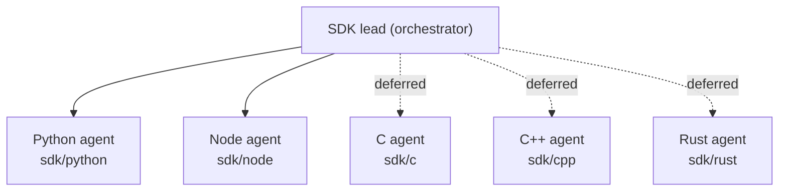

# PLAN_SDK.md: SDK Implementation Plan (C, C++, Rust, Python, Node.js)

> **Who executes this:** the *SDK lead* agent, orchestrating one implementation subagent per language.
> **Read first:** [`AGENTS.md`](AGENTS.md), then the whole contract: [`docs/api/`](docs/api/README.md) (especially [`sdk-guidelines.md`](docs/api/sdk-guidelines.md), [`vectors.md`](docs/api/vectors.md), [`errors.md`](docs/api/errors.md), [`conventions.md`](docs/api/conventions.md)) and [`spec/`](spec/).
> **Parallel track:** the daemon ([`PLAN_DAEMON.md`](PLAN_DAEMON.md)) is built at the same time. You never read or import daemon code. You integrate **only** through the contract, the Prism mock, and the milestones M1–M4.
> **Current scope (owner decision 2026-11-06): Python and Node.js only.** The C, C++ and Rust sections below are kept for later and marked **(deferred)**. Do not start them, do not add them to CI, and do not spawn agents for them until the owner re-enables them. Their placeholder files under `sdk/{c,cpp,rust}/` stay empty.
> **Open-question decisions** (frozen contract, licence deferred, etc.) are listed in [`PLAN_DAEMON.md`](PLAN_DAEMON.md#decisions-on-open-questions-2026-11-06-owner-approved-take-the-best-most-optimistic-path). For SDKs this means: the contract in `spec/` is final for v1; package licence fields stay unset until the owner chooses (Q8).
> **Project decision:** the SDK track has **no documentation, test, or review subagents**. Quality comes from strict linting, type checks, the shared golden files, and the `golden_check` example run in CI.

---

## 0. How to execute

### 0.1 Topology



- The lead runs **S0** itself (scaffolding for **Python and Node** + `sdk.yml` CI + `sdk/README.md`). Then for each phase S1…S6 it spawns **two `backend-implementer` subagents in parallel** (Python, Node), each with `isolation: "worktree"` and `run_in_background: true`.
- *(Deferred, for when C/C++/Rust are re-enabled: one more agent per language. The C++ agent starts each phase only after the C agent of that phase has merged, because C++ wraps C.)*
- Each language agent works on branch `sdk/<lang>-s<n>-<topic>`, commits per the phase table, opens a PR, and makes `sdk.yml` green. The lead merges the PRs, resolves cross-language inconsistencies, and starts the next phase.
- Optional: `api-integration-specialist` for the framework adapters in S5 (LangChain / LlamaIndex / LangChain.js), and `explorer` to summarise long docs.

### 0.2 The per-phase loop (each language agent)

```
1. git switch main && git pull && git switch -c sdk/<lang>-s<n>-<topic>
2. Read the phase "Read first" + the language section of this phase.
3. Implement; after each step run the language's lint/type/build command (§8).
4. Run examples/golden_check (offline always; online when the phase says so).
5. Commit with the messages in the phase table (scope feat(sdk-<lang>) / build(sdk-<lang>)).
6. Open PR "sdk(<lang>): S<n> <title>", CI green, hand back to the lead with a 10-line summary.
```

### 0.3 Spawn prompt template (lead → language agent)

```
subagent_type: backend-implementer   isolation: worktree   run_in_background: true
Task: Arkivector SDK phase S<n> for <LANG> (MemPalace task <id> | brief below).
Work only in sdk/<lang>/ (and nothing else). Never read or import daemon/ code.
Contract: docs/api/sdk-guidelines.md §3 (<LANG> surface) + docs/api/{conventions,vectors,errors,filters,search,entities}.md + spec/openapi.yaml.
Phase spec: PLAN_SDK.md §<section> "<LANG>" (files, features, commits).
Verify: <lint/build command from PLAN_SDK.md §8>; examples/golden_check (offline; online if ARKIVECTOR_URL given).
Mock: npx --yes @stoplight/prism-cli@5.12.0 mock -p 4010 spec/openapi.yaml ; ARKIVECTOR_URL=http://127.0.0.1:4010
Deliver: branch sdk/<lang>-s<n>-<topic>, commits as listed, PR opened, 10-line summary + any contract ambiguity found.
Contract ambiguity → do NOT guess silently: implement the most literal reading, and list it in the summary for a CCR.
```

---

## 1. Shared principles (all languages)

1. **Thin client:** HTTP + JSON + the VectorBytes codec. No distance math, no Arkiv RPC, no caching beyond `/v1/version` and per-collection column type.
2. **Contract-literal:** wire field names, enum strings, and limits exactly as in `spec/openapi.yaml`. Strict on output (never send unknown fields), lenient on input (ignore unknown response fields).
3. **Capabilities first:** fetch `/v1/version` lazily, check `api_version` major = 1, and check capabilities before optional calls (raise the not-implemented error locally).
4. **Errors:** the hierarchy in `docs/api/errors.md §3`, mapped from `problem.code`. Unknown codes → the generic API error.
5. **Retries:** only per `docs/api/conventions.md §8`. Writes carry an auto-generated `Idempotency-Key` (UUIDv4) unless the user disables it.
6. **Vectors:** the four pgvector types. Typed vectors whose type equals the collection column type are sent as `vector_bytes`. Plain arrays go as JSON.
7. **Golden files are law:** `spec/golden/vectorbytes.json` must pass byte-for-byte. `spec/fixtures/demo-dataset.json` must pass online once M2 exists.
8. **Version:** every package starts at `0.1.0` and exposes `SUPPORTED_API_MAJOR = 1` and its own version string (used in `User-Agent`).
9. **No dependency on other SDKs**, except C++ → C.

---

## 2. Phase overview

| Phase | Title | Daemon dependency | Milestone check |
| :---: | :--- | :--- | :--- |
| **S0** | Scaffolding, packaging, CI (lead) | none (Prism) | M0: builds, lints, Prism reachable |
| **S1** | Value types + VectorBytes codec + TypedValue + TTL | none | **M1**: `golden_check` offline passes |
| **S2** | HTTP core: config, transport, errors, retries, version/capabilities, collections API | none (Prism) | Collections ops parse Prism examples |
| **S3** | Read ops: get, search, batch, scroll, count, filter builder, consistency | daemon M2 for online check | **M2**: `golden_check` online passes vs `dev-up.sh` |
| **S4** | Write ops: upsert, prepare, delete, extend, idempotency, session consistency | daemon M3 for online check | **M3**: `quickstart --write` round trip |
| **S5** | Framework adapters (Python LangChain + LlamaIndex, Node LangChain.js) + ergonomics (Rust/C/C++ iterators, examples) | daemon M2 (M3 for add_texts) | RAG quickstart runs |
| **S6** | Release readiness: package metadata, publish dry-runs, version pins | daemon M4 | **M4**: packages build and install cleanly |

Active languages for every phase: **Python, Node**. Rows and subsections labelled *(deferred)* are skipped.

If the daemon milestone a phase needs for its *online* check isn't tagged yet, finish the phase against Prism, mark the online check "pending M<n>", and re-run it when `milestone/M<n>-daemon` appears. **Never block on the daemon.**

---

## 3. Phase S0: Scaffolding (lead only)

### Read first
`AGENTS.md` §2, §4, §6.2, §7, §8; `docs/api/sdk-guidelines.md`; `CODEBASE.md` (sdk/ part).

### Files
`sdk/README.md` (what the SDKs are, install per language, link to docs/api), `.github/workflows/sdk.yml`, plus per language:

| Lang | Files to fill in S0 |
| :--- | :--- |
| C *(deferred)* | `sdk/c/CMakeLists.txt` (lib `arkivector` static+shared, examples, install, `arkivector.pc`), `arkivector.pc.in`, `third_party/README.md` + vendored `yyjson.c/.h` (pin + sha256), empty-but-compiling `src/*.c` and headers with include guards |
| C++ *(deferred)* | `sdk/cpp/CMakeLists.txt` (`add_subdirectory(../c)` or `find_package(arkivector)`, target `arkivector::cpp`, C++17), headers with namespace skeletons |
| Rust *(deferred)* | `sdk/rust/Cargo.toml` (name `arkivector`, edition 2021, rust-version 1.75, deps per sdk-guidelines §3, features `blocking`, `native-tls`, default `rustls`), `src/lib.rs` module tree, examples registered |
| Python | `sdk/python/pyproject.toml` (hatchling, name `arkivector`, requires-python ≥ 3.9, no deps, extras `numpy`, `langchain = ["langchain-core>=0.3"]`, `llama-index = ["llama-index-core>=0.11"]`, ruff + mypy config), `src/arkivector/__init__.py` exporting the planned names, `py.typed` |
| Node | `sdk/node/package.json` (name `@arkivector/client`, type module, exports `.` and `./langchain`, engines node ≥ 18, scripts build/lint/typecheck/format, devDeps typescript 5.6, eslint 9 + typescript-eslint, prettier, `@types/node`), `tsconfig.json` (strict, NodeNext, outDir dist, includes examples), `eslint.config.js` |

### CI `.github/workflows/sdk.yml`
Runs on `push: ['**']` and `pull_request: ['**']`, with path filters `sdk/**`, `spec/**`. Matrix job per **active** language (`python`, `node`; add `c`, `cpp`, `rust` only when re-enabled). **Phase 1** = build + lint/typecheck. **Phase 2** = `golden_check` offline (contract check). Both are required for the green tick. Example steps:
- *(deferred)* C: `cmake -S sdk/c -B b -DCMAKE_C_FLAGS="-Wall -Wextra -Werror" && cmake --build b && b/golden_check`
- *(deferred)* C++: same for `sdk/cpp`
- *(deferred)* Rust: `cargo fmt --check && cargo clippy --all-features -- -D warnings && cargo run --example golden_check`
- Python: `pip install ruff mypy && ruff check && ruff format --check && mypy --strict src && python examples/golden_check.py`
- Node: `npm ci && npm run lint && npm run typecheck && npm run build && node dist/examples/golden_check.js`

### Commits
`build(sdk): scaffolding for python and node packages` · `ci: sdk build, lint and golden-check workflow` · `docs(sdk): sdk README`

### Exit
- [x] Python and Node packages build/lint clean (empty implementations). CI green. Prism mock instructions verified locally.

---

## 4. Phase S1: Value types, VectorBytes, TypedValue, TTL (→ M1)

### Read first
`docs/api/vectors.md` (all), `spec/golden/vectorbytes.json`, `spec/error-codes.json` (`vectorbytes_errors`, `vectorbytes_check_order`), `docs/api/sdk-guidelines.md §4–§6`, `docs/api/filters.md §2` (TypedValue), `docs/api/entities.md §7` (Ttl). For pgvector semantics: `RESEARCH/pgvector/core/{vector_type,halfvec_type,bitvec_type,sparsevec_type}.md` (text formats; sparse text is 1-based), and the pgvector-python/node class designs in `RESEARCH/pgvector/python-sdk/core_types.md` and `RESEARCH/pgvector/node-sdk/core_types.md` (mirror their constructors and `to_list`/`to_text`).

### Features (every language)
1. `Vector`, `HalfVector`, `SparseVector`, `Bit` with constructors, `dim`, `to_list`/`to_text`/`from_text` (pgvector text formats), and `to_vectorbytes(normalized)`/`from_vectorbytes(bytes)`. Validation in the exact `VB_*` order. Also `vectorbytes_decode_any(bytes) → one of the 4 types`.
2. binary16: float32 → binary16 round-to-nearest-even. Overflow beyond ±65504 → `VB_NON_FINITE` error at construction. Decoding binary16 → float32 is exact.
3. `TypedValue` + `T.*` constructors and accessors. `Ttl.*`.
4. `VectorBytesError(code)` (and the base error type skeleton from errors.md §3).
5. `examples/golden_check`: **offline part** only (sdk-guidelines §6).

### Per language

**Python** (`types.py`, `vectorbytes.py`, `models.py` (TypedValue, Ttl), `errors.py`)
- binary16 via `struct.pack('<e')` (IEEE round-half-even; `OverflowError` → `VB_NON_FINITE`). `array('f')`/`array('e')` storage, with lazy numpy acceptance (`sys.modules.get('numpy')`).
- Accept `pgvector.Vector/HalfVector/SparseVector/Bit` instances when that package is importable (duck-typing on `to_list()`/`indices()`).
- Commits: `feat(sdk-python): pgvector value types and VectorBytes codec` · `feat(sdk-python): typed values, ttl and error base` · `feat(sdk-python): golden_check offline`

**Node** (`types.ts`, `vectorbytes.ts`, `models.ts`, `errors.ts`)
- Storage: `Float32Array` (Vector), `Uint16Array` raw halves (HalfVector), `Uint8Array` + length (Bit), `Int32Array` + `Float32Array` (SparseVector). `DataView` little-endian writes.
- float32 → binary16 (round-half-even) implementation: use `Math.fround`, then the bit algorithm below. Overflow → error.
  ```ts
  // f: number (already float32-rounded). Returns binary16 bits.
  const f32 = new Float32Array(1), u32 = new Uint32Array(f32.buffer);
  function toHalf(f: number): number {
    f32[0] = f; const x = u32[0], sign = (x >>> 16) & 0x8000; let exp = (x >>> 23) & 0xff, mant = x & 0x7fffff;
    if (exp === 0xff) throw new VectorBytesError("VB_NON_FINITE");
    let e = exp - 127 + 15;
    if (e >= 0x1f) throw new VectorBytesError("VB_NON_FINITE");               // overflow
    if (e <= 0) {                                                              // subnormal / zero
      if (e < -10) return sign;
      mant |= 0x800000; const shift = 14 - e; let h = mant >>> shift;
      const rem = mant & ((1 << shift) - 1), half = 1 << (shift - 1);
      if (rem > half || (rem === half && (h & 1))) h++;
      return sign | h;
    }
    let h = sign | (e << 10) | (mant >>> 13); const rem = mant & 0x1fff;
    if (rem > 0x1000 || (rem === 0x1000 && (h & 1))) h++;                      // may carry into exponent: correct
    if ((h & 0x7c00) === 0x7c00) throw new VectorBytesError("VB_NON_FINITE");
    return h;
  }
  ```
  Validate it against every `halfvec_*` golden case (including `input_values` rounding).
- Commits: `feat(sdk-node): pgvector value types and VectorBytes codec` · `feat(sdk-node): typed values, ttl and error base` · `feat(sdk-node): golden_check offline`

**Rust** *(deferred)* (`types.rs`, `vectorbytes.rs`, `models.rs`, `error.rs`)
- `half::f16::from_f32` (round-to-nearest-even). Reject `is_infinite()` results from finite input. `serde` for TypedValue (`#[serde(tag="type", content="value")]` won't fit since value types vary, so implement a custom `Serialize`/`Deserialize`).
- `thiserror` error enum with `ErrorKind` per errors.md §3, plus `VectorBytes(VbCode)`.
- Commits: `feat(sdk-rust): pgvector value types and VectorBytes codec` · `feat(sdk-rust): typed values, ttl and error types` · `feat(sdk-rust): golden_check example`

**C** *(deferred)* (`include/arkivector/{types.h,vectorbytes.h}`, `src/vectorbytes.c`, `src/errors.c`)
- `av_vector_t` = tagged struct `{av_vtype type; int32_t dim; int32_t nnz; float *f32; uint16_t *f16; uint8_t *bits; int32_t *indices; float *values;}`, constructors `av_vector_from_f32`, `av_halfvec_from_f32`, `av_bit_from_string`, `av_sparsevec_new`, `av_vector_free`, `av_vb_encode(const av_vector_t*, bool normalized, uint8_t **out, size_t *len, av_error_t*)`, `av_vb_decode(const uint8_t*, size_t, av_vector_t **out, av_error_t*)`.
- **Copy the binary16 software conversion from pgvector** (`pgvector/src/halfutils.h:62–243`, `HalfToFloat4` and `Float4ToHalfUnchecked`, software branches only) into `src/vectorbytes.c` with the PostgreSQL License notice and a provenance comment. Wrap it with an overflow check (`VB_NON_FINITE`).
- `av_value_t` TypedValue (`av_v_bool/i32/u64/u256/dec/str/addr/key/bytes`), `av_ttl_t`.
- `examples/golden_check.c` reads JSON with the vendored yyjson.
- Commits: `feat(sdk-c): vector types and VectorBytes codec (half conversion copied from pgvector)` · `feat(sdk-c): typed values, ttl, error struct` · `feat(sdk-c): golden_check example`

**C++** *(deferred)* (`types.hpp`, `error.hpp`, `src/types.cpp`)
- `arkivector::Vector/HalfVector/SparseVector/Bit` as value classes owning `std::vector`. `to_vectorbytes()`/`from_vectorbytes()` delegate to the C SDK codec (RAII on `av_vector_t`). `VectorBytesError` derives from `arkivector::Error`.
- Commits: `feat(sdk-cpp): value types over the c codec` · `feat(sdk-cpp): golden_check example`

### Exit → M1 (each language)
- [ ] `golden_check` offline: 29/29 PASS. Tag `milestone/M1-sdk-<lang>`.

---

## 5. Phase S2: HTTP core, errors, retries, version, collections

### Read first
`docs/api/conventions.md` (all), `errors.md` (all), `operations.md`, `collections.md`, `spec/openapi.yaml` (paths `/healthz`, `/readyz`, `/v1/version`, `/v1/sync`, `/v1/collections*`), `spec/capabilities.json`.

### Features (every language)
1. Client config (sdk-guidelines §1), including env var fallbacks.
2. Transport: JSON request/response, headers (`User-Agent`, `Authorization`, `X-Request-Id` (generate a ULID or UUID per request), `Content-Type`), timeouts, gzip optional.
3. Problem parsing → typed errors (errors.md §3). Transport errors → `TransportError`.
4. Retry engine (conventions.md §8): attempts, backoff, jitter, `Retry-After`, the idempotent-op set, and writes only with an Idempotency-Key.
5. `version()` (cached), the api major check, `has_capability(name)`, and a local not-implemented error.
6. Ops: `health`, `ready`, `sync_status`.
7. Collections: `list_collections`, `get_collection` (also caches column type per name), `create_collection`, `follow_collection`, `delete_collection`. Models: `Collection`, `Column`, `IndexDef`, `SyncStatus`, `VersionInfo`.
8. `examples/quickstart` (partial): version + capabilities + list collections (against Prism).

### Per language
- **Python** (`_http.py` on `urllib.request` with a keep-alive `http.client.HTTPConnection` pool keyed by host, thread-safe via a lock-protected pool; `client.py`; `models.py` dataclasses with `from_json`): commits `feat(sdk-python): http transport, retries and problem errors` · `feat(sdk-python): version, capabilities, ops and collections api`.
- **Node** (`http.ts` on global `fetch` with `AbortController` timeouts, injectable `fetch`; `client.ts`; `models.ts` interfaces + parse functions; camelCase ↔ snake_case mappers): commits `feat(sdk-node): fetch transport, retries and problem errors` · `feat(sdk-node): version, capabilities, ops and collections api`.
- **Rust** *(deferred)* (`client.rs` async on `reqwest::Client` with `ClientBuilder` (timeout, gzip, user agent), `blocking.rs` behind feature `blocking` wrapping `reqwest::blocking`, sharing request/response models from `models.rs` with serde): commits `feat(sdk-rust): async/blocking transport, retries, errors` · `feat(sdk-rust): version, capabilities, ops and collections api`.
- **C** *(deferred)* (`http.c` on libcurl easy handles (one per call from a mutex-protected pool), `json.c` yyjson helpers, `client.c`; `arkivector.h` declares `av_config_t` + `AV_CONFIG_INIT`, `av_client_new/free`, `av_global_init/cleanup`, `av_version`, `av_has_capability`, `av_health`, `av_ready`, `av_sync_status`, `av_list_collections`, `av_get_collection`, `av_create_collection`, `av_follow_collection`, `av_delete_collection`, result structs + `*_free`; `av_error_t {char code[40]; int status; bool retryable; char request_id[72]; char *title; char *detail; char *problem_json; av_status_t category;}` + `av_error_clear`). **Freeze the public C headers at the end of S2** (append-only afterwards), because the C++ agent builds on them. Commits: `feat(sdk-c): libcurl transport, retries, problem errors` · `feat(sdk-c): version, capabilities, ops and collections api` · `feat(sdk-c): freeze public headers v0.1`.
- **C++** *(deferred)* (after the C S2 merge: `arkivector.hpp` `Client` with `Config` struct (designated-initialiser friendly), RAII handle, exceptions per error category, `Collection` etc. as C++ structs converted from C results): commits `feat(sdk-cpp): client, config and exceptions over the c sdk` · `feat(sdk-cpp): version, ops and collections api`.

### Exit
- [ ] Against Prism: every collections/ops call parses the example response. An invalid request (e.g. bad collection name) surfaces Prism's 422 as `ValidationError`. A retry test with a fake 503 server (inline in the example or a 20-line local server) shows backoff (manual check, logged in the PR).

---

## 6. Phase S3: Read ops + filter builder + consistency (→ M2)

### Read first
`docs/api/search.md`, `filters.md`, `consistency.md`, `entities.md §1–2`, `vectors.md §1–2`, `spec/openapi.yaml` (`search`, `searchBatch`, `scroll`, `count`, `getEntity`), `spec/fixtures/demo-dataset.json`.

### Features (every language)
1. `get(collection, ref, include, verify, min_block, timeout_ms)`: percent-encode ids in the path segment; refs shaped like a key are sent as is.
2. `search(...)` with all `SearchRequest` fields. Vector serialisation rule (sdk-guidelines §2). Parse `SearchResult` (hits with TypedValue attributes, decoded `vector_bytes` when included, `plan` as an opaque map).
3. `search_batch(...)`, `scroll(...)` (lazy auto-paging iterator/stream; respects `limit` per page), `scroll_page(...)`, `count(...)`.
4. Filter builder `F` producing the JSON AST (filters.md §2), emitting **TypedValues** whenever the type is known (explicit `T.*` or numeric-type inference: Python `float` → error that tells the user to use `T.dec`, since floats are ambiguous). The `where` string is passed through.
5. Consistency: per-call `min_block` + `timeout_ms`. Expose `as_of_block` and `sync_state` on every result.
6. `examples/golden_check` **online part** and `examples/quickstart` (search demo.docs).

### Per language
- **Python**: `filter.py` (`F.eq(...)`, `F.and_(…)`, `F.or_(…)`, `F.not_(…)`, `F.between(field, lo, hi)`, `F.startswith`, `F.exists`, `F.typeof`), `client.py` read ops, generator-based `scroll`. Commits: `feat(sdk-python): filter builder` · `feat(sdk-python): get, search, batch, scroll, count with consistency` · `feat(sdk-python): golden_check online and quickstart`.
- **Node**: `filter.ts`, read ops, `scroll` as `AsyncIterable<Entity>`. Commits: `feat(sdk-node): filter builder` · `feat(sdk-node): read ops with async-iterable scroll` · `feat(sdk-node): golden_check online and quickstart`.
- **Rust** *(deferred)*: `filter.rs` (`F::eq`, `F::all([...])`/`F::and_`, …, implementing `Serialize`), request builders `SearchRequest::new(v).k(5).filter(f).include([Include::Attributes])`, `scroll` returning `impl Stream<Item = Result<Entity>>` (async) and `impl Iterator` (blocking). Commits: `feat(sdk-rust): filter builder and request builders` · `feat(sdk-rust): read ops with scroll streams` · `feat(sdk-rust): golden_check online and quickstart`.
- **C** *(deferred)*: `filter.h/.c` (`av_filter_t` tree, `av_f_eq(field, av_value_t)`, `av_f_and(size_t n, av_filter_t **children)`, …, `av_filter_free`, `av_filter_to_json`), `av_search_params_t` + `AV_SEARCH_PARAMS_INIT`, `av_search`, `av_search_batch`, `av_scroll_page` + an `av_scroll_iter_t` (`av_scroll_next`), `av_count`, `av_get`. Result structs own their memory, released with the matching `*_free`. Commits: `feat(sdk-c): filter builder` · `feat(sdk-c): read ops and scroll iterator` · `feat(sdk-c): golden_check online and quickstart`.
- **C++** *(deferred)* (after C S3): `filter.hpp` (`F::eq`, …, value semantics), `SearchRequest` fluent builder, `search`, `search_batch`, `scroll` returning an input range (`begin()/end()` with lazy paging), `count`, `get`. Commits: `feat(sdk-cpp): filter builder and request builders` · `feat(sdk-cpp): read ops and scroll range` · `feat(sdk-cpp): golden_check online and quickstart`.

### Exit → M2 (each language)
- [ ] Against Prism: all read ops parse the examples.
- [ ] Once `milestone/M2-daemon` exists: `daemon/tools/dev-up.sh` → `ARKIVECTOR_URL=http://127.0.0.1:8080 golden_check` → all 4 queries + counts PASS. Tag `milestone/M2-sdk-<lang>`. If the daemon isn't at M2 yet, record "pending M2" and come back.

---

## 7. Phases S4–S6

### 7.1 S4: Writes + session consistency (→ M3)

**Read first:** `docs/api/entities.md` (all), `conventions.md §8` (idempotency), `consistency.md §2`, `collections.md §4` (on-chain layout, for the "direct write" helper).

**Features:**
1. `upsert(collection, entities, wait, timeout_ms, idempotency_key=auto)`. Entity inputs accept SDK vector types, plain arrays, pgvector text, and `document`, `attributes` (TypedValues or shorthand), `ttl`.
2. `prepare(collection, entities, from_address)` → `PrepareResult` (unsigned txs + predicted keys). The SDK does **not** sign.
3. `delete(collection, refs|filter|where)`, `extend(collection, ttl, refs|filter|where)`.
4. `session_consistency`: track the max `block_number` from own writes and inject `consistency.min_block` into subsequent reads. Expose `client.last_write_block`.
5. **Direct-write helper** (no daemon signer needed): `build_entity_attributes(collection_def, entity_input) → list of (name, type_id, value_bytes)` that produces the exact on-chain layout (collections.md §4: `arkiv.schema`, `av.vec` VectorBytes, `av.id`, `av.doc`, user attributes, sorted by bytes32 name). Users pass it to their Arkiv SDK. Node also ships `toArkivSdkAttributes(...)` shaped for `@arkiv-network/sdk` `createEntity` (keys/values only).
6. `examples/quickstart --write`: upsert 3 entities → search with session consistency → they're found → delete → gone.

**Per language commits:** `feat(sdk-<lang>): upsert, prepare, delete, extend with idempotency keys` · `feat(sdk-<lang>): session consistency` · `feat(sdk-<lang>): direct-write attribute builder` · `feat(sdk-<lang>): quickstart write round trip`.

**Exit → M3:** against `dev-up.sh --signer dev` (once `milestone/M3-daemon` exists), `quickstart --write` passes. Tag `milestone/M3-sdk-<lang>`.

### 7.2 S5: Framework adapters & ergonomics

**Read first:** `ARCHITECTURE.md §14.2–14.3`; LangChain `VectorStore` interface (`langchain_core.vectorstores.VectorStore`: `add_texts`, `similarity_search`, `similarity_search_with_score`, `similarity_search_by_vector`, `delete`, `from_texts`, `get_by_ids`); LlamaIndex `BasePydanticVectorStore` (`add`, `delete`, `query` → `VectorStoreQueryResult`, `MetadataFilters` translation); LangChain.js `VectorStore` (`addVectors`, `addDocuments`, `similaritySearchVectorWithScore`, `delete`, `fromTexts`). Use context7 for current signatures.

| Lang | Deliverable | Files | Commits |
| :--- | :--- | :--- | :--- |
| Python | `ArkivectorVectorStore` for LangChain (metadata ↔ attributes via `plain_attributes()`, `filter` param accepts dict-of-equals → `F.and_(F.eq…)` or an `F` node, scores = `distance`), and for LlamaIndex (MetadataFilters `EQ, NE, GT, GTE, LT, LTE, IN, NIN` → F; node text in `document`; node id in `id`). Lazy imports, `ImportError` with an install hint | `langchain.py`, `llama_index.py`, `examples/rag_langchain.py` (add file) | `feat(sdk-python): langchain vector store` · `feat(sdk-python): llama-index vector store` |
| Node | `ArkivectorVectorStore` for LangChain.js at subpath `./langchain` (peer dep `@langchain/core`) | `src/langchain.ts`, `examples/rag_langchain.ts` (add file) | `feat(sdk-node): langchain.js vector store` |
| Rust *(deferred)* | `scroll_all` convenience, `Client::from_env()`, docs examples in README (no framework) | `client.rs`, `README.md` (add) | `feat(sdk-rust): ergonomics and examples` |
| C *(deferred)* | `av_client_from_env`, `av_search_simple(client, coll, const float*, dim, k, ...)` | `client.c` | `feat(sdk-c): convenience api` |
| C++ *(deferred)* | `Client::from_env()`, range-for over search hits, `std::span` overloads when C++20 is available | `client.cpp` | `feat(sdk-cpp): convenience api` |

**Exit:** the Python and Node RAG examples run against `dev-up.sh` (with a fake deterministic embedder in the example, so no API key is needed).

### 7.3 S6: Release readiness (→ M4)

| Lang | Tasks | Commit |
| :--- | :--- | :--- |
| Python | Complete `pyproject.toml` metadata (classifiers, urls; **licence field left unset** until the owner decides, Q8), `python -m build`, `twine check`, test install in a fresh venv, version `0.1.0` | `build(sdk-python): release metadata and build check` |
| Node | `package.json` metadata (**`license` field left unset / `UNLICENSED` placeholder** until the owner decides, Q8), `files`, `exports` with types, `npm pack --dry-run`, test install in a temp project, ESM import works | `build(sdk-node): release metadata and pack check` |
| Rust *(deferred)* | Crate metadata (description, licence, repository, readme, keywords), `cargo package --list`, `cargo publish --dry-run` | `build(sdk-rust): release metadata and package check` |
| C *(deferred)* | `install` targets, `arkivector.pc`, CMake package config (`arkivectorConfig.cmake`), a static+shared build check, `find_package(arkivector)` from a sample project | `build(sdk-c): install, pkg-config and cmake package` |
| C++ *(deferred)* | CMake package `arkivector-cpp`, `find_package` sample project | `build(sdk-cpp): install and cmake package` |

**Exit → M4:** with the daemon at M4, all packages install from local artifacts and pass `golden_check` (offline + online) against a release daemon binary. Tag `sdk-v0.1.0` and `milestone/M4-sdk-<lang>`.

---

## 8. Language technical reference

### 8.1 Commands

| Lang | Lint / type | Build | Contract check |
| :--- | :--- | :--- | :--- |
| C | `clang-format --dry-run --Werror src/*.c include/arkivector/*.h`, `-Wall -Wextra -Werror` | `cmake -S sdk/c -B sdk/c/build && cmake --build sdk/c/build` | `sdk/c/build/golden_check` |
| C++ | `clang-format --dry-run --Werror`, `-Wall -Wextra -Werror` | `cmake -S sdk/cpp -B sdk/cpp/build && cmake --build sdk/cpp/build` | `sdk/cpp/build/golden_check` |
| Rust | `cargo fmt --check`, `cargo clippy --all-features -- -D warnings` | `cargo build --all-features` | `cargo run --example golden_check` |
| Python | `ruff check`, `ruff format --check`, `mypy --strict src` | `python -m build` (S6) | `python examples/golden_check.py` |
| Node | `npm run lint`, `npm run typecheck`, `prettier --check .` | `npm run build` | `node dist/examples/golden_check.js` |

### 8.2 Wire-name mapping

| Concept | Wire | Python | TS | Rust | C | C++ |
| :--- | :--- | :--- | :--- | :--- | :--- | :--- |
| as of block | `as_of_block` | `as_of_block` | `asOfBlock` | `as_of_block` | `as_of_block` | `as_of_block` |
| hits | `results` | `hits` | `hits` | `hits` | `hits`/`n_hits` | `hits` |
| vector bytes | `vector_bytes` | decoded → `.vector` | decoded → `.vector` | `.vector: Option<AnyVector>` | `av_vector_t *vector` | `std::optional<AnyVector>` |
| ef search | `ef_search` | `ef_search=` | `efSearch` | `.ef_search()` | `.ef_search` | `.ef_search()` |
| Idempotency-Key | header | `idempotency_key=` | `idempotencyKey` | `.idempotency_key()` | `.idempotency_key` | `.idempotency_key()` |

`AnyVector` = sum type of the four vector types.

### 8.3 Implementation notes
- **Percent-encoding refs:** encode every byte outside `A-Za-z0-9-._~` (RFC 3986 unreserved), including `/` and `:`.
- **Colon paths:** `/v1/collections:follow`, `…/entities:prepare`, `…/search:batch`. Never percent-encode the colon in these fixed paths.
- **JSON numbers:** send vector floats with round-trippable float32 precision (Python `repr(float(np.float32(x)))`, or simply `vector_bytes`). Never send NaN/Infinity.
- **dec values:** always strings. Never convert to binary floats inside the SDK.
- **ULID/UUID:** Python `uuid.uuid4().hex`, Node `crypto.randomUUID()`, Rust `uuid::Uuid::new_v4()`, C read 16 bytes from `/dev/urandom` (or `BCryptGenRandom` on Windows; Windows is out of scope for v0.1).
- **Thread-safety:** Python client is thread-safe (pool lock). Rust `Client: Clone + Send + Sync`. C client is safe across threads. C++ follows C. Node is single-threaded.

---

## 9. Status log

| Lang | S0 | S1 (M1) | S2 | S3 (M2) | S4 (M3) | S5 | S6 (M4) |
| :--- | :---: | :---: | :---: | :---: | :---: | :---: | :---: |
| Python | done | | | | | | |
| Node | done | | | | | | |
| C | deferred | | | | | | |
| C++ | deferred | | | | | | |
| Rust | deferred | | | | | | |
