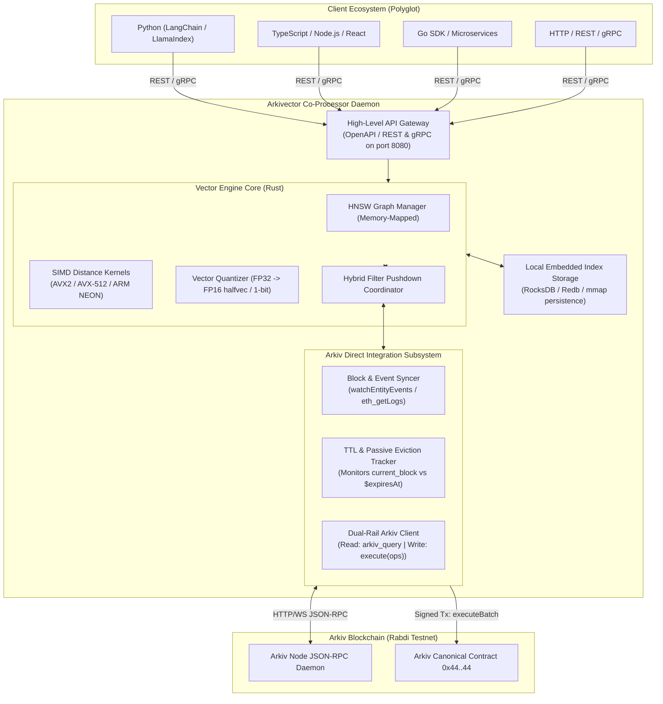

# Problem Statement & System Design Prompt: Building "pgvector for Arkiv" via an Off-Chain Vector Co-Processor Engine

> **Instructions for the Reasoning Model**:
> You are an elite distributed systems architect, database kernel engineer, and Web3 infrastructure researcher.
> Read this entire document thoroughly. It details the problem, constraints, research foundations, and architectural requirements for building **Arkivector**—a high-performance vector similarity search engine and co-processor for **Arkiv** (a Web3 database).
>
> Your goal is to deeply reason through this architecture and output a comprehensive, production-grade, step-by-step **Implementation & Engineering Plan**.

---

## 1. Project Mission & Vision

We are building **Arkivector** ("pgvector for Arkiv"). 

Our objective is to bring native vector similarity search ($k$-NN / ANN), dense and sparse embedding support, and hybrid relational-vector search to **Arkiv**, the decentralized Web3 database.

Just as `pgvector` transformed PostgreSQL from a relational database into a state-of-the-art vector database for AI agents, RAG pipelines, and recommendation engines, **Arkivector** will empower decentralized AI agents, autonomous applications, and on-chain intelligence to query, filter, and rank semantic vector embeddings backed by blockchain immutability and cryptographic proof.

---

## 2. Substrate Deep Dive: The Arkiv Protocol & Constraints

We have extensively researched and documented Arkiv in [`RESEARCH/arkiv-docs/`](file:///home/dikshitrj/Coding/arkivector/RESEARCH/arkiv-docs/). Here are the verified technical invariants of the substrate:

### A. Core Architecture & The Dual-Rail Paradigm
- **Arkiv is an EVM-based decentralized database** (current public testnet is **Rabdi**, Chain ID `7794095`, 2.0-second block time, gas token `tGLM`).
- **Arkiv has NO `arkiv_write` JSON-RPC method**. It operates a strict **Dual-Rail Protocol**:
  1. **Read Rail (Off-Chain JSON-RPC Daemon)**: Free, gasless, low-latency queries evaluated directly by the node daemon via custom JSON-RPC methods (`arkiv_query`, `arkiv_getEntity`, `arkiv_getBlockTiming`).
  2. **Write Rail (On-Chain EVM Consensus)**: All creates, updates, extensions, and deletes are executed as signed Ethereum transactions to the canonical protocol contract at `0x4400000000000000000000000000000000000044` calling function `execute((uint8 operation, bytes operationData)[] ops)` (selector `0x49650044`).

### B. Entity & Attribute Model
- Data is stored as **entities** identified by a 32-byte `$key`.
- Each entity has protocol fields starting with `$`:
  - `$key`: 32-byte deterministic key (`keccak256(abi.encodePacked(chainId, arkiv, owner, entityNonce, salt))`).
  - `$owner`: Current administrative address (can patch, transfer, delete).
  - `$creator`: Immutable address that created the entity.
  - `$expiresAt`: Block height when the entity expires.
  - `$creationFlags`: Bitfield (`bit 0`: readonly, `bit 1`: permissionless extension).
- Each entity supports up to **32 user attributes** (`MAX_ATTRIBUTES`).
- Column types: `bool` (1), `i32` (2), `u64` (3), `u256` (4), `dec` (5, 18-decimal fixed point), `bytes` (7), `str` (8, max 128 bytes), `addr` (9), `key` (10), and `tombstone` (0).
- An attribute is **indexed** if bit 7 of `typeId` is set (`0x80`). For instance, indexed `str` is `0x88`.

### C. The Critical Substrate Bottlenecks for Vector Search
1. **`bytes` (`typeId 7`) holds up to 128 KiB (131,072 bytes)**:
   - This provides ample storage capacity for embeddings! A 1536-dimensional FP32 vector requires only 6,144 bytes; an FP16 vector requires only 3,072 bytes; an 8-bit quantized vector requires 1,536 bytes; a 1-bit binary quantized vector requires only 192 bytes.
2. **`bytes` CANNOT be indexed, filtered, or sorted in Arkiv**:
   - The node query engine does **NOT** support filtering or sorting on `bytes`.
   - Bit 7 on `bytes` (`0x87`) is illegal and reverts on-chain with `InvalidValueType`.
3. **No Vector Distance Operators on Node**:
   - `arkiv_query` only supports relational operators: `=`, `!=`, `<`, `<=`, `>`, `>=`, `BETWEEN`, `STARTSWITH`, `EXISTS`, `TYPEOF`.
   - Arkiv has no `<->` (L2 distance), `<=>` (Cosine distance), or `<#>` (Inner Product).
4. **Validators are Closed**:
   - You **cannot** install custom C/Rust plugins or modified execution engines into third-party Arkiv validator nodes.

### D. Time-To-Live (TTL) & Eviction Mechanics
- Expiration formula: $\text{expiry} = \max(\text{expiresAt}, \text{currentBlock} + \text{minLifetime})$.
- Entities are **passively pruned** when block height $\ge \$expiresAt$.
- **Crucially: No on-chain transaction occurs on expiration, and NO event is emitted** (preventing mass eviction denial-of-service).

---

## 3. Inspiration Deep Dive: `pgvector` Architecture & Lessons

We have analyzed `pgvector` in [`RESEARCH/pgvector/README.md`](file:///home/dikshitrj/Coding/arkivector/RESEARCH/pgvector/README.md). Here are the key technical takeaways relevant to Arkivector:

1. **Distance Metrics**:
   - Euclidean / L2 (`<->`): $\sqrt{\sum (u_i - v_i)^2}$
   - Cosine Distance (`<=>`): $1 - \frac{\mathbf{u} \cdot \mathbf{v}}{\|\mathbf{u}\|_2 \|\mathbf{v}\|_2}$
   - Negative Inner Product (`<#>`): $-(\mathbf{u} \cdot \mathbf{v})$ (negated so ascending order returns nearest).
   - Hamming (`<~>`): Hardware popcount of XOR on binary packed bit vectors.
2. **Indexing Algorithms**:
   - **HNSW (Hierarchical Navigable Small World)**: Multi-layer proximity graph with skip-list routing, priority queue beam search, and heuristic neighbor pruning. Delivers sub-5ms search with $>98\%$ recall.
   - **IVFFlat (Inverted File Flat)**: Centroid clustering via $k$-means and inverted posting lists. Fast build, low RAM, sequential streaming.
3. **The Filtered ANN Dilemma & Iterative Scan**:
   - When relational filters (`WHERE category = 'news'`) eliminate top-$k$ candidates returned by vector search, naive vector databases return empty or degraded results.
   - `pgvector` solved this with **Iterative Scanning** (`hnsw.iterative_scan`), dynamically expanding the HNSW search frontier until the required `LIMIT` of valid filtered items is reached.
4. **Quantization & Asymmetric Precision**:
   - Storing in FP16 (`halfvec`) cuts storage and memory by 50%.
   - In distance calculations, unpacking FP16 into **FP32 registers** on the fly prevents arithmetic underflow/overflow while preserving full recall.
5. **Client Architecture**:
   - `pgvector-python` and `pgvector-node` have **zero heavy dependencies**. They do not execute search; they format vectors into compact binary frames or SQL strings, leaving computation to the engine.

---

## 4. The Core Architectural Challenge & Problem Statement

### Why Existing Approaches Fail:
1. **Approach A (Custom Smart Contract on Arkiv)**:
   - Calculating high-dimensional cosine distance inside an EVM smart contract is impossible. A single 1536-dim vector dot product requires 1,536 multiplications and additions; iterating over 10,000 entities would exceed Ethereum block gas limits by several orders of magnitude.
2. **Approach B (Client-Side Thick SDKs in Every Language)**:
   - If Python, TypeScript, Rust, and Go SDKs try to do vector search client-side, every search query must first download all entity vectors over JSON-RPC. Downloading 100,000 vectors (600 MB) for a single search destroys network bandwidth and takes tens of seconds.
   - Furthermore, duplicating SIMD kernels and HNSW indexing across 4 different programming languages creates an unmaintainable engineering nightmare.

### The Decisive Conclusion:
**We do NOT need any new smart contract.** Arkiv's existing contract `0x44..44` already stores binary blobs up to 128 KiB in `bytes` attributes.

Instead, we need an **Off-Chain Vector Co-Processor Engine / Daemon ("Arkivector Engine")**:
- It runs locally on a user's machine, inside a Docker container, or as a self-hosted cloud daemon.
- It connects to Arkiv via JSON-RPC (`arkiv_query`, `arkiv_getBlockTiming`) and WebSocket (`watchEntityEvents` / `eth_subscribe`).
- It maintains an in-memory/memory-mapped **HNSW vector index** accelerated by CPU SIMD instructions.
- It exposes a unified high-level API (REST / gRPC) that any language client (Python, TypeScript, Go, Rust, curl) can query in sub-5 milliseconds.
- It solves the Filtered ANN dilemma by pairing Arkiv's relational queries with local HNSW graph traversal.
- It is **stateless and crash-proof regarding consensus**: if the local daemon is deleted, a new instance can stream history from Arkiv and reconstruct the entire HNSW index automatically.

---

## 5. Architectural Requirements for the Co-Processor Engine

The reasoning model must formulate a complete engineering blueprint addressing the following core subsystems:

### Subsystem 1: Vector Binary Wire Format on Arkiv
- How should vectors be packed into Arkiv's 128 KiB `bytes` attribute?
- Need a compact binary layout header:
  - Format version (1 byte)
  - Dimensions $d$ (uint16, e.g. 1536)
  - Metric type / Quantization type (1 byte: FP32, FP16, INT8, 1-bit)
  - Normalized flag (1 byte)
  - Raw binary array (IEEE 754 floats or binary16)
- What is the schema design for Arkiv entities storing vectors? (e.g., `arkiv.schema: "arkivector.collection_name"`, metadata attributes like `title`, `category`, and the vector `bytes` payload).

### Subsystem 2: Blockchain Synchronization, Re-Indexing & Passive TTL Pruning
- How does the engine bootstrap on startup?
  - Key-cursor pagination (`ORDER BY $key ASC` with `$key > key(0x...)`) over `arkiv_query` to ingest historical entities without pagination drift.
- Real-time synchronization:
  - Subscribing to `EntityCreated`, `EntityPatched`, `EntityDeleted` via `watchEntityEvents`.
- Handling Passive TTL Eviction:
  - Since Arkiv emits **no on-chain events** when block height reaches `$expiresAt`, how should the co-processor detect and prune expired vectors from the HNSW graph?
  - Priority queue / min-heap of `($expiresAt, entityKey)` checked against `current_block` from `arkiv_getBlockTiming`?

### Subsystem 3: The Hybrid Filter Pushdown Engine (Solving Filtered ANN)
- Suppose a user queries: `"Find top 5 vectors nearest to Q where category = 'finance' AND score >= 4.0"`.
- How should the co-processor coordinate between Arkiv's relational engine and its local HNSW index?
- Analyze two distinct execution strategies:
  1. **Pre-Filtering (Arkiv Pushdown + Restricted HNSW)**:
     - Query Arkiv via `arkiv_query` with relational filters $\to$ obtain candidate `$key` set.
     - Traverse local HNSW restricted to candidate keys (or fallback to exact flat scan if candidate set is small).
  2. **Post-Filtering / Iterative Search**:
     - Traverse HNSW, retrieving nearest candidates; check if candidates satisfy filters.
- When should the engine choose strategy 1 vs strategy 2 based on selectivity estimates?

### Subsystem 4: Co-Processor High-Level API Specification
- What should the API look like?
  - Collection management: `POST /v1/collections` (name, dimensions, metric: cosine/l2/ip, quantization).
  - Upsert vector: `POST /v1/collections/:name/entities` (id/key, vector, metadata attributes, TTL options).
  - Vector similarity search: `POST /v1/collections/:name/search` (vector, filter object, limit, threshold).
  - Point lookup: `GET /v1/collections/:name/entities/:key`.
- Compatibility: Can we provide an **OpenAI-compatible** or **Qdrant-compatible** endpoint wrapper so that existing frameworks (`LangChain`, `LlamaIndex`, `Flowise`, `Dify`) can plug into Arkivector immediately without writing new integrations?

### Subsystem 5: Polyglot Client Strategy
- Confirm why we do **not** need complex, heavy SDKs in every language.
- Define what thin client adapters should look like in Python and TypeScript (e.g. `arkivector-python` under 200 lines, providing a LangChain `VectorStore` subclass).

---

## 6. Deliverable Request: What the Reasoning Model Must Produce

We request a comprehensive, meticulously reasoned **Master Architecture & Implementation Plan** covering:

1. **Technology Stack Decision**:
   - Language choice for the co-processor daemon (Rust vs. Go vs. C++). Evaluate memory safety, SIMD intrinsics, concurrency, and binary distribution.
   - HNSW implementation approach: Embed an existing library (e.g. `usearch`, `instant-distance`, `hora`) vs. custom lightweight HNSW implementation.
   - Persistence layer: Memory-only with replay log vs. memory-mapped storage (`redb`, `rocksdb`, or custom mmap file).
2. **Binary Wire Specification (`VectorBytes`)**:
   - Byte-level layout diagram for embedding vectors inside Arkiv's `bytes` attribute.
   - Header fields, endianness, quantization flags, and validation rules.
3. **Synchronization & State Recovery Engine**:
   - Step-by-step state machine for initial synchronization from Arkiv.
   - Real-time WebSocket event loop.
   - Algorithmic design of the **Passive TTL Pruning Scheduler**.
4. **Hybrid Query Planner & Filter Pushdown Specification**:
   - Detailed algorithm for bridging Arkiv's SQL-like query language (`arkiv_query`) with HNSW graph exploration.
   - Mathematical heuristics for switching between Filtered Graph Traversal and Exact Flat SIMD Scan based on candidate cardinality.
5. **Complete API Design (OpenAPI / REST / gRPC)**:
   - Full request/response JSON schemas for collection creation, insertion, and similarity search.
   - Drop-in compatibility mapping for LangChain and LlamaIndex.
6. **Step-by-Step Implementation Roadmap**:
   - Phased execution plan (Phase 1: Binary Encodings & SIMD Kernels, Phase 2: Arkiv Sync & Storage, Phase 3: HNSW & Hybrid Planner, Phase 4: HTTP Gateway & Ecosystem Adapters).
   - Test suite verification strategy (unit, integration with Rabdi testnet, benchmark suite for recall & latency).

---

*Please analyze all constraints, synthesize the optimal architectural choices, and provide a master engineering implementation plan.*
