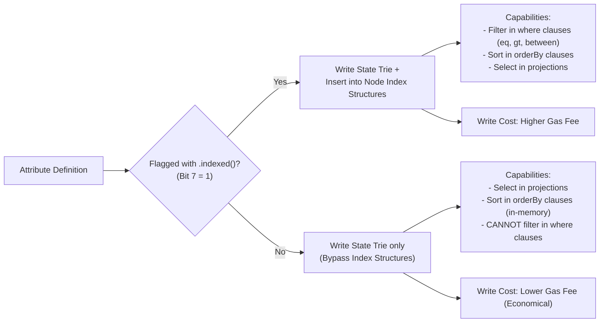

# Arkiv Attributes, Column Types & Indexing Specification

## Table of Contents
- [1. Executive Summary](#1-executive-summary)
- [2. The Attribute Architecture](#2-the-attribute-architecture)
  - [2.1. In-Memory & Calldata Struct](#21-in-memory--calldata-struct)
  - [2.2. Name Packing & Identifier Rules](#22-name-packing--identifier-rules)
  - [2.3. Attribute Limits & Slot Allocations](#23-attribute-limits--slot-allocations)
- [3. Complete Type Specification](#3-complete-type-specification)
  - [3.1. Type ID Reference Table](#31-type-id-reference-table)
  - [3.2. Detailed Analysis of Supported Types](#32-detailed-analysis-of-supported-types)
    - [Tombstone (`typeId 0`)](#tombstone-typeid-0)
    - [`bool` (`typeId 1`)](#bool-typeid-1)
    - [`i32` (`typeId 2`)](#i32-typeid-2)
    - [`u64` (`typeId 3`)](#u64-typeid-3)
    - [`u256` (`typeId 4`)](#u256-typeid-4)
    - [`dec` (`typeId 5`)](#dec-typeid-5)
    - [Reserved (`typeId 6`)](#reserved-typeid-6)
    - [`bytes` (`typeId 7`)](#bytes-typeid-7)
    - [`str` (`typeId 8`)](#str-typeid-8)
    - [`addr` (`typeId 9`)](#addr-typeid-9)
    - [`key` (`typeId 10`)](#key-typeid-10)
- [4. The Bit 7 Index Flag (`0x80`)](#4-the-bit-7-index-flag-0x80)
  - [4.1. Bitwise Encoding Mechanism](#41-bitwise-encoding-mechanism)
  - [4.2. Write Gas Overhead vs Query Capabilities](#42-write-gas-overhead-vs-query-capabilities)
- [5. Lexicographic Sorting Invariant](#5-lexicographic-sorting-invariant)
  - [5.1. Strict Ascending Sort Enforcement](#51-strict-ascending-sort-enforcement)
  - [5.2. Hexadecimal Sorting Walkthrough](#52-hexadecimal-sorting-walkthrough)
- [6. Schema DSL & Column Modifiers](#6-schema-dsl--column-modifiers)
  - [6.1. Dual Nature of Type Constructors](#61-dual-nature-of-type-constructors)
  - [6.2. `.indexed()`, `.optional()`, and `.default()`](#62-indexed-optional-and-default)
- [7. Query Operator & Sorting Compatibility Matrix](#7-query-operator--sorting-compatibility-matrix)
- [8. Wire Encoding & Hexadecimal Serialization Examples](#8-wire-encoding--hexadecimal-serialization-examples)
- [9. Conclusion & Reference Links](#9-conclusion--reference-links)

---

## 1. Executive Summary

Arkiv entities store application data as structured, strongly typed **Attributes**. Unlike traditional EVM contracts that store opaque ABI-encoded blobs or rely on arbitrary string mappings in Solidity, Arkiv enforces strict attribute-level type schemas directly at the node consensus and execution layer.

Every attribute consists of:
1. A unique, ASCII-encoded identifier (`name`) padded to 32 bytes (`bytes32`).
2. An 8-bit composite type and indexing descriptor (`typeId`).
3. An ABI-encoded payload (`value`).

Arkiv defines **10 active column types** (plus one protocol-reserved ID). By decoupling storage from indexing via the high-bit index flag (`0x80`), developers optimize transaction gas by paying indexing costs only for attributes required in query filter predicates.

---

## 2. The Attribute Architecture

### 2.1. In-Memory & Calldata Struct

On the EVM wire, attribute mutations and initializations are passed to `execute((uint8, bytes)[])` as arrays of the canonical `Attribute` struct:

```solidity
struct Attribute {
    bytes32 name;    // ASCII identifier, left-aligned, null-padded
    uint8   typeId;  // Low 7 bits = type (0..10), Bit 7 = indexed flag (0x80)
    bytes   value;   // Type-specific byte serialization
}
```

```
+-----------------------------------------------------------------------------------+
|                            STRUCT ATTRIBUTE WIRE LAYOUT                           |
+-------------------+--------------------+------------------------------------------+
| Element           | Solidity Type      | Layout Details                           |
+-------------------+--------------------+------------------------------------------+
| name              | bytes32            | 32-byte word (ASCII left, zero-padded)   |
| typeId            | uint8              | 1 byte: [Index Flag: 1 bit][Type: 7 bits]|
| value             | bytes              | Dynamic byte slice (offset + length)     |
+-------------------+--------------------+------------------------------------------+
```

### 2.2. Name Packing & Identifier Rules

Attribute names are ASCII strings packed into a 32-byte EVM word (`bytes32`).

#### Identifier Rules:
1. **Length**: At most 32 bytes long (`MAX_NAME_BYTES = 32`).
2. **Character Set**: Must start with an ASCII letter (`[A-Za-z]`), followed by alphanumeric characters (`[A-Za-z0-9]`), periods (`.`), hyphens (`-`), or underscores (`_`).
3. **Prefix Restrictions**: Can never start with `$`. Names starting with `$` are strictly reserved for protocol system fields (`$key`, `$owner`, etc.). Any attempt to write an attribute starting with `$` reverts with `SystemAttributeNotWritable(bytes32 name)`.
4. **Prohibited Sequences**: Cannot contain `--` (double hyphens, which introduce parser ambiguities).
5. **Reserved Words**: Cannot match any query language keyword (e.g. `and`, `or`, `not`, `between`, `order`, `desc`, `asc`) or any type name (`str`, `dec`, `i32`, `u64`, etc.).
6. **Case Sensitivity**: Names are strictly case-sensitive. `category` and `Category` are treated as distinct attributes.
7. **Protocol Namespace Protection**: `arkiv.schema` is the only internal name reserved by the SDK for project tagging; custom user schemas cannot define a column named `arkiv.schema`.

```ts
// Example: Left-aligned ASCII packing of attribute name "category"
// "category" in ASCII hex = 0x63617465676f7279
// Padded to 32 bytes:
// 0x63617465676f7279000000000000000000000000000000000000000000000000
```

### 2.3. Attribute Limits & Slot Allocations

- **Maximum Attributes Per Entity**: Exactly **32 attributes** (`MAX_ATTRIBUTES = 32`).
- **Named Schema Slot Consumption**: In a named schema (e.g., `defineSchema("my-app.posts", { ... })`), the SDK automatically injects the `arkiv.schema` tag. Therefore, named schemas support a maximum of **31 user-defined columns**.
- **Single Patch Mutation Cap**: A patch operation cannot submit more than 32 mutations in a single batch call (`TooManyAttributes(uint256 count, uint256 maxCount)`).

---

## 3. Complete Type Specification

### 3.1. Type ID Reference Table

Arkiv supports 10 distinct attribute types, each represented by a 7-bit integer (`0` through `10`, with `6` reserved):

| `typeId` (Dec) | `typeId` (Hex) | Name | Description | Stored Size | Max Length / Range | JS / TS Type |
|---|---|---|---|---|---|---|
| **0** | `0x00` | **Tombstone** | Deletion marker in patch | 0 bytes | Empty (`bytes("")`) | `undefined` / `unset` |
| **1** | `0x01` | **`bool`** | Boolean flag | 32 bytes | `0` (`false`) or `1` (`true`) | `boolean` |
| **2** | `0x02` | **`i32`** | Signed 32-bit integer | 32 bytes | −2,147,483,648 to 2,147,483,647 | `number` |
| **3** | `0x03` | **`u64`** | Unsigned 64-bit integer | 32 bytes | 0 to 18,446,744,073,709,551,615 | `bigint` |
| **4** | `0x04` | **`u256`** | Unsigned 256-bit integer | 32 bytes | 0 to 2^256 − 1 | `bigint` |
| **5** | `0x05` | **`dec`** | Fixed-point decimal (18 decimals) | 32 bytes | Signed 256-bit scaled by 10^18 | `string` (`"4.5"`) |
| **6** | `0x06` | *Reserved* | Reserved for future protocol expansion | — | — | — |
| **7** | `0x07` | **`bytes`** | Raw binary data (unindexed) | Dynamic | 0 to 131,072 bytes (128 KiB) | `Uint8Array` / `Hex` |
| **8** | `0x08` | **`str`** | UTF-8 encoded text | Dynamic | 0 to 128 bytes | `string` |
| **9** | `0x09` | **`addr`** | Ethereum address | 32 bytes | 20-byte address (right-aligned) | `Hex` (checksummed) |
| **10** | `0x0A` | **`key`** | 32-byte foreign entity key | 32 bytes | 32 bytes (`bytes32`) | `Hex` |

---

### 3.2. Detailed Analysis of Supported Types

#### Tombstone (`typeId 0`)
- **Semantics**: Represents an unsetting/deletion operation in a patch mutation (`patchEntity`).
- **Wire Representation**: Must have an empty value (`bytes("")`).
- **Enforcement Rules**:
  - Cannot be present in a `create` operation; encounters `TombstoneInCreate(bytes32 name)`.
  - Cannot carry a non-empty payload; encounters `TombstoneValueNotEmpty(bytes32 name)`.
  - Removes the target attribute from the entity record, decrementing the stored attribute count.

#### `bool` (`typeId 1`)
- **Semantics**: Logical boolean truth value (`true` or `false`).
- **Wire Representation**: Standard 32-byte ABI word. `0x00...00` represents `false`, `0x00...01` represents `true`.
- **Query Semantics**: Compares in predicates where `false < true`.

#### `i32` (`typeId 2`)
- **Semantics**: Signed 32-bit two's-complement integer.
- **Bounds**: `I32_MIN = -2147483648`, `I32_MAX = 2147483647`.
- **Wire Representation**: 32-byte word with sign-extension. Negative numbers are prefixed with `0xFF...FF`.
- **Validation**: Values exceeding 32-bit signed limits throw `InvalidValueError` in the SDK and revert with `InvalidValueType` on-chain.

#### `u64` (`typeId 3`)
- **Semantics**: Unsigned 64-bit integer, frequently used for timestamps, counters, and block heights.
- **Bounds**: `0` to `U64_MAX = 18446744073709551615n` (`0xFFFFFFFFFFFFFFFF`).
- **Wire Representation**: 32-byte word, right-aligned, padded with 24 leading zero bytes.

#### `u256` (`typeId 4`)
- **Semantics**: Full 256-bit unsigned integer, natively matching EVM word sizes (e.g. ERC-20 token balances, wei quantities).
- **Bounds**: `0` to `U256_MAX = 2^256 - 1`.
- **Wire Representation**: Standard 32-byte word (`uint256`).

#### `dec` (`typeId 5`)
- **Semantics**: Signed fixed-point decimal with 18 decimal places (`DECIMAL_SCALE = 18`).
- **Internal Storage**: Stored on-chain as a signed 256-bit integer multiplied by $10^{18}$ (`1_000_000_000_000_000_000n`).
- **Precision Guarantees**: Prevents floating-point rounding errors inherent in IEEE 754 floats.
  - Passing a floating-point number directly (e.g. `dec(0.1)`) throws an error; values must be passed as exact strings: `dec("0.1")`.
  - Providing more than 18 decimal places throws `InvalidValueError` rather than silently rounding.
- **Helper Utilities**:
  ```ts
  import { dec, decUnits, decFromUnits } from "@arkiv-network/sdk/schema"

  const price = dec("12.50")
  const rawUnits = decUnits(price) // 12_500_000_000_000_000_000n
  const back = decFromUnits(rawUnits) // "12.5"
  ```

#### Reserved (`typeId 6`)
- Explicitly reserved for future protocol revisions. Using `typeId 6` in current transactions will revert with `InvalidValueType`.

#### `bytes` (`typeId 7`)
- **Semantics**: Opaque binary payload (e.g., serialized JSON, compressed images, protocol buffers, vector embeddings).
- **Capacity**: Up to **128 KiB** (`131,072` bytes) per attribute (`MAX_BYTES_LENGTH`).
- **Cumulative Budget**: All `bytes` attributes within a single entity creation or patch mutation share a combined budget of 128 KiB (`MAX_ENTITY_BYTES`). Exceeding this budget throws `EntityTooLargeError`.
- **Indexing Restriction**: **`bytes` CANNOT be indexed.** Bit 7 (`0x80`) cannot be applied (`0x87` is invalid). `bytes` columns cannot be filtered in `where` clauses or sorted in `orderBy` clauses.

#### `str` (`typeId 8`)
- **Semantics**: UTF-8 encoded text string.
- **Capacity**: Up to **128 bytes** (`MAX_STRING_BYTES = 128`).
- **Character Encoding**: The limit is strictly 128 UTF-8 bytes, not 128 characters. Multi-byte Unicode characters (e.g., emojis or CJK glyphs) consume 2–4 bytes each.
- **Special Query Operator**: `str` is the **only** type that supports the `startsWith` prefix operator.
- **Storing Hashes**: To index and filter 32-byte hashes, encode them as 64-character lowercase hexadecimal strings (`0x...`), which comfortably fit within the 128-byte limit.

#### `addr` (`typeId 9`)
- **Semantics**: 20-byte standard Ethereum address.
- **Wire Representation**: 32-byte word, right-aligned, with 12 leading zero bytes (identical to Solidity `abi.encode(address)`).
- **Validation**: In TypeScript, mixed-case inputs are validated against EIP-55 checksum standards. Lowercase inputs are normalized. Queries return checksummed hex strings.

#### `key` (`typeId 10`)
- **Semantics**: Direct reference to another entity's 32-byte `$key`.
- **Wire Representation**: 32-byte word (`bytes32`).
- **Referential Integrity**: Arkiv operates with loose coupling. The consensus layer does not verify that the referenced entity exists, nor does it cascade delete. A `key` attribute pointing to an expired or non-existent entity remains valid storage.

---

## 4. The Bit 7 Index Flag (`0x80`)

### 4.1. Bitwise Encoding Mechanism

Arkiv optimizes calldata efficiency by multiplexing the index status into the single `typeId` byte:
- **Bits 0..6 (Mask `0x7F`)**: Define the base data type (`0` to `10`).
- **Bit 7 (Mask `0x80`)**: Represents the **Indexed Flag**.

```
Bit Position:    7       6   5   4   3   2   1   0
               +-------+---------------------------+
               | INDEX |         TYPE ID           |
               +-------+---------------------------+
               | 0 / 1 |          0 .. 10          |
               +-------+---------------------------+
```

```ts
const INDEXED_FLAG = 0x80

// Type ID Combinations:
const UNINDEXED_STR = 8         // 0x08
const INDEXED_STR   = 8 | 0x80  // 0x88 (136)

const UNINDEXED_ADDR = 9        // 0x09
const INDEXED_ADDR   = 9 | 0x80 // 0x89 (137)

const UNINDEXED_DEC  = 5        // 0x05
const INDEXED_DEC    = 5 | 0x80 // 0x85 (133)
```

### 4.2. Write Gas Overhead vs Query Capabilities



1. **Storage-Only Economy**: For large text fields, secondary descriptions, or unqueried flags, omitting `.indexed()` avoids index maintenance overhead in validating nodes, keeping write transactions inexpensive.
2. **Query Filtering Prerequisite**: A column without `.indexed()` cannot be queried in a `where` predicate. Attempting to filter an unindexed column results in a TypeScript compilation error or runtime `InvalidPredicateError`.

---

## 5. Lexicographic Sorting Invariant

### 5.1. Strict Ascending Sort Enforcement

A critical low-level protocol rule is the **Lexicographic Sorting Invariant**:
> **When submitting an array of attributes in a `create` or `patch` operation, the attributes must be sorted in strictly ascending lexicographic order by their 32-byte `name` field.**

If the array is unsorted, or if duplicate attribute names are provided, the Arkiv contract immediately reverts with:
```solidity
error AttributesNotSorted();
```

### 5.2. Hexadecimal Sorting Walkthrough

Sorting occurs on the raw 32-byte zero-padded byte representation of the ASCII name.

#### Example Attribute Set:
1. `arkiv.schema`
2. `body`
3. `category`
4. `score`
5. `title`

#### Binary Hex Representation:
```text
"arkiv.schema" -> 0x61726b69762e736368656d610000000000000000000000000000000000000000
"body"         -> 0x626f647900000000000000000000000000000000000000000000000000000000
"category"     -> 0x63617465676f7279000000000000000000000000000000000000000000000000
"score"        -> 0x73636f7265000000000000000000000000000000000000000000000000000000
"title"        -> 0x7469746c65000000000000000000000000000000000000000000000000000000
```

Because `0x61... < 0x62... < 0x63... < 0x73... < 0x74...`, this sequence satisfies the invariant. The TypeScript SDK handles this sorting automatically prior to ABI serialization.

---

## 6. Schema DSL & Column Modifiers

### 6.1. Dual Nature of Type Constructors

Every type constructor in `@arkiv-network/sdk/schema` serves two distinct roles:
1. **Column Definition (Zero Arguments)**: In schema definitions, it constructs a column descriptor:
   ```ts
   const Posts = defineSchema("posts", {
     title: str(), // Column descriptor
   })
   ```
2. **Typed Value Wrapping (One Argument)**: In mutation and query contexts, it wraps raw JavaScript values into validated, typed objects:
   ```ts
   const val = str("Hello, Arkiv") // Typed value
   const price = dec("4.5")        // Typed value
   ```

### 6.2. `.indexed()`, `.optional()`, and `.default()`

Column descriptors provide three chainable modifiers that can be invoked in any order:

```ts
import { bool, dec, defineSchema, i32, key, str } from "@arkiv-network/sdk/schema"

const ArticleSchema = defineSchema("my-app.articles", {
  // Required & Indexed
  category: str().indexed(),
  
  // Indexed with Default Value (written if omitted during create)
  views: i32().indexed().default(0),
  
  // Optional & Indexed (may be omitted or unset with tombstone)
  parentKey: key().indexed().optional(),
  
  // Optional, Unindexed
  pinned: bool().optional(),
  
  // Required, Unindexed
  content: str(),
})
```

#### Modifier Behavior:

| Modifier | On Create | On Patch | On Query / Read |
|---|---|---|---|
| *Default (None)* | **Required**: Omitting throws `SchemaMismatchError` | Cannot be unset; can only be updated | Guaranteed non-null in typed row |
| `.indexed()` | Sets bit 7 (`0x80`) on wire `typeId` | Maintains index structures | Filterable in `where` predicates |
| `.optional()` | Can be omitted (not written to state) | Can be removed via `unset: ["col"]` | Returned as `T \| undefined` |
| `.default(val)` | If omitted, SDK writes `val` | Can be set to new value | Guaranteed non-null in typed row |

---

## 7. Query Operator & Sorting Compatibility Matrix

| Type | `eq` / `ne` | `gt` / `gte` / `lt` / `lte` | `between` | `startsWith` | `exists` | `hasType` | Sortable (`orderBy`) |
|---|---|---|---|---|---|---|---|
| **`bool`** | Yes | Yes (`false < true`) | Yes | No | Yes | Yes | Yes |
| **`i32`** | Yes | Yes (Numeric) | Yes | No | Yes | Yes | Yes |
| **`u64`** | Yes | Yes (Numeric) | Yes | No | Yes | Yes | Yes |
| **`u256`** | Yes | Yes (Numeric) | Yes | No | Yes | Yes | Yes |
| **`dec`** | Yes | Yes (Scaled Numeric) | Yes | No | Yes | Yes | Yes |
| **`bytes`** | **No** | **No** | **No** | **No** | **No** | **No** | **No** |
| **`str`** | Yes | Yes (Byte-by-byte UTF-8) | Yes | **Yes** | Yes | Yes | Yes |
| **`addr`** | Yes | Yes (Byte-by-byte hex) | Yes | No | Yes | Yes | Yes |
| **`key`** | Yes | Yes (Byte-by-byte hex) | Yes | No | Yes | Yes | Yes |

> [!NOTE]
> Strings, addresses, and keys compare and sort **byte-by-byte**, not according to locale-aware alphabetical dictionaries. For instance, in UTF-8 sorting, uppercase `"Z"` (`0x5A`) precedes lowercase `"a"` (`0x61`).

---

## 8. Wire Encoding & Hexadecimal Serialization Examples

To illustrate how Arkiv attributes are serialized on the EVM wire, consider creating an entity with a decimal score (`4.5`), an indexed category (`"news"`), and an unindexed title (`"Hello"`).

```ts
import { toHex, stringToHex } from "viem"

// 1. "category" (str, indexed: 0x88)
const attrCategory = {
  name: toHex("category", { size: 32 }), // 0x63617465676f7279...00
  typeId: 0x88,                          // 8 | 0x80
  value: stringToHex("news"),            // 0x6e657773
}

// 2. "score" (dec, indexed: 0x85)
// 4.5 * 10^18 = 4500000000000000000n = 0x3e73362871420000
const attrScore = {
  name: toHex("score", { size: 32 }),    // 0x73636f7265...00
  typeId: 0x85,                          // 5 | 0x80
  value: toHex(4500000000000000000n, { size: 32 }),
}

// 3. "title" (str, unindexed: 0x08)
const attrTitle = {
  name: toHex("title", { size: 32 }),    // 0x7469746c65...00
  typeId: 0x08,                          // 8
  value: stringToHex("Hello"),           // 0x48656c6c6f
}
```

When encoded via `abi.encode(Attribute[])`, each element cleanly maps to the EVM tuple structure, verified by the contract's `execute` dispatcher.

---

## 9. Conclusion & Reference Links

The Arkiv attribute type system achieves an optimal balance between EVM execution efficiency and rich relational query semantics. Through compact 32-byte word packing, bitwise indexing flags, and explicit validation rules, Arkiv protects smart contract state from dirty or malformed inputs while powering sub-second filtering across decentralized nodes.

### Related Architecture Modules
- [Arkiv Overview & Four Principles](file:///home/dikshitrj/Coding/arkivector/RESEARCH/arkiv-docs/01-architecture-and-fundamentals/overview.md)
- [Entity Model & System Fields](file:///home/dikshitrj/Coding/arkivector/RESEARCH/arkiv-docs/01-architecture-and-fundamentals/entity-model.md)
- [Lifecycle, Block Timing & Expiration](file:///home/dikshitrj/Coding/arkivector/RESEARCH/arkiv-docs/01-architecture-and-fundamentals/lifecycle-and-expiration.md)
- [Network Topography & Infrastructure](file:///home/dikshitrj/Coding/arkivector/RESEARCH/arkiv-docs/01-architecture-and-fundamentals/network-and-infrastructure.md)
