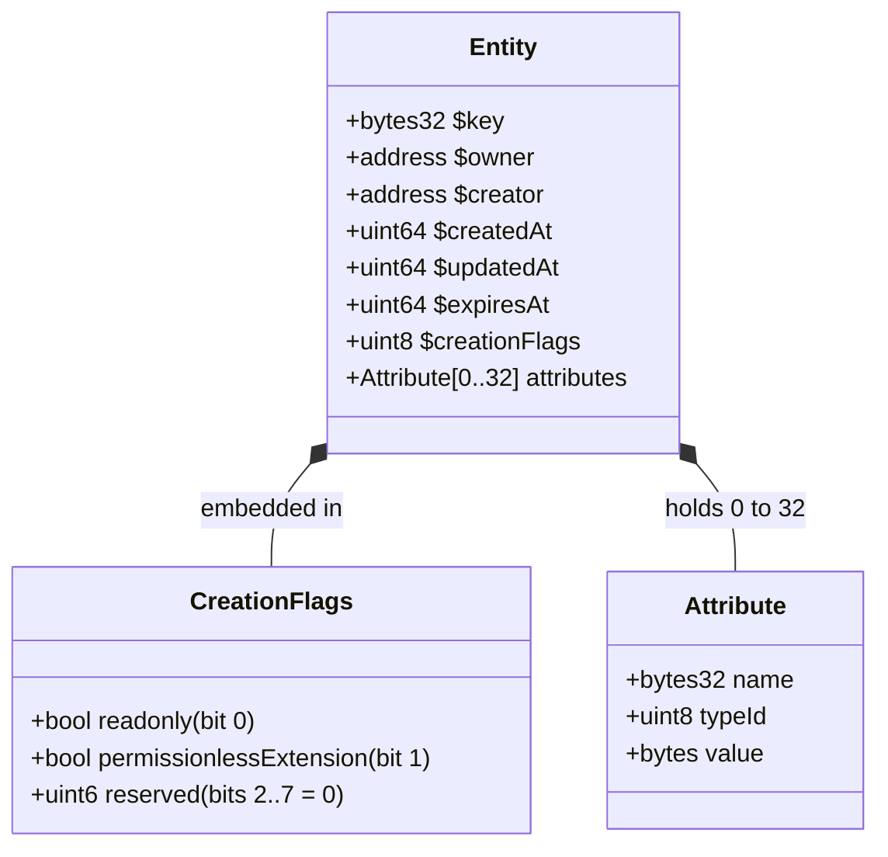
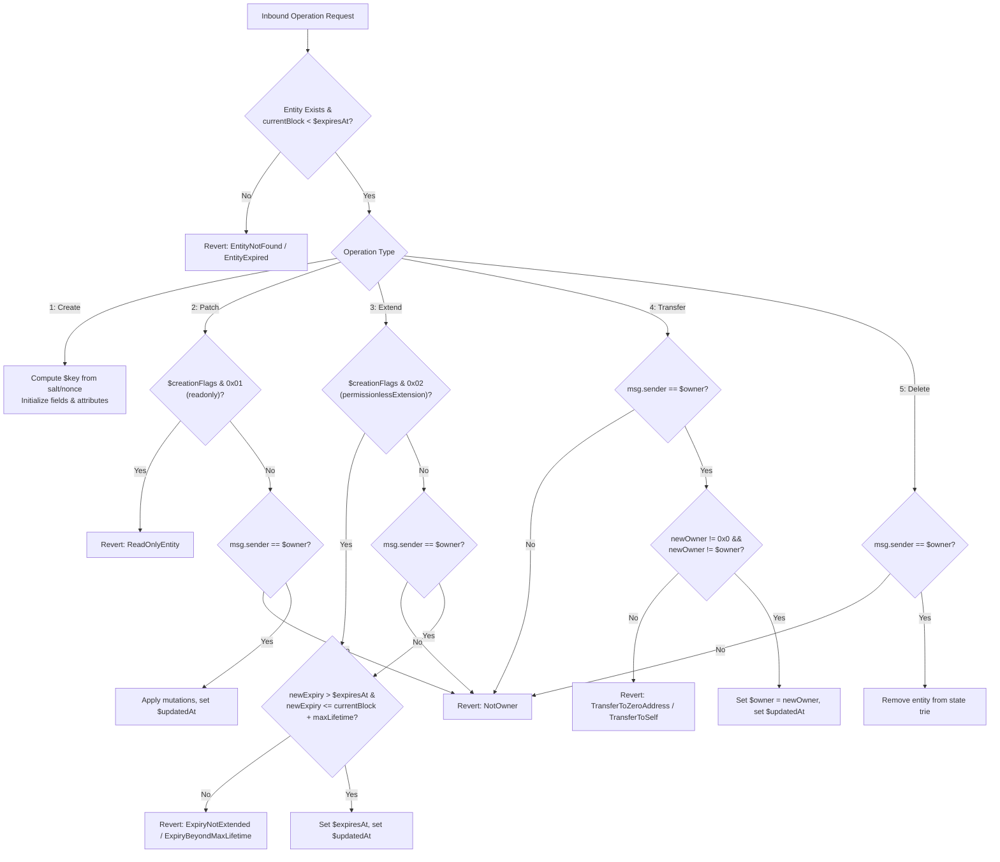
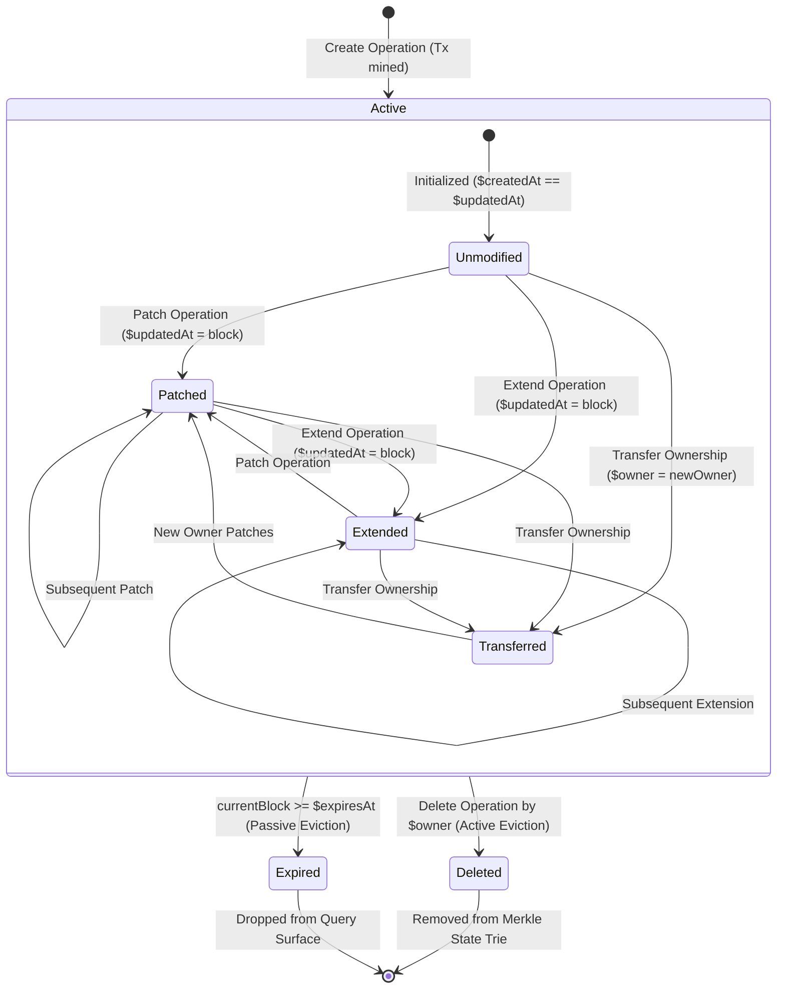

# Arkiv Entity Model & System Fields

## Table of Contents
- [1. Executive Overview](#1-executive-overview)
- [2. Anatomy of an Entity](#2-anatomy-of-an-entity)
  - [2.1. Structural Layout](#21-structural-layout)
  - [2.2. Entity State Wire Layout](#22-entity-state-wire-layout)
- [3. The Seven System Fields (`$` Fields)](#3-the-seven-system-fields--fields)
  - [3.1. `$key` (Entity Key Identifier)](#31-key-entity-key-identifier)
  - [3.2. `$owner` (Administrative Controller)](#32-owner-administrative-controller)
  - [3.3. `$creator` (Immutable Origin Author)](#33-creator-immutable-origin-author)
  - [3.4. `$createdAt` (Genesis Block Height)](#34-createdat-genesis-block-height)
  - [3.5. `$updatedAt` (Last Mutation Block Height)](#35-updatedat-last-mutation-block-height)
  - [3.6. `$expiresAt` (Time-to-Live Expiration Block)](#36-expiresat-time-to-live-expiration-block)
  - [3.7. `$creationFlags` (Immutable Behavioral Bitfield)](#37-creationflags-immutable-behavioral-bitfield)
- [4. Queryability & Sorting Matrix](#4-queryability--sorting-matrix)
- [5. Access Control & Mutation Rules](#5-access-control--mutation-rules)
  - [5.1. Ownership Verification Flow](#51-ownership-verification-flow)
  - [5.2. Operation Permission Matrix](#52-operation-permission-matrix)
- [6. JSON-RPC Representation vs SDK Formats](#6-json-rpc-representation-vs-sdk-formats)
  - [6.1. Raw JSON-RPC Response Shape](#61-raw-json-rpc-response-shape)
  - [6.2. SDK Strongly Typed Row](#62-sdk-strongly-typed-row)
- [7. Entity Lifecycle State Machine](#7-entity-lifecycle-state-machine)
- [8. Conclusion & Cross References](#8-conclusion--cross-references)

---

## 1. Executive Overview

In Arkiv, an **Entity** is the fundamental atomic unit of data storage—conceptually analogous to a document in MongoDB or a row in a relational database. Each entity consists of:
1. **User Attributes**: Up to 32 typed key-value pairs (`name`, `typeId`, `value`) that hold user-defined application data.
2. **System Fields (`$` Fields)**: Seven immutable or protocol-managed metadata fields prefixed with `$`.

System field names are strictly reserved. No user attribute may begin with `$`, preventing any collision between system metadata and user domain data. While attributes are dynamically defined and mutated, system fields govern the entity's cryptographic identity, access control, consensus provenance, and expiration lifecycle.

---

## 2. Anatomy of an Entity

### 2.1. Structural Layout



### 2.2. Entity State Wire Layout

When committed to Arkiv's Merkle-Patricia Trie state, an entity record encapsulates the system headers followed by the lexicographically ordered attribute array:

```
+-------------------------------------------------------------------------------------------------+
|                                    ARKIV ENTITY HEADER                                          |
+------------------------------------+-----------------------------------+------------------------+
| Field                              | Type                              | Encoding Size          |
+------------------------------------+-----------------------------------+------------------------+
| $key                               | bytes32                           | 32 bytes               |
| $owner                             | address (20 bytes)                | 32 bytes (word aligned)|
| $creator                           | address (20 bytes)                | 32 bytes (word aligned)|
| $createdAt                         | uint64                            | 8 bytes (word aligned) |
| $updatedAt                         | uint64                            | 8 bytes (word aligned) |
| $expiresAt                         | uint64                            | 8 bytes (word aligned) |
| $creationFlags                     | uint8 bitfield                    | 1 byte                 |
+------------------------------------+-----------------------------------+------------------------+
|                                    USER ATTRIBUTES ARRAY                                        |
+------------------------------------+-----------------------------------+------------------------+
| Attribute[0]                       | struct Attribute                  | bytes32, uint8, bytes  |
| Attribute[1]                       | struct Attribute                  | bytes32, uint8, bytes  |
| ...                                | ...                               | ...                    |
| Attribute[N <= 31]                 | struct Attribute                  | bytes32, uint8, bytes  |
+------------------------------------+-----------------------------------+------------------------+
```

---

## 3. The Seven System Fields (`$` Fields)

| Field | Solidity / Wire Type | TS SDK Type | Mutability | Populated By |
|---|---|---|---|---|
| [`$key`](#31-key-entity-key-identifier) | `bytes32` (32 bytes) | `Hex` (0x-string) | **Strictly Immutable** | Protocol key derivation function |
| [`$owner`](#32-owner-administrative-controller) | `address` (20 bytes) | `Hex` (EIP-55 checksum) | **Mutable** | Caller at creation; new owner on transfer |
| [`$creator`](#33-creator-immutable-origin-author) | `address` (20 bytes) | `Hex` (EIP-55 checksum) | **Strictly Immutable** | Caller (`tx.origin` / `msg.sender`) |
| [`$createdAt`](#34-createdat-genesis-block-height) | `uint64` (8 bytes) | `bigint` | **Strictly Immutable** | Consensus block height at creation |
| [`$updatedAt`](#35-updatedat-last-mutation-block-height) | `uint64` (8 bytes) | `bigint` | **Mutable** | Consensus block height on any mutation |
| [`$expiresAt`](#36-expiresat-time-to-live-expiration-block) | `uint64` (8 bytes) | `bigint` | **Mutable** (forward only) | `max(expiresAt, currentBlock + minLifetime)` |
| [`$creationFlags`](#37-creationflags-immutable-behavioral-bitfield) | `uint8` (bitfield) | `{ readonly, permissionlessExtension, raw }` | **Strictly Immutable** | Caller options specified during creation |

---

### 3.1. `$key` (Entity Key Identifier)

The `$key` is the permanent, globally unique 32-byte primary key of the entity.

#### Derivation Formula
The Arkiv node derives `$key` deterministically inside the consensus layer:
```solidity
bytes32 entityKey = keccak256(
    abi.encodePacked(
        uint256 chainId,
        address arkivContract,
        address owner,
        uint64  entityNonce,
        uint128 salt
    )
);
```
- **`chainId`**: The EIP-155 integer ID of the network (`7794095` on Rabdi). Prevents cross-chain replay collisions.
- **`arkivContract`**: Canonical address `0x4400000000000000000000000000000000000044`.
- **`owner`**: The account address creating the entity.
- **`entityNonce`**: A dedicated, monotonic per-account counter tracking total entities created by this owner. This is entirely separate from the transaction nonce (`eth_getTransactionCount`).
- **`salt`**: A 128-bit unsigned integer (`uint128`).

#### Predictability & Salt Mechanics
- **Default Random Salt**: The SDK generates 128 bits of cryptographic randomness via `crypto.getRandomValues`. This guarantees privacy and unguessability prior to block inclusion.
- **`NO_SALT` (`salt = 0`)**: The entity key is completely predictable by any observer who knows the owner's next `entityNonce`.
- **Pre-computed Cross-Entity References**: Using `publicClient.predictEntityKeys({ owner, count })`, applications can pre-compute keys to link dependent entities in a single atomic batch transaction (`executeBatch`).

---

### 3.2. `$owner` (Administrative Controller)

The `$owner` field identifies the Ethereum address that holds exclusive mutation rights over the entity.

#### Permissions Granted to `$owner`:
- Modifying attributes via operation 2 (`patch`).
- Transferring entity ownership via operation 4 (`transfer ownership`).
- Extending lifetime via operation 3 (`extend expiry`) (when `permissionlessExtension` is disabled).
- Deleting the entity via operation 5 (`delete`).

#### Reassignment (`changeOwnership`):
Ownership is transferred using operation tag `4`:
```solidity
(bytes32 entityKey, address newOwner)
```
- **Constraints**:
  - The caller must be the existing `$owner`; otherwise reverts with `NotOwner(bytes32, address, address)`.
  - `newOwner` cannot be `address(0)`; reverts with `TransferToZeroAddress(bytes32)`.
  - `newOwner` cannot be the current `$owner`; reverts with `TransferToSelf(bytes32)`.
- Upon successful transfer, the `$owner` field updates immediately, `$updatedAt` is updated to the current block, and an `OwnershipTransferred` event is emitted.

---

### 3.3. `$creator` (Immutable Origin Author)

The `$creator` field records the original address that initialized the entity during operation 1 (`create`).

#### Key Properties:
- **Strict Immutability**: Even if an entity's `$owner` changes 100 times, `$creator` remains permanently fixed to the initial creating address.
- **Provenance Verification**: Because Arkiv is a public database where anyone can write arbitrary schema tags, dApps filter on `createdBy(account.address)` or `$creator = addr(0x...)` to ensure records were genuinely minted by the authorized protocol author rather than an impersonator.

---

### 3.4. `$createdAt` (Genesis Block Height)

- **Definition**: The uint64 block number of the block in which the creation transaction was included.
- **Units**: Block height. On the Rabdi network, block height increments every 2 seconds.
- **Immutability**: Written once during creation; never changes.
- **Query Engine Limitation**: On Rabdi, `$createdAt` cannot be sorted or filtered on inside query strings. To sort by creation time, applications can sort client-side after selecting `$createdAt`, or rely on default oldest-first query return order.

---

### 3.5. `$updatedAt` (Last Mutation Block Height)

- **Definition**: The uint64 block number of the most recent block in which a state change occurred.
- **Initial Value**: Set equal to `$createdAt` upon initial creation.
- **Triggers for Update**:
  - Attribute mutation via `patchEntity` (Operation 2)
  - Expiration extension via `extendEntity` (Operation 3)
  - Ownership reassignment via `changeOwnership` (Operation 4)
- **Query Engine Limitation**: Like `$createdAt`, `$updatedAt` can be projected (`select({ $updatedAt: true })`), but cannot be filtered or sorted in `where` or `orderBy` clauses.

---

### 3.6. `$expiresAt` (Time-to-Live Expiration Block)

The `$expiresAt` field determines the definitive block height after which the entity is pruned from query visibility.

#### Expiry Resolution Formula:
```text
expiry = max(expiresAtParam, currentBlock + minLifetimeParam)
```
- **Enforcement Window**:
  - Must be in the strict future: `expiry > currentBlock` (otherwise reverts with `ExpiryDeadOnArrival`).
  - Cannot exceed maximum network lifetime: `expiry <= currentBlock + 7,884,000` (about 182.5 days on Rabdi; otherwise reverts with `ExpiryBeyondMaxLifetime`).
- **Extension Monotonicity**: An extension transaction can only advance `$expiresAt` further into the future. Attempting to set an expiry less than or equal to the current `$expiresAt` reverts with `ExpiryNotExtended`.
- **Querying Support**: `$expiresAt` is fully indexed. It can be filtered using `gt`, `gte`, `lt`, `lte`, and `between`, and sorted using `orderBy(asc("$expiresAt"))` or `orderBy(desc("$expiresAt"))`.

---

### 3.7. `$creationFlags` (Immutable Behavioral Bitfield)

The `$creationFlags` field is an 8-bit unsigned integer (`uint8`) configured at entity creation time. It fixes fundamental behavioral properties for the entity's entire lifespan.

```
Bit:       7   6   5   4   3   2   1   0
         +---+---+---+---+---+---+---+---+
Meaning: |   RESERVED (Must be 0)| P | R |
         +---+---+---+---+---+---+---+---+
                                   |   |
                                   |   +---> Bit 0: readonly (0x01)
                                   +-------> Bit 1: permissionlessExtension (0x02)
```

#### Bitfield Specifications:

| Bit | Hex Mask | Flag Name | Description when Bit = 1 | Violation Error |
|---|---|---|---|---|
| **0** | `0x01` | `readonly` | Entity attributes become immutable. Any subsequent `patchEntity` operation is rejected. The entity can still be extended, transferred, or deleted. | `ReadOnlyEntity(bytes32 entityKey)` |
| **1** | `0x02` | `permissionlessExtension` | Expiry extension is decoupled from ownership. Any external wallet can invoke `extendEntity` to fund longer retention. | `NotOwner(...)` (if 0 and caller is non-owner) |
| **2..7** | `0xFC` | `RESERVED` | Protocol reserved bits. Must strictly be `0`. | `ReservedCreationFlags(uint8 creationFlags)` |

#### TypeScript SDK Decoding:
When selected, `$creationFlags` is decoded into a structured object:
```ts
row.$creationFlags = {
  readonly: false,
  permissionlessExtension: true,
  raw: 2, // 0x02
}
```

---

## 4. Queryability & Sorting Matrix

The table below contrasts how user attributes and system fields behave across Arkiv's query operations:

| Field | Selectable (`select`) | Filterable (`where`) | Sortable (`orderBy`) | Query Language Type |
|---|---|---|---|---|
| **`$key`** | Yes (`Hex`) | **Yes** (`eq`, `gt`, `lt`, etc.) | **Yes** (`ASC`/`DESC`) | `key(0x...)` |
| **`$owner`** | Yes (`Hex` address) | **Yes** (`eq`, `ownedBy`) | **Yes** (`ASC`/`DESC`) | `addr(0x...)` |
| **`$creator`** | Yes (`Hex` address) | **Yes** (`eq`, `createdBy`) | **Yes** (`ASC`/`DESC`) | `addr(0x...)` |
| **`$expiresAt`** | Yes (`bigint`) | **Yes** (`lt`, `gt`, `between`) | **Yes** (`ASC`/`DESC`) | `u64(...)` |
| **`$createdAt`** | Yes (`bigint`) | **No** (Compile / Predicate Error) | **No** (Sort Error) | N/A (Client-side sort) |
| **`$updatedAt`** | Yes (`bigint`) | **No** (Compile / Predicate Error) | **No** (Sort Error) | N/A (Client-side sort) |
| **`$creationFlags`** | Yes (`Object`) | **No** | **No** | N/A |
| **User Attribute (Indexed)** | Yes (`ArkivValue`) | **Yes** | **Yes** (except `bytes`) | Native literal constructor |
| **User Attribute (Unindexed)** | Yes (`ArkivValue`) | **No** (Compile Error) | **Yes** (except `bytes`) | Native literal constructor |
| **`bytes` Attribute** | Yes (`Hex`) | **No** | **No** | N/A |

---

## 5. Access Control & Mutation Rules

### 5.1. Ownership Verification Flow



### 5.2. Operation Permission Matrix

| Operation | Non-Owner Allowed? | Pre-requisite Checks | Revert Errors |
|---|---|---|---|
| **Create** | N/A (New Entity) | Salt validity, positive future expiry, max attributes <= 32, sorted names | `ExpiryDeadOnArrival`, `TooManyAttributes`, `AttributesNotSorted` |
| **Patch** | **No** (Owner Only) | Must not be `readonly`, mutations non-empty, attributes match schema | `NotOwner`, `ReadOnlyEntity`, `EmptyMutations`, `ConflictingMutationError` |
| **Extend Expiry** | **Yes IF** `permissionlessExtension == 1` | `newExpiresAt > currentExpiresAt`, `newExpiresAt <= currentBlock + 7,884,000` | `NotOwner`, `ExpiryNotExtended`, `ExpiryBeyondMaxLifetime` |
| **Transfer Ownership** | **No** (Owner Only) | `newOwner != address(0)`, `newOwner != currentOwner` | `NotOwner`, `TransferToZeroAddress`, `TransferToSelf` |
| **Delete** | **No** (Owner Only) | Entity must be active (not already expired or deleted) | `NotOwner`, `EntityNotFound`, `EntityExpired` |

---

## 6. JSON-RPC Representation vs SDK Formats

### 6.1. Raw JSON-RPC Response Shape

When querying entities through `arkiv_query` or `arkiv_getEntity`, system fields are returned as top-level JSON keys with hexadecimal numeric encodings:

```json
{
  "key": "0x5f1e8a93bc214d48956e1b782987114b09e20a34b221e7d8004fbc87a2e411b9",
  "owner": "0xd8dA6BF26964aF9D7eEd9e03E53415D37aA96045",
  "creator": "0xd8dA6BF26964aF9D7eEd9e03E53415D37aA96045",
  "createdAt": "0x1bc420",
  "updatedAt": "0x1bc4e8",
  "expiresAt": "0x2fad40",
  "creationFlags": {
    "readonly": false,
    "permissionlessExtension": true,
    "raw": 2
  },
  "attributes": [
    { "name": "arkiv.schema", "type": "str", "value": "my-app.posts" },
    { "name": "score", "type": "dec", "value": "4.5" },
    { "name": "title", "type": "str", "value": "Hello, Arkiv" }
  ]
}
```

### 6.2. SDK Strongly Typed Row

The TypeScript SDK parses hex strings into native ECMAScript and Viem primitives:

```ts
import { type Hex } from "viem"

interface ArkivPostRow {
  $key: Hex                   // '0x5f1e...'
  $owner: Hex                 // Checksummed address
  $creator: Hex               // Checksummed address
  $createdAt: bigint          // 1819680n
  $updatedAt: bigint          // 1819880n
  $expiresAt: bigint          // 3124544n
  $creationFlags: {
    readonly: boolean         // false
    permissionlessExtension: boolean // true
    raw: number               // 2
  }
  score: {
    type: "dec"
    value: string             // "4.5"
  }
  title: {
    type: "str"
    value: string             // "Hello, Arkiv"
  }
}
```

---

## 7. Entity Lifecycle State Machine



---

## 8. Conclusion & Cross References

The Arkiv entity model cleanly bifurcates application data (user attributes) from administrative and consensus metadata (`$` system fields). By enforcing cryptographic ownership, immutable provenance (`$creator`), strictly monotonic expiration, and immutable behavioral flags (`$creationFlags`), Arkiv establishes an incorruptible substrate for Web3 data management.

### Related Architecture Modules
- [Arkiv Overview & Four Principles](file:///home/dikshitrj/Coding/arkivector/RESEARCH/arkiv-docs/01-architecture-and-fundamentals/overview.md)
- [Attributes, Types & Indexing Mechanics](file:///home/dikshitrj/Coding/arkivector/RESEARCH/arkiv-docs/01-architecture-and-fundamentals/attributes-and-types.md)
- [Lifecycle, Block Timing & Expiration](file:///home/dikshitrj/Coding/arkivector/RESEARCH/arkiv-docs/01-architecture-and-fundamentals/lifecycle-and-expiration.md)
- [Network Topography & Infrastructure](file:///home/dikshitrj/Coding/arkivector/RESEARCH/arkiv-docs/01-architecture-and-fundamentals/network-and-infrastructure.md)
