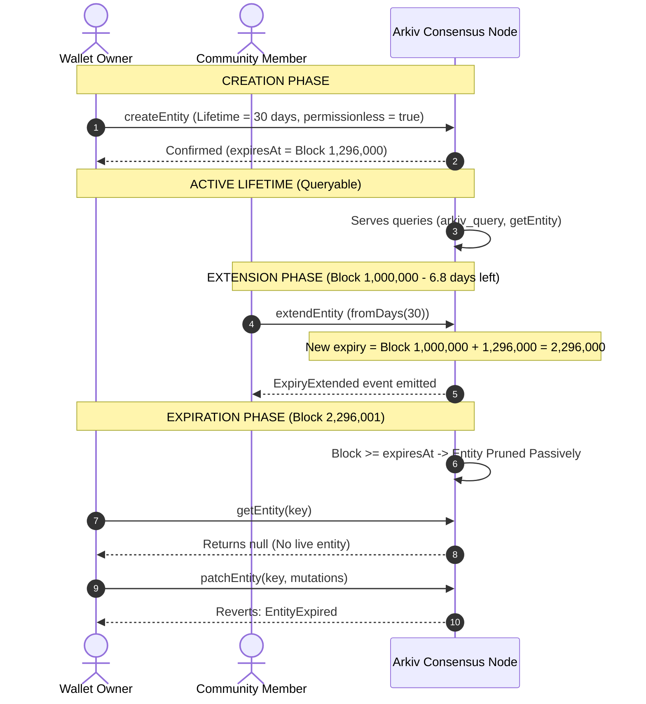

# Arkiv Lifecycle, Block Timing & Expiration Specification

## Table of Contents
- [1. Executive Summary](#1-executive-summary)
- [2. Time as Consensus Blocks](#2-time-as-consensus-blocks)
  - [2.1. The 2-Second Block Quantum (Rabdi Testnet)](#21-the-2-second-block-quantum-rabdi-testnet)
  - [2.2. Block Timing Method (`arkiv_getBlockTiming`)](#22-block-timing-method-arkiv_getblocktiming)
- [3. The Unified Expiration Formula](#3-the-unified-expiration-formula)
  - [3.1. Mathematical Formulation](#31-mathematical-formulation)
  - [3.2. Lifetimes vs. Deadlines](#32-lifetimes-vs-deadlines)
  - [3.3. Combination Mode (Deadlines with Floors)](#33-combination-mode-deadlines-with-floors)
- [4. Protocol Bounds & Constraints](#4-protocol-bounds--constraints)
  - [4.1. Dead-on-Arrival Invariant](#41-dead-on-arrival-invariant)
  - [4.2. Maximum Lifetime Cap (`MAX_LIFETIME`)](#42-maximum-lifetime-cap-max_lifetime)
- [5. Expiration Extensions (`extendEntity`)](#5-expiration-extensions-extendentity)
  - [5.1. Extension Relative to Block Inclusion](#51-extension-relative-to-block-inclusion)
  - [5.2. Monotonicity Enforcement](#52-monotonicity-enforcement)
  - [5.3. Permissionless Extensions](#53-permissionless-extensions)
- [6. Entity Expiration Mechanics](#6-entity-expiration-mechanics)
  - [6.1. Passive Eviction & Zero-Event Pruning](#61-passive-eviction--zero-event-pruning)
  - [6.2. Query Surface Disappearance](#62-query-surface-disappearance)
  - [6.3. Post-Expiry Mutation Reversions](#63-post-expiry-mutation-reversions)
- [7. SDK `ExpirationTime` Builder](#7-sdk-expirationtime-builder)
  - [7.1. Helper Methods Reference](#71-helper-methods-reference)
  - [7.2. Conversion Mechanics & Rounding](#72-conversion-mechanics--rounding)
- [8. Economic Rationale: Time-Scoped Storage Rent](#8-economic-rationale-time-scoped-storage-rent)
  - [8.1. Eliminating the Tragedy of the Commons](#81-eliminating-the-tragedy-of-the-commons)
  - [8.2. Gas Sizing by Lifetime Duration](#82-gas-sizing-by-lifetime-duration)
- [9. Visual Workflows & State Machines](#9-visual-workflows--state-machines)
- [10. Conclusion & Reference Links](#10-conclusion--reference-links)

---

## 1. Executive Summary

In traditional blockchains like Ethereum, data written to contract storage (`sstore`) persists indefinitely unless explicitly cleared by a transaction. This creates an uncurbed state bloat problem where validators bear permanent infrastructure costs for historical data that may have been abandoned years prior.

Arkiv fundamentally reimagines on-chain storage by introducing a **time-scoped storage rent model**. Every entity exists for a strictly bounded lifespan measured in consensus blocks. When the blockchain tip reaches an entity's expiration block height (`$expiresAt`), the entity immediately, passively, and irreversibly leaves the active query surface. Storage fees are paid proportional to data size and chosen duration, ensuring sustainable validator resource requirements.

---

## 2. Time as Consensus Blocks

### 2.1. The 2-Second Block Quantum (Rabdi Testnet)

Arkiv measures all lifespans, deadlines, and durations in **discrete block increments**, rather than Unix epoch seconds. 
- On the **Rabdi public testnet**, the target block generation time is exactly **2 seconds** (`duration: 2`).
- A duration in wall-clock time (seconds, minutes, hours, days) is converted into integer block units:
  $$\text{Blocks} = \frac{\text{Seconds}}{2}$$

```
+-----------------------------------------------------------------------------+
|                           RABDI BLOCK QUANTUM CONVERSIONS                   |
+-------------------+--------------------+------------------------------------+
| Wall-Clock Unit   | Duration (Seconds) | Rabdi Consensus Blocks             |
+-------------------+--------------------+------------------------------------+
| 1 Block           | 2 seconds          | 1 block                            |
| 1 Minute          | 60 seconds         | 30 blocks                          |
| 1 Hour            | 3,600 seconds      | 1,800 blocks                       |
| 1 Day (24 hours)  | 86,400 seconds     | 43,200 blocks                      |
| 1 Week (7 days)   | 604,800 seconds    | 302,400 blocks                     |
| 1 Month (30 days) | 2,592,000 seconds  | 1,296,000 blocks                   |
| 182.5 Days (Max)  | 15,768,000 seconds | 7,884,000 blocks (MAX_LIFETIME)   |
+-------------------+--------------------+------------------------------------+
```

> [!WARNING]
> Because network conditions or block production jitter may occasionally cause blocks to arrive slightly faster or slower than 2.0 seconds, wall-clock time in Arkiv is approximate. The consensus block number is the only exact source of truth.

### 2.2. Block Timing Method (`arkiv_getBlockTiming`)

Clients query the current consensus height and cadence via the specialized JSON-RPC endpoint `arkiv_getBlockTiming`:

```json
// Request
{
  "jsonrpc": "2.0",
  "id": 1,
  "method": "arkiv_getBlockTiming",
  "params": []
}

// Response
{
  "jsonrpc": "2.0",
  "id": 1,
  "result": {
    "current_block": 1824100,
    "current_block_time": 1742721127,
    "duration": 2
  }
}
```
- `current_block`: Latest canonical block height mined by the node.
- `current_block_time`: Unix timestamp in seconds of the current block.
- `duration`: Elapsed seconds since the prior block (typically 2).

---

## 3. The Unified Expiration Formula

Both entity creation (Operation 1) and expiration extension (Operation 3) pass two 64-bit parameters to the EVM precompile / contract:
1. `uint64 expiresAt`
2. `uint64 minLifetime`

### 3.1. Mathematical Formulation

The Arkiv node resolves these two parameters into a single definitive block height using the **Unified Expiration Formula**:

$$\text{expiry} = \max(\text{expiresAt}, \text{currentBlock} + \text{minLifetime})$$

Where `currentBlock` is the block height in which the transaction is mined and included by validators.

### 3.2. Lifetimes vs. Deadlines

By selectively setting one parameter to `0`, developers choose between relative lifetime durations or absolute block deadlines:

```
+-----------------------------------------------------------------------------------------+
|                               EXPIRATION PARAMETER CONFIGURATIONS                       |
+------------------------+------------------+------------------+--------------------------+
| Desired Mode           | expiresAt Param  | minLifetime Param| Node Calculation         |
+------------------------+------------------+------------------+--------------------------+
| Relative Lifetime      | 0                | Target Blocks    | currentBlock + Target    |
| Absolute Deadline      | Target Block     | 0                | Target Block             |
| Deadline with Floor    | Target Block     | Minimum Blocks   | max(Target, current + Min|
+------------------------+------------------+------------------+--------------------------+
```

#### Mode A: Relative Lifetime (e.g., 30 Days)
If you want an entity to live for exactly 30 days (1,296,000 blocks) starting from whenever the transaction is confirmed:
- `expiresAt = 0`
- `minLifetime = 1296000`
- Node computes: $\max(0, \text{currentBlock} + 1296000) = \text{currentBlock} + 1296000$.

#### Mode B: Absolute Deadline (e.g., Block 5,000,000)
If you want an entity to persist until a specific scheduled future event at block 5,000,000:
- `expiresAt = 5000000`
- `minLifetime = 0`
- Node computes: $\max(5000000, \text{currentBlock} + 0) = 5000000$.

### 3.3. Combination Mode (Deadlines with Floors)

Network congestion can delay transaction confirmation. If a transaction targeting an absolute deadline of block 2,000,000 is delayed in the mempool and lands at block 1,999,990, the entity would only survive for 10 blocks (20 seconds).

To guard against mempool lag, Arkiv supports **combination mode**:
```ts
ExpirationTime.atBlock(2_000_000n, {
  atLeast: ExpirationTime.fromDays(1), // 43,200 blocks
})
```
- Wire payload: `expiresAt = 2000000`, `minLifetime = 43200`.
- If mined at block 1,950,000: $\max(2000000, 1950000 + 43200 = 1993200) = 2000000$.
- If mined at block 1,999,990: $\max(2000000, 1999990 + 43200 = 2043190) = 2043190$.
The entity is guaranteed to live at least 1 full day regardless of when the transaction confirms.

---

## 4. Protocol Bounds & Constraints

Every calculated expiration must pass two protocol checks inside the contract. If either fails, the transaction reverts and emits a specific custom error:

```
               +--------------------------------------------------+
               |            Consensus Block Verification          |
               +------------------------+-------------------------+
                                        |
                         +--------------v-------------+
                         |  expiry > currentBlock ?   |
                         +--------------+-------------+
                                        |
                          +-------------+-------------+
                          | No                        | Yes
                          v                           v
              [Revert: ExpiryDeadOnArrival]     +-----v--------------------------------------+
                                                | expiry <= currentBlock + MAX_LIFETIME ?    |
                                                +-----+--------------------------------------+
                                                      |
                                        +-------------+-------------+
                                        | No                        | Yes
                                        v                           v
                          [Revert: ExpiryBeyondMax]          [Accept Expiry Block]
```

### 4.1. Dead-on-Arrival Invariant
An entity cannot be created or extended to expire at or before the block of inclusion:
$$\text{expiry} > \text{currentBlock}$$
If $\text{expiry} \le \text{currentBlock}$, the node reverts with:
```solidity
error ExpiryDeadOnArrival(uint64 target, uint64 currentBlock);
```

### 4.2. Maximum Lifetime Cap (`MAX_LIFETIME`)
To preserve storage rent velocity and prevent unbounded commitment of validator state, Arkiv enforces an immutable maximum lifetime limit:
$$\text{MAX\_LIFETIME} = 7{,}884{,}000 \text{ blocks}$$
At 2 seconds per block, $7{,}884{,}000 \text{ blocks} = 15{,}768{,}000 \text{ seconds} = 182.5 \text{ days}$ (approximately 6 months).

Any transaction where $\text{expiry} > \text{currentBlock} + 7{,}884{,}000$ reverts with:
```solidity
error ExpiryBeyondMaxLifetime(uint64 target, uint64 currentBlock, uint64 maxLifetime);
```
In the TypeScript SDK, attempting to configure an expiration beyond $182.5$ days (e.g., `ExpirationTime.fromDays(200)` or `ExpirationTime.fromYears(1)`) throws an immediate client-side `InvalidExpiryError` before broadcasting.

---

## 5. Expiration Extensions (`extendEntity`)

Entities can be kept alive indefinitely by submitting an extension operation (Operation 3) prior to expiration.

```solidity
// Operation 3: Extend Expiry
struct ExtendExpiryOp {
    bytes32 entityKey;
    uint64  expiresAt;
    uint64  minLifetime;
}
```

### 5.1. Extension Relative to Block Inclusion

> [!IMPORTANT]
> **Durations count from NOW (the block of transaction inclusion), NOT from the entity's current `$expiresAt`!**

Unlike some subscription systems that append days onto the end of an existing subscription balance:
- If an entity currently has 10 days of lifetime remaining, and the owner executes:
  ```ts
  await walletClient.extendEntity({
    entityKey,
    expiration: ExpirationTime.fromDays(30),
  })
  ```
- The entity's new lifetime is **30 days from the inclusion block**, NOT $10 + 30 = 40$ days.
- To maximize an entity's lifespan at any time, execute `ExpirationTime.max()`, resetting `$expiresAt` to the full 182.5 days forward from the current block.

### 5.2. Monotonicity Enforcement

Arkiv enforces strict forward monotonicity on entity lifespans. The new expiration block cannot move earlier than the current `$expiresAt`:
$$\text{newExpiry} \ge \text{currentExpiresAt}$$
- If $\text{newExpiry} < \text{currentExpiresAt}$, the transaction reverts with:
  ```solidity
  error ExpiryNotExtended(bytes32 entityKey, uint64 newExpiresAt, uint64 currentExpiresAt);
  ```
- If $\text{newExpiry} == \text{currentExpiresAt}$, the operation succeeds as a no-op without altering the expiration block or incurring unnecessary state updates.

### 5.3. Permissionless Extensions

By default, only the entity's `$owner` can execute `extendEntity`. Attempts by third-party accounts revert with `NotOwner(...)`.

However, during entity creation, the creator can set bit 1 of `$creationFlags`:
```ts
const { entityKey } = await walletClient.createEntity(Posts, values, {
  expiration: ExpirationTime.fromDays(30),
  flags: { permissionlessExtension: true }, // sets bit 1 (0x02)
})
```

When `permissionlessExtension` is enabled:
1. **Sovereign Content, Crowd-Funded Rent**: The owner retains exclusive rights to edit or delete the entity, but any third party, DAO, or community member can pay gas to keep the entity alive.
2. **Public Good Data Hosting**: Allows public indexes, protocol registries, and open data feeds to be preserved by anyone who values their availability.

---

## 6. Entity Expiration Mechanics

### 6.1. Passive Eviction & Zero-Event Pruning

Arkiv does **not** run an active cleanup transaction or loop over expired entities when a block is mined. Such an approach would cause massive, unpredictable gas spikes (block stuffing).

Instead, eviction is **passive and consensus-driven**:
1. When block $N$ is mined, any entity where $\$expiresAt \le N$ is mathematically considered expired by all nodes.
2. **Zero Events Emitted**: Arkiv emits **no event** when an entity expires. There is no `EntityExpired` event log on the blockchain.
3. External caching layers, indexers, or local databases must track the entity's `$expiresAt` field and invalidate their local caches independently.

### 6.2. Query Surface Disappearance

Once expired:
- `arkiv_query` automatically filters out the entity from all query results.
- `arkiv_getEntity` returns `null` (or throws `NoEntityFoundError` in SDK high-level helpers).
- The entity is completely invisible to read traffic.

### 6.3. Post-Expiry Mutation Reversions

Once an entity has expired, it can never be revived, patched, extended, or transferred. Any transaction attempting to mutate an expired entity reverts with:
```solidity
error EntityExpired(bytes32 entityKey, uint64 expiresAt);
```

---

## 7. SDK `ExpirationTime` Builder

The TypeScript SDK provides a fluent builder class, `ExpirationTime`, to construct valid wire parameters.

### 7.1. Helper Methods Reference

```ts
import { ExpirationTime } from "@arkiv-network/sdk"
```

| Helper Method | Description | Underlying Calculation |
|---|---|---|
| `ExpirationTime.fromSeconds(n)` | Durations in seconds (must be even) | `minLifetime = n / 2` |
| `ExpirationTime.fromMinutes(n)` | `n` minutes of lifetime | `minLifetime = n * 30` |
| `ExpirationTime.fromHours(n)` | `n` hours of lifetime | `minLifetime = n * 1800` |
| `ExpirationTime.fromDays(n)` | `n` days of lifetime | `minLifetime = n * 43200` |
| `ExpirationTime.fromWeeks(n)` | `n` weeks of lifetime | `minLifetime = n * 302400` |
| `ExpirationTime.fromMonths(n)` | `n` 30-day periods | `minLifetime = n * 1296000` |
| `ExpirationTime.fromBlocks(n)` | Explicit block count | `minLifetime = n` |
| `ExpirationTime.max()` | Maximum allowable lifespan | `minLifetime = 7884000n` |
| `ExpirationTime.atBlock(block, opts)` | Target specific block number | `expiresAt = block` |
| `ExpirationTime.atDate(date, opts)` | Target future wall-clock date | Estimates target block from `current_block_time` |

### 7.2. Conversion Mechanics & Rounding

- **Odd Second Validation**: If `fromSeconds(3)` is passed, the SDK throws `InvalidExpiryError` immediately because Rabdi's 2-second block duration cannot split fractional blocks.
- **Date Conversion**: When using `atDate(new Date(...))`, the SDK fetches the latest block timing via `arkiv_getBlockTiming`, computes $\Delta t = \text{targetTime} - \text{currentBlockTime}$, and rounds up to the next whole block:
  $$\text{targetBlock} = \text{currentBlock} + \left\lceil \frac{\Delta t}{2} \right\rceil$$

---

## 8. Economic Rationale: Time-Scoped Storage Rent

### 8.1. Eliminating the Tragedy of the Commons

Traditional blockchains suffer from permanent state accumulation:

```
Ethereum / L2 Storage Growth (Cumulative State Bloat):
State Size (GB)
 ^
 |                                                  /
 |                                            /----/
 |                                      /----/
 |                                /----/
 |                          /----/
 |                    /----/
 |              /----/
 |        /----/
 +----------------------------------------------------> Time (Years)
 State disk footprint grows monotonically forever.
```

Arkiv's time-scoped storage model stabilizes the validator state size around active data:

```
Arkiv Dynamic State Equilibrium:
State Size (GB)
 ^
 |                /---\         /---\
 |        /---\  /     \  /---\/     \  /---\
 |       /     \/       \/            \/     \
 |  /---/
 +----------------------------------------------------> Time (Years)
 Expired entities automatically drop off, keeping node state bounded.
```

### 8.2. Gas Sizing by Lifetime Duration

In Arkiv, state expansion is priced along two axes:
1. **Size Dimension**: Number of attributes and byte length of payloads.
2. **Time Dimension**: Total block duration requested ($\text{expiresAt} - \text{currentBlock}$).

An application storing a temporary session token for 1 hour pays a tiny fraction of the gas required to store an NFT metadata record for 182 days. This makes Arkiv exceptionally economical for high-velocity, ephemeral Web3 applications (e.g., oracles, state channels, game sessions, and IoT telemetries).

---

## 9. Visual Workflows & State Machines

### 9.1. Entity Lifecycle Timeline



---

## 10. Conclusion & Reference Links

Arkiv's lifecycle architecture bridges the gap between decentralized immutability and sustainable resource governance. By anchoring time to consensus blocks, establishing deterministic bounds via `max(expiresAt, currentBlock + minLifetime)`, and enabling permissionless extensions, Arkiv ensures that active state remains lightweight, accessible, and economically sound.

### Related Architecture Modules
- [Arkiv Overview & Four Principles](file:///home/dikshitrj/Coding/arkivector/RESEARCH/arkiv-docs/01-architecture-and-fundamentals/overview.md)
- [Entity Model & System Fields](file:///home/dikshitrj/Coding/arkivector/RESEARCH/arkiv-docs/01-architecture-and-fundamentals/entity-model.md)
- [Attributes, Types & Indexing Mechanics](file:///home/dikshitrj/Coding/arkivector/RESEARCH/arkiv-docs/01-architecture-and-fundamentals/attributes-and-types.md)
- [Network Topography & Infrastructure](file:///home/dikshitrj/Coding/arkivector/RESEARCH/arkiv-docs/01-architecture-and-fundamentals/network-and-infrastructure.md)
