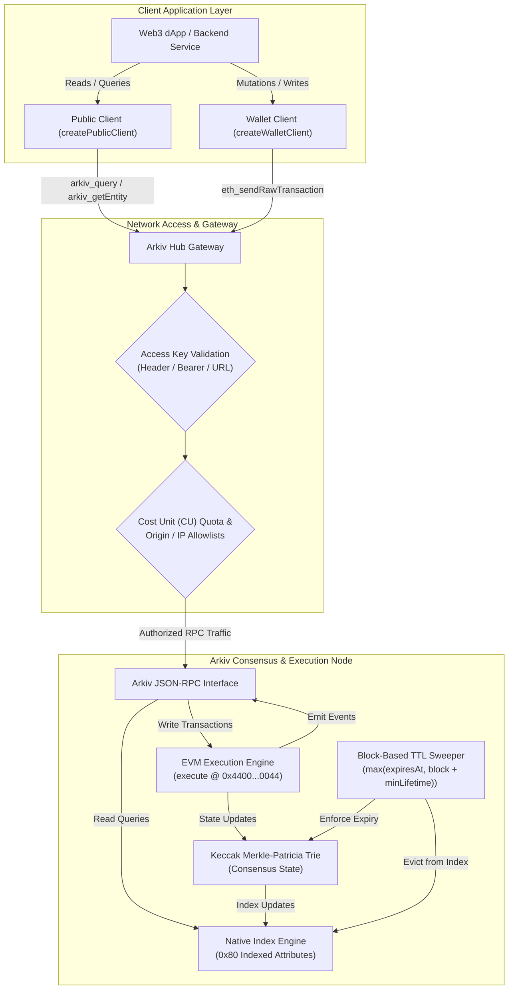
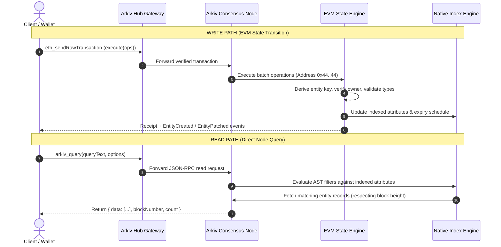

# Arkiv Architecture & Fundamentals: Overview

## Table of Contents
- [1. Executive Summary](#1-executive-summary)
- [2. The Web3 Database Paradigm](#2-the-web3-database-paradigm)
- [3. The Four Core Principles](#3-the-four-core-principles)
  - [3.1. Queryable](#31-queryable)
  - [3.2. Time-Scoped](#32-time-scoped)
  - [3.3. Tamper-Proof](#33-tamper-proof)
  - [3.4. Wallet-Owned](#34-wallet-owned)
- [4. Dual-Rail Architecture](#4-dual-rail-architecture)
  - [4.1. System Architecture Diagram](#41-system-architecture-diagram)
  - [4.2. Read vs. Write Paths](#42-read-vs-write-paths)
- [5. Cryptographic State Commitment](#5-cryptographic-state-commitment)
  - [5.1. Keccak Merkle-Patricia Trie](#51-keccak-merkle-patricia-trie)
  - [5.2. State Transitions & Verification](#52-state-transitions--verification)
- [6. Economic Model & Gas Mechanics](#6-economic-model--gas-mechanics)
  - [6.1. Native Gas Token (GLM / tGLM)](#61-native-gas-token-glm--tglm)
  - [6.2. Storage Rent Economics](#62-storage-rent-economics)
- [7. Public Yet Partitioned Multi-Tenancy](#7-public-yet-partitioned-multi-tenancy)
  - [7.1. Global Shared State vs. Application Boundaries](#71-global-shared-state-vs-application-boundaries)
  - [7.2. Tag Isolation via `arkiv.schema`](#72-tag-isolation-via-arkivschema)
  - [7.3. Cryptographic Ownership Boundaries](#73-cryptographic-ownership-boundaries)
- [8. Architectural Comparison with Existing Web3 Storage](#8-architectural-comparison-with-existing-web3-storage)
- [9. Conclusion & Reference Links](#9-conclusion--reference-links)

---

## 1. Executive Summary

Arkiv is an EVM-native, verifiable, time-scoped Web3 database. It unifies decentralized smart contract execution with structured relational and document database semantics. Rather than relying on external indexing intermediaries (such as The Graph or bespoke off-chain indexers) or treating decentralized storage as immutable blob dumps (such as IPFS or Arweave), Arkiv introduces native attribute-level indexing, block-based time-to-live (TTL) expiration, and direct JSON-RPC SQL-like querying straight from the blockchain consensus layer.

Developers interact with Arkiv using standard Ethereum tooling—cryptographic wallets, signed EVM transactions, and JSON-RPC endpoints. Arkiv maintains the guarantees of Web3 (decentralized consensus, cryptographic state proofs, non-custodial ownership) while delivering Web2-grade querying capabilities (sub-second query execution, multi-attribute indexing, sorting, filtering, and pagination).

```
                      +---------------------------------------+
                      |               ARKIV                   |
                      |        The Web3 Database              |
                      +-------------------+-------------------+
                                          |
          +-------------------------------+-------------------------------+
          |                               |                               |
+---------v---------+           +---------v---------+           +---------v---------+
|     Queryable     |           |    Time-Scoped    |           |   Tamper-Proof    |
| Native Indexing   |           | Block-Level TTL   |           | Keccak MPT Roots  |
| Web2 SQL Queries  |           | Storage Rent Model|           | Signed EVM Txs    |
+-------------------+           +-------------------+           +-------------------+
                                          |
                                +---------v---------+
                                |   Wallet-Owned    |
                                | EOA Administrative|
                                | Sovereign Control |
                                +-------------------+
```

---

## 2. The Web3 Database Paradigm

Traditional decentralized application (dApp) architectures suffer from a fundamental disconnect:
1. **Raw EVM Storage**: `sload` and `sstore` are prohibitively expensive for structured records, text, or binary assets, and cannot be filtered or indexed without costly contract loops.
2. **Decentralized Blob Storage (IPFS / Arweave)**: Immutable content-addressable blobs cannot be queried, updated, or indexed in place; finding records requires an off-chain coordinator.
3. **Decentralized Indexers (The Graph / Subsquid)**: Indexers lag behind chain tip, introduce indexing delay, rely on off-chain subgraphs that can fall out of sync, and present centralization vectors.

Arkiv solves this trilemma by structuring blockchain state directly as **Entities** composed of up to 32 typed **Attributes**. Selected attributes can be tagged with an on-chain index flag (`0x80`), prompting the Arkiv consensus node to construct real-time query indexes alongside the block state transitions. 

```
+---------------------------------------------------------------------------------------+
|                                    ARKIV PARADIGM                                     |
|                                                                                       |
|   +-----------------------+     Write (EVM Tx)     +------------------------------+   |
|   |   Application / SDK   | ---------------------> | Arkiv Precompile / Contract  |   |
|   |                       |                        | 0x4400...0044 execute(ops)   |   |
|   +-----------------------+                        +--------------+---------------+   |
|               ^                                                   |                   |
|               | Read (arkiv_query)                                v                   |
|   +-----------+-----------+                        +--------------+---------------+   |
|   | Native Query Engine   | <--------------------- | Merkle-Patricia State Trie   |   |
|   | In-Node Index Store   |   Instant Indexing     | Time-Scoped Entity Storage   |   |
|   +-----------------------+                        +------------------------------+   |
+---------------------------------------------------------------------------------------+
```

---

## 3. The Four Core Principles

Arkiv is built on four core design tenets that govern its consensus, storage engine, and query mechanics.

### 3.1. Queryable
- **In-Engine Filtering**: Query records directly through indexed attributes with a declarative, SQL-like query language. 
- **No External Indexers**: Nodes index transactions as they are validated into blocks. The moment an EVM transaction is mined, the entity is queryable via `arkiv_query` without waiting for third-party indexers.
- **Relational Operations**: Supports filtering (`eq`, `gt`, `gte`, `lt`, `lte`, `between`, `startsWith`, `exists`, `hasType`), sorting (`ORDER BY attribute:type ASC|DESC`), and pagination (limit/offset and key-cursor pagination).

### 3.2. Time-Scoped
- **Block-Based TTL**: Every entity is assigned an expiration block (`$expiresAt`). Once the blockchain reaches this block height, the entity immediately and automatically leaves the query surface.
- **Storage Rent Model**: Arkiv replaces the permanent storage model (which creates unchecked blockchain state bloat) with time-scoped storage rent. Users pay gas proportional to the entity's data size and intended lifetime.
- **Continuous Retention**: Entities can have their lifetime extended at any time prior to expiration by the owner (or by anyone if permissionless extension is enabled).

### 3.3. Tamper-Proof
- **Consensus-Backed Mutations**: Every creation, mutation, extension, transfer, and deletion is executed as a signed Ethereum transaction dispatched to the canonical Arkiv contract address `0x4400000000000000000000000000000000000044`.
- **Merkle-Patricia Trie Commitment**: Entity state is committed directly to the blockchain's cryptographic state trie using Keccak-256 Merkle-Patricia Trie roots, ensuring mathematical proof of state and tamper evidence.
- **Deterministic Key Derivation**: Keys are deterministically computed on-chain using Keccak-256 hashes of the chain ID, contract address, owner address, owner entity nonce, and user salt.

### 3.4. Wallet-Owned
- **Sovereign Cryptographic Ownership**: Entities are bound to an owner Ethereum address (`$owner`).
- **Owner-Exclusive Mutation Rights**: Only the `$owner` account can patch attributes, transfer ownership, extend lifetime (unless flagged as permissionless), or delete the entity before expiration.
- **Immutability of Creator**: The original author is preserved permanently in `$creator` across subsequent ownership transfers.

| Principle | Traditional Blockchain | Blob Storage (IPFS/Arweave) | Arkiv Network |
|---|---|---|---|
| **Queryability** | None (requires external indexer) | None (metadata lookups only) | **Native in-node SQL-like engine** |
| **Storage Term** | Indefinite (state bloat problem) | Indefinite / Pinning-dependent | **Deterministic, time-scoped block TTL** |
| **State Proofs** | Cryptographic EVM state | Cryptographic Content-ID (CID) | **Keccak Merkle-Patricia Trie commitment** |
| **Access Control** | Custom smart contract logic | Public/Static or encryption-gated | **Wallet-owned administrative permissions** |

---

## 4. Dual-Rail Architecture

Arkiv separates reads and writes into two distinct transport rails:
1. **The Write Rail (EVM Execution)**: State changes are routed through Ethereum transactions calling `execute((uint8, bytes)[])` on the canonical Arkiv contract.
2. **The Read Rail (JSON-RPC Engine)**: Queries and single-record fetches bypass EVM transaction processing and are resolved directly against the node's indexed state storage using dedicated JSON-RPC methods (`arkiv_query`, `arkiv_getEntity`, `arkiv_getBlockTiming`).

### 4.1. System Architecture Diagram



### 4.2. Read vs. Write Paths



---

## 5. Cryptographic State Commitment

### 5.1. Keccak Merkle-Patricia Trie
Arkiv does not compromise on decentralized trust assumptions. Every entity, its attributes, system fields, and current ownership status are committed to the state trie using standard Ethereum Merkle-Patricia Trie (MPT) structures with Keccak-256 hashing.

```
                     +-----------------------+
                     |    State Root Hash    |
                     +-----------+-----------+
                                 |
                 +---------------+---------------+
                 |                               |
         +-------v-------+               +-------v-------+
         |  Branch Node  |               |  Branch Node  |
         +-------+-------+               +-------+-------+
                 |                               |
         +-------v-------+               +-------v-------+
         |Extension Node |               |Extension Node |
         +-------+-------+               +-------+-------+
                 |                               |
         +-------v-------+               +-------v-------+
         |   Leaf Node   |               |   Leaf Node   |
         |  Entity State |               |  Entity State |
         +---------------+               +---------------+
```

Each entity's trie record binds:
- `$key`: 32-byte unique identifier
- `$owner`: 20-byte address of the current administrative owner
- `$creator`: 20-byte address of the original creator
- `$createdAt`: 64-bit creation block number
- `$updatedAt`: 64-bit last update block number
- `$expiresAt`: 64-bit expiration block number
- `$creationFlags`: 8-bit immutable creation bitfield
- `Attribute[]`: Array of up to 32 typed key-value pairs sorted in strictly ascending lexicographic order by `name`

### 5.2. State Transitions & Verification
Because state is committed to the MPT:
1. **Light Client Verifiability**: Light nodes can verify entity inclusion proofs against canonical block headers.
2. **Deterministic Consensus**: All validating nodes execute operations in the identical sequence, deriving identical Merkle roots.
3. **Reentrancy and Atomicity**: Operations submitted within a single `execute` call are atomic. If any mutation fails (e.g. invalid type, unauthorized caller, deadline in the past), the entire transaction reverts, rolling back all state changes in that batch.

---

## 6. Economic Model & Gas Mechanics

### 6.1. Native Gas Token (GLM / tGLM)
Unlike networks that decouple database access into proprietary subscription credits, Arkiv integrates directly with EVM transaction economics:
- **Testnet (Rabdi)**: Gas is paid in `tGLM` (Test Golem Network Token).
- **Production Networks**: Gas is paid in `GLM` (Golem Network Token).
- **Transaction Value**: Every write transaction to `0x4400000000000000000000000000000000000044` carries `value = 0`. Gas is consumed purely through execution and state expansion.

### 6.2. Storage Rent Economics
Arkiv implements an on-chain storage rent economic model:
1. **Write Cost Proportional to Lifetime**: Writing an entity that lives for 180 days costs substantially more gas than writing an entity that lives for 1 day.
2. **Indexing Surcharge**: Attributes flagged as indexed (`typeId | 0x80`) require extra write gas because nodes must maintain additional index trees.
3. **No Unbounded State Accumulation**: Because expired entities automatically drop out of active state storage, validator disk footprint remains bounded, allowing the network to maintain minimal hardware requirements and low transaction fees.

```
Total Transaction Fee = Gas Used * (Base Fee + Priority Fee)

Where Gas Used = f(
    Payload Size (Bytes),
    Number of Attributes (1..32),
    Indexed vs Unindexed Attributes,
    Target Lifetime (minLifetime / expiresAt - currentBlock)
)
```

---

## 7. Public Yet Partitioned Multi-Tenancy

Arkiv is an open, permissionless public blockchain. Anyone with an funded wallet can write arbitrary entities, and anyone can query the entire dataset. To build secure, multi-tenant applications on this public medium, Arkiv establishes two distinct boundary systems: **Project Tag Isolation** and **Cryptographic Ownership Boundaries**.

```
+-------------------------------------------------------------------------------+
|                             PUBLIC ARKIV NETWORK                              |
|                                                                               |
|   Project A Space (Schema Tag: "app-a.posts")                                 |
|   +-----------------------------------------------------------------------+   |
|   |  Entity 0x1111...  (Owned by 0xAlice)  - VALID Project A Entity       |   |
|   |  Entity 0x2222...  (Owned by 0xMallory)- SPOOFED Tag (Untrusted Owner) |   |
|   +-----------------------------------------------------------------------+   |
|                                                                               |
|   Project B Space (Schema Tag: "app-b.chat")                                  |
|   +-----------------------------------------------------------------------+   |
|   |  Entity 0x3333...  (Owned by 0xBob)    - VALID Project B Entity       |   |
|   +-----------------------------------------------------------------------+   |
+-------------------------------------------------------------------------------+
```

### 7.1. Global Shared State vs. Application Boundaries
In a relational database like PostgreSQL, multi-tenancy is enforced through separate databases, schemas, or role-based access control (RBAC). In Arkiv, all entities share a flat, global key-space. If two independent applications both create entities with attribute `category = "news"`, a naive query `category = str('news')` will return records from both applications.

### 7.2. Tag Isolation via `arkiv.schema`
Arkiv solves accidental namespace collisions through named schemas:
1. When defining a schema with `defineSchema("my-app.posts", { ... })`, the SDK automatically injects an indexed attribute named `arkiv.schema` holding the UTF-8 string `"my-app.posts"`.
2. Every query executed via `publicClient.select().from(Posts)` automatically compiles into:
   ```sql
   arkiv.schema = str('my-app.posts') AND ...
   ```
3. The schema tag filters out all entities from other applications by default.
4. Schema tags are up to 128 bytes long. Projects must prefix schemas with unique reverse-domain or project identifiers (e.g. `org.arkivector.v1.embeddings`).

### 7.3. Cryptographic Ownership Boundaries
Because any external user can construct an entity with the exact attribute `arkiv.schema = "my-app.posts"`, schema tags protect against **accidental collision**, not **malicious spoofing**.

To establish absolute cryptographic trust, applications enforce ownership boundaries:
- **`ownedBy(account.address)`**: Injects `$owner = addr(0x...)` into the query predicates, guaranteeing that returned records are currently under the administrative control of a trusted address.
- **`createdBy(account.address)`**: Injects `$creator = addr(0x...)` into the query predicates, guaranteeing that returned records were originally minted by the trusted author, even if ownership was subsequently transferred.

```ts
// Absolute trust boundary in Arkiv:
// 1. Tag isolation filters out foreign schemas
// 2. ownedBy ensures only records signed by our app/user account are loaded
const trustedPosts = await publicClient
  .select({ $key: true, title: true, body: true })
  .from(Posts)
  .ownedBy(trustedAppSignerAddress)
  .where(eq("category", "news"))
  .fetch()
```

---

## 8. Architectural Comparison with Existing Web3 Storage

| Dimension | Arkiv | IPFS / Filecoin | Arweave | Tableland | Ceramic |
|---|---|---|---|---|---|
| **Consensus Core** | Native EVM State | Libp2p / Proof of Spacetime | Proof of Access (PoA) | EVM Smart Contract + Off-chain SQLite | Ceramic DAG / Libp2p |
| **Data Mutability** | In-place atomic mutations (patch, transfer, delete) | Append-only / IPNS pointers | Permanent / Immutable | In-place SQL mutations | Stream-based append-only commits |
| **Native Querying** | Real-time SQL-like filtering & sorting in node | None (lookup by CID) | GraphQL (metadata only) | SQL queries via validator network | GraphQL via ComposeDB indexer |
| **Indexing Latency** | **Immediate** (mined in block) | None | Dependent on bundler | Dependent on tableland validator | Dependent on ceramic node sync |
| **Storage Duration** | **Time-scoped** (1 block to 182.5 days, renewable) | Deal-based / Pinning dependent | Permanent (200+ years endowment) | Indefinite (table exists until dropped) | Indefinite / Node retention |
| **Write Interface** | EVM transaction (`execute`) | HTTP API / Bitswap | Bundlr / Arweave HTTP API | EVM transaction | HTTP / DID Commits |
| **Cost Model** | Gas token (`GLM`/`tGLM`) per lifetime | Fiat / FIL per storage deal | AR token upfront permanent fee | EVM Gas + Tableland credits | Node hosting / Ceramic credits |

---

## 9. Conclusion & Reference Links

Arkiv establishes a novel category in the decentralized stack: a high-performance, queryable, time-scoped Web3 database that eliminates external indexers while retaining EVM cryptographic verifiability. By pairing block-based storage rent with Keccak Merkle-Patricia Trie state roots and native attribute indexing, Arkiv enables production applications to manage dynamic state on-chain with minimal cost and zero infrastructure overhead.

### Related Architecture Modules
- [Entity Model & System Fields](file:///home/dikshitrj/Coding/arkivector/RESEARCH/arkiv-docs/01-architecture-and-fundamentals/entity-model.md)
- [Attributes, Types & Indexing Mechanics](file:///home/dikshitrj/Coding/arkivector/RESEARCH/arkiv-docs/01-architecture-and-fundamentals/attributes-and-types.md)
- [Lifecycle, Block Timing & Expiration](file:///home/dikshitrj/Coding/arkivector/RESEARCH/arkiv-docs/01-architecture-and-fundamentals/lifecycle-and-expiration.md)
- [Network Topography & Infrastructure](file:///home/dikshitrj/Coding/arkivector/RESEARCH/arkiv-docs/01-architecture-and-fundamentals/network-and-infrastructure.md)
