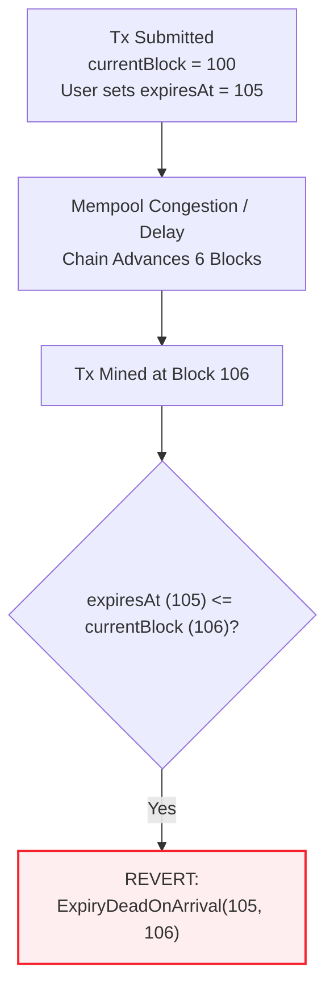
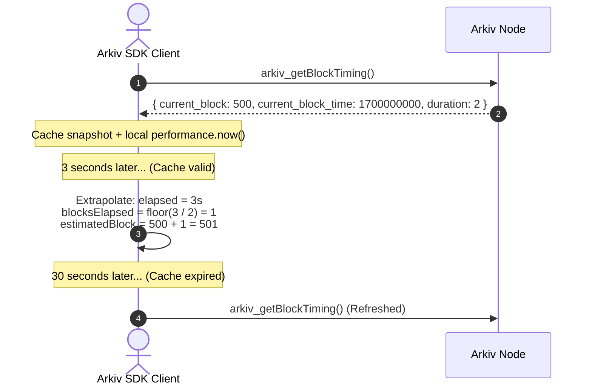
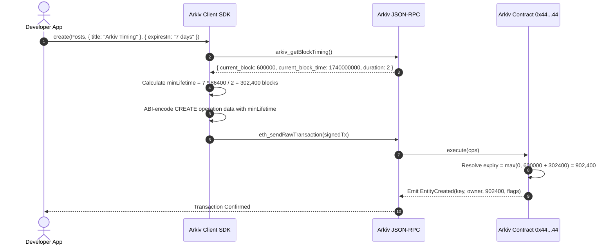

# Specification: `arkiv_getBlockTiming`

## Table of Contents
- [1. Method Overview & RPC Signature](#1-method-overview--rpc-signature)
- [2. Response Payload Structure](#2-response-payload-structure)
  - [2.1 Field Definitions & Types](#21-field-definitions--types)
  - [2.2 Wire Response Example](#22-wire-response-example)
- [3. The Arkiv Block-Based Time Architecture](#3-the-arkiv-block-based-time-architecture)
  - [3.1 Why EVM State Uses Block Numbers, Not Timestamps](#31-why-evm-state-uses-block-numbers-not-timestamps)
  - [3.2 The On-Chain Expiry Resolution Formula](#32-the-on-chain-expiry-resolution-formula)
  - [3.3 Protocol Constraints: `ExpiryDeadOnArrival` & `ExpiryBeyondMaxLifetime`](#33-protocol-constraints-expirydeadonarrival--expirybeyondmaxlifetime)
- [4. Client-Side Expiration Resolution Algorithms](#4-client-side-expiration-resolution-algorithms)
  - [4.1 Converting Human Durations to Blocks](#41-converting-human-durations-to-blocks)
  - [4.2 Converting Wall-Clock Dates to Target Block Numbers](#42-converting-wall-clock-dates-to-target-block-numbers)
  - [4.3 Mitigating Mempool Delay via `minLifetime`](#43-mitigating-mempool-delay-via-minlifetime)
- [5. SDK Caching & Extrapolation Strategies](#5-sdk-caching--extrapolation-strategies)
  - [5.1 Monotonic Clock Extrapolation](#51-monotonic-clock-extrapolation)
  - [5.2 Cache Invalidation & Staleness Bounds](#52-cache-invalidation--staleness-bounds)
- [6. Complete Integration Sequence & Code Examples](#6-complete-integration-sequence--code-examples)
  - [6.1 Full Lifecycle Sequence Diagram](#61-full-lifecycle-sequence-diagram)
  - [6.2 Direct Curl Command](#62-direct-curl-command)
  - [6.3 TypeScript Expiration Resolver Implementation](#63-typescript-expiration-resolver-implementation)

---

## 1. Method Overview & RPC Signature

`arkiv_getBlockTiming` is a specialized, zero-gas read method that returns synchronization primitives: the canonical block height, the current block's Unix timestamp, and the consensus block duration.

Client SDKs and mutation builders depend on this method to translate human-friendly wall-clock timestamps and durations into deterministic EVM block numbers before constructing `execute(ops)` calldata.

```typescript
type ArkivGetBlockTimingMethod = "arkiv_getBlockTiming"
type ArkivGetBlockTimingParams = [] // Empty parameters array
```

### JSON-RPC 2.0 Request Frame

```json
{
  "jsonrpc": "2.0",
  "id": 1,
  "method": "arkiv_getBlockTiming",
  "params": []
}
```

---

## 2. Response Payload Structure

### 2.1 Field Definitions & Types

The method returns a JSON object with three integer properties:

| Field | JSON Type | Units / Format | Description |
| :--- | :--- | :--- | :--- |
| `current_block` | Number | Integer | The canonical block number of the node's current chain tip. |
| `current_block_time` | Number | Unix Seconds | Block timestamp in seconds since Unix Epoch (UTC). |
| `duration` | Number | Seconds | The block interval duration (typically 2 seconds on Rabdi). |

> [!NOTE]
> Unlike standard Ethereum JSON-RPC methods (which encode quantities as hexadecimal strings like `"0x1bc"`), `arkiv_getBlockTiming` returns numeric integer values for direct arithmetic calculation.

### 2.2 Wire Response Example

```json
{
  "jsonrpc": "2.0",
  "id": 1,
  "result": {
    "current_block": 582143,
    "current_block_time": 1742721127,
    "duration": 2
  }
}
```

---

## 3. The Arkiv Block-Based Time Architecture

### 3.1 Why EVM State Uses Block Numbers, Not Timestamps

Decentralized validators must achieve strict consensus on state transitions. While block timestamps (`block.timestamp`) can be manipulated by miners within small drift windows (e.g. 15-second drift), block numbers (`block.number`) are monotonically strictly increasing, tamper-proof, and universally agreed upon.

Consequently, Arkiv entity lifecycles and Time-To-Live (TTL) expiration are strictly metered in **block numbers**:
- An entity with `expiresAt = 600000` expires immediately when block `600000` is mined.
- On Rabdi testnet, with `duration = 2`, one standard calendar day corresponds to:
  $$\frac{86,400\text{ seconds}}{2\text{ seconds/block}} = 43,200\text{ blocks/day}$$

### 3.2 The On-Chain Expiry Resolution Formula

When an entity is created (Operation 1) or its expiry extended (Operation 3), the caller provides two distinct uint64 fields:
1. `expiresAt`: A target block deadline.
2. `minLifetime`: A minimum required duration in blocks.

The smart contract executes canonical resolution inside `execute(ops)`:

$$\text{expiry} = \max(\text{expiresAt},\; \text{currentBlock} + \text{minLifetime})$$

| Application Intent | `expiresAt` Value | `minLifetime` Value | Resulting On-Chain Expiry |
| :--- | :--- | :--- | :--- |
| **Fixed Lifetime** (e.g., 30 Days) | `0` | `1,296,000` | $\text{currentBlock} + 1,296,000$ |
| **Exact Deadline** (e.g., Block 800,000) | `800,000` | `0` | `800,000` |
| **Deadline with Minimum Buffer** | `800,000` | `43,200` | $\max(800000, \text{currentBlock} + 43200)$ |

### 3.3 Protocol Constraints: `ExpiryDeadOnArrival` & `ExpiryBeyondMaxLifetime`

The Arkiv smart contract strictly asserts that the resolved `expiry` satisfies:
$$\text{currentBlock} < \text{expiry} \le \text{currentBlock} + \text{MAX\_LIFETIME}$$

Where `MAX_LIFETIME = 7,884,000` blocks (~182.5 days at 2s/block).
- If $\text{expiry} \le \text{currentBlock}$, the transaction reverts with custom error:
  `ExpiryDeadOnArrival(uint64 target, uint64 currentBlock)`
- If $\text{expiry} > \text{currentBlock} + \text{MAX\_LIFETIME}$, the transaction reverts with custom error:
  `ExpiryBeyondMaxLifetime(uint64 target, uint64 currentBlock, uint64 maxLifetime)`

---

## 4. Client-Side Expiration Resolution Algorithms

Client SDKs implement the following algorithms using the data returned by `arkiv_getBlockTiming`.

### 4.1 Converting Human Durations to Blocks

When a user specifies a duration in seconds, milliseconds, or days:

$$\text{lifetimeBlocks} = \left\lceil \frac{\text{durationInSeconds}}{\text{duration}} \right\rceil$$

```typescript
function durationToBlocks(seconds: number, blockDuration: number): bigint {
  return BigInt(Math.ceil(seconds / blockDuration))
}
```
*Example:* A 30-day duration on a 2-second chain:
$$\lceil 2,592,000 / 2 \rceil = 1,296,000\text{ blocks}$$

### 4.2 Converting Wall-Clock Dates to Target Block Numbers

When a user specifies a target `Date` (e.g. `2026-12-31T23:59:59Z`):

$$\Delta t = \text{targetUnixSeconds} - \text{current\_block\_time}$$
$$\text{targetBlock} = \text{current\_block} + \left\lceil \frac{\Delta t}{\text{duration}} \right\rceil$$

```typescript
function dateToTargetBlock(
  targetDate: Date,
  currentBlock: number,
  currentBlockTime: number,
  blockDuration: number
): bigint {
  const targetSeconds = Math.floor(targetDate.getTime() / 1000)
  const deltaSeconds = targetSeconds - currentBlockTime

  if (deltaSeconds <= 0) {
    throw new Error("Target expiration date must be in the future")
  }

  const additionalBlocks = Math.ceil(deltaSeconds / blockDuration)
  return BigInt(currentBlock + additionalBlocks)
}
```

### 4.3 Mitigating Mempool Delay via `minLifetime`

Network latency, gas price spikes, or validator queuing can delay transaction inclusion by several blocks.



**The Solution:**
Rather than relying solely on `expiresAt`, client SDKs configure `minLifetime`:
```solidity
expiresAt = 0;
minLifetime = 1296000; // 30 days of blocks
```
Because the contract calculates $\max(\text{expiresAt}, \text{currentBlock} + \text{minLifetime})$, the lifetime floats with the inclusion block. No matter how long the transaction waits in the mempool, it will always be granted exactly `minLifetime` blocks from the block in which it is successfully executed.

---

## 5. SDK Caching & Extrapolation Strategies

Repeatedly querying `arkiv_getBlockTiming` before every single operation creates redundant network overhead. Production SDKs implement a short-lived cache with local clock extrapolation.



### 5.1 Monotonic Clock Extrapolation

When evaluating block height within a short window ($t < 15\text{ seconds}$):
$$\Delta t_{\text{local}} = \text{now}_{\text{monotonic}} - t_{\text{cached}}$$
$$\text{estimatedBlock} = \text{cachedBlock} + \left\lfloor \frac{\Delta t_{\text{local}}}{\text{duration}} \right\rfloor$$

### 5.2 Cache Invalidation & Staleness Bounds
- **Maximum Cache Age:** 10–15 seconds.
- **Immediate Invalidation:** If an EVM call returns `ExpiryDeadOnArrival` or an unexpected nonce mismatch, the timing cache is immediately purged and refetched.

---

## 6. Complete Integration Sequence & Code Examples

### 6.1 Full Lifecycle Sequence Diagram



### 6.2 Direct Curl Command

```bash
curl -X POST "https://rpc.rabdi.db-chain.testnet.arkiv.network/$ARKIV_ACCESS_KEY" \
  -H "Content-Type: application/json" \
  -d '{
    "jsonrpc": "2.0",
    "id": 1,
    "method": "arkiv_getBlockTiming",
    "params": []
  }'
```

### 6.3 TypeScript Expiration Resolver Implementation

```typescript
export interface BlockTiming {
  current_block: number
  current_block_time: number
  duration: number
}

export class ExpirationResolver {
  private cachedTiming: BlockTiming | null = null
  private lastFetchTime = 0
  private readonly CACHE_TTL_MS = 10_000 // 10 seconds

  constructor(private readonly fetchTimingFn: () => Promise<BlockTiming>) {}

  public async getTiming(): Promise<BlockTiming> {
    const now = Date.now()
    if (!this.cachedTiming || now - this.lastFetchTime > this.CACHE_TTL_MS) {
      this.cachedTiming = await this.fetchTimingFn()
      this.lastFetchTime = now
    }
    return this.cachedTiming
  }

  /**
   * Resolves expiry parameters for Operation 1 (CREATE) or Operation 3 (EXTEND)
   */
  public async resolve(options: {
    expiresAtBlock?: bigint
    lifetimeSeconds?: number
    deadline?: Date
  }): Promise<{ expiresAt: bigint; minLifetime: bigint }> {
    const timing = await this.getTiming()

    let expiresAt = 0n
    let minLifetime = 0n

    if (options.expiresAtBlock) {
      expiresAt = options.expiresAtBlock
    }

    if (options.lifetimeSeconds) {
      minLifetime = BigInt(Math.ceil(options.lifetimeSeconds / timing.duration))
    }

    if (options.deadline) {
      const targetSeconds = Math.floor(options.deadline.getTime() / 1000)
      const deltaSeconds = targetSeconds - timing.current_block_time
      if (deltaSeconds <= 0) {
        throw new Error("Deadline must be in the future")
      }
      const targetBlock = timing.current_block + Math.ceil(deltaSeconds / timing.duration)
      expiresAt = BigInt(targetBlock)
    }

    return { expiresAt, minLifetime }
  }
}
```
