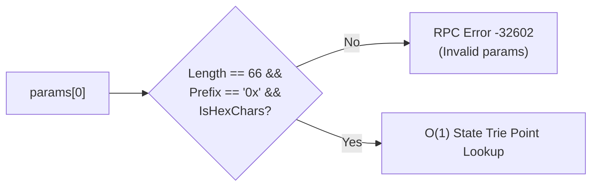
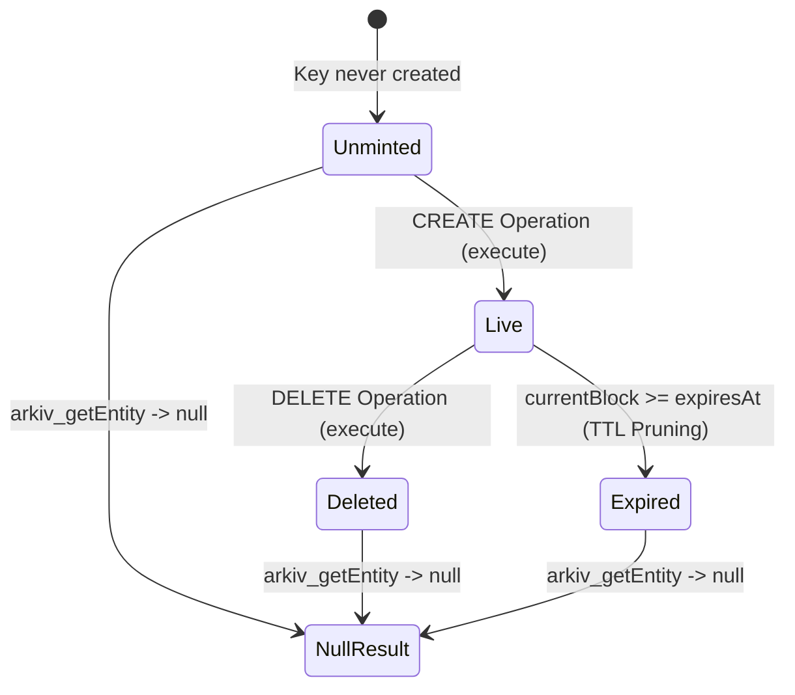
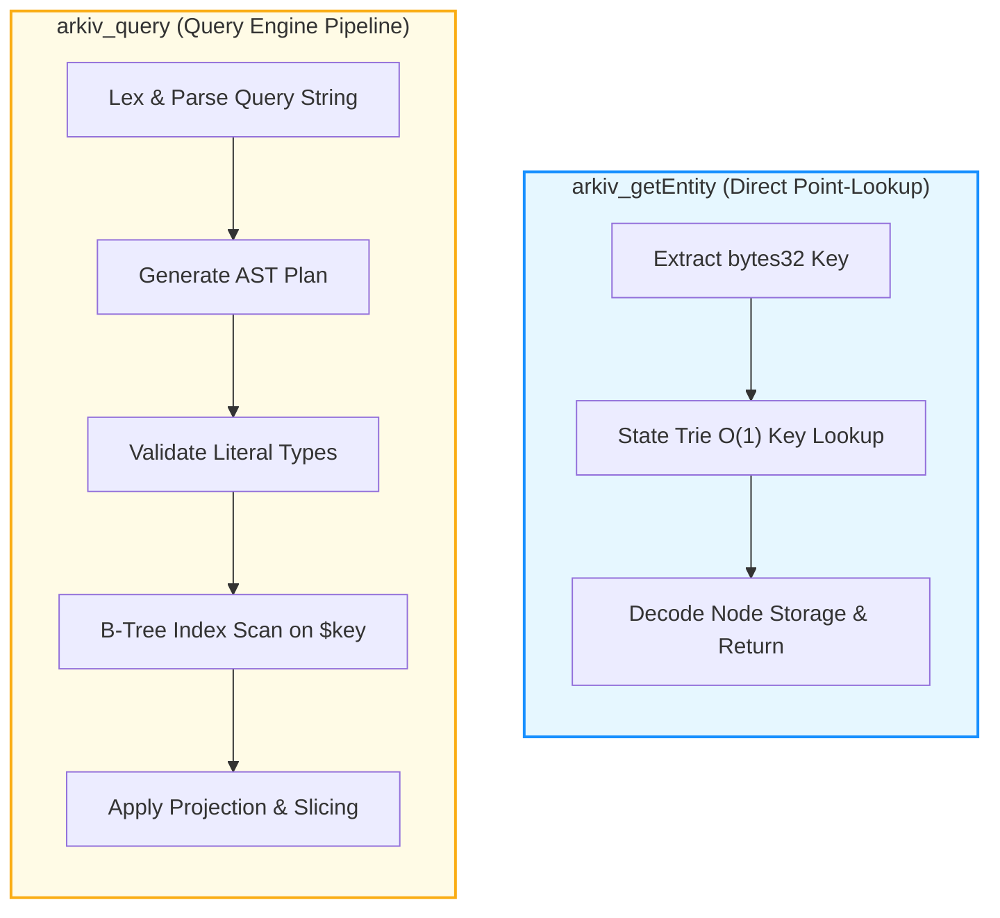

# Specification: `arkiv_getEntity`

## Table of Contents
- [1. Method Overview & RPC Signature](#1-method-overview--rpc-signature)
- [2. Parameter Specification](#2-parameter-specification)
  - [2.1 The 32-Byte Entity Key](#21-the-32-byte-entity-key)
  - [2.2 Format Validation Rules](#22-format-validation-rules)
- [3. Response Payload Specification](#3-response-payload-specification)
  - [3.1 Structure of Returned Live Entity](#31-structure-of-returned-live-entity)
  - [3.2 System Fields & Attributes Exhaustive Map](#32-system-fields--attributes-exhaustive-map)
  - [3.3 Exclusion of `attributeSchema`](#33-exclusion-of-attributeschema)
- [4. Semantics of `null` Return & Lifecycle Pruning](#4-semantics-of-null-return--lifecycle-pruning)
  - [4.1 The Three States of Absence](#41-the-three-states-of-absence)
  - [4.2 SDK Mapping: `NoEntityFoundError`](#42-sdk-mapping-noentityfounderror)
- [5. Architectural Comparison: `arkiv_getEntity` vs. `arkiv_query`](#5-architectural-comparison-arkiv_getentity-vs-arkiv_query)
  - [5.1 Performance & Execution Path](#51-performance--execution-path)
  - [5.2 Feature Comparison Matrix](#52-feature-comparison-matrix)
  - [5.3 When to Use Which Method](#53-when-to-use-which-method)
- [6. Complete JSON-RPC & Curl Examples](#6-complete-json-rpc--curl-examples)
  - [6.1 Successful Retrieval of Live Entity](#61-successful-retrieval-of-live-entity)
  - [6.2 Retrieval of Non-Existent or Expired Entity (`null`)](#62-retrieval-of-non-existent-or-expired-entity-null)
  - [6.3 Direct Command-Line Curl Examples](#63-direct-command-line-curl-examples)
- [7. Error Conditions & Edge Cases](#7-error-conditions--edge-cases)

---

## 1. Method Overview & RPC Signature

`arkiv_getEntity` provides direct, gasless, point-lookup retrieval of a single entity by its 32-byte cryptographic key. It evaluates against the latest canonical block head and returns either the complete entity payload or `null`.

```typescript
type ArkivGetEntityMethod = "arkiv_getEntity"

type ArkivGetEntityParams = [
  entityKey: `0x${string}` // Exactly 32 bytes (64 hex characters with "0x" prefix)
]
```

### JSON-RPC 2.0 Request Frame

```json
{
  "jsonrpc": "2.0",
  "id": 1,
  "method": "arkiv_getEntity",
  "params": [
    "0x9f2c730248a31e84a22bf70940502a9e32f056976722d56d11b3bc551d77d701"
  ]
}
```

---

## 2. Parameter Specification

`arkiv_getEntity` accepts exactly **one positional parameter**:

### 2.1 The 32-Byte Entity Key
The parameter is a 66-character hexadecimal string (`0x` followed by 64 hex characters) representing the unique `bytes32` identifier generated at creation time via:
$$\text{key} = \text{keccak256}(\text{chainId} \parallel \text{arkivAddress} \parallel \text{owner} \parallel \text{nonce} \parallel \text{salt})$$



### 2.2 Format Validation Rules
- **Length:** Must be exactly 32 bytes (64 hex nybbles + `0x` prefix).
- **Prefix:** Must strictly begin with `0x`.
- **Casing:** Hexadecimal characters `0-9`, `a-f`, `A-F` are valid (case-insensitive on parse).
- **Arity:** Passing 0 parameters, or passing more than 1 parameter, results in an immediate RPC error code `-32602` (Invalid params).

---

## 3. Response Payload Specification

### 3.1 Structure of Returned Live Entity

When a live entity is located, the JSON-RPC `result` object contains the complete entity representation, containing all system fields and all stored attributes:

```json
{
  "jsonrpc": "2.0",
  "id": 1,
  "result": {
    "key": "0x9f2c730248a31e84a22bf70940502a9e32f056976722d56d11b3bc551d77d701",
    "owner": "0xd8dA6BF26964aF9D7eEd9e03E53415D37aA96045",
    "creator": "0xd8dA6BF26964aF9D7eEd9e03E53415D37aA96045",
    "createdAt": "0x1bc",
    "updatedAt": "0x205",
    "expiresAt": "0x13d620",
    "creationFlags": {
      "readonly": false,
      "permissionlessExtension": true,
      "raw": false
    },
    "attributes": [
      { "name": "arkiv.schema", "type": "str", "value": "my-app.posts" },
      { "name": "category", "type": "str", "value": "news" },
      { "name": "score", "type": "dec", "value": "4.5" },
      { "name": "title", "type": "str", "value": "Decentralized Database Foundations" }
    ]
  }
}
```

### 3.2 System Fields & Attributes Exhaustive Map

| Property | Type | Wire Encoding | Semantics |
| :--- | :--- | :--- | :--- |
| `key` | `string` | 66-character Hex string | The 32-byte primary key. |
| `owner` | `string` | 42-character Hex string | Checksummed Ethereum address holding update and deletion authority. |
| `creator` | `string` | 42-character Hex string | Checksummed address of the transaction signer that minted the entity. |
| `createdAt` | `string` | Hex quantity (`0x...`) | Canonical block number in which the `EntityCreated` operation was included. |
| `updatedAt` | `string` | Hex quantity (`0x...`) | Canonical block number of the most recent patch or extension. |
| `expiresAt` | `string` | Hex quantity (`0x...`) | Canonical block number after which the entity is pruned by TTL. |
| `creationFlags` | `object` | Boolean sub-map | Flags established at creation: `readonly`, `permissionlessExtension`, `raw`. |
| `attributes` | `array` | Array of objects | Complete array of `{ name, type, value }` attribute descriptors. |

### 3.3 Exclusion of `attributeSchema`

Unlike `arkiv_query`, which allows requesting `"attributeSchema": true` to discover column metadata without payloads, `arkiv_getEntity` **does not support projection**. It always returns all attributes with their full values.
- If an entity contains a large 128 KiB `bytes` attribute, `arkiv_getEntity` will transmit the entire 128 KiB payload.
- To inspect metadata without payload overhead, clients should invoke `arkiv_query` with predicate `$key = key(...)` and selection `{ "attributeSchema": true }`.

---

## 4. Semantics of `null` Return & Lifecycle Pruning

If no live entity corresponds to the requested key, `arkiv_getEntity` returns a successful JSON-RPC response where `result` is explicitly `null`:

```json
{
  "jsonrpc": "2.0",
  "id": 1,
  "result": null
}
```

### 4.1 The Three States of Absence

The protocol does not differentiate why an entity does not exist; all three scenarios produce `null`:



1. **Non-Existent (Never Created):** The key was never derived or committed to the Arkiv contract state.
2. **Explicitly Deleted:** The entity was deleted via Operation 5 (`DELETE`) by its owner. The contract recorded a tombstone and pruned storage.
3. **TTL Expired:** The current block height has advanced past `expiresAt` ($\text{currentBlock} \ge \text{expiresAt}$). The Arkiv state machine automatically excludes expired entities from reads, regardless of whether a physical state cleanup transaction has been triggered.

### 4.2 SDK Mapping: `NoEntityFoundError`

Higher-level SDK clients intercept `result: null` and throw a strongly-typed `NoEntityFoundError`:

```typescript
import { createPublicClient, NoEntityFoundError } from "@arkiv-network/sdk"

try {
  const entity = await publicClient.getEntity("0x9f2c...")
} catch (error) {
  if (error instanceof NoEntityFoundError) {
    console.error(`Entity ${error.entityKey} is non-existent, deleted, or expired.`)
  }
}
```

---

## 5. Architectural Comparison: `arkiv_getEntity` vs. `arkiv_query`

Developers can locate an entity either by calling `arkiv_getEntity(key)` or querying `arkiv_query("$key = key(...)")`. While both yield the entity, their internal mechanics and trade-offs differ significantly.

### 5.1 Performance & Execution Path



### 5.2 Feature Comparison Matrix

| Feature | `arkiv_getEntity` | `arkiv_query` with `$key = key(...)` |
| :--- | :--- | :--- |
| **Node Execution Complexity** | $O(1)$ direct point lookup | $O(\log N)$ AST parse + index lookup |
| **Query Engine Overhead** | **Zero** (bypasses SQL parser) | Requires lexing, parsing, and planning |
| **Parameter Size** | Compact: single 32-byte hex | Verbose: SQL predicate string + options map |
| **Field Projection** | None (always returns all attributes) | Granular (select individual attributes) |
| **Payload Optimization** | Heavy if large `bytes` are stored | Can omit heavy attributes or request `attributeSchema` |
| **Return on Not Found** | `result: null` | `result: { data: [], blockNumber: "0x...", count: "0x0" }` |
| **Block Height Returned** | No (only entity metadata) | Yes (`blockNumber` field at root) |
| **Aggregate Counting** | Not supported | Supported via `select.count: true` |

### 5.3 When to Use Which Method

- **Use `arkiv_getEntity` when:**
  - You possess the exact 32-byte entity key and require all or most attributes.
  - Latency is paramount (e.g. real-time API gateways, fast entity resolution).
  - You want minimal wire request payload size.
- **Use `arkiv_query` when:**
  - The entity holds large `bytes` attributes (up to 128 KiB) that you want to exclude from the response.
  - You only want to discover the entity's schema metadata (`attributeSchema: true`).
  - You need the canonical block height at which the read occurred.

---

## 6. Complete JSON-RPC & Curl Examples

### 6.1 Successful Retrieval of Live Entity

**Request:**
```json
{
  "jsonrpc": "2.0",
  "id": 201,
  "method": "arkiv_getEntity",
  "params": [
    "0x9f2c730248a31e84a22bf70940502a9e32f056976722d56d11b3bc551d77d701"
  ]
}
```

**Response:**
```json
{
  "jsonrpc": "2.0",
  "id": 201,
  "result": {
    "key": "0x9f2c730248a31e84a22bf70940502a9e32f056976722d56d11b3bc551d77d701",
    "owner": "0xd8dA6BF26964aF9D7eEd9e03E53415D37aA96045",
    "creator": "0xd8dA6BF26964aF9D7eEd9e03E53415D37aA96045",
    "createdAt": "0x58210",
    "updatedAt": "0x58220",
    "expiresAt": "0x1945a0",
    "creationFlags": {
      "readonly": false,
      "permissionlessExtension": true,
      "raw": false
    },
    "attributes": [
      { "name": "arkiv.schema", "type": "str", "value": "my-app.users" },
      { "name": "reputation", "type": "i32", "value": 1500 },
      { "name": "username", "type": "str", "value": "vitalik" }
    ]
  }
}
```

### 6.2 Retrieval of Non-Existent or Expired Entity (`null`)

**Request:**
```json
{
  "jsonrpc": "2.0",
  "id": 202,
  "method": "arkiv_getEntity",
  "params": [
    "0x000000000000000000000000000000000000000000000000000000000000dead"
  ]
}
```

**Response:**
```json
{
  "jsonrpc": "2.0",
  "id": 202,
  "result": null
}
```

### 6.3 Direct Command-Line Curl Examples

#### Retrieve Live Entity via Curl:
```bash
curl -X POST "https://rpc.rabdi.db-chain.testnet.arkiv.network/$ARKIV_ACCESS_KEY" \
  -H "Content-Type: application/json" \
  -d '{
    "jsonrpc": "2.0",
    "id": 1,
    "method": "arkiv_getEntity",
    "params": ["0x9f2c730248a31e84a22bf70940502a9e32f056976722d56d11b3bc551d77d701"]
  }'
```

---

## 7. Error Conditions & Edge Cases

When input validation fails, `arkiv_getEntity` rejects the request before state trie lookup:

| Condition | Protocol Error Code | Error Message |
| :--- | :--- | :--- |
| Missing parameter (`params: []`) | `-32602` | `Invalid params: expected 1 parameter, got 0` |
| Excess parameters (`params: [key, extra]`) | `-32602` | `Invalid params: expected 1 parameter, got 2` |
| Malformed hex string (not 66 chars) | `-32602` | `Invalid params: entity key must be 32 bytes (66 hex characters)` |
| Missing `0x` prefix | `-32602` | `Invalid params: entity key must start with '0x'` |
| Invalid hexadecimal characters | `-32602` | `Invalid params: non-hex character in entity key` |
| Invalid / Expired Access Key | HTTP `401` | `Unauthorized: invalid access key` |
