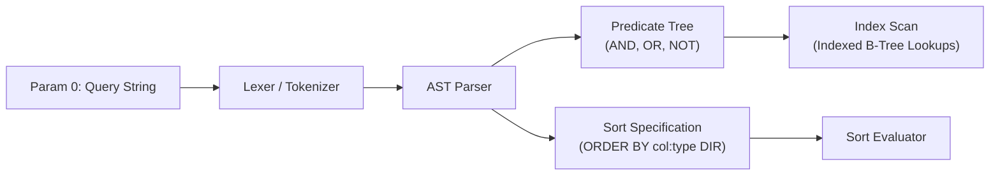
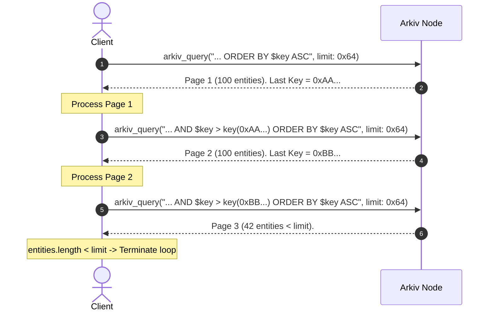
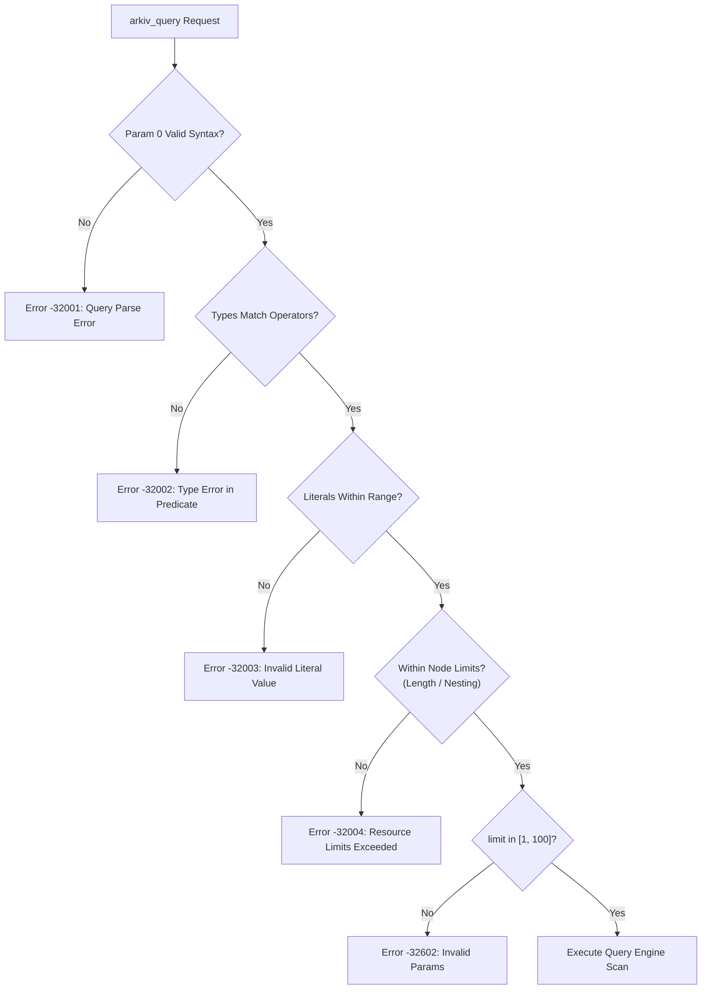

# Specification: `arkiv_query`

## Table of Contents
- [1. Method Overview & RPC Signature](#1-method-overview--rpc-signature)
- [2. Parameter 0: Query String Specification](#2-parameter-0-query-string-specification)
  - [2.1 Predicates and Operators](#21-predicates-and-operators)
  - [2.2 Value Literal Formatting](#22-value-literal-formatting)
  - [2.3 Entity Field Filtering](#23-entity-field-filtering)
  - [2.4 Ordering and Sorting (`ORDER BY`)](#24-ordering-and-sorting-order-by)
  - [2.5 Schema Tag Isolation](#25-schema-tag-isolation)
- [3. Parameter 1: Options Specification](#3-parameter-1-options-specification)
  - [3.1 The `select` Projection Object](#31-the-select-projection-object)
  - [3.2 Granular Attribute Subsets](#32-granular-attribute-subsets)
  - [3.3 Schema Reflection via `attributeSchema`](#33-schema-reflection-via-attributeschema)
  - [3.4 Headless & Integrated Counting (`count`)](#34-headless--integrated-counting-count)
  - [3.5 Pagination Controls: `limit` and `offset`](#35-pagination-controls-limit-and-offset)
- [4. Response Wire Format & Attribute Encoding](#4-response-wire-format--attribute-encoding)
  - [4.1 Complete Response Schema](#41-complete-response-schema)
  - [4.2 Attribute Wire Encoding Table](#42-attribute-wire-encoding-table)
  - [4.3 Missing vs. Omitted Fields](#43-missing-vs-omitted-fields)
- [5. Pagination Strategies & Mechanics](#5-pagination-strategies--mechanics)
  - [5.1 Offset-Based Slicing](#51-offset-based-slicing)
  - [5.2 Key-Cursor Deterministic Traversal](#52-key-cursor-deterministic-traversal)
  - [5.3 Skipped Entities & Schema Alignment](#53-skipped-entities--schema-alignment)
- [6. Complete JSON-RPC & Curl Examples](#6-complete-json-rpc--curl-examples)
  - [6.1 Basic Query with Selective Attributes](#61-basic-query-with-selective-attributes)
  - [6.2 Full Entity Inspection](#62-full-entity-inspection)
  - [6.3 Headless Aggregate Count](#63-headless-aggregate-count)
  - [6.4 Key-Cursor Pagination Request](#64-key-cursor-pagination-request)
- [7. Error Conditions & Protocol Rejections](#7-error-conditions--protocol-rejections)

---

## 1. Method Overview & RPC Signature

`arkiv_query` is the core read primitive of the Arkiv protocol. It executes expressive SQL-like predicate evaluations and sorting against indexed entity attributes, slices results into pages, projects requested fields, and computes aggregate counts.

```typescript
type ArkivQueryMethod = "arkiv_query"

type ArkivQueryParams = [
  query: string,
  options?: {
    select?: SelectProjection
    limit?: `0x${string}`   // Hex-encoded uint, range [1, 100]
    offset?: `0x${string}`  // Hex-encoded uint, default 0x0
  }
]
```

### JSON-RPC 2.0 Request Frame

```json
{
  "jsonrpc": "2.0",
  "id": 1,
  "method": "arkiv_query",
  "params": [
    "arkiv.schema = str('my-app.posts') AND category = str('news') ORDER BY score:dec DESC",
    {
      "select": {
        "key": true,
        "owner": true,
        "attributes": { "title": true, "score": true },
        "count": true
      },
      "limit": "0xa",
      "offset": "0x0"
    }
  ]
}
```

---

## 2. Parameter 0: Query String Specification

The first parameter is an ASCII/UTF-8 query string parsed by the Arkiv node query engine into an Abstract Syntax Tree (AST).



### 2.1 Predicates and Operators

Predicates evaluate against indexed attributes. Attributes stored without an index flag cannot be filtered using `where` conditions (with the exception of `ORDER BY`).

| Operator | Syntax | Semantics |
| :--- | :--- | :--- |
| **Equality** | `attr = value` | Matches if the attribute value and type strictly match. |
| **Inequality** | `attr != value` | Matches if the attribute is set, indexed, and does not equal the value. |
| **Relational** | `<`, `<=`, `>`, `>=` | Relational comparison. Numbers compare by magnitude; strings/bytes compare lexicographically. |
| **Range** | `attr BETWEEN low AND high` | Inclusive range `[low, high]`. Both bounds must share the identical type constructor. |
| **Prefix Match** | `attr STARTSWITH str('prefix')` | Evaluates UTF-8 prefix matching. **Only supported on type `str`**. |
| **Existence** | `EXISTS(attr)` | Evaluates `true` if `attr` is present on the entity with any type. |
| **Type Check** | `TYPEOF(attr) = type` | Evaluates `true` if `attr` exists with the designated type identifier (e.g. `i32`, `dec`). |

*Logical Precedence:*
- `AND` binds tighter than `OR`.
- Parentheses `(` and `)` override default precedence.
- Comments are denoted by `--` and continue to the end of the line.

### 2.2 Value Literal Formatting

Every literal in the query string (except `bool`) must be explicitly wrapped in its typed constructor:

```sql
category = str('tech') AND score >= dec(4.5) AND count < i32(100)
```

| Type | Literal Constructor Syntax | Example |
| :--- | :--- | :--- |
| `bool` | `true`, `false` (bare keywords) | `isPublished = true` |
| `i32` | `i32(integer)` (bare integer default) | `counter = i32(-5)` or `counter = -5` |
| `u64` | `u64(unsigned_integer)` | `timestamp = u64(1700000000)` |
| `u256` | `u256(unsigned_integer)` | `balance = u256(1000000000000000000)` |
| `dec` | `dec(decimal_number)` | `rating = dec(4.5)` |
| `str` | `str('single_quoted_string')` | `title = str('Arkiv''s Architecture')` *(doubled quote for escape)* |
| `addr` | `addr(0xHex20Address)` | `recipient = addr(0xd8dA6BF26964aF9D7eEd9e03E53415D37aA96045)` |
| `key` | `key(0xHex32Key)` | `parent = key(0x9f2c000000000000000000000000000000000000000000000000000000000001)` |

> [!NOTE]
> The `bytes` column type cannot be indexed on-chain, and therefore cannot be compared, filtered, or used in `where` clauses.

### 2.3 Entity Field Filtering

Four internal system fields are exposed to the query engine and can be queried like indexed attributes, each with an immutable built-in type:

| System Field | Type Constructor | Description |
| :--- | :--- | :--- |
| `$key` | `key` | The unique 32-byte entity key derived from `keccak256`. |
| `$owner` | `addr` | The current owner Ethereum address holding mutation rights. |
| `$creator` | `addr` | The original account that broadcast the creation transaction. |
| `$expiresAt` | `u64` | The canonical block number at which the entity expires and is pruned. |

*Example:*
```sql
$owner = addr(0xd8dA6BF26964aF9D7eEd9e03E53415D37aA96045) AND $expiresAt > u64(500000)
```

### 2.4 Ordering and Sorting (`ORDER BY`)

The query string can terminate with an optional `ORDER BY` clause:
```sql
ORDER BY attribute:type ASC|DESC
```
- **Type Specifier:** Required for attributes (e.g. `score:dec`, `title:str`) because different entities may store different types under the same name.
- **System Fields:** System fields have fixed types. `ORDER BY $key ASC` or `ORDER BY $expiresAt DESC` do not require a type suffix.
- **Index Agnostic:** Unlike `where` predicates, `ORDER BY` can sort on attributes **even if they are not indexed**.
- **Null / Missing Value Handling:** Entities lacking the sorted attribute (or containing it under a differing type) sort **below all valid values**:
  - In `ASC` order: Missing entities appear **first**.
  - In `DESC` order: Missing entities appear **last**.
- **Tie-Breaking:** Arkiv supports sorting by exactly **one** attribute. Entities that tie sort in the node's internal storage sequence. To achieve strict determinism across pages, sort by `$key ASC`.

### 2.5 Schema Tag Isolation

Because Arkiv is a shared public state machine, any wallet can write entities containing arbitrary attribute names. Schemas defined in client applications isolate their namespace using the reserved indexed attribute `arkiv.schema`:

```sql
arkiv.schema = str('my-app.v1.articles') AND status = str('published')
```

---

## 3. Parameter 1: Options Specification

Parameter 1 is an optional JSON object configuring field projection, page slicing, and aggregate count computation.

```typescript
interface QueryOptions {
  select?: SelectProjection
  limit?: string  // Hex quantity: "0x1" to "0x64" (1 to 100)
  offset?: string // Hex quantity: "0x0" upwards
}
```

### 3.1 The `select` Projection Object

By default, omitting `select` or passing `{}` returns only the 32-byte entity key: `{ "key": true }`. Setting individual fields to `true` projects them into the response payload:

| Projection Field | Return Type in Entity Object | Description |
| :--- | :--- | :--- |
| `key` | `string` (Hex) | 32-byte entity key (`0x...`). Enabled by default. |
| `owner` | `string` (Hex) | Checksummed Ethereum address of the owner. |
| `creator` | `string` (Hex) | Checksummed Ethereum address of the creator. |
| `createdAt` | `string` (Hex) | Block height at creation, hex-encoded (`0x1bc`). |
| `updatedAt` | `string` (Hex) | Block height of most recent patch/update. |
| `expiresAt` | `string` (Hex) | Canonical block height when entity expires. |
| `creationFlags` | `object` | `{ "readonly": bool, "permissionlessExtension": bool, "raw": bool }` |
| `attributes` | `array` or `object` | Attribute array or subset projection (see below). |
| `attributeSchema` | `object` | Attribute metadata (name, type, indexed) without values. |
| `count` | `boolean` | Triggers total dataset match counting at the read block. |

### 3.2 Granular Attribute Subsets

The `attributes` selector supports two modes:
1. **Full Projection:** `"attributes": true` returns all stored attributes on the entity.
2. **Selective Subset Map:** `"attributes": { "title": true, "category": true }` extracts *only* the specified attributes, drastically reducing bandwidth when entities store large binary blobs or lengthy text strings.

```json
{
  "select": {
    "key": true,
    "attributes": {
      "title": true,
      "score": true
    }
  }
}
```

### 3.3 Schema Reflection via `attributeSchema`

When inspecting entities of unknown structure, setting `"attributeSchema": true` instructs the node to return attribute descriptors without returning their payload data:

```json
"attributeSchema": [
  { "name": "title", "type": "str", "indexed": false },
  { "name": "score", "type": "dec", "indexed": true },
  { "name": "payload", "type": "bytes", "indexed": false }
]
```
This allows clients to discover shapes without incurring the bandwidth of 128 KiB `bytes` attributes.

### 3.4 Headless & Integrated Counting (`count`)

`count` is not an entity field; it represents an aggregate computation over the entire matching result set at the evaluated block height:
- **Integrated Count:** Combining `"count": true` with entity selectors returns the current page of rows in `data`, plus `"count": "0x..."` in the root `result` object.
- **Headless Count:** Setting `"select": { "count": true }` returns an empty `data: []` array, returning only the hex-encoded aggregate count:

```json
{
  "jsonrpc": "2.0",
  "id": 1,
  "result": {
    "data": [],
    "blockNumber": "0x5821a",
    "count": "0x14e"
  }
}
```

### 3.5 Pagination Controls: `limit` and `offset`

- **`limit`**: Hexadecimal quantity between `"0x1"` (1) and `"0x64"` (100). Default is `"0x64"`. Requesting `"0x0"` or values greater than `"0x64"` causes an immediate `-32602` Invalid Params error.
- **`offset`**: Hexadecimal quantity specifying the number of matching records to skip. Defaults to `"0x0"`.

---

## 4. Response Wire Format & Attribute Encoding

### 4.1 Complete Response Schema

```json
{
  "jsonrpc": "2.0",
  "id": 1,
  "result": {
    "data": [
      {
        "key": "0x9f2c100000000000000000000000000000000000000000000000000000000001",
        "owner": "0xd8dA6BF26964aF9D7eEd9e03E53415D37aA96045",
        "creator": "0xd8dA6BF26964aF9D7eEd9e03E53415D37aA96045",
        "createdAt": "0x1bc",
        "updatedAt": "0x205",
        "expiresAt": "0x13d620",
        "creationFlags": {
          "readonly": false,
          "permissionlessExtension": true,
          "raw": false
        },
        "attributes": [
          { "name": "arkiv.schema", "type": "str", "value": "my-app.posts" },
          { "name": "category", "type": "str", "value": "news" },
          { "name": "score", "type": "dec", "value": "4.5" },
          { "name": "published", "type": "bool", "value": true }
        ]
      }
    ],
    "blockNumber": "0x205",
    "count": "0x1"
  }
}
```

### 4.2 Attribute Wire Encoding Table

The `type` field in each attribute object dictates the JSON encoding of `value`:

| Internal Type | Wire `type` String | JSON Value Type | Format Specification | Concrete Example |
| :--- | :--- | :--- | :--- | :--- |
| `bool` | `"bool"` | Boolean | `true` or `false` | `true` |
| `i32` | `"i32"` | Number | Signed 32-bit JSON numeric integer | `-42` |
| `u64` | `"u64"` | String (Hex) | Hex quantity prefixed with `0x` | `"0x65b3f210"` |
| `u256` | `"u256"` | String (Hex) | Hex quantity prefixed with `0x` | `"0xde0b6b3a7640000"` |
| `dec` | `"dec"` | String | Fixed-point decimal string (up to 18 decimals) | `"4.500000000000000000"` |
| `str` | `"str"` | String | Standard UTF-8 JSON string (max 128 bytes) | `"Breaking News"` |
| `addr` | `"addr"` | String (Hex) | 42-char checksummed Ethereum address | `"0xd8dA6BF26964aF9D7eEd9e03E53415D37aA96045"` |
| `key` | `"key"` | String (Hex) | 66-char 32-byte hex string | `"0x9f2c...44"` |
| `bytes` | `"bytes"` | String (Hex) | Arbitrary binary data as hex (max 128 KiB) | `"0x89504e470d0a1a0a..."` |

### 4.3 Missing vs. Omitted Fields

Arkiv strictly adheres to a sparse projection model:
- If a projection flag was not explicitly enabled in `select` (e.g. `creator: false` or omitted), the property is **entirely omitted** from the JSON entity object. It is **never** emitted as `null` or `undefined`.
- `count` is only included in the top-level `result` if `select.count: true` was requested.
- `blockNumber` is always returned at the root level, indicating the exact state snapshot at which the query was evaluated.

---

## 5. Pagination Strategies & Mechanics

### 5.1 Offset-Based Slicing

Offset pagination skips $N$ entities using `"offset": "0x..."` and slices up to `"limit": "0x..."`.

```json
[
  "arkiv.schema = str('my-app.posts') ORDER BY $key ASC",
  { "limit": "0x14", "offset": "0x28" }
]
```
*(Skips 40 entities and returns page 3 with 20 entities)*.

> [!CAUTION]
> **Offset Pagination State Drift:**
> Because each JSON-RPC query evaluates against the latest block head, transactions included between pagination requests (new creations, deletions, or TTL expirations) shift matching entities. A row may appear twice or be skipped completely. Offset pagination is suitable only for interactive user interfaces where occasional drift is acceptable.

### 5.2 Key-Cursor Deterministic Traversal

For reliable full-table extracts, data syncs, or background indexing, use **Key-Cursor Pagination**:



**Key-Cursor Invariants:**
1. Maintain `ORDER BY $key ASC`.
2. Append `$key > key(0x<LAST_SEEN_KEY>)` to the predicate.
3. Keep `offset: "0x0"` and `limit: "0x64"`.
4. When `data.length < limit`, the iteration is complete.
5. Entity keys are immutable cryptographic hashes; concurrent writes cannot shift the cursor boundary.

### 5.3 Skipped Entities & Schema Alignment

When an SDK client reads entities through a strongly-typed schema (e.g. via `publicClient.select().from(Posts)`), the client validates each row against the schema definition:
- If a live entity matches the SQL predicate (e.g. it shares the tag `arkiv.schema = 'my-app.posts'`), but lacks a required non-optional column or contains an invalid type, the SDK client skips the row.
- In raw JSON-RPC `arkiv_query`, all matching entities are returned without client-side dropping. The client-side SDK tracks these discrepancies in its `skipped` property.

---

## 6. Complete JSON-RPC & Curl Examples

### 6.1 Basic Query with Selective Attributes

Query posts with category "news", ordering by descending score, returning only `key`, `score`, and `title`:

```bash
curl -X POST "https://rpc.rabdi.db-chain.testnet.arkiv.network/$ARKIV_ACCESS_KEY" \
  -H "Content-Type: application/json" \
  -d '{
    "jsonrpc": "2.0",
    "id": 101,
    "method": "arkiv_query",
    "params": [
      "arkiv.schema = str(\"my-app.posts\") AND category = str(\"news\") ORDER BY score:dec DESC",
      {
        "select": {
          "key": true,
          "attributes": {
            "title": true,
            "score": true
          }
        },
        "limit": "0xa"
      }
    ]
  }'
```

**Wire Response:**
```json
{
  "jsonrpc": "2.0",
  "id": 101,
  "result": {
    "data": [
      {
        "key": "0x9f2c730248a31e84a22bf70940502a9e32f056976722d56d11b3bc551d77d701",
        "attributes": [
          { "name": "score", "type": "dec", "value": "4.8" },
          { "name": "title", "type": "str", "value": "Arkiv Rabdi Testnet Released" }
        ]
      }
    ],
    "blockNumber": "0x8e21a"
  }
}
```

### 6.2 Full Entity Inspection

Retrieve full system metadata and all attributes for entities created by a specific address:

```bash
curl -X POST "https://rpc.rabdi.db-chain.testnet.arkiv.network/$ARKIV_ACCESS_KEY" \
  -H "Content-Type: application/json" \
  -d '{
    "jsonrpc": "2.0",
    "id": 102,
    "method": "arkiv_query",
    "params": [
      "$creator = addr(0xd8dA6BF26964aF9D7eEd9e03E53415D37aA96045)",
      {
        "select": {
          "key": true,
          "owner": true,
          "creator": true,
          "createdAt": true,
          "updatedAt": true,
          "expiresAt": true,
          "creationFlags": true,
          "attributes": true
        },
        "limit": "0x5"
      }
    ]
  }'
```

### 6.3 Headless Aggregate Count

Count matching records without transferring entity rows:

```bash
curl -X POST "https://rpc.rabdi.db-chain.testnet.arkiv.network/$ARKIV_ACCESS_KEY" \
  -H "Content-Type: application/json" \
  -d '{
    "jsonrpc": "2.0",
    "id": 103,
    "method": "arkiv_query",
    "params": [
      "category = str(\"news\") AND score >= dec(4.0)",
      {
        "select": {
          "count": true
        }
      }
    ]
  }'
```

**Wire Response:**
```json
{
  "jsonrpc": "2.0",
  "id": 103,
  "result": {
    "data": [],
    "blockNumber": "0x8e220",
    "count": "0x42"
  }
}
```
*(Hex count `0x42` corresponds to decimal 66 matching entities)*.

### 6.4 Key-Cursor Pagination Request

Fetch the next page after a known entity key:

```bash
curl -X POST "https://rpc.rabdi.db-chain.testnet.arkiv.network/$ARKIV_ACCESS_KEY" \
  -H "Content-Type: application/json" \
  -d '{
    "jsonrpc": "2.0",
    "id": 104,
    "method": "arkiv_query",
    "params": [
      "arkiv.schema = str(\"my-app.posts\") AND $key > key(0x9f2c730248a31e84a22bf70940502a9e32f056976722d56d11b3bc551d77d701) ORDER BY $key ASC",
      {
        "select": { "key": true, "attributes": true },
        "limit": "0x64"
      }
    ]
  }'
```

---

## 7. Error Conditions & Protocol Rejections

`arkiv_query` enforces strict syntax, type, and resource checks before query evaluation.



See [Error Handling Specification](./error-handling.md) for full wire representations and debugging workflows.
