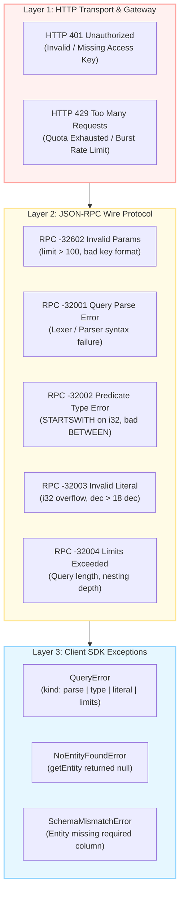
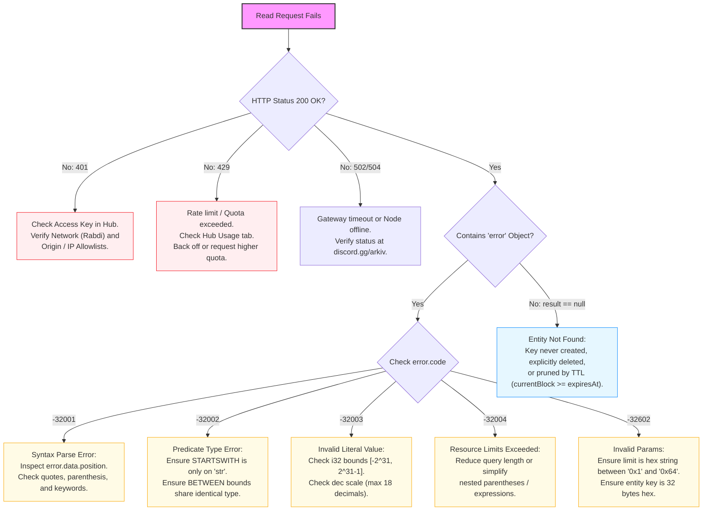

# JSON-RPC Read Protocol Error Handling

## Table of Contents
- [1. Error Architecture & Layer Separation](#1-error-architecture--layer-separation)
- [2. JSON-RPC Protocol Error Codes](#2-json-rpc-protocol-error-codes)
  - [2.1 `-32001`: Query Parse Error](#21--32001-query-parse-error)
  - [2.2 `-32002`: Type Error in Predicate](#22--32002-type-error-in-predicate)
  - [2.3 `-32003`: Invalid Literal Value](#23--32003-invalid-literal-value)
  - [2.4 `-32004`: Node Resource Limits Exceeded](#24--32004-node-resource-limits-exceeded)
  - [2.5 `-32602`: Invalid Parameters](#25--32602-invalid-parameters)
- [3. HTTP Transport & Gateway Errors](#3-http-transport--gateway-errors)
  - [3.1 HTTP 401 Unauthorized (Access Key Failures)](#31-http-401-unauthorized-access-key-failures)
  - [3.2 HTTP 429 Too Many Requests (Rate Limits & Quota Exhaustion)](#32-http-429-too-many-requests-rate-limits--quota-exhaustion)
  - [3.3 Gateway Timeouts (504) & Internal Errors (500)](#33-gateway-timeouts-504--internal-errors-500)
- [4. SDK Error Class Mapping & Translation Matrix](#4-sdk-error-class-mapping--translation-matrix)
- [5. Diagnostic Flowchart & Troubleshooting Guide](#5-diagnostic-flowchart--troubleshooting-guide)
- [6. Client Resilience, Retries & Fallbacks](#6-client-resilience-retries--fallbacks)

---

## 1. Error Architecture & Layer Separation

The Arkiv read protocol partitions errors across three architectural layers:



1. **HTTP Transport Level:** Handled by edge gateways and load balancers before JSON-RPC parsing occurs.
2. **JSON-RPC Engine Level:** Emitted by the Arkiv node when validating parameters or executing the query engine AST.
3. **Client SDK Level:** Strongly-typed errors thrown when unpacking node payloads or enforcing local schema constraints.

---

## 2. JSON-RPC Protocol Error Codes

When a read request fails at the node level, the node returns a standard JSON-RPC 2.0 error envelope:

```json
{
  "jsonrpc": "2.0",
  "id": 1,
  "error": {
    "code": -32001,
    "message": "Query parse error",
    "data": { ... }
  }
}
```

### 2.1 `-32001`: Query Parse Error

Emitted when Parameter 0 fails lexical analysis or grammar parsing. The query engine cannot build a valid Abstract Syntax Tree.

- **Trigger Scenarios:**
  - Unclosed string literal or invalid quote escaping (e.g. `str('hello)`).
  - Missing logical operator between predicates (e.g. `category = str('news') score > 4`).
  - Misplaced or unbalanced parentheses.
  - Unknown keyword or reserved identifier used as an attribute name.
- **Payload `data` Object:**
  Contains the precise character position of the syntax violation, what tokens the parser expected, and what token was encountered.

```json
{
  "jsonrpc": "2.0",
  "id": 1,
  "error": {
    "code": -32001,
    "message": "Query parse error",
    "data": {
      "position": 35,
      "expected": ["AND", "OR", "ORDER BY", "<EOF>"],
      "found": "score"
    }
  }
}
```

*SDK Mapping:* Throws `QueryError` with property `kind: "parse"`.

---

### 2.2 `-32002`: Type Error in Predicate

Emitted when the syntax is valid, but an operator is applied to an incompatible column type or two conflicting types are evaluated in a binary expression.

- **Trigger Scenarios:**
  - Invoking `STARTSWITH` on a non-`str` attribute (e.g. `score STARTSWITH str('4')` where `score` is `i32` or `dec`).
  - `BETWEEN` bounds evaluated with differing type constructors:
    `counter BETWEEN i32(1) AND u64(10)` *(fails: mixed types)*.
  - Comparing non-orderable types (e.g. filtering on `bytes` column).
- **Wire Payload Example:**

```json
{
  "jsonrpc": "2.0",
  "id": 2,
  "error": {
    "code": -32002,
    "message": "Type error in predicate",
    "data": {
      "operator": "STARTSWITH",
      "expectedType": "str",
      "actualType": "i32",
      "attribute": "score"
    }
  }
}
```

*SDK Mapping:* Throws `QueryError` with property `kind: "type"`.

---

### 2.3 `-32003`: Invalid Literal Value

Emitted when a value constructor contains a literal that violates the mathematical or architectural constraints of the specified type.

- **Trigger Scenarios:**
  - `i32` numeric overflow or underflow: values outside $[-2^{31}, 2^{31} - 1]$ (e.g. `i32(3000000000)`).
  - `dec` precision overflow: supplying more than 18 decimal places without scaling (e.g. `dec(1.1234567890123456789)`).
  - `u64` overflow: values exceeding $2^{64} - 1$.
  - `addr` malformed hex: address is not 20 bytes or fails EIP-55 mixed-case checksum.
  - `key` malformed hex: entity key is not 32 bytes.
  - `str` length overflow: string UTF-8 byte length exceeds 128 bytes.
- **Wire Payload Example:**

```json
{
  "jsonrpc": "2.0",
  "id": 3,
  "error": {
    "code": -32003,
    "message": "Invalid literal value",
    "data": {
      "type": "i32",
      "value": "3000000000",
      "reason": "Value exceeds signed 32-bit integer maximum (2147483647)"
    }
  }
}
```

*SDK Mapping:* Throws `QueryError` with property `kind: "literal"`.

---

### 2.4 `-32004`: Node Resource Limits Exceeded

Emitted when a query exceeds the protective resource boundaries configured on the Arkiv node to prevent DoS attacks and runaway compute consumption.

- **Trigger Scenarios:**
  - Query string byte length exceeds the node's maximum allowed query length.
  - Abstract Syntax Tree nesting depth exceeds the maximum recursion limit (e.g. deeply nested parentheses `((((...))))` or recursive `AND`/`OR` chains exceeding 64 levels).
  - Excessive number of boolean conditions within a single query.
- **Wire Payload Example:**

```json
{
  "jsonrpc": "2.0",
  "id": 4,
  "error": {
    "code": -32004,
    "message": "Node resource limits exceeded",
    "data": {
      "limit": "max_nesting_depth",
      "maxAllowed": 64,
      "actual": 82
    }
  }
}
```

*SDK Mapping:* Throws `QueryError` with property `kind: "limits"`.

---

### 2.5 `-32602`: Invalid Parameters

Standard JSON-RPC 2.0 error indicating that the structure or constraints of the `params` array are invalid.

- **Trigger Scenarios in `arkiv_query`:**
  - `limit` outside the range $[1, 100]$ (e.g. `"0x0"` or `"0x65"`).
  - `limit` or `offset` formatted as decimal numbers or non-hex strings instead of `"0x..."`.
  - Passing more than 2 parameters.
- **Trigger Scenarios in `arkiv_getEntity`:**
  - Passing 0 parameters (`params: []`).
  - Passing more than 1 parameter.
  - Entity key parameter is not a 66-character hex string starting with `0x`.
- **Wire Payload Example:**

```json
{
  "jsonrpc": "2.0",
  "id": 5,
  "error": {
    "code": -32602,
    "message": "Invalid params",
    "data": "limit must be a hex string between '0x1' and '0x64'"
  }
}
```

---

## 3. HTTP Transport & Gateway Errors

Errors occurring prior to JSON-RPC method execution return standard HTTP error status codes.

### 3.1 HTTP 401 Unauthorized (Access Key Failures)

Occurs when connecting to an authenticated RPC endpoint with an invalid, revoked, or mismatched access key.

```http
HTTP/1.1 401 Unauthorized
Content-Type: application/json

{
  "error": "Unauthorized: invalid access key"
}
```

- **Root Causes:**
  - Access key was mistyped or missing.
  - Access key generated for another network (e.g. old testnet key used on Rabdi).
  - Access key was regenerated or deleted in the Hub.
  - Browser request originated from a domain not listed in the Hub **Origins** allowlist.
  - Server request originated from an IP not listed in the Hub **IP allowlist**.
- **SDK Translation:**
  The SDK throws `MissingAccessKeyError` or an HTTP transport error.

### 3.2 HTTP 429 Too Many Requests (Rate Limits & Quota Exhaustion)

Occurs when a client exceeds rate limits or reaches their monthly Cost Unit allowance.

```http
HTTP/1.1 429 Too Many Requests
Content-Type: application/json
Retry-After: 5

{
  "error": "Too Many Requests: monthly cost unit quota exceeded for this access key"
}
```

- **Public RPC Throttling:** Unauthenticated requests (`accessKey: ""`) encounter aggressive burst rate limiting.
- **Quota Exhaustion:** Authenticated keys that consume 100% of their monthly Cost Units receive 429 until the monthly billing cycle resets or additional quota is granted via `hub.arkiv.network`.

### 3.3 Gateway Timeouts (504) & Internal Errors (500)

- **HTTP 504 Gateway Timeout:** The RPC node took longer than the edge gateway timeout (typically 10–30s) to evaluate the query. Usually indicates a complex unindexed sort over a large dataset.
- **HTTP 500 Internal Server Error:** Unexpected panic or state corruption on the node.

---

## 4. SDK Error Class Mapping & Translation Matrix

The official SDK abstracts protocol-level codes into JavaScript error classes:

| Layer | Wire Code / Status | Arkiv SDK Class | Exported From | Diagnostic Property |
| :--- | :--- | :--- | :--- | :--- |
| **RPC** | `-32001` | `QueryError` | `@arkiv-network/sdk/query` | `error.kind === "parse"` |
| **RPC** | `-32002` | `QueryError` | `@arkiv-network/sdk/query` | `error.kind === "type"` |
| **RPC** | `-32003` | `QueryError` | `@arkiv-network/sdk/query` | `error.kind === "literal"` |
| **RPC** | `-32004` | `QueryError` | `@arkiv-network/sdk/query` | `error.kind === "limits"` |
| **RPC** | `-32602` | `Error` | Standard Error | Message contains param validation failure |
| **HTTP** | `401` | `MissingAccessKeyError` | `@arkiv-network/sdk` | `error.message` |
| **HTTP** | `429` | `Error` (Transport) | Transport layer | Inspect HTTP 429 status & `Retry-After` |
| **App** | `result: null` | `NoEntityFoundError` | `@arkiv-network/sdk` | `error.entityKey` |
| **Client** | Pre-validation | `InvalidPredicateError` | `@arkiv-network/sdk` | Missing indexed flag / unindexed filter |
| **Client** | Post-fetch | `SchemaMismatchError` | `@arkiv-network/sdk` | Missing required column / type mismatch |

---

## 5. Diagnostic Flowchart & Troubleshooting Guide



---

## 6. Client Resilience, Retries & Fallbacks

Because all Arkiv read methods (`arkiv_query`, `arkiv_getEntity`, `arkiv_getBlockTiming`) are strictly idempotent and read-only, client applications should implement robust retry policies:

### 6.1 Exponential Backoff with Jitter for HTTP 429 & Network Errors
```typescript
async function fetchWithRetry<T>(fn: () => Promise<T>, retries = 3): Promise<T> {
  let attempt = 0
  while (true) {
    try {
      return await fn()
    } catch (error: any) {
      attempt++
      if (attempt > retries || (error.status !== 429 && error.status < 500)) {
        throw error
      }
      const delay = Math.min(1000 * 2 ** attempt + Math.random() * 200, 10000)
      console.warn(`RPC throttled or failed. Retrying in ${delay.toFixed(0)}ms...`)
      await new Promise(r => setTimeout(r, delay))
    }
  }
}
```

### 6.2 Fail-Fast on Protocol Specification Violations
Never retry errors `-32001`, `-32002`, `-32003`, `-32004`, or `-32602`. These errors indicate deterministic coding or query-generation defects that will never succeed on subsequent attempts without modifying the request.
