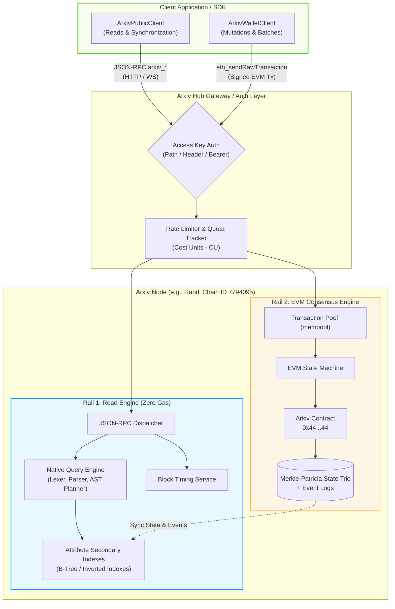
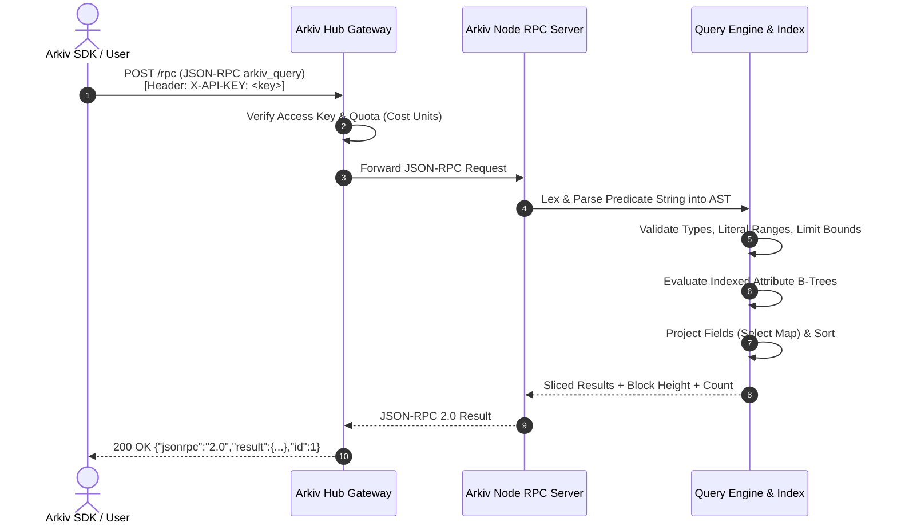
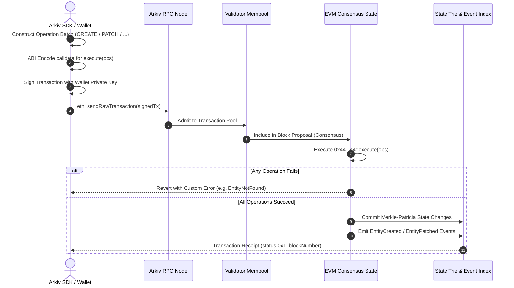
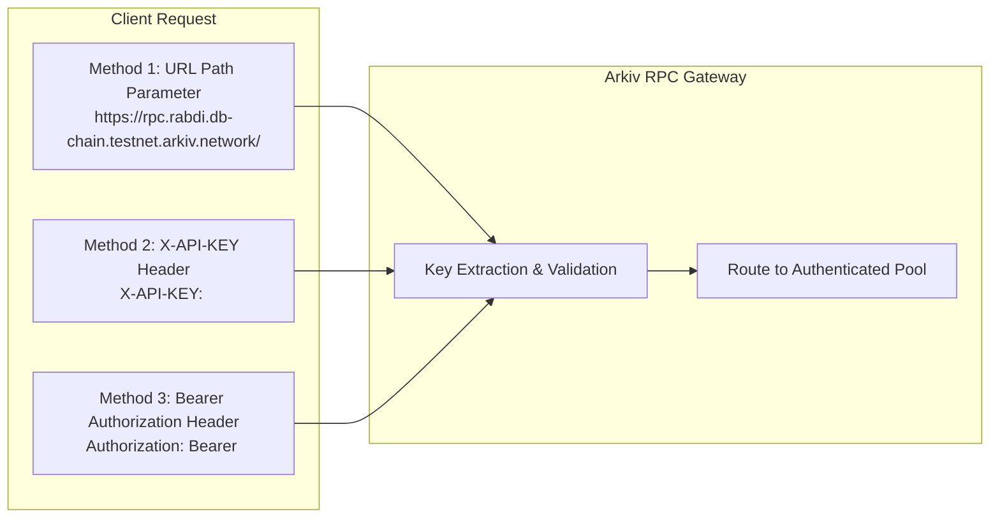
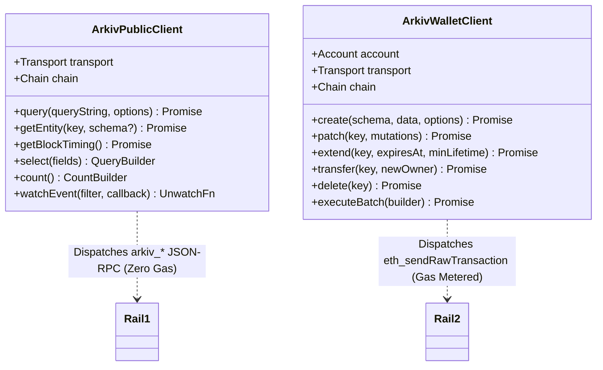

# Dual-Rail Protocol Architecture: JSON-RPC Reads vs. EVM Writes

## Table of Contents
- [1. Executive Summary & Architectural Motivation](#1-executive-summary--architectural-motivation)
- [2. The Dual-Rail Communication Architecture](#2-the-dual-rail-communication-architecture)
  - [2.1 Rail 1: Query & Read Rail (Off-Chain Node Evaluation)](#21-rail-1-query--read-rail-off-chain-node-evaluation)
  - [2.2 Rail 2: Consensus & State Mutation Rail (EVM Execution)](#22-rail-2-consensus--state-mutation-rail-evm-execution)
  - [2.3 Architectural Topology Diagram](#23-architectural-topology-diagram)
- [3. Comparative Analysis: Read Path vs. Write Path](#3-comparative-analysis-read-path-vs-write-path)
  - [3.1 Structural Comparison](#31-structural-comparison)
  - [3.2 Read Pipeline Flow](#32-read-pipeline-flow)
  - [3.3 Write Pipeline Flow](#33-write-pipeline-flow)
- [4. Custom `arkiv_*` Methods vs. Standard `eth_*` Methods](#4-custom-arkiv_-methods-vs-standard-eth_-methods)
  - [4.1 The Custom `arkiv_*` Method Suite](#41-the-custom-arkiv_-method-suite)
  - [4.2 Supported Standard `eth_*` RPC Methods](#42-supported-standard-eth_-rpc-methods)
  - [4.3 Protocol Interoperability Matrix](#43-protocol-interoperability-matrix)
- [5. Authentication, Access Keys & Hub Infrastructure](#5-authentication-access-keys--hub-infrastructure)
  - [5.1 Arkiv Hub Authentication Model](#51-arkiv-hub-authentication-model)
  - [5.2 Transmission Mechanisms for Access Keys](#52-transmission-mechanisms-for-access-keys)
  - [5.3 Public RPC Fallback Behavior](#53-public-rpc-fallback-behavior)
  - [5.4 Security Boundaries: Origin vs. IP Allowlisting](#54-security-boundaries-origin-vs-ip-allowlisting)
- [6. Transport Protocols: HTTP vs. WebSocket](#6-transport-protocols-http-vs-websocket)
  - [6.1 HTTP JSON-RPC Transport](#61-http-json-rpc-transport)
  - [6.2 WebSocket Duplex Transport](#62-websocket-duplex-transport)
- [7. SDK Architecture Implications](#7-sdk-architecture-implications)

---

## 1. Executive Summary & Architectural Motivation

Traditional decentralized storage networks and on-chain databases force developers into suboptimal trade-offs:
1. **On-chain smart contract storage (EVM SSTORE):** Guarantees cryptographic composability and consensus, but querying complex data is prohibitively expensive or practically impossible without auxiliary indexers (The Graph, subgraphs, SQD).
2. **Decentralized blob networks (IPFS, Arweave, Filecoin):** Provide immutable static storage, but lack native indexed querying, relational predicates, transactional mutation semantics, and automatic state-pruning time-to-live (TTL).

Arkiv solves this fundamental dilemma through a **Dual-Rail Protocol Architecture**. By decoupling state mutations from state queries while maintaining a single cryptographic root of trust, Arkiv delivers:
- **Consensus-enforced mutations** via standard EVM transactions submitted to a canonical singleton smart contract (`0x4400000000000000000000000000000000000044`), ensuring strict atomicity, nonce ordering, and Merkle-Patricia trie state transitions.
- **Gasless, high-throughput, indexed reads** via standard Ethereum JSON-RPC endpoints extended with native `arkiv_*` methods (`arkiv_query`, `arkiv_getEntity`, `arkiv_getBlockTiming`). RPC nodes maintain real-time in-memory and disk-backed attribute indexes evaluated directly at the node layer without gas fees or transaction latency.

---

## 2. The Dual-Rail Communication Architecture

Arkiv separates user interactions into two distinct operational rails based on whether state is modified or inspected.



### 2.1 Rail 1: Query & Read Rail (Off-Chain Node Evaluation)
- **Transport:** HTTP POST or WebSocket duplex messaging using JSON-RPC 2.0.
- **Methods:** Custom RPC extensions (`arkiv_query`, `arkiv_getEntity`, `arkiv_getBlockTiming`) alongside standard EVM inspection methods (`eth_blockNumber`, `eth_call`, `eth_getLogs`).
- **Cost:** **0 Gas**. Reads do not broadcast transactions to the mempool, do not consume miner/validator gas, and require no cryptographic wallet signatures.
- **Engine:** Arkiv validator and read nodes parse query strings into an Abstract Syntax Tree (AST), execute index scans over indexed attributes, filter rows, apply ordering, and slice pages up to 100 entities in sub-millisecond execution windows.

### 2.2 Rail 2: Consensus & State Mutation Rail (EVM Execution)
- **Transport:** Standard Ethereum raw transactions submitted via `eth_sendRawTransaction`.
- **Target:** Contract address `0x4400000000000000000000000000000000000044` deployed uniformly across all Arkiv networks.
- **Entrypoint:** `execute((uint8 operation, bytes operationData)[] ops)` (Function selector `0x49650044`).
- **Cost:** Standard EVM transaction gas paid in the native gas token (e.g., `tGLM` on the Rabdi testnet).
- **Semantics:** Full ACID batch execution. Operations 1–5 (CREATE, PATCH, EXTEND, TRANSFER, DELETE) execute sequentially within the transaction. If any single operation reverts, the entire batch aborts atomically.

### 2.3 Architectural Topology Diagram

The duality ensures that reading data scales horizontally across read-replica nodes, while state integrity remains strictly anchored to cryptographic proof verification on the consensus chain.

---

## 3. Comparative Analysis: Read Path vs. Write Path

### 3.1 Structural Comparison

| Dimension | Read Rail (`arkiv_*`) | Write Rail (`execute`) |
| :--- | :--- | :--- |
| **Protocol Mechanism** | Extended JSON-RPC 2.0 request | Signed EVM RLP/EIP-1559 transaction |
| **Node Execution Target** | Native node query engine & indexes | EVM Bytecode on contract `0x44...44` |
| **Authentication** | Access Key (`X-API-KEY`, Bearer, Path) | ECDSA signature (secp256k1 private key) |
| **Transaction Gas** | **None (Free)** | Metered gas (paid in network native token) |
| **Finality / Latency** | Immediate (~tens of ms) | Block inclusion (~2 seconds on Rabdi) |
| **State Mutation** | Strictly Read-Only (Idempotent) | State Transition in Merkle-Patricia Trie |
| **Response Format** | JSON-RPC 2.0 `result` payload | Transaction hash (`0x...`) -> Receipt -> Events |
| **Error Modes** | JSON-RPC error codes (`-32001` to `-32004`) | EVM custom error reverts (`EmptyBatch`, `NotOwner`) |

### 3.2 Read Pipeline Flow



### 3.3 Write Pipeline Flow



---

## 4. Custom `arkiv_*` Methods vs. Standard `eth_*` Methods

Arkiv nodes support standard Ethereum JSON-RPC conventions while extending the API with three domain-specific read primitives.

### 4.1 The Custom `arkiv_*` Method Suite

1. **`arkiv_query`**:
   - Executes expressive predicate searches and sort expressions against indexed entity attributes.
   - Slices pages of up to 100 entities with optional offset.
   - Provides granular projection over entity fields and attribute maps.
   - Computes aggregate counts of matching entities at the current block.

2. **`arkiv_getEntity`**:
   - Performs a direct $O(1)$ point-lookup by a 32-byte hexadecimal entity key (`bytes32`).
   - Returns the complete entity, including all system metadata and attributes.
   - Returns `null` if the key does not exist, was explicitly deleted, or has expired.

3. **`arkiv_getBlockTiming`**:
   - Returns synchronization primitives: canonical block height (`current_block`), block timestamp (`current_block_time`), and block duration (`duration`, 2 seconds).
   - Essential for client-side TTL deadline calculations without clock drift.

### 4.2 Supported Standard `eth_*` RPC Methods

Because Arkiv is fully EVM-compatible, standard Ethereum RPC methods are leveraged for essential infrastructure workflows:

- **`eth_blockNumber`**: Returns the current chain head block height (hex encoded).
- **`eth_call`**: Simulates contract execution without state changes. In Arkiv, this is primarily used to query an account's entity nonce:
  ```solidity
  function entityNonce(address owner) external view returns (uint64);
  ```
  Calling `entityNonce` (selector `0x36917bfd`) is required before creating entities to deterministically pre-calculate entity keys via:
  $$\text{keccak256}(\text{chainId} \parallel \text{arkivAddress} \parallel \text{owner} \parallel \text{nonce} \parallel \text{salt})$$
- **`eth_getLogs`**: Retrieves historical mutation events emitted by the Arkiv contract (`EntityCreated`, `EntityPatched`, `ExpiryExtended`, `OwnershipTransferred`, `EntityDeleted`).
- **`eth_sendRawTransaction`**: Submits signed mutation batches to the consensus layer.
- **`eth_estimateGas`**: Estimates the gas required to execute an `execute(ops)` call, returning EVM custom errors if validation fails.
- **`eth_subscribe` / `eth_unsubscribe`**: Establishes real-time pub/sub notifications over WebSocket for new blocks (`newHeads`) and mutation logs (`logs`).

### 4.3 Protocol Interoperability Matrix

| Method | Rail | Purpose | Gas Cost | Caller Signature |
| :--- | :--- | :--- | :--- | :--- |
| `arkiv_query` | Read | Expressive entity search and projection | 0 | None |
| `arkiv_getEntity` | Read | Fast direct point lookup by key | 0 | None |
| `arkiv_getBlockTiming` | Read | Timing synchronization for TTL | 0 | None |
| `eth_blockNumber` | Read | Query current block height | 0 | None |
| `eth_call` | Read | Query `entityNonce` on contract `0x44...44` | 0 | None |
| `eth_getLogs` | Read | Event log inspection | 0 | None |
| `eth_estimateGas` | Read | Dry-run mutation transaction | 0 | None |
| `eth_sendRawTransaction` | Write | Commit state mutation batch | Gas Metered | Required (secp256k1) |

---

## 5. Authentication, Access Keys & Hub Infrastructure

Public RPC infrastructure is susceptible to Denial of Service (DoS) attacks and query abuse. Arkiv employs an Access Key mechanism managed via the **Arkiv Hub** (`https://hub.arkiv.network/access-keys`).

### 5.1 Arkiv Hub Authentication Model

- **Generation:** Developers connect an Ethereum wallet and sign an EIP-191 / EIP-712 sign-in message. The signature authenticates wallet ownership off-chain without broadcasting an on-chain transaction.
- **Scope:** Access keys are isolated per network (e.g., an access key generated for the Rabdi testnet cannot be used on older networks or mainnet).
- **Quota Accounting:** Each key is assigned a monthly allowance measured in **Cost Units (CUs)**. Read queries and standard RPC calls consume CUs relative to execution complexity. When the quota is exhausted, subsequent requests receive HTTP 429 / rejection.

### 5.2 Transmission Mechanisms for Access Keys

The Arkiv RPC gateway supports three transmission formats. Clients must implement at least one:



#### 1. URL Path Parameter
The access key is appended as the final path segment of the RPC endpoint:
```text
https://rpc.rabdi.db-chain.testnet.arkiv.network/<YOUR_ACCESS_KEY>
wss://rpc.rabdi.db-chain.testnet.arkiv.network/<YOUR_ACCESS_KEY>
```
*SDK Behavior:* In the official TypeScript SDK, passing `rabdi({ accessKey: "..." })` automatically constructs the transport URLs using this format.

#### 2. `X-API-KEY` HTTP Header
The key is transmitted as a custom HTTP header:
```bash
curl https://rpc.rabdi.db-chain.testnet.arkiv.network \
  -H "Content-Type: application/json" \
  -H "X-API-KEY: <YOUR_ACCESS_KEY>" \
  --data '{"jsonrpc":"2.0","id":1,"method":"eth_blockNumber","params":[]}'
```

#### 3. Bearer Token Authorization Header
The key is transmitted in the standard RFC 6750 `Authorization` header:
```bash
curl https://rpc.rabdi.db-chain.testnet.arkiv.network \
  -H "Content-Type: application/json" \
  -H "Authorization: Bearer <YOUR_ACCESS_KEY>" \
  --data '{"jsonrpc":"2.0","id":1,"method":"eth_blockNumber","params":[]}'
```

### 5.3 Public RPC Fallback Behavior

If no access key is provided (or if `accessKey: ""` is passed to SDK chain initializers):
- The request is routed to the unauthenticated public RPC pool.
- The public pool enforces strict rate limits. High-frequency reads or automated pipelines will be throttled.
- The SDK emits a runtime warning discouraging production use of the public endpoint.

### 5.4 Security Boundaries: Origin vs. IP Allowlisting

The Arkiv Hub allows developers to restrict key usage via two distinct security policies:

| Allowlist Policy | Target Environment | Security Mechanism | Trust Guarantee |
| :--- | :--- | :--- | :--- |
| **Origins** | Browser / Web Apps | Browser `Origin` header matching | Attribution only (non-browser clients can spoof `Origin`) |
| **IP Allowlist** | Backend Servers / Microservices | Layer-4 TCP Remote Address matching | Strict access control (CIDR ranges rejected; exact IPs required) |

> [!WARNING]
> Because access keys embedded in browser bundles can be inspected by end users, always configure the **Origins** allowlist in the Hub for web applications. For backend daemons, indexers, and services, strictly configure the **IP Allowlist**. Never reuse server-side access keys in client-side web bundles.

---

## 6. Transport Protocols: HTTP vs. WebSocket

Arkiv nodes expose identical JSON-RPC interfaces over both HTTP and WebSocket transports.

### 6.1 HTTP JSON-RPC Transport
- **Default Endpoint:** `https://rpc.rabdi.db-chain.testnet.arkiv.network` (Chain ID: `7794095`)
- **Semantics:** Request/response model over TLS. Best suited for stateless queries (`arkiv_query`, `arkiv_getEntity`, `arkiv_getBlockTiming`) and transaction broadcasting (`eth_sendRawTransaction`).
- **Headers:** Requires `Content-Type: application/json` and `Accept: application/json`.

### 6.2 WebSocket Duplex Transport
- **Default Endpoint:** `wss://rpc.rabdi.db-chain.testnet.arkiv.network`
- **Semantics:** Persistent bidirectional TCP connection.
- **Key Authentication:** Passed via URL path segment or `X-API-KEY` during the initial HTTP upgrade handshake:
  ```bash
  wscat -c "wss://rpc.rabdi.db-chain.testnet.arkiv.network/<YOUR_ACCESS_KEY>"
  ```
- **Capabilities:**
  - Standard unary JSON-RPC requests without connection setup overhead.
  - Subscriptions via `eth_subscribe` for real-time `logs` emitted by contract `0x44...44`.

---

## 7. SDK Architecture Implications

The Dual-Rail architecture directly dictates the separation of responsibilities within client SDKs:



1. **`ArkivPublicClient`**: Requires only network connectivity and an optional access key. It handles all read queries (`arkiv_query`, `arkiv_getEntity`), time synchronization (`arkiv_getBlockTiming`), schema reflection, and log polling. It can be instantiated anywhere (even in read-only public web apps without wallet connection).
2. **`ArkivWalletClient`**: Requires a connected signer (private key, hardware wallet, or browser extension). It handles transaction nonce synchronization (`eth_call` -> `entityNonce`), salt generation, ABI calldata encoding, fee estimation, transaction signing, and submission via `eth_sendRawTransaction`.
