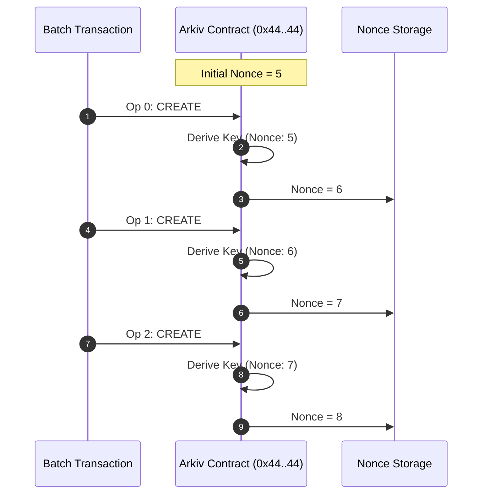
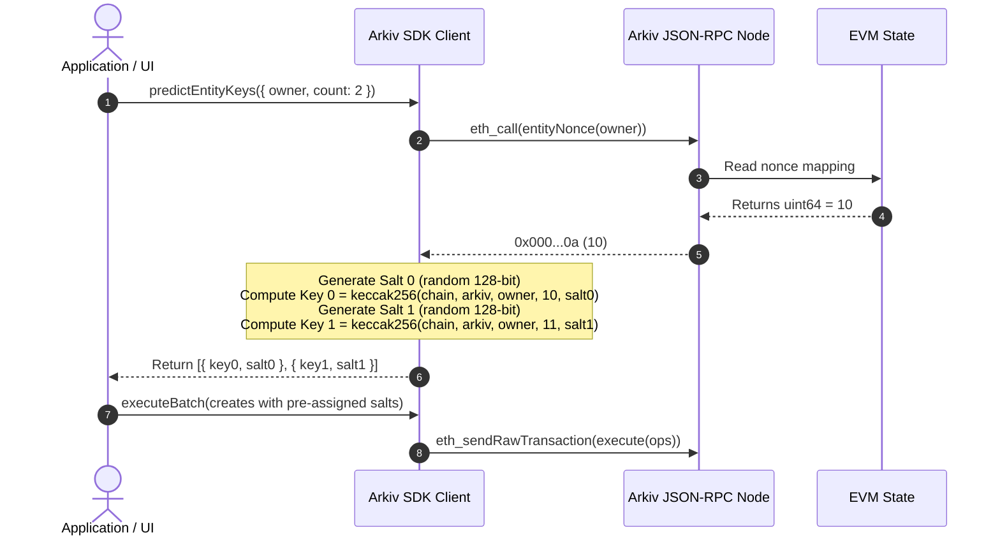

# Deterministic Entity Key Derivation & Nonce Mechanics

## Table of Contents
- [1. Executive Summary](#1-executive-summary)
- [2. The Key Derivation Formula](#2-the-key-derivation-formula)
  - [2.1 Mathematical Formulation](#21-mathematical-formulation)
  - [2.2 Byte-Level Packing (`abi.encodePacked`)](#22-byte-level-packing-abiencodepacked)
  - [2.3 Collision Resistance & Domain Separation](#23-collision-resistance--domain-separation)
- [3. The Entity Nonce Mechanism](#3-the-entity-nonce-mechanism)
  - [3.1 Decoupling from Transaction Nonces](#31-decoupling-from-transaction-nonces)
  - [3.2 Monotonic Progression in Multi-Create Batches](#32-monotonic-progression-in-multi-create-batches)
  - [3.3 Inspecting Entity Nonce via `eth_call`](#33-inspecting-entity-nonce-via-eth_call)
- [4. Salt Strategies & Predictability](#4-salt-strategies--predictability)
  - [4.1 Publicly Predictable Keys (`NO_SALT` / 0)](#41-publicly-predictable-keys-no_salt--0)
  - [4.2 Secret / Unpredictable Keys (128-Bit CSPRNG Salt)](#42-secret--unpredictable-keys-128-bit-csprng-salt)
  - [4.3 Security & Front-Running Considerations](#43-security--front-running-considerations)
- [5. Client-Side Key Prediction (`predictEntityKeys`)](#5-client-side-key-prediction-predictentitykeys)
  - [5.1 Prediction Algorithm Workflow](#51-prediction-algorithm-workflow)
  - [5.2 Sequence Diagram](#52-sequence-diagram)
- [6. Cross-Entity References in Atomic Batches](#6-cross-entity-references-in-atomic-batches)
  - [6.1 Relational Linking Before Creation](#61-relational-linking-before-creation)
  - [6.2 Concrete Batch Code Example (Post & Comment)](#62-concrete-batch-code-example-post--comment)
  - [6.3 Race Conditions & Invalidation Safeguards](#63-race-conditions--invalidation-safeguards)
- [7. Complete Reference Implementations](#7-complete-reference-implementations)
  - [7.1 TypeScript / Viem Reference](#71-typescript--viem-reference)
  - [7.2 Rust / Alloy Reference](#72-rust--alloy-reference)

---

## 1. Executive Summary

In Arkiv, an entity key (`bytes32 entityKey`) is not an arbitrary database auto-incrementing integer or a random UUID. It is a **cryptographically deterministic 32-byte identifier** derived on-chain during the execution of an entity `CREATE` operation.

The key derivation system achieves three critical architectural objectives:
1. **Universal Uniqueness**: Prevents cross-chain, cross-contract, and cross-account key collisions.
2. **Offline Computability**: Enables client SDKs and dApps to calculate exact entity keys *before* dispatching a transaction to the network.
3. **Atomic Cross-Referencing**: Allows a single batch transaction to create relational graphs (e.g., parent entities and child comments) where child entities store foreign key references to parent entities created within the very same transaction.

---

## 2. The Key Derivation Formula

### 2.1 Mathematical Formulation

When an entity `CREATE` operation is executed by the Arkiv smart contract, the 32-byte `entityKey` is calculated as follows:

$$\text{entityKey} = \text{Keccak-256}\Big(\text{abi.encodePacked}(\text{chainId}, \text{arkiv}, \text{owner}, \text{nonce}, \text{salt})\Big)$$

Where:
- $\text{chainId}$ (`uint256`): The EIP-155 integer ID of the host EVM network (e.g., `7794095` for Rabdi Testnet).
- $\text{arkiv}$ (`address`): The canonical 20-byte address of the Arkiv contract (`0x4400000000000000000000000000000000000044`).
- $\text{owner}$ (`address`): The 20-byte account address initiating the creation (`msg.sender`).
- $\text{nonce}$ (`uint64`): The creator's current internal entity creation counter.
- $\text{salt}$ (`uint128`): A 128-bit unsigned integer supplied in the create operation payload.

### 2.2 Byte-Level Packing (`abi.encodePacked`)

Solidity's `abi.encodePacked` serializes arguments tightly according to their minimum elementary byte lengths without 32-byte word padding. The packed buffer is **exactly 96 bytes long**:

```text
[ Offset: 0 ] -------------------------------------------------------------
  Field:      chainId
  Solidity:   uint256 (32 bytes, big-endian)
  Byte Range: bytes [0 .. 31]
[ Offset: 32 ] ------------------------------------------------------------
  Field:      arkiv (contract address)
  Solidity:   address (20 bytes)
  Byte Range: bytes [32 .. 51]
[ Offset: 52 ] ------------------------------------------------------------
  Field:      owner (creator address)
  Solidity:   address (20 bytes)
  Byte Range: bytes [52 .. 71]
[ Offset: 72 ] ------------------------------------------------------------
  Field:      nonce (entity counter)
  Solidity:   uint64 (8 bytes, big-endian)
  Byte Range: bytes [72 .. 79]
[ Offset: 80 ] ------------------------------------------------------------
  Field:      salt (entropy modifier)
  Solidity:   uint128 (16 bytes, big-endian)
  Byte Range: bytes [80 .. 95]
---------------------------------------------------------------------------
Total Packed Length: 32 + 20 + 20 + 8 + 16 = 96 bytes
```

#### Hexadecimal Trace Example
For `chainId = 7794095` (`0x76edaf`), `arkiv = 0x44..44`, `owner = 0xd8dA6BF26964aF9D7eEd9e03E53415D37aA96045`, `nonce = 0`, and `salt = 0`:

```text
000000000000000000000000000000000000000000000000000000000076edaf  <- chainId (32B)
4400000000000000000000000000000000000044                          <- arkiv (20B)
d8da6bf26964af9d7eed9e03e53415d37aa96045                          <- owner (20B)
0000000000000000                                                  <- nonce (8B)
00000000000000000000000000000000                                  <- salt (16B)
```

Passing these 96 packed bytes through Keccak-256 generates:
```text
0x4b18bfc16927943dd824368476f0acf1f2d1f60cec6534f41a0e98a9d8f754b3
```

### 2.3 Collision Resistance & Domain Separation

The inclusion of every parameter guarantees structural domain separation:
1. **Cross-Chain Replay Immunity**: Including `chainId` ensures that an identical transaction executed on two distinct Arkiv testnets/mainnets yields mutually exclusive entity keys.
2. **Cross-Contract Immunity**: Including `arkiv` isolates entities should alternate protocol instances ever be deployed.
3. **Cross-Account Isolation**: `owner` ensures two different accounts cannot generate the same key, even with identical nonces and salts.
4. **Intra-Account Monotonicity**: `nonce` ensures that sequential creations by the same user never collide.

---

## 3. The Entity Nonce Mechanism

### 3.1 Decoupling from Transaction Nonces

A fundamental architectural feature of Arkiv is that **entity nonces are completely independent of Ethereum account transaction nonces**:

| Property | Ethereum Account Nonce (`eth_getTransactionCount`) | Arkiv Entity Nonce (`entityNonce(address)`) |
| :--- | :--- | :--- |
| **Purpose** | Prevents transaction replay at the EVM transaction pool layer. | Guarantees uniqueness for entities created by the account. |
| **Increment Trigger** | Advances by $1$ per transaction submitted by the account. | Advances by $1$ per **entity created** within `execute`. |
| **Batch Behavior** | Remains constant during the execution of a batch transaction. | Advances monotonically for each `CREATE` operation inside the batch. |
| **Storage Location** | Native EVM account state trie. | Arkiv protocol contract storage mapping. |

### 3.2 Monotonic Progression in Multi-Create Batches

If a single batch transaction contains 3 `CREATE` operations submitted by account $A$ whose initial entity nonce is $5$:
- **Op 0 (CREATE)**: Derived using $\text{nonce} = 5$. Contract increments entity nonce to $6$.
- **Op 1 (CREATE)**: Derived using $\text{nonce} = 6$. Contract increments entity nonce to $7$.
- **Op 2 (CREATE)**: Derived using $\text{nonce} = 7$. Contract increments entity nonce to $8$.

At the conclusion of the transaction, account $A$'s entity nonce is $8$, while the account's Ethereum transaction nonce has only increased by $1$.



### 3.3 Inspecting Entity Nonce via `eth_call`

The contract exposes a read-only view function to inspect any account's current entity nonce:

```solidity
function entityNonce(address owner) external view returns (uint64);
```

#### Function Selector
$$\text{Selector} = \text{Keccak-256}(\texttt{"entityNonce(address)"})[0..4] = \texttt{0x36917bfd}$$

#### JSON-RPC Invocation via cURL
To query the entity nonce of address `0xd8dA6BF26964aF9D7eEd9e03E53415D37aA96045`:

```bash
curl "https://rpc.rabdi.db-chain.testnet.arkiv.network/$ARKIV_ACCESS_KEY" \
  -H "content-type: application/json" \
  --data @- <<EOF
{
  "jsonrpc": "2.0",
  "id": 1,
  "method": "eth_call",
  "params": [{
    "to": "0x4400000000000000000000000000000000000044",
    "data": "0x36917bfd000000000000000000000000d8da6bf26964af9d7eed9e03e53415d37aa96045"
  }, "latest"]
}
EOF
```

The node returns a 32-byte hex response containing the 64-bit integer:
```json
{
  "jsonrpc": "2.0",
  "id": 1,
  "result": "0x0000000000000000000000000000000000000000000000000000000000000005"
}
```

---

## 4. Salt Strategies & Predictability

Arkiv supports two distinct key derivation modes via the 128-bit `salt` parameter:

### 4.1 Publicly Predictable Keys (`NO_SALT` / 0)

Passing `salt = 0` (exported by the SDK as `NO_SALT = 0n`) yields a **publicly predictable key**:
- Anyone who knows the creator's address and entity nonce can compute the exact entity key in advance.
- Ideal for counterfactual architectures, deterministic data anchoring, or when public transparency of upcoming entity keys is required.

```typescript
import { NO_SALT } from "@arkiv-network/sdk";

await walletClient.createEntity(Posts, values, {
  expiration: ExpirationTime.fromDays(30),
  salt: NO_SALT, // Salt = 0n
});
```

### 4.2 Secret / Unpredictable Keys (128-Bit CSPRNG Salt)

By default, SDKs generate a random 128-bit integer using a cryptographically secure pseudo-random number generator (CSPRNG, such as `crypto.getRandomValues` in browsers/Node.js):

$$\text{salt} \in [0, 2^{128} - 1]$$

- Because external observers cannot guess 128 bits of entropy, the entity key is **unpredictable** prior to the transaction being broadcast.
- Once broadcast, the salt is visible in transaction calldata; however, the key remains bound exclusively to `msg.sender`.

#### Validation Invariants:
- If `salt < 0` or `salt > 2^128 - 1`, SDK validation fails with `InvalidSaltError`.
- If the runtime environment lacks a CSPRNG source, the SDK throws `NoRandomSourceError`.

### 4.3 Security & Front-Running Considerations

Because `owner` (`msg.sender`) is tightly bound inside the `keccak256` hash:
- **No Front-Running Key Theft**: Even if an adversary intercepts a pending create transaction in the mempool and attempts to execute it first with their own address, the adversary's entity key will hash with their own address, generating an entirely different key.
- The legitimate creator's key derivation cannot be hijacked.

---

## 5. Client-Side Key Prediction (`predictEntityKeys`)

### 5.1 Prediction Algorithm Workflow

The Arkiv client method `predictEntityKeys({ owner, count })` allows an application to precompute future entity keys and their associated salts before generating transactions:

1. **Query Current Nonce**: Query the Arkiv contract using `eth_call` with selector `0x36917bfd` for the given `owner` address to retrieve `baseNonce`.
2. **Iterative Generation**:
   For $i \in [0, \text{count} - 1]$:
   - $\text{currentNonce} = \text{baseNonce} + i$
   - Generate a 128-bit random salt $S_i$ (or use $0$ if predictable keys requested).
   - Compute $K_i = \text{keccak256}(\text{abi.encodePacked}(\text{chainId}, \text{arkiv}, \text{owner}, \text{currentNonce}, S_i))$.
3. **Return Precomputed Pairs**: Returns an array of objects `[{ key: K_0, salt: S_0 }, ..., { key: K_{n-1}, salt: S_{n-1} }]`.

### 5.2 Sequence Diagram



---

## 6. Cross-Entity References in Atomic Batches

### 6.1 Relational Linking Before Creation

In relational database schemas, a record often needs to reference the foreign key of another record. When inserting both records within the same transaction, traditional databases require auto-increment triggers or returning clauses.

Arkiv solves this natively through **deterministic salt-bound key pre-allocation**:
1. Pre-allocate keys for both the parent entity (e.g., `Post`) and child entity (e.g., `Comment`).
2. Pass the pre-allocated parent key into the child entity's `key` attribute.
3. Submit both creates within a single atomic batch transaction (`executeBatch`).

### 6.2 Concrete Batch Code Example (Post & Comment)

```typescript
import {
  ExpirationTime,
  createPublicClient,
  createWalletClient,
  custom,
  http,
} from "@arkiv-network/sdk";
import { defineSchema, key, str } from "@arkiv-network/sdk/schema";
import { rabdi } from "@arkiv-network/sdk/chains";

// 1. Define schemas
const Posts = defineSchema("my-app.posts", {
  title: str(),
  body: str(),
});

const Comments = defineSchema("my-app.comments", {
  post: key().indexed(), // Foreign key pointing to Posts entity
  text: str(),
});

// 2. Pre-predict 2 keys for our account
const [predictedPost, predictedComment] = await publicClient.predictEntityKeys({
  owner: account.address,
  count: 2,
});

// 3. Assemble atomic batch
const expiration = ExpirationTime.fromDays(30);

const result = await walletClient.executeBatch({
  creates: [
    // Op 0: Post created with predictedPost.salt
    {
      schema: Posts,
      values: {
        title: "Relational Data in Arkiv",
        body: "Arkiv allows cross-entity references in atomic batches.",
      },
      expiration,
      salt: predictedPost.salt,
    },
    // Op 1: Comment created with predictedComment.salt, referencing predictedPost.key!
    {
      schema: Comments,
      values: {
        post: key(predictedPost.key), // Pre-allocated foreign key!
        text: "Mind blown! Native Web3 relational integrity.",
      },
      expiration,
      salt: predictedComment.salt,
    },
  ],
});

console.log("Transaction Hash:", result.txHash);
console.log("Post Entity Key:", predictedPost.key);
console.log("Comment Entity Key:", predictedComment.key);
```

### 6.3 Race Conditions & Invalidation Safeguards

> [!WARNING]
> A key prediction is valid **if and only if no other create operation from the same account is mined first**.

If another create transaction submitted by the same owner account confirms before the batch transaction lands in a block:
1. The on-chain `entityNonce` advances unexpectedly.
2. The batch transaction's creates will use the new, higher nonces.
3. As a result, the on-chain key derived for the parent entity will **not** match `predictedPost.key`.
4. The comment will store a dangling `post` key reference pointing to an unallocated or mismatched key.

#### Mitigation Best Practices:
- Keep key prediction and batch transaction dispatch closely coupled in application code.
- Avoid concurrent create transactions from the same signer account; manage a local sequence lock or pipeline transactions sequentially.

---

## 7. Complete Reference Implementations

### 7.1 TypeScript / Viem Reference

```typescript
import {
  type Address,
  type Hex,
  concat,
  keccak256,
  padHex,
  toBytes,
  toHex,
} from "viem";

export const CANONICAL_ARKIV_ADDRESS: Address =
  "0x4400000000000000000000000000000000000044";

/**
 * Derives an Arkiv entity key using the canonical 96-byte packed formula
 */
export function deriveEntityKey(params: {
  chainId: bigint;
  arkivAddress?: Address;
  owner: Address;
  nonce: bigint;
  salt: bigint;
}): Hex {
  const arkiv = params.arkivAddress ?? CANONICAL_ARKIV_ADDRESS;

  // 1. chainId: uint256 (32 bytes)
  const chainIdHex = padHex(toHex(params.chainId), { size: 32 });

  // 2. arkiv: address (20 bytes)
  const arkivHex = arkiv.toLowerCase() as Hex;

  // 3. owner: address (20 bytes)
  const ownerHex = params.owner.toLowerCase() as Hex;

  // 4. nonce: uint64 (8 bytes)
  const nonceHex = padHex(toHex(params.nonce), { size: 8 });

  // 5. salt: uint128 (16 bytes)
  const saltHex = padHex(toHex(params.salt), { size: 16 });

  // Tight concatenation (total 96 bytes)
  const packedPayload = concat([
    chainIdHex,
    arkivHex,
    ownerHex,
    nonceHex,
    saltHex,
  ]);

  if (toBytes(packedPayload).length !== 96) {
    throw new Error(`Packed payload length must be exactly 96 bytes, got ${toBytes(packedPayload).length}`);
  }

  return keccak256(packedPayload);
}
```

### 7.2 Rust / Alloy Reference

```rust
use alloy_primitives::{address, Address, B256, U256};
use tiny_keccak::{Hasher, Keccak};

pub const ARKIV_ADDRESS: Address = address!("4400000000000000000000000000000000000044");

pub fn derive_entity_key(
    chain_id: u64,
    arkiv: Address,
    owner: Address,
    nonce: u64,
    salt: u128,
) -> B256 {
    let mut packed = [0u8; 96];

    // 1. chain_id: uint256 (32 bytes)
    let chain_u256 = U256::from(chain_id);
    packed[0..32].copy_from_slice(&chain_u256.to_be_bytes::<32>());

    // 2. arkiv: address (20 bytes)
    packed[32..52].copy_from_slice(arkiv.as_slice());

    // 3. owner: address (20 bytes)
    packed[52..72].copy_from_slice(owner.as_slice());

    // 4. nonce: uint64 (8 bytes)
    packed[72..80].copy_from_slice(&nonce.to_be_bytes());

    // 5. salt: uint128 (16 bytes)
    packed[80..96].copy_from_slice(&salt.to_be_bytes());

    let mut hasher = Keccak::v256();
    hasher.update(&packed);
    let mut output = [0u8; 32];
    hasher.finalize(&mut output);

    B256::from(output)
}
```
