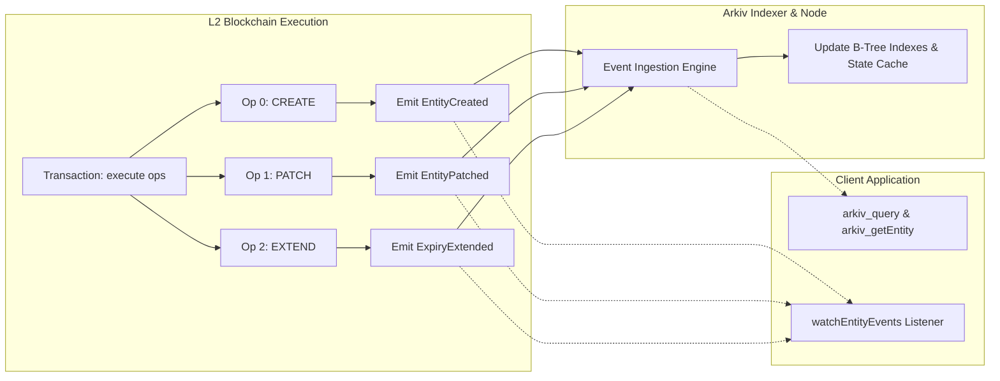

# On-Chain Events, Log Indexing & Custom Error Catalog

## Table of Contents
- [1. Executive Summary](#1-executive-summary)
- [2. The On-Chain Event System](#2-the-on-chain-event-system)
  - [2.1 The Role of Logs in Arkiv Architecture](#21-the-role-of-logs-in-arkiv-architecture)
  - [2.2 Emission Ordering in Batches](#22-emission-ordering-in-batches)
- [3. The 5 Core EVM Events](#3-the-5-core-evm-events)
  - [3.1 `EntityCreated`](#31-entitycreated)
  - [3.2 `EntityPatched`](#32-entitypatched)
  - [3.3 `ExpiryExtended`](#33-expiryextended)
  - [3.4 `OwnershipTransferred`](#34-ownershiptransferred)
  - [3.5 `EntityDeleted`](#35-entitydeleted)
- [4. Architectural Design Rationales](#4-architectural-design-rationales)
  - [4.1 Why Attributes Are Omitted from Events](#41-why-attributes-are-omitted-from-events)
  - [4.2 Why No Event Is Emitted on Natural TTL Expiration](#42-why-no-event-is-emitted-on-natural-ttl-expiration)
  - [4.3 Owner Field Semantics in `ExpiryExtended`](#43-owner-field-semantics-in-expiryextended)
- [5. Event Filtering, Polling & Subscriptions](#5-event-filtering-polling--subscriptions)
  - [5.1 `eth_getLogs` Filtering](#51-eth_getlogs-filtering)
  - [5.2 `eth_subscribe` WebSocket Streaming](#52-eth_subscribe-websocket-streaming)
  - [5.3 SDK `watchEntityEvents` Mechanics](#53-sdk-watchentityevents-mechanics)
- [6. Complete EVM Contract ABI](#6-complete-evm-contract-abi)
- [7. Comprehensive Custom Error Catalog](#7-comprehensive-custom-error-catalog)
  - [7.1 Selector Reference Table](#71-selector-reference-table)
  - [7.2 Detailed Error Specifications & SDK Mappings](#72-detailed-error-specifications--sdk-mappings)

---

## 1. Executive Summary

Arkiv utilizes Ethereum's native event logging mechanism (`LOG0` .. `LOG4` opcodes) to emit canonical receipts for every successfully applied mutation. These EVM logs serve as the write-ahead log that decentralized indexing nodes consume to maintain read-optimized indexes for `arkiv_query` and `arkiv_getEntity`.

Clients, dApps, and indexers track these events to maintain local synchronized state caches, update user interfaces reactively, and audit data ownership changes with cryptographic finality.

---

## 2. The On-Chain Event System

### 2.1 The Role of Logs in Arkiv Architecture

Every mutating operation inside an `execute` batch emits **exactly one event** from the Arkiv contract address (`0x4400000000000000000000000000000000000044`).



### 2.2 Emission Ordering in Batches

- Events are emitted synchronously as each operation applies during EVM execution.
- If a batch contains 5 operations, the transaction receipt contains exactly 5 logs indexed sequentially (`logIndex = 0, 1, 2, 3, 4`).
- If an operation reverts, the entire batch transaction reverts; no logs are emitted, and no receipts are generated.

---

## 3. The 5 Core EVM Events

### 3.1 `EntityCreated`

Emitted when Op 1 (`CREATE`) successfully initializes a new entity.

```solidity
event EntityCreated(
    bytes32 indexed entityKey,
    address indexed owner,
    uint64 expiresAt,
    uint8 creationFlags
);
```

#### Topic & Data Encoding
- **Topic 0 (Event Signature)**:
  ```text
  0xb282d7c494b8899aa8015cd07be621530beb03409eb8c5e8fdc1411ba64356a5
  Keccak-256("EntityCreated(bytes32,address,uint64,uint8)")
  ```
- **Topic 1 (`indexed entityKey`)**: The derived 32-byte `entityKey`.
- **Topic 2 (`indexed owner`)**: The 20-byte creator address, right-aligned (padded with 12 leading zero bytes).
- **Data Payload (64 bytes)**:
  - `bytes [0x00 .. 0x1f]`: `expiresAt` (uint64 right-aligned in 32 bytes).
  - `bytes [0x20 .. 0x3f]`: `creationFlags` (uint8 right-aligned in 32 bytes).

---

### 3.2 `EntityPatched`

Emitted when Op 2 (`PATCH`) successfully modifies attributes of an existing entity.

```solidity
event EntityPatched(
    bytes32 indexed entityKey,
    address indexed owner
);
```

#### Topic & Data Encoding
- **Topic 0 (Event Signature)**:
  ```text
  0xe986ee220b2d7947a009d9389d8400b2ac82d3b430a9f72700a0975d3d5a34fe
  Keccak-256("EntityPatched(bytes32,address)")
  ```
- **Topic 1 (`indexed entityKey`)**: The 32-byte key of the modified entity.
- **Topic 2 (`indexed owner`)**: The current owner of the entity.
- **Data Payload**: Empty (`0x`, 0 bytes).

---

### 3.3 `ExpiryExtended`

Emitted when Op 3 (`EXTEND_EXPIRY`) updates an entity's expiration block.

```solidity
event ExpiryExtended(
    bytes32 indexed entityKey,
    address indexed owner,
    uint64 expiresAt
);
```

#### Topic & Data Encoding
- **Topic 0 (Event Signature)**:
  ```text
  0x10dc3526654c9ba4e2370b1bfcbc0de087d141a5694b3d3305d37df7e6705d4b
  Keccak-256("ExpiryExtended(bytes32,address,uint64)")
  ```
- **Topic 1 (`indexed entityKey`)**: The 32-byte entity key.
- **Topic 2 (`indexed owner`)**: The **current owner** of the entity (see [Section 4.3](#43-owner-field-semantics-in-expiryextended)).
- **Data Payload (32 bytes)**:
  - `bytes [0x00 .. 0x1f]`: The newly resolved `expiresAt` block height.

---

### 3.4 `OwnershipTransferred`

Emitted when Op 4 (`TRANSFER_OWNERSHIP`) reassigns administrative ownership.

```solidity
event OwnershipTransferred(
    bytes32 indexed entityKey,
    address indexed previousOwner,
    address indexed newOwner
);
```

#### Topic & Data Encoding
- **Topic 0 (Event Signature)**:
  ```text
  0x0b659dccc8eb950324170e8d9598af5ee04ee070883eb28651a96788721fbf83
  Keccak-256("OwnershipTransferred(bytes32,address,address)")
  ```
- **Topic 1 (`indexed entityKey`)**: The 32-byte entity key.
- **Topic 2 (`indexed previousOwner`)**: The old owner address.
- **Topic 3 (`indexed newOwner`)**: The new owner address.
- **Data Payload**: Empty (`0x`, 0 bytes).

---

### 3.5 `EntityDeleted`

Emitted when Op 5 (`DELETE`) removes an entity before its natural TTL expiration.

```solidity
event EntityDeleted(
    bytes32 indexed entityKey,
    address indexed owner
);
```

#### Topic & Data Encoding
- **Topic 0 (Event Signature)**:
  ```text
  0x4059b76c47e1ecc40ba88e649b654f716515eb358c3ce83c803820e3b3130cc3
  Keccak-256("EntityDeleted(bytes32,address)")
  ```
- **Topic 1 (`indexed entityKey`)**: The 32-byte key of the deleted entity.
- **Topic 2 (`indexed owner`)**: The owner that authorized deletion.
- **Data Payload**: Empty (`0x`, 0 bytes).

---

## 4. Architectural Design Rationales

### 4.1 Why Attributes Are Omitted from Events

A conspicuous property of Arkiv events is that **no attribute names or values are included in event topics or log data**:
1. **Gas Cost Minimization**: EVM log data costs 8 gas per byte. Storing arbitrary user attributes (which can reach up to 128 KiB per entity) inside logs would make writes prohibitively expensive.
2. **Calldata Availability**: Because write transactions are published on-chain, full attribute payloads are already available in transaction calldata for indexers that require raw reconstruction.
3. **Dedicated Query Engine**: Clients requiring current attribute values use `arkiv_getEntity` or `arkiv_query`, which return indexed state directly from local database nodes.

### 4.2 Why No Event Is Emitted on Natural TTL Expiration

> [!IMPORTANT]
> Arkiv **never** emits an event when an entity expires naturally at its `$expiresAt` block height.

#### Rationales:
- **No Free Execution in EVM**: Smart contracts cannot execute timers or cron jobs autonomously. Emitting an event upon expiration would require an incentivized keeper network to execute on-chain transactions, consuming gas fees.
- **Passive Invalidation**: The contract evaluates expiration passively: whenever an expired entity is accessed, `block.number >= entity.expiresAt` triggers an immediate revert.
- **Client & Indexer Responsibility**: Clients maintaining off-chain state replicas must inspect `$expiresAt` and prune entities locally once the host blockchain height crosses their expiration block.

### 4.3 Owner Field Semantics in `ExpiryExtended`

When Op 3 (`EXTEND_EXPIRY`) is executed on an entity created with the `permissionlessExtension` flag (`creationFlags = 0x02`), the transaction caller (`msg.sender`) may be a sponsor or automated keeper, rather than the entity owner.

The contract specifically records the **entity's actual owner** in the event's `indexed owner` topic, **not** `msg.sender`. This ensures that downstream indexers and queries tracking an owner's active entities maintain consistent attribution.

---

## 5. Event Filtering, Polling & Subscriptions

### 5.1 `eth_getLogs` Filtering

Clients can fetch historical events using standard EVM JSON-RPC:

```json
{
  "jsonrpc": "2.0",
  "id": 1,
  "method": "eth_getLogs",
  "params": [{
    "address": "0x4400000000000000000000000000000000000044",
    "fromBlock": "0x6f4a00",
    "toBlock": "latest",
    "topics": [
      "0xb282d7c494b8899aa8015cd07be621530beb03409eb8c5e8fdc1411ba64356a5"
    ]
  }]
}
```

### 5.2 `eth_subscribe` WebSocket Streaming

Over WebSockets (`wss://rpc.rabdi.db-chain.testnet.arkiv.network`), clients subscribe to real-time events:

```json
{
  "jsonrpc": "2.0",
  "id": 2,
  "method": "eth_subscribe",
  "params": [
    "logs",
    {
      "address": "0x4400000000000000000000000000000000000044"
    }
  ]
}
```

### 5.3 SDK `watchEntityEvents` Mechanics

The Arkiv SDK exposes `watchEntityEvents` to abstract transport mechanics:
- **Default Polling Interval**: 1,000 milliseconds (half of Rabdi's 2-second block time).
- **Callback Dispatch**: Dispatches strongly-typed objects (`EntityCreatedEvent`, `EntityPatchedEvent`, etc.).
- **Master Stream Handler**: An optional `onEvent` callback processes every event in exact execution order before specific handlers run.

```typescript
const unwatch = publicClient.watchEntityEvents({
  pollingInterval: 1000,
  onEntityCreated: ({ entityKey, owner, expiresAt, creationFlags }) => {
    console.log(`Created: ${entityKey} by ${owner} until block ${expiresAt}`);
  },
  onEntityPatched: ({ entityKey, owner }) => {
    console.log(`Patched: ${entityKey}`);
  },
  onEntityDeleted: ({ entityKey, owner }) => {
    console.log(`Deleted: ${entityKey}`);
  },
  onError: (err) => console.error("Watcher error:", err),
});
```

---

## 6. Complete EVM Contract ABI

The complete standard Solidity JSON ABI for `0x4400000000000000000000000000000000000044` is provided below:

```json
[
  {
    "type": "function",
    "name": "execute",
    "inputs": [
      {
        "name": "ops",
        "type": "tuple[]",
        "components": [
          { "name": "operation", "type": "uint8" },
          { "name": "operationData", "type": "bytes" }
        ]
      }
    ],
    "outputs": [],
    "stateMutability": "nonpayable"
  },
  {
    "type": "function",
    "name": "entityNonce",
    "inputs": [
      { "name": "owner", "type": "address" }
    ],
    "outputs": [
      { "name": "", "type": "uint64" }
    ],
    "stateMutability": "view"
  },
  {
    "type": "event",
    "name": "EntityCreated",
    "inputs": [
      { "name": "entityKey", "type": "bytes32", "indexed": true },
      { "name": "owner", "type": "address", "indexed": true },
      { "name": "expiresAt", "type": "uint64", "indexed": false },
      { "name": "creationFlags", "type": "uint8", "indexed": false }
    ],
    "anonymous": false
  },
  {
    "type": "event",
    "name": "EntityPatched",
    "inputs": [
      { "name": "entityKey", "type": "bytes32", "indexed": true },
      { "name": "owner", "type": "address", "indexed": true }
    ],
    "anonymous": false
  },
  {
    "type": "event",
    "name": "ExpiryExtended",
    "inputs": [
      { "name": "entityKey", "type": "bytes32", "indexed": true },
      { "name": "owner", "type": "address", "indexed": true },
      { "name": "expiresAt", "type": "uint64", "indexed": false }
    ],
    "anonymous": false
  },
  {
    "type": "event",
    "name": "OwnershipTransferred",
    "inputs": [
      { "name": "entityKey", "type": "bytes32", "indexed": true },
      { "name": "previousOwner", "type": "address", "indexed": true },
      { "name": "newOwner", "type": "address", "indexed": true }
    ],
    "anonymous": false
  },
  {
    "type": "event",
    "name": "EntityDeleted",
    "inputs": [
      { "name": "entityKey", "type": "bytes32", "indexed": true },
      { "name": "owner", "type": "address", "indexed": true }
    ],
    "anonymous": false
  },
  { "type": "error", "name": "EmptyBatch", "inputs": [] },
  { "type": "error", "name": "InvalidOpType", "inputs": [{ "name": "operation", "type": "uint8" }] },
  { "type": "error", "name": "NonCanonicalOperationData", "inputs": [{ "name": "operation", "type": "uint8" }] },
  { "type": "error", "name": "AttributesNotSorted", "inputs": [] },
  { "type": "error", "name": "TooManyAttributes", "inputs": [{ "name": "count", "type": "uint256" }, { "name": "maxCount", "type": "uint256" }] },
  { "type": "error", "name": "EmptyMutations", "inputs": [{ "name": "entityKey", "type": "bytes32" }] },
  { "type": "error", "name": "TombstoneInCreate", "inputs": [{ "name": "name", "type": "bytes32" }] },
  { "type": "error", "name": "TombstoneValueNotEmpty", "inputs": [{ "name": "name", "type": "bytes32" }] },
  { "type": "error", "name": "SystemAttributeNotWritable", "inputs": [{ "name": "name", "type": "bytes32" }] },
  { "type": "error", "name": "InvalidValueType", "inputs": [{ "name": "name", "type": "bytes32" }, { "name": "typeId", "type": "uint8" }] },
  { "type": "error", "name": "Ident32Empty", "inputs": [] },
  { "type": "error", "name": "Ident32InvalidByte", "inputs": [{ "name": "position", "type": "uint256" }, { "name": "value", "type": "bytes1" }] },
  { "type": "error", "name": "EntityNotFound", "inputs": [{ "name": "entityKey", "type": "bytes32" }] },
  { "type": "error", "name": "EntityExpired", "inputs": [{ "name": "entityKey", "type": "bytes32" }, { "name": "expiresAt", "type": "uint64" }] },
  { "type": "error", "name": "NotOwner", "inputs": [{ "name": "entityKey", "type": "bytes32" }, { "name": "caller", "type": "address" }, { "name": "owner", "type": "address" }] },
  { "type": "error", "name": "ReadOnlyEntity", "inputs": [{ "name": "entityKey", "type": "bytes32" }] },
  { "type": "error", "name": "ReservedCreationFlags", "inputs": [{ "name": "creationFlags", "type": "uint8" }] },
  { "type": "error", "name": "ExpiryDeadOnArrival", "inputs": [{ "name": "target", "type": "uint64" }, { "name": "currentBlock", "type": "uint64" }] },
  { "type": "error", "name": "ExpiryBeyondMaxLifetime", "inputs": [{ "name": "target", "type": "uint64" }, { "name": "currentBlock", "type": "uint64" }, { "name": "maxLifetime", "type": "uint64" }] },
  { "type": "error", "name": "ExpiryNotExtended", "inputs": [{ "name": "entityKey", "type": "bytes32" }, { "name": "newExpiresAt", "type": "uint64" }, { "name": "currentExpiresAt", "type": "uint64" }] },
  { "type": "error", "name": "TransferToZeroAddress", "inputs": [{ "name": "entityKey", "type": "bytes32" }] },
  { "type": "error", "name": "TransferToSelf", "inputs": [{ "name": "entityKey", "type": "bytes32" }] }
]
```

---

## 7. Comprehensive Custom Error Catalog

### 7.1 Selector Reference Table

When transactions revert or gas estimation fails, the contract returns standard Solidity custom errors. Each error begins with a deterministic 4-byte selector:

| Custom Error Signature | 4-Byte Selector | Decoded Parameters | Functional Description |
| :--- | :---: | :--- | :--- |
| `EmptyBatch()` | `0xc2e5347d` | *None* | `ops` array passed to `execute` is empty. |
| `InvalidOpType(uint8 operation)` | `0x6bd847c6` | `uint8` | Operation tag is not between 1 and 5. |
| `NonCanonicalOperationData(uint8 operation)` | `0x89bc9448` | `uint8` | `operationData` violates canonical ABI encoding. |
| `AttributesNotSorted()` | `0x3206846a` | *None* | Attributes in create/patch are not strictly ascending by name. |
| `TooManyAttributes(uint256 count, uint256 maxCount)` | `0xd7ce981c` | `uint256`, `uint256` | Operation exceeds 32 attributes (`maxCount = 32`). |
| `EmptyMutations(bytes32 entityKey)` | `0x78a58538` | `bytes32` | Patch operation supplied an empty mutation array. |
| `TombstoneInCreate(bytes32 name)` | `0x42501bac` | `bytes32` | Tombstone (`typeId 0`) was included in a `CREATE` operation. |
| `TombstoneValueNotEmpty(bytes32 name)` | `0x019f59df` | `bytes32` | Tombstone in patch has non-empty `value` bytes. |
| `SystemAttributeNotWritable(bytes32 name)` | `0x79b2b398` | `bytes32` | Attribute name starts with `$` (ASCII `0x24`). |
| `InvalidValueType(bytes32 name, uint8 typeId)` | `0x639fb7ab` | `bytes32`, `uint8` | Unknown `typeId` or indexing attempted on `bytes` (`0x87`). |
| `Ident32Empty()` | `0xc109aef4` | *None* | Attribute name length is 0. |
| `Ident32InvalidByte(uint256 position, bytes1 value)` | `0x276f7798` | `uint256`, `bytes1` | Character in name violates lexical regex rules. |
| `EntityNotFound(bytes32 entityKey)` | `0x66a89f2a` | `bytes32` | Entity key does not exist in state trie. |
| `EntityExpired(bytes32 entityKey, uint64 expiresAt)` | `0x2411cf56` | `bytes32`, `uint64` | Target entity has already expired at or before current block. |
| `NotOwner(bytes32 entityKey, address caller, address owner)` | `0xa3221ef2` | `bytes32`, `address`, `address` | Caller is not entity owner (and extension is not permissionless). |
| `ReadOnlyEntity(bytes32 entityKey)` | `0xd858a824` | `bytes32` | Attempted patch on entity with `readonly` flag (`0x01`). |
| `ReservedCreationFlags(uint8 creationFlags)` | `0xdcc18611` | `uint8` | Creation flags set reserved bits (`0xFC`). |
| `ExpiryDeadOnArrival(uint64 target, uint64 currentBlock)` | `0x26049d1c` | `uint64`, `uint64` | Expiration block is $\le$ current block height. |
| `ExpiryBeyondMaxLifetime(uint64 target, uint64 currentBlock, uint64 maxLifetime)` | `0xdd7e986b` | `uint64`, `uint64`, `uint64` | Expiration exceeds `currentBlock + 7,884,000`. |
| `ExpiryNotExtended(bytes32 entityKey, uint64 newExpiresAt, uint64 currentExpiresAt)` | `0x33268a0d` | `bytes32`, `uint64`, `uint64` | New expiration is earlier than current expiration. |
| `TransferToZeroAddress(bytes32 entityKey)` | `0x8742c67c` | `bytes32` | Ownership transfer target is `address(0)`. |
| `TransferToSelf(bytes32 entityKey)` | `0xe324b169` | `bytes32` | Ownership transfer target is the current owner. |

---

### 7.2 Detailed Error Specifications & SDK Mappings

When interacting through the TypeScript SDK, low-level EVM revert data is intercepted and mapped to high-level JavaScript error classes:

```typescript
import {
  EntityMutationError,
  InvalidExpiryError,
  SchemaMismatchError,
} from "@arkiv-network/sdk";

try {
  await walletClient.patchEntity(Posts, entityKey, {
    set: { score: dec("4.5") },
  });
} catch (error) {
  if (error instanceof EntityMutationError) {
    // Contains txHash, revert selector, and decoded reason
    console.error("Mutation failed on-chain:", error.message);
  }
}
```
