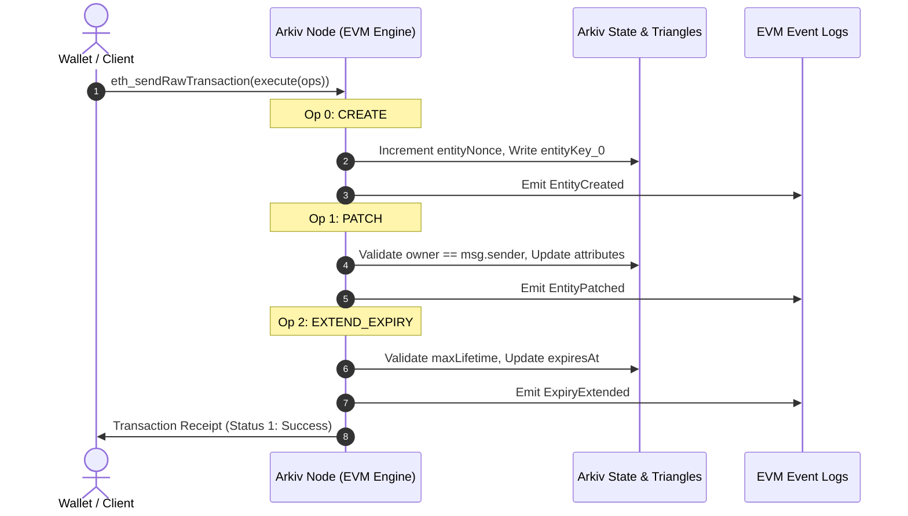
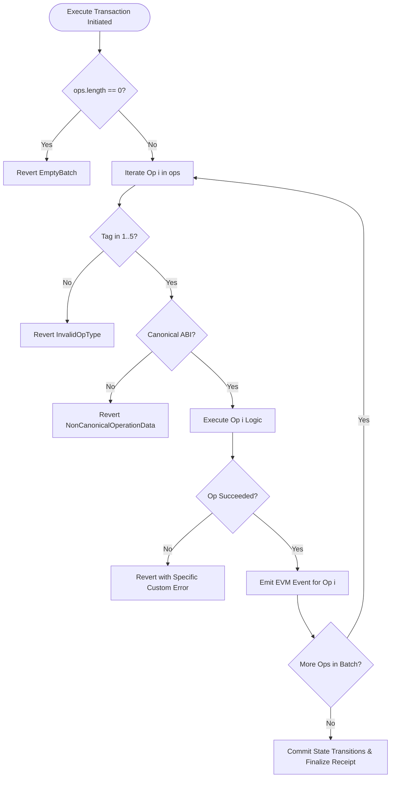
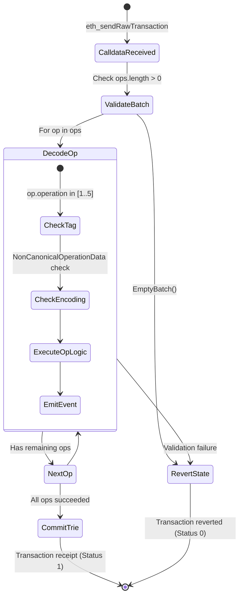

# The `execute` Function & EVM Contract Entrypoint

## Table of Contents
- [1. Executive Summary](#1-executive-summary)
- [2. Protocol Contract Architecture](#2-protocol-contract-architecture)
  - [2.1 Canonical Contract Address](#21-canonical-contract-address)
  - [2.2 Function Interface & Selector](#22-function-interface--selector)
  - [2.3 Transaction Parameter Invariants](#23-transaction-parameter-invariants)
- [3. Batch Execution Semantics & Atomicity](#3-batch-execution-semantics--atomicity)
  - [3.1 All-or-Nothing Atomicity](#31-all-or-nothing-atomicity)
  - [3.2 Sequential Execution Order](#32-sequential-execution-order)
  - [3.3 Revert Propagation & Gas Consumption](#33-revert-propagation--gas-consumption)
- [4. Calldata Encoding & Memory Layout](#4-calldata-encoding--memory-layout)
  - [4.1 EVM ABI Structure](#41-evm-abi-structure)
  - [4.2 Word-by-Word Calldata Dissection](#42-word-by-word-calldata-dissection)
  - [4.3 Memory Allocation in Contract Execution](#43-memory-allocation-in-contract-execution)
- [5. Execution Lifecycle & State Machine](#5-execution-lifecycle--state-machine)
- [6. Gas Model, Estimation & Economic Considerations](#6-gas-model-estimation--economic-considerations)
  - [6.1 Gas Token & Gas Schedules](#61-gas-token--gas-schedules)
  - [6.2 Gas Estimation via `eth_estimateGas`](#62-gas-estimation-via-eth_estimategas)
- [7. SDK Implementation Blueprint](#7-sdk-implementation-blueprint)
  - [7.1 TypeScript / Viem Implementation](#71-typescript--viem-implementation)
  - [7.2 Rust / Alloy Implementation](#72-rust--alloy-implementation)
  - [7.3 Go / go-ethereum Implementation](#73-go--go-ethereum-implementation)
- [8. Edge Cases & Error Modes](#8-edge-cases--error-modes)

---

## 1. Executive Summary

In Arkiv, mutations are not submitted via custom JSON-RPC endpoints (`arkiv_*`). Instead, Arkiv operates a **dual-rail architecture**:
1. **Reads & Queries**: Handled off-chain by Arkiv indexing nodes over specialized JSON-RPC methods (`arkiv_query`, `arkiv_getEntity`, `arkiv_getBlockTiming`).
2. **Writes & State Transitions**: Handled strictly through native EVM transactions sent via `eth_sendRawTransaction` to a single protocol contract entrypoint: the `execute` function on the canonical Arkiv precompile/system contract.

Every mutating action—creating entities, updating attributes, extending time-to-live (TTL) expiration, transferring ownership, and deleting entities—is multiplexed through this single function. All mutations in a single transaction execute as an atomic batch.

---

## 2. Protocol Contract Architecture

### 2.1 Canonical Contract Address

Across every Arkiv network (including the current Rabdi public testnet with Chain ID `7794095` and future mainnets), the protocol contract resides at a fixed, deterministic address:

```text
0x4400000000000000000000000000000000000044
```

> [!IMPORTANT]
> The address `0x4400000000000000000000000000000000000044` is hardcoded across all chains. There are no secondary factory or proxy contracts for write routing. All client write transactions must specify this address as their `to` recipient.

### 2.2 Function Interface & Selector

The contract exposes the `execute` entrypoint with the following Solidity signature:

```solidity
struct Operation {
    uint8 operation;       // Operation tag: 1 = CREATE, 2 = PATCH, 3 = EXTEND, 4 = TRANSFER, 5 = DELETE
    bytes operationData;   // ABI-encoded payload corresponding to the operation tag
}

function execute(Operation[] calldata ops) external;
```

#### Function Selector Calculation
The 4-byte EVM function selector is derived from the canonical Keccak-256 hash of the normalized function signature:

$$\text{Selector} = \text{Keccak-256}(\texttt{"execute((uint8,bytes)[])"})[0..4]$$

Computing the hash:
```text
Keccak-256("execute((uint8,bytes)[])") = 0x49650044b3603d65b1ce55eb2b9a7be834e5a953e5066db48fc1a774b706cbbd
```

Taking the first 4 bytes yields the exact selector:
```text
0x49650044
```

### 2.3 Transaction Parameter Invariants

| Parameter | Required Value | Rationale & Rules |
| :--- | :--- | :--- |
| `to` | `0x4400000000000000000000000000000000000044` | Canonical Arkiv contract address. |
| `value` | `0` (`0x0`) | The contract accepts zero native value. Non-zero `msg.value` causes execution to revert. |
| `data` | `0x49650044...` | Function selector followed by ABI-encoded `Operation[]` array. |
| `gasLimit` | Estimated via `eth_estimateGas` | Sufficient gas for state writes and indexing table updates. |
| Gas Token | `tGLM` (Rabdi testnet) / `GLM` (Mainnet) | Arkiv utilizes Golem tokens (`GLM`) as its native L2 gas fee token. |

---

## 3. Batch Execution Semantics & Atomicity

### 3.1 All-or-Nothing Atomicity

The `execute` function guarantees strict **ACID atomicity**:
- Either **all** operations in the `ops` array succeed and their state transitions persist to the world state, or **none** do.
- If an individual operation reverts (e.g., due to an unauthorized mutation, non-sorted attributes, or an expired entity), the entire EVM transaction reverts, discarding all state changes made by preceding operations within the batch.
- No partial writes can ever be committed to the Merkle-Patricia trie or query indexing databases.

### 3.2 Sequential Execution Order

Operations inside the `ops` array are processed **in strict chronological array order** ($i = 0, 1, 2, \dots, n-1$):
1. **Nonce Increment**: If operation $i$ is a `CREATE`, the sender's internal `entityNonce` is incremented immediately, so subsequent `CREATE` operations in the same batch observe the incremented nonce.
2. **Key Referencing**: An operation at index $k > i$ can reference the entity created at index $i$ by its predicted or calculated `bytes32 entityKey` within the same batch.
3. **State Dependencies**: A batch can create an entity at index $0$, patch its attributes at index $1$, extend its expiration at index $2$, and transfer its ownership at index $3$.



### 3.3 Revert Propagation & Gas Consumption

When an operation fails:
- The contract triggers an EVM `REVERT` opcode accompanied by an ABI-encoded custom error (e.g., `NotOwner(bytes32,address,address)` or `AttributesNotSorted()`).
- All state updates within the transaction rollback.
- The sender pays gas for the execution consumed up to the point of failure.
- In JSON-RPC interactions, `eth_estimateGas` and `eth_call` simulate execution and return the custom error selector and decoded parameters directly to the client.



---

## 4. Calldata Encoding & Memory Layout

### 4.1 EVM ABI Structure

Under standard Solidity ABI encoding rules:
- `execute((uint8,bytes)[])` takes a dynamic array of tuples.
- The tuple is `(uint8, bytes)`.
- Because `bytes` is a dynamic type, each tuple in the array is itself dynamic. Therefore, the array of tuples is encoded as an array of offsets pointing to each element's head.

```solidity
// Canonical ABI Signature
function execute((uint8,bytes)[]) external
```

### 4.2 Word-by-Word Calldata Dissection

Consider a minimal batch containing **one CREATE operation** (`op = 1`). The calldata layout unfolds across 32-byte (256-bit) words:

```text
Offset (Hex)  | Word Content (Hex / Description)
------------------------------------------------------------------------------------------------------------------
0x0000        | 0x4965004400000000000000000000000000000000000000000000000000000000 (Selector padded to 32 bytes)
              |   Note: In raw calldata, only the first 4 bytes [0x49, 0x65, 0x00, 0x44] are selector bytes.
0x0004        | 0x0000000000000000000000000000000000000000000000000000000000000020 (Offset to `ops` array = 32)
0x0024        | 0x0000000000000000000000000000000000000000000000000000000000000001 (Array length: 1 operation)
0x0044        | 0x0000000000000000000000000000000000000000000000000000000000000020 (Offset to Op[0] head = 32)
0x0064        | 0x0000000000000000000000000000000000000000000000000000000000000001 (Op[0].operation: uint8 = 1)
0x0084        | 0x0000000000000000000000000000000000000000000000000000000000000040 (Offset to `operationData` = 64)
0x00A4        | 0x00000000000000000000000000000000000000000000000000000000000000... (Length of `operationData` bytes)
0x00C4...     | [Raw ABI-encoded bytes of Operation 1 struct, padded to multiples of 32 bytes]
```

#### Detailed Breakdown of Head-Tail Mechanics
1. **Function Selector**: `bytes4(0x49650044)` occupying calldata bytes `[0x00..0x03]`.
2. **Offset to `ops`**: `0x0000000000000000000000000000000000000000000000000000000000000020` points to offset `32` relative to the arguments segment (byte `0x04`).
3. **Length of `ops`**: Number of operations $N$.
4. **Tuple Offsets**: An array of $N$ 32-byte offsets. Each offset points to the location of the `(uint8, bytes)` tuple.
5. **Tuple Elements**:
   - `operation`: Word-aligned 32-byte integer with value $1 \dots 5$.
   - Offset to dynamic `operationData`: Relative offset pointing to the payload.
   - `operationData` length: 32-byte length prefix.
   - `operationData` content: Byte array padded to a 32-byte boundary with trailing zeroes.

### 4.3 Memory Layout in Contract Execution

During execution inside the EVM:
- Calldata is loaded into linear memory via `calldatacopy`.
- Memory expansion gas is incurred proportionally to the size of the payload.
- Because Arkiv limits all `bytes` attributes in a single operation to **128 KiB** (`MAX_ENTITY_BYTES`), the memory footprint for an individual create or patch is strictly bounded, preventing EVM out-of-gas quadratic memory expansion attacks.

---

## 5. Execution Lifecycle & State Machine

The contract validates each operation against protocol invariants before executing state modifications.



---

## 6. Gas Model, Estimation & Economic Considerations

### 6.1 Gas Token & Gas Schedules

- **Native Gas Token**: `tGLM` (on Rabdi Testnet) or `GLM` (on Arkiv Mainnet). Arkiv is an Ethereum L2/application-chain that utilizes standard ERC-20 wrapped or native GLM as the base execution token.
- **Block Time**: Exactly **2 seconds** per block.
- **Gas Schedule Dynamics**:
  - Base transaction gas: 21,000 gas.
  - Calldata gas: 16 gas per non-zero byte, 4 gas per zero byte (standard EIP-2028).
  - Storage & Indexing overhead: Writing indexed attributes incurs higher gas than unindexed attributes because the node updates internal indexing B-trees / state structures.
  - Large binary data: Storing `bytes` payloads up to 128 KiB consumes calldata gas plus state persistence costs.

### 6.2 Gas Estimation via `eth_estimateGas`

Before sending mutations, clients should invoke standard `eth_estimateGas`:

```bash
curl "https://rpc.rabdi.db-chain.testnet.arkiv.network/$ARKIV_ACCESS_KEY" \
  -H "content-type: application/json" \
  --data @- <<EOF
{
  "jsonrpc": "2.0",
  "id": 1,
  "method": "eth_estimateGas",
  "params": [{
    "from": "0xd8dA6BF26964aF9D7eEd9e03E53415D37aA96045",
    "to": "0x4400000000000000000000000000000000000044",
    "data": "0x49650044..."
  }]
}
EOF
```

> [!NOTE]
> If any operation in the batch will revert upon block inclusion, `eth_estimateGas` fails immediately with an execution error containing the custom revert data.

---

## 7. SDK Implementation Blueprint

### 7.1 TypeScript / Viem Implementation

```typescript
import {
  type Address,
  type Hex,
  createWalletClient,
  custom,
  encodeAbiParameters,
  encodeFunctionData,
  parseAbi,
  parseAbiParameters,
  stringToHex,
  toHex,
} from "viem";

export const ARKIV_CONTRACT_ADDRESS: Address = "0x4400000000000000000000000000000000000044";
export const EXECUTE_SELECTOR = "0x49650044";

export interface Operation {
  operation: number; // 1 to 5
  operationData: Hex;
}

/**
 * Encodes an array of operations into calldata for execute()
 */
export function encodeExecuteCalldata(ops: Operation[]): Hex {
  return encodeFunctionData({
    abi: parseAbi(["function execute((uint8 operation, bytes operationData)[] ops)"]),
    functionName: "execute",
    args: [ops.map((o) => [o.operation, o.operationData])],
  });
}
```

### 7.2 Rust / Alloy Implementation

```rust
use alloy_primitives::{address, Address, Bytes, FixedBytes};
use alloy_sol_types::{sol, SolCall};

// Canonical contract address
pub const ARKIV_ADDRESS: Address = address!("4400000000000000000000000000000000000044");

sol! {
    struct Operation {
        uint8 operation;
        bytes operationData;
    }

    function execute(Operation[] ops) external;
}

pub fn build_execute_calldata(ops: Vec<Operation>) -> Vec<u8> {
    let call = executeCall { ops };
    call.abi_encode()
}
```

### 7.3 Go / go-ethereum Implementation

```go
package arkiv

import (
	"strings"

	"github.com/ethereum/go-ethereum/accounts/abi"
	"github.com/ethereum/go-ethereum/common"
)

var CanonicalArkivAddress = common.HexToAddress("0x4400000000000000000000000000000000000044")

const ArkivABI = `[
  {
    "type": "function",
    "name": "execute",
    "inputs": [
      {
        "name": "ops",
        "type": "tuple[]",
        "components": [
          { "name": "operation", "type": "uint8" },
          { "name": "operationData", "type": "bytes" }
        ]
      }
    ],
    "outputs": []
  }
]`

func EncodeExecute(ops []struct {
	Operation     uint8
	OperationData []byte
}) ([]byte, error) {
	parsedABI, err := abi.JSON(strings.NewReader(ArkivABI))
	if err != nil {
		return nil, err
	}
	return parsedABI.Pack("execute", ops)
}
```

---

## 8. Edge Cases & Error Modes

The `execute` entrypoint rejects transactions violating fundamental protocol constraints:

1. **Empty Batch (`EmptyBatch()`, selector `0xc2e5347d`)**:
   - Submitted `ops` array has a length of 0.
2. **Invalid Opcode (`InvalidOpType(uint8 operation)`, selector `0x6bd847c6`)**:
   - The `operation` tag is not within the range $[1..5]$.
3. **Malleable / Malformed Encoding (`NonCanonicalOperationData(uint8 operation)`, selector `0x89bc9448`)**:
   - The payload in `operationData` contains non-canonical ABI encoding, trailing garbage bytes, or non-minimal integers.
4. **Non-Zero Value**:
   - If `msg.value > 0`, the transaction reverts immediately.
