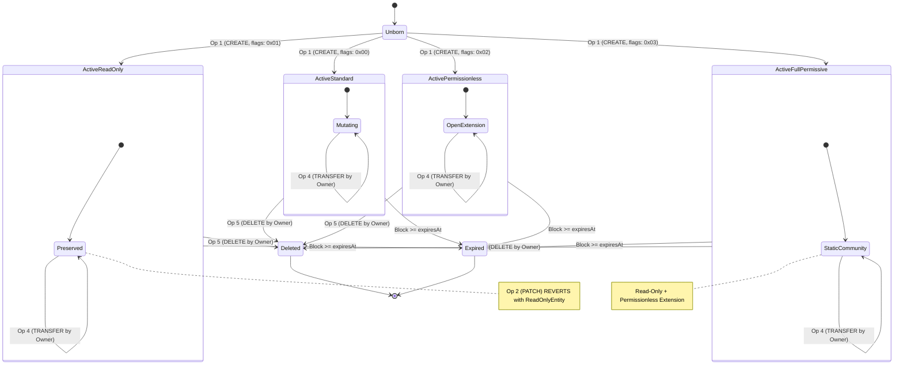

# Operation Types & Mutation Payloads

## Table of Contents
- [1. Overview of Core Operations](#1-overview-of-core-operations)
- [2. Operations Architecture Matrix](#2-operations-architecture-matrix)
- [3. Operation 1: CREATE](#3-operation-1-create)
  - [3.1 Struct Definition & ABI Encoding](#31-struct-definition--abi-encoding)
  - [3.2 Parameter Semantics](#32-parameter-semantics)
  - [3.3 Creation Flags Bitfield](#33-creation-flags-bitfield)
  - [3.4 State Transitions & Execution Invariants](#34-state-transitions--execution-invariants)
  - [3.5 Validation Checks & Revert Conditions](#35-validation-checks--revert-conditions)
- [4. Operation 2: PATCH](#4-operation-2-patch)
  - [4.1 Struct Definition & ABI Encoding](#41-struct-definition--abi-encoding)
  - [4.2 Mutation Semantics & Differential Updates](#42-mutation-semantics--differential-updates)
  - [4.3 Tombstone Mechanism](#43-tombstone-mechanism)
  - [4.4 Validation Checks & Revert Conditions](#44-validation-checks--revert-conditions)
- [5. Operation 3: EXTEND_EXPIRY](#5-operation-3-extend_expiry)
  - [5.1 Struct Definition & ABI Encoding](#51-struct-definition--abi-encoding)
  - [5.2 Expiry Resolution Arithmetic](#52-expiry-resolution-arithmetic)
  - [5.3 Authorization & Permissionless Extensions](#53-authorization--permissionless-extensions)
  - [5.4 Validation Checks & Revert Conditions](#54-validation-checks--revert-conditions)
- [6. Operation 4: TRANSFER_OWNERSHIP](#6-operation-4-transfer_ownership)
  - [6.1 Struct Definition & ABI Encoding](#61-struct-definition--abi-encoding)
  - [6.2 Owner vs Creator Distinction](#62-owner-vs-creator-distinction)
  - [6.3 Validation Checks & Revert Conditions](#63-validation-checks--revert-conditions)
- [7. Operation 5: DELETE](#7-operation-5-delete)
  - [7.1 Struct Definition & ABI Encoding](#71-struct-definition--abi-encoding)
  - [7.2 Pruning Mechanics & Storage Reclamation](#72-pruning-mechanics--storage-reclamation)
  - [7.3 Validation Checks & Revert Conditions](#73-validation-checks--revert-conditions)
- [8. Entity State Machine](#8-entity-state-machine)
- [9. Complete Concrete Calldata Examples](#9-complete-concrete-calldata-examples)

---

## 1. Overview of Core Operations

All mutations within Arkiv are encapsulated inside one of five discrete operation types. Each operation is identified by an unsigned 8-bit integer tag (`uint8 operation`) paired with an ABI-encoded byte payload (`bytes operationData`):

$$\text{Operation} = \langle \text{tag} \in \{1, 2, 3, 4, 5\}, \text{abi.encode}(\text{PayloadStruct}) \rangle$$

The Arkiv execution engine unpacks the operation tag and dispatches execution to specialized subroutines.

---

## 2. Operations Architecture Matrix

| Op Code | Operation Name | Target Entity Key | Struct Parameters | Emitted EVM Event | Authorization Boundary |
| :---: | :--- | :--- | :--- | :--- | :--- |
| **`1`** | **`CREATE`** | Derived by node | `(uint128 salt, uint64 expiresAt, uint64 minLifetime, uint8 creationFlags, Attribute[] attributes)` | `EntityCreated` | Anyone (`msg.sender` becomes owner) |
| **`2`** | **`PATCH`** | Explicit (`bytes32`) | `(bytes32 entityKey, Attribute[] mutations)` | `EntityPatched` | Owner only (entity must not be read-only) |
| **`3`** | **`EXTEND_EXPIRY`**| Explicit (`bytes32`) | `(bytes32 entityKey, uint64 expiresAt, uint64 minLifetime)` | `ExpiryExtended` | Owner only, **or** Anyone if `permissionlessExtension` flag is set |
| **`4`** | **`TRANSFER_OWNERSHIP`**| Explicit (`bytes32`) | `(bytes32 entityKey, address newOwner)` | `OwnershipTransferred` | Current owner only |
| **`5`** | **`DELETE`** | Explicit (`bytes32`) | `(bytes32 entityKey)` | `EntityDeleted` | Owner only |

---

## 3. Operation 1: CREATE

### 3.1 Struct Definition & ABI Encoding

The `CREATE` operation (`operation = 1`) initializes a new entity.

```solidity
struct CreateOperation {
    uint128 salt;
    uint64 expiresAt;
    uint64 minLifetime;
    uint8 creationFlags;
    Attribute[] attributes;
}
```

Canonical ABI signature for parameter encoding:
```text
(uint128,uint64,uint64,uint8,(bytes32,uint8,bytes)[])
```

### 3.2 Parameter Semantics

1. **`salt` (`uint128`)**:
   - A 128-bit unsigned integer used in deterministic key generation.
   - When set to `0` (`NO_SALT`), the entity key is publicly predictable to anyone who knows the owner's next `entityNonce`.
   - When set to 128 cryptographically secure random bits, the entity key is secret and predictable only to the creator prior to inclusion.
2. **`expiresAt` (`uint64`)**:
   - An absolute target block height for entity expiration.
   - Set to `0` if specifying a relative duration via `minLifetime`.
3. **`minLifetime` (`uint64`)**:
   - A relative lifetime counted in blocks from the block that includes the transaction (`currentBlock`).
   - On Arkiv chains, block time is fixed at **2 seconds** (e.g., 30 days = $30 \times 86400 / 2 = 1,296,000$ blocks).
4. **`creationFlags` (`uint8`)**:
   - An 8-bit immutable bitfield configuring entity permanence and extension governance.
5. **`attributes` (`Attribute[]`)**:
   - An array of initial attribute tuples `(bytes32 name, uint8 typeId, bytes value)`.

### 3.3 Creation Flags Bitfield

`creationFlags` are locked at creation time and can **never** be modified:

```text
Bit 7  Bit 6  Bit 5  Bit 4  Bit 3  Bit 2  Bit 1                  Bit 0
[ 0 ][ 0 ][ 0 ][ 0 ][ 0 ][ 0 ][ EXT ][ RO ]
                                         │                       │
                                         │                       └─ 0x01: Read-Only
                                         └───────────────────────── 0x02: Permissionless Extension
```

- **Bit 0 (`0x01` - Read-Only)**: When enabled, the entity's attributes can **never** be patched or mutated. The owner can still extend expiration, transfer ownership, or delete the entity.
- **Bit 1 (`0x02` - Permissionless Extension)**: When enabled, any account on the network can call `EXTEND_EXPIRY` on the entity, allowing community sponsors or automated keepers to maintain entity persistence without granting modification rights.
- **Bits 2..7 (`0xFC` - Reserved)**: Reserved for future protocol upgrades. Must be `0`.

### 3.4 State Transitions & Execution Invariants

Upon processing Op 1:
1. `owner = msg.sender`.
2. `creator = msg.sender`.
3. Fetch current `entityNonce` for `owner`.
4. Derive deterministic `entityKey = keccak256(abi.encodePacked(block.chainid, address(this), owner, nonce, salt))`.
5. Increment `owner`'s `entityNonce` by 1.
6. Resolve TTL: $\text{expiry} = \max(\text{expiresAt}, \text{currentBlock} + \text{minLifetime})$.
7. Store all attributes in the state trie and update indexing structures for indexed columns.
8. Emit `EntityCreated(entityKey, owner, expiry, creationFlags)`.

### 3.5 Validation Checks & Revert Conditions

- Setting reserved bits in flags reverts with `ReservedCreationFlags(creationFlags)`.
- If `expiry <= currentBlock`, reverts with `ExpiryDeadOnArrival(expiry, currentBlock)`.
- If `expiry > currentBlock + 7_884_000`, reverts with `ExpiryBeyondMaxLifetime(expiry, currentBlock, 7884000)`.
- Including a tombstone (`typeId == 0`) reverts with `TombstoneInCreate(name)`.
- If attributes are not in strict ascending order, reverts with `AttributesNotSorted()`.
- If attributes length exceeds 32, reverts with `TooManyAttributes(count, 32)`.
- If aggregate `bytes` payloads exceed 128 KiB (131,072 bytes), reverts with `EntityTooLargeError`.

---

## 4. Operation 2: PATCH

### 4.1 Struct Definition & ABI Encoding

The `PATCH` operation (`operation = 2`) mutates an existing entity's attributes.

```solidity
struct PatchOperation {
    bytes32 entityKey;
    Attribute[] mutations;
}
```

Canonical ABI signature:
```text
(bytes32,(bytes32,uint8,bytes)[])
```

### 4.2 Mutation Semantics & Differential Updates

- **Differential Mutation**: Patching updates **only** the attributes explicitly supplied in `mutations`. Attributes not listed remain completely untouched in storage.
- **Expiry Stability**: A patch does not change the entity's `$expiresAt` block height.
- **Strict Sorting**: The `mutations` array must be sorted in strictly ascending byte order by `name`.

### 4.3 Tombstone Mechanism

To delete or unset an optional column from an entity:
- Pass an `Attribute` with `typeId = 0` (the **Tombstone** type).
- The `value` field must be empty (`0x` / length 0).
- If `value.length > 0`, execution reverts with `TombstoneValueNotEmpty(bytes32 name)`.
- The node unsets the column in state and removes it from indexing tables.

### 4.4 Validation Checks & Revert Conditions

| Error Signature | Selector | Condition |
| :--- | :--- | :--- |
| `EntityNotFound(bytes32 entityKey)` | `0x66a89f2a` | No entity exists with the provided `entityKey`. |
| `EntityExpired(bytes32 entityKey, uint64 expiresAt)` | `0x2411cf56` | Current block height is $\ge \text{expiresAt}$. |
| `NotOwner(bytes32 entityKey, address caller, address owner)` | `0xa3221ef2` | `msg.sender != entity.owner`. |
| `ReadOnlyEntity(bytes32 entityKey)` | `0xd858a824` | Entity was created with `creationFlags` Bit 0 (`0x01`) set. |
| `EmptyMutations(bytes32 entityKey)` | `0x78a58538` | `mutations` array length is 0. |
| `AttributesNotSorted()` | `0x3206846a` | Mutations are not strictly ascending by name. |
| `TombstoneValueNotEmpty(bytes32 name)` | `0x019f59df` | Tombstone attribute (`typeId 0`) has non-empty `value`. |
| `SystemAttributeNotWritable(bytes32 name)` | `0x79b2b398` | Attribute name starts with `$` byte (`0x24`). |

---

## 5. Operation 3: EXTEND_EXPIRY

### 5.1 Struct Definition & ABI Encoding

The `EXTEND_EXPIRY` operation (`operation = 3`) resets or extends an entity's expiration block.

```solidity
struct ExtendExpiryOperation {
    bytes32 entityKey;
    uint64 expiresAt;
    uint64 minLifetime;
}
```

Canonical ABI signature:
```text
(bytes32,uint64,uint64)
```

### 5.2 Expiry Resolution Arithmetic

The new expiration block is computed identically to create:

$$\text{newExpiry} = \max(\text{expiresAt}, \text{currentBlock} + \text{minLifetime})$$

#### Key Rules:
1. **No Retraction**: An extension can **never** move an entity's expiration earlier than its current `$expiresAt`. If $\text{newExpiry} < \text{currentExpiresAt}$, the operation reverts with `ExpiryNotExtended(entityKey, newExpiresAt, currentExpiresAt)`.
2. **No-Op Idempotency**: If $\text{newExpiry} == \text{currentExpiresAt}$, state remains unchanged and the operation succeeds.
3. **From Now, Not Additive**: Lifetimes count relative to `currentBlock`, **not** by adding onto the current expiration. For example, if an entity currently has 5 days left and is extended with `minLifetime = fromDays(30)`, its new lifetime is 30 days from the current block, **not** 35 days.
4. **Max Lifetime Boundary**: An extension cannot exceed $7,884,000$ blocks past `currentBlock` ($\approx 182.5$ days). If $\text{newExpiry} > \text{currentBlock} + 7,884,000$, reverts with `ExpiryBeyondMaxLifetime`.

### 5.3 Authorization & Permissionless Extensions

- **Standard Entities**: Only `entity.owner` is authorized to extend expiration. If `msg.sender != entity.owner`, reverts with `NotOwner`.
- **Permissionless Extension Entities**: If the entity was created with `creationFlags` Bit 1 (`0x02`) enabled, **any account** on the network can submit Op 3.
- In both cases, the emitted `ExpiryExtended` event records the entity's **owner** in its indexed `owner` topic, **not** `msg.sender`.

### 5.4 Validation Checks & Revert Conditions

- `EntityNotFound(bytes32)`: Entity does not exist.
- `EntityExpired(bytes32, uint64)`: Entity has already expired prior to or at `currentBlock`.
- `NotOwner(bytes32, address, address)`: Caller is unauthorized and permissionless extension is disabled.
- `ExpiryNotExtended(bytes32, uint64, uint64)`: Target block is earlier than current expiration.
- `ExpiryBeyondMaxLifetime(uint64, uint64, uint64)`: Target block exceeds protocol maximum.

---

## 6. Operation 4: TRANSFER_OWNERSHIP

### 6.1 Struct Definition & ABI Encoding

The `TRANSFER_OWNERSHIP` operation (`operation = 4`) reassigns administrative ownership of an entity.

```solidity
struct TransferOwnershipOperation {
    bytes32 entityKey;
    address newOwner;
}
```

Canonical ABI signature:
```text
(bytes32,address)
```

### 6.2 Owner vs Creator Distinction

Arkiv maintains an explicit distinction between administrative ownership and provenance:
- **`$owner`**: The account currently authorized to patch, extend, transfer, or delete the entity. Updated immediately upon transfer.
- **`$creator`**: The account that initially executed the `CREATE` operation. **Permanently immutable**. Never alters during an ownership transfer.

```text
Before Transfer:
  $owner   = 0xAlice...
  $creator = 0xAlice...

After TransferOwnership(newOwner = 0xBob):
  $owner   = 0xBob...
  $creator = 0xAlice...  <-- Immutable provenance preserved!
```

### 6.3 Validation Checks & Revert Conditions

- **`NotOwner(entityKey, caller, owner)`**: `msg.sender != currentOwner`.
- **`TransferToZeroAddress(bytes32 entityKey)` (selector `0x8742c67c`)**: Reverts if `newOwner == address(0)`. Entities cannot be burned via transfer; use Op 5 (`DELETE`).
- **`TransferToSelf(bytes32 entityKey)` (selector `0xe324b169`)**: Reverts if `newOwner == currentOwner`. Redundant self-transfers are rejected.
- **`EntityNotFound(entityKey)`**: Entity does not exist.
- **`EntityExpired(entityKey, expiresAt)`**: Entity has expired.

---

## 7. Operation 5: DELETE

### 7.1 Struct Definition & ABI Encoding

The `DELETE` operation (`operation = 5`) removes an entity immediately.

```solidity
struct DeleteOperation {
    bytes32 entityKey;
}
```

Canonical ABI signature:
```text
(bytes32)
```

### 7.2 Pruning Mechanics & Storage Reclamation

- **Immediate Invalidation**: The entity is instantly deleted from active state. Subsequent reads (`arkiv_getEntity`) return `null`, and queries omit it.
- **Equivalence to Expiration**: Functionally, deletion achieves the exact same state outcome as natural TTL expiration occurring at the current block, but triggers an on-chain `EntityDeleted` event.
- **Storage Cleanup**: Removes all index pointers, freeing state trie slots.

### 7.3 Validation Checks & Revert Conditions

- **`NotOwner(entityKey, caller, owner)`**: Only the current owner can delete an entity.
- **`EntityNotFound(entityKey)`**: Entity does not exist.
- **`EntityExpired(entityKey, expiresAt)`**: Entity is already expired.

---

## 8. Entity State Machine

The complete lifecycle transitions of an Arkiv entity across all operations are visualized below:



---

## 9. Complete Concrete Calldata Examples

### 9.1 TypeScript Viem Construction of All 5 Operations

```typescript
import {
  type Hex,
  encodeAbiParameters,
  encodeFunctionData,
  parseAbi,
  parseAbiParameters,
  stringToHex,
  toHex,
} from "viem";

const ATTRIBUTE_STRUCT = "(bytes32 name, uint8 typeId, bytes value)[]";

// 1. CREATE Operation
export function encodeCreateOp(params: {
  salt: bigint;
  expiresAt: bigint;
  minLifetime: bigint;
  creationFlags: number;
  attributes: Array<{ name: Hex; typeId: number; value: Hex }>;
}): { operation: number; operationData: Hex } {
  const abiParams = parseAbiParameters(
    `uint128, uint64, uint64, uint8, ${ATTRIBUTE_STRUCT}`
  );
  const operationData = encodeAbiParameters(abiParams, [
    params.salt,
    params.expiresAt,
    params.minLifetime,
    params.creationFlags,
    params.attributes,
  ]);
  return { operation: 1, operationData };
}

// 2. PATCH Operation
export function encodePatchOp(params: {
  entityKey: Hex;
  mutations: Array<{ name: Hex; typeId: number; value: Hex }>;
}): { operation: number; operationData: Hex } {
  const abiParams = parseAbiParameters(`bytes32, ${ATTRIBUTE_STRUCT}`);
  const operationData = encodeAbiParameters(abiParams, [
    params.entityKey,
    params.mutations,
  ]);
  return { operation: 2, operationData };
}

// 3. EXTEND_EXPIRY Operation
export function encodeExtendOp(params: {
  entityKey: Hex;
  expiresAt: bigint;
  minLifetime: bigint;
}): { operation: number; operationData: Hex } {
  const abiParams = parseAbiParameters("bytes32, uint64, uint64");
  const operationData = encodeAbiParameters(abiParams, [
    params.entityKey,
    params.expiresAt,
    params.minLifetime,
  ]);
  return { operation: 3, operationData };
}

// 4. TRANSFER_OWNERSHIP Operation
export function encodeTransferOp(params: {
  entityKey: Hex;
  newOwner: Hex;
}): { operation: number; operationData: Hex } {
  const abiParams = parseAbiParameters("bytes32, address");
  const operationData = encodeAbiParameters(abiParams, [
    params.entityKey,
    params.newOwner,
  ]);
  return { operation: 4, operationData };
}

// 5. DELETE Operation
export function encodeDeleteOp(params: {
  entityKey: Hex;
}): { operation: number; operationData: Hex } {
  const abiParams = parseAbiParameters("bytes32");
  const operationData = encodeAbiParameters(abiParams, [params.entityKey]);
  return { operation: 5, operationData };
}
```
