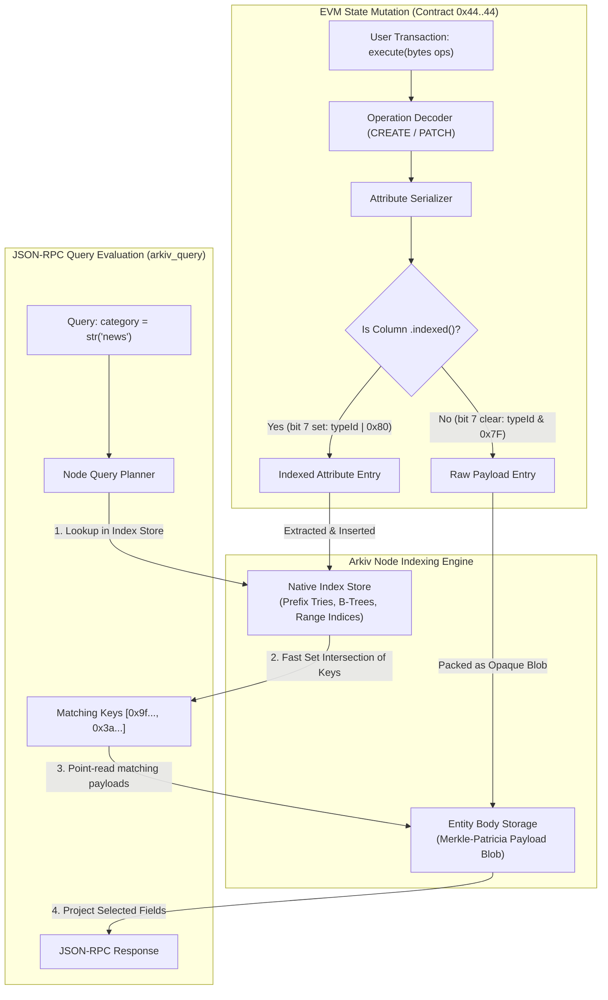
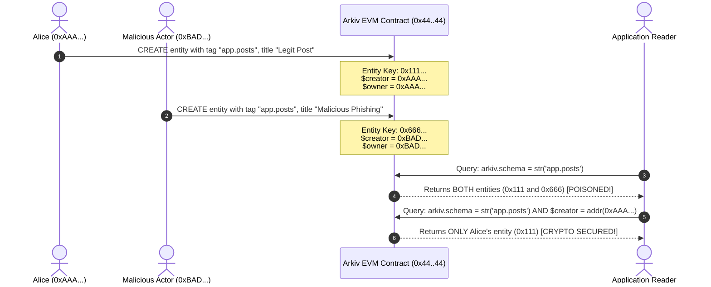

# Arkiv Query Engine: Predicates, Operators & Type Semantics

## Table of Contents
1. [Architecture of Native Index Filtering](#1-architecture-of-native-index-filtering)
   - [Why Unindexed Columns Cannot Be Filtered](#why-unindexed-columns-cannot-be-filtered)
   - [Dual Storage Model: Index Store vs Raw Entity Payload](#dual-storage-model-index-store-vs-raw-entity-payload)
   - [Gas and Storage Cost Implications of `.indexed()`](#gas-and-storage-cost-implications-of-indexed)
2. [Exhaustive Predicate Specification](#2-exhaustive-predicate-specification)
   - [Equality & Inequality (`=`, `!=` / `ne`)](#equality--inequality---ne)
   - [Relational Comparisons (`<`, `<=`, `>`, `>=`)](#relational-comparisons-----)
   - [Range Inclusivity (`BETWEEN low AND high`)](#range-inclusivity-between-low-and-high)
   - [String Prefix Matching (`STARTSWITH`)](#string-prefix-matching-startswith)
   - [Attribute Existence Verification (`EXISTS`)](#attribute-existence-verification-exists)
   - [Runtime Type Inspection (`TYPEOF`)](#runtime-type-inspection-typeof)
3. [Strong Type-Checking & Comparison Semantics](#3-strong-type-checking--comparison-semantics)
   - [Zero Implicit Type Coercion](#zero-implicit-type-coercion)
   - [Type-by-Type Comparison Rules & Collations](#type-by-type-comparison-rules--collations)
   - [The Unindexable `bytes` Type Exception](#the-unindexable-bytes-type-exception)
4. [Logical Combinators & Boolean Evaluation Logic](#4-logical-combinators--boolean-evaluation-logic)
   - [`AND` Conjunction & Precedence](#and-conjunction--precedence)
   - [`OR` Disjunction & Index Branching](#or-disjunction--index-branching)
   - [`NOT` Negation Semantics](#not-negation-semantics)
   - [Three-Valued vs Two-Valued Logic for Missing Attributes](#three-valued-vs-two-valued-logic-for-missing-attributes)
5. [Filtering on System Entity Fields](#5-filtering-on-system-entity-fields)
   - [Cryptographic Trust Boundaries (`$owner`, `$creator`)](#cryptographic-trust-boundaries-owner-creator)
   - [Temporal Filtering (`$expiresAt`)](#temporal-filtering-expiresat)
   - [Primary Key Lookups (`$key`)](#primary-key-lookups-key)
6. [Compiler & Runtime Error Catalog](#6-compiler--runtime-error-catalog)

---

## 1. Architecture of Native Index Filtering

In traditional relational databases (like PostgreSQL or MySQL), a table scan (sequential scan) can inspect every row when an index is absent, albeit at a severe performance penalty. In Arkiv, however, **unindexed attributes can never be filtered under any circumstances**. An attempt to filter on an unindexed column is rejected at compile time by TypeScript types, or fails immediately at runtime with `InvalidPredicateError` (SDK) or JSON-RPC code `-32002` (Node Query Engine).

Understanding why requires analyzing how Arkiv coordinates EVM state commitment with off-chain node indexing.



### Why Unindexed Columns Cannot Be Filtered

1. **Denial of Service Prevention**: In a public blockchain containing millions of decentralized entities, executing a full-state sequential scan across every entity's raw Merkle-Patricia trie storage payload would require gigabytes of disk I/O and CPU deserialization per request, completely paralyzing RPC nodes.
2. **Native Index Traversal Only**: Arkiv's query planner is purely an **index-driven search engine**. It evaluates boolean expressions exclusively by intersecting and unioning candidate key sets retrieved from native index structures.
3. **Payload Encapsulation**: Non-indexed columns are stored exclusively inside the entity's opaque payload blob. Because the node indexing daemon does not index these values, the query engine cannot evaluate predicates against them without loading the entire database into memory.

### Dual Storage Model: Index Store vs Raw Entity Payload

When an entity is written to the Arkiv contract:
- **Indexed columns**: Serialized with bit 7 of the `typeId` byte set high (`typeId | 0x80`). When the node processes the block transaction, it extracts these attributes into fast off-chain index trees keyed by `(attribute_name, attribute_type, value) -> entity_key`.
- **Unindexed columns**: Serialized with bit 7 cleared (`typeId & 0x7F`). They reside only within the entity body. They can be selected in projections (`select({ title: true })`) and sorted (`orderBy(asc("title"))`), but never passed to `where()`.

### Gas and Storage Cost Implications of `.indexed()`

Indexing an attribute incurs higher EVM transaction execution costs and higher node storage overhead:
- EVM execution requires writing additional log topics or index metadata structures into state receipts.
- Node memory and disk footprints increase linearly with the number of indexed keys.
- **Protocol Rule**: `bytes` attributes (which can be up to 128 KiB in size) **can never be indexed**. They cannot fit into index key entries and are restricted to raw storage only.

---

## 2. Exhaustive Predicate Specification

Arkiv provides six fundamental predicate families for filtering indexed attributes and system fields.

### Equality & Inequality (`=`, `!=` / `ne`)

Matches entities where an attribute equals or differs from a strictly typed value.

```sql
-- Query Language Syntax
category = str('news')
priority != i32(0)
$owner = addr(0xd8dA6BF26964aF9D7eEd9e03E53415D37aA96045)
```

```ts
// TypeScript SDK Syntax
import { eq, ne } from "@arkiv-network/sdk/query"
import { i32, str, addr } from "@arkiv-network/sdk/schema"

query.where(eq("category", "news"))
query.where(ne("priority", i32(0)))
query.where(eq("$owner", addr("0xd8dA6BF26964aF9D7eEd9e03E53415D37aA96045")))
```

- **Semantics**: Evaluates to `true` if and only if the entity possesses an indexed attribute matching the specified name, type, and exact binary value.
- **Inequality Caveat**: `attr != val` matches entities that have `attr` with the same type but a different value. It does **not** match entities that lack `attr` or store it under a completely different type.

### Relational Comparisons (`<`, `<=`, `>`, `>=`)

Performs ordered relational comparisons against ordered types.

```sql
-- Query Language Syntax
score >= dec(4.5)
views < u64(100000)
$expiresAt > u64(2500000)
```

```ts
// TypeScript SDK Syntax
import { gt, gte, lt, lte } from "@arkiv-network/sdk/query"
import { dec, u64 } from "@arkiv-network/sdk/schema"

query.where(gte("score", dec("4.5")))
query.where(lt("views", u64(100_000n)))
query.where(gt("$expiresAt", u64(2_500_000n)))
```

- **Supported Types**: All types except `bytes` support relational comparison (`bool`, `i32`, `u64`, `u256`, `dec`, `str`, `addr`, `key`).
- **Ordering Semantics**:
  - `bool`: `false < true`.
  - `i32`, `u64`, `u256`, `dec`: Compared numerically by scalar value.
  - `str`, `addr`, `key`: Compared lexicographically by raw byte values (UTF-8 bytes for strings, big-endian byte sequences for addresses and keys).

### Range Inclusivity (`BETWEEN low AND high`)

Specifies an inclusive closed-interval range: $\text{low} \le \text{value} \le \text{high}$.

```sql
-- Query Language Syntax
score BETWEEN dec(1.0) AND dec(5.0)
likes BETWEEN i32(10) AND i32(50)
```

```ts
// TypeScript SDK Syntax
import { between } from "@arkiv-network/sdk/query"
import { dec, i32 } from "@arkiv-network/sdk/schema"

query.where(between("score", dec("1.0"), dec("5.0")))
query.where(between("likes", 10, 50))
```

> [!IMPORTANT]
> **Homogeneous Type Constraint**: Both `low` and `high` bounds **must share the exact same type**. Passing heterogeneous types (e.g., `score BETWEEN i32(1) AND dec(5.0)`) causes an immediate compiler error or node rejection (`-32002`, `QueryError` with `kind: "type"`).

- **Logical Equivalence**: `attr BETWEEN low AND high` is mathematically and functionally identical to:
  ```sql
  (attr >= low AND attr <= high)
  ```
- **Bound Order**: If $\text{low} > \text{high}$, the predicate will match zero entities, as no value can be simultaneously $\ge \text{low}$ and $\le \text{high}$.

### String Prefix Matching (`STARTSWITH`)

Searches for string values matching a specified literal prefix.

```sql
-- Query Language Syntax
slug STARTSWITH str('announcements/')
title STARTSWITH str('Arkiv:')
```

```ts
// TypeScript SDK Syntax
import { startsWith } from "@arkiv-network/sdk/query"

query.where(startsWith("slug", "announcements/"))
```

- **Type Invariance**: `STARTSWITH` is valid **exclusively for `str` attributes**. Applying `STARTSWITH` to any numeric, boolean, address, or key column is rejected at compile time or throws `UnsupportedOperatorError` / `-32002` (QueryError `kind: "type"`).
- **Byte Prefix Matching**: Evaluated directly against the index prefix trie. It performs byte-for-byte prefix checking of the UTF-8 byte stream.
- **Case Sensitivity**: Matches are strictly case-sensitive. `STARTSWITH str('arkiv')` will **not** match an entity whose slug is `'Arkiv'`.

### Attribute Existence Verification (`EXISTS`)

Verifies that an entity contains a specific attribute, regardless of its type or value.

```sql
-- Query Language Syntax
EXISTS(summary)
EXISTS(metadataUri)
```

```ts
// TypeScript SDK Syntax
import { exists } from "@arkiv-network/sdk/query"

query.where(exists("summary"))
```

- **Semantics**: Matches any entity where the named attribute has been set and indexed, even if the value is an empty string `str('')`, zero `i32(0)`, or `false`.
- **Use Case**: Filtering entities that provide optional schema attributes (`.optional()`) without constraining the value itself.

### Runtime Type Inspection (`TYPEOF`)

Verifies that an attribute is present and held with a specific protocol type.

```sql
-- Query Language Syntax
TYPEOF(rating) = i32
TYPEOF(score) = dec
```

```ts
// TypeScript SDK Syntax
import { hasType } from "@arkiv-network/sdk/query"

query.where(hasType("rating", "i32"))
```

- **Semantics**: In schema-less queries or multi-versioned data pipelines where different entities store an attribute under different types (e.g. legacy entities storing `score` as `i32` and new entities storing `score` as `dec`), `TYPEOF` guarantees that only entities storing the exact expected type are matched.

---

## 3. Strong Type-Checking & Comparison Semantics

### Zero Implicit Type Coercion

Arkiv enforces **complete type isolation**. The query engine has zero implicit type casting or coercion:
- `score = i32(4)` will **never** match an entity where `score` was stored as `dec(4.0)`.
- `counter = u64(100)` will **never** match an entity where `counter` was stored as `u256(100)`.
- `active = bool(true)` will **never** match `active = i32(1)`.

```mermaid
graph TD
    QueryValue["Query: score = i32(4)"]
    
    subgraph EntityDatabase["Stored Entities in Arkiv"]
        E1["Entity A: score -> i32(4)"]
        E2["Entity B: score -> dec(4.0)"]
        E3["Entity C: score -> u64(4)"]
        E4["Entity D: score -> str('4')"]
    end
    
    QueryValue -->|Match! (Exact Type & Value)| E1
    QueryValue -.->|No Match: Type Mismatch| E2
    QueryValue -.->|No Match: Type Mismatch| E3
    QueryValue -.->|No Match: Type Mismatch| E4
```

### Type-by-Type Comparison Rules & Collations

| Protocol Type | Storage Size | Comparison Domain | Comparison Mechanism | Locale / Collation Rules |
|:---|:---|:---|:---|:---|
| **`bool`** | 1 byte | `{false, true}` | `false < true` | None |
| **`i32`** | 4 bytes | $[-2^{31}, 2^{31}-1]$ | Signed two's-complement arithmetic | None |
| **`u64`** | 8 bytes | $[0, 2^{64}-1]$ | Unsigned 64-bit scalar arithmetic | None |
| **`u256`** | 32 bytes | $[0, 2^{256}-1]$ | Unsigned 256-bit big-integer arithmetic | None |
| **`dec`** | 32 bytes (scaled) | Signed 256-bit with 18 decimal places | Exact integer comparison on $V = \lfloor d \times 10^{18} \rfloor$ | None (Exact decimal fixed-point) |
| **`str`** | 1 to 128 bytes | UTF-8 byte stream | Lexicographical byte-by-byte comparison (`memcmp`) | **No linguistic collation**. Sorted purely by UTF-8 code point byte values. |
| **`addr`** | 20 bytes | 160-bit hex address | Lexicographical big-endian byte comparison | None |
| **`key`** | 32 bytes | 256-bit entity key | Lexicographical big-endian byte comparison | None |
| **`bytes`** | Up to 128 KiB | Raw binary blob | **Unsupported**: Cannot be compared, indexed, or sorted | N/A |

> [!NOTE]
> Because `str` values are compared byte-by-byte without linguistic collation, ASCII uppercase characters (`0x41`–`0x5A`) compare as strictly smaller than lowercase characters (`0x61`–`0x7A`). For example, `str('Zoo') < str('apple')` evaluates to `true`.

### The Unindexable `bytes` Type Exception
The `bytes` type represents arbitrary binary data up to 128 KiB per attribute (with a 128 KiB shared budget across all `bytes` attributes in a single mutation). Because binary payloads can be very large, Arkiv prohibits indexing them. Consequently:
- `bytes` cannot be filtered with `=`, `!=`, `<`, `<=`, `>`, `>=`, or `BETWEEN`.
- `bytes` cannot be checked with `STARTSWITH`.
- `bytes` cannot be sorted on with `ORDER BY`.
- Attempting to filter or sort on a `bytes` column throws `InvalidPredicateError` immediately.

---

## 4. Logical Combinators & Boolean Evaluation Logic

Conditions are combined into complex boolean trees using standard logical connectives.

### `AND` Conjunction & Precedence
`AND` combines conditions where **all** must evaluate to `true`. It binds tighter than `OR`.

```sql
category = str('news') AND score > dec(4.0) AND views >= u64(500)
```

In the SDK query builder, chaining multiple `.where()` calls or wrapping expressions in `and(...)` creates an `AND` conjunction:

```ts
query
  .where(eq("category", "news"))
  .where(gt("score", dec("4.0")))
// Equivalent to: and(eq("category", "news"), gt("score", dec("4.0")))
```

### `OR` Disjunction & Index Branching
`OR` combines conditions where **at least one** must evaluate to `true`.

```sql
category = str('news') OR category = str('announcements')
```

```ts
import { or, eq } from "@arkiv-network/sdk/query"

query.where(or(eq("category", "news"), eq("category", "announcements")))
```

At the indexing engine level, an `OR` condition causes the query planner to evaluate each branch independently across the index trie and compute the **set union** of the matching entity keys.

### `NOT` Negation Semantics
`NOT` negates the truth value of a primary predicate.

```sql
NOT category = str('spam')
```

### Three-Valued vs Two-Valued Logic for Missing Attributes
In SQL, missing values are represented as `NULL` under Kleene three-valued logic (`TRUE`, `FALSE`, `UNKNOWN`). In Arkiv, **attributes do not have NULL values**. An entity either has an attribute or it does not.

If an entity **does not hold** an attribute referenced in a predicate:
- Equality (`attr = val`): Evaluates to **`false`**.
- Inequality (`attr != val`): Evaluates to **`false`**! (The entity does not have `attr`, so it cannot have a value differing from `val`).
- Relational (`attr > val`, `attr < val`, etc.): Evaluates to **`false`**.
- `BETWEEN`: Evaluates to **`false`**.
- `STARTSWITH`: Evaluates to **`false`**.
- `EXISTS(attr)`: Evaluates to **`false`**.
- `NOT attr = val`: Evaluates to **`true`** (since `attr = val` is `false`).

---

## 5. Filtering on System Entity Fields

In addition to user attributes, four immutable blockchain system entity fields can be filtered in any query:

```sql
$owner = addr(0xd8dA6BF26964aF9D7eEd9e03E53415D37aA96045)
$creator = addr(0x4444444444444444444444444444444444444444)
$expiresAt < u64(3000000)
$key > key(0x9f2c8d76e4b10000000000000000000000000000000000000000000000000000)
```

### Cryptographic Trust Boundaries (`$owner`, `$creator`)

Because Arkiv is an open, permissionless EVM database, any user or smart contract can write an entity with any schema tag (e.g. `arkiv.schema = str('my-app.posts')`). Therefore:
- The schema tag alone is **not** an access control boundary.
- **The only cryptographic provenance guarantee** is provided by filtering on `$owner` or `$creator`.



- **`$creator`**: The address that signed the creation transaction. Immutable for the lifetime of the entity.
- **`$owner`**: The address that currently has mutation, extension, transfer, and deletion authority. Mutable via the `TRANSFER` mutation operation.
- **SDK Convenience Helpers**:
  - `.ownedBy(address)` $\to$ automatically appends `$owner = addr(address)`
  - `.createdBy(address)` $\to$ automatically appends `$creator = addr(address)`

### Temporal Filtering (`$expiresAt`)

`$expiresAt` is the EVM block number at which an entity will expire. Entities past their `$expiresAt` are automatically purged by node garbage collection. Queries can filter on impending expirations:
```ts
// Fetch entities expiring within the next 10,000 blocks
const currentBlock = await publicClient.getBlockNumber()
const expiringSoon = await publicClient
  .select({ $key: true, $expiresAt: true })
  .from(Posts)
  .where(lte("$expiresAt", u64(currentBlock + 10_000n)))
  .fetch()
```

### Primary Key Lookups (`$key`)

The 32-byte `$key` can be filtered directly in queries:
```sql
$key = key(0x9f2c8d76e4b1a2b3c4d5e6f7a8b9c0d1e2f3a4b5c6d7e8f9a0b1c2d3e4f5a6b7)
```
While direct key lookups should generally use the dedicated `getEntity(key)` JSON-RPC endpoint (`arkiv_getEntity`), filtering by `$key` in `arkiv_query` enables range-based cursor pagination (`$key > key(...)`), which is analyzed in detail in Chapter 4.

---

## 6. Compiler & Runtime Error Catalog

| Error Classification | Error Class / Code | Exact Condition | Example Offending Code |
|:---|:---|:---|:---|
| **SDK Compiler Error** | TypeScript Type Check | Predicate references an unindexed schema column | `Posts.where(eq("title", "Hello"))` (when `title: str()` lacks `.indexed()`) |
| **SDK Compiler Error** | TypeScript Type Check | Predicate type does not match column declaration | `Posts.where(eq("score", 5))` (when `score` is declared as `dec()`) |
| **SDK Runtime Error** | `InvalidPredicateError` | Filter without condition on unnamed schema, invalid column name, or incompatible types | `publicClient.select().where()` (no predicate supplied on unnamed query) |
| **SDK Runtime Error** | `UnsupportedOperatorError` | Calling `startsWith` on a non-`str` attribute | `startsWith("score", "4")` |
| **Node JSON-RPC Error** | `-32001` (parse) | Syntax error in raw textual query string | `"category = str('news'"` (missing parenthesis) |
| **Node JSON-RPC Error** | `-32002` (type) | Query operator applied to mismatched type | `"score STARTSWITH str('4')"` (operator unsupported for `dec`) |
| **Node JSON-RPC Error** | `-32003` (literal) | Typed literal out of numeric or byte bounds | `"count = i32(999999999999)"` (exceeds 32-bit integer range) |
