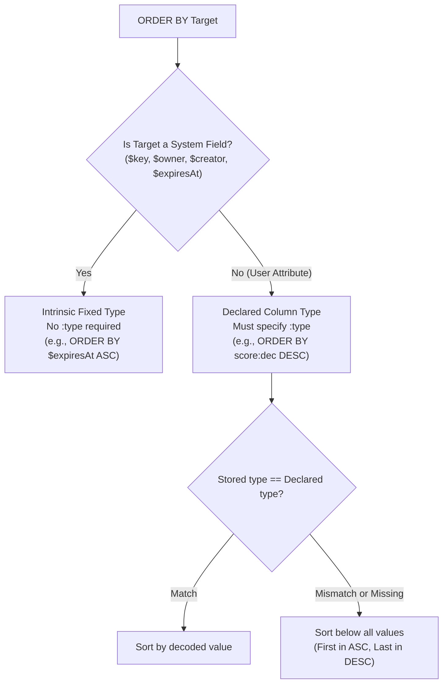
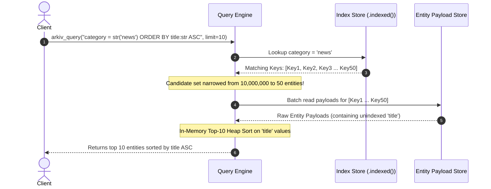
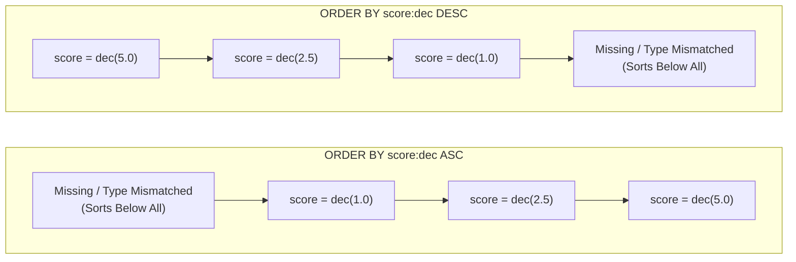

# Arkiv Query Engine: Ordering, Sorting & Collation Semantics

## Table of Contents
1. [Grammar & Syntax of the `ORDER BY` Clause](#1-grammar--syntax-of-the-order-by-clause)
   - [Clause Placement and Scope](#clause-placement-and-scope)
   - [Directionality: `ASC` vs `DESC`](#directionality-asc-vs-desc)
   - [Single-Attribute Sort Limitation](#single-attribute-sort-limitation)
2. [Intrinsic vs Declared Types: System Fields vs User Attributes](#2-intrinsic-vs-declared-types-system-fields-vs-user-attributes)
   - [User Attributes Require Explicit Type Specification (`:type`)](#user-attributes-require-explicit-type-specification-type)
   - [System Entity Fields Have Fixed Types](#system-entity-fields-have-fixed-types)
3. [Sorting Indexed vs Unindexed Columns: Node Engine Internals](#3-sorting-indexed-vs-unindexed-columns-node-engine-internals)
   - [Why Unindexed Attributes Are Sortable](#why-unindexed-attributes-are-sortable)
   - [Execution Mechanisms: Index Range Scan vs Top-K Priority Queue](#execution-mechanisms-index-range-scan-vs-top-k-priority-queue)
4. [Missing and Type-Mismatched Attributes: The "Bottom" Ordering Principle](#4-missing-and-type-mismatched-attributes-the-bottom-ordering-principle)
   - [The "Sorts Below All Values" Rule](#the-sorts-below-all-values-rule)
   - [Placement in `ASC` (First) vs `DESC` (Last)](#placement-in-asc-first-vs-desc-last)
   - [Filtering Strategies: Eliminating Incomplete Entities with `hasType`](#filtering-strategies-eliminating-incomplete-entities-with-hastype)
5. [Forbidden Sort Fields: `$createdAt`, `$updatedAt`, and `bytes`](#5-forbidden-sort-fields-createdat-updatedat-and-bytes)
   - [Why `$createdAt` and `$updatedAt` Cannot Be Sorted](#why-createdat-and-updatedat-cannot-be-sorted)
   - [Prohibition of `bytes` Sorting](#prohibition-of-bytes-sorting)
6. [Tie-Breaking Semantics & Determinism Across Pages](#6-tie-breaking-semantics--determinism-across-pages)
   - [The "Node's Own Order" Fallback](#the-nodes-own-order-fallback)
   - [Default Sort Order Without `ORDER BY` (Oldest First)](#default-sort-order-without-order-by-oldest-first)
7. [SDK Usage Patterns & JSON-RPC Calldata](#7-sdk-usage-patterns--json-rpc-calldata)

---

## 1. Grammar & Syntax of the `ORDER BY` Clause

In Arkiv, sorting is expressed through an optional `ORDER BY` clause appended to the end of a query string. The clause directs the Arkiv node query engine to order the entire candidate set of matching entities before slicing them into paginated result windows.

```sql
-- Formal Query Syntax with ORDER BY
category = str('news') ORDER BY score:dec DESC
```

### Clause Placement and Scope

The `ORDER BY` clause must appear as the final component of a query string. It applies globally to the entire boolean condition expression that precedes it, regardless of whether that expression contains disjunctions (`OR`), conjunctions (`AND`), or nested sub-expressions:

```sql
-- Valid: ORDER BY applies to the entire (a = 1 OR b = 2) result set
a = i32(1) OR b = i32(2) ORDER BY a:i32 ASC
```

Syntactically, no outer parentheses are required around the boolean expression when `ORDER BY` is present.

### Directionality: `ASC` vs `DESC`

- **`ASC` (Ascending)**: Sorts values from smallest to largest. If the direction keyword is omitted in raw textual queries, the engine defaults to `ASC`. (The official Arkiv TypeScript SDK always writes the direction explicitly).
- **`DESC` (Descending)**: Sorts values from largest to smallest.

```sql
ORDER BY $expiresAt ASC   -- Soonest expiring entities first
ORDER BY score:dec DESC   -- Highest score entities first
```

### Single-Attribute Sort Limitation

An Arkiv query supports sorting by **exactly one attribute or entity field**. Compound, multi-column sorting (such as `ORDER BY category:str ASC, score:dec DESC`) is explicitly **disallowed** by the protocol grammar:

```sql
-- INVALID: Fails query parsing with JSON-RPC error -32001
category = str('news') ORDER BY category:str ASC, score:dec DESC
```

In the TypeScript SDK, calling `orderBy` multiple times replaces the previously specified sort key:

```ts
// Only sorts by score:dec DESC (replaces the previous asc sort)
query.orderBy(asc("category")).orderBy(desc("score"))
```

Attempting to pass multiple sort arguments to `orderBy` produces a TypeScript compile-time error and throws `InvalidPredicateError` if invoked dynamically:

```ts
// Compile error: InvalidPredicateError: orderBy takes exactly one sort key
query.orderBy(asc("category"), desc("score"))
```

---

## 2. Intrinsic vs Declared Types: System Fields vs User Attributes

A key architectural feature of the Arkiv query engine is the distinction between **User Attribute Sorting** and **System Entity Field Sorting**.



### User Attributes Require Explicit Type Specification (`:type`)

Arkiv operates as a schemaless, multi-tenant state layer at the node level. The underlying storage engine does not enforce a global table schema; different entities within the same database can technically store an attribute named `score` under different types (e.g., Entity 1 stores `score` as `dec("4.5")`, while Entity 2 stores `score` as `i32(4)`).

Because raw byte representations differ completely across data types, the query engine cannot determine sort ordering without knowing the intended evaluation type. Therefore, **every user attribute in an `ORDER BY` clause must explicitly declare its type via `:type`**:

```sql
-- Query Language Syntax
ORDER BY score:dec DESC
ORDER BY title:str ASC
ORDER BY views:u64 DESC
```

When querying through a named schema in the SDK, the SDK compiler automatically extracts the declared column type from the schema definition:

```ts
// Schema has score: dec().indexed()
// SDK automatically outputs: ORDER BY score:dec DESC
publicClient.select().from(Posts).orderBy(desc("score"))
```

In schema-less queries, the type must be passed explicitly to the `asc` or `desc` constructor:

```ts
// Schema-less query: must pass type as second argument
publicClient.select().where(eq("category", "news")).orderBy(desc("score", "dec"))
```

### System Entity Fields Have Fixed Types

System entity fields are immutable blockchain metadata properties defined natively by the node protocol. Because their types are hardcoded and universal across all entities, specifying their type in `ORDER BY` is completely optional:

| System Field | Hardcoded Protocol Type | Query Language Syntax | SDK Builder Syntax |
|:---|:---|:---|:---|
| **`$key`** | `key` (32-byte hash) | `ORDER BY $key ASC` | `orderBy(asc("$key"))` |
| **`$owner`** | `addr` (20-byte address) | `ORDER BY $owner ASC` | `orderBy(asc("$owner"))` |
| **`$creator`** | `addr` (20-byte address) | `ORDER BY $creator ASC` | `orderBy(asc("$creator"))` |
| **`$expiresAt`** | `u64` (Block height) | `ORDER BY $expiresAt ASC` | `orderBy(asc("$expiresAt"))` |

> [!NOTE]
> If a type suffix is provided for a system field (e.g. `ORDER BY $expiresAt:u64 ASC`), it is accepted by the parser only if it matches the field's intrinsic type. Attempting to override the type (e.g. `ORDER BY $expiresAt:i32 ASC`) causes a query validation error (`-32002`).

---

## 3. Sorting Indexed vs Unindexed Columns: Node Engine Internals

One of Arkiv's most remarkable architectural characteristics is that **columns do not need to be marked `.indexed()` to be sorted on**.

| Capability | Indexed Column (`.indexed()`) | Unindexed Column (default) |
|:---|:---:|:---:|
| **Selectable in projection (`select`)** | Yes | Yes |
| **Filterable in predicates (`where`)** | **Yes** | **NO** (Compile error / Rejection) |
| **Sortable in ordering (`orderBy`)** | **Yes** | **Yes** |

### Why Unindexed Attributes Are Sortable

In Arkiv, predicate filtering requires an index because testing predicates against millions of unindexed records across the entire database would require a catastrophic full-state table scan.

However, sorting occurs **after** the `where` conditions have already filtered the candidate set:
1. The query engine uses indexed attributes and system fields to evaluate the `where` condition, narrowing millions of global database entities down to a bounded matching set $S$ (e.g., 50 matching posts).
2. Once the matching set $S$ is identified, the node reads the stored entity bodies for those specific entities.
3. If the sort attribute is unindexed, the node deserializes the attribute value directly from the entity body and performs an in-memory sort or top-$K$ heap selection.



### Execution Mechanisms: Index Range Scan vs Top-K Priority Queue

- **Sorting on an Indexed Attribute**: If the sort column is indexed, the query engine can traverse the index trie directly in sorted order, fetching only the required `limit + offset` entities without materializing intermediate rows.
- **Sorting on an Unindexed Attribute**: The node must materialize all entities matching the `where` filter, extract the unindexed attribute from their bodies, and maintain a min/max heap (priority queue) of size `limit + offset`.

---

## 4. Missing and Type-Mismatched Attributes: The "Bottom" Ordering Principle

Because Arkiv is an open public database where entities may be created with optional columns (`.optional()`) or written by external parties without specific schema fields, the query engine must define deterministic sorting behavior when an entity **lacks** the sort attribute or holds it under a **mismatched type**.

### The "Sorts Below All Values" Rule

Arkiv implements a universal sorting invariant:

$$\text{Missing or Type-Mismatched Attribute} < \text{Any Valid Stored Value}$$

An entity that:
1. Does not possess the attribute specified in `ORDER BY`, OR
2. Possesses the attribute, but serialized with a type different from `:type`

is considered to have **no comparable value** and sorts **below every valid value**.

### Placement in `ASC` (First) vs `DESC` (Last)

Because missing/mismatched attributes sort below all valid values:
- Under **`ASC` (Ascending)**: Missing and type-mismatched entities appear **first** (at the very beginning of the result stream).
- Under **`DESC` (Descending)**: Missing and type-mismatched entities appear **last** (at the very end of the result stream).



### Filtering Strategies: Eliminating Incomplete Entities with `hasType`

In applications where missing or malformed entities must not pollute ascending sorts, the query must explicitly require the existence and type of the attribute in the `where` condition using `hasType`:

```ts
// Without hasType: posts missing 'score' appear at page 0 (top of list)
const contaminated = await publicClient
  .select({ $key: true, score: true })
  .from(Posts)
  .orderBy(asc("score"))
  .fetch()

// With hasType: guarantees every returned row has a valid decimal score
const clean = await publicClient
  .select({ $key: true, score: true })
  .from(Posts)
  .where(hasType("score", "dec"))
  .orderBy(asc("score"))
  .fetch()
```

---

## 5. Forbidden Sort Fields: `$createdAt`, `$updatedAt`, and `bytes`

The Arkiv query engine explicitly forbids sorting on certain fields. Attempting to sort on them causes a TypeScript compilation error or immediate query rejection (`InvalidPredicateError` / `-32001`).

### Why `$createdAt` and `$updatedAt` Cannot Be Sorted

Every entity stored in Arkiv contains system-managed block timestamps:
- `$createdAt`: The EVM block number in which the entity was initially minted.
- `$updatedAt`: The EVM block number in which the entity was last modified (via `PATCH`, `EXTEND`, or `TRANSFER`).

Although these fields are selectable in projections (`select({ $createdAt: true, $updatedAt: true })`), **they cannot be filtered or sorted in the query language**:

```ts
// COMPILE ERROR: InvalidPredicateError: $createdAt cannot be sorted on
publicClient.select().from(Posts).orderBy(desc("$createdAt"))
```

#### Architectural Rationale
1. **Dynamic Block Association**: `$createdAt` and `$updatedAt` are derived from blockchain block headers and transaction receipt states rather than static indexing trees.
2. **Index Bloat Prevention**: Maintaining a continuously updated B-tree index over every entity's modification timestamp across millions of historical entities would dramatically increase node I/O overhead on every block.
3. **Application Recommendation**: Applications requiring chronological sorting should select `$createdAt` or `$updatedAt` and perform sorting in application memory, or store an explicit indexed timestamp attribute (e.g. `publishedAt: u64().indexed()`).

### Prohibition of `bytes` Sorting

The `bytes` data type is designed for arbitrary binary payloads up to 128 KiB. Because raw binary blobs have no natural scalar representation and are never indexed, `bytes` columns **can never be sorted on**:

```ts
// COMPILE ERROR: InvalidPredicateError: bytes columns cannot be sorted on
publicClient.select().from(Posts).orderBy(asc("body"))
```

---

## 6. Tie-Breaking Semantics & Determinism Across Pages

When multiple entities share the exact same value for the sort attribute (or when all lack the attribute), the query engine must resolve their relative order.

### The "Node's Own Order" Fallback

Arkiv specifies that **entities that tie on the sort attribute come in the node's own internal order**.

- **Internal Storage Sequence**: The node's internal order corresponds to the underlying storage engine's key order (typically the deterministic lexicographical order of the 32-byte `$key` in the state trie).
- **Stability Guarantee**: For a static blockchain block height, the node's own order is 100% deterministic and reproducible.
- **Cross-Block Mutation Impact**: If new entities are inserted or existing entities are deleted between paginated requests, the node's internal order may shift, creating offset pagination anomalies (as examined in Chapter 4).

### Default Sort Order Without `ORDER BY` (Oldest First)

If a query does **not** specify an `ORDER BY` clause:
- The node returns matching entities in default insertion order: **Oldest First** (ascending block creation sequence).
- This order is maintained consistently across pages when using offset pagination on an immutable dataset.

---

## 7. SDK Usage Patterns & JSON-RPC Calldata

### TypeScript SDK High-Level Pattern

```ts
import { asc, desc, eq, hasType } from "@arkiv-network/sdk/query"
import { Posts } from "./schemas"

// 1. Sort by indexed numeric column descending
const topScored = await publicClient
  .select({ $key: true, title: true, score: true })
  .from(Posts)
  .orderBy(desc("score"))
  .limit(25)
  .fetch()

// 2. Sort by unindexed column ascending (safe because hasType filters out missing rows)
const alphabetical = await publicClient
  .select({ $key: true, title: true })
  .from(Posts)
  .where(hasType("title", "str"))
  .orderBy(asc("title"))
  .limit(50)
  .fetch()

// 3. Sort by expiration block to identify impending TTL purges
const expiringSoon = await publicClient
  .select({ $key: true, $expiresAt: true })
  .from(Posts)
  .orderBy(asc("$expiresAt"))
  .limit(10)
  .fetch()
```

### Raw JSON-RPC Calldata & Payloads

When calling the JSON-RPC endpoint `arkiv_query` directly in languages without an official SDK (e.g., Python, Rust, Go), the sort expression is embedded directly into the query string:

```json
{
  "jsonrpc": "2.0",
  "id": 42,
  "method": "arkiv_query",
  "params": [
    "arkiv.schema = str('my-app.posts') AND category = str('news') ORDER BY score:dec DESC",
    {
      "select": {
        "key": true,
        "attributes": {
          "title": true,
          "score": true
        }
      },
      "limit": "0x19",
      "offset": "0x0"
    }
  ]
}
```

#### JSON-RPC Response:
```json
{
  "jsonrpc": "2.0",
  "id": 42,
  "result": {
    "data": [
      {
        "key": "0x9f2c8d76e4b10000000000000000000000000000000000000000000000000001",
        "attributes": [
          { "name": "title", "type": "str", "value": "Arkiv V2 Released" },
          { "name": "score", "type": "dec", "value": "9.950000000000000000" }
        ]
      },
      {
        "key": "0x3a1b4c5d6e7f0000000000000000000000000000000000000000000000000002",
        "attributes": [
          { "name": "title", "type": "str", "value": "EVM State Indexing Deep Dive" },
          { "name": "score", "type": "dec", "value": "8.700000000000000000" }
        ]
      }
    ],
    "blockNumber": "0x1bc890",
    "count": "0x2"
  }
}
```
