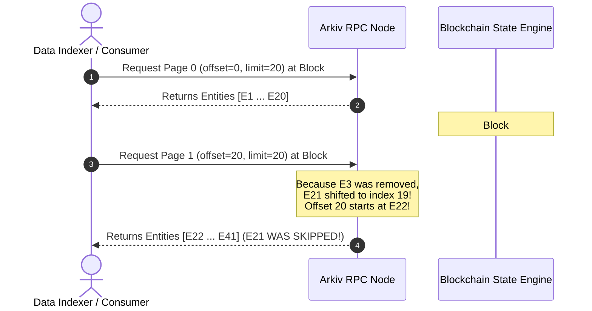
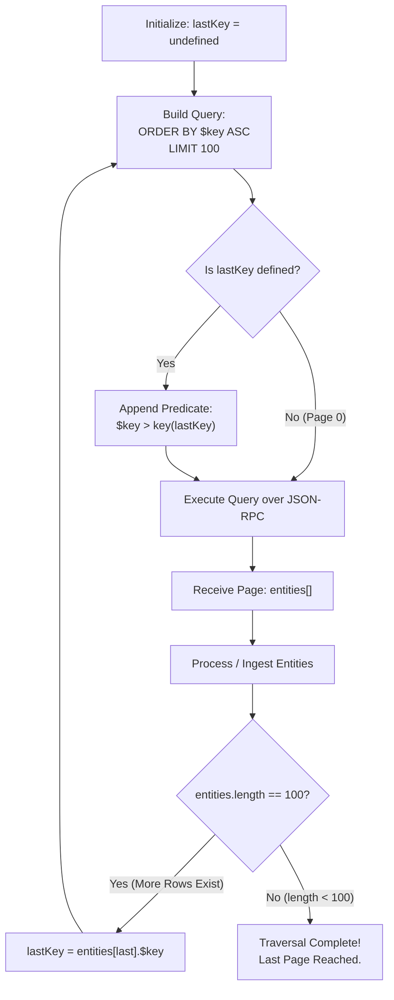
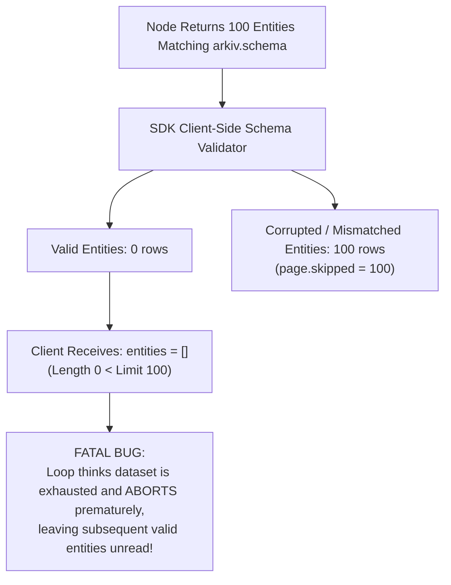

# Arkiv Query Engine: Pagination Architectures & Key-Cursor Mechanics

## Table of Contents
1. [State Evolution & The Challenge of Decentralized Pagination](#1-state-evolution--the-challenge-of-decentralized-pagination)
   - [Block Progression & Live State Mutation](#block-progression--live-state-mutation)
   - [Anatomy of an Arkiv Query Page Response](#anatomy-of-an-arkiv-query-page-response)
2. [Offset-Based Pagination Architecture](#2-offset-based-pagination-architecture)
   - [Parameters: `limit` and `offset`](#parameters-limit-and-offset)
   - [JSON-RPC Protocol Calldata Layout](#json-rpc-protocol-calldata-layout)
   - [The "Sliding Window" Vulnerabilities: Duplication & Missed Rows](#the-sliding-window-vulnerabilities-duplication--missed-rows)
   - [Legitimate Use Cases for Offset Pagination](#legitimate-use-cases-for-offset-pagination)
3. [Key-Cursor Pagination Architecture (Deterministic Traversal)](#3-key-cursor-pagination-architecture-deterministic-traversal)
   - [The Monotonic Invariant of `$key`](#the-monotonic-invariant-of-key)
   - [Traversal Mechanics: `ORDER BY $key ASC` + `$key > key(lastKey)`](#traversal-mechanics-order-by-key-asc--key--keylastkey)
   - [Mathematical Invariance Across Live Block Mutations](#mathematical-invariance-across-live-block-mutations)
   - [Termination & Last-Page Detection](#termination--last-page-detection)
4. [Schema Mismatches & The "Silent Cursor Stalling" Hazard](#4-schema-mismatches--the-silent-cursor-stalling-hazard)
   - [How `page.skipped` Interacts with Cursor Progress](#how-pageskipped-interacts-with-cursor-progress)
   - [The Zero-Entity Cursor Trap](#the-zero-entity-cursor-trap)
   - [Mitigation Strategies: Strict Throw vs Schema-Less Ingestion](#mitigation-strategies-strict-throw-vs-schema-less-ingestion)
5. [Production ETL Pipeline Implementation](#5-production-etl-pipeline-implementation)
   - [Complete TypeScript Key-Cursor Iterator](#complete-typescript-key-cursor-iterator)
   - [Handling Reorgs and Block Timing](#handling-reorgs-and-block-timing)

---

## 1. State Evolution & The Challenge of Decentralized Pagination

Pagination in a decentralized database presents distinct architectural challenges that do not exist in traditional relational databases operating under snapshot isolation:
1. **Continuous Block Production**: On the Arkiv testnet (Rabdi, Chain ID `7794095`), new blocks are produced every **2 seconds** (`duration = 2`).
2. **Stateless Node Queries**: Every JSON-RPC `arkiv_query` call is executed independently against the latest finalized or pending state root of the responding node. There are no stateful server-side cursors, database transactions, or snapshot locks held open across HTTP requests.
3. **Concurrent Mutations**: Between any two HTTP pagination requests, external accounts and smart contracts may create new entities, delete existing entities, or allow entities to reach their time-to-live expiration (`$expiresAt`), immediately pruning them from the index.



### Anatomy of an Arkiv Query Page Response

When an Arkiv public client or raw JSON-RPC query executes, the response payload provides vital metadata regarding the page execution context:

```ts
interface QueryPage<TEntity> {
  entities: TEntity[]   // Matched entities that successfully fit the schema
  blockNumber: bigint   // EVM block height at which this specific page was read
  skipped: number       // Count of entities matched by filter but skipped (schema mismatch)
  count?: bigint        // Total global count of matches (only present if withCount() requested)
}
```

- **`entities`**: The deserialized, schema-validated row records for this page window.
- **`blockNumber`**: The exact block height at which the query engine evaluated this page. Monitoring this value across requests allows clients to detect whether state shifted between pagination calls.
- **`skipped`**: Indicates how many entities satisfied the query's indexed predicates but were discarded by the client SDK because they lacked required columns or held mismatched column types.
- **`count`**: The global aggregate number of matching entities in the database at `blockNumber`.

---

## 2. Offset-Based Pagination Architecture

Offset pagination mimics traditional SQL `LIMIT ... OFFSET ...` semantics, where the node counts past a specified number of matching records before accumulating results.

### Parameters: `limit` and `offset`

- **`limit`**: Controls the maximum number of entities returned in a single page.
  - Permissible Range: **1 to 100** rows (`MAX_LIMIT = 100`).
  - Default: `100` if omitted.
  - Passing a limit outside this range throws an error before transmission or fails with JSON-RPC error `-32602` (Invalid Params).
- **`offset`**: Specifies the number of matching records to skip before collecting the page.
  - Permissible Domain: Non-negative integer ($\ge 0$).
  - Default: `0` (starts at the very first match).

### JSON-RPC Protocol Calldata Layout

In raw JSON-RPC over HTTP, `limit` and `offset` are passed in the second parameter object, encoded as decimal integers or hex quantities:

```json
{
  "jsonrpc": "2.0",
  "id": 101,
  "method": "arkiv_query",
  "params": [
    "arkiv.schema = str('my-app.posts') ORDER BY $key ASC",
    {
      "select": { "key": true, "attributes": true },
      "limit": "0x14",
      "offset": "0x28"
    }
  ]
}
```
*Note: `"0x14"` is 20 in decimal; `"0x28"` is 40 in decimal (requesting Page 2 for a page size of 20).*

### The "Sliding Window" Vulnerabilities: Duplication & Missed Rows

Offset pagination relies on the implicit assumption that the indexed result set remains strictly static between requests. On an active blockchain, this assumption is false.

#### Anomaly 1: The Missed Row Anomaly (Entity Deletion / Expiration)
1. Client requests Page 0: `offset = 0, limit = 20`. Node returns rows 0–19.
2. An entity at index 4 expires or is explicitly deleted in a new block.
3. Every subsequent entity in the sort order shifts backward by 1 position (row 20 becomes row 19).
4. Client requests Page 1: `offset = 20, limit = 20`.
5. The node skips the first 20 records (which now includes what used to be row 20).
6. **Result**: The former row 20 was **never delivered** to the client.

#### Anomaly 2: The Duplicate Row Anomaly (Entity Insertion)
1. Client requests Page 0: `offset = 0, limit = 20`. Node returns rows 0–19.
2. A new entity is created whose sort value falls into the range of rows 0–19.
3. Every subsequent entity shifts forward by 1 position (row 19 shifts to index 20).
4. Client requests Page 1: `offset = 20, limit = 20`.
5. The node skips the first 20 records, and row 20 is read as the first element of Page 1.
6. **Result**: The client receives the former row 19 **twice**.

### Legitimate Use Cases for Offset Pagination

Despite these edge cases, offset pagination is suitable for:
- User-facing UI tables with numbered page buttons (e.g. `[1] [2] [3] ... [10]`), where end-users jump directly to page 5 and minor jitter during active browsing is acceptable.
- Static datasets where entities have infinite lifetimes or writes occur infrequently.

---

## 3. Key-Cursor Pagination Architecture (Deterministic Traversal)

For data synchronizers, ETL pipelines, backend caching layers, and external indexers, **offset pagination is unacceptable**. To guarantee that every entity is processed **exactly once**, applications must use **Key-Cursor Pagination**.



### The Monotonic Invariant of `$key`

Every entity in Arkiv has a unique, 32-byte identifier (`$key` / `bytes32`).
- The entity key is cryptographically derived from the creator's address, a 128-bit salt, and the creator's entity nonce:
  $$\text{key} = \text{keccak256}(\text{creator} \parallel \text{salt} \parallel \text{nonce})$$
- The key is **immutable** for the entire lifecycle of the entity.
- The 256-bit keys form a strict total order under big-endian byte comparison.

### Traversal Mechanics: `ORDER BY $key ASC` + `$key > key(lastKey)`

Key-cursor pagination eliminates offsets entirely. Instead of skipping rows by numeric count, every query uses a deterministic relational predicate on the primary key:

1. **Initial Page (Page 0)**:
   ```sql
   arkiv.schema = str('my-app.posts') ORDER BY $key ASC
   ```
2. **Subsequent Pages**:
   The client extracts the `$key` of the last entity from the previous page (`0x9f2c...`) and appends a strictly greater-than filter:
   ```sql
   arkiv.schema = str('my-app.posts') AND $key > key(0x9f2c...) ORDER BY $key ASC
   ```

### Mathematical Invariance Across Live Block Mutations

Key-cursor pagination is completely immune to the sliding window problem:
- **Deletions ahead of cursor**: If an entity that was already processed is deleted, it has no effect on `$key > key(lastKey)`.
- **Deletions behind cursor**: If an entity ahead of the cursor is deleted, subsequent keys simply advance to the next existing key in trie order. No entity is ever skipped.
- **Insertions behind cursor**: If a new entity is inserted with a key smaller than `lastKey`, it is naturally ignored by `$key > key(lastKey)`.
- **Insertions ahead of cursor**: If a new entity is inserted with a key greater than `lastKey`, it will be seamlessly encountered when the cursor reaches its lexicographical position.
- **Zero Duplication**: Because each step strictly enforces `$key > key(lastKey)`, no key can ever be returned twice.

### Termination & Last-Page Detection

In key-cursor pagination, page termination is determined using a simple invariant:

$$\text{IsLastPage} \iff \text{entities.length} < \text{limit}$$

If a page returns fewer rows than the requested `limit` (e.g., 42 rows returned when `limit = 100`), the query has reached the end of the matching result set. If the total number of records happens to be an exact multiple of `limit`, the final request returns `entities.length === 0`, terminating the loop.

---

## 4. Schema Mismatches & The "Silent Cursor Stalling" Hazard

A critical protocol nuance in Arkiv arises when combining key-cursor pagination with client-side schema validation.

### How `page.skipped` Interacts with Cursor Progress

Arkiv nodes evaluate the `where` conditions across their indexed attributes and return raw entity payloads up to `limit`. However, Arkiv is an open public database: another user or contract may create an entity tagged with your schema's name (`arkiv.schema = 'my-app.posts'`) that:
- Omits a required non-indexed column (e.g., `title`), or
- Stores a column with a corrupted data type (e.g., `score` stored as `str` instead of `dec`).

By default, the Arkiv SDK's schema validator discards such invalid entities and increments `page.skipped`:

$$\text{page.entities.length} = \text{node.returned.length} - \text{page.skipped}$$



### The Zero-Entity Cursor Trap

If an attacker or rogue application writes 100 consecutive corrupted entities with keys sorting together:
1. The node returns 100 matching entities.
2. The SDK validation pipeline rejects all 100 entities as non-conforming.
3. The SDK produces a page where `entities.length === 0` and `skipped === 100`.
4. If the client code checks `entities.length < limit`, it assumes the dataset has ended and terminates the sync!
5. Furthermore, because `entities` is empty, there is **no `lastKey`** to continue pagination from!

### Mitigation Strategies: Strict Throw vs Schema-Less Ingestion

#### Strategy 1: Enforce Strict Schema Validation (`onMismatch: "throw"`)
For trusted enterprise environments where all writes are controlled by your own smart contracts or backend signers, configure the query to throw immediately if a malformed entity is encountered:

```ts
// Fails immediately with SchemaMismatchError if corrupted entities are found
publicClient.select().from(Posts, { onMismatch: "throw" })
```

#### Strategy 2: Two-Phase Raw Key Extraction (Resilient Ingestion)
For bulletproof public indexing where external parties may attempt schema poisoning, use a schema-less cursor that selects only `$key`:

```ts
// 1. Fetch raw keys (immune to schema corruption because $key is intrinsic)
const keyPage = await publicClient
  .select({ $key: true })
  .where(filter)
  .orderBy(asc("$key"))
  .limit(100)
  .fetch()

// 2. Fetch or validate entities individually by key
```

---

## 5. Production ETL Pipeline Implementation

Below is a complete, production-grade implementation of a deterministic key-cursor traversal iterator written in TypeScript:

```ts
import { createPublicClient, http } from "@arkiv-network/sdk"
import { asc, eq, gt } from "@arkiv-network/sdk/query"
import { key } from "@arkiv-network/sdk/schema"
import { rabdi } from "@arkiv-network/sdk/chains"
import type { Hex } from "viem"
import { Posts, type PostEntity } from "./schemas"

export interface CursorIteratorOptions {
  batchSize?: number
  maxRetries?: number
  onBlockProgress?: (blockNumber: bigint) => void
}

/**
 * Deterministically iterates through every entity matching a schema
 * across live block mutations without duplicates or omissions.
 */
export async function* iterateAllPosts(
  client: ReturnType<typeof createPublicClient>,
  options: CursorIteratorOptions = {}
): AsyncGenerator<PostEntity, void, unknown> {
  const batchSize = Math.min(options.batchSize ?? 100, 100)
  let lastKey: Hex | undefined = undefined
  let hasMore = true

  while (hasMore) {
    let query = client
      .select({
        $key: true,
        $owner: true,
        $creator: true,
        $createdAt: true,
        $expiresAt: true,
        title: true,
        category: true,
        score: true,
      })
      .from(Posts, { onMismatch: "throw" })
      .orderBy(asc("$key"))
      .limit(batchSize)

    // Anchor query cursor after the previous batch's last key
    if (lastKey) {
      query = query.where(gt("$key", key(lastKey)))
    }

    const page = await query.fetch()

    if (options.onBlockProgress) {
      options.onBlockProgress(page.blockNumber)
    }

    for (const entity of page.entities) {
      yield entity
    }

    // Determine termination condition
    if (page.entities.length < batchSize) {
      hasMore = false
    } else {
      const finalRow = page.entities[page.entities.length - 1]
      lastKey = finalRow.$key as Hex
    }
  }
}

// Example Consumer Usage
async function runIndexer() {
  const client = createPublicClient({
    chain: rabdi,
    transport: http(process.env.ARKIV_RPC_URL),
  })

  console.log("Starting deterministic state crawl...")
  let count = 0

  for await (const post of iterateAllPosts(client, {
    batchSize: 100,
    onBlockProgress: (block) => console.log(`Crawl active at block #${block}`),
  })) {
    count++
    console.log(`Indexed Post [${post.$key}]: ${post.title.value} (Score: ${post.score.value})`)
  }

  console.log(`Crawl complete! Ingested ${count} entities exactly once.`)
}
```

### Handling Reorgs and Block Timing

- **Short Block Interval (2s)**: On Rabdi, nodes update state every 2 seconds. The `page.blockNumber` returned with every response allows consumers to track sync head distance from `arkiv_getBlockTiming`.
- **Chain Reorganizations**: In the rare event of a shallow block reorganization on testnet, entities whose transactions were reverted will be filtered out on subsequent cursor pages. Consumer applications persisting entities to local relational stores (e.g. SQLite, PostgreSQL) should insert records using `UPSERT` (`ON CONFLICT ($key) DO UPDATE`) to ensure idempotency.
