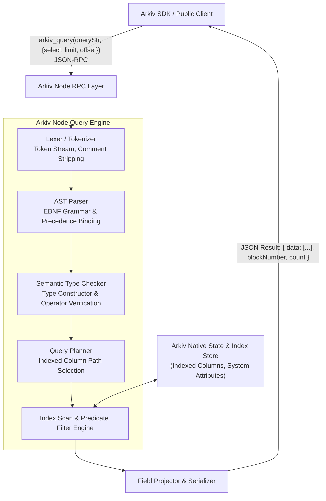
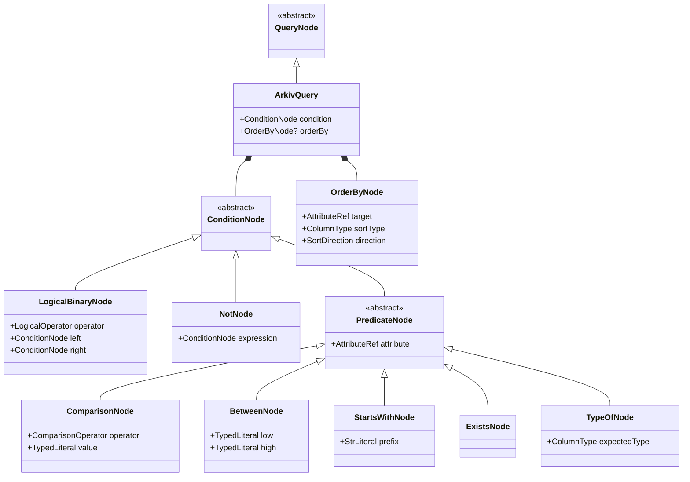
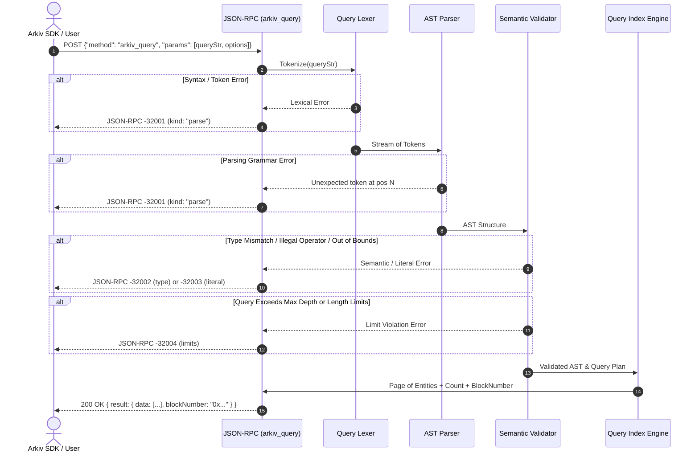

# Arkiv Query Language Grammar & Lexical Specification

## Table of Contents
1. [Overview & Query Engine Architecture](#1-overview--query-engine-architecture)
2. [Lexical Structure & Token Specification](#2-lexical-structure--token-specification)
   - [Whitespace and Layout](#whitespace-and-layout)
   - [Comments](#comments)
   - [Identifiers and Names](#identifiers-and-names)
   - [Reserved Keywords](#reserved-keywords)
   - [Literals and Type Constructors](#literals-and-type-constructors)
   - [String Escaping Rules](#string-escaping-rules)
3. [Formal EBNF Grammar](#3-formal-ebnf-grammar)
4. [Operator Precedence & Associativity Matrix](#4-operator-precedence--associativity-matrix)
5. [Abstract Syntax Tree (AST) Model](#5-abstract-syntax-tree-ast-model)
6. [Query Engine Parsing Pipeline](#6-query-engine-parsing-pipeline)
7. [Query Language Errors & Node Validation Limits](#7-query-language-errors--node-validation-limits)

---

## 1. Overview & Query Engine Architecture

The Arkiv query language is a declarative, SQL-inspired boolean expression language designed specifically for querying decentralized state entities on an EVM-based state store. Queries are evaluated at the node level against native indexing structures (such as Patricia tries, inverted indexes, or indexed column lookups) before projecting and returning matching entity payloads via JSON-RPC (`arkiv_query`).

A query in Arkiv consists of:
1. A **mandatory boolean condition expression** over indexed entity attributes and system entity fields.
2. An **optional sorting clause** (`ORDER BY`) that determines the total ordering of returned entity rows across pagination windows.

```sql
-- Example Arkiv Query
category = str('news') AND score >= dec(3.5) AND EXISTS(summary) ORDER BY score:dec DESC
```

### Architectural Position in Arkiv Dual-Rail System

Unlike mutating operations (which execute as EVM transactions calling `execute(bytes)` on contract `0x0000000000000000000000000000000000004444`), read queries bypass the EVM execution pipeline entirely. They are submitted over JSON-RPC via `arkiv_query` and parsed, planned, and evaluated directly by the native Arkiv node indexing daemon.



---

## 2. Lexical Structure & Token Specification

### Whitespace and Layout
Whitespace characters separate tokens and are otherwise ignored by the lexer:
- Space (`0x20`)
- Horizontal Tab (`0x09`)
- Carriage Return (`0x0D`)
- Line Feed (`0x0A`)

Consecutive whitespace characters are treated as a single whitespace delimiter. Whitespace is required between alphanumeric tokens and keywords, but optional around punctuation and operators (e.g., `=`, `<`, `>`, `(`, `)`).

### Comments
Comments in the Arkiv query language begin with a double-hyphen `--` and extend to the end of the current physical line (terminated by `\n` or EOF).

```sql
-- Filter active announcements
category = str('announcements') AND -- inline comment
score > dec(0)                      -- filter positive scores
```

> [!IMPORTANT]
> The lexer strips all comments prior to generating the AST. Attribute names cannot contain `--` anywhere in their identifier string.

### Identifiers and Names

Arkiv distinguishes between **User Attribute Identifiers** and **System Entity Fields**.

#### 1. User Attribute Identifiers
User attribute names correspond to keys defined on entities. They must adhere to strict protocol naming rules:
- **Starting character**: Must begin with an ASCII letter (`a-z` or `A-Z`).
- **Subsequent characters**: Can contain ASCII letters (`a-z`, `A-Z`), digits (`0-9`), periods (`.`), hyphens (`-`), or underscores (`_`).
- **Maximum length**: 32 bytes UTF-8 (`MAX_NAME_BYTES = 32`).
- **Case-sensitivity**: Attribute names are strictly **case-sensitive**. `title`, `Title`, and `TITLE` represent three distinct entity attributes.
- **Forbidden substrings**: Cannot contain `--` (reserved for comment syntax).
- **Reserved words**: Cannot match any reserved language keyword (such as `and`, `order`, `desc`) or type constructor name (such as `str`, `i32`).
- **Prefix constraints**: Cannot begin with a dollar sign (`$`), preventing collisions with system entity fields.
- **Special reserved name**: The attribute name `arkiv.schema` is reserved by the protocol for schema tagging and cannot be declared manually as a user column in a schema.

#### 2. System Entity Fields
System entity fields represent immutable blockchain metadata properties intrinsic to every entity stored in the database. In textual queries, system entity fields are explicitly prefixed with `$`:

| System Field | Intrinsic Type | Description | Filterable | Sortable |
|:---|:---|:---|:---:|:---:|
| `$key` | `key` | 32-byte unique entity identifier (`bytes32`) | Yes | Yes |
| `$owner` | `addr` | 20-byte Ethereum address with mutation authority | Yes | Yes |
| `$creator` | `addr` | 20-byte Ethereum address that minted the entity | Yes | Yes |
| `$expiresAt` | `u64` | Block height at which the entity expires and is purged | Yes | Yes |
| `$createdAt` | `u64` | Block height of entity creation | **No** | **No** |
| `$updatedAt` | `u64` | Block height of last entity mutation | **No** | **No** |
| `$creationFlags` | `object` | Flags (`readonly`, `permissionlessExtension`, `raw`) | **No** | **No** |

> [!NOTE]
> `$createdAt` and `$updatedAt` are selectable in projections but **cannot** be filtered or sorted in the query language. They are not stored in the fast-index trie. Applications needing time-based sorting should select them and sort client-side in application memory.

### Reserved Keywords
Keywords in the query language are **case-insensitive** (e.g., `AND`, `and`, and `And` are lexically equivalent). They cannot be used as user attribute names.

```
AND          OR           NOT
TRUE         FALSE
BETWEEN      STARTSWITH   EXISTS       TYPEOF
ORDER        BY           ASC          DESC
```

Additionally, the 9 protocol type names are reserved keywords:
```
bool         i32          u64          u256
dec          str          addr         key          bytes
```

### Literals and Type Constructors

Arkiv's query language is strongly typed. Every literal value in a predicate must be explicitly typed using its corresponding type constructor, with two exceptions:
1. `bool` literals (`true`, `false`) can be written bare.
2. Bare integers without a constructor are treated as `i32`.

| Type | Type Constructor / Literal Syntax | Valid Representation / Domain | Example Query Fragment |
|:---|:---|:---|:---|
| **`bool`** | `true`, `false` (or `bool(true)`) | Boolean literal | `active = true` |
| **`i32`** | `i32(n)` or bare `n` | Signed 32-bit integer (`-2,147,483,648` to `2,147,483,647`) | `priority = i32(5)` or `priority = 5` |
| **`u64`** | `u64(n)` | Unsigned 64-bit integer (`0` to `18,446,744,073,709,551,615`) | `$expiresAt > u64(1750000)` |
| **`u256`** | `u256(n)` | Unsigned 256-bit integer (`0` to `2^256 - 1`) | `balance >= u256(1000000000000000000)` |
| **`dec`** | `dec(n)` or `dec('n')` | Signed 18-decimal fixed-point decimal | `score > dec(4.5)` |
| **`str`** | `str('text')` | Single-quoted UTF-8 string, max 128 bytes | `category = str('news')` |
| **`addr`** | `addr(0x...)` | 20-byte (40 hex chars) Ethereum address | `$owner = addr(0xd8dA6BF26964aF9D7eEd9e03E53415D37aA96045)` |
| **`key`** | `key(0x...)` | 32-byte (64 hex chars) entity reference key | `$key > key(0x9f2c8d...00)` |
| **`bytes`** | `bytes(0x...)` | Arbitrary binary blob (max 128 KiB) | *Unindexable: Cannot be used in predicates* |

### String Escaping Rules
String literals in the Arkiv query language follow SQL-standard single-quote escaping:
- String contents are enclosed within leading and trailing single quotes: `'...'`.
- Any literal single quote character inside a string literal must be **doubled** (`''`).
- Escape sequences like `\'` or `\"` are **not** permitted.

```sql
-- Represents string: it's
category = str('it''s')

-- Represents string: Alice's "Wonderland"
title = str('Alice''s "Wonderland"')
```

The maximum length of a `str` literal is **128 bytes** of UTF-8 encoded text (`MAX_STRING_BYTES`). A string literal exceeding 128 bytes results in a literal evaluation error (`-32003` / `InvalidValueError`).

---

## 3. Formal EBNF Grammar

Below is the complete, unambiguous ISO/IEC 14977-compliant Extended Backus-Naur Form (EBNF) definition for the Arkiv query language:

```ebnf
(* ========================================================================= *)
(* Arkiv Query Language Grammar Specification                                *)
(* ========================================================================= *)

Query
    = BooleanExpression , [ Whitespace , OrderByClause ] ;

(* ------------------------------------------------------------------------- *)
(* Ordering & Sorting Clause                                                 *)
(* ------------------------------------------------------------------------- *)

OrderByClause
    = "ORDER" , Whitespace , "BY" , Whitespace , SortTarget , [ Whitespace , SortDirection ] ;

SortTarget
    = SystemSortField
    | UserSortField ;

SystemSortField
    = ( "$key" , [ ":" , "key" ] )
    | ( "$owner" , [ ":" , "addr" ] )
    | ( "$creator" , [ ":" , "addr" ] )
    | ( "$expiresAt" , [ ":" , "u64" ] ) ;

UserSortField
    = AttributeIdentifier , ":" , SortableType ;

SortDirection
    = "ASC" | "DESC" ;

SortableType
    = "bool" | "i32" | "u64" | "u256" | "dec" | "str" | "addr" | "key" ;

(* ------------------------------------------------------------------------- *)
(* Boolean Expression Hierarchy (Precedence Levels)                          *)
(* ------------------------------------------------------------------------- *)

BooleanExpression
    = OrExpression ;

OrExpression
    = AndExpression , { Whitespace , "OR" , Whitespace , AndExpression } ;

AndExpression
    = UnaryExpression , { Whitespace , "AND" , Whitespace , UnaryExpression } ;

UnaryExpression
    = [ "NOT" , Whitespace ] , PrimaryExpression ;

PrimaryExpression
    = "(" , [ Whitespace ] , BooleanExpression , [ Whitespace ] , ")"
    | Predicate ;

(* ------------------------------------------------------------------------- *)
(* Predicates                                                                *)
(* ------------------------------------------------------------------------- *)

Predicate
    = BetweenPredicate
    | StartsWithPredicate
    | ExistsPredicate
    | TypeOfPredicate
    | ComparisonPredicate ;

ComparisonPredicate
    = AttributeReference , [ Whitespace ] , ComparisonOperator , [ Whitespace ] , TypedValue ;

BetweenPredicate
    = AttributeReference , Whitespace , "BETWEEN" , Whitespace , TypedValue , Whitespace , "AND" , Whitespace , TypedValue ;

StartsWithPredicate
    = AttributeReference , Whitespace , "STARTSWITH" , Whitespace , StrLiteral ;

ExistsPredicate
    = "EXISTS" , [ Whitespace ] , "(" , [ Whitespace ] , AttributeReference , [ Whitespace ] , ")" ;

TypeOfPredicate
    = "TYPEOF" , [ Whitespace ] , "(" , [ Whitespace ] , AttributeReference , [ Whitespace ] , ")" , [ Whitespace ] , "=" , [ Whitespace ] , TypeName ;

ComparisonOperator
    = "=" | "!=" | "<=" | ">=" | "<" | ">" ;

(* ------------------------------------------------------------------------- *)
(* Identifiers & Attribute References                                        *)
(* ------------------------------------------------------------------------- *)

AttributeReference
    = SystemFieldReference
    | AttributeIdentifier ;

SystemFieldReference
    = "$key" | "$owner" | "$creator" | "$expiresAt" ;

AttributeIdentifier
    = Letter , { Letter | Digit | "." | "-" | "_" } ;

(* ------------------------------------------------------------------------- *)
(* Typed Literals & Type Constructors                                        *)
(* ------------------------------------------------------------------------- *)

TypedValue
    = BoolLiteral
    | BareInteger
    | I32Constructor
    | U64Constructor
    | U256Constructor
    | DecConstructor
    | StrLiteral
    | AddrLiteral
    | KeyLiteral ;

BoolLiteral
    = "true" | "false" | "TRUE" | "FALSE"
    | ( "bool" , [ Whitespace ] , "(" , [ Whitespace ] , ( "true" | "false" ) , [ Whitespace ] , ")" ) ;

BareInteger
    = [ "-" ] , Digit , { Digit } ;

I32Constructor
    = "i32" , [ Whitespace ] , "(" , [ Whitespace ] , [ "-" ] , Digit , { Digit } , [ Whitespace ] , ")" ;

U64Constructor
    = "u64" , [ Whitespace ] , "(" , [ Whitespace ] , Digit , { Digit } , [ Whitespace ] , ")" ;

U256Constructor
    = "u256" , [ Whitespace ] , "(" , [ Whitespace ] , Digit , { Digit } , [ Whitespace ] , ")" ;

DecConstructor
    = "dec" , [ Whitespace ] , "(" , [ Whitespace ] , DecValue , [ Whitespace ] , ")" ;

DecValue
    = ( [ "-" ] , Digit , { Digit } , [ "." , { Digit } ] )
    | ( "'" , [ "-" ] , Digit , { Digit } , [ "." , { Digit } ] , "'" ) ;

StrLiteral
    = "str" , [ Whitespace ] , "(" , [ Whitespace ] , SingleQuotedString , [ Whitespace ] , ")" ;

SingleQuotedString
    = "'" , { StringChar | "''" } , "'" ;

AddrLiteral
    = "addr" , [ Whitespace ] , "(" , [ Whitespace ] , HexAddress , [ Whitespace ] , ")" ;

KeyLiteral
    = "key" , [ Whitespace ] , "(" , [ Whitespace ] , Hex32Bytes , [ Whitespace ] , ")" ;

TypeName
    = "bool" | "i32" | "u64" | "u256" | "dec" | "str" | "addr" | "key" | "bytes" ;

(* ------------------------------------------------------------------------- *)
(* Lexical Primitives & Hex Encoding                                         *)
(* ------------------------------------------------------------------------- *)

HexAddress
    = "0x" , 40 * HexDigit ;

Hex32Bytes
    = "0x" , 64 * HexDigit ;

HexDigit
    = Digit | "a" | "b" | "c" | "d" | "e" | "f" | "A" | "B" | "C" | "D" | "E" | "F" ;

Letter
    = "a" ... "z" | "A" ... "Z" ;

Digit
    = "0" ... "9" ;

StringChar
    = ? any UTF-8 character except single quote "'" ? ;

Whitespace
    = { " " | "\t" | "\r" | "\n" } ;
```

---

## 4. Operator Precedence & Associativity Matrix

The Arkiv query parser resolves ambiguities using strict operator precedence. The table below lists all operators ordered from **highest precedence (tightest binding)** to **lowest precedence (loosest binding)**.

| Precedence Level | Operator / Syntax | Description | Associativity | Example |
|:---:|:---|:---|:---:|:---|
| **1 (Highest)** | `(...)` | Parenthetical Grouping | Non-associative | `(a = 1 OR b = 2)` |
| **2** | `TYPEOF(...)`, `EXISTS(...)` | Unary Functional Inspects | Non-associative | `EXISTS(author)` |
| **3** | `STARTSWITH` | String Prefix Match | Non-associative | `slug STARTSWITH str('blog-')` |
| **4** | `BETWEEN ... AND ...` | Range Enclosure | Non-associative | `score BETWEEN dec(1) AND dec(5)` |
| **5** | `=`, `!=`, `<`, `<=`, `>`, `>=` | Relational Comparisons | Non-associative | `views >= u64(100)` |
| **6** | `NOT` | Logical Negation | Right-to-left | `NOT active = true` |
| **7** | `AND` | Logical Conjunction | Left-to-right | `a = 1 AND b = 2 AND c = 3` |
| **8** | `OR` | Logical Disjunction | Left-to-right | `x = 1 OR y = 2` |
| **9 (Lowest)** | `ORDER BY` | Result Ordering Clause | Postfix non-associative | `... ORDER BY score:dec DESC` |

### Critical Disambiguation Rules

#### 1. The `BETWEEN ... AND ...` Special Rule
In SQL and Arkiv, `BETWEEN` uses the reserved keyword `AND` to delimit its upper bound. The query engine's parser treats the `AND` inside a `BETWEEN` clause as an atomic delimiter of the ternary predicate, not as a logical conjunction:

```sql
-- The query:
a BETWEEN 1 AND 5 AND b = 2

-- Is strictly parsed as:
((a BETWEEN 1 AND 5) AND (b = 2))
```

#### 2. Precedence of `AND` over `OR`
`AND` binds tighter than `OR`. In the absence of parentheses:

```sql
-- The query:
category = str('news') OR category = str('blog') AND score >= dec(4)

-- Is evaluated as:
category = str('news') OR (category = str('blog') AND score >= dec(4))
```
To group the disjunction, parentheses must be explicitly provided:
```sql
(category = str('news') OR category = str('blog')) AND score >= dec(4)
```

#### 3. Scope of `ORDER BY`
`ORDER BY` is a postfix clause that applies to the entire evaluated boolean expression. It does not bind to the final branch of an `OR` or `AND` expression:

```sql
-- Valid without outer parentheses:
a = 1 OR b = 2 ORDER BY a:i32 ASC

-- Is parsed as:
( (a = 1) OR (b = 2) ) ORDER BY a:i32 ASC
```

---

## 5. Abstract Syntax Tree (AST) Model

When an Arkiv node or SDK parses a query string, it constructs an Abstract Syntax Tree (AST). The class hierarchy of AST nodes is modeled below:



### JSON AST Representation Example
Consider the query:
```sql
arkiv.schema = str('my-app.posts') AND (score BETWEEN dec(3.0) AND dec(5.0) OR featured = true) ORDER BY score:dec DESC
```

The corresponding parsed AST serialized into JSON format:

```json
{
  "type": "ArkivQuery",
  "condition": {
    "type": "LogicalBinary",
    "operator": "AND",
    "left": {
      "type": "Comparison",
      "attribute": { "name": "arkiv.schema", "isSystemField": false },
      "operator": "=",
      "value": { "type": "str", "value": "my-app.posts" }
    },
    "right": {
      "type": "LogicalBinary",
      "operator": "OR",
      "left": {
        "type": "Between",
        "attribute": { "name": "score", "isSystemField": false },
        "low": { "type": "dec", "value": "3.0" },
        "high": { "type": "dec", "value": "5.0" }
      },
      "right": {
        "type": "Comparison",
        "attribute": { "name": "featured", "isSystemField": false },
        "operator": "=",
        "value": { "type": "bool", "value": true }
      }
    }
  },
  "orderBy": {
    "attribute": { "name": "score", "isSystemField": false },
    "sortType": "dec",
    "direction": "DESC"
  }
}
```

---

## 6. Query Engine Parsing Pipeline



---

## 7. Query Language Errors & Node Validation Limits

When an Arkiv node receives a query that cannot be parsed, planned, or executed, it rejects the request with standard JSON-RPC error codes. The SDK wraps these responses in a `QueryError` class with a discriminator field `kind`:

| JSON-RPC Code | QueryError `kind` | Triggering Cause | Example Error Case |
|:---:|:---:|:---|:---|
| **`-32001`** | `"parse"` | The query string breaks lexical or syntactic grammar rules. | Unclosed parentheses `(a = 1`, unclosed quote `str('hello)`, missing operator, invalid identifier `123bad`. The `data` field contains `{ "position": 14, "expected": "...", "found": "..." }`. |
| **`-32002`** | `"type"` | A predicate operator is applied to an incompatible column type, or mismatched types are compared. | `STARTSWITH` on an `i32` column (`score STARTSWITH str('4')`); `BETWEEN` with heterogeneous bounds (`score BETWEEN i32(1) AND dec(5)`). |
| **`-32003`** | `"literal"` | A literal value exceeds the architectural representation limits of its type constructor. | `i32(3000000000)` (exceeds signed 32-bit integer range); `dec(0.12345678901234567891)` (> 18 decimal places); `str` literal exceeding 128 bytes. |
| **`-32004`** | `"limits"` | The query string or AST violates node security and complexity limits. | Query string length exceeds max byte limit (typically 4 KiB to 16 KiB depending on node config); AST nesting depth exceeds node recursion limit (e.g. > 32 nested parens). |

### Node Limits Reference Table

| Limit Category | Threshold | Enforcement Phase | Failure Code |
|:---|:---|:---|:---:|
| **Maximum String Literal** | 128 bytes UTF-8 | Lexing / Value parsing | `-32003` |
| **Attribute Name Length** | 32 bytes UTF-8 | Lexing / Identifier parsing | `-32001` |
| **Decimal Precision** | 18 fractional places | Decimal constructor validation | `-32003` |
| **Integer Bounds** | $[-2^{31}, 2^{31}-1]$ for `i32`, $[0, 2^{64}-1]$ for `u64`, $[0, 2^{256}-1]$ for `u256` | Literal range validation | `-32003` |
| **Sort Key Count** | Exactly 1 sort attribute | Parser / AST Validation | `-32001` |
| **Page Rows (`limit`)** | 1 to 100 rows per request | RPC Parameter validation | `-32602` |
