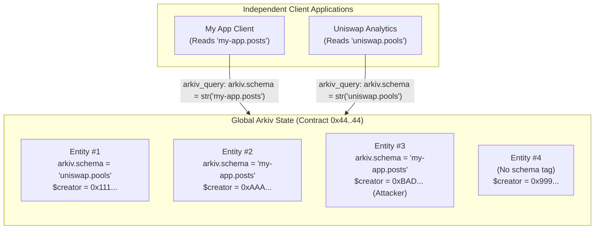
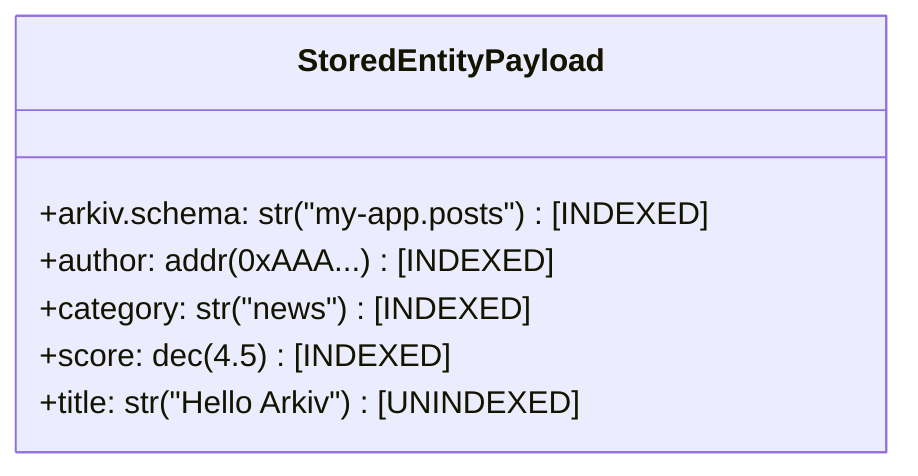
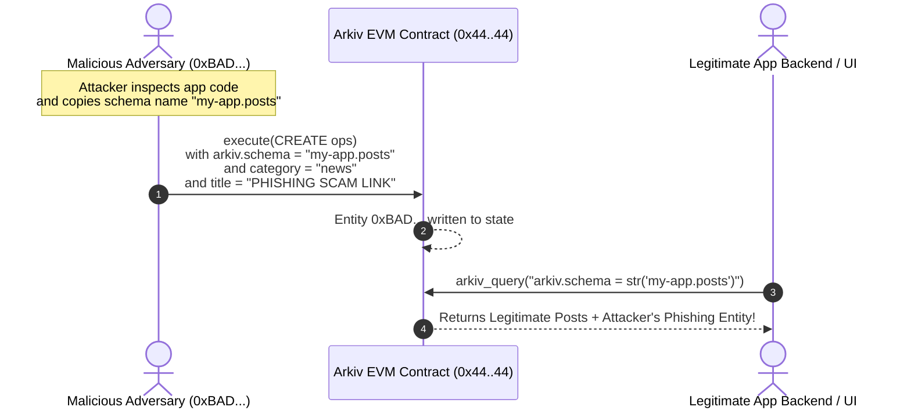
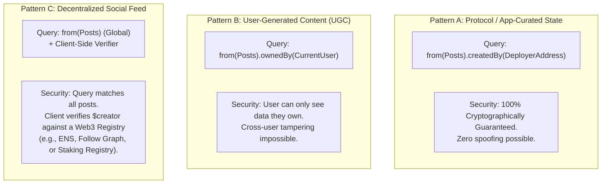
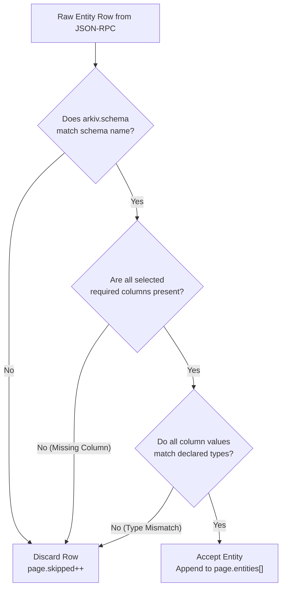

# Arkiv Query Engine: Multi-Tenant Schema Isolation & Tag Verification

## Table of Contents
1. [The Multi-Tenant Architecture of Arkiv](#1-the-multi-tenant-architecture-of-arkiv)
   - [Public Shared State with Zero Write Gating](#public-shared-state-with-zero-write-gating)
   - [The Client-Side Schema Illusion](#the-client-side-schema-illusion)
2. [The `arkiv.schema` Tag Injection Mechanism](#2-the-arkivschema-tag-injection-mechanism)
   - [Automated Schema Tag Injection](#automated-schema-tag-injection)
   - [Storage Overhead & The 31-Column Budget](#storage-overhead--the-31-column-budget)
   - [Automatic Query Injection](#automatic-query-injection)
   - [Namespacing Best Practices: Avoiding Namespace Collisions](#namespacing-best-practices-avoiding-namespace-collisions)
   - [Unnamed Schemas (`defineSchema({ ... })`)](#unnamed-schemas-defineschema---)
3. [The Threat Model: Schema Tag Spoofing](#3-the-threat-model-schema-tag-spoofing)
   - [The "Tag Is Not Access Control" Principle](#the-tag-is-not-access-control-principle)
   - [Anatomy of a Schema Poisoning Attack](#anatomy-of-a-schema-poisoning-attack)
   - [Denial of Service via Corrupted Attributes](#denial-of-service-via-corrupted-attributes)
4. [Cryptographic Trust Boundaries: Filtering by `$owner` and `$creator`](#4-cryptographic-trust-boundaries-filtering-by-owner-and-creator)
   - [Public Key Cryptography as the Ultimate Security Boundary](#public-key-cryptography-as-the-ultimate-security-boundary)
   - [`$creator` vs `$owner` Semantics](#creator-vs-owner-semantics)
   - [SDK Security Helpers: `ownedBy()` and `createdBy()`](#sdk-security-helpers-ownedby-and-createdby)
   - [Production Security Architecture Patterns](#production-security-architecture-patterns)
5. [Client-Side Schema Validation & `page.skipped`](#5-client-side-schema-validation--pageskipped)
   - [The Validation Pipeline](#the-validation-pipeline)
   - [Why Entities Are Skipped](#why-entities-are-skipped)
   - [The `page.skipped` Metric and Page Length Jitter](#the-pageskipped-metric-and-page-length-jitter)
   - [Configuration Modes: `onMismatch: "ignore"` vs `onMismatch: "throw"`](#configuration-modes-onmismatch-ignore-vs-onmismatch-throw)
   - [Impact on Aggregate `count()` Queries](#impact-on-aggregate-count-queries)
6. [Defensive Implementation Patterns](#6-defensive-implementation-patterns)

---

## 1. The Multi-Tenant Architecture of Arkiv

Arkiv represents a fundamental departure from traditional database architectures. In traditional database engines (such as PostgreSQL, MySQL, or MongoDB), data is partitioned into separate databases, schemas, or tables governed by centralized access control lists (ACLs) and database users.

In Arkiv, **all applications, smart contracts, and users share a single, global, multi-tenant EVM state**.



### Public Shared State with Zero Write Gating

- **No `CREATE TABLE` DDL**: The Arkiv blockchain contract does not contain table definitions or schema catalogs.
- **Permissionless Writes**: Any Ethereum account that possesses testnet gas (or tGLM) can submit a transaction calling `execute(ops)` to mint an entity containing any attribute names and any values.
- **Zero Schema Gatekeeping**: The node does not verify whether an entity matches a known schema definition before committing it to state.

### The Client-Side Schema Illusion

To developers using the Arkiv TypeScript SDK, Arkiv feels like a strictly typed relational database. However, this structure is an **application-tier illusion** maintained entirely by:
1. Schema tagging via an indexed string attribute (`arkiv.schema`).
2. Client-side query rewriting that injects tag predicates into every query.
3. Client-side response validation that strips or flags non-conforming rows.

---

## 2. The `arkiv.schema` Tag Injection Mechanism

The core mechanism enabling multi-tenancy in Arkiv is the schema name tag.

### Automated Schema Tag Injection

When you declare a named schema using `defineSchema(name, columns)`:

```ts
import { addr, dec, defineSchema, str } from "@arkiv-network/sdk/schema"

export const Posts = defineSchema("my-app.posts", {
  author: addr().indexed(),
  category: str().indexed(),
  score: dec().indexed(),
  title: str(),
})
```

The SDK automatically injects a hidden, indexed attribute into every entity created through this schema:
- **Attribute Name**: `arkiv.schema`
- **Attribute Type**: `str`
- **Indexing Flag**: Set (`.indexed()`, bit 7 set: `0x80`)
- **Attribute Value**: The schema name string (e.g. `'my-app.posts'`)



### Storage Overhead & The 31-Column Budget

Every Arkiv entity is strictly capped at a maximum of **32 total attributes** (`MAX_ATTRIBUTES = 32`).

Because the schema tag occupies an attribute slot:
- An **unnamed schema** can declare up to **32 user columns**.
- A **named schema** can declare up to **31 user columns** (the 32nd slot is consumed by `arkiv.schema`).

Attempting to declare 32 columns in a named schema causes an immediate SDK compilation error or throws `TooManyAttributesError`.

### Automatic Query Injection

Whenever a query is constructed using `.from(Posts)`, the SDK query builder automatically intercepts the query and prefixes the condition with an equality check on `arkiv.schema`:

```ts
const query = publicClient
  .select({ title: true })
  .from(Posts)
  .where(eq("category", "news"))

console.log(query.toString())
// Outputs: arkiv.schema = str('my-app.posts') AND category = str('news')
```

Even if the developer specifies no `.where()` filter at all:
```ts
const allPosts = publicClient.select().from(Posts)
console.log(allPosts.toString())
// Outputs: arkiv.schema = str('my-app.posts')
```

The query engine evaluates this filter against its native string index, returning only entities tagged with that specific schema string.

### Namespacing Best Practices: Avoiding Namespace Collisions

Because the global database state is shared, schema names must be uniquely qualified:
- **Poor Name**: `defineSchema("posts", { ... })` $\to$ Any other developer who also names a schema `"posts"` will share your namespace!
- **Recommended Pattern**: Reverse domain name notation or project prefix:
  - `defineSchema("supercast.v1.posts", { ... })`
  - `defineSchema("dao.governance.proposals", { ... })`

A schema name can be any UTF-8 string up to **128 bytes** (`MAX_STRING_BYTES`).

### Unnamed Schemas (`defineSchema({ ... })`)

A schema can be defined without a name:

```ts
const SharedMetrics = defineSchema({
  timestamp: u64().indexed(),
  value: dec().indexed(),
})
```

- **No Tag Overhead**: Consumes 0 metadata attribute slots (all 32 slots available for user columns).
- **No Tag Injection**: The SDK does not append `arkiv.schema = str(...)` to queries.
- **Global Matching**: Queries through an unnamed schema will match entities across any project in the database that share those attribute names and values.
- **Query Requirement**: Because an unnamed schema injects no default tag, queries without a `.where()` predicate are rejected with `InvalidPredicateError`.

---

## 3. The Threat Model: Schema Tag Spoofing

### The "Tag Is Not Access Control" Principle

> [!CAUTION]
> A schema tag (`arkiv.schema`) is **not** an access control mechanism, nor is it a cryptographic boundary. It is purely a namespace delimiter.

Because write operations to the Arkiv contract are completely permissionless:
1. Any external account can sign a transaction that sets `arkiv.schema = 'my-app.posts'`.
2. Anyone can write entities with legitimate-looking or corrupted columns.
3. Anyone can attempt to flood or poison your application's query results.

### Anatomy of a Schema Poisoning Attack



### Denial of Service via Corrupted Attributes

An attacker does not even need to write valid data to disrupt your application. By writing an entity with:
```sql
arkiv.schema = str('my-app.posts')
score = str('INVALID_STRING_VALUE') -- Corrupted type! Expected dec!
```
The attacker can trigger client-side validation failures, inflate `page.skipped` metrics, or stall cursor-based pagination loops.

---

## 4. Cryptographic Trust Boundaries: Filtering by `$owner` and `$creator`

To achieve true security and data integrity in Arkiv, applications must rely on **Ethereum Public Key Cryptography**.

### Public Key Cryptography as the Ultimate Security Boundary

While anyone can write any attribute value, **no one can forge their Ethereum address**. Every entity creation transaction is cryptographically signed by an `msg.sender`, which the Arkiv smart contract permanently records into the entity's `$creator` field.

### `$creator` vs `$owner` Semantics

| System Field | Mutability | Origin | Security Implication |
|:---|:---:|:---|:---|
| **`$creator`** | **Immutable** | Set to `msg.sender` at the moment of initial `CREATE` execution. Can never be altered. | **Permanent provenance**. Proves exactly which account deployed the entity. |
| **`$owner`** | **Mutable** | Initially set to `msg.sender`, but can be reassigned via the `TRANSFER` operation. | **Administrative authority**. Proves which account currently has the right to update, delete, or extend the entity. |

### SDK Security Helpers: `ownedBy()` and `createdBy()`

The Arkiv SDK provides fluent builder shortcuts to bind queries to trusted addresses:

```ts
// Enforce that only entities created by our official backend wallet are accepted
const trustedPosts = await publicClient
  .select({ title: true, score: true })
  .from(Posts)
  .createdBy("0xMyOfficialBackendDeployerAddress...")
  .fetch()

// Enforce that only entities currently owned by Alice are retrieved
const userPosts = await publicClient
  .select({ title: true })
  .from(Posts)
  .ownedBy(userAddress)
  .fetch()
```

When evaluated, these helpers append cryptographic equality checks to the query string:
```sql
arkiv.schema = str('my-app.posts') AND $creator = addr(0xMyOfficialBackendDeployerAddress...)
```

### Production Security Architecture Patterns



---

## 5. Client-Side Schema Validation & `page.skipped`

When the node query engine returns a batch of entities satisfying the query's indexed predicates, the SDK executes a client-side validation pipeline against the schema definition.



### The Validation Pipeline

For every entity delivered by the node in the `data` array:
1. **Tag Check**: Verifies that the entity's `arkiv.schema` attribute matches the expected schema name string.
2. **Presence Check**: Verifies that all selected columns that are not marked `.optional()` are present.
3. **Type Check**: Verifies that each attribute value conforms to the declared type constructor (e.g. `dec` must be a valid 18-decimal fixed-point string, `i32` must be a signed 32-bit integer).

### Why Entities Are Skipped

An entity will be excluded from `page.entities` if:
- It was written by another application with your schema tag, but missed one of your required columns.
- An optional column was omitted (this does not skip the row; the field is simply populated as `undefined`).
- A column was written with a conflicting type (e.g. `score: str('10')` instead of `score: dec(10)`).

### The `page.skipped` Metric and Page Length Jitter

Whenever the validator encounters a non-conforming entity, it omits the entity from the returned `entities` array and increments the `page.skipped` counter:

```ts
const page = await publicClient
  .select({ title: true, score: true })
  .from(Posts)
  .limit(20)
  .fetch()

console.log(`Delivered rows: ${page.entities.length}`)
console.log(`Skipped invalid rows: ${page.skipped}`)
// Example Output: Delivered rows: 17, Skipped invalid rows: 3
```

> [!WARNING]
> Because skipped entities are discarded after fetching, a page request with `limit(20)` may return fewer than 20 rows even when more rows exist on subsequent pages!

### Configuration Modes: `onMismatch: "ignore"` vs `onMismatch: "throw"`

The SDK supports two behavioral modes when handling mismatched entities:

#### 1. Default Mode: `onMismatch: "ignore"`
Non-conforming entities are silently skipped, allowing applications to display valid records without crashing:
```ts
const page = await publicClient.select().from(Posts).fetch()
```

#### 2. Strict Mode: `onMismatch: "throw"`
If any entity in the fetched batch fails schema validation, the query immediately throws a `SchemaMismatchError`:
```ts
try {
  const page = await publicClient
    .select()
    .from(Posts, { onMismatch: "throw" })
    .fetch()
} catch (err) {
  if (err instanceof SchemaMismatchError) {
    console.error("Corrupted entity detected in database stream!", err)
  }
}
```

### Impact on Aggregate `count()` Queries

The node-level aggregate counting method (`publicClient.count().from(Posts)`) evaluates conditions **purely at the index layer**.

Because the node does not deserialize entity bodies or validate optional columns during count queries:
- **`count()` includes all entities matching `arkiv.schema`**, including those that fail client-side schema validation!
- If an attacker has injected 50 corrupted entities with your schema tag, `count()` will report 50 higher than the number of valid rows obtained by walking the pages.

---

## 6. Defensive Implementation Patterns

### Pattern: The Hardened Multi-Tenant Ingestion Pipeline

```ts
import { createPublicClient, http } from "@arkiv-network/sdk"
import { rabdi } from "@arkiv-network/sdk/chains"
import { asc, eq, gt } from "@arkiv-network/sdk/query"
import { key } from "@arkiv-network/sdk/schema"
import type { Hex } from "viem"
import { Posts, type PostEntity } from "./schemas"

const TRUSTED_CREATORS = new Set([
  "0x4444444444444444444444444444444444444444".toLowerCase(),
  "0xd8dA6BF26964aF9D7eEd9e03E53415D37aA96045".toLowerCase(),
])

/**
 * Defensive query executor that isolates data boundaries
 * using both schema tags and cryptographic creator allowlists.
 */
export async function fetchVerifiedPosts(client: ReturnType<typeof createPublicClient>) {
  let lastKey: Hex | undefined = undefined
  const verifiedEntities: PostEntity[] = []

  while (true) {
    let query = client
      .select({
        $key: true,
        $owner: true,
        $creator: true,
        title: true,
        score: true,
      })
      .from(Posts, { onMismatch: "ignore" })
      .orderBy(asc("$key"))
      .limit(100)

    if (lastKey) {
      query = query.where(gt("$key", key(lastKey)))
    }

    const page = await query.fetch()

    // 1. Audit skipped rows
    if (page.skipped > 0) {
      console.warn(`[Security Warning] Skipped ${page.skipped} poisoned/mismatched entities at block #${page.blockNumber}`)
    }

    // 2. Cryptographically verify creator against trusted allowlist
    for (const post of page.entities) {
      const creator = (post.$creator as string).toLowerCase()
      if (TRUSTED_CREATORS.has(creator)) {
        verifiedEntities.push(post)
      } else {
        console.warn(`[Spoof Attempt] Rejected post with valid schema tag but untrusted creator: ${creator}`)
      }
    }

    if (page.entities.length < 100) {
      break
    }
    lastKey = page.entities[page.entities.length - 1].$key as Hex
  }

  return verifiedEntities
}
```
