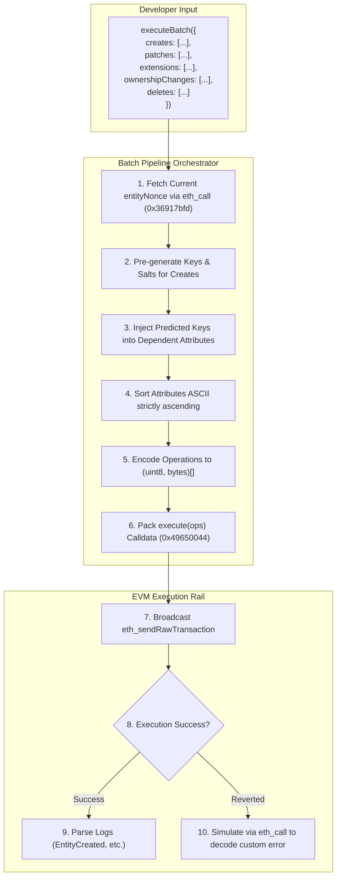
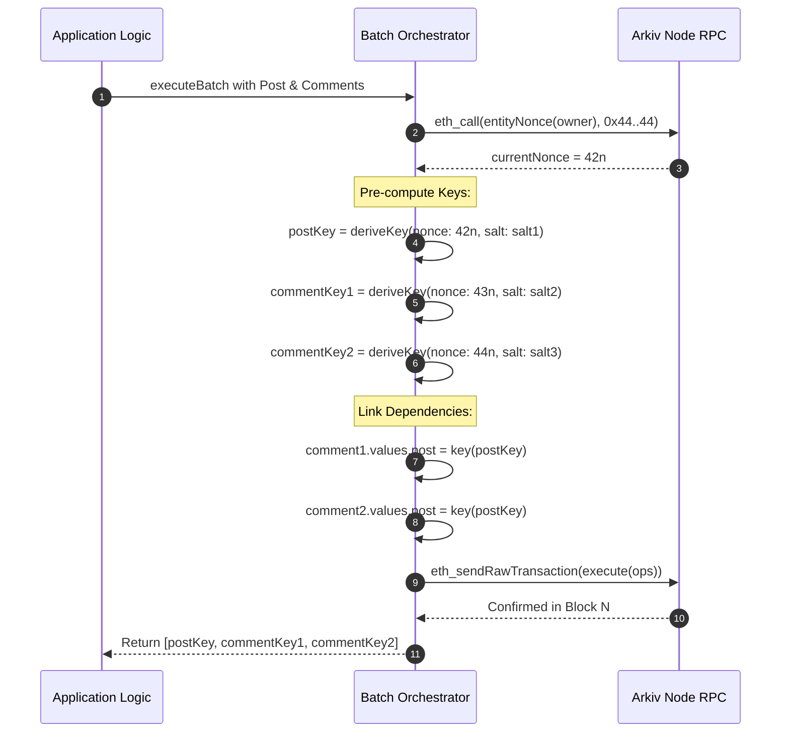

# Batch Pipeline Orchestrator & Multi-Entity Dependency Engine

## Table of Contents
- [1. Architectural Overview & Batch Processing Engine](#1-architectural-overview--batch-processing-engine)
- [2. Transaction Packing Pipeline (execute)](#2-transaction-packing-pipeline-execute)
  - [2.1 Operation Encoders & Struct Layouts](#21-operation-encoders--struct-layouts)
  - [2.2 Attribute Serialization & ASCII Ordering](#22-attribute-serialization--ascii-ordering)
  - [2.3 Tombstone Encodings for Patches](#23-tombstone-encodings-for-patches)
- [3. Salt Generation & Deterministic Key Derivation](#3-salt-generation--deterministic-key-derivation)
  - [3.1 Cryptographic 128-Bit Salt Generation](#31-cryptographic-128-bit-salt-generation)
  - [3.2 Deterministic NO_SALT Mode](#32-deterministic-no_salt-mode)
  - [3.3 Key Derivation Mathematics & Formula](#33-key-derivation-mathematics--formula)
- [4. Multi-Entity Dependency Orchestration & Key Prediction](#4-multi-entity-dependency-orchestration--key-prediction)
  - [4.1 The Forward-Reference Challenge](#41-the-forward-reference-challenge)
  - [4.2 Orchestration via predictEntityKeys](#42-orchestration-via-predictentitykeys)
  - [4.3 Entity Nonce Sequential Indexing](#43-entity-nonce-sequential-indexing)
  - [4.4 Dependency Graph Execution Flow](#44-dependency-graph-execution-flow)
- [5. Atomicity, Gas Profiling & Error Decoding](#5-atomicity-gas-profiling--error-decoding)
  - [5.1 All-or-Nothing Revert Guarantee](#51-all-or-nothing-revert-guarantee)
  - [5.2 Gas Sizing & Calldata Limits](#52-gas-sizing--calldata-limits)
  - [5.3 Revert Reason Simulation & Error Unwrapping](#53-revert-reason-simulation--error-unwrapping)
- [6. Complete Implementation Reference](#6-complete-implementation-reference)
- [7. Architectural Invariants](#7-architectural-invariants)

---

## 1. Architectural Overview & Batch Processing Engine

In distributed database design, atomic multi-record mutations are vital for maintaining relational consistency. Arkiv fulfills this natively on the EVM via its single write gateway:

$$\text{Target Contract}: \texttt{0x4400000000000000000000000000000000000044}$$
$$\text{Function}: \texttt{execute((uint8 operation, bytes operationData)[] ops)}$$
$$\text{Selector}: \texttt{0x49650044}$$

The **Batch Pipeline Orchestrator** is the SDK subsystem responsible for:
1. **Heterogeneous Packing**: Bundling creates, patches, extensions, ownership transfers, and deletes into a single linear calldata array.
2. **Attribute Normalization & Sorting**: Enforcing protocol invariants such as 32-byte name zero-padding and strict ascending ASCII sorting.
3. **Multi-Entity Graph Resolution**: Pre-allocating keys for forward-referencing entities (e.g., creating a Post and its Comments in a single transaction) using deterministic key prediction.
4. **Receipt Parsing & Result Mapping**: Correlating emitted transaction events (`EntityCreated`, `EntityPatched`, etc.) back to developer operations.



---

## 2. Transaction Packing Pipeline (`execute`)

### 2.1 Operation Encoders & Struct Layouts

Arkiv recognizes 5 distinct operation tags ($1$ to $5$). Each operation encodes a specific Solidity struct:

```solidity
// 1: CREATE
struct CreateOp {
    uint128 salt;
    uint64 expiresAt;
    uint64 minLifetime;
    uint8 creationFlags;
    Attribute[] attributes;
}

// 2: PATCH
struct PatchOp {
    bytes32 entityKey;
    Attribute[] mutations;
}

// 3: EXTEND EXPIRY
struct ExtendOp {
    bytes32 entityKey;
    uint64 expiresAt;
    uint64 minLifetime;
}

// 4: TRANSFER OWNERSHIP
struct TransferOp {
    bytes32 entityKey;
    address newOwner;
}

// 5: DELETE
struct DeleteOp {
    bytes32 entityKey;
}
```

The outer parameter `ops` is an array of tuples:
```solidity
struct Operation {
    uint8 operation;       // 1..5
    bytes operationData;   // abi.encode(OpStruct)
}
```

### 2.2 Attribute Serialization & ASCII Ordering

The EVM `Attribute` struct is defined as:
```solidity
struct Attribute {
    bytes32 name;   // ASCII string, left-aligned, zero-padded to 32 bytes
    uint8 typeId;   // low 7 bits = type (1..10), bit 7 (0x80) = isIndexed
    bytes value;    // ABI word or dynamic bytes payload
}
```

#### Protocol Sorting Rule:
Attributes in `attributes` (Create) or `mutations` (Patch) **must be sorted in strictly ascending ASCII order** by their 32-byte hex name:
$$\text{attr}_0.\text{name} < \text{attr}_1.\text{name} < \dots < \text{attr}_{n-1}.\text{name}$$

If any two attributes share the same name, or if they appear out of order, the contract unconditionally reverts with custom error `AttributesNotSorted()`.

```ts
function packAndSortAttributes(attributes: RawAttribute[]): EncodedAttribute[] {
  return attributes
    .map((attr) => ({
      name: toHex(attr.name, { size: 32 }), // left-aligned, padded with 0x00 to 32 bytes
      typeId: attr.typeId | (attr.isIndexed ? 0x80 : 0x00),
      value: attr.encodedValue,
    }))
    .sort((a, b) => (a.name < b.name ? -1 : a.name > b.name ? 1 : 0));
}
```

### 2.3 Tombstone Encodings for Patches

In a `patchEntity` call, attributes can be updated or removed:
- **Set Attribute**: Encodes the attribute with its standard `typeId` and payload.
- **Unset Attribute**: Encoded as a **Tombstone** with `typeId = 0` and an empty `value` (`0x`).

Protocol rules for tombstones:
- A tombstone is only valid within operation 2 (`PATCH`). A tombstone in operation 1 (`CREATE`) reverts with `TombstoneInCreate(bytes32 name)`.
- If a tombstone has a non-empty value, the contract reverts with `TombstoneValueNotEmpty(bytes32 name)`.
- If a patch contains no mutations (empty list), the contract reverts with `EmptyMutations(bytes32 entityKey)`.

---

## 3. Salt Generation & Deterministic Key Derivation

### 3.1 Cryptographic 128-Bit Salt Generation

By default, every entity created through the SDK is assigned a cryptographically random 128-bit salt:
```ts
function generateRandomSalt(): bigint {
  const buffer = new Uint8Array(16); // 128 bits = 16 bytes
  if (typeof crypto !== "undefined" && crypto.getRandomValues) {
    crypto.getRandomValues(buffer);
  } else {
    throw new NoRandomSourceError("No secure random source available");
  }
  return BigInt("0x" + Buffer.from(buffer).toString("hex"));
}
```
A random salt prevents front-running and guarantees that third parties cannot guess or calculate an entity's key prior to block inclusion.

### 3.2 Deterministic `NO_SALT` Mode

For registries, singleton state records, or content-addressed entities, developers can pass:
```ts
import { NO_SALT } from "@arkiv-network/sdk";

await walletClient.createEntity(Posts, values, {
  expiration: ExpirationTime.fromDays(30),
  salt: NO_SALT, // Evaluates to 0n
});
```
With `salt = 0n`, anyone possessing the creator's address and the target `entityNonce` can compute the exact entity key beforehand.

### 3.3 Key Derivation Mathematics & Formula

The Arkiv node derives entity keys using tightly packed ABI parameters hashed with Keccak-256:

$$\text{entityKey} = \text{keccak256}(\text{abi.encodePacked}(\text{uint256 } \text{chainId}, \text{address } \text{arkiv}, \text{address } \text{owner}, \text{uint64 } \text{nonce}, \text{uint128 } \text{salt}))$$

#### Exact Byte Packing Representation:
- `uint256 chainId`: 32 bytes, big-endian.
- `address arkiv`: 20 bytes (e.g. `0x4400000000000000000000000000000000000044`).
- `address owner`: 20 bytes.
- `uint64 nonce`: 8 bytes, big-endian (`entityNonce`).
- `uint128 salt`: 16 bytes, big-endian.
- **Total Packed Byte Length**: $32 + 20 + 20 + 8 + 16 = 96\text{ bytes}$.

```ts
import { encodePacked, keccak256, type Address, type Hex } from "viem";

export function deriveEntityKey(params: {
  chainId: bigint;
  arkivAddress: Address;
  owner: Address;
  nonce: bigint;
  salt: bigint;
}): Hex {
  const packedData = encodePacked(
    ["uint256", "address", "address", "uint64", "uint128"],
    [params.chainId, params.arkivAddress, params.owner, params.nonce, params.salt]
  );
  return keccak256(packedData);
}
```

---

## 4. Multi-Entity Dependency Orchestration & Key Prediction

### 4.1 The Forward-Reference Challenge

A common database operation is creating a parent entity and child entities simultaneously. For example:
- Create a `Post` entity.
- Create two `Comment` entities whose `post` column references the `Post` entity's key.

In traditional databases, developers perform a round-trip: insert the post, wait for the database to return its ID, then insert the comments. In Arkiv, round-tripping across blocks adds latency (2 seconds per block) and forfeits transaction atomicity.

### 4.2 Orchestration via `predictEntityKeys`

Because key derivation is deterministic, the SDK orchestrates forward references in a single batch:



### 4.3 Entity Nonce Sequential Indexing

The `entityNonce` is an on-chain counter maintained per address inside the Arkiv contract:
- Starts at `0`.
- Increments by `1` for each CREATE operation executed by that address.
- Is **independent** of the Ethereum transaction nonce.
- Can be read at any time via an `eth_call`:
  ```bash
  data: 0x36917bfd000000000000000000000000${OWNER#0x}
  ```

### 4.4 Dependency Graph Execution Flow

```ts
import { ExpirationTime } from "@arkiv-network/sdk";
import { key, str } from "@arkiv-network/sdk/schema";

// 1. Predict keys for 1 post and 2 comments
const [predictedPost, predictedComment1, predictedComment2] = await publicClient.predictEntityKeys({
  owner: account.address,
  count: 3,
});

// 2. Submit atomic batch
const result = await walletClient.executeBatch({
  creates: [
    {
      schema: Posts,
      values: { title: "Arkiv Deep Dive", body: stringToBytes("...") },
      expiration: ExpirationTime.fromDays(30),
      salt: predictedPost.salt,
    },
    {
      schema: Comments,
      values: { post: key(predictedPost.key), text: "Brilliant explanation!" },
      expiration: ExpirationTime.fromDays(30),
      salt: predictedComment1.salt,
    },
    {
      schema: Comments,
      values: { post: key(predictedPost.key), text: "Does it support Rust?" },
      expiration: ExpirationTime.fromDays(30),
      salt: predictedComment2.salt,
    },
  ],
});
```

---

## 5. Atomicity, Gas Profiling & Error Decoding

### 5.1 All-or-Nothing Revert Guarantee

All operations in an `executeBatch` are executed sequentially within a single EVM transaction context. If any operation fails (e.g. extending an entity that already expired, or submitting an unsorted attribute array), the entire transaction reverts:
- All created entities are rolled back.
- No storage mutations persist.
- Gas consumed up to the point of revert is burned.

### 5.2 Gas Sizing & Calldata Limits

Batch sizing must respect protocol and EVM constraints:
- **Maximum Attributes per Operation**: 32.
- **Combined `bytes` Quota**: 128 KiB per create/patch operation.
- **Block Gas Limit**: On Rabdi testnet, standard Ethereum block gas limits apply. Batches of up to 50–100 moderate entities execute smoothly within typical limits.

### 5.3 Revert Reason Simulation & Error Unwrapping

When a batch reverts, Ethereum nodes standardly return generic error strings like `execution reverted`. The SDK wraps the transaction in an `eth_call` to extract and decode the contract's custom ABI errors:

```ts
const CUSTOM_ERRORS_ABI = parseAbi([
  "error EmptyBatch()",
  "error InvalidOpType(uint8 operation)",
  "error AttributesNotSorted()",
  "error TooManyAttributes(uint256 count, uint256 maxCount)",
  "error EmptyMutations(bytes32 entityKey)",
  "error TombstoneInCreate(bytes32 name)",
  "error TombstoneValueNotEmpty(bytes32 name)",
  "error SystemAttributeNotWritable(bytes32 name)",
  "error InvalidValueType(bytes32 name, uint8 typeId)",
  "error Ident32Empty()",
  "error Ident32InvalidByte(uint256 position, bytes1 value)",
  "error EntityNotFound(bytes32 entityKey)",
  "error EntityExpired(bytes32 entityKey, uint64 expiresAt)",
  "error NotOwner(bytes32 entityKey, address caller, address owner)",
  "error ReadOnlyEntity(bytes32 entityKey)",
  "error ReservedCreationFlags(uint8 creationFlags)",
  "error ExpiryDeadOnArrival(uint64 target, uint64 currentBlock)",
  "error ExpiryBeyondMaxLifetime(uint64 target, uint64 currentBlock, uint64 maxLifetime)",
  "error ExpiryNotExtended(bytes32 entityKey, uint64 newExpiresAt, uint64 currentExpiresAt)",
  "error TransferToZeroAddress(bytes32 entityKey)",
  "error TransferToSelf(bytes32 entityKey)",
]);
```

---

## 6. Complete Implementation Reference

```ts
export class BatchPipelineOrchestrator {
  constructor(
    private readonly walletClient: ArkivWalletClient,
    private readonly publicClient: ArkivPublicClient
  ) {}

  async executeBatch(batch: BatchOperations, overrides?: TxOverrides): Promise<BatchResult> {
    const rawOps: Array<{ operation: number; operationData: Hex }> = [];
    const createdKeyPromises: KeyPrediction[] = [];

    // 1. Fetch current entity nonce if any creates exist
    if (batch.creates && batch.creates.length > 0) {
      let currentNonce = await this.fetchEntityNonce(this.walletClient.account.address);

      for (const create of batch.creates) {
        const salt = create.salt ?? generateRandomSalt();
        const derivedKey = deriveEntityKey({
          chainId: BigInt(this.walletClient.chain.id),
          arkivAddress: ARKIV_ADDRESS,
          owner: this.walletClient.account.address,
          nonce: currentNonce,
          salt,
        });

        createdKeyPromises.push({ key: derivedKey, salt });
        currentNonce += 1n;

        // Encode CreateOp
        const encodedAttributes = this.prepareAttributes(create.schema, create.values);
        const [expiresAt, minLifetime] = create.expiration.resolve();
        const creationFlags = (create.flags?.readonly ? 1 : 0) | (create.flags?.permissionlessExtension ? 2 : 0);

        const opData = encodeAbiParameters(CREATE_ABI_PARAMS, [{
          salt,
          expiresAt,
          minLifetime,
          creationFlags,
          attributes: encodedAttributes,
        }]);

        rawOps.push({ operation: 1, operationData: opData });
      }
    }

    // 2. Encode Patches
    if (batch.patches) {
      for (const patch of batch.patches) {
        const mutations = this.prepareMutations(patch.schema, patch.set, patch.unset);
        const opData = encodeAbiParameters(PATCH_ABI_PARAMS, [{
          entityKey: patch.entityKey,
          mutations,
        }]);
        rawOps.push({ operation: 2, operationData: opData });
      }
    }

    // 3. Encode Extensions
    if (batch.extensions) {
      for (const ext of batch.extensions) {
        const [expiresAt, minLifetime] = ext.expiration.resolve();
        const opData = encodeAbiParameters(EXTEND_ABI_PARAMS, [{
          entityKey: ext.entityKey,
          expiresAt,
          minLifetime,
        }]);
        rawOps.push({ operation: 3, operationData: opData });
      }
    }

    // 4. Encode Ownership Changes
    if (batch.ownershipChanges) {
      for (const transfer of batch.ownershipChanges) {
        const opData = encodeAbiParameters(TRANSFER_ABI_PARAMS, [{
          entityKey: transfer.entityKey,
          newOwner: transfer.newOwner,
        }]);
        rawOps.push({ operation: 4, operationData: opData });
      }
    }

    // 5. Encode Deletes
    if (batch.deletes) {
      for (const del of batch.deletes) {
        const opData = encodeAbiParameters(DELETE_ABI_PARAMS, [{
          entityKey: del.entityKey,
        }]);
        rawOps.push({ operation: 5, operationData: opData });
      }
    }

    if (rawOps.length === 0) {
      throw new EmptyBatchError("executeBatch requires at least one operation");
    }

    // 6. Encode calldata for execute(ops)
    const calldata = encodeFunctionData({
      abi: EXECUTE_ABI,
      functionName: "execute",
      args: [rawOps.map(op => [op.operation, op.operationData])],
    });

    // 7. Dispatch transaction & await receipt
    const txHash = await this.walletClient.sendTransaction({
      to: ARKIV_ADDRESS,
      data: calldata,
      ...overrides,
    });

    const receipt = await this.publicClient.waitForTransactionReceipt({ hash: txHash });

    return {
      txHash,
      createdEntities: createdKeyPromises.map(p => p.key),
      receipt,
    };
  }

  private async fetchEntityNonce(owner: Address): Promise<bigint> {
    const raw = await this.publicClient.call({
      to: ARKIV_ADDRESS,
      data: `0x36917bfd000000000000000000000000${owner.slice(2)}`,
    });
    return BigInt(raw.data ?? "0x0");
  }

  private prepareAttributes(schema: Schema, values: Record<string, any>): EncodedAttribute[] {
    const attrs: EncodedAttribute[] = [];

    // Prepend schema tag if named
    if (schema.name) {
      attrs.push({
        name: toHex("arkiv.schema", { size: 32 }),
        typeId: 8 | 0x80, // str | INDEXED
        value: stringToHex(schema.name),
      });
    }

    for (const [key, val] of Object.entries(values)) {
      const col = schema.columns[key];
      attrs.push({
        name: toHex(key, { size: 32 }),
        typeId: col.typeId | (col.isIndexed ? 0x80 : 0),
        value: col.encodeValue(val),
      });
    }

    // Sort strictly ascending by ASCII name
    return attrs.sort((a, b) => (a.name < b.name ? -1 : a.name > b.name ? 1 : 0));
  }
}
```

---

## 7. Architectural Invariants

1. **Strict ASCII Order**: Attributes in creates and patches must be sorted by `bytes32 name` strictly ascending prior to encoding.
2. **Deterministic Salt Predictability**: When predicting keys, the orchestrator must pair each generated salt with its exact prospective `entityNonce` sequence.
3. **No Intermediate Commits**: Batches must never be broken into multiple transactions; atomicity must be preserved through a single `execute` invocation.
4. **Revert Transparency**: The orchestrator must never swallow or disguise custom contract reverts; it must decode and surface the exact revert selector and parameters.
5. **Zero-Balance Preflight**: Before broadcasting, the pipeline should verify that the signing account has sufficient gas balance to execute the batch.
