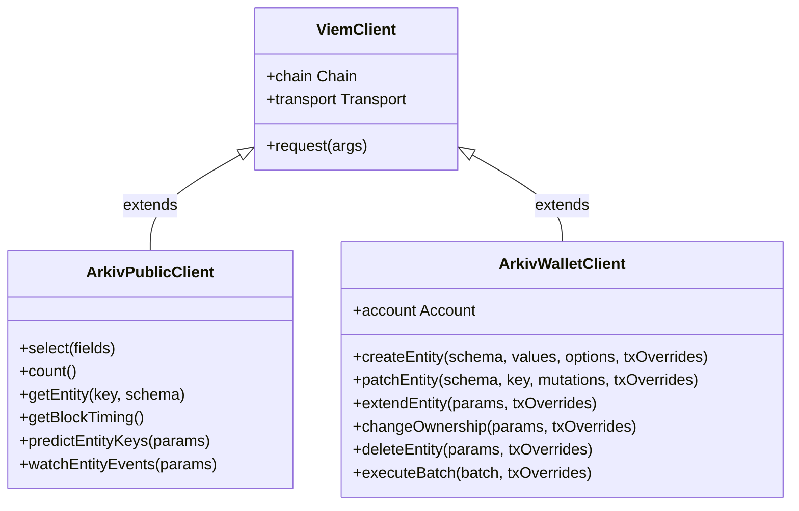
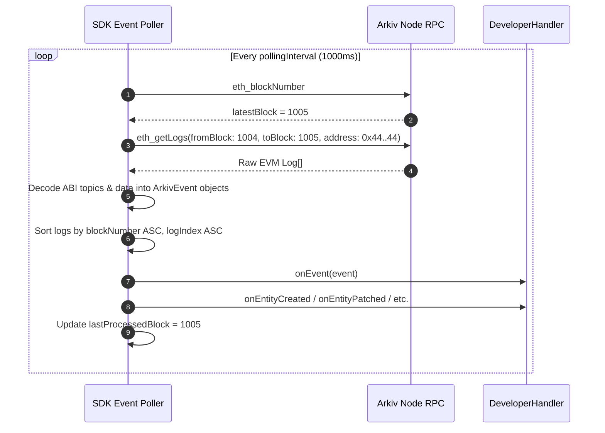
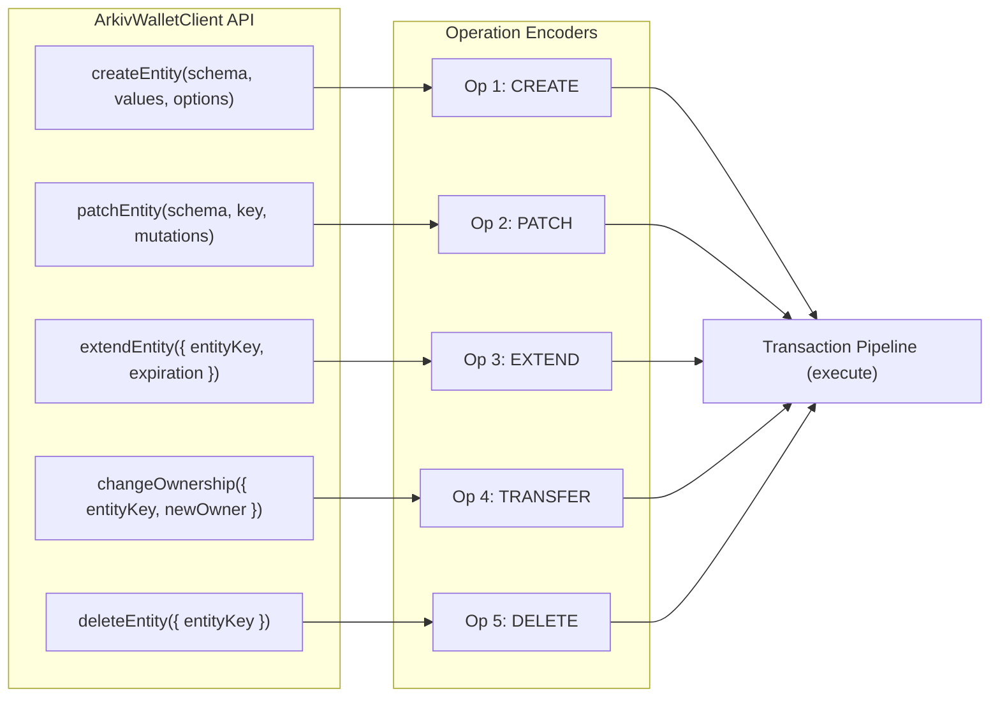
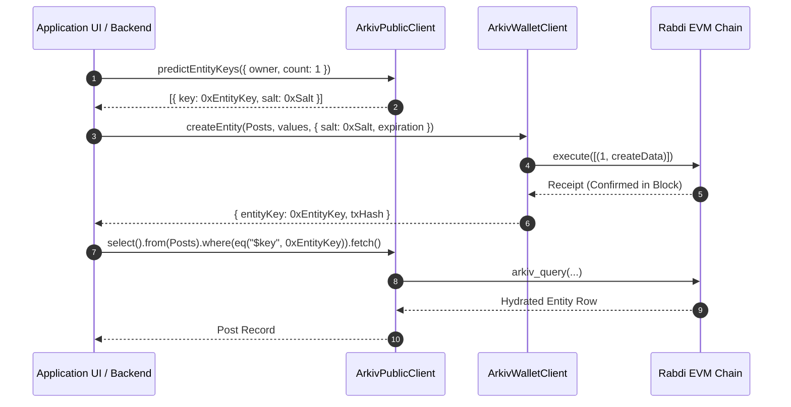

# Client Abstractions: ArkivPublicClient & ArkivWalletClient

## Table of Contents
- [1. Client Model Overview & Viem Integration](#1-client-model-overview--viem-integration)
- [2. ArkivPublicClient Architecture](#2-arkivpublicclient-architecture)
  - [2.1 Factory & Configuration](#21-factory--configuration)
  - [2.2 Read Operations](#22-read-operations)
  - [2.3 Node Timing & Block Diagnostics](#23-node-timing--block-diagnostics)
  - [2.4 Key Prediction Engine](#24-key-prediction-engine)
  - [2.5 Event Streaming & Polling Watcher](#25-event-streaming--polling-watcher)
  - [2.6 Transport Management & Access Key Injection](#26-transport-management--access-key-injection)
- [3. ArkivWalletClient Architecture](#3-arkivwalletclient-architecture)
  - [3.1 Factory & Account Binding](#31-factory--account-binding)
  - [3.2 Mutation API Specification](#32-mutation-api-specification)
  - [3.3 Batch Mutation Pipeline](#33-batch-mutation-pipeline)
  - [3.4 Transaction Lifecycle Management](#34-transaction-lifecycle-management)
  - [3.5 Receipt Decoding & Event Extraction](#35-receipt-decoding--event-extraction)
- [4. Dual-Client Interaction & Orchestration Flow](#4-dual-client-interaction--orchestration-flow)
- [5. Complete TypeScript Interface Specifications](#5-complete-typescript-interface-specifications)
- [6. Architectural Invariants](#6-architectural-invariants)

---

## 1. Client Model Overview & Viem Integration

Arkiv decouples read and write responsibilities into two distinct client classes:
- **`ArkivPublicClient`**: A read-only client engineered to query entities, inspect chain metadata, predict future keys, and stream blockchain events. It carries no account credentials and incurs no gas fees.
- **`ArkivWalletClient`**: A state-mutating client backed by a signer (EOA private key, browser wallet, or hardware device) that constructs, estimates, signs, and broadcasts EVM transactions calling the core contract at `0x4400000000000000000000000000000000000044`.

Both clients extend the foundational primitives of [Viem](https://viem.sh), inheriting composable transports (`http`, `webSocket`, `custom`), chain definitions, ABI encoders, and RPC dispatch pipelines.



---

## 2. ArkivPublicClient Architecture

### 2.1 Factory & Configuration

An `ArkivPublicClient` is instantiated via `createPublicClient`. It requires a `chain` definition (such as `rabdi`) and a network `transport`:

```ts
import { createPublicClient } from "@arkiv-network/sdk";
import { rabdi } from "@arkiv-network/sdk/chains";
import { http } from "viem";

const chain = rabdi({ accessKey: process.env.ARKIV_ACCESS_KEY ?? "" });

export const publicClient = createPublicClient({
  chain,
  transport: http(),
});
```

When initialized with `accessKey: ""`, the client connects to the public, unauthenticated RPC endpoint and issues a warning regarding aggressive rate limiting.

### 2.2 Read Operations

The public client exposes three primary data reading surfaces:

#### 1. Query Builder (`select()`)
Initiates the fluent query compilation pipeline:
```ts
const { entities, blockNumber, skipped, count } = await publicClient
  .select({ $key: true, title: true, score: true })
  .from(Posts)
  .where(eq("category", "news"))
  .orderBy(desc("score"))
  .limit(20)
  .fetch();
```
- Under the hood, this translates to an `arkiv_query` RPC method invocation.
- If `.withCount()` is chained, `select.count = true` is passed to the RPC, returning the global match total alongside the page.
- Returns an array of entities typed strictly against the schema and selected fields.

#### 2. Headless Count (`count()`)
Counts matching entities without fetching attributes or entity keys:
```ts
const totalMatches = await publicClient
  .count()
  .from(Posts)
  .where(eq("category", "news"))
  .fetch(); // returns bigint
```
- Emits an `arkiv_query` call with payload:
  ```json
  [
    "arkiv.schema = str('my-app.posts') AND category = str('news')",
    { "select": { "count": true } }
  ]
  ```
- The node evaluates the index match count without projecting or serializing row data, optimizing response speed and network throughput.

#### 3. Direct Key Lookup (`getEntity()`)
Retrieves an individual entity by its 32-byte hexadecimal key:
```ts
// With Schema (Strict Typing & Validation)
const post = await publicClient.getEntity(entityKey, Posts);

// Without Schema (Dynamic Map)
const rawEntity = await publicClient.getEntity(entityKey);
```
- Dispatches `arkiv_getEntity` with `[entityKey]`.
- If the entity does not exist or has expired, throws `NoEntityFoundError`.
- If read through a schema and the entity lacks required columns or holds invalid types, throws `SchemaMismatchError`.

### 2.3 Node Timing & Block Diagnostics

Arkiv relies on block heights for TTL expiration. The method `getBlockTiming()` retrieves the node's authoritative time parameters:

```ts
const timing = await publicClient.getBlockTiming();
// Returns:
// {
//   currentBlock: 582143n,
//   currentBlockTime: 1742721127n, // Unix timestamp in seconds
//   duration: 2                   // Block time in seconds
// }
```
- Calls `arkiv_getBlockTiming`.
- Enables client-side resolution of `ExpirationTime.fromDays(n)` and `ExpirationTime.atDate(d)` into exact block targets.

### 2.4 Key Prediction Engine

Entities created on Arkiv receive deterministic keys derived from:
$$\text{key} = \text{keccak256}(\text{abi.encodePacked}(\text{chainId}, \text{arkivAddress}, \text{owner}, \text{nonce}, \text{salt}))$$

`predictEntityKeys` allows applications to calculate entity keys before submitting transactions:

```ts
const predictions = await publicClient.predictEntityKeys({
  owner: account.address,
  count: 2,
});
// Returns:
// [
//   { key: "0x1a2b...", salt: 0x9876543210abcdef...n },
//   { key: "0x3c4d...", salt: 0xfedcba0123456789...n }
// ]
```

#### Internal Prediction Algorithm:
1. Calls `eth_call` on the Arkiv contract (`0x4400000000000000000000000000000000000044`) with function selector `0x36917bfd` (`entityNonce(address)`) to fetch the current account nonce.
2. For each requested index $i \in [0, \text{count}-1]$:
   - Generates a secure random 128-bit integer for `salt` (via `crypto.getRandomValues`).
   - Computes Keccak-256 over the packed parameters:
     ```ts
     keccak256(
       encodePacked(
         ["uint256", "address", "address", "uint64", "uint128"],
         [chainId, ARKIV_ADDRESS, owner, currentNonce + BigInt(i), salt]
       )
     )
     ```
3. Returns the derived keys alongside their respective salts.

### 2.5 Event Streaming & Polling Watcher

`watchEntityEvents` establishes an active subscription loop monitoring entity lifecycle operations:

```ts
const unwatch = publicClient.watchEntityEvents({
  pollingInterval: 1_000, // Optional: default is half-block (1000ms)
  onEntityCreated: ({ entityKey, owner, expiresAt, creationFlags }) => { ... },
  onEntityPatched: ({ entityKey, owner }) => { ... },
  onExpiryExtended: ({ entityKey, owner, expiresAt }) => { ... },
  onOwnershipTransferred: ({ entityKey, previousOwner, newOwner }) => { ... },
  onEntityDeleted: ({ entityKey, owner }) => { ... },
  onEvent: (event) => { /* Dispatches for all event types in strict batch order */ },
  onError: (error) => { console.error("Watcher failure:", error); },
});

// To terminate the watcher loop:
unwatch();
```

#### Event Polling Mechanism:


### 2.6 Transport Management & Access Key Injection

#### HTTP vs WebSocket:
- **HTTP Transport**: Preferred for serverless functions, Next.js API routes, and standard queries. Dispatches stateless JSON-RPC requests.
- **WebSocket Transport**: Preferred for persistent backend services maintaining long-lived event listeners, bypassing HTTP connection negotiation overhead.

#### Access Key Routing:
Arkiv Hub keys are injected either via URL path routing or the standard `Authorization` header:
- **Path Parameter**: `https://rpc.rabdi.db-chain.testnet.arkiv.network/${accessKey}`
- **Header Injection**:
  ```ts
  transport: http("https://rpc.rabdi.db-chain.testnet.arkiv.network", {
    fetchOptions: {
      headers: { "x-arkiv-access-key": accessKey },
    },
  })
  ```

---

## 3. ArkivWalletClient Architecture

### 3.1 Factory & Account Binding

An `ArkivWalletClient` combines the chain and transport with an explicit signing `account`:

```ts
// 1. Server Environment (Private Key)
const walletClient = createWalletClient({
  chain,
  transport: http(),
  account: privateKeyToAccount(process.env.PRIVATE_KEY as Hex),
});

// 2. Browser Environment (EIP-1193 Provider)
const [address] = await window.ethereum.request({ method: "eth_requestAccounts" });
const browserWalletClient = createWalletClient({
  chain,
  transport: custom(window.ethereum),
  account: address,
});
```

### 3.2 Mutation API Specification

The wallet client provides five dedicated mutation methods:



#### 1. `createEntity`
```ts
const { entityKey, txHash, expiresAt } = await walletClient.createEntity(
  Posts,
  {
    author: addr(account.address),
    category: "news",
    score: dec("4.5"),
    title: "Hello World",
    body: stringToBytes("Content"),
  },
  {
    expiration: ExpirationTime.fromDays(30),
    flags: { readonly: false, permissionlessExtension: false },
    salt: undefined, // defaults to 128-bit random salt; or NO_SALT
  },
  txOverrides // { gas, nonce, maxFeePerGas, maxPriorityFeePerGas }
);
```

#### 2. `patchEntity`
```ts
const { txHash } = await walletClient.patchEntity(
  Posts,
  entityKey,
  {
    set: { score: dec("4.8"), summary: "New summary" },
    unset: ["summary"],
  },
  txOverrides
);
```
- Validates that attributes in `set` and `unset` do not overlap (or throws `ConflictingMutationError`).
- Unsetting an attribute encodes a `Tombstone` attribute (`typeId = 0`, empty value).

#### 3. `extendEntity`
```ts
const { txHash, expiresAt } = await walletClient.extendEntity(
  {
    entityKey,
    expiration: ExpirationTime.fromDays(60),
  },
  txOverrides
);
```
- Cannot set an expiration earlier than the entity's current expiration.

#### 4. `changeOwnership`
```ts
const { txHash } = await walletClient.changeOwnership(
  {
    entityKey,
    newOwner: "0xd8dA6BF26964aF9D7eEd9e03E53415D37aA96045",
  },
  txOverrides
);
```
- Reverts if `newOwner` is the zero address or the current owner.

#### 5. `deleteEntity`
```ts
const { txHash } = await walletClient.deleteEntity(
  { entityKey },
  txOverrides
);
```
- Marks the entity as expired/deleted immediately.

### 3.3 Batch Mutation Pipeline

`executeBatch` sends multiple heterogenous operations in a single atomic transaction:

```ts
const result = await walletClient.executeBatch({
  creates: [
    { schema: Posts, values: postValues, expiration: ExpirationTime.fromDays(7), salt: postSalt },
    { schema: Comments, values: commentValues, expiration: ExpirationTime.fromDays(7), salt: commentSalt },
  ],
  patches: [
    { schema: Posts, entityKey: existingKey, set: { score: dec("5.0") } },
  ],
  extensions: [
    { entityKey: oldKey, expiration: ExpirationTime.fromDays(30) },
  ],
  ownershipChanges: [
    { entityKey: teamKey, newOwner: newLeadAddress },
  ],
  deletes: [
    { entityKey: expiredKey },
  ],
});

// Result structure:
// {
//   txHash: "0x...",
//   createdEntities: ["0xKey1...", "0xKey2..."],
//   patchedEntities: ["0x..."],
//   extendedEntities: ["0x..."],
//   transferredEntities: ["0x..."],
//   deletedEntities: ["0x..."]
// }
```

### 3.4 Transaction Lifecycle Management

When any write method is invoked, the SDK executes the following pipeline:

```mermaid
flowchart TD
    Invoke[Invoke Mutation Method] --> Validate[Preflight Validation: Types, Limits, Expiration]
    Validate --> EncodeOps[Encode Operation Structs & Sort Attributes]
    EncodeOps --> PackCalldata[Encode execute ops ABI Payload]
    
    PackCalldata --> GasCheck{Gas Overrides Provided?}
    GasCheck -->|No| Estimate[Call eth_estimateGas]
    GasCheck -->|Yes| UseGas[Apply User Gas Limits]
    Estimate --> Sign[Sign Transaction via Account / Provider]
    UseGas --> Sign
    
    Sign --> Broadcast[Broadcast via eth_sendRawTransaction]
    Broadcast --> PollReceipt[Poll eth_getTransactionReceipt]
    
    PollReceipt --> ReceiptStatus{Receipt Status == 1?}
    ReceiptStatus -->|Yes| ParseLogs[Parse Receipt Logs for Arkiv Events]
    ReceiptStatus -->|No| DecodeRevert[Fetch Revert Reason via eth_call & Decode ABI Error]
    
    ParseLogs --> ReturnResult[Return { entityKey, txHash, ... }]
    DecodeRevert --> ThrowError[Throw EntityMutationError with Decoded Cause]
```

### 3.5 Receipt Decoding & Event Extraction

Because the EVM `execute` function does not return values to external RPC callers, entity keys and confirmed expirations must be extracted from the transaction logs:

```ts
// Contract Event ABI Signatures
const EntityCreatedEvent = parseAbiItem(
  "event EntityCreated(bytes32 indexed entityKey, address indexed owner, uint64 expiresAt, uint8 creationFlags)"
);

// Extraction Logic in SDK:
const receipt = await waitForTransactionReceipt({ hash: txHash });
const logs = parseEventLogs({
  abi: [EntityCreatedEvent],
  logs: receipt.logs,
  eventName: "EntityCreated",
});

const createdKey = logs[0]?.args.entityKey;
const confirmedExpiresAt = logs[0]?.args.expiresAt;
```

---

## 4. Dual-Client Interaction & Orchestration Flow

In real-world applications, `ArkivPublicClient` and `ArkivWalletClient` operate collaboratively:



---

## 5. Complete TypeScript Interface Specifications

```ts
import type { Address, Hash, Hex, Transport, Chain, Account } from "viem";
import type { Schema, AttributeSchema } from "./schema";
import type { ExpirationTime } from "./expiration";
import type { QueryCondition, SortKey, SelectArg } from "./query";

export interface ArkivPublicClientConfig {
  chain: Chain;
  transport: Transport;
}

export interface ArkivWalletClientConfig {
  chain: Chain;
  transport: Transport;
  account: Account | Address;
}

export interface BlockTiming {
  currentBlock: bigint;
  currentBlockTime: bigint;
  duration: number;
}

export interface KeyPrediction {
  key: Hex;
  salt: bigint;
}

export interface QueryPage<T> {
  entities: T[];
  blockNumber: bigint;
  skipped: number;
  count?: bigint;
}

export interface ArkivPublicClient {
  chain: Chain;
  transport: Transport;

  select<TSelection extends SelectArg = "*">(selection?: TSelection): QueryBuilder<TSelection>;
  count(): CountBuilder;
  getEntity<TSchema extends Schema>(key: Hex, schema: TSchema): Promise<InferSelectType<TSchema>>;
  getEntity(key: Hex): Promise<DynamicEntity>;
  getBlockTiming(): Promise<BlockTiming>;
  predictEntityKeys(params: { owner: Address; count: number }): Promise<KeyPrediction[]>;
  watchEntityEvents(handlers: WatchEventHandlers): () => void;
  query(condition: QueryCondition | string, options?: QueryOptions): Promise<QueryPage<DynamicEntity>>;
}

export interface ArkivWalletClient {
  chain: Chain;
  transport: Transport;
  account: Account;

  createEntity<TSchema extends Schema>(
    schema: TSchema,
    values: InferInsertType<TSchema>,
    options: CreateEntityOptions,
    txOverrides?: TxOverrides
  ): Promise<CreateEntityResult>;

  patchEntity<TSchema extends Schema>(
    schema: TSchema,
    entityKey: Hex,
    mutations: PatchMutations<TSchema>,
    txOverrides?: TxOverrides
  ): Promise<PatchEntityResult>;

  extendEntity(
    params: { entityKey: Hex; expiration: ExpirationTime },
    txOverrides?: TxOverrides
  ): Promise<ExtendEntityResult>;

  changeOwnership(
    params: { entityKey: Hex; newOwner: Address },
    txOverrides?: TxOverrides
  ): Promise<TxResult>;

  deleteEntity(
    params: { entityKey: Hex },
    txOverrides?: TxOverrides
  ): Promise<TxResult>;

  executeBatch(
    batch: BatchOperations,
    txOverrides?: TxOverrides
  ): Promise<BatchResult>;
}
```

---

## 6. Architectural Invariants

1. **Account Isolation**: `ArkivPublicClient` must never accept an `account` parameter or sign transactions.
2. **Deterministic Derivation**: `predictEntityKeys` must query the latest `entityNonce` dynamically from the contract to prevent stale key calculations.
3. **Receipt Validation**: `ArkivWalletClient` must wait for transaction confirmation and verify `receipt.status === 'success'` before returning resolved keys.
4. **Revert Error Unwrapping**: On transaction revert, the wallet client must simulate the failure via `eth_call` to extract and throw the exact ABI custom error (`ReadOnlyEntity`, `NotOwner`, etc.).
