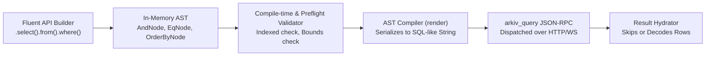
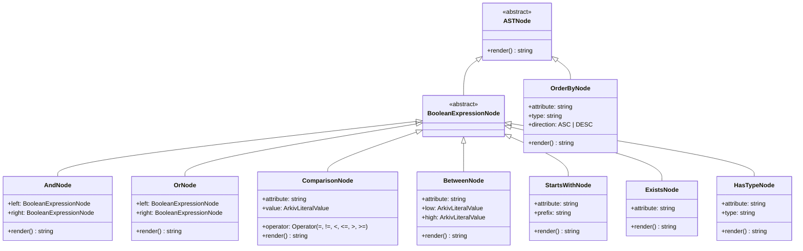
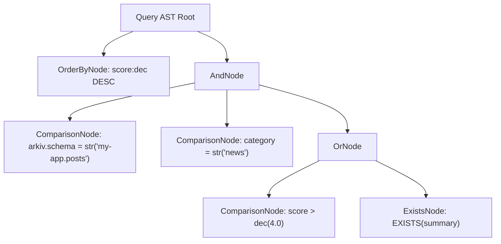
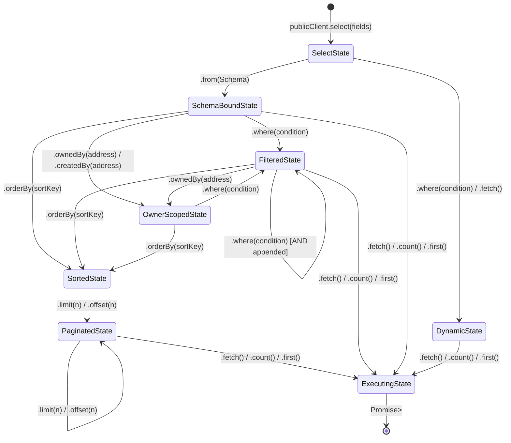

# Query Builder & AST Compiler Specification

## Table of Contents
- [1. Architectural Overview & Query Engine Interface](#1-architectural-overview--query-engine-interface)
- [2. The Query Abstract Syntax Tree (AST)](#2-the-query-abstract-syntax-tree-ast)
  - [2.1 Node Hierarchy & Grammar Mapping](#21-node-hierarchy--grammar-mapping)
  - [2.2 Node Data Structures](#22-node-data-structures)
  - [2.3 Visualizing the Query AST](#23-visualizing-the-query-ast)
- [3. Fluent Method Chaining Lifecycle](#3-fluent-method-chaining-lifecycle)
  - [3.1 Chaining State Machine](#31-chaining-state-machine)
  - [3.2 Method Chaining API Surface](#32-method-chaining-api-surface)
  - [3.3 Terminal Execution Methods](#33-terminal-execution-methods)
- [4. The AST Compiler Pipeline (render & toString)](#4-the-ast-compiler-pipeline-render--tostring)
  - [4.1 Serialization Rules & Grammar](#41-serialization-rules--grammar)
  - [4.2 Value Literal Serialization Matrix](#42-value-literal-serialization-matrix)
  - [4.3 String Escaping & Identifiers](#43-string-escaping--identifiers)
  - [4.4 Operator Precedence & Grouping](#44-operator-precedence--grouping)
- [5. Type-Level Safety & Compile-Time Constraints](#5-type-level-safety--compile-time-constraints)
  - [5.1 Indexed-Only Column Verification](#51-indexed-only-column-verification)
  - [5.2 Projection Return Type Inference](#52-projection-return-type-inference)
- [6. Runtime Validation & Mismatch Handling](#6-runtime-validation--mismatch-handling)
  - [6.1 Client-Side Preflight Checks](#61-client-side-preflight-checks)
  - [6.2 Entity Skipping vs. Strict Mismatch Errors](#62-entity-skipping-vs-strict-mismatch-errors)
- [7. Comprehensive Implementation Reference](#7-comprehensive-implementation-reference)
- [8. Architectural Invariants](#8-architectural-invariants)

---

## 1. Architectural Overview & Query Engine Interface

Arkiv processes queries through its native JSON-RPC method `arkiv_query`. Unlike SQL databases that accept raw string queries from client drivers, Arkiv’s SDK incorporates an **Abstract Syntax Tree (AST) Query Builder DSL**. 

The Query Builder fulfills three vital architectural functions:
1. **Type-Safe Expression Construction**: Prevents invalid queries at compile time by ensuring that only `.indexed()` columns can be used in filters, only valid column names can be referenced, and values match their declared column types.
2. **Deterministic AST Compilation**: Compiles the in-memory AST into standard Arkiv Query Language strings (`arkiv.schema = str('...') AND ... ORDER BY ...`).
3. **Decoupled Projection & Hydration**: Maps returned raw JSON tuples into typed entity rows, resolving `$key`, `$owner`, and user attributes into native JavaScript/TypeScript structures.



---

## 2. The Query Abstract Syntax Tree (AST)

### 2.1 Node Hierarchy & Grammar Mapping

The Arkiv query language grammar maps directly to an explicit node hierarchy:



### 2.2 Node Data Structures

Each node is an immutable object capturing the semantics of a filter or sorting clause:

```ts
export type Operator = "=" | "!=" | "<" | "<=" | ">" | ">=";

export interface ComparisonNode {
  readonly kind: "comparison";
  readonly attribute: string;
  readonly operator: Operator;
  readonly value: ArkivValue;
}

export interface BetweenNode {
  readonly kind: "between";
  readonly attribute: string;
  readonly low: ArkivValue;
  readonly high: ArkivValue;
}

export interface StartsWithNode {
  readonly kind: "startsWith";
  readonly attribute: string;
  readonly prefix: string;
}

export interface ExistsNode {
  readonly kind: "exists";
  readonly attribute: string;
}

export interface HasTypeNode {
  readonly kind: "hasType";
  readonly attribute: string;
  readonly type: ColumnTypeName;
}

export interface AndNode {
  readonly kind: "and";
  readonly conditions: readonly QueryConditionNode[];
}

export interface OrNode {
  readonly kind: "or";
  readonly conditions: readonly QueryConditionNode[];
}

export interface OrderByNode {
  readonly attribute: string;
  readonly type?: ColumnTypeName;
  readonly direction: "ASC" | "DESC";
}
```

### 2.3 Visualizing the Query AST

For a complex query:
```ts
publicClient
  .select({ $key: true, title: true })
  .from(Posts)
  .where(
    and(
      eq("category", "news"),
      or(gt("score", dec("4.0")), exists("summary"))
    )
  )
  .orderBy(desc("score"))
```

The resulting AST representation is structured as:



---

## 3. Fluent Method Chaining Lifecycle

### 3.1 Chaining State Machine

The Query Builder is an immutable state machine where every method call returns a new instance of `QueryBuilder` with updated internal configuration:



### 3.2 Method Chaining API Surface

| Method | Signature | Description |
| :--- | :--- | :--- |
| `select(fields)` | `select<T>(fields?: T)` | Specifies entity fields (`$key`, etc.) and schema columns to project. |
| `from(schema, opts?)` | `from<S>(schema: S, opts?: { onMismatch?: 'skip' \| 'throw' })` | Binds a schema, enforcing type safety and auto-tagging `arkiv.schema`. |
| `where(condition)` | `where(condition: QueryCondition)` | Appends a filter. Multiple `where()` calls are conjoined with `AND`. |
| `ownedBy(address)` | `ownedBy(address: Address)` | Convenience helper for `where(eq("$owner", addr(address)))`. |
| `createdBy(address)` | `createdBy(address: Address)` | Convenience helper for `where(eq("$creator", addr(address)))`. |
| `orderBy(sortKey)` | `orderBy(sort: SortKey)` | Sets the single sort criterion (`asc(col)` or `desc(col)`). Replaces prior sort. |
| `limit(n)` | `limit(limit: number)` | Sets page limit (1 to 100). Defaults to 100. |
| `offset(n)` | `offset(offset: number)` | Sets match offset for pagination. Defaults to 0. |
| `withCount()` | `withCount()` | Requests global match count alongside page rows. |

### 3.3 Terminal Execution Methods

1. **`fetch()`**: Executes the query and returns a `QueryPage<T>`:
   ```ts
   const page = await query.fetch();
   // { entities: T[], blockNumber: bigint, skipped: number, count?: bigint }
   ```
2. **`count()`**: Executes headless count evaluation, returning a `bigint`:
   ```ts
   const total = await publicClient.count().from(Posts).fetch();
   ```
3. **`first()`**: Convenience method setting `limit(1)` and returning the first entity or `null`:
   ```ts
   const post = await query.first();
   ```

---

## 4. The AST Compiler Pipeline (`render` & `toString`)

### 4.1 Serialization Rules & Grammar

The compiler traverses the AST recursively and emits valid Arkiv query strings according to the official EBNF specification:

```
Query            ::= BooleanExpression [ 'ORDER' 'BY' OrderByClause ]
BooleanExpression::= OrExpression
OrExpression     ::= AndExpression ( 'OR' AndExpression )*
AndExpression    ::= Predicate ( 'AND' Predicate )*
Predicate        ::= Comparison | Between | StartsWith | Exists | HasType | '(' BooleanExpression ')'
```

### 4.2 Value Literal Serialization Matrix

Every value literal in the query language (except booleans) must be explicitly annotated with its type constructor:

| Type | SDK Value Representation | Rendered Query Literal |
| :--- | :--- | :--- |
| `bool` | `true`, `false` | `true`, `false` |
| `i32` | `i32(-42)` or `-42` | `i32(-42)` |
| `u64` | `u64(1700000000n)` | `u64(1700000000)` |
| `u256` | `u256(1000000000000000000n)` | `u256(1000000000000000000)` |
| `dec` | `dec("4.5")` | `dec(4.5)` |
| `str` | `"hello"` or `str("hello")` | `str('hello')` |
| `addr` | `addr("0xd8dA6BF...")` | `addr(0xd8dA6BF...)` |
| `key` | `key("0x9f2c...")` | `key(0x9f2c...)` |
| `bytes` | `Uint8Array` or hex | *Cannot be indexed or queried* |

### 4.3 String Escaping & Identifiers

- **Single Quotes**: Strings are enclosed in single quotes. Internal single quotes must be escaped by doubling them:
  `str('it\'s a test')` $\rightarrow$ `str('it''s a test')`
- **Identifier Rules**: Attribute names must start with a letter and contain only alphanumeric characters, `.`, `-`, or `_`, up to 32 bytes.
- **Reserved Words**: Identifiers cannot be keywords (`AND`, `OR`, `NOT`, `BETWEEN`, `ORDER`, etc.) or type names (`str`, `i32`, etc.).

### 4.4 Operator Precedence & Grouping

- `AND` binds more tightly than `OR`.
- When an `OrNode` is a child of an `AndNode`, parentheses are strictly generated:
  ```text
  (category = str('news') OR category = str('blog')) AND score >= dec(3)
  ```
- The `BETWEEN` operator consumes the inner `AND` atom:
  ```text
  (score BETWEEN dec(1) AND dec(5)) AND category = str('news')
  ```

---

## 5. Type-Level Safety & Compile-Time Constraints

### 5.1 Indexed-Only Column Verification

A core design innovation of Arkiv is compile-time enforcement of database indexing constraints. If a developer attempts to filter on an unindexed column, the TypeScript compiler refuses to compile:

```ts
const Posts = defineSchema("my-app.posts", {
  category: str().indexed(),
  title: str(), // NOT indexed!
});

// VALID: category is indexed
publicClient.select().from(Posts).where(eq("category", "news"));

// COMPILE ERROR: Argument of type '"title"' is not assignable to parameter of type '"category"'
publicClient.select().from(Posts).where(eq("title", "Hello"));
```

#### TypeScript Implementation Mechanism:
```ts
export type IndexedColumnKeys<TSchema extends Schema> = {
  [K in keyof TSchema["columns"]]: TSchema["columns"][K]["isIndexed"] extends true
    ? K
    : never;
}[keyof TSchema["columns"]];

export interface SchemaBoundQueryBuilder<TSchema extends Schema, TSelect> {
  where(
    condition: QueryCondition<IndexedColumnKeys<TSchema> | "$key" | "$owner" | "$creator" | "$expiresAt">
  ): this;
}
```

### 5.2 Projection Return Type Inference

When fields are selected via `.select(...)`, the resulting row type is dynamically inferred at compile time:

```ts
const fields = { $key: true, title: true, score: true } as const;

const { entities } = await publicClient
  .select(fields)
  .from(Posts)
  .fetch();

// Type of entities:
// Array<{
//   $key: Hex;
//   title: StrValue; // .value is string
//   score: DecValue; // .value is string
// }>
// Accessing entities[0].author or entities[0].$owner is a TypeScript compile error!
```

---

## 6. Runtime Validation & Mismatch Handling

### 6.1 Client-Side Preflight Checks

Before sending an `arkiv_query` request, the SDK validates:
1. **Predicate Bounds**: Checks that numerical values fit within their bounds (`I32_MIN` to `I32_MAX`, `U64_MAX`, `DECIMAL_SCALE`).
2. **Address Checksums**: Verifies that mixed-case Ethereum addresses pass EIP-55 checksum validation.
3. **Prefix Operands**: Ensures `startsWith` is only applied to `str` attributes.
4. **Sort Key Validation**: Confirms that sort keys do not target `bytes` columns, `$createdAt`, or `$updatedAt`.

### 6.2 Entity Skipping vs. Strict Mismatch Errors

Arkiv is an open public database. Any third party can write an entity tagged with `arkiv.schema = str('my-app.posts')` that omits a required column or provides corrupted attribute types.

To prevent malicious or corrupted entities from breaking application queries:
1. **Default Mode (`skip`)**:
   - Entities failing schema validation are excluded from the `entities` array.
   - The total number of skipped entities is returned in `page.skipped`.
   - The application continues rendering valid entities without crashing.
2. **Strict Mode (`throw`)**:
   - If configured via `.from(Posts, { onMismatch: "throw" })`:
   - Enforcing strict matching causes the SDK to throw `SchemaMismatchError` immediately upon detecting an invalid entity.
   - Essential for strict data-sync pipelines and cursor-based key pagination loops.

---

## 7. Comprehensive Implementation Reference

```ts
export class QueryBuilder<TSelect extends SelectArg = "*", TSchema extends Schema | undefined = undefined> {
  private schema?: TSchema;
  private conditions: QueryConditionNode[] = [];
  private sort?: OrderByNode;
  private limitCount: number = 100;
  private offsetCount: number = 0;
  private includeCount: boolean = false;
  private mismatchPolicy: "skip" | "throw" = "skip";

  constructor(
    private readonly client: ArkivPublicClient,
    private readonly selection: TSelect
  ) {}

  from<S extends Schema>(schema: S, options?: { onMismatch?: "skip" | "throw" }): QueryBuilder<TSelect, S> {
    const next = this.clone<TSelect, S>();
    next.schema = schema;
    if (options?.onMismatch) next.mismatchPolicy = options.onMismatch;
    return next;
  }

  where(condition: QueryConditionNode): this {
    const next = this.clone();
    next.conditions.push(condition);
    return next;
  }

  ownedBy(owner: Address): this {
    return this.where(new ComparisonNode("$owner", "=", new AddrValue(owner)));
  }

  createdBy(creator: Address): this {
    return this.where(new ComparisonNode("$creator", "=", new AddrValue(creator)));
  }

  orderBy(sort: OrderByNode): this {
    const next = this.clone();
    next.sort = sort;
    return next;
  }

  limit(limit: number): this {
    if (limit < 1 || limit > 100) throw new InvalidPredicateError("Limit must be between 1 and 100");
    const next = this.clone();
    next.limitCount = limit;
    return next;
  }

  offset(offset: number): this {
    if (offset < 0) throw new InvalidPredicateError("Offset cannot be negative");
    const next = this.clone();
    next.offsetCount = offset;
    return next;
  }

  withCount(): this {
    const next = this.clone();
    next.includeCount = true;
    return next;
  }

  toString(): string {
    const expressions: string[] = [];

    // Inject schema isolation tag if schema is named
    if (this.schema?.name) {
      expressions.push(`arkiv.schema = str('${this.escapeString(this.schema.name)}')`);
    }

    for (const cond of this.conditions) {
      expressions.push(cond.render());
    }

    if (expressions.length === 0) {
      throw new InvalidPredicateError("Query must have at least one condition or a named schema");
    }

    let queryText = expressions.length > 1 ? expressions.join(" AND ") : expressions[0];

    if (this.sort) {
      queryText += ` ORDER BY ${this.sort.render()}`;
    }

    return queryText;
  }

  async fetch(): Promise<QueryPage<InferRowType<TSchema, TSelect>>> {
    const queryStr = this.toString();
    const selectParam = this.buildSelectParam();

    const rpcResult = await this.client.request({
      method: "arkiv_query",
      params: [
        queryStr,
        {
          select: selectParam,
          limit: toHex(this.limitCount),
          offset: toHex(this.offsetCount),
        },
      ],
    });

    return this.hydrate(rpcResult);
  }

  private escapeString(val: string): string {
    return val.replace(/'/g, "''");
  }

  private clone<S1 = TSelect, S2 = TSchema>(): QueryBuilder<S1, S2> {
    const b = new QueryBuilder<S1, S2>(this.client, this.selection as any);
    b.schema = this.schema as any;
    b.conditions = [...this.conditions];
    b.sort = this.sort;
    b.limitCount = this.limitCount;
    b.offsetCount = this.offsetCount;
    b.includeCount = this.includeCount;
    b.mismatchPolicy = this.mismatchPolicy;
    return b;
  }
}
```

---

## 8. Architectural Invariants

1. **AST Immutability**: All builder operations must return cloned instances without mutating existing queries, ensuring safe query reuse across components.
2. **Schema Tag Injection**: The compiler must automatically inject `arkiv.schema = str('...')` into the root conjunction whenever `.from(namedSchema)` is bound.
3. **String Literal Escaping**: Single quotes inside string literals must always be escaped by doubling (`''`) to prevent injection attacks or AST syntax errors.
4. **Single Sort Key**: The query language and AST support exactly one `ORDER BY` clause; setting a new sort key must cleanly overwrite any previous sort key.
5. **No Unindexed Predicates**: Compile-time type signatures and runtime preflights must reject predicates targeting unindexed columns.
