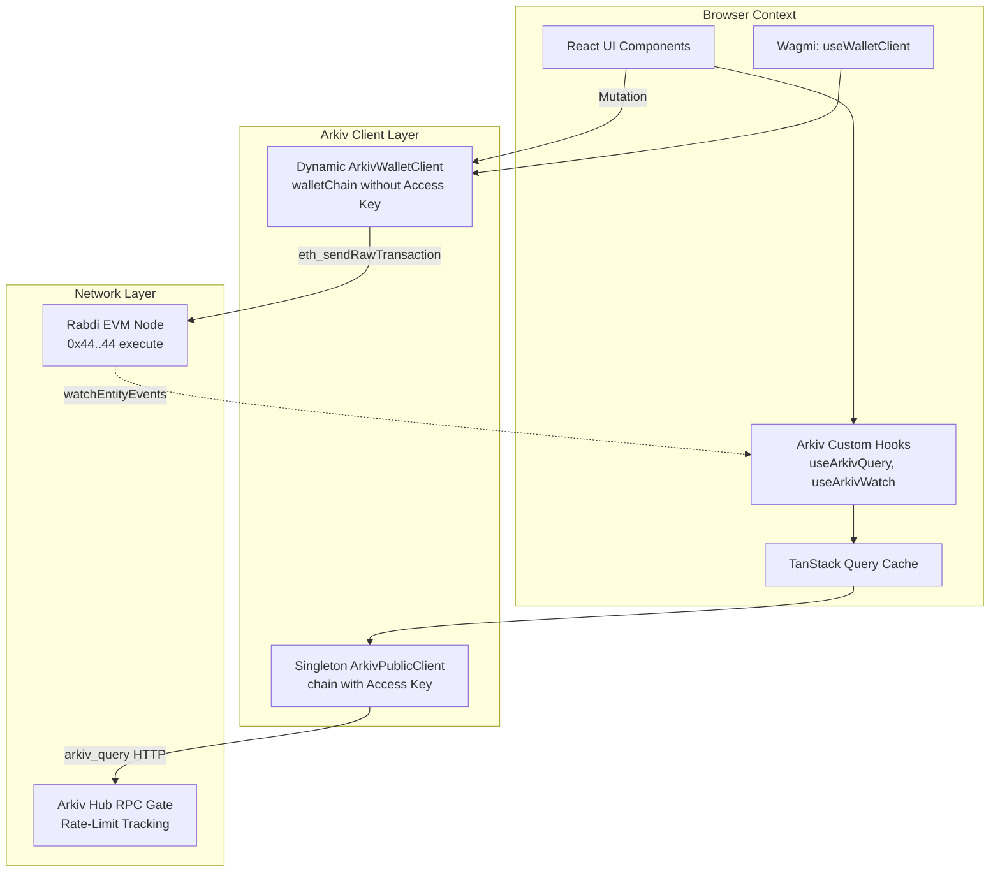
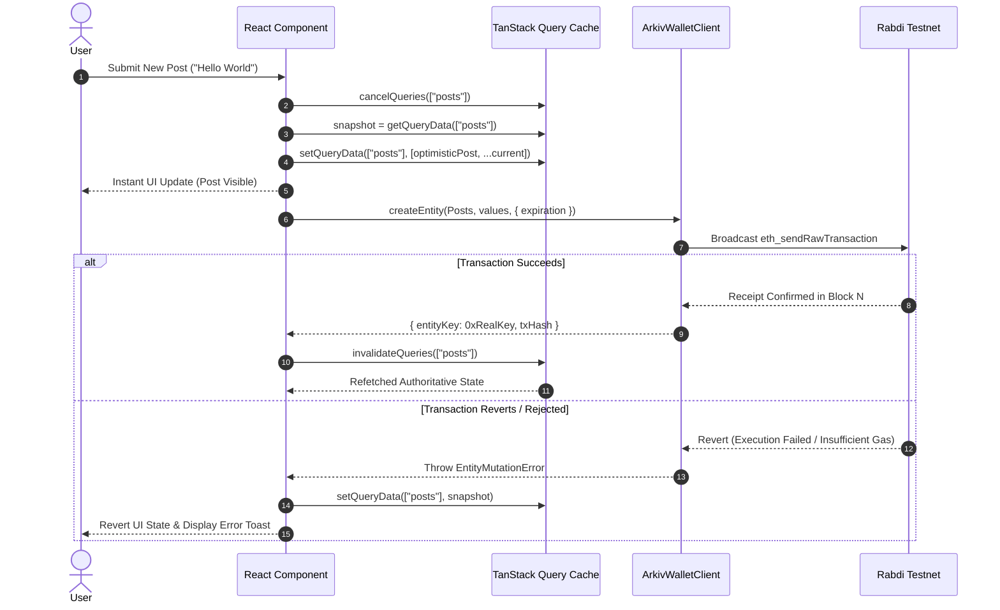

# React & Frontend Framework Bindings

## Table of Contents
- [1. Architectural Overview & Frontend Integration](#1-architectural-overview--frontend-integration)
- [2. The Dual-Chain Configuration Pattern](#2-the-dual-chain-configuration-pattern)
  - [2.1 The Public Read Chain (Access Key Enabled)](#21-the-public-read-chain-access-key-enabled)
  - [2.2 The Wallet Write Chain (Access Key Free)](#22-the-wallet-write-chain-access-key-free)
  - [2.3 Origin Locking & Security Architecture](#23-origin-locking--security-architecture)
- [3. Wagmi & Wallet Provider Integration](#3-wagmi--wallet-provider-integration)
  - [3.1 Building the Wallet Client Hook (useArkivWallet)](#31-building-the-wallet-client-hook-usearkivwallet)
  - [3.2 Provider Bridging via custom() Transport](#32-provider-bridging-via-custom-transport)
  - [3.3 Network Switching & addChain Orchestration](#33-network-switching--addchain-orchestration)
- [4. TanStack Query Integration Architecture](#4-tanstack-query-integration-architecture)
  - [4.1 Deterministic Query Key Design](#41-deterministic-query-key-design)
  - [4.2 The BigInt Serialization Problem & Hashing Solutions](#42-the-bigint-serialization-problem--hashing-solutions)
  - [4.3 Cache Invalidation Patterns](#43-cache-invalidation-patterns)
- [5. Custom Arkiv React Hooks Reference](#5-custom-arkiv-react-hooks-reference)
  - [5.1 useArkivQuery](#51-usearkivquery)
  - [5.2 useArkivEntity](#52-usearkiventity)
  - [5.3 useArkivInfiniteQuery](#53-usearkivinfinitequery)
  - [5.4 useArkivWatch](#54-usearkivwatch)
- [6. Optimistic UI Updates & Rollback Recovery](#6-optimistic-ui-updates--rollback-recovery)
  - [6.1 Optimistic Mutation Architecture](#61-optimistic-mutation-architecture)
  - [6.2 Revert & Rollback Sequence Diagram](#62-revert--rollback-sequence-diagram)
- [7. Production Next.js & React Implementation](#7-production-nextjs--react-implementation)
- [8. Architectural Invariants](#8-architectural-invariants)

---

## 1. Architectural Overview & Frontend Integration

Modern Web3 web applications demand sub-second UI reactivity, seamless wallet onboarding, and robust synchronization with blockchain state. Building atop Arkiv in React/Next.js presents a unique architectural advantage: because Arkiv provides native JSON-RPC read methods (`arkiv_query`), applications do not require slow indexing subgraphs (e.g. The Graph, Envio) to query entity records.

The **Arkiv Framework Binding Architecture** combines:
1. **Wagmi / RainbowKit**: For managing wallet connections, chain switching, and EIP-1193 custom transports.
2. **TanStack Query (React Query)**: For caching, stale-while-revalidate background fetches, cursor pagination, and optimistic UI mutations.
3. **Arkiv SDK Core**: Decoupled into a singleton browser `ArkivPublicClient` for querying and dynamic `ArkivWalletClient` instances generated from active Wagmi wallet connections.



---

## 2. The Dual-Chain Configuration Pattern

### 2.1 The Public Read Chain (Access Key Enabled)

Queries originating from your application frontend must use a private or site-locked Arkiv Hub access key to avoid public rate-limiting:
```ts
import { rabdi } from "@arkiv-network/sdk/chains";

export const chain = rabdi({
  accessKey: process.env.NEXT_PUBLIC_ARKIV_ACCESS_KEY ?? "",
});
```
This chain configures the RPC URL as:
`https://rpc.rabdi.db-chain.testnet.arkiv.network/${accessKey}`

### 2.2 The Wallet Write Chain (Access Key Free)

When RainbowKit or Wagmi connects to a user's wallet (e.g. MetaMask, Coinbase Wallet), it prompts the wallet to add or switch to the Rabdi network. If the wallet RPC URL contains your access key, **the wallet will permanently persist that URL and use it for all future transactions and dApps on Rabdi**, allowing third-party applications to consume your project's quota.

To prevent quota leakage, apps must export a separate, key-free chain for wallets:
```ts
// Chain configured specifically for wagmi / wallet connection:
export const walletChain = rabdi({ accessKey: "" });
```

### 2.3 Origin Locking & Security Architecture

Because `NEXT_PUBLIC_ARKIV_ACCESS_KEY` is embedded in client-side bundles, projects must lock the key to authorized domains inside the [Arkiv Hub](https://hub.arkiv.network/access-keys):

| Security Setting | Value / Example | Purpose |
| :--- | :--- | :--- |
| **Origin Allowlist** | `https://myapp.com`, `https://*.myapp.com` | Restricts browser HTTP `Origin` header |
| **IP Allowlist** | `203.0.113.195` (Server deployments) | Rejects requests from unauthorized IPs |
| **Rate Limiting** | Quota tracking per key | Prevents denial-of-service bill spikes |

---

## 3. Wagmi & Wallet Provider Integration

### 3.1 Building the Wallet Client Hook (`useArkivWallet`)

The hook `useArkivWallet` monitors Wagmi's active wallet state and dynamically instantiates an `ArkivWalletClient` whenever the user is connected and on the correct chain:

```ts
import { createWalletClient } from "@arkiv-network/sdk";
import { useMemo } from "react";
import { custom } from "viem";
import { useWalletClient } from "wagmi";
import { chain } from "@/lib/arkiv";

export function useArkivWallet() {
  // Only resolves when the user's wallet is connected and switched to Rabdi
  const { data: walletClient } = useWalletClient({ chainId: chain.id });

  return useMemo(() => {
    if (!walletClient) return undefined;

    return createWalletClient({
      chain,
      transport: custom(walletClient.transport),
      account: walletClient.account,
    });
  }, [walletClient]);
}
```

### 3.2 Provider Bridging via `custom()` Transport

By wrapping `walletClient.transport` in Viem's `custom()` transport:
- Transactions prepared by the Arkiv SDK are dispatched through the user's wallet provider (EIP-1193).
- Works out-of-the-box with browser extensions, mobile wallets via WalletConnect, and embedded smart accounts.
- Avoids fragile references to `window.ethereum`, which fails in SSR and WalletConnect contexts.

### 3.3 Network Switching & `addChain` Orchestration

When a user initiates an action while connected to a different chain (e.g., Ethereum Mainnet), Wagmi coordinates network addition and switching:

```ts
import { useSwitchChain } from "wagmi";
import { walletChain } from "@/lib/arkiv";

export function NetworkSwitchBanner() {
  const { switchChain } = useSwitchChain();

  return (
    <button onClick={() => switchChain({ chainId: walletChain.id })}>
      Switch to Rabdi Testnet
    </button>
  );
}
```

---

## 4. TanStack Query Integration Architecture

### 4.1 Deterministic Query Key Design

TanStack Query relies on serializable arrays for caching and deduplication. Arkiv query keys should follow a structured hierarchical pattern:

```text
['arkiv', schemaName, operation, queryHashOrParams]
```

Examples:
- All posts for an owner: `['arkiv', 'my-app.posts', 'list', { owner: '0x123...' }]`
- Single post by key: `['arkiv', 'my-app.posts', 'entity', entityKey]`
- Headless post count: `['arkiv', 'my-app.posts', 'count', { owner: '0x123...' }]`

### 4.2 The BigInt Serialization Problem & Hashing Solutions

**The Problem**:
JavaScript `BigInt` values (such as entity keys, block numbers, or raw numbers like `43200n`) cannot be serialized by `JSON.stringify()`. TanStack Query uses `JSON.stringify` internally to hash query keys. Supplying a `bigint` inside a query key throws:
`TypeError: Do not know how to serialize a BigInt`.

**The Architectural Solution**:
The SDK provides a query key serializer that normalizes `bigint` values to hexadecimal or string representations prior to passing them to TanStack Query:

```ts
export function normalizeQueryKey(key: readonly unknown[]): unknown[] {
  return key.map((item) => {
    if (typeof item === "bigint") {
      return `0x${item.toString(16)}`;
    }
    if (typeof item === "object" && item !== null) {
      return Object.fromEntries(
        Object.entries(item).map(([k, v]) => [
          k,
          typeof v === "bigint" ? `0x${v.toString(16)}` : v,
        ])
      );
    }
    return item;
  });
}
```

### 4.3 Cache Invalidation Patterns

When a mutation lands in a block, the query cache must be selectively invalidated:

```ts
const queryClient = useQueryClient();

// Invalidate all queries for a given schema:
queryClient.invalidateQueries({ queryKey: ["arkiv", "my-app.posts"] });

// Invalidate only a specific entity:
queryClient.invalidateQueries({
  queryKey: ["arkiv", "my-app.posts", "entity", entityKey],
});
```

---

## 5. Custom Arkiv React Hooks Reference

### 5.1 `useArkivQuery`

Executes a type-safe query builder query and caches the result:

```ts
export function useArkivQuery<TSelection extends SelectArg, TSchema extends Schema>(
  builder: QueryBuilder<TSelection, TSchema>,
  options?: Omit<UseQueryOptions<QueryPage<any>>, "queryKey" | "queryFn">
) {
  const queryText = builder.toString();

  return useQuery({
    queryKey: ["arkiv", "query", queryText],
    queryFn: () => builder.fetch(),
    staleTime: 4_000, // 2 blocks (4 seconds)
    ...options,
  });
}
```

### 5.2 `useArkivEntity`

Fetches and caches an individual entity by key:

```ts
export function useArkivEntity<TSchema extends Schema>(
  key: Hex | undefined,
  schema: TSchema,
  options?: { enabled?: boolean }
) {
  return useQuery({
    queryKey: ["arkiv", schema.name, "entity", key],
    enabled: Boolean(key) && (options?.enabled ?? true),
    queryFn: async () => {
      if (!key) throw new Error("Entity key is required");
      return publicClient.getEntity(key, schema);
    },
    staleTime: 10_000,
  });
}
```

### 5.3 `useArkivInfiniteQuery`

Enables cursor-based pagination using the `$key > key(...)` pattern:

```ts
export function useArkivInfiniteQuery<TSchema extends Schema>(
  schema: TSchema,
  condition: QueryCondition,
  pageSize: number = 20
) {
  return useInfiniteQuery({
    queryKey: ["arkiv", schema.name, "infinite", condition.render()],
    initialPageParam: undefined as Hex | undefined,
    queryFn: async ({ pageParam }) => {
      let q = publicClient
        .select()
        .from(schema, { onMismatch: "throw" })
        .where(condition)
        .orderBy(asc("$key"))
        .limit(pageSize);

      if (pageParam) {
        q = q.where(gt("$key", key(pageParam)));
      }

      return q.fetch();
    },
    getNextPageParam: (lastPage) => {
      if (lastPage.entities.length < pageSize) return undefined;
      return lastPage.entities.at(-1)?.$key;
    },
  });
}
```

### 5.4 `useArkivWatch`

Subscribes to live blockchain events and triggers cache updates:

```ts
export function useArkivWatch(handlers: WatchEventHandlers) {
  useEffect(() => {
    const unwatch = publicClient.watchEntityEvents(handlers);
    return () => unwatch();
  }, [handlers]);
}
```

---

## 6. Optimistic UI Updates & Rollback Recovery

### 6.1 Optimistic Mutation Architecture

Because EVM transactions take ~2 seconds to confirm on Rabdi, immediate UI feedback requires **optimistic mutations**. When the user clicks "Save", the item appears in the UI instantly. If the transaction reverts or fails, the SDK rolls back to the previous snapshot.

### 6.2 Revert & Rollback Sequence Diagram



---

## 7. Production Next.js & React Implementation

A complete production hook managing an optimistic post creation mutation:

```tsx
import { ExpirationTime } from "@arkiv-network/sdk";
import { addr, dec } from "@arkiv-network/sdk/schema";
import { useMutation, useQueryClient } from "@tanstack/react-query";
import { stringToBytes, type Hex } from "viem";
import { useArkivWallet } from "@/hooks/use-arkiv-wallet";
import { Posts, publicClient } from "@/lib/arkiv";

interface CreatePostInput {
  title: string;
  category: string;
  score: string;
  body: string;
}

export function useOptimisticCreatePost() {
  const arkiv = useArkivWallet();
  const queryClient = useQueryClient();

  return useMutation({
    mutationFn: async (input: CreatePostInput) => {
      if (!arkiv) throw new Error("Wallet not connected to Rabdi");

      return arkiv.createEntity(
        Posts,
        {
          author: addr(arkiv.account.address),
          category: input.category,
          score: dec(input.score),
          title: input.title,
          body: stringToBytes(input.body),
        },
        { expiration: ExpirationTime.fromDays(30) }
      );
    },

    // 1. When mutation starts: snapshot cache and optimistically insert
    onMutate: async (newPostInput) => {
      await queryClient.cancelQueries({ queryKey: ["posts"] });
      const previousPosts = queryClient.getQueryData<any[]>(["posts"]) ?? [];

      const optimisticPost = {
        $key: "0x0000000000000000000000000000000000000000000000000000000000000000" as Hex,
        $owner: arkiv?.account.address,
        $createdAt: 0n,
        title: { value: newPostInput.title },
        score: { value: newPostInput.score },
        category: { value: newPostInput.category },
        isOptimistic: true,
      };

      queryClient.setQueryData(["posts"], [optimisticPost, ...previousPosts]);
      return { previousPosts };
    },

    // 2. If mutation fails: rollback to snapshot
    onError: (err, newPostInput, context) => {
      if (context?.previousPosts) {
        queryClient.setQueryData(["posts"], context.previousPosts);
      }
    },

    // 3. Always refetch authoritative chain data after settling
    onSettled: () => {
      queryClient.invalidateQueries({ queryKey: ["posts"] });
    },
  });
}
```

---

## 8. Architectural Invariants

1. **Access Key Hygiene**: Browser wallet providers must never be initialized with chains containing private or quota-tracked access keys.
2. **BigInt Serialization**: Query keys containing `BigInt` values must always be sanitized or hex-encoded before being evaluated by TanStack Query.
3. **SSR Safety**: The public client instance must be completely stateless, capable of running securely within Next.js Server Components, API routes, or browser contexts.
4. **Optimistic Rollback**: Any mutation altering cache state before block confirmation must retain an explicit snapshot and roll back on error.
5. **Provider Decoupling**: Wallet clients must never hardcode `window.ethereum` and must always derive provider connectivity via standard EIP-1193 abstractions.
