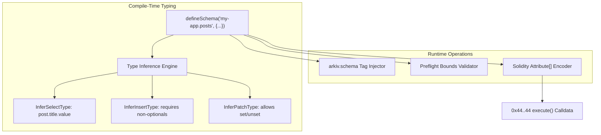

# Schema Declaration System & Type Inference Engine

## Table of Contents
- [1. Architectural Overview & The Role of Schemas](#1-architectural-overview--the-role-of-schemas)
- [2. The Column Definition DSL](#2-the-column-definition-dsl)
  - [2.1 Dual-Role Constructor Pattern](#21-dual-role-constructor-pattern)
  - [2.2 Supported Column Types & Specifications](#22-supported-column-types--specifications)
  - [2.3 Column Modifiers](#23-column-modifiers)
- [3. Schema Anatomy & Storage Budgets](#3-schema-anatomy--storage-budgets)
  - [3.1 Named Schemas vs. Unnamed Schemas](#31-named-schemas-vs-unnamed-schemas)
  - [3.2 The 32-Attribute Budget & Tag Overhead](#32-the-32-attribute-budget--tag-overhead)
  - [3.3 Attribute Naming Lexical Rules](#33-attribute-naming-lexical-rules)
- [4. Schema Metadata & Runtime Discovery](#4-schema-metadata--runtime-discovery)
  - [4.1 AttributeSchema Structure](#41-attributeschema-structure)
  - [4.2 Binary Wire Layout: typeId and the Index Flag (0x80)](#42-binary-wire-layout-typeid-and-the-index-flag-0x80)
- [5. Static Type Inference Engine](#5-static-type-inference-engine)
  - [5.1 Inferring Select (Row) Types](#51-inferring-select-row-types)
  - [5.2 Inferring Insert Types (Handling Defaults & Optionals)](#52-inferring-insert-types-handling-defaults--optionals)
  - [5.3 Inferring Patch Types (Sets and Unsets)](#53-inferring-patch-types-sets-and-unsets)
- [6. Runtime Validation Engine & Preflight Guards](#6-runtime-validation-engine--preflight-guards)
  - [6.1 Numeric Bounds Validation](#61-numeric-bounds-validation)
  - [6.2 Decimal Fixed-Point Arithmetic (10^18 Scaling)](#62-decimal-fixed-point-arithmetic-1018-scaling)
  - [6.3 EIP-55 Address Checksumming](#63-eip-55-address-checksumming)
  - [6.4 128 KiB Byte Quota Enforcement](#64-128-kib-byte-quota-enforcement)
- [7. Complete Implementation Reference](#7-complete-implementation-reference)
- [8. Architectural Invariants](#8-architectural-invariants)

---

## 1. Architectural Overview & The Role of Schemas

In Arkiv, smart contracts on the EVM do not maintain a hardcoded, rigid schema table. Instead, the contract stores arbitrary arrays of `struct Attribute { bytes32 name; uint8 typeId; bytes value; }`.

The **Schema Declaration System** provides the crucial semantic layer that translates developer-declared database schemas into EVM attributes and query filters:
1. **Compile-Time Contract**: Generates TypeScript types for reads, inserts, and patches, making mistakes like missing a required field or filtering on an unindexed column impossible to compile.
2. **Runtime Tag Isolation**: Enforces tenant/application isolation by automatically appending an indexed `arkiv.schema` tag to every created entity.
3. **Calldata Serialization Driver**: Guides the EVM attribute packer on how to format, scale, and sort attribute tuples before calling `execute((uint8, bytes)[] ops)`.



---

## 2. The Column Definition DSL

### 2.1 Dual-Role Constructor Pattern

Arkiv SDK implements a **dual-role constructor pattern** modeled after SQL types:
- **Called with NO arguments**: Acts as a column schema builder (e.g., `dec()`, `str()`).
- **Called WITH an argument**: Acts as a typed value wrapper (e.g., `dec("4.5")`, `str("Hello")`).

```ts
import { dec, str, addr } from "@arkiv-network/sdk/schema";

// 1. Defining a schema column
const column = dec().indexed();

// 2. Instantiating a typed value
const value = dec("4.5");
const addressValue = addr("0xd8dA6BF26964aF9D7eEd9e03E53415D37aA96045");
```

### 2.2 Supported Column Types & Specifications

Arkiv defines 9 concrete column storage types:

| Type Constructor | EVM `typeId` | Description & Constraints | In JavaScript/TypeScript | Wire Size |
| :--- | :--- | :--- | :--- | :--- |
| `bool()` | `1` | Boolean flag (`true` or `false`) | `boolean` | 32 bytes (`0` or `1`) |
| `i32()` | `2` | Signed 32-bit integer ($-2^{31}$ to $2^{31}-1$) | `number` | 32 bytes (sign-extended) |
| `u64()` | `3` | Unsigned 64-bit integer ($0$ to $2^{64}-1$) | `bigint` | 32 bytes |
| `u256()` | `4` | Unsigned 256-bit integer ($0$ to $2^{256}-1$) | `bigint` | 32 bytes |
| `dec()` | `5` | Signed fixed-point decimal with 18 decimal places | `string` (e.g. `"4.5"`) | 32 bytes (scaled by $10^{18}$) |
| `bytes()` | `7` | Arbitrary binary data up to 128 KiB | `Hex` or `Uint8Array` | Variable (max 128 KiB) |
| `str()` | `8` | UTF-8 text up to 128 bytes | `string` | Variable (max 128 bytes) |
| `addr()` | `9` | Ethereum address (20 bytes) | `Hex` (checksummed) | 32 bytes (right-aligned) |
| `key()` | `10` | 32-byte foreign key to another Arkiv entity | `Hex` (32 bytes) | 32 bytes |

*(Note: `typeId = 0` is reserved for `Tombstone` operations in patches, and `typeId = 6` is reserved by the protocol).*

### 2.3 Column Modifiers

Every column constructor returns a column builder supporting chaining modifiers:

```ts
interface ColumnBuilder<TType, TRequired, TIndexed> {
  indexed(): ColumnBuilder<TType, TRequired, true>;
  optional(): ColumnBuilder<TType, false, TIndexed>;
  default(value: TType): ColumnBuilder<TType, false, TIndexed>;
}
```

1. **`.indexed()`**:
   - Enables native indexing on the attribute by setting bit 7 (`0x80`) on its wire `typeId`.
   - Allows the attribute to be used in `where()` predicates (`eq`, `gt`, `between`, `startsWith`, etc.).
   - `bytes()` columns **cannot** be indexed (throws a compile/runtime error).
2. **`.optional()`**:
   - Permits creating an entity without supplying this attribute.
   - Permits unsetting the attribute during `.patchEntity({ unset: [...] })`.
   - On reads, the attribute resolves to `Type | undefined`.
3. **`.default(value)`**:
   - Supplies a fallback value when the attribute is omitted during creation.
   - If omitted during `createEntity()`, the SDK writes the default value automatically.

---

## 3. Schema Anatomy & Storage Budgets

### 3.1 Named Schemas vs. Unnamed Schemas

#### Named Schemas:
```ts
const Posts = defineSchema("my-app.posts", {
  author: addr().indexed(),
  title: str(),
});
```
- Automatically writes an indexed `str` attribute: `arkiv.schema = "my-app.posts"`.
- All queries chained from `publicClient.select().from(Posts)` automatically append the filter `arkiv.schema = str('my-app.posts')`.
- Provides strict logical multi-tenancy and data isolation across projects on the shared public ledger.

#### Unnamed Schemas:
```ts
const RawRecords = defineSchema({
  author: addr().indexed(),
  score: dec().indexed(),
});
```
- No `arkiv.schema` attribute is injected.
- Writes do not consume an extra attribute slot for the tag.
- Reads must specify custom filtering predicates (e.g. `ownedBy(address)`).

### 3.2 The 32-Attribute Budget & Tag Overhead

Arkiv enforces a hard protocol limit of **32 attributes per entity**:
- **Unnamed Schema Limit**: Up to 32 user-defined columns.
- **Named Schema Limit**: Up to **31 user-defined columns**, because the tag `arkiv.schema` occupies the 32nd attribute slot.

Defining a schema with more columns throws `TooManyAttributesError` immediately at initialization.

### 3.3 Attribute Naming Lexical Rules

Column names must satisfy strict formatting rules verified during schema creation:
1. **Length**: 1 to 32 ASCII bytes.
2. **Character Set**: Must start with a letter (`[a-zA-Z]`), followed by letters, digits (`[0-9]`), `.`, `-`, or `_`.
3. **Reserved Characters**: Cannot contain `--` (reserved for SQL comments).
4. **Reserved Prefixes**: Cannot start with `$` (reserved for entity system fields like `$key`, `$owner`, `$createdAt`).
5. **Reserved Words**: Cannot collide with query keywords (`AND`, `OR`, `NOT`, `BETWEEN`, `ORDER`, `BY`, `ASC`, `DESC`, `EXISTS`, `TYPEOF`) or type names (`str`, `dec`, etc.).
6. **Protected Tag**: A schema cannot define a column named `arkiv.schema`.

Violating any rule throws `InvalidAttributeNameError` or `SchemaDefinitionError`.

---

## 4. Schema Metadata & Runtime Discovery

### 4.1 AttributeSchema Structure

When an application queries entities without a static schema, it can inspect their layout by requesting the `$attributeSchema` projection:

```ts
const { entities } = await publicClient
  .select({ $key: true, $attributeSchema: true })
  .where(eq("category", "news"))
  .fetch();

for (const entity of entities) {
  console.log(entity.$attributeSchema);
}
```

The resulting `$attributeSchema` map has the structure:
```ts
export type AttributeSchema = Record<
  string,
  {
    type: "bool" | "i32" | "u64" | "u256" | "dec" | "bytes" | "str" | "addr" | "key";
    indexed: boolean;
  }
>;
```

### 4.2 Binary Wire Layout: typeId and the Index Flag (`0x80`)

On the EVM contract level, attributes carry an 8-bit `typeId`:
- **Bits 0–6**: The base type identifier (0 through 10).
- **Bit 7 (`0x80`)**: The index flag.

```mermaid
bitfield
    0-6: "Type ID (1: bool, 2: i32, ..., 8: str, 9: addr)"
    7: "Indexed Flag (0x80)"
```

| Type | Unindexed Wire `typeId` (Hex) | Indexed Wire `typeId` (Hex) |
| :--- | :--- | :--- |
| `bool` | `0x01` | `0x81` |
| `i32` | `0x02` | `0x82` |
| `u64` | `0x03` | `0x83` |
| `u256` | `0x04` | `0x84` |
| `dec` | `0x05` | `0x85` |
| `bytes` | `0x07` | *Not indexable* |
| `str` | `0x08` | `0x88` |
| `addr` | `0x09` | `0x89` |
| `key` | `0x0A` | `0x8A` |

---

## 5. Static Type Inference Engine

### 5.1 Inferring Select (Row) Types

`InferSelectType<TSchema>` constructs the type of a fully projected entity row:

```ts
export type InferColumnValueType<TCol extends ColumnDefinition> =
  TCol["type"] extends "bool" ? BoolValue :
  TCol["type"] extends "i32" ? I32Value :
  TCol["type"] extends "u64" ? U64Value :
  TCol["type"] extends "u256" ? U256Value :
  TCol["type"] extends "dec" ? DecValue :
  TCol["type"] extends "str" ? StrValue :
  TCol["type"] extends "addr" ? AddrValue :
  TCol["type"] extends "key" ? KeyValue :
  TCol["type"] extends "bytes" ? BytesValue : never;

export type InferSelectType<TSchema extends Schema> = {
  $key: Hex;
  $owner: Address;
  $creator: Address;
  $createdAt: bigint;
  $updatedAt: bigint;
  $expiresAt: bigint;
  $creationFlags: { readonly: boolean; permissionlessExtension: boolean; raw: number };
} & {
  [K in keyof TSchema["columns"]]: TSchema["columns"][K]["isOptional"] extends true
    ? InferColumnValueType<TSchema["columns"][K]> | undefined
    : InferColumnValueType<TSchema["columns"][K]>;
};
```

### 5.2 Inferring Insert Types (Handling Defaults & Optionals)

During `createEntity()`, columns with defaults or optional modifiers are optional in the input object, while all others are strictly required:

```ts
export type InferInsertType<TSchema extends Schema> = {
  // Required columns (not optional, no default)
  [K in keyof TSchema["columns"] as TSchema["columns"][K]["isOptional"] extends false
    ? TSchema["columns"][K]["hasDefault"] extends false
      ? K
      : never
    : never]: InputValueFor<TSchema["columns"][K]["type"]>;
} & {
  // Optional columns or columns with defaults
  [K in keyof TSchema["columns"] as TSchema["columns"][K]["isOptional"] extends true
    ? K
    : TSchema["columns"][K]["hasDefault"] extends true
    ? K
    : never]?: InputValueFor<TSchema["columns"][K]["type"]>;
};
```

### 5.3 Inferring Patch Types (Sets and Unsets)

During `patchEntity()`, the developer can set any declared column or unset optional columns:

```ts
export type OptionalColumnKeys<TSchema extends Schema> = {
  [K in keyof TSchema["columns"]]: TSchema["columns"][K]["isOptional"] extends true ? K : never;
}[keyof TSchema["columns"]];

export interface PatchMutations<TSchema extends Schema> {
  set?: {
    [K in keyof TSchema["columns"]]?: InputValueFor<TSchema["columns"][K]["type"]>;
  };
  unset?: OptionalColumnKeys<TSchema>[];
}
```

---

## 6. Runtime Validation Engine & Preflight Guards

Before any payload is submitted to the EVM transaction builder, the SDK runs preflight validations:

### 6.1 Numeric Bounds Validation

- **`i32`**: Must be a signed 32-bit integer:
  $$-2,147,483,648 \le x \le 2,147,483,647$$
  Exceeding this throws `InvalidValueError`.
- **`u64`**: Must be $0 \le x \le 2^{64}-1$.
- **`u256`**: Must be $0 \le x \le 2^{256}-1$.

### 6.2 Decimal Fixed-Point Arithmetic ($10^{18}$ Scaling)

JavaScript numbers cannot represent numbers like `0.1` precisely in IEEE 754 floating point. Arkiv mandates:
- Decimals must be passed as strings or via `dec("4.5")`.
- Passing a float like `dec(0.1)` throws `InvalidValueError`.
- At most 18 decimal places are supported.
- On the wire, decimals are scaled by $10^{18}$:
  $$\text{wireValue} = \text{BigInt}(\text{value} \times 10^{18})$$
  Example: `"4.5"` $\rightarrow$ `4500000000000000000n` (`0x3e71d34cb0200000`).

### 6.3 EIP-55 Address Checksumming

- Addresses passed to `addr()` are validated.
- All-lowercase addresses (`0xd8da6bf26964af9d7eed9e03e53415d37aa96045`) are accepted and normalized.
- Mixed-case addresses must match the EIP-55 checksum hash; invalid checksums throw `InvalidValueError`.

### 6.4 128 KiB Byte Quota Enforcement

- Single `bytes` values are capped at 128 KiB ($131,072$ bytes).
- All `bytes` attributes across a single `createEntity` or `patchEntity` call share a combined budget of 128 KiB (`MAX_ENTITY_BYTES`).
- Exceeding this budget throws `EntityTooLargeError` before invoking gas estimation.

---

## 7. Complete Implementation Reference

```ts
export class ColumnDefinition<TType extends string = string> {
  constructor(
    public readonly type: TType,
    public readonly isIndexed: boolean = false,
    public readonly isOptional: boolean = false,
    public readonly hasDefault: boolean = false,
    public readonly defaultValue?: any
  ) {}

  indexed(): ColumnDefinition<TType> {
    if (this.type === "bytes") {
      throw new SchemaDefinitionError("bytes columns cannot be indexed");
    }
    return new ColumnDefinition(this.type, true, this.isOptional, this.hasDefault, this.defaultValue);
  }

  optional(): ColumnDefinition<TType> {
    return new ColumnDefinition(this.type, this.isIndexed, true, this.hasDefault, this.defaultValue);
  }

  default(val: any): ColumnDefinition<TType> {
    return new ColumnDefinition(this.type, this.isIndexed, false, true, val);
  }
}

export function defineSchema<TColumns extends Record<string, ColumnDefinition>>(
  nameOrColumns: string | TColumns,
  maybeColumns?: TColumns
): Schema<TColumns> {
  const isNamed = typeof nameOrColumns === "string";
  const name = isNamed ? nameOrColumns : undefined;
  const columns = isNamed ? maybeColumns! : nameOrColumns;

  if (isNamed) {
    if (name.length > 128) throw new SchemaDefinitionError("Schema name exceeds 128 bytes");
    if (Object.keys(columns).length > 31) {
      throw new TooManyAttributesError("Named schemas can have at most 31 columns (32 including arkiv.schema tag)");
    }
  } else {
    if (Object.keys(columns).length > 32) {
      throw new TooManyAttributesError("Unnamed schemas can have at most 32 columns");
    }
  }

  for (const [colName, col] of Object.entries(columns)) {
    validateAttributeName(colName);
  }

  return new Schema(name, columns);
}
```

---

## 8. Architectural Invariants

1. **Tag Isolation Budgeting**: Named schemas must account for the `arkiv.schema` tag in attribute counts (max 31 user columns).
2. **Immutable Column Definitions**: Column modifier methods (`.indexed()`, `.optional()`, `.default()`) must return fresh instances and never mutate existing definitions.
3. **No Indexing for `bytes`**: The `bytes` data type is permanently restricted from indexing; any attempt to chain `.indexed()` on `bytes()` must fail immediately.
4. **Precision Loss Prevention**: Float-to-decimal conversions must reject raw floating point numbers; developers must supply decimal values as exact string literals.
5. **ASCII Lexical Order**: Schema columns must be systematically sortable by their 32-byte zero-padded ASCII representation for EVM serialization.
