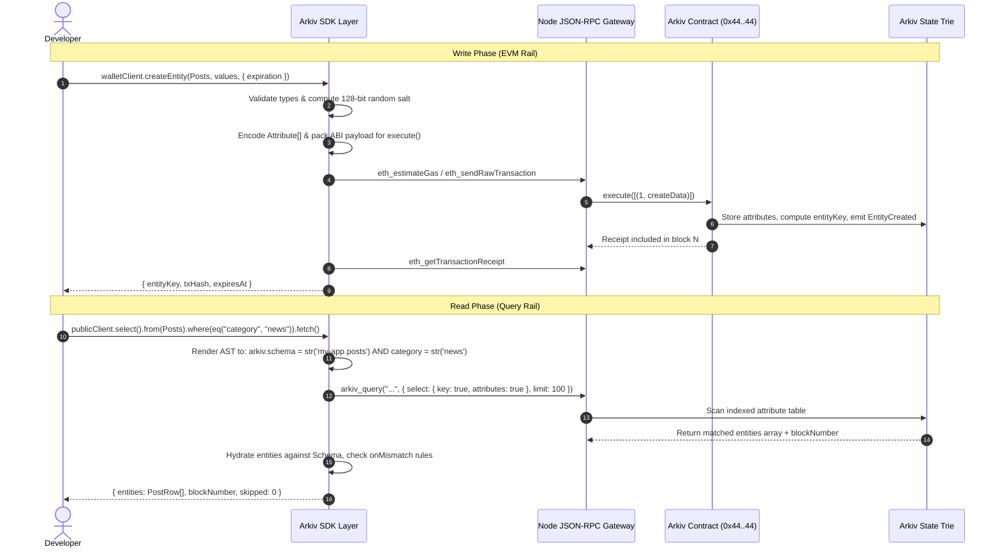
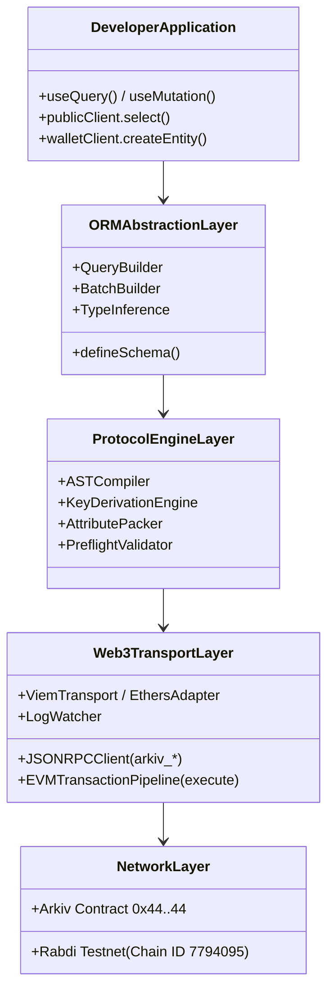
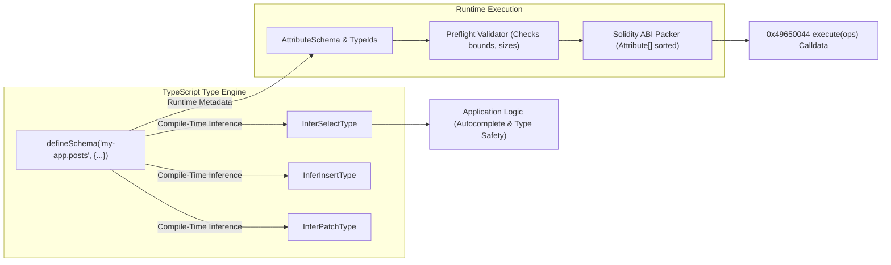
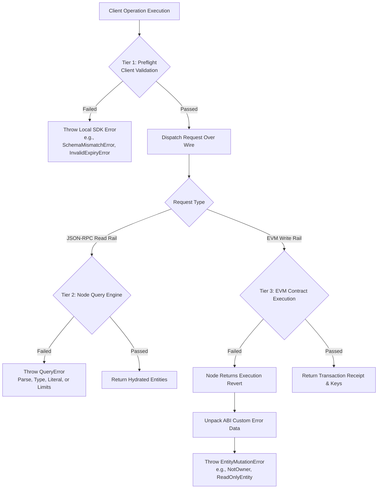

# SDK Architecture & Engineering Design Thesis

## Table of Contents
- [1. Executive Summary & Design Philosophy](#1-executive-summary--design-philosophy)
- [2. The Dual-Rail Protocol Architecture](#2-the-dual-rail-protocol-architecture)
  - [2.1 Separation of Concerns: Read vs Write](#21-separation-of-concerns-read-vs-write)
  - [2.2 Protocol Comparison Matrix](#22-protocol-comparison-matrix)
  - [2.3 Dual-Rail Sequence Flow](#23-dual-rail-sequence-flow)
- [3. Abstraction of EVM Complexity](#3-abstraction-of-evm-complexity)
  - [3.1 The Hidden Web3 Plumbing](#31-the-hidden-web3-plumbing)
  - [3.2 The ORM Mental Model](#32-the-orm-mental-model)
  - [3.3 Layered SDK Stack](#33-layered-sdk-stack)
- [4. Type Safety & Schema-Driven Metaprogramming](#4-type-safety--schema-driven-metaprogramming)
  - [4.1 Static Typing vs Runtime Dynamic State](#41-static-typing-vs-runtime-dynamic-state)
  - [4.2 The Type-Bridge Architecture](#42-the-type-bridge-architecture)
- [5. Cross-Language Portability Blueprint](#5-cross-language-portability-blueprint)
  - [5.1 Language-Agnostic Core Specification](#51-language-agnostic-core-specification)
  - [5.2 TypeScript Reference Implementation](#52-typescript-reference-implementation)
  - [5.3 Rust Systems Implementation](#53-rust-systems-implementation)
  - [5.4 Go Backend Service Implementation](#54-go-backend-service-implementation)
  - [5.5 Python Data Science & AI Agent Implementation](#55-python-data-science--ai-agent-implementation)
- [6. Error Handling & Fault Isolation Architecture](#6-error-handling--fault-isolation-architecture)
  - [6.1 Three-Tier Error Boundary](#61-three-tier-error-boundary)
  - [6.2 Error Mapping Matrix](#62-error-mapping-matrix)
- [7. Architectural Invariants](#7-architectural-invariants)

---

## 1. Executive Summary & Design Philosophy

Arkiv (`https://docs.arkiv.network`) is a decentralized database platform built atop EVM state. It fundamentally reimagines on-chain storage by combining:
1. **Native Indexing**: On-chain attributes can be marked as indexed, permitting expressive querying without off-chain indexing subgraphs.
2. **Deterministic Time-To-Live (TTL)**: Block-based expiration guarantees state pruning, bounded gas costs, and deterministic state cleanup.
3. **Dual-Rail Architectural Foundation**: Read access is served via high-throughput JSON-RPC query engines (`arkiv_query`, `arkiv_getEntity`, `arkiv_getBlockTiming`), while write mutations are executed through EVM smart contract transactions calling `execute((uint8, bytes)[] ops)` on address `0x4400000000000000000000000000000000000044`.

The primary design thesis of the **Arkiv SDK** is to provide developers with a **relational/document ORM experience** (reminiscent of Prisma, Drizzle, or SQLAlchemy) while completely abstracting away the underlying cryptographic and EVM plumbing. Developers should interact with typed entities, fluent builders, and automated transaction lifecycles without having to manually calculate gas limits, manage transaction nonces, serialize ABI structs, derive Keccak-256 entity keys, or parse contract event logs.

### Core Architectural Pillars
- **Zero-Cost Client Decoupling**: Complete separation between `ArkivPublicClient` (stateless, key-authenticated, read-only HTTP/WS) and `ArkivWalletClient` (stateful, signer-backed, gas-paying EVM mutator).
- **Strict Preflight Validation**: Every mutation and query predicate is validated client-side against the declared schema and protocol limits prior to network serialization, eliminating unnecessary gas burns and RPC round-trips.
- **Bi-Directional Type Soundness**: Schemas defined once serve as the single source of truth for both TypeScript compile-time type inference and runtime ABI packing/unpacking.
- **Language Agnosticism**: While the reference SDK is implemented in TypeScript atop Viem, the architecture is engineered as an open specification portable to Rust, Go, and Python.

---

## 2. The Dual-Rail Protocol Architecture

### 2.1 Separation of Concerns: Read vs Write

The most distinct architectural property of Arkiv is its dual-rail execution model:

```mermaid
flowchart TD
    subgraph Client Application
        App[Application Logic]
        PublicClient[ArkivPublicClient]
        WalletClient[ArkivWalletClient]
    end

    subgraph Arkiv Node
        RPCGate[JSON-RPC Gateway]
        QueryEngine[Indexing & AST Query Engine]
        Mempool[EVM Transaction Pool]
        EVMState[Arkiv EVM Core Contract\n0x4400...0044]
        StorageTrie[Merkle-Patricia State Trie\nTTL Pruned Storage]
    end

    App -->|Read: select, count, getEntity| PublicClient
    App -->|Write: create, patch, batch| WalletClient

    PublicClient -->|arkiv_query, arkiv_getEntity\nHTTP / WebSocket| RPCGate
    RPCGate --> QueryEngine
    QueryEngine --> StorageTrie

    WalletClient -->|eth_sendRawTransaction\nexecute(ops)| Mempool
    Mempool --> EVMState
    EVMState -->|State Mutation / Log Emission| StorageTrie
    QueryEngine -.->|Syncs New Blocks| EVMState
```

1. **The Read Rail (JSON-RPC Engine)**:
   - Queries are processed through specialized node extensions via `arkiv_query`, `arkiv_getEntity`, and `arkiv_getBlockTiming`.
   - The query syntax is SQL-like, evaluated directly against the indexed attributes stored in the node's local database index.
   - Operations require no cryptographic signatures, burn no gas, and can be executed anonymously (subject to rate limiting) or authenticated via access keys.
   - Response payloads contain decoded JSON values, paginated arrays, matching counts, and block timestamps.

2. **The Write Rail (EVM Contract Execution)**:
   - All mutations—creates, patches, extensions, ownership transfers, and deletions—are bundled as operations in an EVM transaction calling:
     ```solidity
     function execute((uint8 operation, bytes operationData)[] ops) external;
     ```
     Target Contract: `0x4400000000000000000000000000000000000044`  
     Function Selector: `0x49650044`
   - Every write transaction requires account signing, gas payment in the native token (`tGLM` on the Rabdi testnet), nonce tracking, and block inclusion.
   - Operations within an `execute` call are strictly atomic: if any single operation fails, the entire transaction reverts and leaves the state unchanged.

### 2.2 Protocol Comparison Matrix

| Property | Read Rail (`ArkivPublicClient`) | Write Rail (`ArkivWalletClient`) |
| :--- | :--- | :--- |
| **Transport Protocol** | JSON-RPC 2.0 over HTTP/WebSocket | JSON-RPC 2.0 over HTTP (`eth_sendRawTransaction`) |
| **Target Endpoint** | `arkiv_query`, `arkiv_getEntity`, `arkiv_getBlockTiming` | `execute(ops)` at `0x4400000000000000000000000000000000000044` |
| **Authentication** | Access Key in RPC URL (`/` or header) | Private key ECDSA signature (secp256k1) |
| **Account Required** | None (Stateless) | Yes (EOA or Smart Contract Account) |
| **Economic Cost** | Free (Rate limited / Quota tracked via Hub) | Gas fee paid in native token (`tGLM` on Rabdi) |
| **Execution Latency** | Milliseconds (Node in-memory index lookup) | Block latency (2.0s block time on Rabdi) |
| **State Mutation** | Zero (Pure read projection) | Permanent until block expiration (`expiresAt`) |
| **Consistency** | Latest block view (Snapshots at block height) | Atomic batch commit; all-or-nothing rollback |

### 2.3 Dual-Rail Sequence Flow



---

## 3. Abstraction of EVM Complexity

### 3.1 The Hidden Web3 Plumbing

To an application engineer, interacting with blockchain databases historically meant dealing with raw hex strings, big-endian word packing, gas spikes, reorgs, and ABI encoders. The Arkiv SDK encapsulates these low-level concerns behind high-level interfaces:

1. **ABI Packing & Calldata Serialization**:
   - Attribute names must be converted into 32-byte zero-padded ASCII identifiers (`bytes32`).
   - Attribute types must have bit 7 set if indexed (`0x80 | typeId`).
   - Attribute arrays must be strictly sorted in ascending ASCII order by name before submission, or the contract reverts with `AttributesNotSorted()`.
   - The SDK automatically sorts and encodes all attribute tuples behind the scenes.

2. **Key Derivation Arithmetic**:
   - Entity keys are not random hashes; they are deterministically derived via:
     $$\text{entityKey} = \text{keccak256}(\text{abi.encodePacked}(\text{chainId}, \text{arkivAddress}, \text{owner}, \text{entityNonce}, \text{salt}))$$
   - The SDK transparently queries the account's on-chain `entityNonce` via an `eth_call` to `0x36917bfd` on contract `0x44..44`, allowing ahead-of-time entity key prediction for relational graph links.

3. **TTL & Expiration Resolution**:
   - The protocol enforces expiration via:
     $$\text{expiry} = \max(\text{expiresAt}, \text{currentBlock} + \text{minLifetime})$$
   - The SDK provides fluent helpers (`ExpirationTime.fromDays(30)`, `ExpirationTime.atDate(...)`) that query `arkiv_getBlockTiming` to translate human time into exact EVM block numbers.

### 3.2 The ORM Mental Model

The SDK's developer-facing API mirrors modern typed ORMs:
- **Entities as Records**: Entities are treated as structured database records conforming to a schema.
- **Fluent Query Builder**: Method chaining (`.select()`, `.from()`, `.where()`, `.orderBy()`, `.limit()`, `.offset()`) builds an Abstract Syntax Tree (AST) that serializes into the Arkiv query language.
- **Relational Integrity**: `key()` columns act as foreign keys, allowing entities to reference one another across batches with deterministic key predictions.

### 3.3 Layered SDK Stack



---

## 4. Type Safety & Schema-Driven Metaprogramming

### 4.1 Static Typing vs Runtime Dynamic State

EVM storage is inherently untyped raw bytes, whereas databases demand rigid schema consistency. Arkiv bridges this divide:
1. **At Compile Time**: TypeScript's type system inspects the schema definition to enforce that:
   - Only indexed columns can be passed to `.where()` predicates.
   - Insert payloads require all non-optional columns without defaults.
   - Unsetting an attribute in `.patchEntity()` is only permitted for optional columns.
   - Selected fields accurately shape the returned entity type.
2. **At Runtime**: Before submitting any payload over the wire:
   - String byte lengths are validated against the 128-byte limit (`MAX_STRING_BYTES`).
   - Combined `bytes` sizes are capped at 128 KiB (`MAX_ENTITY_BYTES`).
   - Numerical bounds (`I32_MIN`, `I32_MAX`, `U64_MAX`, `U256_MAX`) are strictly enforced.
   - Decimal values are checked for precision overflow (max 18 decimals) and scaled by $10^{18}$.

### 4.2 The Type-Bridge Architecture



---

## 5. Cross-Language Portability Blueprint

While the initial reference implementation is written in TypeScript, the protocol specification is completely platform-independent. An idiomatic Arkiv SDK can be implemented across multiple languages by adhering to the following structural blueprints.

### 5.1 Language-Agnostic Core Specification

Any Arkiv SDK implementation requires four decoupled modules:
1. **Schema & Value Model**: Represents the 9 core attribute types, their storage IDs (1–10), and the indexing flag (`0x80`).
2. **Query AST & Compiler**: Represents predicates (`eq`, `between`, `startsWith`, `exists`, `hasType`) and renders them to the Arkiv query grammar.
3. **EVM Transaction Encoder**: Implements `Attribute` sorting, ABI parameter encoding for the 5 operation structs, and Keccak-256 key derivation.
4. **Transport Layer**: Dispatches `arkiv_*` JSON-RPC calls and handles `eth_sendRawTransaction` / `eth_getTransactionReceipt`.

### 5.2 TypeScript Reference Implementation

- **Foundation**: Built atop [Viem](https://viem.sh) as client extensions.
- **Type System**: Leverages recursive conditional types and template literal types for compile-time AST verification.
- **Idiomatic Usage**:
  ```ts
  import { createPublicClient, createWalletClient } from "@arkiv-network/sdk";
  import { rabdi } from "@arkiv-network/sdk/chains";
  import { defineSchema, str, dec } from "@arkiv-network/sdk/schema";

  const Posts = defineSchema("my-app.posts", {
    title: str(),
    score: dec().indexed(),
  });
  ```

### 5.3 Rust Systems Implementation

- **Foundation**: Built atop [Alloy](https://github.com/alloy-rs/alloy) (`alloy-rpc-types`, `alloy-sol-types`, `alloy-contract`).
- **Idiomatic Usage**: Macros for zero-cost compile-time schema generation.
- **Architecture**:
  ```rust
  // Idiomatic Rust Schema Definition
  arkiv_schema! {
      pub struct Posts "my-app.posts" {
          #[indexed]
          pub category: Str,
          #[indexed]
          pub score: Dec,
          pub title: Str,
          pub body: Bytes,
      }
  }

  // Strongly-typed Query Builder
  let posts = client
      .select::<Posts>()
      .filter(Posts::category.eq("news").and(Posts::score.gt(dec!(4.0))))
      .order_by(Posts::score.desc())
      .fetch()
      .await?;
  ```

### 5.4 Go Backend Service Implementation

- **Foundation**: Built atop `go-ethereum` (`ethclient`, `accounts/abi`).
- **Idiomatic Usage**: Struct tags and code generation (`arkiv-gen`) to generate type-safe query builders and encoders.
- **Architecture**:
  ```go
  type Post struct {
      Category string          `arkiv:"category,indexed"`
      Score    *big.Int        `arkiv:"score,dec,indexed"`
      Title    string          `arkiv:"title"`
      Body     []byte          `arkiv:"body"`
  }

  // Fluent execution
  results, err := client.From("my-app.posts").
      Where(arkiv.Eq("category", "news")).
      OrderBy("score", arkiv.Desc).
      Fetch(ctx)
  ```

### 5.5 Python Data Science & AI Agent Implementation

- **Foundation**: Built atop `web3.py` and `pydantic`.
- **Idiomatic Usage**: Pydantic models for schemas, enabling seamless integration into AI agent toolings (LangChain, LlamaIndex, MCP).
- **Architecture**:
  ```python
  from arkiv import ArkivClient, Schema, Field, Dec

  class Post(Schema):
      __schema_name__ = "my-app.posts"
      category: str = Field(indexed=True)
      score: Dec = Field(indexed=True)
      title: str
      body: bytes

  client = ArkivClient(chain="rabdi", access_key="...")
  posts = client.query(Post).where(Post.category == "news").limit(10).fetch()
  ```

---

## 6. Error Handling & Fault Isolation Architecture

### 6.1 Three-Tier Error Boundary

The SDK isolates faults into three distinct layers to ensure that developer errors are caught immediately before hitting the network or paying gas fees:



### 6.2 Error Mapping Matrix

| Failure Point | EVM / RPC Error Source | Unwrapped SDK Error | Trigger Condition |
| :--- | :--- | :--- | :--- |
| **Client Preflight** | None (Local execution) | `SchemaMismatchError` | Required field missing, column not in schema |
| **Client Preflight** | None (Local execution) | `InvalidValueError` | Number exceeds bounds (`i32`, `u64`), malformed EIP-55 address |
| **Client Preflight** | None (Local execution) | `EntityTooLargeError` | Combined `bytes` across create/patch exceed 128 KiB |
| **Client Preflight** | None (Local execution) | `InvalidExpiryError` | Expiration in past, $> 7,884,000$ blocks, or unaligned seconds |
| **Client Preflight** | None (Local execution) | `ConflictingMutationError` | Same attribute present in both `set` and `unset` |
| **JSON-RPC Read** | RPC Code `-32001` | `QueryError (kind: "parse")` | Malformed query string grammar |
| **JSON-RPC Read** | RPC Code `-32002` | `QueryError (kind: "type")` | Operator type mismatch (`STARTSWITH` on `i32`) |
| **JSON-RPC Read** | RPC Code `-32003` | `QueryError (kind: "literal")` | Literal value out of range |
| **JSON-RPC Read** | RPC Code `-32004` | `QueryError (kind: "limits")` | Query string too long or AST nesting too deep |
| **EVM Write** | `NotOwner(bytes32,address,address)` | `EntityMutationError` | Caller does not own the target entity |
| **EVM Write** | `ReadOnlyEntity(bytes32)` | `EntityMutationError` | Attempted patch on entity with `readonly: true` |
| **EVM Write** | `EntityNotFound(bytes32)` | `EntityMutationError` | Target entity key does not exist or has expired |
| **EVM Write** | `AttributesNotSorted()` | `EntityMutationError` | Attributes array not in ascending ASCII order |
| **EVM Write** | `ExpiryDeadOnArrival(...)` | `EntityMutationError` | Expiration resolved to block $\le \text{currentBlock}$ |

---

## 7. Architectural Invariants

Every compliant Arkiv SDK must adhere to the following non-negotiable architectural invariants:

1. **Deterministic Attribute Ordering**:
   All operations writing attributes (`create`, `patch`) must sort attributes by their 32-byte name in strictly ascending ASCII order prior to ABI encoding. Duplicate attribute names within a single operation must throw a preflight error.
2. **Tag Isolation Guarantee**:
   Named schemas must automatically prepend the indexed attribute `arkiv.schema` set to the schema's name. All queries executed via `.from(Schema)` must inject `arkiv.schema = str('name')` into the root predicate conjunction.
3. **Graceful Entity Skipping**:
   When reading via a schema, entities that do not conform to the schema (e.g. missing required fields or holding mismatched types) must be skipped by default and reported in `page.skipped`. If `onMismatch: "throw"` is specified, the SDK must throw `SchemaMismatchError`.
4. **Separation of Transports**:
   Public client instances must never hold or require private keys, making them completely safe for client-side browser execution. Wallet clients must inherit or wrap standard web3 provider interfaces (e.g., EIP-1193, Viem Account).
5. **Key Predictability Alignment**:
   Key derivation routines must match the on-chain formula bit-for-bit:
   `keccak256(abi.encodePacked(uint256, address, address, uint64, uint128))`.
