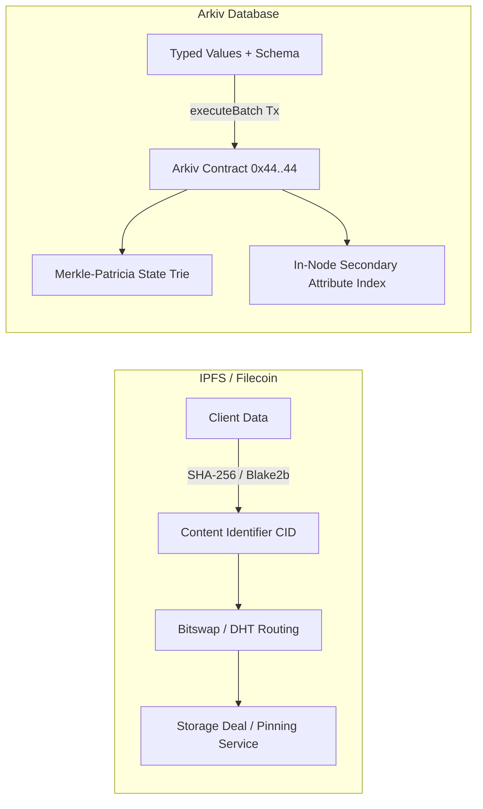
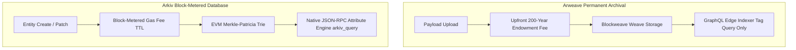
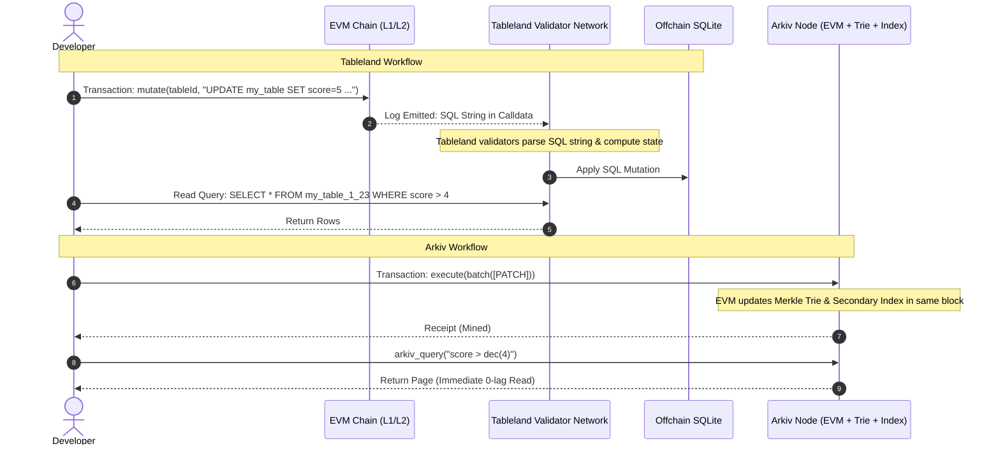
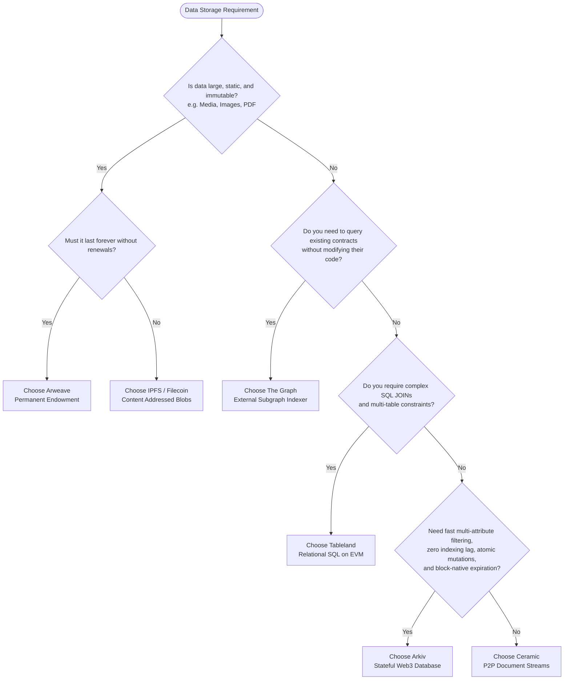

# Architectural Comparison: Arkiv vs. Web3 Storage Paradigms

This document provides a rigorous architectural and operational comparison between **Arkiv** and the prominent decentralized storage, document, database, and indexing paradigms in Web3: **IPFS / Filecoin**, **Arweave**, **Ceramic**, **Tableland**, and **The Graph**.

---

## Table of Contents

1. [The Web3 Data Architecture Spectrum](#1-the-web3-data-architecture-spectrum)
2. [Deep Dive 1: Arkiv vs. IPFS & Filecoin](#2-deep-dive-1-arkiv-vs-ipfs--filecoin)
   - [Content-Addressed Blobs vs. Stateful Structured Entities](#content-addressed-blobs-vs-stateful-structured-entities)
   - [Garbage Collection & Deal Management vs. Block-Native TTL](#garbage-collection--deal-management-vs-block-native-ttl)
   - [Retrieval Architecture: DHT Discovery vs. In-Node Index Scans](#retrieval-architecture-dht-discovery-vs-in-node-index-scans)
3. [Deep Dive 2: Arkiv vs. Arweave](#3-deep-dive-2-arkiv-vs-arweave)
   - [The Permanent Endowment Dilemma vs. Rental Economics](#the-permanent-endowment-dilemma-vs-rental-economics)
   - [Opaque Chunk Streams vs. First-Class Typed Attributes](#opaque-chunk-streams-vs-first-class-typed-attributes)
   - [Append-Only Logs vs. Atomic Lifecycle Operations](#append-only-logs-vs-atomic-lifecycle-operations)
4. [Deep Dive 3: Arkiv vs. Ceramic (ComposeDB)](#4-deep-dive-3-arkiv-vs-ceramic-composedb)
   - [Event-Sourced Document Streams vs. Native State Trie](#event-sourced-document-streams-vs-native-state-trie)
   - [Decentralized P2P Gossip vs. EVM Consensus Ordering](#decentralized-p2p-gossip-vs-evm-consensus-ordering)
   - [Self-Hosted Relational Projections vs. Integrated Query Engine](#self-hosted-relational-projections-vs-integrated-query-engine)
5. [Deep Dive 4: Arkiv vs. Tableland](#5-deep-dive-4-arkiv-vs-tableland)
   - [SQL Calldata Event Logs vs. Native Merkle-Patricia Trie](#sql-calldata-event-logs-vs-native-merkle-patricia-trie)
   - [Offchain Validator Projections vs. Real-Time Block Execution](#offchain-validator-projections-vs-real-time-block-execution)
   - [Perpetual Table Bloat vs. State Expiration Pruning](#perpetual-table-bloat-vs-state-expiration-pruning)
6. [Deep Dive 5: Arkiv vs. The Graph](#6-deep-dive-5-arkiv-vs-the-graph)
   - [External Projection Indexers vs. Dual-Rail Architecture](#external-projection-indexers-vs-dual-rail-architecture)
   - [Indexing Lag and Block Synchronization Latency](#indexing-lag-and-block-synchronization-latency)
   - [Economic Alignment: GRT Query Fees vs. Writer-Pays Storage Gas](#economic-alignment-grt-query-fees-vs-writer-pays-storage-gas)
7. [Comprehensive Multi-Dimensional Comparison Matrix](#7-comprehensive-multi-dimensional-comparison-matrix)
8. [Architectural Decision Matrix & Workload Fit](#8-architectural-decision-matrix--workload-fit)

---

## 1. The Web3 Data Architecture Spectrum

Decentralized applications historically struggled with a fundamental architectural trade-off: **EVM execution state is prohibitively expensive ($>\$10,000/\text{MB}$ on Ethereum L1) and impossible to query flexibly without external infrastructure**, whereas **decentralized storage networks (IPFS, Arweave) are static, unindexed blob stores disconnected from EVM transaction semantics**.

Web3 technologies address different positions along the data continuum:

```
┌──────────────────────────────────────────────────────────────────────────────────┐
│                          The Web3 Data Continuum                                │
├─────────────────────────┬──────────────────────────┬─────────────────────────────┤
│  Static Blob & Archive  │ Stream & Offchain SQL    │ Native In-State Database    │
│  (IPFS, Filecoin, AR)   │ (Ceramic, Tableland)     │ (Arkiv)                     │
├─────────────────────────┼──────────────────────────┼─────────────────────────────┤
│ • Content-addressed     │ • Event-sourced streams  │ • Native EVM contract       │
│ • Static file payloads  │ • Offchain projections   │ • In-node multi-attr index  │
│ • No relational queries │ • Relational / GraphQL   │ • Block-native TTL pruning  │
│ • Permanent / Pinning   │ • Moderate latency       │ • Zero indexing lag (0 blk) │
└─────────────────────────┴──────────────────────────┴─────────────────────────────┘
```

Arkiv introduces a **dual-rail architecture**: mutations execute as signed Ethereum transactions against a native contract (`0x4400000000000000000000000000000000000044`) that commits state to a Keccak Merkle-Patricia trie, while validator nodes maintain synchronous, in-memory secondary attribute indexes exposed directly over JSON-RPC.

---

## 2. Deep Dive 1: Arkiv vs. IPFS & Filecoin

IPFS (InterPlanetary File System) and Filecoin provide decentralized, content-addressed storage for static files and binary datasets.



### Content-Addressed Blobs vs. Stateful Structured Entities

* **IPFS / Filecoin**: Data is addressed strictly by the cryptographic hash of its payload ($\text{CID} = \text{multihash}(\text{content})$). Any change to a single byte generates a completely new CID. This immutability is ideal for static media (NFT artwork, compiled frontends, raw archives), but makes mutable entity state difficult to manage. IPNS (InterPlanetary Name System) allows updating a cryptographic pointer, but updates propagate slowly through Libp2p DHTs (often taking tens of seconds).
* **Arkiv**: Data is stored as structured records called **entities**. An entity has a stable 32-byte key derived at creation:
  $$\text{Key} = \text{keccak256}(\text{chainId} \parallel \text{arkivAddress} \parallel \text{owner} \parallel \text{nonce} \parallel \text{salt})$$
  The entity's attributes (up to 32 typed fields including `i32`, `u64`, `dec`, `str`, `addr`, `key`) can be patched atomically onchain by its `$owner` without changing its key.

### Garbage Collection & Deal Management vs. Block-Native TTL

* **IPFS / Filecoin**: In IPFS, nodes continuously perform garbage collection; content without an active pin is pruned unpredictably. Filecoin resolves this through economic storage deals (typically 180 to 540 days) negotiated with independent storage providers, requiring complex sector collateral, proof of spacetime (PoSt), and renewal coordination.
* **Arkiv**: Lifetimes are enforced directly by the consensus state machine in units of blocks:
  $$\text{expiry} = \max(\text{expiresAt}, \text{currentBlock} + \text{minLifetime})$$
  When `currentBlock >= $expiresAt`, the entity is immediately excluded from the query surface and state trie. Developers do not negotiate storage deals; they pay deterministic gas in GLM at transaction inclusion time for their chosen lifespan (up to 7,884,000 blocks $\approx$ 182.5 days).

### Retrieval Architecture: DHT Discovery vs. In-Node Index Scans

* **IPFS / Filecoin**: Retrieving data requires locating provider records in a Kademlia Distributed Hash Table (DHT) and downloading data chunks over Bitswap. Lookup latency is variable (hundreds of milliseconds to seconds). IPFS cannot execute attribute queries (e.g. *“find all posts where category = 'news' and score > 4”*).
* **Arkiv**: Query execution occurs directly inside the validator node daemon (`arkiv_query`). Nodes parse an expressive SQL-like query language, scan in-memory B-trees / indexes maintained synchronously with the state trie, and return paginated entity collections with low millisecond latency.

---

## 3. Deep Dive 2: Arkiv vs. Arweave

Arweave is designed for permanent data persistence powered by a Proof of Access (PoA/SPoRA) consensus mechanism and a 200-year storage endowment fund.



### The Permanent Endowment Dilemma vs. Rental Economics

* **Arweave**: Users pay an upfront fee designed to cover storage costs for over 200 years based on conservative disk storage cost decay models. While permanent storage is beneficial for legal agreements, historical archives, and permanent public records, it creates economic friction for application state that is inherently ephemeral, transactional, or frequently mutated (e.g., session metadata, IoT streams, game state, social media feeds, order books).
* **Arkiv**: Arkiv introduces **time-scoped rental economics**. Users pay only for the lifespan their application actually requires (e.g., 1 day for a cache, 30 days for a feed, 180 days for a registry). Ephemeral state naturally expires and is pruned from the node state trie, preventing long-term state bloat. When permanent retention is desired, entities can be periodically renewed via `extendEntity` or permissionless extension.

### Opaque Chunk Streams vs. First-Class Typed Attributes

* **Arweave**: Arweave stores data as arbitrary binary chunks. The network itself does not parse or index the internal contents of stored files. Querying is limited to top-level key-value metadata strings called **Tags** exposed via external edge gateways running GraphQL. Tags cannot perform numeric range comparisons, fixed-point math, or schema validation.
* **Arkiv**: Arkiv enforces a formal type system with 9 primitive types (`bool`, `i32`, `u64`, `u256`, `dec`, `str`, `addr`, `key`, `bytes`). Attributes can be indexed (`0x80 | typeId`), enabling full range comparisons (`score BETWEEN dec(1.0) AND dec(5.0)`), prefix matching (`startsWith`), existence checks (`EXISTS`), and type checks (`TYPEOF`).

### Append-Only Logs vs. Atomic Lifecycle Operations

* **Arweave**: The Blockweave is an append-only transaction ledger. A stored transaction can never be modified or deleted. "Updating" state requires publishing a new transaction that references the prior transaction ID, forcing the application client to implement custom reduction logic to reconstruct state.
* **Arkiv**: Entities have a full lifecycle: `CREATE`, `PATCH`, `EXTEND`, `TRANSFER`, and `DELETE`. A patch updates only specified attributes via atomic EVM operations; deletions remove the record immediately.

---

## 4. Deep Dive 3: Arkiv vs. Ceramic (ComposeDB)

Ceramic is a decentralized event-streaming network designed for mutable, composable document streams, often queried using ComposeDB.

```mermaid
flowchart TD
    subgraph CeramicArch["Ceramic / ComposeDB Architecture"]
        C1[Client Mutation] --> C2[Ceramic Stream Event Commit]
        C2 --> C3[P2P Libp2p PubSub Gossip]
        C3 --> C4[Anchor Batch Commit on Rollup / L1]
        C4 --> C5[ComposeDB Server Node sync to Local Postgres]
    end

    subgraph ArkivArch["Arkiv Architecture"]
        A1[Client Mutation] --> A2[EVM Transaction execute ops]
        A2 --> A3[Validator Consensus Block Inclusion]
        A3 --> A4[In-Node Synchronous Index Update]
        A4 --> A5[Immediate JSON-RPC Query Availability]
    end
```



### Event-Sourced Document Streams vs. Native State Trie

* **Ceramic**: Every document is an independent, append-only DAG stream of signed commits. State resolution requires fetching all stream commits from the P2P network and folding them into a unified document state. Ceramic periodically anchors batches of stream commits to Ethereum or an L2 (e.g. Arbitrum) via Merkle root trees.
* **Arkiv**: State is anchored directly inside the EVM's global Keccak Merkle-Patricia state trie at address `0x4400000000000000000000000000000000000044`. State transitions are atomic, strictly ordered by EVM block execution, and provable via Merkle proofs.

### Decentralized P2P Gossip vs. EVM Consensus Ordering

* **Ceramic**: Ceramic relies on Libp2p pub/sub gossip for propagating stream commits between nodes. Concurrently submitted commits to the same document can cause stream forks that require conflict resolution rules based on anchoring timestamps.
* **Arkiv**: Uses standard Ethereum transaction ordering and consensus (Rabdi testnet block time: 2 seconds). Write operations are deterministic: conflicting transactions are serialized by block inclusion, preventing split-brain states.

### Self-Hosted Relational Projections vs. Integrated Query Engine

* **Ceramic / ComposeDB**: ComposeDB is not an onchain query engine. To query Ceramic streams with GraphQL, developers must host and manage a **ComposeDB node**, which connects to a Ceramic daemon, subscribes to stream events, and indexes them into a self-hosted PostgreSQL database. If the node falls behind or crashes, queries return stale data.
* **Arkiv**: The query engine is embedded within the Arkiv node daemon. Validator nodes index attributes in real time during block execution. Clients query any standard RPC node via `arkiv_query` without running a separate indexing database.

---

## 5. Deep Dive 4: Arkiv vs. Tableland

Tableland is a decentralized relational database engine that translates SQL statements into EVM event logs and offchain SQLite table projections.



### SQL Calldata Event Logs vs. Native Merkle-Patricia Trie

* **Tableland**: Tables are represented onchain by an ERC-721 token. Mutations are submitted as raw SQL text strings packed into EVM transaction calldata. The EVM smart contract does not parse or validate the SQL syntax, nor does it maintain the table data in contract storage. Instead, an offchain network of Tableland validator nodes watches for EVM logs, parses the SQL strings, and executes them against local SQLite instances.
* **Arkiv**: Mutations are strongly typed ABI-encoded structs (`Operation`, `Attribute`) processed natively by the Arkiv EVM contract. Validation (type checks, sorted attributes, bounds, ownership) occurs during EVM execution. State is written directly into contract storage trie nodes.

### Offchain Validator Projections vs. Real-Time Block Execution

* **Tableland**: Because Tableland relies on an offchain validator network to tail EVM logs and interpret SQL strings, there is inherent latency between transaction confirmation and table update. If the Tableland validator network suffers a network partition or synchronization delay, queries to the SQLite gateway return stale state.
* **Arkiv**: The secondary index is updated synchronously during block processing. When a transaction is included in block $N$, queries sent to the same block height immediately reflect the state update. There is zero indexing lag.

### Perpetual Table Bloat vs. State Expiration Pruning

* **Tableland**: Tableland tables are permanent by default. Unless rows are manually deleted via SQL `DELETE` transactions (which cost additional gas), tables persist indefinitely on all validator nodes, creating state bloat over time.
* **Arkiv**: Arkiv includes block-native expiration. When an entity reaches its `$expiresAt` block, the node prunes the record from the active state trie and secondary indexes automatically, without requiring a cleanup transaction.

---

## 6. Deep Dive 5: Arkiv vs. The Graph

The Graph is an indexing and query protocol that extracts data from blockchain event logs and serves it via GraphQL subgraphs.

```mermaid
flowchart TD
    subgraph TheGraphModel["The Graph (External Pipeline)"]
        TG1[Base Smart Contract] -->|Emits Event| TG2[EVM Block Receipt]
        TG2 -->|Sync Latency 1-10+ blocks| TG3[Graph Node Indexer]
        TG3 -->|WASM Mapping Script| TG4[PostgreSQL Database]
        TG4 -->|GraphQL Query + GRT Billing| TG5[DApp Frontend]
    end

    subgraph ArkivModel["Arkiv (Native Pipeline)"]
        AK1[Arkiv Smart Contract 0x44..44] -->|execute ops| AK2[EVM State Trie]
        AK2 -->|Synchronous Index Hook| AK3[In-Node Attribute Index]
        AK3 -->|JSON-RPC arkiv_query 0-lag| AK4[DApp Frontend]
    end
```



### External Projection Indexers vs. Dual-Rail Architecture

* **The Graph**: The Graph is a **read-only external indexing layer**. It does not provide storage or state management; it indexes events emitted by other smart contracts. Building a feature requires:
  1. Authoring and deploying a custom Solidity smart contract.
  2. Authoring a Subgraph manifest (`subgraph.yaml`), GraphQL schema (`schema.graphql`), and AssemblyScript event mapping scripts.
  3. Deploying the subgraph to The Graph Studio or Decentralized Network.
  4. Waiting for indexer nodes to catch up with blockchain history.
* **Arkiv**: Arkiv is a **primary database**. Applications write typed entities directly to Arkiv using pre-built SDK helpers (`createEntity`, `patchEntity`). Secondary indexing is handled natively by node software without custom indexing pipelines or mapping scripts.

### Indexing Lag and Block Synchronization Latency

* **The Graph**: Subgraphs run asynchronously behind chain head. Complex subgraphs with heavy AssemblyScript logic can lag behind the blockchain by blocks, minutes, or hours during periods of network congestion or node catchup. This creates synchronization challenges for dApps (e.g. a user submits a transaction, but the UI cannot display the updated state because the subgraph has not yet indexed the block).
* **Arkiv**: Arkiv features **zero indexing lag**. Read methods (`arkiv_query`, `arkiv_getEntity`) execute against the state of the latest block:
  $$\text{Query Read Latency} \le \text{Block Time (2s)}$$
  The response includes the exact `blockNumber` at which the query was evaluated, matching the receipt of the mined transaction.

### Economic Alignment: GRT Query Fees vs. Writer-Pays Storage Gas

* **The Graph**: The Graph requires consumers (or dApp developers funding API keys) to pay micro-fees in **GRT** per GraphQL query request via state channels. Read traffic incur ongoing costs.
* **Arkiv**: Follows the Web3 **writer-pays model**: the entity creator or owner pays gas in GLM (or testnet `tGLM`) when submitting transactions (`CREATE`, `PATCH`, `EXTEND`). Querying data via JSON-RPC is free on the public RPC, or governed by monthly Cost Unit quotas on the Arkiv Hub without per-query token micropayments.

---

## 7. Comprehensive Multi-Dimensional Comparison Matrix

The following table provides a side-by-side technical evaluation across all six architectures:

| Architectural Dimension | Arkiv | IPFS / Filecoin | Arweave | Ceramic (ComposeDB) | Tableland | The Graph |
| :--- | :--- | :--- | :--- | :--- | :--- | :--- |
| **Primary Category** | Native Web3 Entity Database | Content-Addressed Blob Storage | Permanent Storage Endowment | Event-Sourced Document Streams | SQL-on-EVM Relational Database | Blockchain Event Indexing Protocol |
| **Data Abstraction** | Typed Entities & Attributes ($\le 32$ cols) | Static Files / UnixFS DAGs | Unstructured Chunks + String Tags | Event Streams & JSON Documents | Relational SQL Tables & Rows | GraphQL Entities (Derived Views) |
| **State Mutability** | First-class mutable (Create, Patch, Delete) | Immutable (CIDs); IPNS pointer updates | Append-only (Immutable historical weave) | Mutable via append-only commit DAG | Mutable via SQL `UPDATE` / `DELETE` | Derived read-only projection |
| **Storage Lifespan** | Block-metered TTL ($\le 7.88\text{M}$ blocks) | Deal duration (180–540d) or Pinning | Permanent ($\ge 200$ years) | Stream persistence via Rollup anchors | Permanent (Unless dropped / deleted) | Historical index (Retained while hosted) |
| **Query Engine** | In-Node SQL-like AST (`arkiv_query`) | None (Hash / CID lookup only) | GraphQL on top-level Tag strings | GraphQL on local ComposeDB Postgres | SQLite SQL Gateway | GraphQL on hosted PostgreSQL |
| **Secondary Indexing** | In-node real-time attribute B-Trees | None | Edge indexers (Tags only) | Local self-hosted database index | Offchain SQLite B-Trees | Offchain PostgreSQL indexes |
| **Index Freshness / Lag** | **0 blocks (Immediate at block head)** | Variable / Not applicable | 1–5 minutes (Gateway edge indexing) | Variable (P2P gossip propagation) | 1–3 blocks (Validator log parsing) | **1–10+ blocks (Indexer delay)** |
| **Transaction Atomicity** | Atomic batch execution (`executeBatch`) | None | Per-transaction | Per-stream commit ordering | Per-SQL statement | Eventual consistency |
| **Consensus Integration** | Native EVM Keccak Merkle-Patricia Trie | Proof of Spacetime (PoSt), Proof of Replication | Proof of Access (PoA / SPoRA) | Anchored Merkle roots on Ethereum/Rollup | EVM calldata logs + Validator BFT | None (Tail-follower of base chain) |
| **Access Control** | Wallet ownership (`$owner`), ReadOnly flags | Public content-addressed (Encryption optional) | Public ledger (Encryption optional) | DID-based session signatures | ERC-721 table ownership + SQL grants | Read-only public query layer |
| **Cost Model** | Gas in GLM / tGLM (Time-metered TTL) | Filecoin storage deals / Pinning fee | High upfront endowment fee (AR) | Free P2P / Rollup anchor gas | EVM gas per SQL mutation transaction | GRT query micropayments |
| **Direct Read Cost** | Free / RPC quota (Cost Units) | Free / Gateway bandwidth | Free (Via public gateways) | Free (Self-hosted node) | Free (Public gateway) | Paid (GRT / Studio API quotas) |
| **Referential Integrity** | Supported via 32-byte `key` attributes | Merkle DAG links (CID-to-CID) | Manual transaction ID links | Schema relation linking in ComposeDB | Foreign key constraints in SQLite | GraphQL relationship mappings |

---

## 8. Architectural Decision Matrix & Workload Fit



### When to Select Arkiv

* **Application State with Finite Lifetimes**: Session metadata, user profiles, social feeds, gaming leaderboards, oracle feeds, and order books where data naturally expires after hours, days, or months.
* **Zero Indexing Lag Requirements**: Applications that cannot tolerate indexing delays (e.g. an e-commerce or ticketing platform where a user creates an order and expects it to be queryable immediately on the next page view).
* **Multi-Attribute Filter & Sort**: Applications requiring real-time filtering on scalar values, numeric ranges, address ownership, and prefix string matches without maintaining external PostgreSQL or Redis pipelines.
* **Wallet-Owned State Transitions**: Workloads where records must have clear, tamper-proof cryptographic ownership tied directly to an Ethereum address, enabling seamless ownership transfers and permissionless maintenance.

### When to Combine Arkiv with Other Technologies

* **Hybrid Architecture (Arkiv + IPFS/Arweave)**: Store multi-megabyte media assets (images, videos, PDF documents) on IPFS or Arweave, and store the resulting 32-byte hash/CID, searchable metadata (title, category, tags, owner, timestamps, expiration), and access control flags as an indexed entity inside Arkiv.
