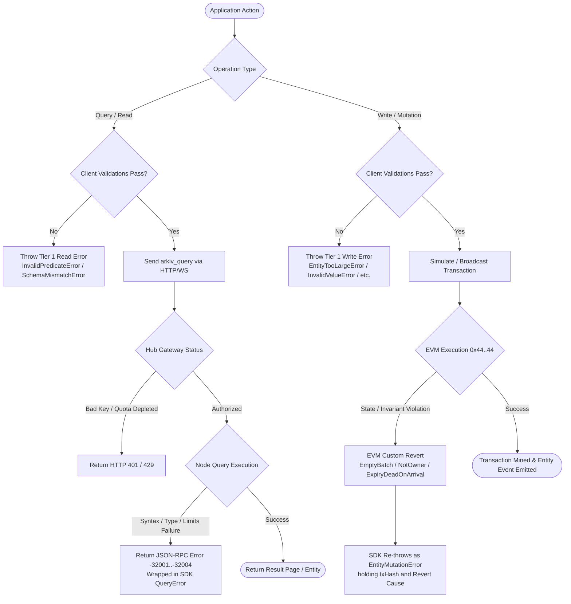

# Arkiv Complete Error Catalog & Diagnostic Reference

This catalog provides an exhaustive, multi-tiered reference for all error classes, JSON-RPC failure codes, and EVM smart contract reverts across the Arkiv protocol.

---

## Table of Contents

1. [Architectural Overview & The 3-Tier Error Model](#1-architectural-overview--the-3-tier-error-model)
2. [Diagnostic Flowchart & Error Lifecycle](#2-diagnostic-flowchart--error-lifecycle)
3. [Tier 1: Client SDK Validation Errors](#3-tier-1-client-sdk-validation-errors)
   - [Mutation & Write Pre-Flight Errors](#mutation--write-pre-flight-errors)
   - [Query & Read Pre-Flight Errors](#query--read-pre-flight-errors)
   - [Schema Definition & Column Configuration Errors](#schema-definition--column-configuration-errors)
   - [Transport & Access Key Errors](#transport--access-key-errors)
   - [Wrapper & Container Errors](#wrapper--container-errors)
4. [Tier 2: Node JSON-RPC Protocol Errors](#4-tier-2-node-json-rpc-protocol-errors)
   - [Query Execution Codes (-32001 to -32004)](#query-execution-codes--32001-to--32004)
   - [Standard JSON-RPC Parameter Errors (-32602)](#standard-json-rpc-parameter-errors--32602)
   - [Gateway & Hub Authentication Errors (HTTP 401 / 429)](#gateway--hub-authentication-errors-http-401--429)
5. [Tier 3: EVM Smart Contract Custom Errors](#5-tier-3-evm-smart-contract-custom-errors)
   - [Batch Structure & Calldata Errors](#batch-structure--calldata-errors)
   - [Attribute Serialization & Format Errors](#attribute-serialization--format-errors)
   - [Entity State & Ownership Errors](#entity-state--ownership-errors)
   - [Expiration & Temporal Integrity Errors](#expiration--temporal-integrity-errors)
   - [Ownership Transfer Errors](#ownership-transfer-errors)
6. [Cross-Tier Mapping & Recovery Matrix](#6-cross-tier-mapping--recovery-matrix)
7. [Production Error Handling & Recovery Recipes](#7-production-error-handling--recovery-recipes)

---

## 1. Architectural Overview & The 3-Tier Error Model

Arkiv partitions failure detection into three discrete operational tiers. This design guarantees that invalid operations fail as close to the caller as possible, saving network bandwidth, preventing unnecessary gas expenditure, and providing actionable developer feedback.

```
┌────────────────────────────────────────────────────────────────────────┐
│                   Tier 1: Client SDK Validation                        │
│ Thrown synchronously in TypeScript/JavaScript runtime before I/O.      │
│ Validates schema conformity, byte lengths, numeric limits, and types.  │
└───────────────────────────────────┬────────────────────────────────────┘
                                    │ Network Request
                                    ▼
┌────────────────────────────────────────────────────────────────────────┐
│                   Tier 2: Node JSON-RPC Protocol                       │
│ Returned asynchronously in JSON-RPC error response bodies.             │
│ Catches query syntax errors, AST nesting limits, and gateway quotas.   │
└───────────────────────────────────┬────────────────────────────────────┘
                                    │ Onchain Transaction
                                    ▼
┌────────────────────────────────────────────────────────────────────────┐
│               Tier 3: EVM Smart Contract Custom Errors                 │
│ Reverted onchain during execute(ops) transaction execution.           │
│ Enforces cryptographic state invariants, ownership, and expiry bounds. │
└────────────────────────────────────────────────────────────────────────┘
```

* **Tier 1 (Client SDK)**: Errors inherit from JavaScript's native `Error` class and are exported from `@arkiv-network/sdk` and `@arkiv-network/sdk/query`. Applications should inspect them using `instanceof`.
* **Tier 2 (Node JSON-RPC)**: Standardized JSON-RPC 2.0 error payloads returned by `arkiv_query`, `arkiv_getEntity`, and `arkiv_getBlockTiming`. Includes diagnostic metadata in the `data` field.
* **Tier 3 (EVM Custom Errors)**: Reverts emitted by the canonical Arkiv contract at `0x4400000000000000000000000000000000000044`. Captured during `eth_estimateGas`, `eth_call`, or encapsulated inside `EntityMutationError` after transaction broadcast.

---

## 2. Diagnostic Flowchart & Error Lifecycle



---

## 3. Tier 1: Client SDK Validation Errors

All Tier 1 errors are checked prior to network I/O. They allow the developer to identify configuration bugs, schema drift, and payload overflow during local development.

### Mutation & Write Pre-Flight Errors

#### `SchemaMismatchError`
* **Package**: `@arkiv-network/sdk`
* **Trigger Conditions**:
  - A required schema column is missing from the `values` object in `createEntity`.
  - The payload specifies a property name that does not exist in the referenced schema.
  - A value supplied for an attribute does not match the column's declared constructor type (e.g., providing a raw string for a `dec()` column).
* **Recovery Action**: Inspect the schema definition and align property names and types. Use explicit type constructors (e.g. `dec("4.5")`) when providing values that do not map to plain JavaScript primitives.

#### `InvalidValueError`
* **Package**: `@arkiv-network/sdk`
* **Trigger Conditions**:
  - An integer exceeds the defined boundaries of its type (e.g., $2^{40}$ passed to `i32()`).
  - An Ethereum address string fails EIP-55 checksum validation.
  - A decimal string specifies more than 18 decimal places.
  - A floating-point number is passed to `dec()` directly (e.g., `dec(0.1)`).
  - A `str` value exceeds 128 bytes of UTF-8 encoding.
* **Recovery Action**: Ensure values reside strictly within their mathematical and byte ranges. Always pass decimal numbers as strings. Verify address checksums with standard Web3 utilities before assignment.

#### `UntypedValueError`
* **Package**: `@arkiv-network/sdk`
* **Trigger Conditions**: A value provided in a schemaless or generic context is neither an instance of an Arkiv typed value constructor nor one of the five accepted JavaScript primitives (`boolean`, `number`, `bigint`, `string`, `Uint8Array`).
* **Recovery Action**: Wrap arbitrary values in an explicit schema type constructor (e.g. `key()`, `addr()`, `dec()`, `u64()`).

#### `MissingValueError`
* **Package**: `@arkiv-network/sdk`
* **Trigger Conditions**: An explicit `null` is passed as a column value in `createEntity` or `patchEntity`.
* **Recovery Action**: In Arkiv, values cannot be set to `null`. To leave an optional column empty on creation, omit the property from the payload. To delete an attribute in a patch, place the column name into the `unset` array.

#### `EntityTooLargeError`
* **Package**: `@arkiv-network/sdk`
* **Trigger Conditions**: The cumulative byte size of all `bytes` attributes within a single `createEntity` or `patchEntity` call exceeds 128 KiB (131,072 bytes).
* **Recovery Action**: Compress binary payloads, split data across multiple entities, or store large static assets on content-addressed storage (e.g. IPFS) and store only the resulting 32-byte hash/CID in Arkiv.

#### `EmptyPatchError`
* **Package**: `@arkiv-network/sdk`
* **Trigger Conditions**: A call to `patchEntity` provides neither attributes to update in `set` nor attributes to remove in `unset`.
* **Recovery Action**: Ensure at least one column is specified in `set` or `unset`. Do not invoke `patchEntity` if no state change has occurred.

#### `ConflictingMutationError`
* **Package**: `@arkiv-network/sdk`
* **Trigger Conditions**: A single `patchEntity` payload includes the same column name in both the `set` object and the `unset` list.
* **Recovery Action**: Ensure mutations are mutually exclusive per column. A property can be updated or removed in a single transaction, but not both.

#### `InvalidExpiryError`
* **Package**: `@arkiv-network/sdk`
* **Trigger Conditions**:
  - Expiration block or timestamp is in the past.
  - Specified lifetime exceeds the 7,884,000-block ceiling (`MAX_LIFETIME` $\approx$ 182.5 days).
  - A duration supplied via `ExpirationTime.fromSeconds(n)` is not an exact integer multiple of the 2-second block time (e.g. `fromSeconds(3)`).
* **Recovery Action**: Use `ExpirationTime.fromHours()`, `ExpirationTime.fromDays()`, or `ExpirationTime.max()`. Ensure relative timestamps are calculated from the latest mined block height.

#### `InvalidCreationFlagsError`
* **Package**: `@arkiv-network/sdk`
* **Trigger Conditions**: A property in the `flags` configuration object is not a boolean primitive (e.g. `{ readonly: "true" }`).
* **Recovery Action**: Pass standard boolean literals (`readonly: true`, `permissionlessExtension: true`).

#### `InvalidSaltError`
* **Package**: `@arkiv-network/sdk`
* **Trigger Conditions**: The `salt` passed to `createEntity` or a batch creation struct is negative or larger than 128 bits ($> 2^{128} - 1$).
* **Recovery Action**: Use `NO_SALT` (`0n`) for deterministic derivation, or omit the parameter to let the SDK generate a secure random 128-bit salt.

#### `NoRandomSourceError`
* **Package**: `@arkiv-network/sdk`
* **Trigger Conditions**: The JavaScript execution environment lacks a native cryptographic random number generator (`crypto.getRandomValues`). Typically occurs in older Node.js runtimes or bare React Native threads without a crypto polyfill.
* **Recovery Action**: Polyfill `globalThis.crypto` using `crypto.webcrypto` (Node.js) or `react-native-get-random-values`.

---

### Query & Read Pre-Flight Errors

#### `NoEntityFoundError`
* **Package**: `@arkiv-network/sdk`
* **Trigger Conditions**: `publicClient.getEntity(key)` found no active entity corresponding to the provided 32-byte key. The entity either never existed, was deleted via `deleteEntity`, or has expired past `$expiresAt`.
* **Inspection Properties**: `error.entityKey` holds the requested 32-byte hexadecimal string.
* **Recovery Action**: Handle as a 404 condition in application logic. Catch via `instanceof NoEntityFoundError`.

#### `InvalidPredicateError`
* **Package**: `@arkiv-network/sdk/query`
* **Trigger Conditions**:
  - A filter condition specifies an attribute that is not marked `.indexed()` in the schema.
  - A sort key specifies a `bytes` column (which cannot be indexed or ordered).
  - A sort key specifies a column not declared in the schema.
  - A comparison operator compares two mismatched data types (e.g. `between` with an `i32` lower bound and a `dec` upper bound).
  - In a schemaless query, a sort attribute lacks an explicit type qualification.
  - An `orderBy` call specifies more than one attribute.
  - A query expression resolves to empty conditions.
* **Recovery Action**: Mark filtered schema attributes with `.indexed()`. Ensure single-column sorting with explicit type signatures (`orderBy("score:dec", "DESC")`).

#### `UnsupportedOperatorError`
* **Package**: `@arkiv-network/sdk/query`
* **Trigger Conditions**: Calling `startsWith` on an attribute that is not of type `str` (e.g., attempting prefix searches on `i32` or `addr`).
* **Recovery Action**: `startsWith` is valid exclusively for `str` columns. For range comparisons on numbers or addresses, use `gte` and `lte` or `between`.

#### `UnknownAttributeTypeError`
* **Package**: `@arkiv-network/sdk`
* **Trigger Conditions**: The node JSON-RPC daemon returns an entity containing an attribute whose numeric `typeId` is unrecognized by the current SDK version.
* **Recovery Action**: Upgrade `@arkiv-network/sdk` to the latest release to receive support for newly introduced protocol types.

---

### Schema Definition & Column Configuration Errors

#### `InvalidAttributeNameError`
* **Package**: `@arkiv-network/sdk`
* **Trigger Conditions**:
  - Attribute name exceeds 32 bytes (`MAX_NAME_BYTES`).
  - Attribute name starts with a non-letter (e.g., `_score`, `1stPost`).
  - Attribute name starts with `$` (reserved for system metadata fields).
  - Attribute name contains invalid characters (allowed: `[a-zA-Z0-9._-]`).
  - Attribute name contains the double-hyphen comment token `--`.
  - Attribute name matches a reserved query keyword (`BETWEEN`, `ORDER`, `AND`, etc.).
* **Recovery Action**: Adhere to naming rules: start with an ASCII letter, use alphanumeric characters, dots, or underscores, and avoid reserved keywords.

#### `SchemaDefinitionError`
* **Package**: `@arkiv-network/sdk`
* **Trigger Conditions**:
  - The schema identifier passed to `defineSchema` is not a valid UTF-8 string or exceeds 128 bytes.
  - An object key in the schema declaration maps to something other than an Arkiv column definition.
  - A user column is explicitly named `arkiv.schema`.
* **Recovery Action**: Define columns using official type constructors (`str()`, `i32()`, etc.). Never declare `arkiv.schema` as a user column.

#### `TooManyAttributesError`
* **Package**: `@arkiv-network/sdk`
* **Trigger Conditions**:
  - An unnamed schema defines more than 32 columns.
  - A named schema defines more than 31 columns (since `arkiv.schema` consumes the 32nd slot).
* **Recovery Action**: Consolidate non-indexed columns into a serialized binary structure (`bytes`), or partition attributes across related entities linked via `key` foreign references.

---

### Transport & Access Key Errors

#### `MissingAccessKeyError`
* **Package**: `@arkiv-network/sdk`
* **Trigger Conditions**: The chain helper `rabdi()` was called with undefined or malformed arguments.
* **Recovery Action**: Supply your Arkiv Hub access key: `rabdi({ accessKey: process.env.ARKIV_ACCESS_KEY })`. If public rate-limited testing is intended, pass an explicit empty string: `rabdi({ accessKey: "" })`.

---

### Wrapper & Container Errors

#### `EntityMutationError`
* **Package**: `@arkiv-network/sdk`
* **Trigger Conditions**: Thrown when a mutation transaction fails on the blockchain or reverts during simulation. Wraps onchain execution failures.
* **Inspection Properties**:
  - `error.message`: Detailed human-readable failure reason parsed from the EVM revert data.
  - `error.txHash`: The transaction hash on Rabdi (if the transaction was signed and broadcast before failing).
* **Recovery Action**: Inspect the embedded revert string or error name (see Tier 3 errors below). Check wallet balance for testnet `tGLM`.

#### `QueryError`
* **Package**: `@arkiv-network/sdk/query`
* **Trigger Conditions**: Thrown when an `arkiv_query` call is rejected by the validator node JSON-RPC daemon.
* **Inspection Properties**:
  - `error.kind`: Categorical classification string (`"parse"`, `"type"`, `"literal"`, or `"limits"`).
  - `error.message`: Verbose syntax or operational error reported by the node.
* **Recovery Action**: Match `error.kind` to determine whether the query string failed syntax parsing, had mismatched comparison types, or exceeded query nesting limits.

---

## 4. Tier 2: Node JSON-RPC Protocol Errors

When an application communicates with an Arkiv node directly via JSON-RPC 2.0 (without using the TypeScript SDK's high-level abstractions), queries that fail execution return a standard JSON-RPC error response object:

```json
{
  "jsonrpc": "2.0",
  "id": 1,
  "error": {
    "code": -32001,
    "message": "Query parse error",
    "data": {
      "position": 35,
      "expected": ["AND", "OR", "ORDER BY"],
      "found": "INVALID_TOKEN"
    }
  }
}
```

### Query Execution Codes (-32001 to -32004)

| Code | Label / `kind` | Trigger Root Cause | Accompanying `data` Payload | Mitigation Strategy |
| :--- | :--- | :--- | :--- | :--- |
| **`-32001`** | `parse` | Malformed query syntax, missing closing parentheses, unrecognized keyword, or unterminated string literal. | Holds parse offset (`position`), array of expected tokens (`expected`), and the encountered token (`found`). | Validate query string against the Arkiv EBNF grammar. Double single quotes inside string values (e.g. `'it''s'`). |
| **`-32002`** | `type` | Type mismatch in boolean predicates or operators. E.g., `STARTSWITH` evaluated against an integer, or `BETWEEN` evaluated with bounds of two distinct types. | Identifies the offending attribute name, expected type signature, and actual detected type. | Ensure both operands in comparisons share identical types. Wrap literals in explicit constructors: `score > dec(4.0)`. |
| **`-32003`** | `literal` | A literal value cannot be parsed or falls outside the physical bounds of its target type (e.g. `i32(9999999999)`). | Identifies the failed literal token and the target type. | Check integer ranges, decimal string scale ($\le 18$ digits), and address checksums. |
| **`-32004`** | `limits` | Query exceeds node execution guardrails: query string byte length exceeded or AST expression nesting depth exceeded. | Maximum allowed limit and actual measured value. | Flatten boolean expressions, remove redundant grouping parentheses, and break complex queries into multi-stage lookups. |

### Standard JSON-RPC Parameter Errors (-32602)

* **Code**: `-32602` (`Invalid params`)
* **Trigger Conditions**:
  - `limit` parameter in `arkiv_query` is less than 1 or greater than 100 (`MAX_LIMIT`).
  - `offset` parameter is negative or formatted as an invalid hexadecimal string.
  - `select` object specifies unrecognized field flags.
* **Recovery Action**: Clamp pagination window sizes between 1 and 100. Always provide `offset` as non-negative integers or valid hex strings.

### Gateway & Hub Authentication Errors (HTTP 401 / 429)

Requests rejected at the network edge prior to JSON-RPC dispatch return HTTP status codes:

* **HTTP 401 Unauthorized**:
  - The access key in the path or header is unrecognized, revoked, or formatted incorrectly.
  - The requesting IP address is not included in the key's **IP allowlist**.
* **HTTP 429 Too Many Requests**:
  - The access key has depleted its monthly allotment of Cost Units (CUs).
  - The request was sent to the public unauthenticated gateway (`accessKey: ""`) and exceeded the burst or sustained rate ceiling.

---

## 5. Tier 3: EVM Smart Contract Custom Errors

All onchain write mutations dispatched via `execute((uint8 operation, bytes operationData)[] ops)` at contract address `0x4400000000000000000000000000000000000044` are atomic. If any single operation in a batch reverts, the entire batch reverts.

The contract reports failure via custom Solidity errors. The table below documents every revert signature, parameter schema, root cause, and remediation.

### Batch Structure & Calldata Errors

#### `EmptyBatch()`
* **Signature**: `EmptyBatch()`
* **Revert Condition**: The `ops` dynamic array passed to `execute` contains zero operations (`ops.length == 0`).
* **Recovery Action**: Ensure the batch builder includes at least one mutation (`CREATE`, `PATCH`, `EXTEND`, `TRANSFER`, or `DELETE`) prior to broadcasting.

#### `InvalidOpType(uint8 operation)`
* **Signature**: `InvalidOpType(uint8 operation)`
* **Parameters**: `operation` — the numeric tag received by the dispatcher.
* **Revert Condition**: An operation tag in the `ops` array is not within the defined range $1 \le \text{operation} \le 5$:
  - `1`: CREATE
  - `2`: PATCH
  - `3`: EXTEND
  - `4`: TRANSFER
  - `5`: DELETE
* **Recovery Action**: Set the operation code strictly to one of the 5 canonical operation enums.

#### `NonCanonicalOperationData(uint8 operation)`
* **Signature**: `NonCanonicalOperationData(uint8 operation)`
* **Parameters**: `operation` — the operation type whose payload failed decoding.
* **Revert Condition**: The `operationData` bytes payload cannot be decoded into the expected struct, contains trailing dirty bytes, or violates standard ABI encoding rules.
* **Recovery Action**: Use standard `abi.encode` without manual padding hacks or packed encoding.

---

### Attribute Serialization & Format Errors

#### `AttributesNotSorted()`
* **Signature**: `AttributesNotSorted()`
* **Revert Condition**: The `Attribute[]` array within a CREATE or PATCH operation is not in strictly ascending lexicographical order by the 32-byte left-aligned `bytes32 name`. Duplicate attribute names also trigger this revert because order must be strictly greater ($name_{i} < name_{i+1}$).
* **Recovery Action**: Sort all attributes ascending by their 32-byte hexadecimal representation before encoding calldata:
  ```typescript
  attributes.sort((a, b) => a.name.localeCompare(b.name));
  ```

#### `TooManyAttributes(uint256 count, uint256 maxCount)`
* **Signature**: `TooManyAttributes(uint256 count, uint256 maxCount)`
* **Parameters**:
  - `count`: Number of attributes supplied in the operation.
  - `maxCount`: Protocol maximum (`32`).
* **Revert Condition**: `attributes.length > 32`.
* **Recovery Action**: Reduce attribute count to $\le 32$ per entity.

#### `EmptyMutations(bytes32 entityKey)`
* **Signature**: `EmptyMutations(bytes32 entityKey)`
* **Parameters**: `entityKey` — the target entity of the patch.
* **Revert Condition**: A PATCH operation (op 2) contains an empty `Attribute[] mutations` array.
* **Recovery Action**: Ensure patches specify at least one attribute to set or unset.

#### `TombstoneInCreate(bytes32 name)`
* **Signature**: `TombstoneInCreate(bytes32 name)`
* **Parameters**: `name` — the attribute name carrying a tombstone.
* **Revert Condition**: A CREATE operation contains an attribute with `typeId == 0` (Tombstone).
* **Recovery Action**: Tombstones (`typeId = 0`) are valid only in PATCH operations to unset existing optional columns. Remove tombstones from entity creation payloads.

#### `TombstoneValueNotEmpty(bytes32 name)`
* **Signature**: `TombstoneValueNotEmpty(bytes32 name)`
* **Parameters**: `name` — the tombstoned attribute name.
* **Revert Condition**: An attribute with `typeId == 0` has a non-empty `value` byte slice (`value.length > 0`).
* **Recovery Action**: Set `value = ""` (`0x`) when unsetting an attribute with a tombstone.

#### `SystemAttributeNotWritable(bytes32 name)`
* **Signature**: `SystemAttributeNotWritable(bytes32 name)`
* **Parameters**: `name` — the prohibited attribute name.
* **Revert Condition**: An attribute name begins with the ASCII character `$` (`0x24`).
* **Recovery Action**: Intrinsic fields (`$key`, `$owner`, `$creator`, `$createdAt`, `$updatedAt`, `$expiresAt`, `$creationFlags`) are maintained exclusively by the protocol. Remove leading `$` from custom attribute names.

#### `InvalidValueType(bytes32 name, uint8 typeId)`
* **Signature**: `InvalidValueType(bytes32 name, uint8 typeId)`
* **Parameters**:
  - `name`: The attribute name.
  - `typeId`: The invalid type byte.
* **Revert Condition**:
  - The `typeId` (stripped of bit 7 index flag) is not in the range $0 \le \text{typeId} \le 10$ or equals reserved type $6$.
  - Bit 7 (`0x80`) is set on a `bytes` attribute (`bytes` columns cannot be indexed).
  - The length of `value` does not match the strict byte width expected for fixed types (e.g. `bool`, `i32`, `u64`, `u256`, `dec`, `addr`, `key` must be exactly 32 bytes).
  - `str` value exceeds 128 bytes, or single `bytes` value exceeds 128 KiB.
* **Recovery Action**: Verify `typeId` alignment and ensure scalar types are encoded as exact 32-byte words.

#### `Ident32Empty()`
* **Signature**: `Ident32Empty()`
* **Revert Condition**: An attribute name consists entirely of zero bytes (`0x0000000000000000000000000000000000000000000000000000000000000000`).
* **Recovery Action**: Provide an attribute name with at least one non-zero ASCII character.

#### `Ident32InvalidByte(uint256 position, bytes1 value)`
* **Signature**: `Ident32InvalidByte(uint256 position, bytes1 value)`
* **Parameters**:
  - `position`: Zero-based byte offset where validation failed.
  - `value`: The byte value that violated the protocol character set.
* **Revert Condition**: An attribute name contains bytes outside the allowed ASCII character set (`[a-zA-Z0-9._-]`), or position 0 is not an ASCII letter (`[a-zA-Z]`).
* **Recovery Action**: Sanitize attribute names to contain only valid ASCII characters with an initial letter.

---

### Entity State & Ownership Errors

#### `EntityNotFound(bytes32 entityKey)`
* **Signature**: `EntityNotFound(bytes32 entityKey)`
* **Parameters**: `entityKey` — the requested key.
* **Revert Condition**: An operation targets an entity key that has no entry in the contract's Merkle-Patricia state trie.
* **Recovery Action**: Verify that the entity was mined in a previous block and that the entity key matches the derived key.

#### `EntityExpired(bytes32 entityKey, uint64 expiresAt)`
* **Signature**: `EntityExpired(bytes32 entityKey, uint64 expiresAt)`
* **Parameters**:
  - `entityKey`: The target entity key.
  - `expiresAt`: The block at which the entity expired.
* **Revert Condition**: An operation targets an entity whose `$expiresAt` block is less than or equal to `block.number`.
* **Recovery Action**: Expired entities are permanently inert and cannot be patched, extended, transferred, or deleted. Re-create the entity with a fresh key if data must be restored.

#### `NotOwner(bytes32 entityKey, address caller, address owner)`
* **Signature**: `NotOwner(bytes32 entityKey, address caller, address owner)`
* **Parameters**:
  - `entityKey`: Target entity.
  - `caller`: Address of `msg.sender`.
  - `owner`: Current `$owner` recorded in state.
* **Revert Condition**: A PATCH, DELETE, TRANSFER, or non-permissionless EXTEND operation was signed by an account other than the current owner.
* **Recovery Action**: Switch active wallet credentials to the account recorded in `$owner`, or ensure the entity was created with the `permissionlessExtension` flag if attempting third-party renewal.

#### `ReadOnlyEntity(bytes32 entityKey)`
* **Signature**: `ReadOnlyEntity(bytes32 entityKey)`
* **Parameters**: `entityKey` — the entity targeted for mutation.
* **Revert Condition**: A PATCH operation targets an entity created with creation flag bit 0 set (`readonly: true`).
* **Recovery Action**: Attributes of read-only entities are immutable. (Note: Read-only entities can still have their lifetime extended, ownership transferred, or be deleted by their owner).

#### `ReservedCreationFlags(uint8 creationFlags)`
* **Signature**: `ReservedCreationFlags(uint8 creationFlags)`
* **Parameters**: `creationFlags` — the invalid bitmask.
* **Revert Condition**: A CREATE operation has any of bits 2 through 7 set in `creationFlags` (only bit 0 `readonly` and bit 1 `permissionlessExtension` are valid).
* **Recovery Action**: Mask `creationFlags` with `0x03` prior to submission.

---

### Expiration & Temporal Integrity Errors

#### `ExpiryDeadOnArrival(uint64 target, uint64 currentBlock)`
* **Signature**: `ExpiryDeadOnArrival(uint64 target, uint64 currentBlock)`
* **Parameters**:
  - `target`: Resolved expiry block (`max(expiresAt, currentBlock + minLifetime)`).
  - `currentBlock`: Current `block.number`.
* **Revert Condition**: The resolved expiration block is less than or equal to the block in which the transaction is executing ($\text{target} \le \text{currentBlock}$).
* **Recovery Action**: Set `minLifetime >= 1` or specify an absolute `expiresAt` well in advance of the expected inclusion block.

#### `ExpiryBeyondMaxLifetime(uint64 target, uint64 currentBlock, uint64 maxLifetime)`
* **Signature**: `ExpiryBeyondMaxLifetime(uint64 target, uint64 currentBlock, uint64 maxLifetime)`
* **Parameters**:
  - `target`: Resolved expiration block.
  - `currentBlock`: Current `block.number`.
  - `maxLifetime`: Protocol constant `7884000`.
* **Revert Condition**: $\text{target} > \text{currentBlock} + \text{MAX\_LIFETIME}$.
* **Recovery Action**: Clamp desired lifetimes to at most 7,884,000 blocks (~182.5 days).

#### `ExpiryNotExtended(bytes32 entityKey, uint64 newExpiresAt, uint64 currentExpiresAt)`
* **Signature**: `ExpiryNotExtended(bytes32 entityKey, uint64 newExpiresAt, uint64 currentExpiresAt)`
* **Parameters**:
  - `entityKey`: Target entity.
  - `newExpiresAt`: Attempted new expiration block.
  - `currentExpiresAt`: Existing expiration block.
* **Revert Condition**: An EXTEND operation attempts to set an expiration that is less than or equal to the entity's current `$expiresAt` block ($\text{newExpiresAt} \le \text{currentExpiresAt}$).
* **Recovery Action**: Ensure the new expiration block extends further into the future than the current expiration. Note that durations in `extendEntity` count from the present block, not from the existing expiration.

---

### Ownership Transfer Errors

#### `TransferToZeroAddress(bytes32 entityKey)`
* **Signature**: `TransferToZeroAddress(bytes32 entityKey)`
* **Parameters**: `entityKey` — target entity key.
* **Revert Condition**: An ownership transfer operation specifies `address(0)` (`0x0000000000000000000000000000000000000000`) as `newOwner`.
* **Recovery Action**: Provide a valid non-zero Ethereum recipient address. To discard an entity, call `deleteEntity` rather than transferring to the zero address.

#### `TransferToSelf(bytes32 entityKey)`
* **Signature**: `TransferToSelf(bytes32 entityKey)`
* **Parameters**: `entityKey` — target entity key.
* **Revert Condition**: An ownership transfer operation specifies the current owner address as `newOwner`.
* **Recovery Action**: Verify recipient address; do not initiate ownership transfers where `newOwner == currentOwner`.

---

## 6. Cross-Tier Mapping & Recovery Matrix

The following table cross-references client errors with their underlying protocol triggers and provides exact developer recovery steps:

| Developer Symptom / Scenario | Tier 1 (Client SDK Error) | Tier 2 (Node RPC Code) | Tier 3 (EVM Custom Revert) | Direct Recovery Action |
| :--- | :--- | :--- | :--- | :--- |
| Missing required property in `createEntity` | `SchemaMismatchError` | N/A (Blocked locally) | N/A (Blocked locally) | Populate all columns not marked `.optional()` or `.default()`. |
| Passing float to decimal (`dec(4.5)`) | `InvalidValueError` | N/A (Blocked locally) | N/A (Blocked locally) | Pass decimal numbers as strings: `dec("4.5")`. |
| Setting column to `null` | `MissingValueError` | N/A (Blocked locally) | N/A (Blocked locally) | Omit property in create; place in `unset: [...]` in patch. |
| Total `bytes` values exceed 128 KiB | `EntityTooLargeError` | N/A (Blocked locally) | `InvalidValueType` | Compress binary data or partition across multiple entities. |
| Expiration set to 1 year in future | `InvalidExpiryError` | N/A (Blocked locally) | `ExpiryBeyondMaxLifetime` | Clamp duration to `ExpirationTime.max()` (~182.5 days). |
| Query with `startsWith` on `i32` column | `UnsupportedOperatorError` | `-32002` (`type`) | N/A | Use `between` or `gte`/`lte` for range filters on integers. |
| Query on unindexed column | `InvalidPredicateError` | `-32002` (`type`) | N/A | Add `.indexed()` to column definition in schema. |
| Entity key not found in `getEntity` | `NoEntityFoundError` | Returns `null` | N/A | Treat as 404; verify entity was created and not expired. |
| Patching entity owned by another account | Wrapped in `EntityMutationError` | N/A (Gas estimation reverts) | `NotOwner` | Switch to wallet account matching entity `$owner`. |
| Patching entity created with `readonly: true` | Wrapped in `EntityMutationError` | N/A (Gas estimation reverts) | `ReadOnlyEntity` | Read-only entities cannot be patched; create a new entity. |
| Target expiration <= current block | Wrapped in `EntityMutationError` | N/A (Gas estimation reverts) | `ExpiryDeadOnArrival` | Specify `minLifetime >= 1` block into future. |
| Extending entity with earlier date | Wrapped in `EntityMutationError` | N/A (Gas estimation reverts) | `ExpiryNotExtended` | Calculate extension duration from current block. |
| Invalid access key provided to RPC | `MissingAccessKeyError` | HTTP `401 Unauthorized` | N/A | Verify key from `hub.arkiv.network/access-keys`. |
| Hub monthly quota exhausted | Wrapped in network error | HTTP `429 Too Many Requests` | N/A | Request quota increase via Hub console. |
| Attribute names unsorted in raw calldata | N/A (SDK auto-sorts) | N/A | `AttributesNotSorted` | Sort attributes by `bytes32 name` ascending before encoding. |

---

## 7. Production Error Handling & Recovery Recipes

### 1. Robust Mutation Error Handling in TypeScript

```typescript
import {
  EntityMutationError,
  EntityTooLargeError,
  InvalidExpiryError,
  InvalidValueError,
  SchemaMismatchError,
} from "@arkiv-network/sdk";

try {
  const receipt = await walletClient.createEntity(Posts, values, {
    expiration: ExpirationTime.fromDays(30),
  });
  console.log("Entity created:", receipt.entityKey);
} catch (error) {
  // Catch Tier 1 pre-flight validation errors
  if (error instanceof SchemaMismatchError) {
    console.error("Schema validation failed:", error.message);
  } else if (error instanceof InvalidValueError) {
    console.error("Invalid column value provided:", error.message);
  } else if (error instanceof EntityTooLargeError) {
    console.error("Payload exceeds 128 KiB limit:", error.message);
  } else if (error instanceof InvalidExpiryError) {
    console.error("Expiry must be <= 182.5 days:", error.message);
  }
  // Catch Tier 3 onchain execution / simulation reverts
  else if (error instanceof EntityMutationError) {
    console.error("Onchain transaction reverted. Hash:", error.txHash);
    console.error("Revert reason:", error.message);

    // Parse specific revert causes
    if (error.message.includes("NotOwner")) {
      console.warn("Recovery: Wallet is not the entity owner.");
    } else if (error.message.includes("EntityExpired")) {
      console.warn("Recovery: Target entity has passed its expiry block.");
    } else if (error.message.includes("ReadOnlyEntity")) {
      console.warn("Recovery: Target entity is marked immutable.");
    }
  } else {
    console.error("Unexpected network or system error:", error);
  }
}
```

### 2. Robust Query Error Handling with Diagnostic Introspection

```typescript
import { NoEntityFoundError } from "@arkiv-network/sdk";
import { InvalidPredicateError, QueryError } from "@arkiv-network/sdk/query";

try {
  const result = await publicClient
    .select({ $key: true, title: true })
    .from(Posts)
    .where(eq("category", "tech"))
    .fetch();
} catch (error) {
  if (error instanceof InvalidPredicateError) {
    console.error("Developer mistake: Column not indexed or invalid sort:", error.message);
  } else if (error instanceof QueryError) {
    // Introspect Tier 2 node failure classifications
    switch (error.kind) {
      case "parse":
        console.error("Query syntax parsing error:", error.message);
        break;
      case "type":
        console.error("Query type mismatch in predicate:", error.message);
        break;
      case "literal":
        console.error("Malformed literal in query string:", error.message);
        break;
      case "limits":
        console.error("Query exceeded AST depth or length limit:", error.message);
        break;
    }
  } else {
    console.error("Transport error or gateway rate limit:", error);
  }
}
```
