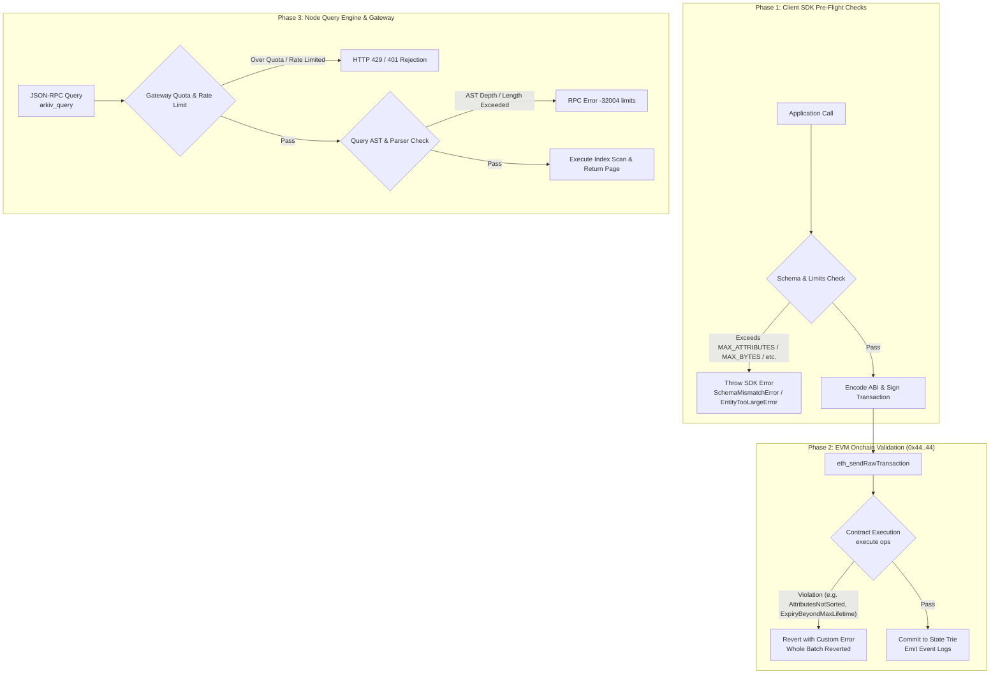
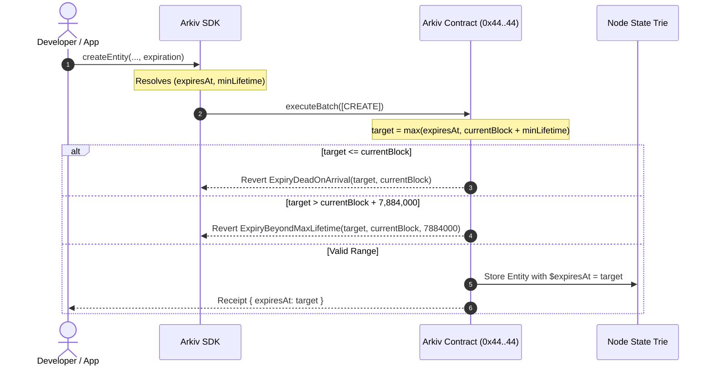

# Arkiv Protocol Limits and Quotas Reference

This document provides an exhaustive, authoritative reference for all structural constraints, numeric boundaries, operational limits, protocol constants, and API quotas enforced by the Arkiv protocol, its EVM smart contract (`0x4400000000000000000000000000000000000044`), the node query engine, and the Arkiv Hub infrastructure.

---

## Table of Contents

1. [Architectural Overview & Enforcement Hierarchy](#1-architectural-overview--enforcement-hierarchy)
2. [Protocol Constants & Exported Identifiers](#2-protocol-constants--exported-identifiers)
3. [Entity & Attribute Structural Limits](#3-entity--attribute-structural-limits)
   - [Attribute Capacity & Named Schema Overhead](#attribute-capacity--named-schema-overhead)
   - [Attribute Name Constraints & Character Set](#attribute-name-constraints--character-set)
   - [Value Size Limits & Cumulative Budget](#value-size-limits--cumulative-budget)
   - [Salt Entropy & Derivation Space](#salt-entropy--derivation-space)
4. [Data Type Precision & Numeric Ranges](#4-data-type-precision--numeric-ranges)
   - [Integer Boundaries (i32, u64, u256)](#integer-boundaries-i32-u64-u256)
   - [Fixed-Point Decimal (dec) Specifications](#fixed-point-decimal-dec-specifications)
   - [Binary & Identification Types (addr, key, bool)](#binary--identification-types-addr-key-bool)
5. [Temporal & Expiration Boundaries](#5-temporal--expiration-boundaries)
   - [Block-Based Accounting Model](#block-based-accounting-model)
   - [Minimum Inclusion Lifetime vs. Absolute Deadlines](#minimum-inclusion-lifetime-vs-absolute-deadlines)
   - [Maximum Expiry Horizon (MAX_LIFETIME)](#maximum-expiry-horizon-max_lifetime)
   - [Permissionless Extension Semantics](#permissionless-extension-semantics)
6. [Query Engine & Retrieval Boundaries](#6-query-engine--retrieval-boundaries)
   - [Pagination & Window Size Limits](#pagination--window-size-limits)
   - [Query String & AST Depth Constraints](#query-string--ast-depth-constraints)
   - [Sorting & Projection Cardinality](#sorting--projection-cardinality)
7. [Arkiv Hub & RPC Access Key Quotas](#7-arkiv-hub--rpc-access-key-quotas)
   - [Monthly Cost Units (CUs) & Billing Windows](#monthly-cost-units-cus--billing-windows)
   - [Rate Limiting: Public vs. Authenticated Gateways](#rate-limiting-public-vs-authenticated-gateways)
   - [Access Control: Origin Attribution & IP Allowlists](#access-control-origin-attribution--ip-allowlists)
   - [Key Lifecycle & Quota Escalation](#key-lifecycle--quota-escalation)
8. [Comprehensive Limits Matrix](#8-comprehensive-limits-matrix)

---

## 1. Architectural Overview & Enforcement Hierarchy

Arkiv enforces limits through a strict three-phase validation pipeline. Because state changes in Arkiv are executed onchain via Ethereum transactions, limits are designed to prevent state bloat, guarantee deterministic gas consumption, ensure fast indexing in node memory, and guard public RPC gateways against denial-of-service (DoS) attacks.



1. **Phase 1 (Client-Side Pre-Flight)**: The official TypeScript SDK (`@arkiv-network/sdk`) statically and dynamically asserts constraints prior to serializing calldata or submitting transactions. This saves users gas by catching malformed operations locally.
2. **Phase 2 (EVM State Machine)**: The native Arkiv storage contract at `0x4400000000000000000000000000000000000044` validates sorted order, byte boundaries, attribute counts, and expiration parameters during EVM execution. Violations trigger custom Solidity reverts.
3. **Phase 3 (Gateway & Query Engine)**: The node JSON-RPC daemon enforces request payload sizes, abstract syntax tree (AST) depths, pagination limits (`MAX_LIMIT`), and Hub access key quotas.

---

## 2. Protocol Constants & Exported Identifiers

The `@arkiv-network/sdk` and its sub-modules export official constants representing protocol limits. Integrating applications and foreign SDK implementations should use these exact identifiers:

```typescript
// Exported from @arkiv-network/sdk
export const MAX_ATTRIBUTES = 32;
export const MAX_NAME_BYTES = 32;
export const MAX_STRING_BYTES = 128;
export const MAX_BYTES_LENGTH = 131_072; // 128 KiB
export const MAX_ENTITY_BYTES = 131_072; // 128 KiB cumulative
export const MAX_LIFETIME = 7_884_000n; // In blocks (~182.5 days at 2s block time)
export const MAX_SALT = (1n << 128n) - 1n; // 128-bit unsigned integer maximum

// Exported from @arkiv-network/sdk/schema
export const I32_MIN = -2_147_483_648;
export const I32_MAX = 2_147_483_647;
export const U64_MAX = 18_446_744_073_709_551_615n;
export const U256_MAX = 115792089237316195423570985008687907853269984665640564039457584007913129639935n;
export const DECIMAL_SCALE = 18;

// Exported from @arkiv-network/sdk/query
export const MAX_LIMIT = 100;
```

---

## 3. Entity & Attribute Structural Limits

### Attribute Capacity & Named Schema Overhead

An entity is a single record containing a set of typed, named attributes. Arkiv enforces an absolute hard ceiling on the number of attributes per entity:

* **Maximum attributes per raw entity**: `32` (`MAX_ATTRIBUTES`).
* **Maximum user attributes per named schema**: `31`.

When a schema is declared using a human-readable identifier (e.g., `defineSchema("my-app.posts", { ... })`), the SDK automatically injects an indexed metadata tag:

$$\text{Attribute}_{\text{system}} = \{\text{name: } \texttt{"arkiv.schema"}, \text{typeId: } 8 \mid 0\text{x}80, \text{value: } \texttt{"my-app.posts"}\}$$

Because this tag consumes one attribute slot in the EVM payload, exactly `31` user-defined columns remain available. Attempting to define 32 columns in a named schema throws `TooManyAttributesError` at runtime.

```typescript
// VALID: Unnamed schema with 32 columns
const MaxRawSchema = defineSchema({
  c01: str(), c02: str(), c03: str(), c04: str(),
  c05: str(), c06: str(), c07: str(), c08: str(),
  c09: str(), c10: str(), c11: str(), c12: str(),
  c13: str(), c14: str(), c15: str(), c16: str(),
  c17: str(), c18: str(), c19: str(), c20: str(),
  c21: str(), c22: str(), c23: str(), c24: str(),
  c25: str(), c26: str(), c27: str(), c28: str(),
  c29: str(), c30: str(), c31: str(), c32: str(), // Total: 32 columns
});

// INVALID: Named schema with 32 columns (throws TooManyAttributesError)
// 32 user columns + 1 "arkiv.schema" column = 33 attributes (> MAX_ATTRIBUTES)
const InvalidNamedSchema = defineSchema("my-app.overflow", {
  c01: str(), /* ... */ c32: str(),
});
```

### Attribute Name Constraints & Character Set

Attribute names are serialized as left-aligned ASCII bytes padded with zeros to a fixed 32-byte word (`bytes32 name`).

* **Maximum Name Length**: `32` bytes (`MAX_NAME_BYTES`).
* **Leading Character**: Must strictly be an ASCII letter (`[a-zA-Z]`).
* **Subsequent Characters**: Must be ASCII letters, digits, dots, hyphens, or underscores (`[a-zA-Z0-9._-]`).
* **Prohibited Substrings**: Double hyphens (`--`) are forbidden because `--` denotes a single-line comment in the Arkiv query language.
* **Prohibited Prefixes**: Attribute names cannot begin with the dollar sign (`$`). The `$` prefix is strictly reserved for intrinsic system fields (`$key`, `$owner`, `$creator`, `$createdAt`, `$updatedAt`, `$expiresAt`, `$creationFlags`).
* **Reserved Schema Name**: The exact identifier `arkiv.schema` is reserved exclusively for the SDK schema tagging mechanism and cannot be declared as a user column.
* **Case Sensitivity**: Names are strictly case-sensitive. `category`, `Category`, and `CATEGORY` represent three distinct attributes with distinct 32-byte keys.
* **Query Language Keyword Collision**: Attribute names must not match query language reserved keywords:
  `AND`, `OR`, `NOT`, `TRUE`, `FALSE`, `BETWEEN`, `STARTSWITH`, `EXISTS`, `TYPEOF`, `ORDER`, `BY`, `ASC`, `DESC`, or primitive type constructors (`bool`, `i32`, `u64`, `u256`, `dec`, `str`, `addr`, `key`, `bytes`).

### Value Size Limits & Cumulative Budget

| Attribute Type | Maximum Individual Size | Indexed Support | Cumulative Budget Behavior |
| :--- | :--- | :--- | :--- |
| `str` | 128 bytes (UTF-8) | Yes (`0x88`) or No (`0x08`) | Individual 128-byte limit enforced per string |
| `bytes` | 131,072 bytes (128 KiB) | **Never** (`0x07` only) | Shared across all `bytes` values in operation |
| Scalar types (`bool`, `i32`, `u64`, `u256`, `dec`, `addr`, `key`) | 32 bytes (Solidity word) | Yes (`0x80 | typeId`) or No (`typeId`) | Fixed word encoding |

#### The Cumulative 128 KiB `bytes` Rule

The Arkiv protocol enforces both an individual limit and a cumulative ceiling on binary data:
1. No single `bytes` attribute can exceed 128 KiB (`MAX_BYTES_LENGTH`).
2. The **sum total of all `bytes` attributes** within a single `create` or `patch` operation must not exceed 128 KiB (`MAX_ENTITY_BYTES`).

```typescript
// VIOLATION: Individual values are <= 128 KiB, but cumulative total exceeds budget
// Throws EntityTooLargeError locally before transaction broadcast
await walletClient.createEntity(AttachmentSchema, {
  fileA: new Uint8Array(80 * 1024), // 80 KiB
  fileB: new Uint8Array(60 * 1024), // 60 KiB (80 + 60 = 140 KiB > 128 KiB)
}, { expiration: ExpirationTime.fromDays(7) });
```

### Salt Entropy & Derivation Space

The entity salt is an unsigned 128-bit integer (`uint128`).
* **Salt Size**: `16` bytes / 128 bits (`0` to `340,282,366,920,938,463,463,374,607,431,768,211,455`).
* **Default Behavior**: When no salt is specified, the SDK uses `crypto.getRandomValues()` to generate a cryptographically secure 128-bit random salt, ensuring entity key unpredictability.
* **Deterministic Derivation**: Passing `salt: NO_SALT` (`0n`) yields a predictable key derived solely from `chainId`, `arkivAddress`, `ownerAddress`, and `entityNonce`.

---

## 4. Data Type Precision & Numeric Ranges

Arkiv supports 9 concrete attribute types, each with strict memory layouts and mathematical bounds.

```
       Arkiv Type System Hierarchy
 ┌──────────────────────────────────────┐
 │         Supported Data Types         │
 └──────────────────┬───────────────────┘
         ┌──────────┴──────────┐
         ▼                     ▼
┌──────────────────┐  ┌──────────────────┐
│   Scalar / Fixed │  │ Dynamic / VarLen │
│  (32-byte word)  │  │  (Byte Streams)  │
├──────────────────┤  ├──────────────────┤
│ bool             │  │ str   (<= 128 B) │
│ i32              │  │ bytes (<= 128 KB)│
│ u64              │  └──────────────────┘
│ u256             │
│ dec  (1e18 scale)│
│ addr (20-byte)   │
│ key  (32-byte)   │
└──────────────────┘
```

### Integer Boundaries (i32, u64, u256)

#### Signed 32-bit Integer (`i32`)
* **Type Identifier**: `2` (`0x02` unindexed, `0x82` indexed).
* **Minimum Value**: $-2,147,483,648$ ($-2^{31}$).
* **Maximum Value**: $2,147,483,647$ ($2^{31} - 1$).
* **Onchain Encoding**: 32-byte word, sign-extended two's complement.
* **SDK Validation**: Numbers outside this range throw `InvalidValueError`. A bare integer in raw queries defaults to `i32`.

#### Unsigned 64-bit Integer (`u64`)
* **Type Identifier**: `3` (`0x03` unindexed, `0x83` indexed).
* **Minimum Value**: $0$.
* **Maximum Value**: $18,446,744,073,709,551,615$ ($2^{64} - 1$).
* **Onchain Encoding**: 32-byte word, zero-padded big-endian.
* **JavaScript Representation**: Handled as native `bigint`.

#### Unsigned 256-bit Integer (`u256`)
* **Type Identifier**: `4` (`0x04` unindexed, `0x84` indexed).
* **Minimum Value**: $0$.
* **Maximum Value**: $2^{256} - 1$ ($\approx 1.15792 \times 10^{77}$).
* **Onchain Encoding**: 32-byte EVM word.
* **JavaScript Representation**: Handled as native `bigint`. A bare `bigint` literal (e.g. `100n`) in JavaScript maps directly to `u256`.

### Fixed-Point Decimal (`dec`) Specifications

The `dec` type provides high-precision fixed-point arithmetic without IEEE 754 floating-point inaccuracies.

* **Type Identifier**: `5` (`0x05` unindexed, `0x85` indexed).
* **Scale**: Exactly 18 decimal places ($10^{18}$).
* **Scaling Multiplier**: $1,000,000,000,000,000,000$ (`1e18`).
* **Storage Representation**: A signed 256-bit integer representing $\text{value} \times 10^{18}$.
* **Mathematical Bounds**:
  $$\text{dec}_{\min} = \frac{-2^{255}}{10^{18}} \approx -5.7896 \times 10^{58}$$
  $$\text{dec}_{\max} = \frac{2^{255} - 1}{10^{18}} \approx +5.7896 \times 10^{58}$$
* **Decimal Input Rules**:
  - Decimal values must be provided as strings (e.g., `dec("12.345")`).
  - Passing a JavaScript floating-point number (e.g., `dec(0.1)`) throws `InvalidValueError` to prevent precision loss.
  - Specifying more than 18 digits after the decimal point throws `InvalidValueError` (the SDK does not silently truncate or round).
  - Utility functions `decUnits(value: string): bigint` and `decFromUnits(units: bigint): string` convert between human-readable strings and internal $10^{18}$ scaled representations.

### Binary & Identification Types (addr, key, bool)

#### Boolean (`bool`)
* **Type Identifier**: `1` (`0x01` unindexed, `0x81` indexed).
* **Storage**: 32 bytes, right-aligned: `0x00...00` (`false`) or `0x00...01` (`true`).
* **Sort Order**: `false` sorts strictly before `true`.

#### Address (`addr`)
* **Type Identifier**: `9` (`0x09` unindexed, `0x89` indexed).
* **Storage**: 32 bytes, right-aligned Ethereum address (20 bytes prefixed with 12 zero bytes).
* **Validation**: Input strings with mixed-case formatting must adhere strictly to EIP-55 checksumming. Lowercase strings are normalized. Mistyped checksums throw `InvalidValueError`.

#### Entity Key (`key`)
* **Type Identifier**: `10` (`0x0a` unindexed, `0x8a` indexed).
* **Storage**: 32 bytes (`bytes32`).
* **Semantics**: Foreign-key reference to another entity. Arkiv does not enforce referential integrity; a key reference to an uncreated, expired, or deleted entity remains valid data.

---

## 5. Temporal & Expiration Boundaries

Arkiv operates on block-native time. The network does not use wall-clock timestamps for onchain validity or indexing.



### Block-Based Accounting Model

* **Target Network**: Rabdi Testnet (Chain ID `7794095`).
* **Nominal Block Time**: 2 seconds per block.
* **Blocks Per Minute**: 30 blocks.
* **Blocks Per Hour**: 1,800 blocks.
* **Blocks Per Day**: 43,200 blocks.
* **Blocks Per Year (365 days)**: 15,768,000 blocks.

### Minimum Inclusion Lifetime vs. Absolute Deadlines

The EVM `execute` function resolves entity expiry via two parameters:

$$\text{expiry} = \max(\text{expiresAt}, \text{currentBlock} + \text{minLifetime})$$

* **Minimum Permissible Expiration**: The resolved block must be strictly greater than the block in which the transaction is mined:
  $$\text{expiry} \ge \text{currentBlock} + 1$$
  Submitting an expiry where $\text{expiry} \le \text{currentBlock}$ causes the EVM contract to revert with `ExpiryDeadOnArrival(uint64 target, uint64 currentBlock)`.
* **Block Alignment**: Durations supplied in seconds (via `ExpirationTime.fromSeconds(n)`) must be exact integer multiples of the 2-second block duration. Supplying an odd number (e.g., 3 seconds) throws `InvalidExpiryError` in the SDK.

### Maximum Expiry Horizon (`MAX_LIFETIME`)

No entity may have an expiration date set further into the future than 7,884,000 blocks from the block of inclusion:

$$\text{MAX\_LIFETIME} = 7,884,000 \text{ blocks}$$

$$\text{Time Horizon} = \frac{7,884,000 \text{ blocks} \times 2 \text{ seconds}}{86,400 \text{ seconds/day}} = 182.5 \text{ days (6 calendar months)}$$

* Submitting an expiration further than 7,884,000 blocks into the future causes the EVM to revert with:
  `ExpiryBeyondMaxLifetime(uint64 target, uint64 currentBlock, uint64 maxLifetime)`.
* SDK pre-flight checks throw `InvalidExpiryError` for `ExpirationTime.fromDays(183)` or `ExpirationTime.fromYears(1)`.
* **Long-Term Storage Strategy**: Entities requiring indefinite retention must be proactively renewed before expiration via `extendEntity` or batch extensions.

### Permissionless Extension Semantics

* **Standard Entities**: By default, only the current `$owner` account may call `extendEntity`.
* **Permissionless Extension Entities**: If `creationFlags` has bit 1 set (`0x02`), any third-party account can pay gas to extend the entity's lifetime.
* **Extension Boundaries**:
  - An extension cannot reduce an entity's lifespan: $\text{newExpiresAt} > \text{currentExpiresAt}$. Submitting an equal or earlier block causes an `ExpiryNotExtended` revert.
  - An extension resets the maximum ceiling from the block of extension:
    $$\text{newExpiresAt} \le \text{extensionBlock} + \text{MAX\_LIFETIME}$$

---

## 6. Query Engine & Retrieval Boundaries

The Arkiv node exposes read endpoints (`arkiv_query`, `arkiv_getEntity`, `arkiv_getBlockTiming`). Queries are expressed in a SQL-like grammar executed directly by the node daemon against its in-memory indices.

### Pagination & Window Size Limits

| Parameter | Minimum | Maximum | Default | Error Code on Violation |
| :--- | :--- | :--- | :--- | :--- |
| `limit` | 1 | 100 (`MAX_LIMIT`) | 100 | `-32602` (Invalid params) |
| `offset` | 0 | Unbounded ($\ge 0$) | 0 | `-32602` (Invalid params) |

* **Page Limit Enforcement**: Requesting `limit: 0` or `limit: 101` returns JSON-RPC error `-32602`.
* **Pagination Paradigms**:
  1. *Offset Pagination*: Uses `offset` to skip records. Subject to data drift if entities are inserted or deleted concurrently between page fetches.
  2. *Key-Cursor Pagination*: Appends `$key > key(0x...) ORDER BY $key ASC` to achieve deterministic, drift-free pagination across large datasets.

### Query String & AST Depth Constraints

To protect validator nodes against computational exhaustion and regex/parser backtracking attacks, the query engine imposes structural limits on incoming query strings:

* **Query String Length**: Node implementations reject overly long query payloads that exceed internal memory buffers.
* **AST Nesting Depth**: Deeply nested parenthetical expressions (e.g. `((((a = 1) AND b = 2) OR c = 3) ...)`) are restricted. Exceeding the maximum abstract syntax tree depth returns:
  `QueryError` with JSON-RPC error code `-32004` (`kind: "limits"`).

### Sorting & Projection Cardinality

* **Single Column Sort Limit**: A query can include at most one sort attribute in the `ORDER BY` clause:
  ```sql
  -- VALID:
  category = str('news') ORDER BY score:dec DESC

  -- INVALID: Multiple order attributes throw InvalidPredicateError / Parse Error
  category = str('news') ORDER BY score:dec DESC, author:addr ASC
  ```
* **Sort Type Qualification**: Attributes specified in `ORDER BY` must explicitly append their type qualifier (e.g. `ORDER BY score:dec`), unless sorting by an intrinsic entity field (`$key`, `$expiresAt`, `$owner`, `$creator`) which has an invariant native type.
* **Unsortable System Fields**: `$createdAt` and `$updatedAt` cannot be used in `ORDER BY` clauses.
* **Unsortable Data Types**: `bytes` columns cannot be sorted because binary blobs are not indexed.

---

## 7. Arkiv Hub & RPC Access Key Quotas

All JSON-RPC requests directed to official Arkiv gateways (`rpc.rabdi.db-chain.testnet.arkiv.network`) are governed by the Arkiv Hub rate-limiting and quota subsystem.

```
       RPC Request Authentication Flow
 ┌──────────────────────────────────────────────┐
 │             Incoming JSON-RPC Request        │
 └──────────────────────┬───────────────────────┘
                        ▼
           ┌─────────────────────────┐
           │ Access Key Present?     │
           └────┬───────────────┬────┘
           No   │               │ Yes
                ▼               ▼
      ┌──────────────────┐  ┌────────────────────────┐
      │ Public Rate Limit│  │ Check IP & Origin      │
      │ Aggressive Cap   │  │ Allowlists             │
      └──────────────────┘  └───────────┬────────────┘
                                        ▼
                            ┌────────────────────────┐
                            │ Check Monthly Cost     │
                            │ Units (CU) Quota       │
                            └───────────┬────────────┘
                                        ▼
                            ┌────────────────────────┐
                            │ Execute arkiv_query or │
                            │ eth_sendRawTransaction │
                            └────────────────────────┘
```

### Monthly Cost Units (CUs) & Billing Windows

Arkiv Hub accounts are allocated monthly quotas denominated in **Cost Units (CUs)**.
* **Accounting Frequency**: Consumption tallies are updated asynchronously with a reporting latency of a few minutes.
* **Reset Cycle**: Quotas reset on a strict 30-day recurring calendar cycle based on key generation timestamp.
* **Quota Exhaustion**: When an access key depletes its monthly CU allotment, subsequent calls are rejected with HTTP status code `429 Too Many Requests` or `401 Unauthorized`, accompanied by a Hub console alert.

### Rate Limiting: Public vs. Authenticated Gateways

| Gateway Tier | Access Key Config | Request Throttling | Permitted Environment |
| :--- | :--- | :--- | :--- |
| **Public Gateway** | `accessKey: ""` | Heavily restricted; burst threshold drops rapidly | Local developer testing, quick prototyping |
| **Hub Authenticated** | `accessKey: "arkiv_..."` | High sustained throughput; dedicated CU bucket | Production apps, indexers, testnet CI/CD |

* **Client Transport Configuration**:
  ```bash
  # Option 1: URL Path Parameter
  https://rpc.rabdi.db-chain.testnet.arkiv.network/<YOUR_ACCESS_KEY>

  # Option 2: HTTP Header
  X-API-KEY: <YOUR_ACCESS_KEY>

  # Option 3: Standard Authorization Header
  Authorization: Bearer <YOUR_ACCESS_KEY>
  ```
* Supplying an unrecognized or revoked key results in an immediate HTTP `401 Unauthorized` response.

### Access Control: Origin Attribution & IP Allowlists

To prevent key theft and quota exhaustion, the Arkiv Hub provides two security mechanisms:

1. **Origins Allowlist (Browser Attribution)**:
   - Restricts usage to designated web domains (`https://example.com`).
   - Validated against browser-supplied `Origin` headers.
   - *Security Note*: Non-browser clients (e.g. `curl`, Python scripts) can spoof `Origin` headers; this setting serves as origin attribution rather than tamper-proof access control.
2. **IP Allowlist (Server Access Control)**:
   - Restricts key usage to explicit IPv4 or IPv6 server addresses.
   - **CIDR notation is not permitted**; each server IP must be enumerated individually.
   - Requests arriving from unlisted IP addresses are rejected with HTTP `401`.

### Key Lifecycle & Quota Escalation

* **Single Key Per Network**: Each connected wallet may generate one active key per network (e.g., one key for Rabdi).
* **Regeneration**: Selecting *Regenerate* immediately invalidates the previous key across all active nodes.
* **Deletion**: Permanently removes the key. A new key can be created subsequently.
* **Quota Upgrades**: Applications exceeding standard testnet tiers can submit in-Hub quota escalation requests (*Request more quota* or *Request even higher quota*).

---

## 8. Comprehensive Limits Matrix

The following table consolidates every protocol boundary, threshold, and limit across the Arkiv ecosystem:

| Category | Constraint Name | Value | Constant | Enforcing Entity | Violation Consequence |
| :--- | :--- | :--- | :--- | :--- | :--- |
| **Entities** | Max Attributes per Entity | 32 attributes | `MAX_ATTRIBUTES` | SDK & EVM Contract | EVM: `TooManyAttributes`, SDK: `TooManyAttributesError` |
| **Entities** | Max Columns (Named Schema) | 31 columns | N/A (`MAX_ATTRIBUTES - 1`) | SDK | SDK: `TooManyAttributesError` |
| **Attributes** | Max Name Byte Length | 32 bytes | `MAX_NAME_BYTES` | SDK & EVM Contract | EVM: `Ident32InvalidByte`, SDK: `InvalidAttributeNameError` |
| **Attributes** | Attribute Name Format | `^[a-zA-Z][a-zA-Z0-9._-]*$` | N/A | SDK & EVM Contract | EVM: `Ident32InvalidByte`, SDK: `InvalidAttributeNameError` |
| **Attributes** | Forbidden Substring | `--` (Double hyphen) | N/A | SDK & Query Engine | SDK: `InvalidAttributeNameError` |
| **Attributes** | Reserved Prefixes | `$` (System field prefix) | N/A | SDK & EVM Contract | EVM: `SystemAttributeNotWritable` |
| **Attributes** | Reserved Attribute Name | `arkiv.schema` | N/A | SDK | SDK: `SchemaDefinitionError` |
| **Strings** | Max `str` Length | 128 bytes UTF-8 | `MAX_STRING_BYTES` | SDK & EVM Contract | EVM: `InvalidValueType`, SDK: `InvalidValueError` |
| **Binary** | Max Single `bytes` Length | 131,072 bytes (128 KiB) | `MAX_BYTES_LENGTH` | SDK & EVM Contract | EVM: `InvalidValueType`, SDK: `InvalidValueError` |
| **Binary** | Cumulative `bytes` / Op | 131,072 bytes (128 KiB) | `MAX_ENTITY_BYTES` | SDK & EVM Contract | EVM: `InvalidValueType`, SDK: `EntityTooLargeError` |
| **Entropy** | Salt Bit Width | 128 bits | `MAX_SALT` | SDK & EVM Contract | EVM: Non-canonical decode, SDK: `InvalidSaltError` |
| **Numeric** | `i32` Minimum Value | $-2,147,483,648$ | `I32_MIN` | SDK & EVM Contract | EVM: `InvalidValueType`, SDK: `InvalidValueError` |
| **Numeric** | `i32` Maximum Value | $2,147,483,647$ | `I32_MAX` | SDK & EVM Contract | EVM: `InvalidValueType`, SDK: `InvalidValueError` |
| **Numeric** | `u64` Maximum Value | $2^{64} - 1$ | `U64_MAX` | SDK & EVM Contract | EVM: `InvalidValueType`, SDK: `InvalidValueError` |
| **Numeric** | `u256` Maximum Value | $2^{256} - 1$ | `U256_MAX` | SDK & EVM Contract | EVM: `InvalidValueType`, SDK: `InvalidValueError` |
| **Numeric** | `dec` Fixed Scale | 18 decimal places | `DECIMAL_SCALE` | SDK & EVM Contract | EVM: `InvalidValueType`, SDK: `InvalidValueError` |
| **Lifetimes** | Minimum Expiration | $\text{currentBlock} + 1$ | N/A | EVM Contract | EVM: `ExpiryDeadOnArrival` |
| **Lifetimes** | Maximum Expiration Horizon | 7,884,000 blocks (~182.5d) | `MAX_LIFETIME` | SDK & EVM Contract | EVM: `ExpiryBeyondMaxLifetime`, SDK: `InvalidExpiryError` |
| **Lifetimes** | Block Time Resolution | 2 seconds | N/A | Node Consensus | SDK: `InvalidExpiryError` (if non-multiple of 2s) |
| **Queries** | Page Size (`limit`) | 1 to 100 rows | `MAX_LIMIT` | Node JSON-RPC Daemon | RPC: `-32602` Invalid params |
| **Queries** | Max Sort Attributes | 1 attribute | N/A | SDK & Query Engine | SDK: `InvalidPredicateError`, RPC: `-32001` |
| **Queries** | AST Query Depth | Implementation-bound | N/A | Node JSON-RPC Daemon | RPC: `-32004` Query limits exceeded |
| **Hub Gateway**| Active Keys per Network | 1 key per wallet | N/A | Arkiv Hub Portal | UI validation gate |
| **Hub Gateway**| Key Whitelist Constraints | Exact IP only (no CIDR) | N/A | Arkiv Hub Gateway | HTTP 401 Unauthorized |
