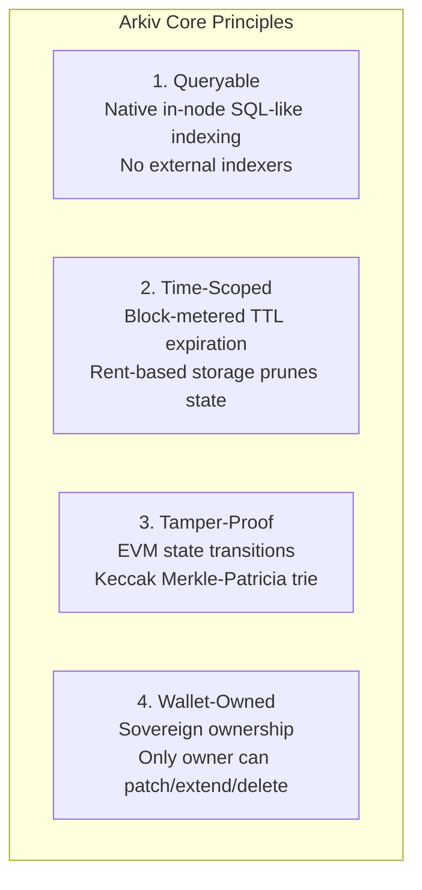
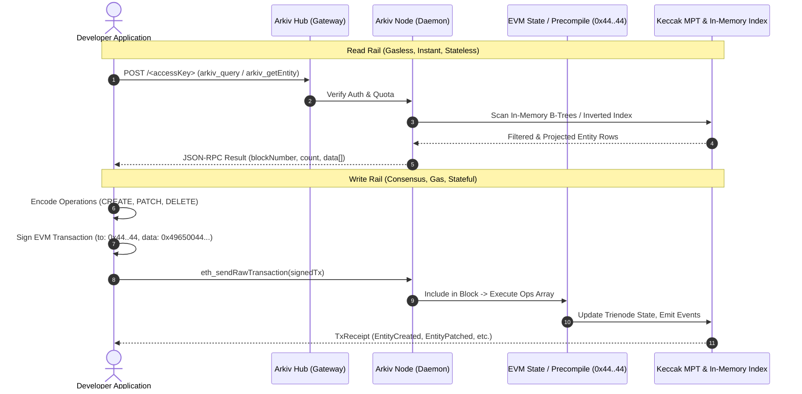
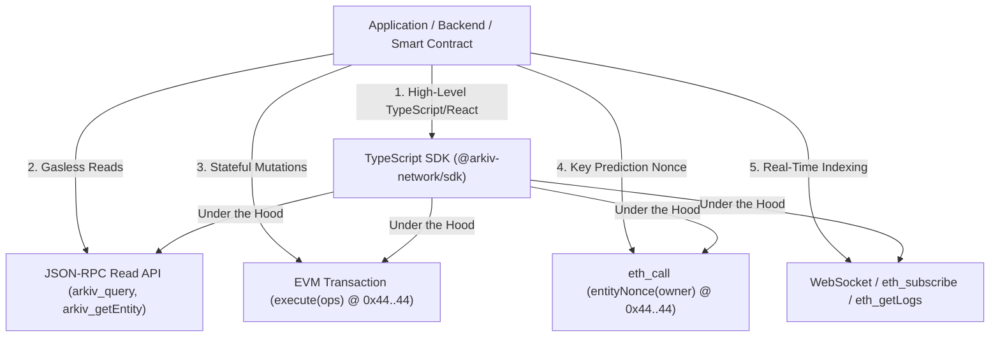

# Arkiv Architecture & Protocol Reference Manual

> **Comprehensive Technical Research on the Arkiv Web3 Database, Protocol Internals, Execution Mechanics, and SDK Implementation Architecture.**

---

## Table of Contents

- [1. Executive Summary & Protocol Overview](#1-executive-summary--protocol-overview)
- [2. The Dual-Rail Execution Paradigm](#2-the-dual-rail-execution-paradigm)
- [3. How the Arkiv Backend is Invoked](#3-how-the-arkiv-backend-is-invoked)
  - [Method A: High-Level Client SDKs (`@arkiv-network/sdk`)](#method-a-high-level-client-sdks-arkiv-networksdk)
  - [Method B: Direct JSON-RPC Read Endpoints (`arkiv_*`)](#method-b-direct-json-rpc-read-endpoints-arkiv_)
  - [Method C: On-Chain EVM Transactions (`execute(ops)`)](#method-c-on-chain-evm-transactions-executeops)
  - [Method D: State Nonce Inspection via `eth_call`](#method-d-state-nonce-inspection-via-eth_call)
  - [Method E: Real-Time Event Streams (`eth_subscribe` / `eth_getLogs`)](#method-e-real-time-event-streams-eth_subscribe--eth_getlogs)
- [4. Comparison Matrix: Arkiv Invocation Methods](#4-comparison-matrix-arkiv-invocation-methods)
- [5. Network Topography, Transports & Authentication](#5-network-topography-transports--authentication)
- [6. Entity Data Model & Storage Encodings](#6-entity-data-model--storage-encodings)
- [7. Complete Research Directory Index](#7-complete-research-directory-index)

---

## 1. Executive Summary & Protocol Overview

**Arkiv** (`https://docs.arkiv.network`) is a specialized Web3 database that stores structured records (**entities**) with indexed, queryable attributes, cryptographically backed by EVM consensus and committed to state using Keccak Merkle-Patricia tries. Arkiv resolves the fundamental Web3 storage dilemma by unifying four operational principles:



1. **Queryable**: Real-time attribute filtering, sorting, and pagination executed directly inside the blockchain node daemon without requiring external indexers (such as The Graph or Subsquid).
2. **Time-Scoped**: Every entity possesses a block-metered expiration block (`$expiresAt`). Upon reaching this block height, the entity automatically leaves the query surface. Users pay only for the storage duration they consume.
3. **Tamper-Proof**: Every state change is an EVM transaction signed by a wallet. State transitions are verified by validators and committed into a Keccak Merkle-Patricia trie.
4. **Wallet-Owned**: Entities are owned by the Ethereum address that created them (or the recipient of an ownership transfer). Only `$owner` can mutate, extend, transfer, or delete the entity (unless permissionless extension is enabled).

---

## 2. The Dual-Rail Execution Paradigm

A foundational architectural realization from the Arkiv documentation is that **Arkiv does not have an `arkiv_write` JSON-RPC method**. 

Instead, Arkiv operates a **Dual-Rail Protocol Architecture**:



- **Read Rail (Off-Chain JSON-RPC Engine)**: Gasless, high-throughput queries executed against the node's local database index using custom JSON-RPC methods (`arkiv_query`, `arkiv_getEntity`, `arkiv_getBlockTiming`).
- **Write Rail (On-Chain EVM Consensus)**: Stateful mutations executed as standard Ethereum transactions sent to the canonical protocol contract address `0x4400000000000000000000000000000000000044` calling function `execute((uint8,bytes)[])`. Gas is paid in `tGLM` (on Rabdi testnet) or `GLM` (on mainnet).

---

## 3. How the Arkiv Backend is Invoked

Arkiv exposes five distinct invocation interfaces depending on whether the consumer requires high-level abstractions, raw network integration, consensus mutations, or reactive event listening:



---

### Method A: High-Level Client SDKs (`@arkiv-network/sdk`)

The official TypeScript SDK wraps both rails into an intuitive, database-like ORM architecture built on top of [Viem](https://viem.sh).

#### 1. Public Client (Reads, Projections, Watchers)
Handles gasless querying, entity retrieval, block timing, key prediction, and event listening.

```typescript
import { createPublicClient } from "@arkiv-network/sdk"
import { rabdi } from "@arkiv-network/sdk/chains"
import { eq, and, gt } from "@arkiv-network/sdk/query"
import { http } from "viem"

const publicClient = createPublicClient({
  chain: rabdi({ accessKey: process.env.ARKIV_ACCESS_KEY ?? "" }),
  transport: http(),
})

// Querying entities through a typed schema
const { entities, count, skipped } = await publicClient
  .select({ $key: true, $createdAt: true, title: true, score: true })
  .from(Posts)
  .where(and(eq("category", "news"), gt("score", dec("4.0"))))
  .limit(10)
  .fetch()
```

#### 2. Wallet Client (Mutations, Batches, Gas Management)
Handles wallet signing, transaction construction, gas estimation, and receipt decoding.

```typescript
import { createWalletClient, ExpirationTime } from "@arkiv-network/sdk"
import { privateKeyToAccount } from "viem/accounts"

const walletClient = createWalletClient({
  account: privateKeyToAccount(process.env.PRIVATE_KEY as `0x${string}`),
  chain: rabdi({ accessKey: process.env.ARKIV_ACCESS_KEY ?? "" }),
  transport: http(),
})

// Atomic entity creation
const result = await walletClient.createEntity(
  Posts,
  { title: "Hello World", category: "news", score: dec("4.8") },
  { expiration: ExpirationTime.fromDays(30) }
)

console.log("Created Entity Key:", result.entityKey)
console.log("Transaction Hash:", result.txHash)
```

For comprehensive SDK architecture specifications, see [05-sdk-architecture-blueprint/](file:///home/dikshitrj/Coding/arkivector/RESEARCH/arkiv-docs/05-sdk-architecture-blueprint/).

---

### Method B: Direct JSON-RPC Read Endpoints (`arkiv_*`)

For clients implemented in Go, Rust, Python, or shell scripts without an official SDK, Arkiv nodes answer three dedicated JSON-RPC read methods over HTTP and WebSocket.

#### 1. `arkiv_query`
Executes SQL-like filtering, selective projection, and pagination:

```bash
curl "https://rpc.rabdi.db-chain.testnet.arkiv.network/$ARKIV_ACCESS_KEY" \
  -H "Content-Type: application/json" \
  --data @- <<'EOF'
{
  "jsonrpc": "2.0",
  "id": 1,
  "method": "arkiv_query",
  "params": [
    "arkiv.schema = str('my-app.posts') AND category = str('news') ORDER BY score:dec DESC",
    {
      "select": {
        "key": true,
        "owner": true,
        "expiresAt": true,
        "attributes": { "title": true, "score": true },
        "count": true
      },
      "limit": "0xa",
      "offset": "0x0"
    }
  ]
}
EOF
```

**Response Format**:
```json
{
  "jsonrpc": "2.0",
  "id": 1,
  "result": {
    "data": [
      {
        "key": "0x9f2c8d1e4b3a7f05c6d2e8b1a4c7f0e3d5b8a1c4e7f0d2b5c8a1e4f7d0c3b6a9",
        "owner": "0xd8dA6BF26964aF9D7eEd9e03E53415D37aA96045",
        "expiresAt": "0x249f0",
        "attributes": [
          { "name": "title", "type": "str", "value": "Decentralized Database News" },
          { "name": "score", "type": "dec", "value": "4.8" }
        ]
      }
    ],
    "blockNumber": "0x1bc",
    "count": "0x1"
  }
}
```

#### 2. `arkiv_getEntity`
Point-lookup of a single entity by its 32-byte hexadecimal key:

```bash
curl "https://rpc.rabdi.db-chain.testnet.arkiv.network/$ARKIV_ACCESS_KEY" \
  -H "Content-Type: application/json" \
  --data @- <<'EOF'
{
  "jsonrpc": "2.0",
  "id": 2,
  "method": "arkiv_getEntity",
  "params": ["0x9f2c8d1e4b3a7f05c6d2e8b1a4c7f0e3d5b8a1c4e7f0d2b5c8a1e4f7d0c3b6a9"]
}
EOF
```
*Note: Returns `null` if the entity never existed, was explicitly deleted, or has passed its expiration block.*

#### 3. `arkiv_getBlockTiming`
Retrieves consensus timing to synchronize block-metered TTL expirations:

```bash
curl "https://rpc.rabdi.db-chain.testnet.arkiv.network/$ARKIV_ACCESS_KEY" \
  -H "Content-Type: application/json" \
  --data @- <<'EOF'
{
  "jsonrpc": "2.0",
  "id": 3,
  "method": "arkiv_getBlockTiming",
  "params": []
}
EOF
```

**Response**:
```json
{
  "jsonrpc": "2.0",
  "id": 3,
  "result": {
    "current_block": 582143,
    "current_block_time": 1742721127,
    "duration": 2
  }
}
```

For complete JSON-RPC documentation, see [02-json-rpc-protocol/](file:///home/dikshitrj/Coding/arkivector/RESEARCH/arkiv-docs/02-json-rpc-protocol/).

---

### Method C: On-Chain EVM Transactions (`execute(ops)`)

To create, mutate, extend, transfer, or delete entities, a client must construct and broadcast an Ethereum transaction to the canonical Arkiv address.

#### 1. Contract Specification
- **Address**: `0x4400000000000000000000000000000000000044` (identical across all Arkiv chains)
- **Function**: `execute((uint8 operation, bytes operationData)[] ops)`
- **Function Selector**: `0x49650044`
- **Native Value**: Strictly `0` (storage rent and compute are paid via transaction gas in `tGLM`/`GLM`).

#### 2. Operation Types & Struct Layouts
Each operation in `ops` consists of a 1-byte opcode tag and ABI-encoded `operationData`:

```solidity
// Opcode 1: CREATE
struct CreateOp {
    uint128 salt;            // 128-bit entropy (or 0 for predictable keys)
    uint64 expiresAt;        // Target block (or 0 for relative lifetime)
    uint64 minLifetime;       // Minimum lifetime in blocks from inclusion
    uint8 creationFlags;     // bit 0: readonly, bit 1: permissionlessExtension
    Attribute[] attributes;  // Sorted array of attributes (max 32)
}

// Opcode 2: PATCH
struct PatchOp {
    bytes32 entityKey;       // Target entity key
    Attribute[] mutations;   // Attribute diff (use typeId 0 for tombstones)
}

// Opcode 3: EXTEND_EXPIRY
struct ExtendExpiryOp {
    bytes32 entityKey;       // Target entity key
    uint64 expiresAt;        // Target block
    uint64 minLifetime;       // Minimum lifetime from inclusion
}

// Opcode 4: TRANSFER_OWNERSHIP
struct TransferOwnershipOp {
    bytes32 entityKey;       // Target entity key
    address newOwner;        // New owner address (cannot be 0x0 or self)
}

// Opcode 5: DELETE
struct DeleteOp {
    bytes32 entityKey;       // Target entity key
}
```

#### 3. Attribute Wire Encoding
Each attribute is defined as:
```solidity
struct Attribute {
    bytes32 name;  // ASCII name left-aligned, zero-padded, max 32 bytes
    uint8 typeId;  // Low 7 bits: Type ID (1..10), Bit 7 (0x80): Indexed flag
    bytes value;   // Encoded attribute payload
}
```

**Critical Rules**:
1. Attributes must be sorted in **strictly ascending lexicographical order** by `bytes32 name`.
2. Max 32 attributes per entity (`MAX_ATTRIBUTES`).
3. Attribute names cannot start with `$`.

For complete transaction calldata and memory layout specifications, see [03-evm-mutations-and-contract-spec/](file:///home/dikshitrj/Coding/arkivector/RESEARCH/arkiv-docs/03-evm-mutations-and-contract-spec/).

---

### Method D: State Nonce Inspection via `eth_call`

Before sending an atomic batch of creations, clients frequently need to know the newly created entity keys in advance (e.g., to create a `Post` and link `Comment` entities to it in the same transaction).

#### Entity Key Derivation Formula:
$$\text{key} = \text{keccak256}(\text{abi.encodePacked}(\text{uint256 chainId}, \text{address arkiv}, \text{address owner}, \text{uint64 nonce}, \text{uint128 salt}))$$

The buffer is exactly **96 packed bytes** ($32 + 20 + 20 + 8 + 16$).

The `nonce` is the **Entity Nonce** (tracked separately from the Ethereum account transaction nonce). Clients read the owner's current entity nonce via `eth_call`:

```bash
curl "https://rpc.rabdi.db-chain.testnet.arkiv.network/$ARKIV_ACCESS_KEY" \
  -H "Content-Type: application/json" \
  --data @- <<EOF
{
  "jsonrpc": "2.0",
  "id": 1,
  "method": "eth_call",
  "params": [{
    "to": "0x4400000000000000000000000000000000000044",
    "data": "0x36917bfd000000000000000000000000${OWNER_ADDRESS#0x}"
  }, "latest"]
}
EOF
```
*`0x36917bfd` is the function selector for `entityNonce(address owner)`.*

---

### Method E: Real-Time Event Streams (`eth_subscribe` / `eth_getLogs`)

When mutations occur, the Arkiv contract emits dedicated EVM log events:

| Event Name | Signature & Topics | Emitted When |
| :--- | :--- | :--- |
| `EntityCreated` | `EntityCreated(bytes32 indexed entityKey, address indexed owner, uint64 expiresAt, uint8 creationFlags)` | Opcode 1 executed |
| `EntityPatched` | `EntityPatched(bytes32 indexed entityKey, address indexed owner)` | Opcode 2 executed |
| `ExpiryExtended` | `ExpiryExtended(bytes32 indexed entityKey, address indexed owner, uint64 expiresAt)` | Opcode 3 executed |
| `OwnershipTransferred` | `OwnershipTransferred(bytes32 indexed entityKey, address indexed previousOwner, address indexed newOwner)` | Opcode 4 executed |
| `EntityDeleted` | `EntityDeleted(bytes32 indexed entityKey, address indexed owner)` | Opcode 5 executed |

**Critical Event Invariants**:
- Events do **not** carry attribute data. Clients observe the event and execute `arkiv_getEntity(entityKey)` to retrieve mutated state.
- **No event is emitted when an entity naturally expires** due to block TTL. Expirations are passive to prevent network denial-of-service.

---

## 4. Comparison Matrix: Arkiv Invocation Methods

| Characteristic | Method A: High-Level SDK | Method B: JSON-RPC Reads | Method C: EVM Transactions | Method D: `eth_call` Nonce | Method E: Event Stream |
| :--- | :--- | :--- | :--- | :--- | :--- |
| **Primary Purpose** | Full-stack app development | Querying & point-lookups | State mutation (writes) | Key prediction | Reactive sync & caching |
| **Transport** | HTTP & WebSocket | HTTP & WebSocket | HTTP JSON-RPC (`eth_sendRawTransaction`) | HTTP JSON-RPC (`eth_call`) | WebSocket / HTTP polling |
| **Gas Cost** | None for reads, Gas for writes | **Zero (Gasless)** | **Gas paid in tGLM / GLM** | **Zero (Gasless)** | **Zero (Gasless)** |
| **Authentication** | Access Key + Private Key | Access Key | Wallet Signature | Access Key | Access Key |
| **Latency** | Network RTT (read) / Block (write) | Sub-100ms (Memory/Disk scan) | 1 block (2 seconds on Rabdi) | Sub-50ms | Push on block inclusion |
| **Target Address** | Handled internally | Arkiv Node RPC daemon | `0x44..44` | `0x44..44` | `0x44..44` (log filter) |
| **Idempotent?** | Query: Yes / Write: Context-dependent | Yes | No (increments nonces) | Yes | Yes |

---

## 5. Network Topography, Transports & Authentication

### Rabdi Public Testnet Specifications

| Network Parameter | Reference Value |
| :--- | :--- |
| **Chain ID** | `7794095` (`0x76edaf`) |
| **Canonical Contract** | `0x4400000000000000000000000000000000000044` |
| **HTTP RPC Endpoint** | `https://rpc.rabdi.db-chain.testnet.arkiv.network` |
| **WebSocket RPC Endpoint** | `wss://rpc.rabdi.db-chain.testnet.arkiv.network` |
| **Block Time** | Exactly 2.0 seconds |
| **Gas Token** | `tGLM` (faucet: `hub.arkiv.network/faucet`) |
| **Access Keys Portal** | `hub.arkiv.network/access-keys` |
| **Block Explorer** | `rabdi.explorer.arkiv.network` |

### Access Key Security & Quotas
- Managed through **Arkiv Hub** via EIP-191 off-chain wallet signatures.
- Three supported authentication formats:
  1. *URL Path*: `https://rpc.rabdi.db-chain.testnet.arkiv.network/<key>`
  2. *HTTP Header*: `X-API-KEY: <key>`
  3. *Bearer Token*: `Authorization: Bearer <key>`
- Empty key (`accessKey: ""`) routes requests to the public pool, which is heavily throttled.
- **Security Warning**: Never add a key-bearing RPC URL to a user's wallet via `wallet_addEthereumChain`, as browser wallets persist RPC URLs and expose project quotas to third-party dApps.

---

## 6. Entity Data Model & Storage Encodings

### Supported Column Types & Wire Encodings

| Type Name | Type ID | Wire Length | Value Format & Invariants | Filterable? | Sortable? |
| :--- | :---: | :---: | :--- | :---: | :---: |
| `tombstone` | `0` | 0 bytes | Empty byte array; unsets attribute during Opcode 2 (`PATCH`) | No | No |
| `bool` | `1` | 32 bytes | `0` (`false`) or `1` (`true`). `false` sorts before `true` | Yes (if indexed) | Yes |
| `i32` | `2` | 32 bytes | Sign-extended 32-bit integer ($-2^{31}$ to $2^{31}-1$) | Yes (if indexed) | Yes |
| `u64` | `3` | 32 bytes | Big-endian unsigned 64-bit integer ($0$ to $2^{64}-1$) | Yes (if indexed) | Yes |
| `u256` | `4` | 32 bytes | Unsigned 256-bit integer ($0$ to $2^{256}-1$) | Yes (if indexed) | Yes |
| `dec` | `5` | 32 bytes | Signed fixed-point integer scaled by $10^{18}$ (18 decimal places) | Yes (if indexed) | Yes |
| *reserved* | `6` | — | Protocol reserved | — | — |
| `bytes` | `7` | Variable | Raw bytes up to 128 KiB (`MAX_BYTES_LENGTH`). Total entity budget 128 KiB | **Never** | **Never** |
| `str` | `8` | Variable | UTF-8 string up to 128 bytes (`MAX_STRING_BYTES`). Only type supporting `startsWith` | Yes (if indexed) | Yes |
| `addr` | `9` | 32 bytes | 20-byte address, right-aligned (12 leading zero bytes) | Yes (if indexed) | Yes |
| `key` | `10` | 32 bytes | 32-byte foreign entity key | Yes (if indexed) | Yes |

*Index Flag: An attribute is indexed if bit 7 of its typeId is set (`typeId | 0x80`). For instance, indexed `str` is `0x88`, and indexed `dec` is `0x85`.*

---

## 7. Complete Research Directory Index

Explore the specialized research modules in this repository for exhaustive details:

1. [**01-architecture-and-fundamentals/**](file:///home/dikshitrj/Coding/arkivector/RESEARCH/arkiv-docs/01-architecture-and-fundamentals/)
   - [overview.md](file:///home/dikshitrj/Coding/arkivector/RESEARCH/arkiv-docs/01-architecture-and-fundamentals/overview.md) – Core philosophy, four principles, gas economics, MPT state commitments.
   - [entity-model.md](file:///home/dikshitrj/Coding/arkivector/RESEARCH/arkiv-docs/01-architecture-and-fundamentals/entity-model.md) – Entity anatomy, 7 system fields (`$key`, `$owner`, `$creator`, etc.), creation flags.
   - [attributes-and-types.md](file:///home/dikshitrj/Coding/arkivector/RESEARCH/arkiv-docs/01-architecture-and-fundamentals/attributes-and-types.md) – Column types, typeId layout, indexing bit `0x80`, sorting invariants.
   - [lifecycle-and-expiration.md](file:///home/dikshitrj/Coding/arkivector/RESEARCH/arkiv-docs/01-architecture-and-fundamentals/lifecycle-and-expiration.md) – Block TTL expiration formula, rent model, permissionless extension.
   - [network-and-infrastructure.md](file:///home/dikshitrj/Coding/arkivector/RESEARCH/arkiv-docs/01-architecture-and-fundamentals/network-and-infrastructure.md) – Rabdi testnet specs, Access Key security, allowlists.

2. [**02-json-rpc-protocol/**](file:///home/dikshitrj/Coding/arkivector/RESEARCH/arkiv-docs/02-json-rpc-protocol/)
   - [overview.md](file:///home/dikshitrj/Coding/arkivector/RESEARCH/arkiv-docs/02-json-rpc-protocol/overview.md) – Dual-rail RPC model, transport layers, security headers.
   - [arkiv_query.md](file:///home/dikshitrj/Coding/arkivector/RESEARCH/arkiv-docs/02-json-rpc-protocol/arkiv_query.md) – Query method specification, projection map, count, pagination.
   - [arkiv_getEntity.md](file:///home/dikshitrj/Coding/arkivector/RESEARCH/arkiv-docs/02-json-rpc-protocol/arkiv_getEntity.md) – Point-lookup key retrieval, null state semantics.
   - [arkiv_getBlockTiming.md](file:///home/dikshitrj/Coding/arkivector/RESEARCH/arkiv-docs/02-json-rpc-protocol/arkiv_getBlockTiming.md) – Block height, timestamp, duration synchronization.
   - [error-handling.md](file:///home/dikshitrj/Coding/arkivector/RESEARCH/arkiv-docs/02-json-rpc-protocol/error-handling.md) – RPC error codes (`-32001` to `-32004`, `-32602`), HTTP gateway status codes.

3. [**03-evm-mutations-and-contract-spec/**](file:///home/dikshitrj/Coding/arkivector/RESEARCH/arkiv-docs/03-evm-mutations-and-contract-spec/)
   - [execute-function.md](file:///home/dikshitrj/Coding/arkivector/RESEARCH/arkiv-docs/03-evm-mutations-and-contract-spec/execute-function.md) – Address `0x44..44`, `execute(ops)` calldata, selector `0x49650044`.
   - [operation-types.md](file:///home/dikshitrj/Coding/arkivector/RESEARCH/arkiv-docs/03-evm-mutations-and-contract-spec/operation-types.md) – ABI structs for Operations 1 to 5, differential patching.
   - [attribute-serialization.md](file:///home/dikshitrj/Coding/arkivector/RESEARCH/arkiv-docs/03-evm-mutations-and-contract-spec/attribute-serialization.md) – `struct Attribute`, ASCII packing, sorting rules, tombstones.
   - [entity-key-derivation.md](file:///home/dikshitrj/Coding/arkivector/RESEARCH/arkiv-docs/03-evm-mutations-and-contract-spec/entity-key-derivation.md) – 96-byte `keccak256` formula, `entityNonce` selector `0x36917bfd`.
   - [events-and-logs.md](file:///home/dikshitrj/Coding/arkivector/RESEARCH/arkiv-docs/03-evm-mutations-and-contract-spec/events-and-logs.md) – On-chain EVM events, 22 custom revert errors, JSON ABI.

4. [**04-query-engine-and-ast/**](file:///home/dikshitrj/Coding/arkivector/RESEARCH/arkiv-docs/04-query-engine-and-ast/)
   - [query-language-grammar.md](file:///home/dikshitrj/Coding/arkivector/RESEARCH/arkiv-docs/04-query-engine-and-ast/query-language-grammar.md) – Full EBNF grammar, lexical tokens, AST hierarchy, precedence.
   - [operators-and-predicates.md](file:///home/dikshitrj/Coding/arkivector/RESEARCH/arkiv-docs/04-query-engine-and-ast/operators-and-predicates.md) – Relational comparisons, ranges, prefix search, type checking.
   - [ordering-and-sorting.md](file:///home/dikshitrj/Coding/arkivector/RESEARCH/arkiv-docs/04-query-engine-and-ast/ordering-and-sorting.md) – Sorting syntax (`ORDER BY attr:type ASC`), unindexed sort mechanics.
   - [pagination-and-cursors.md](file:///home/dikshitrj/Coding/arkivector/RESEARCH/arkiv-docs/04-query-engine-and-ast/pagination-and-cursors.md) – Offset pagination hazards vs key-cursor pagination (`$key > key(...)`).
   - [schema-filtering-tag.md](file:///home/dikshitrj/Coding/arkivector/RESEARCH/arkiv-docs/04-query-engine-and-ast/schema-filtering-tag.md) – `arkiv.schema` tag isolation, multi-tenant trust boundaries.

5. [**05-sdk-architecture-blueprint/**](file:///home/dikshitrj/Coding/arkivector/RESEARCH/arkiv-docs/05-sdk-architecture-blueprint/)
   - [sdk-design-thesis.md](file:///home/dikshitrj/Coding/arkivector/RESEARCH/arkiv-docs/05-sdk-architecture-blueprint/sdk-design-thesis.md) – Architectural design thesis for building an Arkiv SDK across languages.
   - [client-abstractions.md](file:///home/dikshitrj/Coding/arkivector/RESEARCH/arkiv-docs/05-sdk-architecture-blueprint/client-abstractions.md) – PublicClient vs WalletClient architecture and interfaces.
   - [query-builder-dsl.md](file:///home/dikshitrj/Coding/arkivector/RESEARCH/arkiv-docs/05-sdk-architecture-blueprint/query-builder-dsl.md) – Fluent, type-safe AST query builder design and serializer.
   - [schema-declaration-system.md](file:///home/dikshitrj/Coding/arkivector/RESEARCH/arkiv-docs/05-sdk-architecture-blueprint/schema-declaration-system.md) – `defineSchema` DSL, modifiers, and static type inference.
   - [batch-pipeline-orchestrator.md](file:///home/dikshitrj/Coding/arkivector/RESEARCH/arkiv-docs/05-sdk-architecture-blueprint/batch-pipeline-orchestrator.md) – `executeBatch` pipeline, sorting, and key prediction graph.
   - [react-and-framework-bindings.md](file:///home/dikshitrj/Coding/arkivector/RESEARCH/arkiv-docs/05-sdk-architecture-blueprint/react-and-framework-bindings.md) – TanStack Query, Wagmi hooks, and optimistic UI rollback.

6. [**06-reference-and-benchmarks/**](file:///home/dikshitrj/Coding/arkivector/RESEARCH/arkiv-docs/06-reference-and-benchmarks/)
   - [limits-and-quotas.md](file:///home/dikshitrj/Coding/arkivector/RESEARCH/arkiv-docs/06-reference-and-benchmarks/limits-and-quotas.md) – Protocol constants, attribute budgets, numerical ranges.
   - [complete-error-catalog.md](file:///home/dikshitrj/Coding/arkivector/RESEARCH/arkiv-docs/06-reference-and-benchmarks/complete-error-catalog.md) – Unified 3-tier error catalog (SDK, JSON-RPC, EVM Reverts).
   - [comparison-with-web3-storage.md](file:///home/dikshitrj/Coding/arkivector/RESEARCH/arkiv-docs/06-reference-and-benchmarks/comparison-with-web3-storage.md) – Arkiv vs IPFS, Arweave, Ceramic, Tableland, The Graph.
