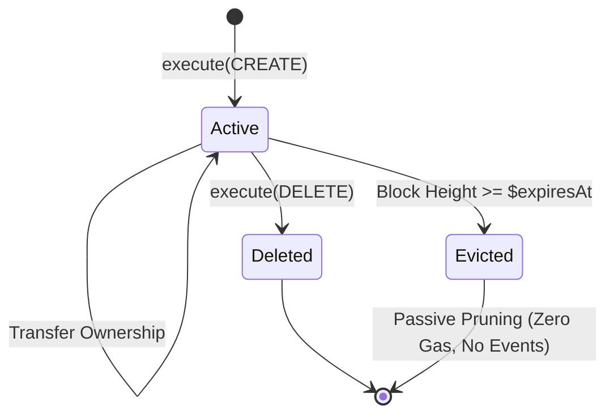
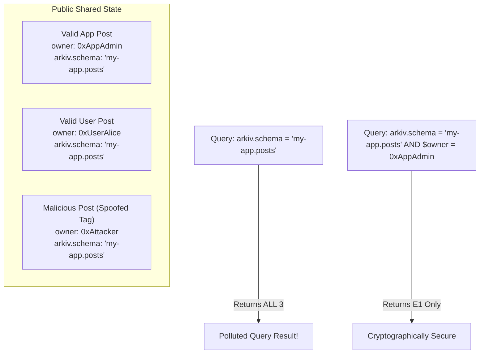
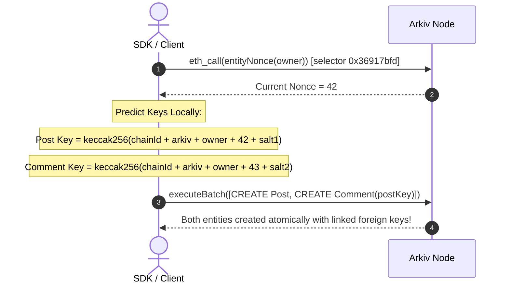
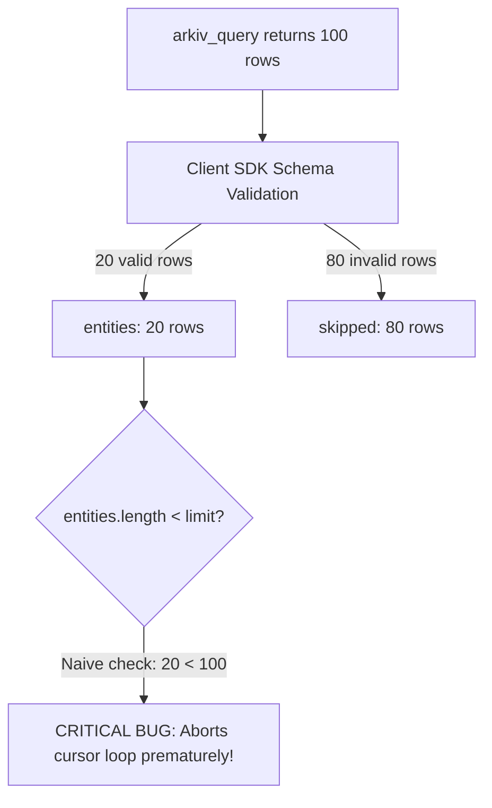
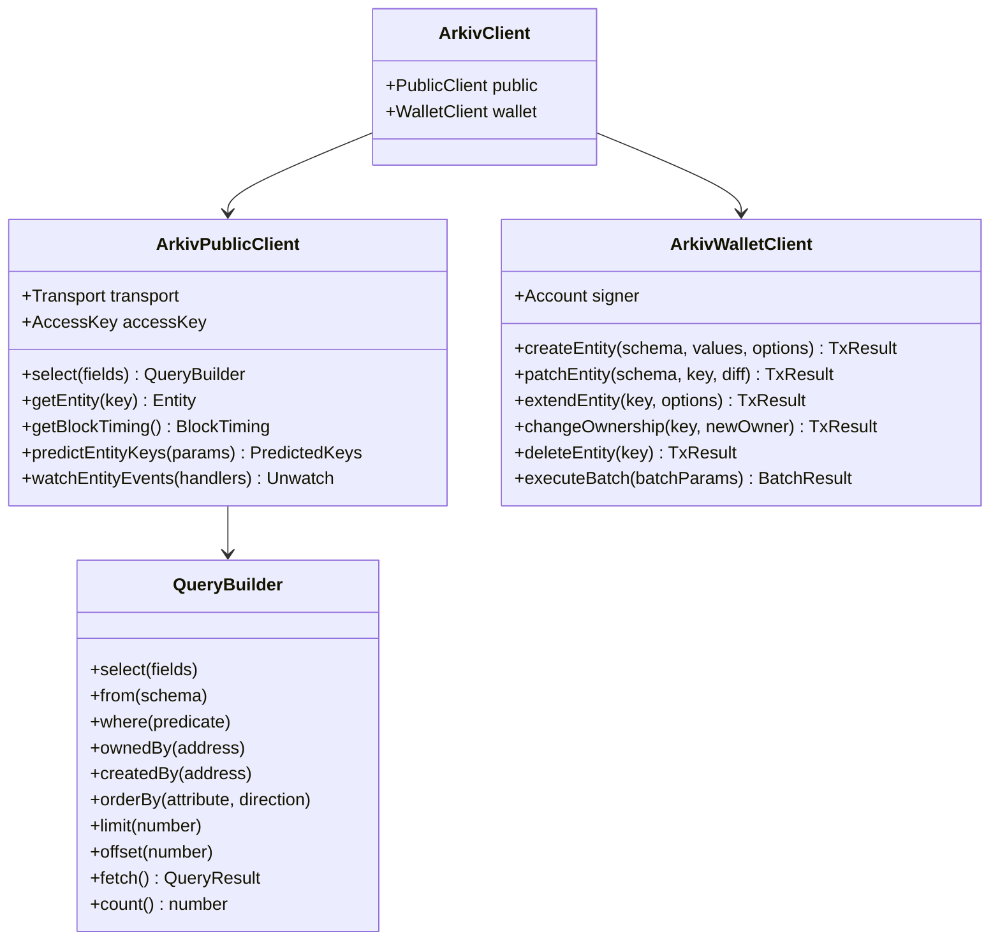

# What We Learned: Architectural Insights, Protocol Nuances & SDK Thesis for Arkiv

> **An in-depth engineering synthesis of Arkiv's Web3 database protocol, architectural design decisions, critical invariants, hidden pitfalls, and implementation blueprints for next-generation SDK authors.**

---

## Table of Contents

- [1. Executive Synthesis & Core Thesis](#1-executive-synthesis--core-thesis)
- [2. The Dual-Rail Mental Model: Decoupling Query from Consensus](#2-the-dual-rail-mental-model-decoupling-query-from-consensus)
- [3. The State Bloat Solution: Passive Block-Level TTL Eviction](#3-the-state-bloat-solution-passive-block-level-ttl-eviction)
- [4. Multi-Tenancy & Security: The Danger of Tag-Only Trust](#4-multi-tenancy--security-the-danger-of-tag-only-trust)
- [5. Deterministic Key Derivation: Relational Graphs in an EVM Trie](#5-deterministic-key-derivation-relational-graphs-in-an-evm-trie)
- [6. The Attribute System: Encodings, Sorting Invariants & Limits](#6-the-attribute-system-encodings-sorting-invariants--limits)
- [7. Query Engine Dynamics: Filtering vs. Sorting Asymmetries](#7-query-engine-dynamics-filtering-vs-sorting-asymmetries)
- [8. The "Silent Cursor Stalling" Pagination Hazard](#8-the-silent-cursor-stalling-pagination-hazard)
- [9. The Three-Tier Error Boundary](#9-the-three-tier-error-boundary)
- [10. Blueprint for SDK Authors: How to Build an Arkiv SDK](#10-blueprint-for-sdk-authors-how-to-build-an-arkiv-sdk)
- [11. Strategic Ecosystem Positioning](#11-strategic-ecosystem-positioning)

---

## 1. Executive Synthesis & Core Thesis

Our exhaustive analysis of the Arkiv documentation reveals that **Arkiv is neither a decentralized file system (like IPFS) nor a traditional blockchain indexer (like The Graph)**. It is an **EVM-native, index-aware relational document store with time-to-live (TTL) mechanics committed into consensus state**.

```mermaid
graph TD
    subgraph Traditional Web3 Stack
        SC[Smart Contract] -->|Emits Events| EVMLogs[EVM Logs]
        EVMLogs -->|External Scraper| Indexer[The Graph / Subsquid]
        Indexer -->|Writes| OffchainDB[PostgreSQL / GraphQL]
        App1[DApp Frontend] -->|Queries| OffchainDB
        App1 -->|Lagging Reads| App1
    end

    subgraph The Arkiv Stack
        ArkivContract["Arkiv Core Contract (0x44..44)"] -->|Synchronous Block Inclusion| NodeIndex["Node In-Memory B-Tree & Keccak MPT"]
        App2[DApp Frontend] -->|arkiv_query (Zero Gas, Zero Lag)| NodeIndex
        App2 -->|execute(ops) (Signed EVM Tx)| ArkivContract
    end
```

### The Core Problem Arkiv Solves
In standard EVM chains:
1. **On-chain storage is prohibitively expensive**: Storing relational or user data in contract storage slots (`sstore`) creates perpetual state bloat that every validator must maintain forever.
2. **On-chain queries do not exist**: Contracts cannot filter, sort, or paginate over historical collections without costly full-table scans.
3. **External indexers introduce lag and centralization**: Off-chain indexers lag behind chain head, incur RPC synchronization bottlenecks, and require developers to maintain separate hosting and GraphQL subgraphs.

Arkiv re-engineers the validator daemon itself: each node maintains local indexing structures directly integrated with the state trie, pairing gasless off-chain reads with consensus-backed on-chain mutations.

---

## 2. The Dual-Rail Mental Model: Decoupling Query from Consensus

The most critical architectural takeaway for developers and SDK authors is the **Dual-Rail Execution Model**:

| Protocol Dimension | The Read Rail (`arkiv_*`) | The Write Rail (`execute(ops)`) |
| :--- | :--- | :--- |
| **Execution Engine** | Node daemon query engine | EVM state transition engine |
| **Target** | Local B-Tree / Inverted Index | Contract `0x4400000000000000000000000000000000000044` |
| **Gas Cost** | **Zero (Gasless)** | **Gas paid in tGLM / GLM** |
| **Latency** | Sub-100ms HTTP/WS response | 1 block (2.0s on Rabdi testnet) |
| **Authentication** | Arkiv Hub Access Key (`X-API-KEY` / path) | EIP-1559 Signed Transaction |
| **Methods** | `arkiv_query`, `arkiv_getEntity`, `arkiv_getBlockTiming` | Standard `eth_sendRawTransaction` |

### Architectural Implication:
There is **no** `arkiv_createEntity` or `arkiv_write` JSON-RPC method. Any SDK designed for Arkiv must fundamentally wrap an **Ethereum transaction signer** (such as Viem, Ethers, Alloy, or Web3.py) alongside an **HTTP JSON-RPC client**.

---

## 3. The State Bloat Solution: Passive Block-Level TTL Eviction

Traditional blockchains suffer from the **Tragedy of the State Commons**: once data is written to state, it remains permanently stored on all validator disks even if the application has been abandoned.

### Arkiv's Solution:
Arkiv enforces that **every entity has a block expiration height (`$expiresAt`)**:
$$\text{expiry} = \max(\text{expiresAt}, \text{currentBlock} + \text{minLifetime})$$



### Critical Insights on TTL & Eviction:
1. **Passive Eviction (Zero Event Emission)**: When block height reaches `$expiresAt`, the entity vanishes from the query surface immediately. **No on-chain transaction or cleanup script is required, and NO event is emitted**. Emitting events on expiration would cause block-stuffing denial-of-service during mass expirations.
2. **Relative Lifetimes vs Absolute Deadlines**:
   - Passing `expiresAt = 0, minLifetime = 1296000` creates an entity valid for 30 days (1,296,000 blocks at 2s/block).
   - Passing both allows developers to set a target deadline with a guaranteed minimum lifetime floor, protecting transactions against mempool delays.
3. **Forward-Only Extension**: An entity's expiration can **never** be shortened. Extension calculates from the block of inclusion (`currentBlock`), not by adding to the previous expiration block.
4. **Permissionless Extension**: Setting bit 1 of `creationFlags` allows any external account to pay gas to extend an entity's lifetime. This enables community-endowed decentralized state.

---

## 4. Multi-Tenancy & Security: The Danger of Tag-Only Trust

Arkiv is a **public, permissionless shared database**. There are no private schemas or protected table namespaces enforced by the node.

### The Vulnerability:
When an SDK defines a schema:
```typescript
const Posts = defineSchema("my-app.posts", { ... })
```
The SDK automatically injects an indexed attribute `arkiv.schema = str('my-app.posts')` into every created entity, and prepends `arkiv.schema = str('my-app.posts')` to every query.

**However, any third-party wallet can create entities tagged with `arkiv.schema = 'my-app.posts'`!**



### The Security Takeaway:
- Schema tags provide **accidental namespace isolation**, NOT security.
- To guarantee data integrity, applications **MUST** filter on cryptographic provenance:
  - `$owner = addr(0x...)` (for administrative or app-curated data)
  - `$creator = addr(0x...)` (for user-generated content, preserving immutable attribution even after ownership transfers)

---

## 5. Deterministic Key Derivation: Relational Graphs in an EVM Trie

How can you create a parent entity (`Post`) and multiple child entities (`Comment`) referencing the parent in a single atomic transaction, before the parent entity even exists on-chain?

Arkiv achieves this through a deterministic key derivation formula:
$$\text{key} = \text{keccak256}(\text{abi.encodePacked}(\text{uint256 chainId}, \text{address arkiv}, \text{address owner}, \text{uint64 nonce}, \text{uint128 salt}))$$

The packed buffer is exactly **96 bytes**:
- `chainId`: 32 bytes (`uint256`)
- `arkiv`: 20 bytes (`address`)
- `owner`: 20 bytes (`address`)
- `nonce`: 8 bytes (`uint64`)
- `salt`: 16 bytes (`uint128`)



### Why This is Revolutionary for Web3:
- By querying the account's `entityNonce` via `eth_call(0x36917bfd)`, the SDK can pre-calculate $N$ keys offline.
- Child entities can embed the parent's predicted `$key` into foreign key attributes (`key().indexed()`).
- The entire relational graph is dispatched in a single `executeBatch` transaction, achieving ACID atomicity without multi-roundtrip dependencies.

---

## 6. The Attribute System: Encodings, Sorting Invariants & Limits

Arkiv entities are not schema-rigid SQL tables; they are collections of up to 32 typed key-value pairs stored directly in state.

### Hard Constraints & Rules:
1. **The 32-Attribute Limit**:
   - Raw entities: Up to 32 attributes (`MAX_ATTRIBUTES`).
   - Named schemas: Up to 31 user attributes (because slot 32 is consumed by the indexed `arkiv.schema` tag).
2. **Lexicographical Ascending Sort Invariant**:
   - The contract enforces that attribute names in calldata must be sorted in strictly ascending ASCII order (`name[i] < name[i+1]`).
   - Disobeying this reverts the transaction with `AttributesNotSorted()` (`0x3206846a`).
   - Names are padded to 32 bytes and must follow `[a-zA-Z][a-zA-Z0-9._-]*`.
3. **Type ID Bit Layout**:
   - Low 7 bits: Type ID ($0 \dots 10$).
   - Bit 7 (`0x80`): Indexed flag. Setting bit 7 (e.g. `0x88` for indexed `str`) commands the node to insert the attribute into its query B-Tree.
4. **Binary Data Boundaries (`bytes`)**:
   - Individual `bytes` limit: 128 KiB (`MAX_BYTES_LENGTH`).
   - Cumulative `bytes` limit per create/patch: 128 KiB (`MAX_ENTITY_BYTES`).
   - **`bytes` can NEVER be indexed (`0x87` is illegal). It can never appear in a `where` predicate or `ORDER BY` clause.**
5. **Fixed-Point Decimals (`dec`)**:
   - Exact 18 decimal places (`DECIMAL_SCALE = 18`).
   - SDKs must parse decimals as strings to prevent floating-point inaccuracies.

---

## 7. Query Engine Dynamics: Filtering vs. Sorting Asymmetries

One of the most fascinating discoveries in the Arkiv architecture is the **asymmetry between filtering and sorting**:

```mermaid
graph TD
    Attr[Attribute]
    Attr -->|Is Indexed? (typeId Bit 7 = 1)| Filterable[Can be Filtered in WHERE]
    Attr -->|Any Attribute (except bytes)| Sortable[Can be Sorted in ORDER BY]
    
    Filterable --> IndexScan[Scanned via In-Node B-Tree Index]
    Sortable --> PostScanHeap[Sorted via In-Memory Heap on Matching Set]
```

### The Asymmetry:
- **Filtering requires an index**: You can **never** filter on an unindexed column (e.g. `publicClient.select().from(Posts).where(eq("unindexed_col", ...))` fails). Filtering unindexed attributes would require scanning millions of state trienodes across the entire network, creating a denial-of-service vector.
- **Sorting does NOT require an index**: `ORDER BY title:str ASC` is fully supported even if `title` is stored unindexed!
  - *Why?* Because predicates (such as `arkiv.schema` and `$owner`) first narrow the result set to a manageable candidate pool. The node then evaluates unindexed values from payload memory and sorts them using an in-memory heap.

### Missing Values Sort to the Bottom:
Arkiv enforces a universal invariant: **Missing or type-mismatched attributes sort below all values**:
- In `ASC` order: Missing attributes appear **first**.
- In `DESC` order: Missing attributes appear **last**.

---

## 8. The "Silent Cursor Stalling" Pagination Hazard

In building data synchronization pipelines and crawlers, offset pagination (`offset: 100`) suffers from the classic "Sliding Window Race Condition" (concurrent writes or TTL expirations shift record positions, resulting in duplicate or skipped records).

To ensure deterministic traversal, developers must use **Key-Cursor Pagination**:
```sql
arkiv.schema = str('posts') AND $key > key(0x<LAST_KEY>) ORDER BY $key ASC
```

### The Hazard:
Arkiv is a permissionless public database. If malicious users or other apps write entities tagged with your schema that fail schema validation (missing required attributes or incorrect types), the Arkiv SDK discards them client-side:
$$\text{page.skipped} > 0$$



If an SDK naively assumes that `entities.length < limit` signals the end of the dataset, **a page containing 100 invalid rows will return `entities: []` and cause the cursor loop to terminate prematurely**, leaving thousands of subsequent valid entities unread!

### The Mitigation:
SDKs and synchronization workers must advance cursors based on the **raw `$key` of the last entity returned in the raw JSON-RPC payload**, or configure queries with `onMismatch: "throw"`.

---

## 9. The Three-Tier Error Boundary

Arkiv error handling is rigorously stratified across three layers:

```mermaid
flowchart TD
    subgraph Tier 1: Client Pre-flight
        E1[SchemaMismatchError]
        E2[InvalidValueError]
        E3[EntityTooLargeError]
        E4[ConflictingMutationError]
        E5[InvalidPredicateError]
    end

    subgraph Tier 2: Node JSON-RPC
        R1["-32001: Query Parse Error"]
        R2["-32002: Predicate Type Error"]
        R3["-32003: Invalid Literal Value"]
        R4["-32004: Node Limit Exceeded"]
        R5["-32602: Invalid Parameters"]
        R6["HTTP 401 / 429: Auth & Quota"]
    end

    subgraph Tier 3: EVM Revert Custom Errors
        C1["EmptyBatch()"]
        C2["AttributesNotSorted()"]
        C3["TooManyAttributes()"]
        C4["NotOwner()"]
        C5["ReadOnlyEntity()"]
        C6["ExpiryDeadOnArrival()"]
        C7["ExpiryBeyondMaxLifetime()"]
        C8["ExpiryNotExtended()"]
    end

    Call[Client Action] --> Tier 1
    Tier 1 -->|Passes Preflight| CallRPC[Send Read RPC]
    Tier 1 -->|Passes Preflight| BroadcastTx[Broadcast Write Tx]
    CallRPC --> Tier 2
    BroadcastTx --> Tier 3
```

- **Tier 1 (Client Preflight)**: The SDK intercepts schema violations, negative salts, invalid attribute names, and byte overflows *before* network transmission, saving users unnecessary gas fees.
- **Tier 2 (Gateway & RPC Daemon)**: The node validates query ASTs and access keys, rejecting unparseable queries with detailed error positions.
- **Tier 3 (EVM Consensus Reverts)**: Custom Solidity errors with zero-padded selectors emitted by `0x44..44` when on-chain invariants are violated (e.g. `0xa3221ef2` for `NotOwner`).

---

## 10. Blueprint for SDK Authors: How to Build an Arkiv SDK

If you are building an Arkiv SDK in **Rust**, **Go**, **Python**, or extending **TypeScript**, the architecture must follow these ten immutable commandments:



### The Ten SDK Architectural Rules:
1. **Separate PublicClient from WalletClient**: Mirror the Viem/Ethers paradigm. Read queries require zero wallet credentials and should never prompt users to connect a wallet.
2. **Never Add Access-Key RPCs to Browser Wallets**: When registering chains with RainbowKit/Wagmi, pass `accessKey: ""`. Inject the project's private access key strictly into the application's backend or internal `PublicClient`.
3. **Implement an AST-Based Query Builder**: Provide a fluent DSL (`eq()`, `and()`, `or()`, `between()`) that renders deterministic SQL-like query strings with proper single-quote doubling escapes (`''`).
4. **Compile-Time Schema Typing**: Utilize generics/macros to enforce that users can only filter on columns tagged with `.indexed()`.
5. **Enforce Attribute Sorting Before Packing**: Automatically sort `Attribute[]` arrays in strictly ascending ASCII order before ABI serialization to eliminate `AttributesNotSorted()` reverts.
6. **Use 128-Bit Cryptographic Random Salts by Default**: Do not default to `0` (`NO_SALT`) unless explicitly requested; predictable salts expose entities to front-running.
7. **Decouple Expiration Calculations from Local Clocks**: Never calculate block numbers using client system clocks. Query `arkiv_getBlockTiming` to obtain the consensus block number and duration.
8. **Automate Key Prediction for Graph Transactions**: Expose helper pipelines that inspect `entityNonce(owner)` to resolve foreign key dependencies across multi-entity batches.
9. **Handle Mismatched Entities Gracefully**: Count and report `page.skipped` entities without crashing query iteration.
10. **Implement Optimistic Mutation Rollbacks**: For frontend UI bindings, cache optimistic mutations locally and listen for EVM receipt reverts to rollback state cleanly.

---

## 11. Strategic Ecosystem Positioning

| Dimension | IPFS / Filecoin | Arweave | Ceramic / ComposeDB | Tableland | Arkiv |
| :--- | :--- | :--- | :--- | :--- | :--- |
| **Primary Category** | Decentralized Blob Storage | Permanent Storage | Stream Document DB | Relational SQL on EVM | **Stateful Web3 Entity DB** |
| **Addressing** | Content hash ($CID$) | Content hash / TxID | Stream ID (`k2...`) | Table ID + Row ID | **Deterministic Key (`0x...`)** |
| **Query Engine** | None (DHT lookup only) | GraphQL Tag filtering | GraphQL on ComposeDB | Full SQL Parser | **Native In-Node Query Engine** |
| **Secondary Indexing** | External indexer required | String tags only | Self-hosted PostgreSQL | EVM event subgraphs | **In-Node B-Trees / Inverted Index** |
| **Index Freshness** | N/A | Variable | Sync-dependent | Minutes (subgraph lag) | **Zero-Lag (Immediate on block)** |
| **Storage Lifecycle** | Deal expiration / Pinning | Permanent (~200 years) | Append-only commits | Permanent table state | **Block-Metered TTL Rent** |
| **Consensus Integration** | Loose (PoRep / PoSt) | Proof of Access | Periodic anchor txs | EVM calldata parser | **Keccak Merkle-Patricia Trie** |
| **Mutation Model** | Immutable | Immutable | Event-sourced DAG | SQL `UPDATE` / `INSERT` | **Atomic Batch Operations 1..5** |

### Conclusion:
Arkiv fills a critical missing gap in the Web3 infrastructure stack: **real-time, queryable, time-scoped, wallet-owned structured data**. By eliminating perpetual storage rent, providing sub-second gasless read queries, and preserving EVM cryptographic consensus for mutations, Arkiv represents the premier database layer for decentralized applications, autonomous AI agents, and on-chain gaming.
