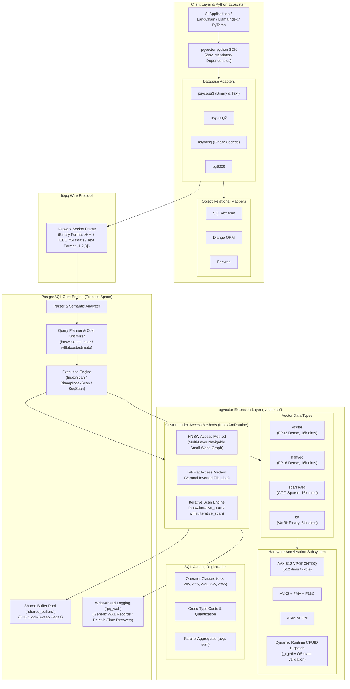
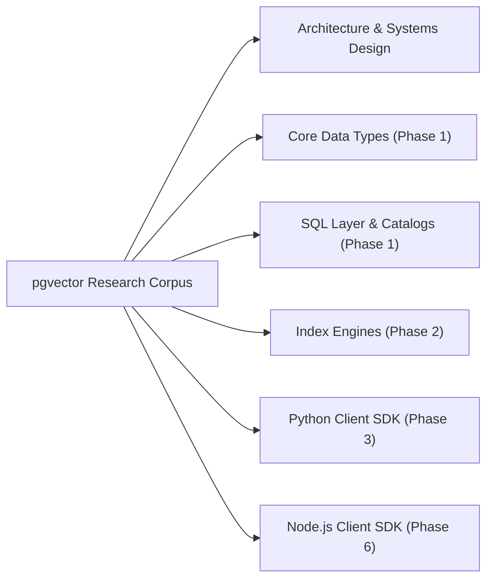
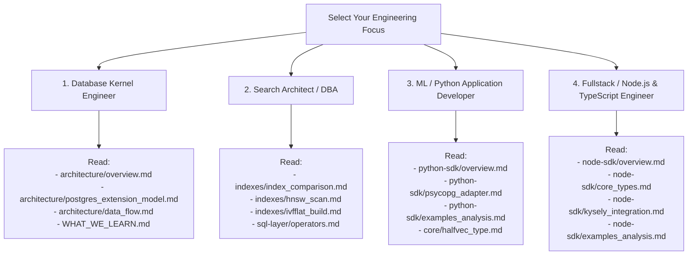

# pgvector Research: A Complete Technical Reference

> **The definitive internals, kernel architecture, indexing algorithms, and ecosystem guide for `pgvector`, `pgvector-python`, and `pgvector-node`.**

---

## Table of Contents

1. [What is pgvector?](#1-what-is-pgvector)
2. [Global Architecture Overview](#2-global-architecture-overview)
3. [Distance Operators Quick Reference](#3-distance-operators-quick-reference)
4. [Vector Types Comparison](#4-vector-types-comparison)
5. [Index Comparison: HNSW vs. IVFFlat](#5-index-comparison-hnsw-vs-ivfflat)
6. [Master Document Map](#6-master-document-map)
   - [Architectural Synthesis & Meta-Lessons](#architectural-synthesis--meta-lessons)
   - [Core Vector Types (Phase 1)](#core-vector-types-phase-1)
   - [SQL Layer & System Catalogs (Phase 1)](#sql-layer--system-catalogs-phase-1)
   - [Index Engines & Algorithms (Phase 2)](#index-engines--algorithms-phase-2)
   - [Python Client SDK & Integrations (Phase 3)](#python-client-sdk--integrations-phase-3)
   - [Kernel Architecture & Build Infrastructure (Phase 4)](#kernel-architecture--build-infrastructure-phase-4)
   - [Node.js & TypeScript Client SDK (Phase 6)](#nodejs--typescript-client-sdk-phase-6)
7. [10 Key Technical Insights & Surprises](#7-10-key-technical-insights--surprises)
8. [Getting Started: Recommended Learning Paths](#8-getting-started-recommended-learning-paths)

---

## 1. What is pgvector?

`pgvector` is an open-source high-performance vector similarity search extension for PostgreSQL written in C. It introduces native vector data types (`vector`, `halfvec`, `sparsevec`, and binary vector operations on `bit`), SIMD-accelerated distance metrics (L2, Inner Product, Cosine, L1, Hamming, Jaccard), and approximate nearest neighbor (ANN) index access methods (**HNSW** and **IVFFlat**) directly into the PostgreSQL kernel.

By executing vector search within PostgreSQL, `pgvector` provides complete ACID transaction guarantees, multi-version concurrency control (MVCC), Point-in-Time Recovery (PITR), and seamless relational filter pushdown (`WHERE` clauses) without requiring brittle dual-write architectures or synchronization with external vector databases.

---

## 2. Global Architecture Overview

The following diagram illustrates the end-to-end architecture of `pgvector`, demonstrating the relationship between the PostgreSQL core engine, the extension layer, data types, indexing access methods, and client application drivers:

---

## 3. Distance Operators Quick Reference

`pgvector` provides six core distance operators registered as ordering operators (`AMOP_ORDER`) in PostgreSQL's operator classes, allowing index-accelerated `ORDER BY ... LIMIT k` queries:

| Operator | Distance Metric | Mathematical Formula | Valid Types | Primary Use Case & Domain |
| :---: | :--- | :--- | :--- | :--- |
| `<->` | **Euclidean (L2)** | $D_{L2}(\mathbf{u}, \mathbf{v}) = \sqrt{\sum_{i=1}^d (u_i - v_i)^2}$ | `vector`, `halfvec`, `sparsevec` | Spatial coordinates, computer vision embeddings, audio feature representations. |
| `<#>` | **Negative Inner Product** | $D_{IP}(\mathbf{u}, \mathbf{v}) = - (\mathbf{u} \cdot \mathbf{v}) = - \sum_{i=1}^d u_i v_i$ | `vector`, `halfvec`, `sparsevec` | Maximum Inner Product Search (MIPS), unnormalized word embeddings, recommender factor dot products. |
| `<=>` | **Cosine Distance** | $D_{cos}(\mathbf{u}, \mathbf{v}) = 1 - \frac{\mathbf{u} \cdot \mathbf{v}}{\|\mathbf{u}\|_2 \|\mathbf{v}\|_2}$ | `vector`, `halfvec`, `sparsevec` | Text & NLP embeddings (OpenAI, Cohere, HuggingFace), document semantic similarity. |
| `<+>` | **Manhattan / Taxicab (L1)** | $D_{L1}(\mathbf{u}, \mathbf{v}) = \sum_{i=1}^d \|u_i - v_i\|$ | `vector`, `halfvec` | Grid-based spatial distances, robust statistical modeling, outlier-resistant similarity. |
| `<~>` | **Hamming Distance** | $D_{Ham}(\mathbf{u}, \mathbf{v}) = \text{popcount}(\mathbf{u} \oplus \mathbf{v})$ | `bit` (varbit) | Binary quantized embeddings, image hashes (pHash), cryptographic fingerprint matching. |
| `<%>` | **Jaccard Distance** | $D_{Jac}(\mathbf{u}, \mathbf{v}) = 1 - \frac{\|\mathbf{u} \land \mathbf{v}\|_1}{\|\mathbf{u} \lor \mathbf{v}\|_1}$ | `bit` (varbit) | Asymmetric set similarity, token co-occurrence, recommendation baskets. |

> [!NOTE]
> **Why Negative Inner Product (`<#>`)?**
> PostgreSQL index ordering operators require distances where **smaller values indicate greater similarity** (ascending order). Because higher inner products denote closer alignment, `pgvector` negates the dot product so that standard ascending index scans naturally return the most similar items first.

---

## 4. Vector Types Comparison

`pgvector` implements four distinct numeric representations tailored to specific machine learning data regimes:

| Type | Physical Format | Storage Footprint | Max Dimensions | Hardware SIMD Acceleration | Primary Machine Learning Use Cases |
| :--- | :--- | :--- | :--- | :--- | :--- |
| **`vector`** | 32-bit single-precision IEEE 754 float | $8 + (4 \times d)\text{ bytes}$ | 16,000 | AVX-512, AVX2 + FMA, ARM NEON | Standard dense neural embeddings (BERT, Ada-002, Mistral). |
| **`halfvec`** | 16-bit half-precision IEEE 754 float (`binary16`) | $8 + (2 \times d)\text{ bytes}$ ($50\%$ savings) | 16,000 | F16C, native `_Float16`, AVX-512 FP16 | High-dimensional models (OpenAI text-embedding-3 at 3072 dims); cuts memory/disk in half. |
| **`sparsevec`** | Coordinate (COO) format: separated parallel `int32[]` indices + `float[]` values | $16 + (8 \times \text{nnz})\text{ bytes}$ | 16,000 (total) / 16,000 (nnz) | Sequential cache-line prefetching, auto-vectorized math | Sparse lexical-neural models (SPLADE, BM25 neural encodings), large vocabulary representations. |
| **`bit`** | PostgreSQL native packed bit string (`VarBit`) | $8 + \lceil d / 8 \rceil\text{ bytes}$ ($32\times$ savings) | 64,000 | AVX-512 VPOPCNTDQ (512 dims/inst), hardware `popcnt` | 1-bit binary quantized embeddings (BQ), Cohere Embed v3 binary, image hashing. |

---

## 5. Index Comparison: HNSW vs. IVFFlat

| Architectural Metric | HNSW (`hnsw`) | IVFFlat (`ivfflat`) |
| :--- | :--- | :--- |
| **Algorithmic Paradigm** | Multi-Layer Navigable Small World Graph (Skip-List) | Inverted File Index with Voronoi Cell Discretization |
| **Theoretical Build Complexity** | $O(N \log N \cdot ef\_construction \cdot M \cdot d)$ | $O(S \cdot K \cdot I \cdot d + N \cdot K \cdot d + N \log N)$ |
| **Practical Build Speed** | Slower (requires extensive distance beam search) | **$10\times\text{--}50\times$ faster** (sampling + Elkan k-means + Tuplesort) |
| **Theoretical Query Complexity** | $O(\log N \cdot d + ef\_search \cdot M \cdot d)$ | $O(K \cdot d + \frac{probes}{K} \cdot N \cdot d)$ |
| **Query Latency Profile** | Sub-millisecond to low-millisecond ($<5\text{ ms}$) | Scales with probed lists ($10\text{--}50\text{ ms}$) |
| **Memory / Cache Sensitivity** | **High:** Non-sequential pointer chasing; index must fit in RAM | **Moderate:** Posting lists stream sequentially via `BAS_BULKREAD` |
| **Disk Size Overhead** | $1.5\times\text{--}2.5\times$ raw vector table size | $1.05\times\text{--}1.15\times$ raw vector table size |
| **Recall Capability** | Predictable high recall ($98\%\text{--}99.9\%$) | Moderate recall ($80\%\text{--}92\%$); $>95\%$ requires high `probes` |
| **Incremental Insert Cost** | **Heavy:** Beam search, graph locking, backlink rewiring | **Light:** Centroid match + tail page append |
| **Key Tuning Parameters** | `m`, `ef_construction` (build), `hnsw.ef_search` (query) | `lists` (build), `ivfflat.probes` (query) |
| **When to Choose** | Real-time user queries, strict latency SLAs, production search | Rapid batch loading, memory-constrained hosts, high insert rates |

---

## 6. Master Document Map

This research repository comprises 34 deeply technical documents detailing the entire `pgvector` architecture:

### Architectural Synthesis & Meta-Lessons

- [`README.md`](file:///mnt/Data/Coding/arkivector/RESEARCH/pgvector/README.md) — Master technical reference, architecture overview, and index selection guide (This document).
- [`WHAT_WE_LEARN.md`](file:///mnt/Data/Coding/arkivector/RESEARCH/pgvector/WHAT_WE_LEARN.md) — The fundamental engineering lessons learned: extension development, AM design, SIMD dispatch, numeric stability, and Python SDK architecture.
- [`architecture/overview.md`](file:///mnt/Data/Coding/arkivector/RESEARCH/pgvector/architecture/overview.md) — Global system architecture, complete component inventory of every source file, and concurrency locking hierarchy.
- [`architecture/data_flow.md`](file:///mnt/Data/Coding/arkivector/RESEARCH/pgvector/architecture/data_flow.md) — End-to-end data flow mechanics: vector ingestion path, $k$-NN search query path, vacuum maintenance path, and wire protocol flow.

### Core Vector Types (Phase 1)

- [`core/vector_type.md`](file:///mnt/Data/Coding/arkivector/RESEARCH/pgvector/core/vector_type.md) — 1,722 lines: Memory layout, varlena headers, deterministic alignment, distance algorithms, and SIMD dispatch.
- [`core/halfvec_type.md`](file:///mnt/Data/Coding/arkivector/RESEARCH/pgvector/core/halfvec_type.md) — 922 lines: IEEE 754 `binary16`, hardware F16C / software conversion, precision preservation, and 50% memory reduction.
- [`core/bitvec_type.md`](file:///mnt/Data/Coding/arkivector/RESEARCH/pgvector/core/bitvec_type.md) — 662 lines: Native `VarBit` reuse, AVX-512 VPOPCNTDQ popcount, Hamming and Jaccard metrics.
- [`core/sparsevec_type.md`](file:///mnt/Data/Coding/arkivector/RESEARCH/pgvector/core/sparsevec_type.md) — 721 lines: Compressed Coordinate (COO) layout, two-pointer linear merge, and SPLADE neural lexical search.

### SQL Layer & System Catalogs (Phase 1)

- [`sql-layer/sql_definitions.md`](file:///mnt/Data/Coding/arkivector/RESEARCH/pgvector/sql-layer/sql_definitions.md) — 628 lines: Complete catalog of all 117 SQL objects (types, functions, operators, casts, opclasses).
- [`sql-layer/operators.md`](file:///mnt/Data/Coding/arkivector/RESEARCH/pgvector/sql-layer/operators.md) — 472 lines: Mathematical foundations, index scan strategies (`AMOP_ORDER`), and arithmetic operator overloading.
- [`sql-layer/migration_history.md`](file:///mnt/Data/Coding/arkivector/RESEARCH/pgvector/sql-layer/migration_history.md) — 350 lines: Version-by-version evolution across five historical epochs (v0.1.0 $\to$ v0.9.0).

### Index Engines & Algorithms (Phase 2)

- [`indexes/index_comparison.md`](file:///mnt/Data/Coding/arkivector/RESEARCH/pgvector/indexes/index_comparison.md) — Deep comparative analysis: HNSW vs. IVFFlat algorithmic fundamentals, build/query trade-offs, and decision matrix.
- [`indexes/hnsw_overview.md`](file:///mnt/Data/Coding/arkivector/RESEARCH/pgvector/indexes/hnsw_overview.md) — 591 lines: Navigable Small World skip-list theory, page layout, and `IndexAmRoutine` integration.
- [`indexes/hnsw_build.md`](file:///mnt/Data/Coding/arkivector/RESEARCH/pgvector/indexes/hnsw_build.md) — 613 lines: Construction pipeline, parallel DSM workers, relative pointers, and two-phase disk spilling.
- [`indexes/hnsw_insert.md`](file:///mnt/Data/Coding/arkivector/RESEARCH/pgvector/indexes/hnsw_insert.md) — 855 lines: Online transactional insertion, greedy routing, heuristic neighbor pruning, and backlink maintenance.
- [`indexes/hnsw_scan.md`](file:///mnt/Data/Coding/arkivector/RESEARCH/pgvector/indexes/hnsw_scan.md) — 687 lines: Query execution, priority queues, beam search, and `hnsw.iterative_scan`.
- [`indexes/hnsw_vacuum.md`](file:///mnt/Data/Coding/arkivector/RESEARCH/pgvector/indexes/hnsw_vacuum.md) — Dead tuple cleanup, graph topology repair, and unlinking.
- [`indexes/ivfflat_overview.md`](file:///mnt/Data/Coding/arkivector/RESEARCH/pgvector/indexes/ivfflat_overview.md) — 460 lines: Inverted file theory, Voronoi cell partitioning, and posting list chaining.
- [`indexes/ivfflat_build.md`](file:///mnt/Data/Coding/arkivector/RESEARCH/pgvector/indexes/ivfflat_build.md) — 506 lines: Four-phase build pipeline: reservoir sampling, k-means, parallel Tuplesort, and posting page writing.
- [`indexes/ivfflat_kmeans.md`](file:///mnt/Data/Coding/arkivector/RESEARCH/pgvector/indexes/ivfflat_kmeans.md) — 517 lines: Elkan's accelerated k-means, k-means++ seeding, and triangle inequality distance pruning.
- [`indexes/ivfflat_insert.md`](file:///mnt/Data/Coding/arkivector/RESEARCH/pgvector/indexes/ivfflat_insert.md) — 381 lines: Centroid distance matching, tail page locking, and page chaining.
- [`indexes/ivfflat_scan.md`](file:///mnt/Data/Coding/arkivector/RESEARCH/pgvector/indexes/ivfflat_scan.md) — 396 lines: Pairing heap probe selection, `BAS_BULKREAD` buffer access, and `ivfflat.iterative_scan`.
- [`indexes/ivfflat_vacuum.md`](file:///mnt/Data/Coding/arkivector/RESEARCH/pgvector/indexes/ivfflat_vacuum.md) — 333 lines: Dead tuple elimination, page chain consolidation, and zombie clusters.

### Python Client SDK & Integrations (Phase 3)

- [`python-sdk/overview.md`](file:///mnt/Data/Coding/arkivector/RESEARCH/pgvector/python-sdk/overview.md) — 591 lines: Package architecture, zero-dependency design, lazy reflection, and static typing (`py.typed`).
- [`python-sdk/core_types.md`](file:///mnt/Data/Coding/arkivector/RESEARCH/pgvector/python-sdk/core_types.md) — 1,383 lines: Deep dive into `Vector`, `HalfVector`, `SparseVector`, and `Bit` Python classes.
- [`python-sdk/psycopg_adapter.md`](file:///mnt/Data/Coding/arkivector/RESEARCH/pgvector/python-sdk/psycopg_adapter.md) — 620 lines: psycopg 3 binary and text dumpers/loaders, async type registration, and binary `COPY`.
- [`python-sdk/psycopg2_adapter.md`](file:///mnt/Data/Coding/arkivector/RESEARCH/pgvector/python-sdk/psycopg2_adapter.md) — psycopg2 extension adapter, binary typecasting, and SQL quoting.
- [`python-sdk/asyncpg_adapter.md`](file:///mnt/Data/Coding/arkivector/RESEARCH/pgvector/python-sdk/asyncpg_adapter.md) — asyncpg custom binary codec registration and async query streaming.
- [`python-sdk/pg8000_adapter.md`](file:///mnt/Data/Coding/arkivector/RESEARCH/pgvector/python-sdk/pg8000_adapter.md) — Pure-Python driver wire adaptation.
- [`python-sdk/sqlalchemy_integration.md`](file:///mnt/Data/Coding/arkivector/RESEARCH/pgvector/python-sdk/sqlalchemy_integration.md) — 804 lines: `VECTOR`, `HALFVEC`, `SPARSEVEC` types, custom Comparator infix operators, and reflection.
- [`python-sdk/django_integration.md`](file:///mnt/Data/Coding/arkivector/RESEARCH/pgvector/python-sdk/django_integration.md) — 741 lines: `VectorField`, `HnswIndex`, `IvfflatIndex`, distance lookup expressions, and migrations.
- [`python-sdk/peewee_integration.md`](file:///mnt/Data/Coding/arkivector/RESEARCH/pgvector/python-sdk/peewee_integration.md) — 456 lines: Peewee ORM field definitions and distance expression builders.
- [`python-sdk/examples_analysis.md`](file:///mnt/Data/Coding/arkivector/RESEARCH/pgvector/python-sdk/examples_analysis.md) — 682 lines: Analysis of all 14 official examples (RAG, ColBERT, ColPali, SPLADE, Hybrid Search, Citus).

### Kernel Architecture & Build Infrastructure (Phase 4)

- [`architecture/postgres_extension_model.md`](file:///mnt/Data/Coding/arkivector/RESEARCH/pgvector/architecture/postgres_extension_model.md) — 1,034 lines: The extension triad, `PG_MODULE_MAGIC`, calling conventions, Generic WAL, and shared buffer management.
- [`architecture/build_system.md`](file:///mnt/Data/Coding/arkivector/RESEARCH/pgvector/architecture/build_system.md) — 651 lines: PGXS build harness, compiler flags (`-O3`, `-march`), multi-version CI test matrix, and release packaging.

### Node.js & TypeScript Client SDK (Phase 6)

- [`node-sdk/overview.md`](file:///mnt/Data/Coding/arkivector/RESEARCH/pgvector/node-sdk/overview.md) — 1,024 lines: ESM-first architecture, zero runtime dependencies, subpath exports map, and 14-tool ecosystem compatibility matrix.
- [`node-sdk/core_types.md`](file:///mnt/Data/Coding/arkivector/RESEARCH/pgvector/node-sdk/core_types.md) — 781 lines: `fromSql`, `toSql`, `SparseVector` class (4 constructor modes, 0-based to 1-based indexing), and string serialization mechanics.
- [`node-sdk/pg_driver.md`](file:///mnt/Data/Coding/arkivector/RESEARCH/pgvector/node-sdk/pg_driver.md) — 732 lines: `node-postgres` (`pg`) integration, dynamic `pg_type` catalog query, `client.setTypeParser()`, and parameter formatting.
- [`node-sdk/postgres_driver.md`](file:///mnt/Data/Coding/arkivector/RESEARCH/pgvector/node-sdk/postgres_driver.md) — 614 lines: `postgres.js` tagged template literal engine, custom type specification objects (`pgvectorTypes`), and connection handshake.
- [`node-sdk/pg_promise_driver.md`](file:///mnt/Data/Coding/arkivector/RESEARCH/pgvector/node-sdk/pg_promise_driver.md) — 657 lines: `pg-promise` event-driven connection registration, Slonik strict type-safety boundaries, and custom type presets.
- [`node-sdk/knex_integration.md`](file:///mnt/Data/Coding/arkivector/RESEARCH/pgvector/node-sdk/knex_integration.md) — 711 lines: Prototype extension (`TableBuilder.extend`, `QueryBuilder.extend`), column definition helpers, identifier escaping, and TypeScript augmentations.
- [`node-sdk/kysely_integration.md`](file:///mnt/Data/Coding/arkivector/RESEARCH/pgvector/node-sdk/kysely_integration.md) — 642 lines: Pure functional AST helpers, `sql` tagged template literals, type-safe distance expressions, and zero prototype mutation.
- [`node-sdk/objection_integration.md`](file:///mnt/Data/Coding/arkivector/RESEARCH/pgvector/node-sdk/objection_integration.md) — 709 lines: Objection.js model lifecycle integration, transitive Knex loading, `$parseDatabaseJson` / `$formatDatabaseJson` automation, and relation graph k-NN queries.
- [`node-sdk/sequelize_integration.md`](file:///mnt/Data/Coding/arkivector/RESEARCH/pgvector/node-sdk/sequelize_integration.md) — 756 lines: Custom `DataTypes.ABSTRACT` subclasses (`VECTOR`, `HALFVEC`, `SPARSEVEC`), identifier sanitization, and SQL literal distance operators.
- [`node-sdk/mikro_orm_integration.md`](file:///mnt/Data/Coding/arkivector/RESEARCH/pgvector/node-sdk/mikro_orm_integration.md) — 658 lines: Custom `Type<T>` classes (`VectorType`, `HalfvecType`, `SparsevecType`, `BitType`), dimension property decorators, and QueryBuilder raw fragment sorting.
- [`node-sdk/prisma_drizzle_typeorm.md`](file:///mnt/Data/Coding/arkivector/RESEARCH/pgvector/node-sdk/prisma_drizzle_typeorm.md) — 634 lines: Modern TypeScript ORMs: Prisma `Unsupported("vector(3)")`, Drizzle native & custom types, TypeORM parameter binding, and 10-point cross-ORM matrix.
- [`node-sdk/examples_analysis.md`](file:///mnt/Data/Coding/arkivector/RESEARCH/pgvector/node-sdk/examples_analysis.md) — 1,096 lines: Analysis of all 12 Node.js production examples (PGlite WebAssembly embedded vector search, Transformers.js in-process ONNX embeddings, Bun native SQL, Deno JSR, Cohere binary quantization, Hybrid Search RRF, Citus sharding, and RDKit molecular similarity).

---

## 7. 10 Key Technical Insights & Surprises

Throughout our rigorous code-level investigation of `pgvector`, several profound architectural discoveries emerged:

### 1. In-Engine Vector Search Beats Standalone Vector DBs
By building vector search directly into PostgreSQL as an access method, `pgvector` eliminates the dual-write synchronization problem, guarantees transactional consistency, leverages the shared buffer cache, and allows relational filters (`WHERE status = 'active'`) to execute concurrently with vector index scans.

### 2. Iterative Scanning Solves the Filtered ANN Dilemma
Traditional vector indices suffer from "over-filtering" when restrictive relational predicates eliminate all top-$k$ candidates returned by an ANN search. `pgvector`’s **iterative scan** (`hnsw.iterative_scan` and `ivfflat.iterative_scan`) maintains an interactive search state, dynamically expanding the search frontier until the query's `LIMIT` is fulfilled.

### 3. Asymmetric Precision Preserves Arithmetic Accuracy
While `halfvec` stores vectors in 16-bit floating-point (cutting storage and RAM by $50\%$), accumulating dot products across 1536+ dimensions in FP16 causes catastrophic underflow or overflow. `pgvector` unpacks FP16 values into **FP32 registers** on the fly, accumulating distances in single- or double-precision registers before returning the scalar distance.

### 4. Zero Type Duplication via `VarBit` Reuse
Rather than defining a redundant custom binary vector type, `pgvector` registers distance operators (`<~>`, `<%>`) and index operator classes directly on PostgreSQL's native `bit` (varbit) type. This provides instant compatibility with all PostgreSQL bitwise functions and client drivers at zero maintenance cost.

### 5. Separated COO Format Enables SIMD Auto-Vectorization
`sparsevec` stores non-zero elements as two parallel arrays (an array of `int32` indices followed by an array of `float32` values) rather than an array of structs (`struct { int idx; float val; }[]`). This Structure-of-Arrays (SoA) layout eliminates memory alignment padding and allows compilers to auto-vectorize floating-point operations.

### 6. Elkan's Triangle Inequality Prunes $>80\%$ of k-means Distance Calculations
To build IVFFlat indices rapidly, `pgvector` uses **Elkan's accelerated k-means**. By exploiting the geometric triangle inequality between vectors and centroids, Elkan's algorithm mathematically proves that certain centroids cannot possibly be the nearest neighbor, skipping $>80\%$ of expensive distance evaluations.

### 7. Two-Phase HNSW Build Prevents Tape Merge Bottlenecks
Standard relational sorting algorithms use tape-based external merge sorts when spilling to disk. Proximity graphs cannot use tape merging because graph construction requires random graph traversals. `pgvector` implements an adaptive two-phase build: constructing in-memory in Dynamic Shared Memory (DSM) using relative pointers (`relptr`), and seamlessly transitioning to on-disk buffer manager writes when `maintenance_work_mem` is exhausted.

### 8. Universal Portability Through Generic WAL
Instead of registering a custom PostgreSQL Resource Manager (RMGR)—which requires server restarts, preloaded libraries, and core vendor patching—`pgvector` relies exclusively on PostgreSQL's **Generic WAL** interface. This enables `pgvector` to run seamlessly on stock PostgreSQL installations and managed cloud services (e.g. AWS RDS, Google Cloud SQL, Supabase).

### 9. Zero Mandatory Dependencies in the Python Client SDK
The `pgvector-python` library has **zero required third-party dependencies**. It relies entirely on Python's standard library `array.array('f')` (which consumes $8\times$ less memory than a Python list of floats) and `struct` module. Heavy libraries like NumPy and SciPy are imported lazily via `sys.modules.get`, eliminating dependency bloat.

### 10. Hardware-Gated Runtime CPUID Dispatch with `_xgetbv`
To distribute a single binary that runs on any x86-64 machine, `pgvector` detects CPU capabilities at runtime. Crucially, it validates that the operating system supports AVX state saving via `_xgetbv(0) & 6 == 6` before issuing vector instructions, avoiding OS crashes. On supporting processors, it leverages AVX-512 VPOPCNTDQ to compute Hamming distances across **512 dimensions per CPU instruction**.

---

## 8. Getting Started: Recommended Learning Paths

Depending on your engineering focus, we recommend navigating the research corpus along these curated paths:

