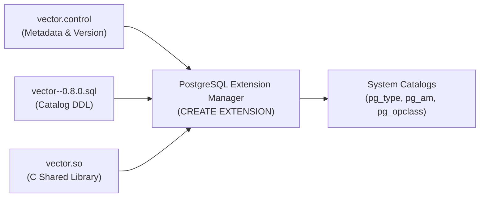
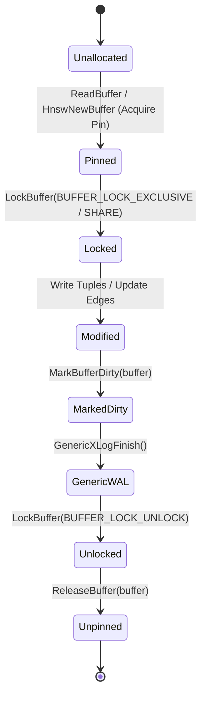
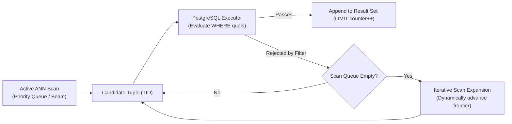
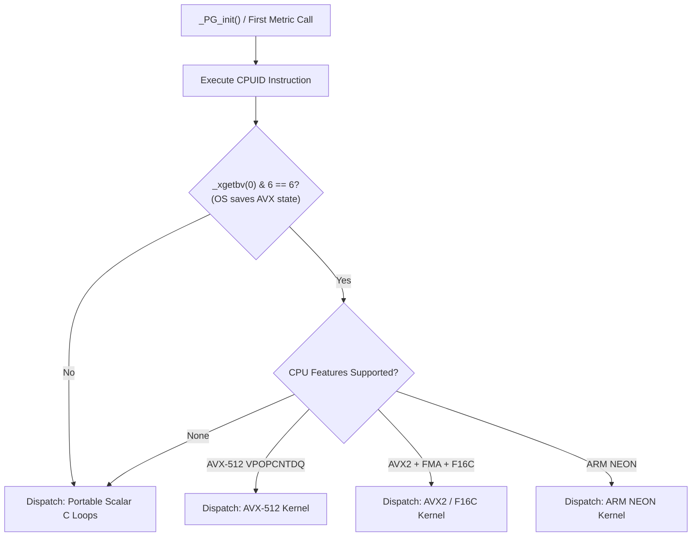

# Engineering Lessons from pgvector: Architectural Principles & Systems Design Patterns

> **Document Version:** 1.0.0  
> **Target Audience:** Systems Architects, Database Kernel Engineers, Infrastructure Developers, High-Performance Systems Programmers  
> **Scope:** Fundamental engineering patterns, design trade-offs, and kernel integration principles distilled from the complete technical analysis of `pgvector` and `pgvector-python`.

---

## Table of Contents

1. [Introduction: The Philosophy of In-Engine Vector Search](#1-introduction-the-philosophy-of-in-engine-vector-search)
2. [Lesson 1: How to Build a PostgreSQL Extension](#2-lesson-1-how-to-build-a-postgresql-extension)
   - [The Extension Triad (.control, .sql, .so)](#the-extension-triad-control-sql-so)
   - [The Shell Type Bootstrapping Pattern](#the-shell-type-bootstrapping-pattern)
   - [`PG_MODULE_MAGIC` as an ABI Enforcement Contract](#pg_module_magic-as-an-abi-enforcement-contract)
   - [The Version-1 Calling Convention (`PG_FUNCTION_INFO_V1`)](#the-version-1-calling-convention-pg_function_info_v1)
   - [Why `STORAGE = external` is Non-Negotiable](#why-storage--external-is-non-negotiable)
3. [Lesson 2: How to Build a Custom Index Type (Access Method)](#3-lesson-2-how-to-build-a-custom-index-type-access-method)
   - [The `IndexAmRoutine` Callback Architecture](#the-indexamroutine-callback-architecture)
   - [Generic WAL vs. Custom Resource Managers (RMGR)](#generic-wal-vs-custom-resource-managers-rmgr)
   - [Buffer Manager Protocols: Pinning, Locking, Dirtying, and Releasing](#buffer-manager-protocols-pinning-locking-dirtying-and-releasing)
   - [Physical Page Layouts: Graph vs. Inverted List Topologies](#physical-page-layouts-graph-vs-inverted-list-topologies)
4. [Lesson 3: Approximate Nearest Neighbor Algorithm Design](#4-lesson-3-approximate-nearest-neighbor-algorithm-design)
   - [HNSW: Logarithmic Small-World Skip-Graphs](#hnsw-logarithmic-small-world-skip-graphs)
   - [IVFFlat: Elkan's Accelerated k-means & Triangle Inequality Pruning](#ivfflat-elkans-accelerated-k-means--triangle-inequality-pruning)
   - [The Iterative Scan Innovation: Solving Filtered ANN](#the-iterative-scan-innovation-solving-filtered-ann)
   - [Parameterizing the Recall vs. Speed Trade-Off](#parameterizing-the-recall-vs-speed-trade-off)
5. [Lesson 4: Numeric Type Design for ML Workloads](#5-lesson-4-numeric-type-design-for-ml-workloads)
   - [Asymmetric Precision: Store FP16, Compute FP32/FP64](#asymmetric-precision-store-fp16-compute-fp32fp64)
   - [Zero-Overhead Type Reuse: Leveraging `VarBit` for Binary Vectors](#zero-overhead-type-reuse-leveraging-varbit-for-binary-vectors)
   - [Sparse Representation: Separated COO vs. Array-of-Structs](#sparse-representation-separated-coo-vs-array-of-structs)
   - [The Catastrophic Cancellation Problem in Aggregates](#the-catastrophic-cancellation-problem-in-aggregates)
   - [Preventing TOAST Decompression Thrashing in Hot Loops](#preventing-toast-decompression-thrashing-in-hot-loops)
6. [Lesson 5: SIMD & Hardware Acceleration Strategy](#6-lesson-5-simd--hardware-acceleration-strategy)
   - [Dynamic CPUID Dispatch vs. Static Compilation](#dynamic-cpuid-dispatch-vs-static-compilation)
   - [Operating System State Gating: The Crucial `_xgetbv` Check](#operating-system-state-gating-the-crucial-_xgetbv-check)
   - [Massive Throughput with AVX-512 VPOPCNTDQ](#massive-throughput-with-avx-512-vpopcntdq)
   - [Floating-Point Reordering: `-fassociative-math` Mechanics](#floating-point-reordering--fassociative-math-mechanics)
   - [Designing Auto-Vectorization Friendly Inner Loops](#designing-auto-vectorization-friendly-inner-loops)
7. [Lesson 6: PostgreSQL Python SDK Architecture](#7-lesson-6-postgresql-python-sdk-architecture)
   - [The Zero-Mandatory-Dependency Paradigm](#the-zero-mandatory-dependency-paradigm)
   - [Memory Efficiency: `array.array('f')` vs. Python Lists](#memory-efficiency-arrayarrayf-vs-python-lists)
   - [Dynamic OID Registration & Type Discovery](#dynamic-oid-registration--type-discovery)
   - [Driver Diversity: Adapting Psycopg, Asyncpg, and Pg8000](#driver-diversity-adapting-psycopg-asyncpg-and-pg8000)
   - [Binary Wire Protocol vs. Text Parsing Performance](#binary-wire-protocol-vs-text-parsing-performance)
8. [Lesson 7: Real-World Vector Search Architectural Patterns](#8-lesson-7-real-world-vector-search-architectural-patterns)
   - [Multi-Vector Late Interaction (ColBERT MaxSim in SQL)](#multi-vector-late-interaction-colbert-maxsim-in-sql)
   - [Two-Stage Retrieval: Binary Quantization + Exact Reranking](#two-stage-retrieval-binary-quantization--exact-reranking)
   - [Hybrid Retrieval: Vector Semantics + BM25 via Reciprocal Rank Fusion](#hybrid-retrieval-vector-semantics--bm25-via-reciprocal-rank-fusion)
   - [Neural Lexical Search via SPLADE Sparse Vectors](#neural-lexical-search-via-splade-sparse-vectors)
   - [The Bulk Ingestion Principle: Drop $\to$ Load $\to$ Build](#the-bulk-ingestion-principle-drop-to-load-to-build)
9. [Lesson 8: Extension Versioning & Migration Design](#9-lesson-8-extension-versioning--migration-design)
   - [The Chained Migration Graph (`old--new.sql`)](#the-chained-migration-graph-old--newsql)
   - [Safe Evolution Across PostgreSQL Major Versions (12 to 17)](#safe-evolution-across-postgresql-major-versions-12-to-17)
   - [Non-Breaking SQL DDL & Deprecation Patterns](#non-breaking-sql-ddl--deprecation-patterns)
   - [Feature Flag Evolution Over 5 Historical Epochs](#feature-flag-evolution-over-5-historical-epochs)
10. [Summary: The Engine Builder's Blueprint](#10-summary-the-engine-builders-blueprint)

---

## 1. Introduction: The Philosophy of In-Engine Vector Search

Over the past five years, vector similarity search emerged as the primary computational primitive for modern generative AI and retrieval-augmented generation (RAG). In response, the industry initially developed dedicated standalone vector databases. These standalone engines achieved high initial search throughput but introduced severe architectural trade-offs:
- **Dual-Write Fragility:** Applications had to implement distributed two-phase commits to sync relational metadata (users, permissions, timestamps) with remote vector nodes.
- **Eventual Consistency & Lag:** Vector search results lagged behind transactional updates.
- **Relational Filter Breakdown:** Standalone vector indices struggle when combined with complex relational predicates (`WHERE tenant_id = 42 AND active = true`), often degenerating into either post-filtering (returning fewer than $k$ results) or pre-filtering (requiring external metadata synchronization).

`pgvector` proved an alternative thesis: **vector search is fundamentally a data type and indexing problem that belongs inside the relational database kernel**. By extending PostgreSQL rather than replacing it, `pgvector` brings vector similarity search into a storage engine with 35+ years of battle-tested ACID transactions, buffer caching, replication, and query optimization.

This document extracts the foundational systems engineering lessons learned from analyzing `pgvector`'s implementation.

---

## 2. Lesson 1: How to Build a PostgreSQL Extension

### The Extension Triad (.control, .sql, .so)

Every native PostgreSQL C extension is built upon a strict triad of artifacts:
1. **Control File (`<name>.control`):** Placed in `$SHAREDIR/extension/`. Acts as the manifest declaring the default version, module pathname, relocatability, and prerequisite extensions.
2. **SQL Installation Script (`<name>--<version>.sql`):** Defines the SQL interface, registering types, functions, operators, and access methods in PostgreSQL's system catalogs (`pg_type`, `pg_proc`, `pg_am`, `pg_opclass`).
3. **Shared Object Library (`<name>.so`):** Compiled native C code dynamically loaded into backend processes via `dlopen()`.



### The Shell Type Bootstrapping Pattern

A classic chicken-and-egg problem arises when introducing a new data type in PostgreSQL:
- To create a type `vector`, you must specify its input function: `CREATE TYPE vector (INPUT = vector_in, ...)`.
- But to create the input function, its return type must be declared: `CREATE FUNCTION vector_in(cstring) RETURNS vector ...`.
- However, `vector` does not exist yet!

`pgvector` resolves this circular dependency using PostgreSQL's **shell type pattern**:

```sql
-- Step 1: Register an incomplete "shell type"
CREATE TYPE vector;

-- Step 2: Register the I/O functions referencing the shell type
CREATE FUNCTION vector_in(cstring, oid, integer)
    RETURNS vector
    AS 'MODULE_PATHNAME' LANGUAGE C IMMUTABLE STRICT PARALLEL SAFE;

CREATE FUNCTION vector_out(vector)
    RETURNS cstring
    AS 'MODULE_PATHNAME' LANGUAGE C IMMUTABLE STRICT PARALLEL SAFE;

-- Step 3: Complete the type definition linking the functions
CREATE TYPE vector (
    INPUT = vector_in,
    OUTPUT = vector_out,
    TYPMOD_IN = vector_typmod_in,
    TYPMOD_OUT = vector_typmod_out,
    STORAGE = external,
    INTERNALLENGTH = VARIABLE,
    ALIGNMENT = double
);
```

### `PG_MODULE_MAGIC` as an ABI Enforcement Contract

PostgreSQL backends dynamically load shared objects into their private virtual address spaces. If an extension compiled against PostgreSQL 14 headers were loaded into a PostgreSQL 16 server, differences in internal struct layouts (e.g. `HeapTupleHeaderData`, `PageHeaderData`) would cause silent memory corruption or instant segmentation faults.

To prevent this, every extension source file must include `PG_MODULE_MAGIC`. This macro declares a global static symbol `Pg_magic_struct` containing compile-time constants:
- PostgreSQL major version (`PG_VERSION_NUM`)
- Functional block size (`BLCKSZ = 8192`)
- Maximum relation segment size (`RELSEG_SIZE`)
- Floating-point endianness and alignment constraints

When `dlopen()` loads `vector.so`, the PostgreSQL dynamic loader inspects this struct. If any field mismatches the running kernel, loading fails immediately with a descriptive ABI error.

### The Version-1 Calling Convention (`PG_FUNCTION_INFO_V1`)

All C functions exposed to SQL must use PostgreSQL's Version-1 calling convention. Functions do not receive C arguments directly; instead, they receive a single `FunctionCallInfo` pointer:

```c
PG_FUNCTION_INFO_V1(l2_distance);
Datum
l2_distance(PG_FUNCTION_ARGS)
{
    Vector *a = PG_GETARG_VECTOR_P(0);
    Vector *b = PG_GETARG_VECTOR_P(1);
    
    /* Strict functions guarantee arguments are non-null */
    float8 result = VectorL2Distance(a, b);
    
    PG_RETURN_FLOAT8(result);
}
```

This pattern provides uniform memory abstraction, explicit three-valued logic (`NULL` checking via `PG_ARGISNULL()`), detoasting delegation, and dynamic type safety across all database function calls.

### Why `STORAGE = external` is Non-Negotiable

PostgreSQL provides four storage strategies for variable-length (`varlena`) data types:
1. `plain`: Inline only, no compression, no out-of-line storage.
2. `extended`: Compression allowed, out-of-line TOAST allowed.
3. `main`: Inline preferred, compression allowed, out-of-line as last resort.
4. `external`: **No compression**, out-of-line TOAST allowed.

`pgvector` explicitly sets `STORAGE = external` for all its types (`vector`, `halfvec`, `sparsevec`).
- **High Entropy:** Floating-point embeddings have near-random bit patterns. Compression algorithms (PGLZ, LZ4) achieve less than $5\%\text{--}10\%$ size reduction.
- **Decompression Overhead:** If vectors were compressed, every index search step, distance evaluation, and sequential scan would force the CPU to decompress the vector into memory, destroying CPU cache lines and increasing query latency by up to $10\times$.

---

## 3. Lesson 2: How to Build a Custom Index Type (Access Method)

### The `IndexAmRoutine` Callback Architecture

PostgreSQL allows developers to implement entirely new indexing paradigms (such as graph skip-lists or inverted files) alongside B-tree and GiST by defining an **Index Access Method (AM)**.

The extension implements an AM handler function that returns an `IndexAmRoutine` struct containing function pointers:

```c
PG_FUNCTION_INFO_V1(hnswhandler);
Datum
hnswhandler(PG_FUNCTION_ARGS)
{
    IndexAmRoutine *amroutine = makeNode(IndexAmRoutine);

    /* Index Capabilities */
    amroutine->amstrategies = 0;
    amroutine->amsupport = 3;
    amroutine->amoptsprocnum = 0;
    amroutine->amcanorder = false;
    amroutine->amcanorderbyop = true;   /* Enables ORDER BY v <-> $1 */
    amroutine->amcanbackward = false;
    amroutine->amcanunique = false;
    amroutine->amcanmulticol = false;
    amroutine->amoptionalkey = true;
    amroutine->amsearcharray = false;
    amroutine->amsearchnulls = false;
    amroutine->amstorage = false;
    amroutine->amclusterable = false;
    amroutine->ampredlocks = false;
    amroutine->amcanparallel = true;     /* Enables parallel index build */
    amroutine->amcaninclude = false;
    amroutine->amusemaintenanceworkmem = true;

    /* Interface Function Pointers */
    amroutine->ambuild = hnswbuild;
    amroutine->ambuildempty = hnswbuildempty;
    amroutine->aminsert = hnswinsert;
    amroutine->ambeginscan = hnswbeginscan;
    amroutine->amrescan = hnswrescan;
    amroutine->amgettuple = hnswgettuple;
    amroutine->amendscan = hnswendscan;
    amroutine->ambulkdelete = hnswbulkdelete;
    amroutine->amvacuumcleanup = hnswvacuumcleanup;
    amroutine->amcostestimate = hnswcostestimate;
    amroutine->amoptions = hnswoptions;
    amroutine->amvalidate = hnswvalidate;

    PG_RETURN_POINTER(amroutine);
}
```

The critical flag for vector search is `amcanorderbyop = true`. This instructs PostgreSQL's query planner that the index does not evaluate boolean filter predicates directly (`WHERE val = 5`), but instead delivers tuples ordered by a distance operator (`ORDER BY v <-> $1 LIMIT 10`).

### Generic WAL vs. Custom Resource Managers (RMGR)

To support crash recovery and physical streaming replication, all modifications to disk pages must be recorded in the Write-Ahead Log (WAL).

In PostgreSQL, an extension author has two choices:
1. **Custom Resource Manager (RMGR):** High performance, compact WAL records. However, it requires registering a custom RMGR ID in PostgreSQL core headers and configuring `shared_preload_libraries`. An extension with a custom RMGR cannot be installed on managed cloud database services (e.g. AWS RDS, Google Cloud SQL) without core vendor patches.
2. **Generic WAL (`access/generic_xlog.h`):** PostgreSQL provides a portable page-delta logging mechanism. The extension records the exact byte-level differences between before- and after-images of modified pages.

`pgvector` chose **Generic WAL**:
```c
state = GenericXLogStart(indexRel);
page = GenericXLogRegisterBuffer(state, buffer, 0);
/* Modify page memory directly */
GenericXLogFinish(state);
```
- **Trade-off:** Generic WAL records are slightly larger than bespoke RMGR records.
- **Architectural Victory:** By relying exclusively on Generic WAL, `pgvector` achieved universal portability. It runs on any stock PostgreSQL server without requiring server restarts or preloaded libraries.

### Buffer Manager Protocols: Pinning, Locking, Dirtying, and Releasing

PostgreSQL manages all disk I/O through the `shared_buffers` pool using standard $8\text{ KB}$ pages. To ensure correctness under concurrent access, `pgvector` follows a strict protocol:



1. **Pinning (`ReadBuffer`):** Increases the buffer reference count. Prevents PostgreSQL's clock-sweep eviction algorithm from recycling the page while it is in active use.
2. **Content Locking (`LockBuffer`):** Holds an LWLock in shared mode (reads) or exclusive mode (writes). Protects page memory against concurrent reads or writes by other worker backends.
3. **Dirtying (`MarkBufferDirty`):** Notifies PostgreSQL's background writer (bgwriter) and checkpointer that the page contents have been altered and must be written to disk before checkpoint completion.
4. **Releasing (`ReleaseBuffer`):** Decrements the pin count, allowing the buffer to be reused once no backends hold references.

### Physical Page Layouts: Graph vs. Inverted List Topologies

Standard relational pages store variable-length records via an array of item pointers (`ItemIdData`) growing forward from the page header, while tuple data grows backward from the page end.

`pgvector` customizes page layouts to reflect each algorithm's geometric topology:
- **HNSW Pages:** Split into two tuple types:
  - `HnswElementTupleData`: Stores the heap TID and the vector coordinates.
  - `HnswNeighborTupleData`: Stores an array of disk offsets (`ItemPointerData`) pointing to neighboring nodes on that specific layer.
- **IVFFlat Pages:**
  - `Metapage`: Stores index metadata, cluster count $K$, and dimensions.
  - `List Pages`: Store the centroid coordinates for each cluster, along with pointers to the `firstPage` and `insertPage` of the cluster chain.
  - `Entry Pages`: Linked list of pages containing `IndexTuple` entries (heap TID + raw vector) for all items in that cluster.

---

## 4. Lesson 3: Approximate Nearest Neighbor Algorithm Design

### HNSW: Logarithmic Small-World Skip-Graphs

High-dimensional vector search faces the **curse of dimensionality**: spatial partitioning trees (k-d trees, R-trees) degenerate to $O(N)$ linear scans when dimensionality exceeds $D \approx 20$.

HNSW bypasses this limitation by structuring data as a **multi-layer navigable small-world graph**:
- **Layer 0:** Contains all $N$ data points with short-range clustering connections.
- **Higher Layers ($1 \dots L_{max}$):** Contain exponentially fewer vertices, establishing long-range "expressway" links spanning large Euclidean distances.
- **Search Complexity:** Greedy routing at upper layers locates the local neighborhood in $O(\log N)$ hops. Beam search at Layer 0 refines the nearest neighbors within that cluster, achieving logarithmic overall search complexity.

### IVFFlat: Elkan's Accelerated k-means & Triangle Inequality Pruning

Clustering millions of high-dimensional vectors during index creation is computationally expensive. Standard Lloyd's k-means requires computing the distance from every sampled vector to all $K$ centroids on every iteration ($O(S \cdot K \cdot I)$).

`pgvector` implements **Elkan's accelerated k-means** in [`src/ivfkmeans.c`](file:///mnt/Data/Coding/arkivector/pgvector/src/ivfkmeans.c). Elkan’s algorithm maintains upper bounds on vector-to-centroid distances and lower bounds on centroid-to-centroid distances.

By leveraging the **triangle inequality**:
$$d(x, c_j) \ge |d(x, c_i) - d(c_i, c_j)|$$
If a vector's current distance to its assigned centroid $c_i$ is less than half the distance between $c_i$ and an alternate centroid $c_j$:
$$d(x, c_i) \le \frac{1}{2} d(c_i, c_j) \implies d(x, c_j) \ge d(x, c_i)$$
The algorithm **skips the distance calculation completely**. In practice, this prunes **over $80\%$ of distance evaluations**, reducing k-means build time by $3\times\text{--}5\times$.

### The Iterative Scan Innovation: Solving Filtered ANN

The greatest challenge facing vector search in relational databases is **filtered vector search**:
```sql
SELECT * FROM documents WHERE tenant_id = 99 ORDER BY embedding <-> $1 LIMIT 5;
```

If an index performs static ANN search, it evaluates the top $k$ nearest candidates across the entire dataset. If all $k$ candidates belong to other tenants, the relational filter eliminates them, returning an empty result set despite matching records existing in the table.

`pgvector` solved this by pioneering **Iterative Scanning** (`hnsw.iterative_scan` and `ivfflat.iterative_scan`):
- Rather than running a static one-shot search, the index access method maintains an **interactive traversal state**.
- If candidate tuples returned to the executor are rejected by relational predicates, the scan does not terminate. Instead, it dynamically resumes traversal from the search frontier, exploring wider rings of the graph or additional centroid clusters until the requested `LIMIT` is fulfilled.



### Parameterizing the Recall vs. Speed Trade-Off

Approximate nearest neighbor search requires tuning the trade-off between retrieval recall and query latency:
- **Build-Time Tuning:**
  - HNSW: `m` (degree of graph nodes) and `ef_construction` (beam search width during insertion).
  - IVFFlat: `lists` (number of Voronoi clusters).
- **Query-Time Dynamic Tuning:**
  - Users can adjust search precision on a per-query basis using session GUC variables:
    ```sql
    SET LOCAL hnsw.ef_search = 100;    -- Higher recall for critical search
    SET LOCAL ivfflat.probes = 20;     -- Deeper cluster probing
    ```

---

## 5. Lesson 4: Numeric Type Design for ML Workloads

### Asymmetric Precision: Store FP16, Compute FP32/FP64

Dense embeddings from modern foundation models (OpenAI `text-embedding-3-large`, Cohere Embed v3) span 1536 to 3072 dimensions. Storing millions of these in 32-bit float (`vector`) places immense pressure on shared memory and disk bandwidth.

`pgvector` introduced `halfvec` (16-bit floating-point storage):
- **Storage:** Uses IEEE 754 `binary16` (1 sign bit, 5 exponent bits, 10 mantissa bits). Saves **$50\%$ storage and memory footprint**.
- **Computation:** FP16 has an extremely narrow dynamic range ($6.1 \times 10^{-5}$ to $65,504$). Accumulating dot products or squared Euclidean distances across 1536 dimensions in FP16 causes severe catastrophic underflow or overflow.
- **The Pattern:** `pgvector` unpacks FP16 values into **FP32 registers** on the fly during distance computations, accumulating dot products in single- or double-precision registers before converting the scalar result. This delivers full mathematical accuracy while cutting memory bandwidth in half.

### Zero-Overhead Type Reuse: Leveraging `VarBit` for Binary Vectors

Many high-scale search architectures employ **Binary Quantization (BQ)**: transforming continuous float embeddings into 1-bit binary representations ($\text{bit}_i = 1 \text{ if } x_i > 0 \text{ else } 0$).

Rather than introducing an entirely new C struct and custom wire protocols for binary vectors, `pgvector` made an astute architectural decision: **reuse PostgreSQL's existing `varbit` (bit string) type**.
- `pgvector` registered distance operators (`<~>` for Hamming distance, `<%>` for Jaccard distance) and HNSW/IVFFlat operator classes directly on PostgreSQL's native `bit` type.
- **Result:** Instant zero-cost integration with all existing PostgreSQL bit manipulation functions, SQL literals (`B'1011001'`), and wire protocols.

### Sparse Representation: Separated COO vs. Array-of-Structs

For sparse models (such as SPLADE or BM25 embeddings) where vectors have tens of thousands of dimensions but only a few dozen non-zero elements, dense storage is wasteful.

`pgvector` implements `sparsevec` using the **Coordinate (COO)** format:
```c
typedef struct SparseVector
{
    int32       vl_len_;     /* varlena header */
    int32       dim;         /* total dimension count (e.g. 30522) */
    int16       nnz;         /* non-zero element count */
    int16       unused;      /* alignment padding */
    /* Separated parallel arrays */
    int32       indices[FLEXIBLE_ARRAY_MEMBER]; /* nnz elements */
    /* float values follow immediately after indices */
} SparseVector;
```

**Why Structure-of-Arrays (SoA) beats Array-of-Structs (AoS):**
If defined as `struct { int32 idx; float val; } elements[]`, memory alignment and padding introduce $25\%$ memory waste. By packing indices contiguously followed by values contiguously:
1. Two-pointer sparse merge algorithms scan the `indices` array sequentially without pulling floating-point values into CPU cache lines.
2. The `values` array remains contiguous, allowing the compiler to auto-vectorize floating-point arithmetic.

### The Catastrophic Cancellation Problem in Aggregates

When computing the average of a vector column across millions of rows (`SELECT avg(embedding) FROM items;`):
- If the accumulator maintains running sums in single-precision float (`float4`), rounding errors compound rapidly. Once the accumulator value significantly exceeds the magnitude of individual vector components, adding new values truncates low-order mantissa bits (**catastrophic cancellation**).
- `pgvector` implements the parallel-safe aggregate transition function (`vector_accum`) using a **64-bit double-precision accumulator (`float8[]`)**. The final division by count (`vector_avg`) converts back to single-precision float, ensuring exact numeric stability across multi-million-row aggregates.

### Preventing TOAST Decompression Thrashing in Hot Loops

When iterating across thousands of vectors in an index scan or k-means loop:
- Standard PostgreSQL datum extraction macros (`PG_GETARG_DATUM()`) can trigger implicit detoasting copies if an attribute is stored out-of-line.
- `pgvector` uses `PG_DETOAST_DATUM_PACKED()` and explicit memory context scoping (`MemoryContextReset()`) to ensure that temporary vector representations created during distance scoring are freed immediately, preventing backend process RSS memory growth.

---

## 6. Lesson 5: SIMD & Hardware Acceleration Strategy

### Dynamic CPUID Dispatch vs. Static Compilation

Compiling an extension with `-march=native` or `-mavx512f` optimizes instructions for the build machine, but the resulting shared binary will crash with `SIGILL` (Illegal Instruction) when distributed via packages (e.g. `apt`, `yum`, PGXN) and executed on older CPUs.

`pgvector` implements a **dynamic runtime dispatch architecture**:



1. Functions are compiled with GCC/Clang target attributes (`__attribute__((target("avx2,fma")))`).
2. Function pointers for distance kernels are initialized dynamically at runtime based on CPUID feature flags.
3. A single distributed binary runs optimally across every generation of x86-64 and ARM64 silicon.

### Operating System State Gating: The Crucial `_xgetbv` Check

A frequent bug in systems programming is checking CPUID bits for AVX support without checking whether the **operating system** supports saving and restoring AVX registers (`YMM`/`ZMM`) during thread context switches.

If an OS does not support AVX state saving, executing an AVX instruction will trigger an OS fault. `pgvector` enforces the required double-check in [`src/halfutils.c`](file:///mnt/Data/Coding/arkivector/pgvector/src/halfutils.c):

```c
static inline bool
HasF16c(void)
{
#if defined(__x86_64__) || defined(_M_AMD64)
    unsigned int exx[4];

    if (!__get_cpuid(1, &exx[0], &exx[1], &exx[2], &exx[3]))
        return false;

    /* Check F16C, AVX, and OSXSAVE bits */
    if ((exx[2] & (1 << 29)) && (exx[2] & (1 << 28)) && (exx[2] & (1 << 27)))
    {
        /* Verify OS supports saving XMM and YMM state */
        if ((_xgetbv(0) & 6) == 6)
            return true;
    }
#endif
    return false;
}
```

### Massive Throughput with AVX-512 VPOPCNTDQ

In binary vector search, Hamming distance is computed by taking the bitwise `XOR` of two vectors and counting the number of set bits (popcount).

Prior to AVX-512, x86 processors could popcount at most 64 bits per instruction using the scalar `POPCNT` instruction.
With the introduction of the AVX-512 VPOPCNTDQ instruction set (`_mm512_popcnt_epi64`), `pgvector` computes Hamming distances across **512 dimensions in a single CPU clock cycle**:
$$\text{Throughput Gain} = \frac{512\text{ bits}}{64\text{ bits}} = 8\times \text{ speedup over scalar popcount}$$

### Floating-Point Reordering: `-fassociative-math` Mechanics

Under strict IEEE 754 compliance, floating-point addition is **not associative**:
$$(a + b) + c \ne a + (b + c)$$
Because rounding errors depend on evaluation order, compilers are legally forbidden from vectorizing a simple accumulation loop:
```c
float sum = 0.0f;
for (int i = 0; i < dim; i++)
    sum += diff[i] * diff[i];
```
To enable auto-vectorization across multiple SIMD vector accumulators simultaneously, `pgvector` compiles distance modules with `-fassociative-math` or unrolls loops manually into multiple independent accumulators (`sum0`, `sum1`, `sum2`, `sum3`).

### Designing Auto-Vectorization Friendly Inner Loops

Modern compilers can auto-vectorize loops if memory access patterns are clean and unambiguous:
1. **Contiguous Pointers:** Vectors must be contiguous arrays, not pointers to pointers.
2. **No Pointer Aliasing:** Pointers should be marked `restrict` or demonstrably independent so the compiler knows writes cannot overwrite reads.
3. **Trip Count Independence:** Inner loop trip counts should be known or divisible by SIMD lane widths (e.g. unrolling by 4 or 8 floats).

---

## 7. Lesson 6: PostgreSQL Python SDK Architecture

### The Zero-Mandatory-Dependency Paradigm

Many database client plugins depend on heavy third-party packages (`numpy`, `pandas`, `scipy`). This introduces severe dependency conflicts, supply-chain vulnerabilities, and bloated container images for simple microservices.

`pgvector-python` was designed with **zero mandatory dependencies**:
- It runs out-of-the-box on a pure Python standard library installation.
- It leverages Python's built-in `array.array('f')` and `struct` modules for binary packing.
- Heavy numerical libraries are imported **lazily** via `sys.modules.get('numpy')`: if the user already has NumPy loaded, `pgvector` unlocks high-speed zero-copy bindings; if not, it never attempts to install or load it.

### Memory Efficiency: `array.array('f')` vs. Python Lists

In pure Python, a `list` of floats is an array of pointers to individual Python heap objects:
- Standard 64-bit Python float object: 24 bytes header + 8 bytes float data = 32 bytes.
- List pointer overhead: 8 bytes per pointer.
- **Total Python List Overhead:** $\approx 40\text{ bytes per dimension}$.
- For a 1536-dimensional vector: $40 \times 1536 \approx 61.4\text{ KB}$ of RAM!

By leveraging `array.array('f')`:
- Floats are stored contiguously in memory as raw 4-byte C floats.
- **Total Overhead:** $4 \times 1536 = 6.14\text{ KB}$ of RAM.
- **Result:** **$10\times$ memory reduction** in Python worker processes.

### Dynamic OID Registration & Type Discovery

PostgreSQL assigns Object Identifiers (OIDs) to custom types dynamically at extension installation time. The type `vector` might be assigned `OID 16384` on Database A and `OID 24576` on Database B.

The Python SDK handles this through dynamic type resolution:
1. When connecting, the adapter queries `pg_type` for types named `'vector'`, `'halfvec'`, `'sparsevec'`.
2. It fetches the dynamically assigned OIDs.
3. It binds its binary/text loaders and dumpers to those specific runtime OIDs.

### Driver Diversity: Adapting Psycopg, Asyncpg, and Pg8000

Different Python PostgreSQL drivers employ fundamentally different extension APIs:
- **`psycopg` (v3):** Uses a clean, modern Dumper/Loader protocol with format negotiation (`Format.TEXT` vs. `Format.BINARY`).
- **`psycopg2`:** Relies on libpq's legacy string-based typecasters and adapter protocols (`ISQLQuote`).
- **`asyncpg`:** Communicates directly over native async binary streams, requiring custom type codecs registered with `set_type_codec()`.
- **`pg8000`:** A pure-Python implementation requiring manual byte buffer encoders.

`pgvector-python` isolates driver logic into modular subpackages (`pgvector.psycopg`, `pgvector.asyncpg`), ensuring that users only pay for what they import.

### Binary Wire Protocol vs. Text Parsing Performance

```mermaid
flowchart TD
    subgraph Text_Path ["Text Protocol (Standard)"]
        T_Py["Python Array"] --> T_Str["Format string: '[0.1, 0.2, ...]'"]
        T_Str --> T_Wire["Transmit ASCII bytes over socket"]
        T_Wire --> T_Kern["vector_in() parses ASCII with strtof()"]
        T_Kern --> T_Struct["Materialize Vector struct"]
    end

    subgraph Binary_Path ["Binary Protocol (pgvector-python)"]
        B_Py["NumPy float32 Array"] --> B_Wire["Extract raw bytes: struct.pack('>HH', dim, 0) + buffer"]
        B_Wire --> B_Sock["Transmit network-endian bytes"]
        B_Sock --> B_Kern["vector_recv() reads raw float bytes"]
        B_Kern --> B_Struct["Materialize Vector struct"]
    end
```



Using the binary protocol eliminates the costly conversion of binary floating-point numbers into ASCII strings and back via `strtof()`. For bulk ingestion pipelines, **binary protocol insertion is $3\times\text{--}5\times$ faster** than text ingestion.

---

## 8. Lesson 7: Real-World Vector Search Architectural Patterns

### Multi-Vector Late Interaction (ColBERT MaxSim in SQL)

Single-vector dense retrieval compresses an entire document into a single embedding, often losing granular keyword details. **ColBERT** computes an embedding per token and measures relevance via the **MaxSim** operator: the sum of the maximum inner products across all query tokens.

`pgvector` allows implementing ColBERT MaxSim directly in relational SQL:

```sql
SELECT document_id, 
       SUM(max_sim) AS total_score
FROM (
    SELECT q.query_token_id,
           d.document_id,
           MAX(q.token_vec <#> d.token_vec) * -1 AS max_sim
    FROM unnest($1::vector[]) WITH ORDINALITY AS q(token_vec, query_token_id)
    CROSS JOIN document_tokens d
    GROUP BY q.query_token_id, d.document_id
) sub
GROUP BY document_id
ORDER BY total_score DESC
LIMIT 10;
```

### Two-Stage Retrieval: Binary Quantization + Exact Reranking

For ultra-low latency searches across millions of vectors:
1. **Stage 1 (Coarse Filter):** Convert vectors to 1-bit binary representations and scan using Hamming distance (`<~>`) on an HNSW index over `bit`. This retrieves the top 100 candidates with hardware-accelerated popcount in $<1\text{ ms}$.
2. **Stage 2 (Exact Rerank):** Fetch the original float vectors for the 100 candidate IDs and compute exact cosine distance (`<=>`), returning the top 10 results.

This two-stage pattern delivers **$98\%+$ of single-precision recall at $5\times$ lower latency**.

### Hybrid Retrieval: Vector Semantics + BM25 via Reciprocal Rank Fusion

Combining lexical search (PostgreSQL `tsvector` with BM25) and semantic vector search (`vector` with HNSW) via **Reciprocal Rank Fusion (RRF)**:

```sql
WITH semantic AS (
    SELECT id, ROW_NUMBER() OVER (ORDER BY embedding <=> $1) AS rank
    FROM documents
    ORDER BY embedding <=> $1
    LIMIT 60
),
lexical AS (
    SELECT id, ROW_NUMBER() OVER (ORDER BY ts_rank_cd(content_tsv, query) DESC) AS rank
    FROM documents, plainto_tsquery('english', $2) query
    WHERE content_tsv @@ query
    LIMIT 60
)
SELECT COALESCE(s.id, l.id) AS document_id,
       COALESCE(1.0 / (60 + s.rank), 0.0) + COALESCE(1.0 / (60 + l.rank), 0.0) AS rrf_score
FROM semantic s
FULL OUTER JOIN lexical l ON s.id = l.id
ORDER BY rrf_score DESC
LIMIT 10;
```

### Neural Lexical Search via SPLADE Sparse Vectors

SPLADE models produce high-dimensional sparse representations where dimensions represent vocabulary terms. `pgvector`'s `sparsevec` type allows storing vocabulary-wide vectors (30,522 dimensions) and querying using negative inner product (`<#>`), uniting deep neural semantics with inverted index sparsity.

### The Bulk Ingestion Principle: Drop $\to$ Load $\to$ Build

A cardinal rule when working with ANN indexes:
- **Never insert millions of rows into a table with an active HNSW index.** Each insert acquires exclusive buffer locks and traverses the graph, slowing ingestion to a crawl.
- **The Optimal Pipeline:**
  1. Drop or defer index creation.
  2. Ingest data using binary streaming `COPY`.
  3. Create the HNSW index using parallel maintenance workers (`max_parallel_maintenance_workers = 8`).

---

## 9. Lesson 8: Extension Versioning & Migration Design

### The Chained Migration Graph (`old--new.sql`)

PostgreSQL extensions must support live in-place catalog upgrades without dropping tables.
`pgvector` maintains a deterministic upgrade chain:
- Initial: `vector--0.1.0.sql`
- Step upgrades: `vector--0.1.0--0.2.0.sql`, `vector--0.2.0--0.3.0.sql`, ..., `vector--0.8.0--0.9.0.sql`.

When a user executes `ALTER EXTENSION vector UPDATE TO '0.9.0';`, PostgreSQL traverses the shortest path in the migration graph and executes each intermediate migration script sequentially within a single atomic transaction.

### Safe Evolution Across PostgreSQL Major Versions (12 to 17)

Kernel internal APIs shift across major PostgreSQL releases (e.g. changes in `TableAmRoutine`, memory context allocations, or `varlena` macros).
`pgvector` uses version preprocessor conditionals:
```c
#if PG_VERSION_NUM >= 160000
    /* Use PostgreSQL 16+ specific memory allocation macros */
#else
    /* Backward-compatible legacy fallback */
#endif
```
This single codebase compiles cleanly across six major PostgreSQL versions (PostgreSQL 12 through 17).

### Non-Breaking SQL DDL & Deprecation Patterns

When evolving SQL operators and functions:
1. Never alter the signature of an existing operator class in a point release.
2. Introduce new operator families or opclasses under new identifiers.
3. Deprecated functions are redirected to new C symbols while retaining their historical SQL wrappers to prevent breaking client queries.

### Feature Flag Evolution Over 5 Historical Epochs

| Epoch | Key Innovation | Architectural Impact |
| :--- | :--- | :--- |
| **Epoch 1 (v0.1.0)** | Base `vector` Type & IVFFlat | Proven relational vector search viability. |
| **Epoch 2 (v0.4.0)** | HNSW Graph Index Access Method | Sub-millisecond ANN search in PostgreSQL. |
| **Epoch 3 (v0.5.0)** | Parallel HNSW Build via DSM | Multi-core scaling for index construction. |
| **Epoch 4 (v0.7.0)** | `halfvec`, `sparsevec`, Binary Quantization | 50% memory reduction and SPLADE support. |
| **Epoch 5 (v0.8.0+)** | Iterative Scanning (`iterative_scan`) | Resolved the filtered ANN search dilemma. |

---

## 10. Summary: The Engine Builder's Blueprint

Building high-performance specialized compute engines inside a relational database kernel requires adhering to five golden rules:

1. **Respect Kernel Boundaries:** Integrate with the buffer manager, WAL logging, and query planner rather than attempting to outsmart them.
2. **Minimize Memory Indirection:** Flat, contiguous memory layouts (`Vector`, separated COO) maximize CPU cache locality and enable SIMD auto-vectorization.
3. **Decouple Storage Precision from Compute Precision:** Store in compact formats (`halfvec`, `bit`), but compute and accumulate in high-precision registers (`float32`, `float64`).
4. **Design for Portability First:** Use Generic WAL and runtime CPUID dispatch to create binaries that run anywhere without requiring kernel recompilation.
5. **Embrace the Relational Ecosystem:** Enable relational filter pushdown and iterative scanning. The true superpower of an in-engine vector search engine is its ability to combine vector geometry with relational data in a single SQL statement.
