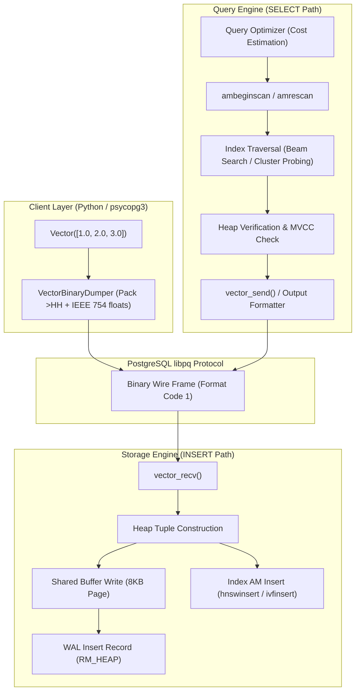
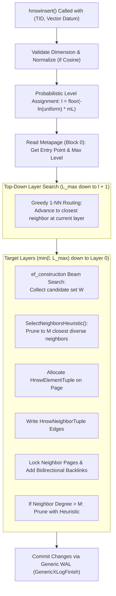
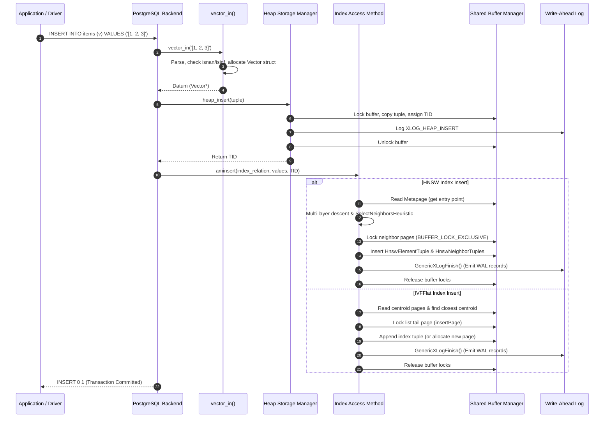
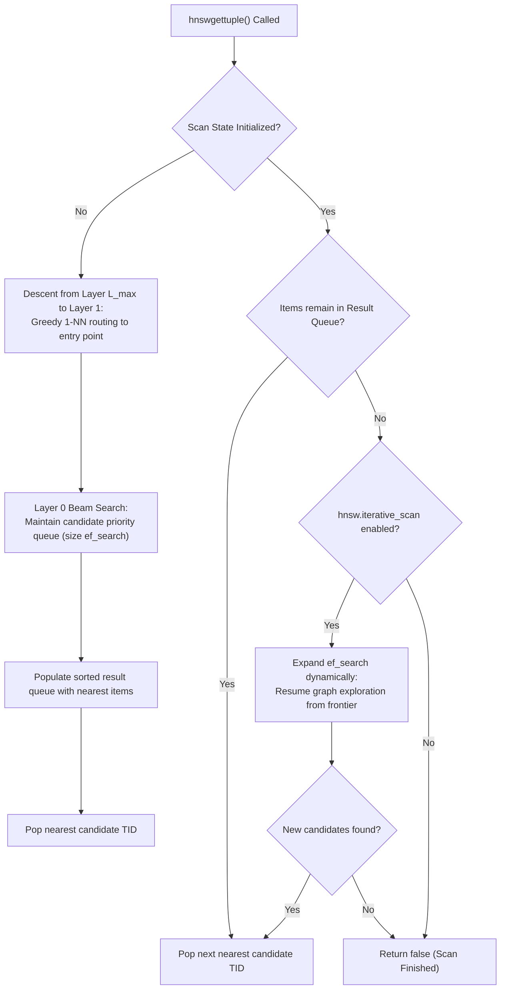
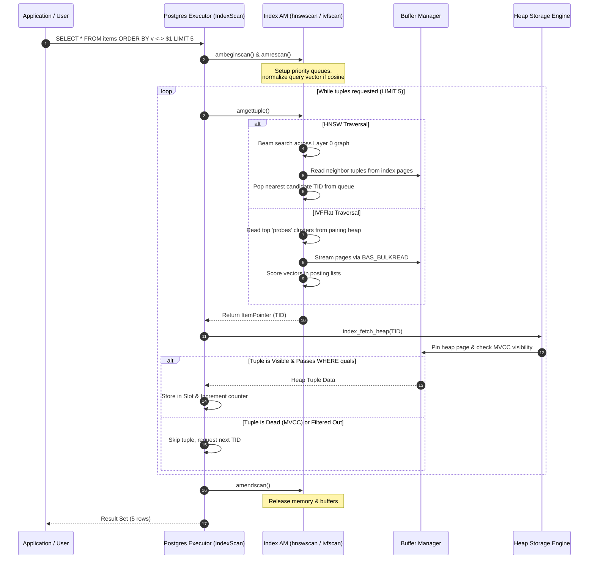
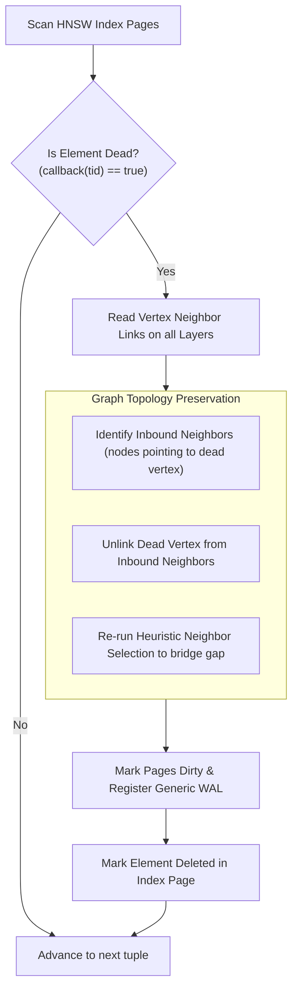
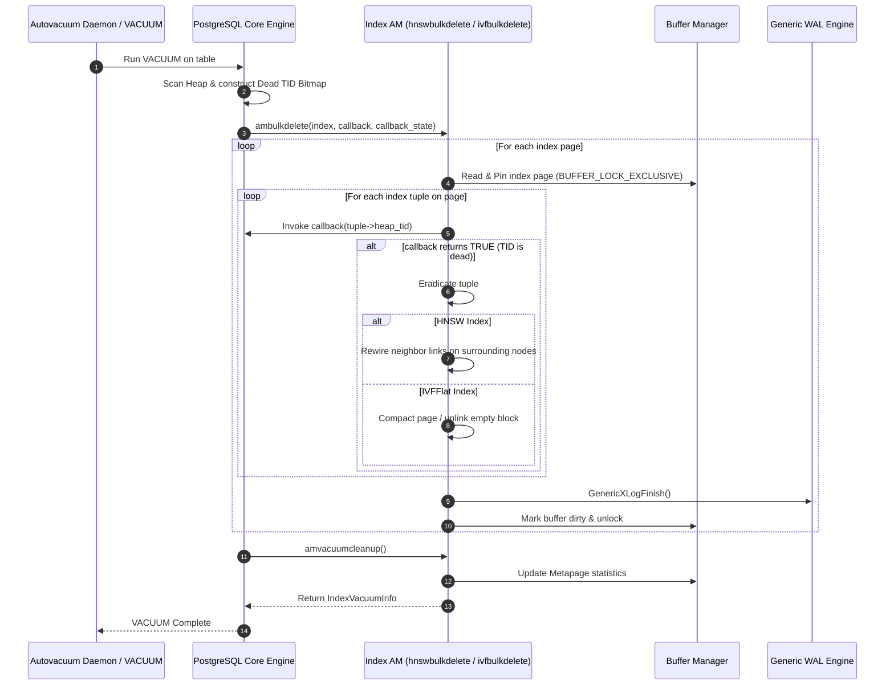
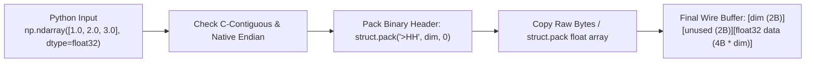
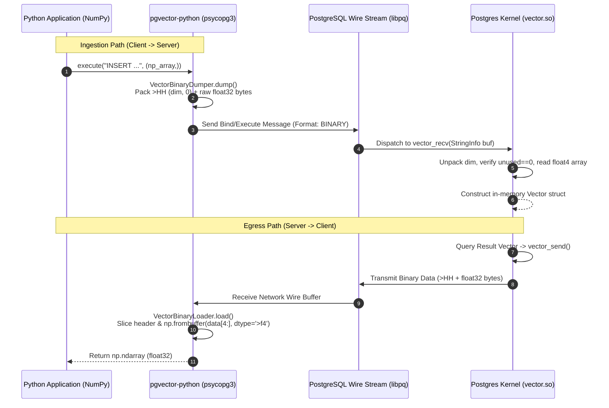

# End-to-End Data Flow & Execution Mechanics

> **Document Version:** 1.0.0  
> **Target Subsystems:** PostgreSQL Engine $\longleftrightarrow$ `vector.so` $\longleftrightarrow$ `pgvector-python`  
> **Audience:** Database Internals Engineers, Kernel Contributors, Performance Engineers

---

## Table of Contents

1. [Architectural Overview of Vector Data Flows](#1-architectural-overview-of-vector-data-flows)
2. [The Vector Ingestion Path (Storage & Indexing)](#2-the-vector-ingestion-path-storage--indexing)
   - [2.1 SQL String Parsing & Numeric Validation (`vector_in`)](#21-sql-string-parsing--numeric-validation-vector_in)
   - [2.2 In-Memory Varlena Struct Allocation](#22-in-memory-varlena-struct-allocation)
   - [2.3 Heap Tuple Construction & Shared Buffer Insertion](#23-heap-tuple-construction--shared-buffer-insertion)
   - [2.4 Write-Ahead Logging (WAL) of Heap Data](#24-write-ahead-logging-wal-of-heap-data)
   - [2.5 HNSW Graph Index Ingestion (`hnswinsert`)](#25-hnsw-graph-index-ingestion-hnswinsert)
   - [2.6 IVFFlat Centroid Search & List Append (`ivfinsert`)](#26-ivfflat-centroid-search--list-append-ivfinsert)
   - [2.7 Ingestion Path Sequence Diagram](#27-ingestion-path-sequence-diagram)
3. [The Vector Query Path ($k$-NN Similarity Search)](#3-the-vector-query-path-k-nn-similarity-search)
   - [3.1 Query Planning, Match-Up & Cost Modeling (`hnswcostestimate`)](#31-query-planning-match-up--cost-modeling-hnswcostestimate)
   - [3.2 Scan Initialization & State Setup (`ambeginscan`, `amrescan`)](#32-scan-initialization--state-setup-ambeginscan-amrescan)
   - [3.3 HNSW Execution: Multi-Layer Beam Search & Iterative Scan](#33-hnsw-execution-multi-layer-beam-search--iterative-scan)
   - [3.4 IVFFlat Execution: Pairing Heap & Cluster Posting Traversal](#34-ivfflat-execution-pairing-heap--cluster-posting-traversal)
   - [3.5 Heap Tuple Fetching & Snapshot MVCC Verification](#35-heap-tuple-fetching--snapshot-mvcc-verification)
   - [3.6 Query Path Sequence Diagram](#36-query-path-sequence-diagram)
4. [The Vacuum & Maintenance Path](#4-the-vacuum--maintenance-path)
   - [4.1 Background Worker vs Explicit VACUUM Lifecycle](#41-background-worker-vs-explicit-vacuum-lifecycle)
   - [4.2 Dead Tuple Identification (`IndexBulkDeleteCallback`)](#42-dead-tuple-identification-indexbulkdeletecallback)
   - [4.3 HNSW Graph Repair & Backlink Pruning (`hnswbulkdelete`)](#43-hnsw-graph-repair--backlink-pruning-hnswbulkdelete)
   - [4.4 IVFFlat List Consolidation & Block Re-Linking (`ivfbulkdelete`)](#44-ivfflat-list-consolidation--block-re-linking-ivfbulkdelete)
   - [4.5 Vacuum Path Sequence Diagram](#45-vacuum-path-sequence-diagram)
5. [The Wire Protocol Flow (Python SDK $\longleftrightarrow$ PostgreSQL)](#5-the-wire-protocol-flow-python-sdk-longleftrightarrow-postgresql)
   - [5.1 Ingestion Flow: Python Object to Binary Buffer](#51-ingestion-flow-python-object-to-binary-buffer)
   - [5.2 Kernel Reception: `vector_recv` Binary Deserialization](#52-kernel-reception-vector_recv-binary-deserialization)
   - [5.3 Egress Flow: `vector_send` Kernel Serialization](#53-egress-flow-vector_send-kernel-serialization)
   - [5.4 Client Parsing: Fast Zero-Copy NumPy Loading](#54-client-parsing-fast-zero-copy-numpy-loading)
   - [5.5 Wire Protocol Sequence Diagram](#55-wire-protocol-sequence-diagram)
6. [Cross-Document Reference Map](#6-cross-document-reference-map)

---

## 1. Architectural Overview of Vector Data Flows

Data flow in `pgvector` bridges high-level client applications with low-level page buffers inside the PostgreSQL shared memory pool. Because high-dimensional embeddings require significant compute and memory bandwidth, each step in the pipeline—text/binary serialization, memory layout, SIMD compute, and WAL record generation—is engineered to minimize memory copying, avoid CPU cache evictions, and prevent unneeded lock contention.



---

## 2. The Vector Ingestion Path (Storage & Indexing)

### 2.1 SQL String Parsing & Numeric Validation (`vector_in`)

When a client inserts a vector using text format (e.g., `'[0.1, -0.5, 3.1415]'::vector`), PostgreSQL invokes `vector_in()` defined in [`src/vector.c`](file:///mnt/Data/Coding/arkivector/pgvector/src/vector.c):

1. **Delimiter & Boundary Validation:** The parser skips leading whitespace, asserts the presence of the opening bracket `'['`, and iteratively scans comma-delimited numeric tokens until encountering `']'`.
2. **Numeric Conversion:** Each coordinate is converted to an IEEE 754 single-precision float using `strtof()`.
3. **Strict Non-Finite Guards:** To prevent corrupted distance calculations and infinite loops in index graphs, `pgvector` enforces strict numeric hygiene:
   ```c
   if (isnan(value))
       ereport(ERROR, (errcode(ERRCODE_NUMERIC_VALUE_OUT_OF_RANGE),
                       errmsg("NaN not allowed in vector")));
   if (isinf(value))
       ereport(ERROR, (errcode(ERRCODE_NUMERIC_VALUE_OUT_OF_RANGE),
                       errmsg("infinite values not allowed in vector")));
   ```
4. **Dimension Bounds Check:** The parsed dimension $d$ is validated against the absolute kernel limit:
   $$1 \le d \le \text{VECTOR\_MAX\_DIM} \quad (16,000)$$
5. **Typmod Dimension Enforcement:** If the target column was declared with a specific dimensionality (e.g. `vector(1536)`), the type modifier check asserts $d = \text{typmod}$.

### 2.2 In-Memory Varlena Struct Allocation

The validated vector is materialized into a contiguous C struct allocated in the current PostgreSQL `MemoryContext`:

```c
typedef struct Vector
{
    int32       vl_len_;     /* Standard 4-byte varlena header */
    int16       dim;         /* Number of dimensions (uint16) */
    int16       unused;      /* Reserved / 16-bit alignment padding (zeroed) */
    float       x[FLEXIBLE_ARRAY_MEMBER]; /* Contiguous IEEE 754 float32 */
} Vector;
```

- Total allocation size is computed via `VECTOR_SIZE(dim)`:
  $$\text{Bytes} = \text{offsetof}(\text{Vector}, x) + (\text{dim} \times \text{sizeof(float)}) = 8 + (4 \times \text{dim})$$
- The 4-byte varlena length header is set using `SET_VARSIZE(result, size)`.
- The `unused` 16-bit field is zeroed out to prevent leaking uninitialized memory onto shared buffer pages or WAL streams.

### 2.3 Heap Tuple Construction & Shared Buffer Insertion

1. The `Vector` datum is incorporated into the heap tuple payload via `heap_form_tuple()`.
2. Because `vector` is registered with `STORAGE = external`, PostgreSQL's TOAST machinery **does not attempt compression** (compression of floating-point embeddings yields negligible gains and incurs heavy decompression penalties).
3. If the tuple exceeds the page tuple threshold (typically $\approx 2\text{ KB}$ for standard $8\text{ KB}$ pages), the vector is TOASTed out-of-line into auxiliary TOAST relation pages without compression.
4. The table storage manager pins and exclusively locks the target heap buffer, writes the tuple into the page's item array, and assigns the tuple an `ItemPointer` (`TID = (block_number, offset_number)`).

### 2.4 Write-Ahead Logging (WAL) of Heap Data

Before the buffer content lock is released, PostgreSQL writes an `XLOG_HEAP_INSERT` WAL record into the write-ahead log buffer via `XLogInsert()`. This guarantees that if a crash occurs immediately after the heap insert, the tuple can be recovered during redo recovery.

### 2.5 HNSW Graph Index Ingestion (`hnswinsert`)

Following the heap write, PostgreSQL invokes `hnswinsert()` in [`src/hnswinsert.c`](file:///mnt/Data/Coding/arkivector/pgvector/src/hnswinsert.c):



1. **Probabilistic Level Sampling:** The node's top level $l$ is drawn from an exponential distribution parameterized by $m_L = \frac{1}{\ln(M)}$.
2. **Top-Down Search:** Starting at the graph entry point on layer $L_{max}$, the algorithm descends to layer $l+1$ using greedy 1-NN traversal (moving to any neighbor closer to the inserted vector).
3. **Neighbor Selection & Heuristic Pruning:** For layers $\min(l, L_{max})$ down to 0, the algorithm conducts a beam search with width `ef_construction` to identify candidate neighbors. `SelectNeighborsHeuristic()` enforces diversity by checking the "shrink factor": a candidate is rejected if it is closer to an already-selected neighbor than to the base element.
4. **Generic WAL Logging:** Because `pgvector` does not register a custom PostgreSQL Resource Manager (RMGR), all index page modifications are wrapped in **Generic WAL** transactions (`GenericXLogStart()`, `GenericXLogRegisterBuffer()`, `GenericXLogFinish()`), generating portable delta records.

### 2.6 IVFFlat Centroid Search & List Append (`ivfinsert`)

In [`src/ivfinsert.c`](file:///mnt/Data/Coding/arkivector/pgvector/src/ivfinsert.c), incremental insertion into an IVFFlat index proceeds as follows:

1. **Centroid Distance Computation:** The backend iterates through the $K$ centroid vectors stored across the index's initial list pages. Distance is computed using SIMD kernels.
2. **Target List Identification:** The cluster list ID $c$ with minimal distance is selected:
   $$c = \arg\min_{i \in [0, K-1]} D(\mathbf{v}, \mathbf{C}_i)$$
3. **Tail Page Append:**
   - The backend accesses the `IvfflatListData` for cluster $c$ on the list page to obtain `insertPage` (the current tail page of the cluster).
   - It pins and locks `insertPage` with `BUFFER_LOCK_EXCLUSIVE`.
   - If `insertPage` has sufficient free space, an `IndexTuple` containing the heap TID and the vector is added.
   - If `insertPage` is full, a new index page is allocated via `IvfflatNewBuffer()`, linked to the previous page's `opaque->nextblkno`, updated as the new `insertPage` in `IvfflatListData`, and registered via Generic WAL.

### 2.7 Ingestion Path Sequence Diagram



---

## 3. The Vector Query Path ($k$-NN Similarity Search)

### 3.1 Query Planning, Match-Up & Cost Modeling (`hnswcostestimate`)

When executing an approximate nearest neighbor search:
```sql
SELECT id FROM items ORDER BY embedding <-> '[0.1, 0.2, 0.3]' LIMIT 10;
```

1. **Ordering Operator Detection:** The PostgreSQL query planner inspects the `ORDER BY` clause. It detects that `<->` is declared as an ordering operator (`AMOP_ORDER`) within the `vector_l2_ops` operator class belonging to the `hnsw` or `ivfflat` access method.
2. **Path Generation:** The planner creates an `IndexScanPath` with an index order-by condition rather than planning a sequential scan followed by a top-N heapsort.
3. **Cost Estimation:**
   - **`hnswcostestimate()`:** Models the startup cost as the graph descent down to layer 0, and the run cost as proportional to the number of nodes evaluated during beam search:
     $$\text{Cost}_{run} \propto \text{ef\_search} \times \text{cost\_per\_distance\_eval}$$
   - **`ivfflatcostestimate()`:** Models cost based on computing distances to all $K$ centroids plus reading $\frac{\text{probes}}{K} \times N$ tuples from the posting lists.

### 3.2 Scan Initialization & State Setup (`ambeginscan`, `amrescan`)

1. The executor initializes the scan by calling `ambeginscan()`, allocating `HnswScanOpaqueData` or `IvfflatScanOpaqueData` inside a dedicated `MemoryContext`.
2. When the query vector is bound, `amrescan()` is called:
   - Evaluates runtime keys and validates that the search vector matches index dimensionality.
   - For cosine distance (`<=>`), the search vector is pre-normalized once to enable fast inner-product shortcuts:
     $$\mathbf{q}_{norm} = \frac{\mathbf{q}}{\|\mathbf{q}\|_2}$$

### 3.3 HNSW Execution: Multi-Layer Beam Search & Iterative Scan

During `hnswgettuple()`:



1. **Layer 0 Exploration:** Maintains two priority queues:
   - `candidates`: Min-heap of vertices discovered but whose neighbors are not yet fully explored.
   - `w`: Max-heap holding the best $ef\_search$ neighbors seen so far.
2. **Search Termination:** At layer 0, search terminates when the closest element in `candidates` is farther than the furthest element in `w`.
3. **Iterative Scan Mode (`hnsw.iterative_scan`):**
   - Standard ANN indices fail when strict relational filters (`WHERE category = 'electronics'`) eliminate all $k$ initial results.
   - When `iterative_scan = relaxed` or `strict`, `pgvector` does not terminate when `ef_search` is exhausted. Instead, it dynamically expands the candidate window and resumes graph exploration on demand until the requested LIMIT is satisfied or the graph is exhausted.

### 3.4 IVFFlat Execution: Pairing Heap & Cluster Posting Traversal

During `ivfflatgettuple()`:

1. **Centroid Ranking:** On initial scan invocation, the query vector is evaluated against all $K$ centroids.
2. **Pairing Heap Selection:** The closest `probes` centroid lists are inserted into a pairing heap ordered by centroid distance.
3. **Posting List Traversal:**
   - The scanner selects the closest centroid list, obtains its `firstPage`, and initializes a `BufferAccessStrategy` (`BAS_BULKREAD`) to avoid blowing out the shared buffer pool cache.
   - Traverses the linked index pages, computing distances for every indexed vector on the page.
   - Vectors and their TIDs are accumulated and ordered in memory.
4. **Tuple Return:** Yields TIDs sequentially until all vectors within the probed clusters are exhausted.

### 3.5 Heap Tuple Fetching & Snapshot MVCC Verification

The access method does not know if a given tuple is visible to the active transaction:
1. `amgettuple` returns an `ItemPointer` (TID) to the PostgreSQL executor.
2. The executor calls `index_fetch_heap()`:
   - Pallocs and pins the heap buffer corresponding to `ItemPointerGetBlockNumber(tid)`.
   - Examines the heap tuple header (`t_xmin`, `t_xmax`, `t_infomask`).
   - Verifies visibility against the current query snapshot via `HeapTupleSatisfiesVisibility()`.
3. If the tuple is dead (e.g. deleted or aborted), it is skipped, and the executor immediately invokes `amgettuple()` again.
4. If visible, any post-quals (`WHERE` conditions not evaluated by the index) are evaluated. If all predicates pass, the tuple is projected to the output slot.

### 3.6 Query Path Sequence Diagram



---

## 4. The Vacuum & Maintenance Path

### 4.1 Background Worker vs Explicit VACUUM Lifecycle

PostgreSQL autovacuum worker daemons periodically inspect table bloat and trigger maintenance on relations. When `VACUUM` processes a table with vector indices, it invokes the index access method callbacks:
- `ambulkdelete`: Invoked to remove index entries pointing to dead heap tuples.
- `amvacuumcleanup`: Invoked to perform post-vacuum statistics updating, metapage maintenance, and page reclamation.

### 4.2 Dead Tuple Identification (`IndexBulkDeleteCallback`)

PostgreSQL provides a callback function `callback(ItemPointer tid, void *state)`:
- During vacuum, PostgreSQL scans the heap and builds a bitmap of all dead TIDs.
- As the vector index traverses its pages, it passes each indexed TID to `callback`.
- If `callback(tid)` returns true, the TID is dead and must be eradicated from the index.

### 4.3 HNSW Graph Repair & Backlink Pruning (`hnswbulkdelete`)

Vacuuming an HNSW graph is mathematically delicate: deleting a vertex without repairing edges can partition the graph and permanently sever search paths.



1. **Topology Preservation:** When an element tuple is removed, `pgvector` inspects all inbound links.
2. **Backlink Pruning & Rewiring:** The inbound neighbors are updated to remove the reference to the dead vertex. If an inbound neighbor's degree falls below $M_{min}$, the algorithm attempts to reconnect it to the dead vertex's former neighbors, maintaining graph connectivity.
3. **WAL Logging:** All page updates are registered via Generic WAL.

### 4.4 IVFFlat List Consolidation & Block Re-Linking (`ivfbulkdelete`)

In [`src/ivfvacuum.c`](file:///mnt/Data/Coding/arkivector/pgvector/src/ivfvacuum.c):

1. **Page-by-Page Scan:** IVFFlat sweeps all entry pages belonging to each cluster list.
2. **Line Pointer Elimination:** For every dead tuple on an entry page, the tuple is removed and remaining index tuples are compacted via `PageIndexTupleDelete()`.
3. **Empty Block Unlinking:** If an entire entry page becomes empty, it is unlinked from the cluster list chain:
   $$\text{prior\_page} \to \text{nextblkno} = \text{current\_page} \to \text{nextblkno}$$
   The vacated page is marked as free for future reuse.

### 4.5 Vacuum Path Sequence Diagram



---

## 5. The Wire Protocol Flow (Python SDK $\longleftrightarrow$ PostgreSQL)

`pgvector-python` provides high-performance binary serialization routines that bypass expensive string conversions (`vector_in` and `vector_out`), writing directly to the PostgreSQL backend wire stream.

### 5.1 Ingestion Flow: Python Object to Binary Buffer

In `pgvector/psycopg/vector.py`:



1. **Header Packing:** Uses Python's standard `struct` module to pack a 4-byte prefix in network byte order (big-endian):
   - `uint16` dimension: `dim`
   - `uint16` unused: `0`
2. **Buffer Optimization:** If the input is already a C-contiguous, single-precision NumPy array (`np.ndarray` of `float32`), `pgvector` extracts `.tobytes()` directly (swapping bytes only if host architecture is little-endian), completely eliminating Python per-element iteration loops.

### 5.2 Kernel Reception: `vector_recv` Binary Deserialization

When PostgreSQL receives the binary payload (format code 1), it invokes `vector_recv()` in [`src/vector.c`](file:///mnt/Data/Coding/arkivector/pgvector/src/vector.c):

```c
Datum
vector_recv(PG_FUNCTION_ARGS)
{
    StringInfo  buf = (StringInfo) PG_GETARG_POINTER(0);
    int32       typmod = PG_GETARG_INT32(2);
    Vector     *result;
    int16       dim = pq_getmsgint(buf, sizeof(int16));
    int16       unused = pq_getmsgint(buf, sizeof(int16));

    if (dim < 1 || dim > VECTOR_MAX_DIM)
        ereport(ERROR, (errcode(ERRCODE_PROGRAM_LIMIT_EXCEEDED),
                        errmsg("vector dimension out of range")));
    if (unused != 0)
        ereport(ERROR, (errcode(ERRCODE_DATA_CORRUPTED),
                        errmsg("expected unused to be 0")));

    CheckDim(typmod, dim);
    result = InitVector(dim);

    for (int i = 0; i < dim; i++)
    {
        result->x[i] = pq_getmsgfloat4(buf);
        CheckElement(result->x[i]);
    }

    pq_getmsgend(buf);
    PG_RETURN_VECTOR_P(result);
}
```

1. `pq_getmsgint(buf, 2)` extracts the dimension and verifies `unused == 0`.
2. Allocates the target `Vector` struct in one step via `InitVector(dim)`.
3. `pq_getmsgfloat4(buf)` unpacks each 32-bit float from network endianness to host endianness and immediately verifies `CheckElement()` (asserting neither `NaN` nor `Inf`).

### 5.3 Egress Flow: `vector_send` Kernel Serialization

When PostgreSQL transmits a vector result to a client requesting binary format, `vector_send()` executes:

```c
Datum
vector_send(PG_FUNCTION_ARGS)
{
    Vector     *s = PG_GETARG_VECTOR_P(0);
    StringInfoData buf;

    pq_begintransfer(&buf);
    pq_sendint16(&buf, s->dim);
    pq_sendint16(&buf, s->unused);

    for (int i = 0; i < s->dim; i++)
        pq_sendfloat4(&buf, s->x[i]);

    PG_RETURN_BYTEA_P(pq_endtransfer(&buf));
}
```

- Prepares a `StringInfoData` wire buffer.
- Emits the 2-byte dimension, 2-byte zero padding, and contiguous stream of 4-byte big-endian floats.

### 5.4 Client Parsing: Fast Zero-Copy NumPy Loading

When `psycopg3` receives the binary bytes in Python:
1. `VectorBinaryLoader.load(data)` is invoked.
2. The loader slices the 4-byte header: `dim, unused = struct.unpack('>HH', data[:4])`.
3. The remaining buffer `data[4:]` is handed directly to `np.frombuffer()`:
   ```python
   vec = np.frombuffer(data[4:], dtype='>f4').astype('=f4')
   ```
   This constructs a NumPy vector using optimized SIMD memory copying and endian-swapping, completely avoiding Python object allocation overhead.

### 5.5 Wire Protocol Sequence Diagram



---

## 6. Cross-Document Reference Map

- **Subsystem Architecture & File Catalog:**
  - [`architecture/overview.md`](file:///mnt/Data/Coding/arkivector/RESEARCH/pgvector/architecture/overview.md)
- **PostgreSQL Kernel Extension Infrastructure:**
  - [`architecture/postgres_extension_model.md`](file:///mnt/Data/Coding/arkivector/RESEARCH/pgvector/architecture/postgres_extension_model.md)
- **Index Access Methods & Comparative Engineering:**
  - [`indexes/index_comparison.md`](file:///mnt/Data/Coding/arkivector/RESEARCH/pgvector/indexes/index_comparison.md)
  - [`indexes/hnsw_scan.md`](file:///mnt/Data/Coding/arkivector/RESEARCH/pgvector/indexes/hnsw_scan.md)
  - [`indexes/ivfflat_scan.md`](file:///mnt/Data/Coding/arkivector/RESEARCH/pgvector/indexes/ivfflat_scan.md)
- **Driver Adapter Implementations:**
  - [`python-sdk/psycopg_adapter.md`](file:///mnt/Data/Coding/arkivector/RESEARCH/pgvector/python-sdk/psycopg_adapter.md)
  - [`python-sdk/core_types.md`](file:///mnt/Data/Coding/arkivector/RESEARCH/pgvector/python-sdk/core_types.md)
