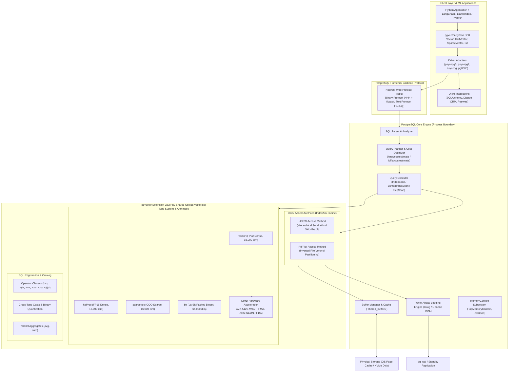
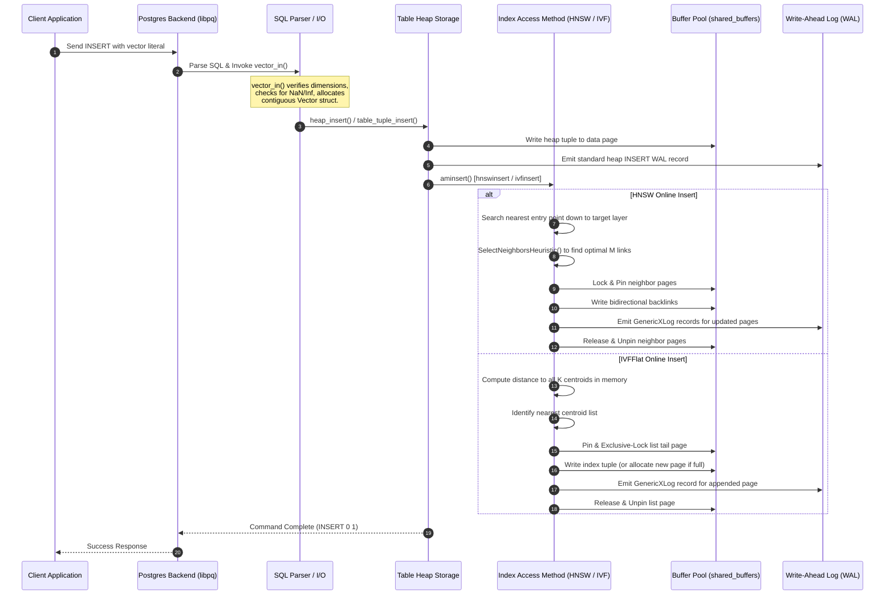
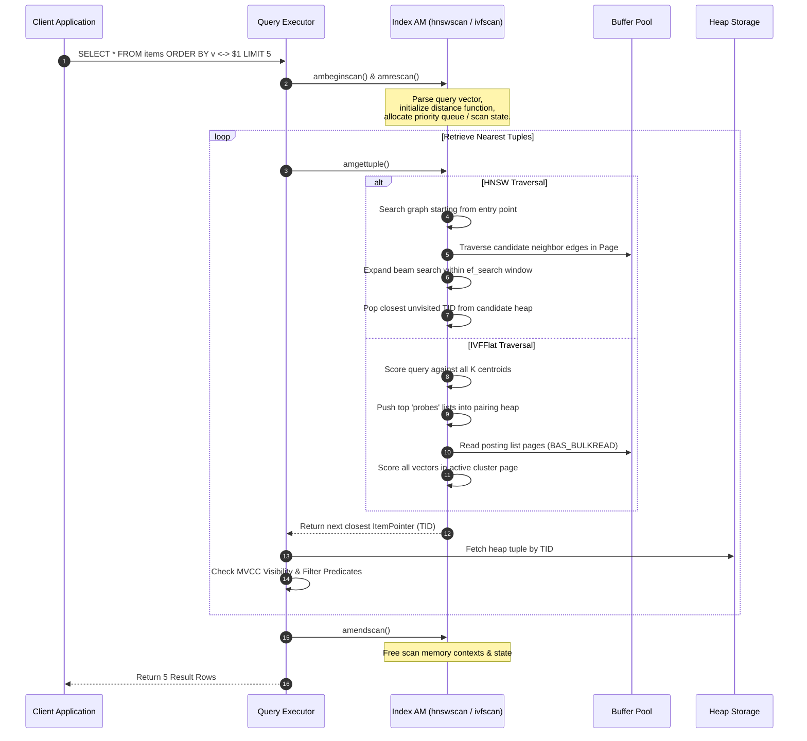
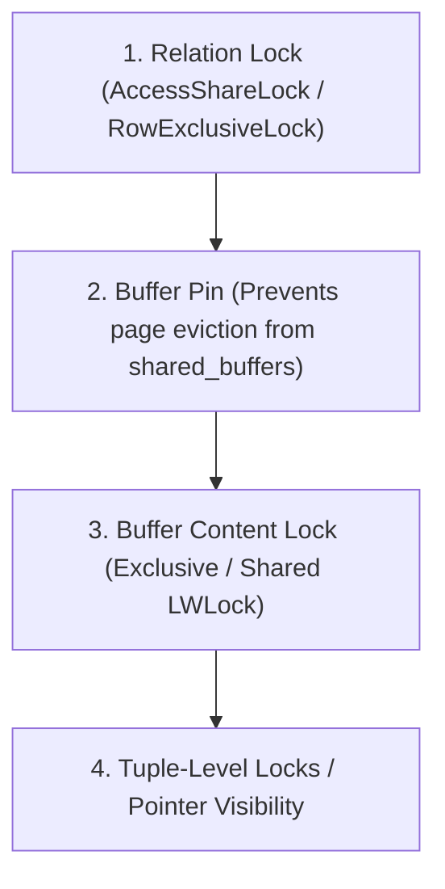
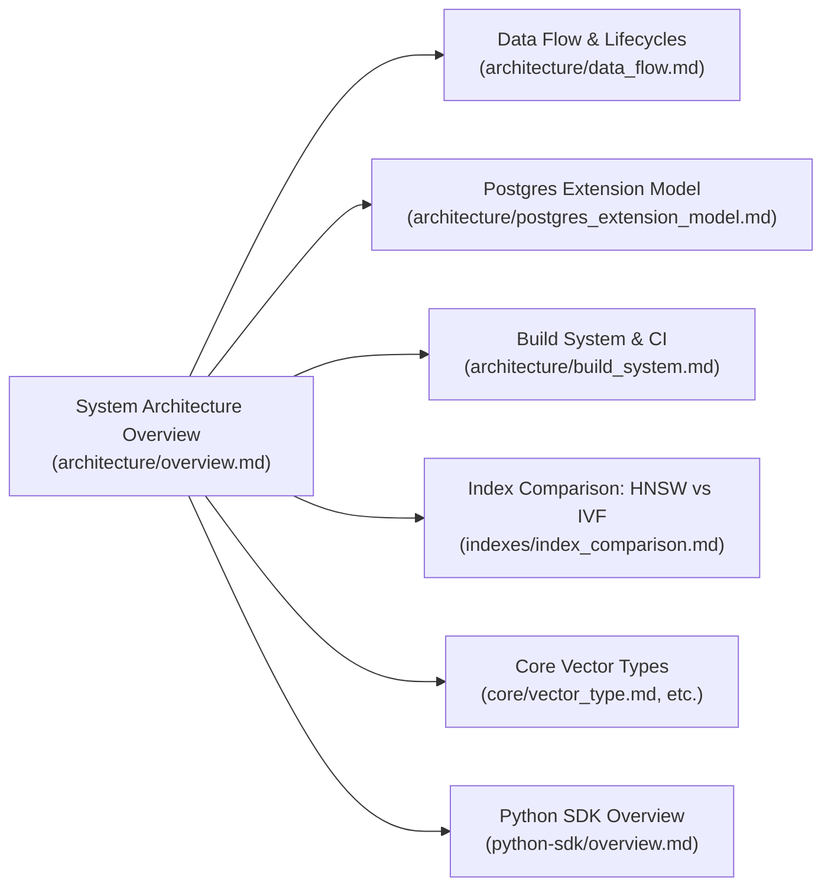

# System Architecture: pgvector Kernel & Ecosystem Overview

> **Document Version:** 1.0.0  
> **Target System:** `pgvector` (C Extension) & `pgvector-python` (SDK)  
> **Audience:** Systems Engineers, Database Architects, Vector Infrastructure Developers

---

## Table of Contents

1. [Executive Architectural Summary](#1-executive-architectural-summary)
2. [Global System Architecture](#2-global-system-architecture)
3. [Comprehensive Component Inventory](#3-comprehensive-component-inventory)
   - [Core Type Subsystem (`src/`)](#core-type-subsystem-src)
   - [HNSW Index Subsystem (`src/hnsw*.c`)](#hnsw-index-subsystem-srchnswc)
   - [IVFFlat Index Subsystem (`src/ivf*.c`)](#ivfflat-index-subsystem-srcivfc)
   - [Catalog & Packaging (`sql/`, `vector.control`, `Makefile`)](#catalog--packaging-sql-vectorcontrol-makefile)
   - [Client SDK Subsystem (`pgvector-python`)](#client-sdk-subsystem-pgvector-python)
4. [Data Flow: Vector Ingestion & Write Path](#4-data-flow-vector-ingestion--write-path)
5. [Data Flow: ANN Query Execution & Scan Path](#5-data-flow-ann-query-execution--scan-path)
6. [Concurrency Model & Synchronization Mechanics](#6-concurrency-model--synchronization-mechanics)
   - [Lock Hierarchy: Relation, Page, Tuple, and Buffer Pins](#lock-hierarchy-relation-page-tuple-and-buffer-pins)
   - [Shared Memory Coordination & DSM Dynamic Allocation](#shared-memory-coordination--dsm-dynamic-allocation)
   - [HNSW Entry Point & Neighbor Lock Protocol](#hnsw-entry-point--neighbor-lock-protocol)
   - [IVFFlat List Page Chaining & Tail Locking](#ivfflat-list-page-chaining--tail-locking)
7. [Extension Lifecycle & Dynamic Loading Sequence](#7-extension-lifecycle--dynamic-loading-sequence)
   - [The Extension Triad Resolution](#the-extension-triad-resolution)
   - [Dynamic Library Linkage & `_PG_init()`](#dynamic-library-linkage--_pg_init)
   - [Sequence Diagram: `CREATE EXTENSION vector`](#sequence-diagram-create-extension-vector)
8. [Cross-Document Reference Map](#8-cross-document-reference-map)

---

## 1. Executive Architectural Summary

`pgvector` is a native PostgreSQL extension that integrates high-dimensional vector data types, SIMD-accelerated distance metrics, and approximate nearest neighbor (ANN) index access methods directly into the PostgreSQL storage and query engine.

Unlike external vector search plugins or standalone vector databases that require sidecar synchronization, dual-write protocols, and distributed consensus overhead, `pgvector` operates **inside** the relational engine's process space:
- **Full ACID Transactions:** Vector modifications participate directly in PostgreSQL Write-Ahead Logging (WAL), point-in-time recovery (PITR), standby replication, and snapshot isolation (MVCC).
- **Direct Shared Buffer Integration:** Vector heaps and index pages reside inside the PostgreSQL shared buffer pool (`shared_buffers`), benefiting from kernel dirty-page writeback, clock-sweep buffer eviction, and Direct I/O optimizations.
- **Relational Filter Pushdown:** Vector index scans integrate with the PostgreSQL cost-based optimizer, allowing relational predicates (`WHERE tenant_id = 42 AND status = 'active'`) to be evaluated seamlessly alongside ANN index scans via iterative scan techniques.

---

## 2. Global System Architecture

The following diagram illustrates the multi-tier hierarchy of `pgvector`, spanning client-side applications, driver wire encoding, PostgreSQL query planning, internal access methods, buffer caching, and physical storage.



---

## 3. Comprehensive Component Inventory

The `pgvector` repository is structured into distinct, high-cohesion subsystems implementing types, utilities, index access methods, and client integration.

### Core Type Subsystem (`src/`)

| File | Primary Functions / Structs | Role & Architectural Function |
| :--- | :--- | :--- |
| [`src/vector.h`](file:///mnt/Data/Coding/arkivector/pgvector/src/vector.h) | `Vector`, `VECTOR_MAX_DIM` (16,000), macros | Primary header defining the standard 32-bit dense vector type, byte sizing, and memory extraction macros. |
| [`src/vector.c`](file:///mnt/Data/Coding/arkivector/pgvector/src/vector.c) | `vector_in`, `vector_out`, `vector_recv`, `vector_send`, distance functions | Text/binary I/O parser, runtime SIMD dispatch, L2/inner-product/cosine/L1 metrics, arithmetic operators (`+`, `-`, `*`, `\|\|`). |
| [`src/halfvec.h`](file:///mnt/Data/Coding/arkivector/pgvector/src/halfvec.h) | `HalfVector`, `half` (`uint16`) | Header defining 16-bit half-precision floating-point vector storage (IEEE 754 `binary16`). |
| [`src/halfvec.c`](file:///mnt/Data/Coding/arkivector/pgvector/src/halfvec.c) | `halfvec_in`, `halfvec_out`, `halfvec_recv`, distance functions | 50% storage footprint type; SIMD-accelerated distance kernels with FP32 arithmetic accumulation. |
| [`src/halfutils.h`](file:///mnt/Data/Coding/arkivector/pgvector/src/halfutils.h) | Conversion signatures | Function declarations for hardware and software FP16 ↔ FP32 conversions. |
| [`src/halfutils.c`](file:///mnt/Data/Coding/arkivector/pgvector/src/halfutils.c) | `HalfToFloat4`, `Float4ToHalf`, `HasF16c` | Bit-manipulation software conversion algorithms and x86 F16C / ARM native hardware conversion detection. |
| [`src/bitvec.h`](file:///mnt/Data/Coding/arkivector/pgvector/src/bitvec.h) | `BITVEC_MAX_DIM` (64,000), macros | Wrapper definitions leveraging PostgreSQL's native `VarBit` data type for vector similarity. |
| [`src/bitvec.c`](file:///mnt/Data/Coding/arkivector/pgvector/src/bitvec.c) | `bit_hamming_distance`, `bit_jaccard_distance` | Hamming distance (`<~>`) and Jaccard distance (`<%>`) computation via hardware popcount. |
| [`src/bitutils.h`](file:///mnt/Data/Coding/arkivector/pgvector/src/bitutils.h) | SIMD popcount signatures | Function declarations for hardware-accelerated popcount routines. |
| [`src/bitutils.c`](file:///mnt/Data/Coding/arkivector/pgvector/src/bitutils.c) | `BitHammingDistance`, AVX-512 `_mm512_popcnt_epi64` | Runtime CPUID dispatch for AVX-512 VPOPCNTDQ (512 bits per instruction) and fallback popcount. |
| [`src/sparsevec.h`](file:///mnt/Data/Coding/arkivector/pgvector/src/sparsevec.h) | `SparseVector`, `SPARSEVEC_MAX_DIM`, `SPARSEVEC_MAX_NNZ` | Header for compressed COO (Coordinate format) vectors storing high-dimensional sparse representations (e.g. SPLADE). |
| [`src/sparsevec.c`](file:///mnt/Data/Coding/arkivector/pgvector/src/sparsevec.c) | `sparsevec_in`, `sparsevec_out`, two-pointer kernels | Sparse vector parsing, validation, sorting, and linear-time merge distance functions. |

### HNSW Index Subsystem (`src/hnsw*.c`)

| File | Primary Functions / Structs | Role & Architectural Function |
| :--- | :--- | :--- |
| [`src/hnsw.h`](file:///mnt/Data/Coding/arkivector/pgvector/src/hnsw.h) | `HnswElementTupleData`, `HnswNeighborTupleData`, `HnswPageOpaqueData` | Core header defining HNSW disk page layouts, in-memory graph nodes, allocator abstractions, and relptr mappings. |
| [`src/hnsw.c`](file:///mnt/Data/Coding/arkivector/pgvector/src/hnsw.c) | `hnswhandler`, `hnswbuildempty`, `hnswvalidate`, `hnswcostestimate` | Access Method handler entry point, cost modeling, GUC definitions (`hnsw.ef_search`, `hnsw.iterative_scan`). |
| [`src/hnswbuild.c`](file:///mnt/Data/Coding/arkivector/pgvector/src/hnswbuild.c) | `hnswbuild`, `BuildGraph`, `HnswBeginParallel`, `FlushPages` | Two-phase index construction: Phase 1 fast in-memory DSM graph; Phase 2 on-disk buffer manager ingestion. |
| [`src/hnswinsert.c`](file:///mnt/Data/Coding/arkivector/pgvector/src/hnswinsert.c) | `hnswinsert`, `HnswInsertTuple`, `SelectNeighborsHeuristic` | Incremental transactional tuple insertion, multi-layer greedy routing, heuristic neighbor pruning, and backlink updates. |
| [`src/hnswscan.c`](file:///mnt/Data/Coding/arkivector/pgvector/src/hnswscan.c) | `hnswbeginscan`, `hnswrescan`, `hnswgettuple`, `hnswendscan` | Execution engine for $k$-NN search, priority queue traversal, and dynamic iterative scanning for filtered queries. |
| [`src/hnswutils.c`](file:///mnt/Data/Coding/arkivector/pgvector/src/hnswutils.c) | `HnswInitPage`, `HnswGetTuple`, `HnswAddElementTuple` | Low-level disk page manipulation, buffer lock acquisition, and tuple binary serialization. |
| [`src/hnswvacuum.c`](file:///mnt/Data/Coding/arkivector/pgvector/src/hnswvacuum.c) | `hnswbulkdelete`, `hnswvacuumcleanup` | Vacuum maintenance, dead tuple identification, graph edge rewiring, and unlinking of deleted heap pointers. |

### IVFFlat Index Subsystem (`src/ivf*.c`)

| File | Primary Functions / Structs | Role & Architectural Function |
| :--- | :--- | :--- |
| [`src/ivfflat.h`](file:///mnt/Data/Coding/arkivector/pgvector/src/ivfflat.h) | `IvfflatMetaPageData`, `IvfflatListData`, `IvfflatPageOpaqueData` | Header defining inverted list page chaining, centroid structures, and scan states. |
| [`src/ivfflat.c`](file:///mnt/Data/Coding/arkivector/pgvector/src/ivfflat.c) | `ivfflathandler`, `ivfflatbuildempty`, `ivfflatcostestimate` | Access Method handler, catalog integration, and cost estimation based on probed lists. |
| [`src/ivfbuild.c`](file:///mnt/Data/Coding/arkivector/pgvector/src/ivfbuild.c) | `ivfbuild`, `SampleRows`, `ComputeCenters`, `AssignTuples` | Four-phase build pipeline: Vitter sampling $\to$ k-means $\to$ Tuplesort partition $\to$ posting list page streaming. |
| [`src/ivfinsert.c`](file:///mnt/Data/Coding/arkivector/pgvector/src/ivfinsert.c) | `ivfinsert`, `IvfflatInsertTuple` | Online insert: finds closest centroid in memory and appends index tuple to the cluster's page chain. |
| [`src/ivfscan.c`](file:///mnt/Data/Coding/arkivector/pgvector/src/ivfscan.c) | `ivfflatbeginscan`, `ivfflatgettuple`, pairing heap probe selection | Scan execution: ranks centroids, uses pairing heap to traverse top `probes` inverted lists with `BAS_BULKREAD`. |
| [`src/ivfkmeans.c`](file:///mnt/Data/Coding/arkivector/pgvector/src/ivfkmeans.c) | `IvfflatKmeans`, Elkan's accelerated algorithm | K-means++ initialization and Elkan's accelerated k-means using triangle inequality distance pruning. |
| [`src/ivfutils.c`](file:///mnt/Data/Coding/arkivector/pgvector/src/ivfutils.c) | `IvfflatInitPage`, `IvfflatUpdateList` | Page formatters, buffer management helpers, and metapage cluster state synchronization. |
| [`src/ivfvacuum.c`](file:///mnt/Data/Coding/arkivector/pgvector/src/ivfvacuum.c) | `ivfbulkdelete`, `ivfvacuumcleanup` | Removal of index tuples referencing dead heap TIDs and page chain consolidation. |

### Catalog & Packaging (`sql/`, `vector.control`, `Makefile`)

| File | Role & Architectural Function |
| :--- | :--- |
| [`sql/vector.sql`](file:///mnt/Data/Coding/arkivector/pgvector/sql/vector.sql) | Master SQL script defining shell types, I/O functions, types, operators, operator families, and opclasses. |
| [`sql/vector--0.8.0--0.9.0.sql`](file:///mnt/Data/Coding/arkivector/pgvector/sql/vector--0.8.0--0.9.0.sql) | Incremental migration scripts maintaining forward/backward compatibility across PostgreSQL catalog versions. |
| [`vector.control`](file:///mnt/Data/Coding/arkivector/pgvector/vector.control) | PostgreSQL extension metadata specifying version, module pathname, and relocatability. |
| [`Makefile`](file:///mnt/Data/Coding/arkivector/pgvector/Makefile) | PGXS build harness compiling source files with `-O3`, `-march` flags, and test target definitions. |

### Client SDK Subsystem (`pgvector-python`)

| File / Submodule | Role & Architectural Function |
| :--- | :--- |
| `pgvector/vector.py` | Zero-dependency client representation of 32-bit float vectors using Python standard library `array.array('f')`. |
| `pgvector/halfvec.py` | Half-precision representation with IEEE 754 software packing fallback and native buffer export. |
| `pgvector/sparsevec.py` | Coordinate format (COO) representation storing `(dim, indices, values)`. |
| `pgvector/bit.py` | Binary string bit-vector representation for Hamming distance search. |
| `pgvector/psycopg/` | High-performance adapter for psycopg 3 implementing both text and binary wire protocol dumpers/loaders. |
| `pgvector/psycopg2/` | Binary and text extension adapter for psycopg 2. |
| `pgvector/asyncpg/` | Asynchronous protocol decoder for asyncpg using custom type codecs. |
| `pgvector/pg8000/` | Pure-Python wire protocol integration for pg8000. |
| `pgvector/sqlalchemy/` | SQLAlchemy `UserDefinedType` classes with custom comparator operators mapping to SQL infix operators. |
| `pgvector/django/` | Django ORM `VectorField`, `DistanceBase` expression lookups, and index migrations. |
| `pgvector/peewee/` | Peewee ORM field definitions and distance expression builders. |

---

## 4. Data Flow: Vector Ingestion & Write Path

When an application executes an `INSERT INTO items (val) VALUES ('[1.0, 2.0, 3.0]');`, the data passes through parsing, type conversion, heap insertion, and index maintenance.



---

## 5. Data Flow: ANN Query Execution & Scan Path

When a query requests the 5 nearest neighbors using Euclidean distance (`ORDER BY embedding <-> '[1,2,3]' LIMIT 5`), the execution engine coordinates with the index access method to avoid sorting the entire table.



---

## 6. Concurrency Model & Synchronization Mechanics

`pgvector` ensures ACID consistency and high concurrency through a coordinated multi-layered locking protocol.

### Lock Hierarchy: Relation, Page, Tuple, and Buffer Pins



1. **Relation Locks:** Standard PostgreSQL heavy-weight locks ensure DDL operations (e.g. `ALTER TABLE`, `DROP INDEX`) cannot race with active scans or inserts.
2. **Buffer Pins:** Whenever an index page is examined or modified, its buffer is pinned. A pinned buffer cannot be evicted by the clock-sweep replacement algorithm.
3. **Buffer Content Locks (LWLocks):** Short-lived shared (`BUFFER_LOCK_SHARE`) or exclusive (`BUFFER_LOCK_EXCLUSIVE`) locks are held during read or write operations on physical 8 KB pages.
4. **Tuple Visibility:** `pgvector` does not store MVCC transaction IDs (xmin/xmax) in index pages. Instead, index scans return heap TIDs (`ItemPointer`), and PostgreSQL's heap engine performs MVCC visibility checks against the active snapshot.

### Shared Memory Coordination & DSM Dynamic Allocation

During parallel index builds (`CREATE INDEX`):
- A **Dynamic Shared Memory (DSM)** segment is allocated via `HnswBeginParallel` or `IvfflatBeginParallel`.
- Worker processes map this segment into their private virtual address spaces at differing base addresses.
- To prevent address corruption, `pgvector` employs **Relative Pointers (`relptr`)**, storing 64-bit byte offsets from the DSM base address rather than raw C pointers:
  $$\text{Target Virtual Address} = \text{Base Address} + \text{relptr.offset}$$

### HNSW Entry Point & Neighbor Lock Protocol

In HNSW, concurrent inserts may simultaneously discover the same node as a neighbor or modify the graph's global entry point:
- **`entryLock` & `entryWaitLock`:** When the graph grows in height, updating the global entry point requires holding an exclusive lock on the metapage.
- **Neighbor List Updates:** Modifying the edge list of an existing vertex acquires an exclusive buffer content lock on the page containing the `HnswNeighborTuple`. The lock is held only for the duration of the memory copy and Generic WAL registration, then immediately released.

### IVFFlat List Page Chaining & Tail Locking

In IVFFlat, every Voronoi cluster forms an inverted list of linked pages:
- **Metapage / List Pages:** Contain the `IvfflatListData` entries specifying the `firstPage` and `insertPage` (tail) of each cluster.
- **Append Contention:** During concurrent inserts into the same cluster, workers acquire an exclusive content lock on the `insertPage`. If the page is full, a new block is allocated via `IvfflatNewBuffer`, linked to the prior page, registered in the list entry, and the lock is released.

---

## 7. Extension Lifecycle & Dynamic Loading Sequence

### The Extension Triad Resolution

When a user executes `CREATE EXTENSION vector;`, PostgreSQL relies on three essential artifacts:
1. **Control File (`vector.control`):** Discovered in `$SHAREDIR/extension/`. Specifies the extension name, current version (`0.8.0`), relocatability, and shared library module name.
2. **SQL Installation Script (`vector--0.8.0.sql`):** Contains DDL statements defining types, operators, and catalog records.
3. **Shared Object Library (`vector.so`):** Discovered in `$LIBDIR/`. Dynamically linked into backend memory.

```mermaid
sequenceDiagram
    autonumber
    participant User as DBA / Client
    participant Engine as PostgreSQL Kernel
    participant Cat as System Catalogs (pg_extension, pg_proc, pg_type)
    participant OS as Dynamic Linker (dlopen)
    participant Lib as vector.so

    User->>Engine: CREATE EXTENSION vector;
    Engine->>Engine: Read vector.control
    Engine->>OS: dlopen("vector.so", RTLD_NOW | RTLD_GLOBAL)
    OS->>Lib: Load vector.so into Backend Virtual Memory
    Lib->>Engine: Verify PG_MODULE_MAGIC (ABI compatibility)
    Lib->>Lib: Execute _PG_init()
    Note over Lib: Register GUCs:<br/>hnsw.ef_search, hnsw.iterative_scan,<br/>ivfflat.probes, ivfflat.iterative_scan.<br/>Register LWLock tranches.
    
    Engine->>Cat: Record extension in pg_extension
    Engine->>Engine: Execute SQL Script (vector.sql)
    
    subgraph Bootstrap Type Registration
        Engine->>Cat: Register Shell Types (CREATE TYPE vector;)
        Engine->>Cat: Register I/O Functions (vector_in, vector_out)
        Engine->>Cat: Finalize Types with I/O function linkages
    end

    subgraph Access Method Registration
        Engine->>Cat: Register hnswhandler & ivfflathandler
        Engine->>Cat: CREATE ACCESS METHOD hnsw / ivfflat
        Engine->>Cat: Register Operator Families & Classes
    end

    Engine-->>User: CREATE EXTENSION Successful
```

---

## 8. Cross-Document Reference Map

To explore deep, implementation-level analyses of specific subsystems, refer to the following companion research documents:



- **Data Flow & Deep Mechanics:** Detailed tuple formatting, pointer rewinds, priority queue state, and wire protocol packing:
  - [`architecture/data_flow.md`](file:///mnt/Data/Coding/arkivector/RESEARCH/pgvector/architecture/data_flow.md)
- **PostgreSQL Kernel & Access Method API:** The C extension contract, calling conventions, generic WAL, and buffer interactions:
  - [`architecture/postgres_extension_model.md`](file:///mnt/Data/Coding/arkivector/RESEARCH/pgvector/architecture/postgres_extension_model.md)
- **Index Engine Deep Dives:** Detailed algorithm breakdowns, source code walkthroughs, and vacuum mechanics:
  - [`indexes/hnsw_overview.md`](file:///mnt/Data/Coding/arkivector/RESEARCH/pgvector/indexes/hnsw_overview.md)
  - [`indexes/hnsw_build.md`](file:///mnt/Data/Coding/arkivector/RESEARCH/pgvector/indexes/hnsw_build.md)
  - [`indexes/hnsw_insert.md`](file:///mnt/Data/Coding/arkivector/RESEARCH/pgvector/indexes/hnsw_insert.md)
  - [`indexes/hnsw_scan.md`](file:///mnt/Data/Coding/arkivector/RESEARCH/pgvector/indexes/hnsw_scan.md)
  - [`indexes/ivfflat_overview.md`](file:///mnt/Data/Coding/arkivector/RESEARCH/pgvector/indexes/ivfflat_overview.md)
  - [`indexes/ivfflat_build.md`](file:///mnt/Data/Coding/arkivector/RESEARCH/pgvector/indexes/ivfflat_build.md)
  - [`indexes/ivfflat_kmeans.md`](file:///mnt/Data/Coding/arkivector/RESEARCH/pgvector/indexes/ivfflat_kmeans.md)
  - [`indexes/index_comparison.md`](file:///mnt/Data/Coding/arkivector/RESEARCH/pgvector/indexes/index_comparison.md)
- **Numeric Type Internals & SIMD:**
  - [`core/vector_type.md`](file:///mnt/Data/Coding/arkivector/RESEARCH/pgvector/core/vector_type.md)
  - [`core/halfvec_type.md`](file:///mnt/Data/Coding/arkivector/RESEARCH/pgvector/core/halfvec_type.md)
  - [`core/bitvec_type.md`](file:///mnt/Data/Coding/arkivector/RESEARCH/pgvector/core/bitvec_type.md)
  - [`core/sparsevec_type.md`](file:///mnt/Data/Coding/arkivector/RESEARCH/pgvector/core/sparsevec_type.md)
- **Client Integration & Application Architectures:**
  - [`python-sdk/overview.md`](file:///mnt/Data/Coding/arkivector/RESEARCH/pgvector/python-sdk/overview.md)
  - [`python-sdk/psycopg_adapter.md`](file:///mnt/Data/Coding/arkivector/RESEARCH/pgvector/python-sdk/psycopg_adapter.md)
  - [`python-sdk/examples_analysis.md`](file:///mnt/Data/Coding/arkivector/RESEARCH/pgvector/python-sdk/examples_analysis.md)
