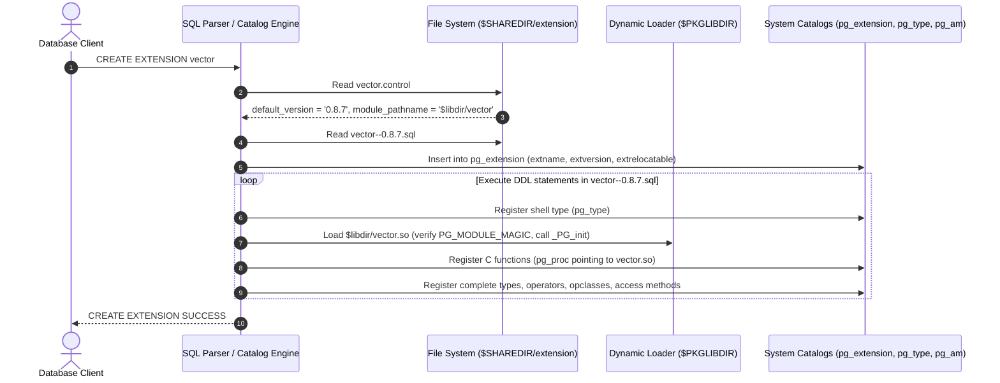
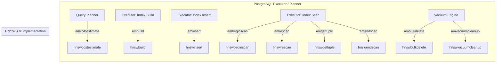
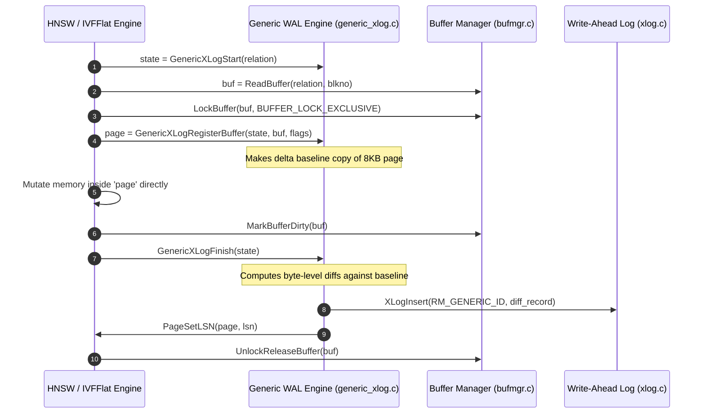

# PostgreSQL Extension Architecture & The pgvector Extension Model

A definitive, internals-level guide to building, registering, and running native C extensions in PostgreSQL, based on the implementation of **pgvector (v0.8.7)**.

---

## Table of Contents
1. [PostgreSQL Extension Architecture](#1-postgresql-extension-architecture)
   - [The Extension Triad](#the-extension-triad)
   - [The Mechanics of CREATE EXTENSION](#the-mechanics-of-create-extension)
   - [Control File Specification & Parameters](#control-file-specification--parameters)
   - [Extension Versioning & Upgrade Chains](#extension-versioning--upgrade-chains)
2. [Shared Library Loading & Initialization](#2-shared-library-loading--initialization)
   - [ABI Safety & PG_MODULE_MAGIC](#abi-safety--pg_module_magic)
   - [Dynamic Library Entry Point: _PG_init()](#dynamic-library-entry-point-_pg_init)
   - [Lightweight Lock (LWLock) Tranche Registration](#lightweight-lock-lwlock-tranche-registration)
   - [Custom GUC Registration](#custom-guc-registration)
   - [Dynamic Linking & Library Loading Mechanics](#dynamic-linking--library-loading-mechanics)
3. [Function Registration & Calling Conventions](#3-function-registration--calling-conventions)
   - [Version-1 Calling Convention & PG_FUNCTION_INFO_V1](#version-1-calling-convention--pg_function_info_v1)
   - [Function Call Execution & Argument Extraction](#function-call-execution--argument-extraction)
   - [SQL-to-C Linkage and MODULE_PATHNAME Resolution](#sql-to-c-linkage-and-module_pathname-resolution)
   - [The Datum Value Type](#the-datum-value-type)
4. [Custom Data Type System](#4-custom-data-type-system)
   - [Shell Types & Two-Phase Type Registration](#shell-types--two-phase-type-registration)
   - [System Catalog Representation (pg_type)](#system-catalog-representation-pg_type)
   - [Varlena Memory Layout & Header Manipulation](#varlena-memory-layout--header-manipulation)
   - [TOAST Storage Strategies & STORAGE = external](#toast-storage-strategies--storage--external)
   - [Alignment & Pass-by-Reference Semantics](#alignment--pass-by-reference-semantics)
5. [Access Method (AM) API & Handler Architecture](#5-access-method-am-api--handler-architecture)
   - [Access Method Handler Entry Point](#access-method-handler-entry-point)
   - [The IndexAmRoutine Interface](#the-indexamroutine-interface)
   - [Callback Implementations in pgvector](#callback-implementations-in-pgvector)
   - [AM Boolean Capability Flags](#am-boolean-capability-flags)
   - [Dynamic GUC Tuning During Scans](#dynamic-guc-tuning-during-scans)
6. [Operator Class System & Query Planner Integration](#6-operator-class-system--query-planner-integration)
   - [Operator Classes & Operator Families](#operator-classes--operator-families)
   - [Distance Operators & Strategy Numbers](#distance-operators--strategy-numbers)
   - [Ordering Operators (AMOP_ORDER) & float_ops](#ordering-operators-amop_order--float_ops)
   - [Amvalidate and Catalog Verification](#amvalidate-and-catalog-verification)
   - [Query Planner Execution & Cost Estimation](#query-planner-execution--cost-estimation)
7. [Write-Ahead Logging (WAL) & Crash Recovery](#7-write-ahead-logging-wal--crash-recovery)
   - [Generic WAL Record Infrastructure](#generic-wal-record-infrastructure)
   - [GenericXLog State Lifecycle](#genericxlog-state-lifecycle)
   - [Design Tradeoffs: Generic WAL vs Custom RMGR](#design-tradeoffs-generic-wal-vs-custom-rmgr)
   - [Full Page Optimization During Bulk Build](#full-page-optimization-during-bulk-build)
8. [Buffer Manager & Shared Memory Interaction](#8-buffer-manager--shared-memory-interaction)
   - [Buffer Operations: Read, Lock, Mark, Release](#buffer-operations-read-lock-mark-release)
   - [Buffer Pin Management During Index Scans](#buffer-pin-management-during-index-scans)
   - [Preserved Page Locks for Scan/Vacuum Synchronization](#preserved-page-locks-for-scanvacuum-synchronization)
   - [MVCC Snapshot Semantics & Recheck Delegation](#mvcc-snapshot-semantics--recheck-delegation)
9. [Memory Management & Parallel Processing](#9-memory-management--parallel-processing)
   - [MemoryContext Tree & AllocSet Contexts](#memorycontext-tree--allocset-contexts)
   - [Per-Scan Memory Lifecycle](#per-scan-memory-lifecycle)
   - [Parallel Index Build via DSM and Relative Pointers](#parallel-index-build-via-dsm-and-relative-pointers)

---

## 1. PostgreSQL Extension Architecture

### The Extension Triad
In PostgreSQL, an extension is not simply a dynamically linked library (`.so` / `.dll`). It is a strictly structured packaging mechanism that encapsulates three fundamental components:

```
+-------------------------------------------------------------------------------+
|                             PostgreSQL Extension                             |
+-------------------------------------------------------------------------------+
| 1. Control File           | 2. Shared Object Library    | 3. SQL Script Files  |
|    vector.control         |    vector.so / vector.dll   |    vector--0.8.7.sql |
|                           |                             |    vector--old--new  |
| Describes metadata,       | Compiled C binary containing| SQL DDL statements   |
| versioning, shared library| functions, type handlers,   | creating types,      |
| path, and relocatability. | access methods, and logic.  | operators, and AMs.  |
+---------------------------+-----------------------------+----------------------+
```

1. **Control File (`<extension>.control`)**: Placed in `$(SHAREDIR)/extension/`. It serves as the manifest for the extension, declaring the default installation version, the file path template for the shared object library, dependencies on other extensions, and relocation rules.
2. **Shared Library (`<extension>.so` / `<extension>.dll`)**: Installed into `$(PKGLIBDIR)/`. It contains the compiled machine instructions for C functions, type I/O routines, indexing access method routines, and memory structures.
3. **SQL Installation and Upgrade Scripts (`<extension>--<version>.sql`)**: Placed in `$(SHAREDIR)/extension/`. When `CREATE EXTENSION` is run, PostgreSQL executes this script within an implicit transaction to define system catalog entries.



### The Mechanics of CREATE EXTENSION
When the user executes `CREATE EXTENSION vector;`, the PostgreSQL backend invokes `CreateExtension()` in `commands/extension.c`. The sequence executes as follows:
1. **Catalog Check**: PostgreSQL verifies whether the extension already exists in `pg_extension`. If it exists and `IF NOT EXISTS` was not specified, it throws `ERRCODE_DUPLICATE_OBJECT`.
2. **Control File Evaluation**: PostgreSQL searches for `vector.control` in `SHAREDIR/extension`. It parses the key-value directives into an internal `ExtensionControlFile` struct.
3. **Upgrade Path Resolution**: If a specific version is requested (`CREATE EXTENSION vector VERSION '0.8.6'`), it searches for `vector--0.8.6.sql`. Otherwise, it uses `default_version` from `vector.control` (`0.8.7`).
4. **Execution Sandbox**: The backend sets the session variable `creating_extension = true` and binds `CurrentExtensionObject` to the new extension's OID. Any database object created while `creating_extension` is true is automatically registered in `pg_depend` as a dependent member of the extension (`deptype = DEPENDENCY_EXTENSION`). If the extension is later dropped with `DROP EXTENSION vector CASCADE;`, PostgreSQL uses these dependency records to drop all associated types, functions, and index access methods.
5. **Script Execution**: The engine executes `vector--0.8.7.sql`. The macro token `MODULE_PATHNAME` inside the SQL file is substituted with the evaluated `module_pathname` parameter (`$libdir/vector`).
6. **Finalize Catalog**: An entry is committed to `pg_extension` recording `extname = 'vector'`, `extowner`, `extnamespace`, `extrelocatable`, and `extversion = '0.8.7'`.

### Control File Specification & Parameters
The file `pgvector/vector.control` contains:

```ini
comment = 'vector data type and ivfflat and hnsw access methods'
default_version = '0.8.7'
module_pathname = '$libdir/vector'
relocatable = true
```

Field breakdown:
- `comment`: Human-readable summary displayed in `pg_available_extensions`.
- `default_version`: The target version installed if no `VERSION` clause is given in `CREATE EXTENSION`.
- `module_pathname`: The dynamic library path. The literal string `$libdir` is expanded by PostgreSQL to `$(pg_config --pkglibdir)`. PostgreSQL appends the platform-specific shared object suffix (`.so` on Linux, `.dylib` on macOS, `.dll` on Windows).
- `relocatable`: Set to `true`. This permits the extension to be moved into an arbitrary schema (`ALTER EXTENSION vector SET SCHEMA custom_schema;`). All SQL functions and types in `vector.sql` avoid hardcoding schema qualifications (e.g. they refer to `vector` rather than `public.vector`).

### Extension Versioning & Upgrade Chains
PostgreSQL does not permit in-place arbitrary mutation of an extension's installed state without explicit migration scripts. Upgrades are initiated with:

```sql
ALTER EXTENSION vector UPDATE TO '0.8.7';
```

When this statement is issued:
1. PostgreSQL queries `pg_extension` to find the currently installed version (e.g., `0.8.6`).
2. If `UPDATE TO` specifies a different target version, PostgreSQL calls `pg_extension_versioncmp()` (in `commands/extension.c`) to parse version numbers according to Debian-style version sorting rules (treating letters, numbers, and separators with defined precedence).
3. PostgreSQL searches `$(SHAREDIR)/extension/` for upgrade files matching the pattern `<extension>--<fromversion>--<toversion>.sql`.
4. If a direct script (e.g., `vector--0.8.6--0.8.7.sql`) exists, PostgreSQL executes it directly.
5. If no direct script exists, PostgreSQL builds a directed acyclic graph (DAG) of all available migration scripts (e.g. `vector--0.8.0--0.8.1.sql`, `vector--0.8.1--0.8.2.sql`, ...) and applies Dijkstra's shortest path algorithm to find a valid multi-step migration sequence, applying each intermediate SQL script sequentially.
6. Upon successful completion, the `extversion` column in `pg_extension` is updated.

---

## 2. Shared Library Loading & Initialization

### ABI Safety & PG_MODULE_MAGIC
PostgreSQL plugins run inside the single-process, multi-backend address space of PostgreSQL workers. A mismatch in compiler flags, struct alignment, or PostgreSQL major version between the server binary and an extension would result in immediate memory corruption or fatal segmentation faults.

To prevent this, PostgreSQL enforces strict Application Binary Interface (ABI) validation via `PG_MODULE_MAGIC`. In `pgvector/src/vector.c`:

```c
#if PG_VERSION_NUM >= 180000
PG_MODULE_MAGIC_EXT(.name = "vector", .version = "0.8.7");
#else
PG_MODULE_MAGIC;
#endif
```

#### What `PG_MODULE_MAGIC` Expands To
The macro expands to a C symbol definition with global external linkage (`Pg_magic_func`):

```c
extern PGDLLEXPORT const Pg_magic_struct *Pg_magic_func(void);
const Pg_magic_struct *
Pg_magic_func(void)
{
    static const Pg_magic_struct Pg_magic_data = {
        sizeof(Pg_magic_struct),
        sizeof(IndexAmRoutine),
        PG_VERSION_NUM / 100,
        FUNC_MAX_ARGS,
        INDEX_MAX_KEYS,
        NAMEDATALEN,
        FLOAT4PASSBYVAL,
        FLOAT8PASSBYVAL
    };
    return &Pg_magic_data;
}
```

When PostgreSQL dynamically loads `vector.so` via `dlopen()`, `internal_load_library()` in `utils/fmgr/dfmgr.c` immediately looks up `Pg_magic_func` using `dlsym()`. It verifies that:
- The magic struct size matches the server's expected struct size.
- `PG_VERSION_NUM / 100` matches the host server's major version. An extension compiled against PostgreSQL 16 headers will be rejected by a PostgreSQL 17 server.
- Key compile-time configuration limits (`NAMEDATALEN`, `FUNC_MAX_ARGS`, `INDEX_MAX_KEYS`, float pass-by-value flags) match bit-for-bit.

In PostgreSQL 18+, `PG_MODULE_MAGIC_EXT` introduces additional metadata fields (`.name` and `.version`) allowing the server core to report extension diagnostic data directly from the dynamic library header.

### Dynamic Library Entry Point: `_PG_init()`
Immediately after verifying `Pg_magic_func()`, PostgreSQL inspects the loaded binary for a symbol named `_PG_init`:

```c
typedef void (*PG_init_t) (void);
PG_init_t _PG_init = (PG_init_t) pg_dlsym(handle, "_PG_init");
if (_PG_init)
    (*_PG_init) ();
```

In `pgvector/src/vector.c`:

```c
PGDLLEXPORT void _PG_init(void);
void
_PG_init(void)
{
	BitvecInit();
	HalfvecInit();
	HnswInit();
	IvfflatInit();
}
```

`_PG_init()` executes exactly once per backend process when the library is first mapped into memory. In pgvector, it delegates initialization to each subsystem:
1. `BitvecInit()` & `HalfvecInit()`: Prepares support parameters for alternative vector types.
2. `HnswInit()`: Registers HNSW reloptions, GUCs, and lock tranches.
3. `IvfflatInit()`: Registers IVFFlat reloptions and GUCs.

### Lightweight Lock (LWLock) Tranche Registration
HNSW supports parallel index building across background worker processes. When worker processes coordinate the insertion of elements into shared memory graphs, they require lightweight locks (`LWLocks`).

To avoid lock identity collisions and enable `pg_stat_activity` to report lock wait events as `HnswBuild`, pgvector registers an LWLock tranche in `src/hnsw.c`:

```c
void
HnswInitLockTranche(void)
{
	int		   *tranche_ids;
	bool		found;

	LWLockAcquire(AddinShmemInitLock, LW_EXCLUSIVE);
	tranche_ids = ShmemInitStruct("hnsw LWLock ids",
								  sizeof(int) * 1,
								  &found);
	if (!found)
	{
#if PG_VERSION_NUM >= 190000
		tranche_ids[0] = LWLockNewTrancheId("HnswBuild");
#else
		tranche_ids[0] = LWLockNewTrancheId();
#endif
	}
	hnsw_lock_tranche_id = tranche_ids[0];
	LWLockRelease(AddinShmemInitLock);

#if PG_VERSION_NUM < 190000
	LWLockRegisterTranche(hnsw_lock_tranche_id, "HnswBuild");
#endif
}
```

#### How LWLock Tranche Registration Works
1. `LWLockAcquire(AddinShmemInitLock, LW_EXCLUSIVE)`: Ensures that only one backend process allocates the tranche ID during startup.
2. `ShmemInitStruct("hnsw LWLock ids", ...)`: Obtains a pointer to a dedicated slot in PostgreSQL's main shared memory segment.
3. `LWLockNewTrancheId()`: Requests an unused dynamic tranche identifier from PostgreSQL's global lock counter.
4. `LWLockRegisterTranche()`: Associates the numeric tranche ID with the human-readable string `"HnswBuild"`. When a query is blocked waiting for an HNSW lock, `pg_stat_activity.wait_event` displays `HnswBuild` instead of an obscure generic identifier.

### Custom GUC Registration
PostgreSQL extensions can define custom configuration parameters (Grand Unified Configuration). In `HnswInit()` (`src/hnsw.c`) and `IvfflatInit()` (`src/ivfflat.c`):

```c
DefineCustomIntVariable("hnsw.ef_search",
                        "Sets the size of the dynamic candidate list for search",
                        "Valid range is 1..1000.",
                        &hnsw_ef_search,
                        HNSW_DEFAULT_EF_SEARCH,  /* 40 */
                        HNSW_MIN_EF_SEARCH,      /* 1 */
                        HNSW_MAX_EF_SEARCH,      /* 1000 */
                        PGC_USERSET,
                        0, NULL, NULL, NULL);

DefineCustomEnumVariable("hnsw.iterative_scan",
                         "Sets the mode for iterative scans",
                         NULL,
                         &hnsw_iterative_scan,
                         HNSW_ITERATIVE_SCAN_OFF,
                         hnsw_iterative_scan_options,
                         PGC_USERSET,
                         0, NULL, NULL, NULL);

MarkGUCPrefixReserved("hnsw");
```

- **`PGC_USERSET` Context**: Any unprivileged database user can adjust this value per session or per transaction (`SET LOCAL hnsw.ef_search = 100;`).
- **Target Variable Binding**: PostgreSQL binds the GUC engine directly to the address of the C variable `&hnsw_ef_search`. When the SQL engine executes `SET hnsw.ef_search = 80`, the integer at that memory address is updated immediately without parsing overhead during queries.
- **`MarkGUCPrefixReserved("hnsw")`**: Prevents typos in configuration files (e.g. `hnsw.efsearch = 50`) from being silently ignored as unrecognized custom GUCs.

### Dynamic Linking & Library Loading Mechanics
PostgreSQL supports two distinct methods for loading extension shared objects:
1. **Explicit Preloading / Manual Loading**:
   - `LOAD 'vector';`: Manually maps the library into the backend's address space.
   - `shared_preload_libraries = 'vector'`: Loaded into the Postmaster during server startup. (pgvector checks `process_shared_preload_libraries_in_progress` in `HnswInit()` to handle tranche allocation appropriately).
2. **On-Demand Loading via SQL Invocations**:
   - During `CREATE EXTENSION vector;` or during any subsequent query executing a vector function, PostgreSQL queries `pg_proc` for the requested function.
   - It reads `pg_proc.probin`, which contains `'$libdir/vector'`.
   - `fmgr_info_cxt_security()` checks an internal hashtable (`file_list`) of already loaded shared libraries.
   - If not yet loaded, `load_external_function()` calls `internal_load_library()` which executes `dlopen()`, checks `Pg_magic_func()`, calls `_PG_init()`, and caches the `dlopen` handle.

---

## 3. Function Registration & Calling Conventions

### Version-1 Calling Convention & PG_FUNCTION_INFO_V1
PostgreSQL formerly supported a Version-0 calling convention (direct C function calls matching C parameter types), which was prone to architecture-dependent crashes and lacked null-handling. Modern PostgreSQL strictly mandates the **Version-1 Calling Convention**.

In `pgvector/src/vector.c`:

```c
FUNCTION_PREFIX PG_FUNCTION_INFO_V1(vector_in);
Datum
vector_in(PG_FUNCTION_ARGS)
```

#### What `PG_FUNCTION_INFO_V1` Expands To
The macro defines a companion metadata function named `pg_finfo_<funcname>`:

```c
extern PGDLLEXPORT const Pg_finfo_record * pg_finfo_vector_in(void);
const Pg_finfo_record *
pg_finfo_vector_in(void)
{
    static const Pg_finfo_record my_finfo = { 1 };
    return &my_finfo;
}
```

When PostgreSQL resolves `vector_in`, it looks up `pg_finfo_vector_in`. If that record returns `api_version = 1`, PostgreSQL knows the function accepts a single standardized parameter: `FunctionCallInfo fcinfo`.

### Function Call Execution & Argument Extraction
The macro `PG_FUNCTION_ARGS` expands to:

```c
FunctionCallInfo fcinfo
```

`FunctionCallInfo` is a pointer to `FunctionCallInfoBaseData`, containing:
- `NullableDatum args[]`: An array of arguments, where each entry contains a `Datum value` and a `bool isnull`.
- `bool isnull`: Return null flag set by the C function.
- `FmgrInfo *flinfo`: Contextual metadata regarding the calling expression and memory contexts.

```
FunctionCallInfo (fcinfo)
+--------------------------------------------------------+
| FmgrInfo *flinfo   --> metadata about SQL function     |
| Node *context      --> trigger / aggregate context     |
| bool isnull        --> output: true if return is NULL  |
| int16 nargs        --> number of arguments             |
| NullableDatum args[0] = { Datum value, bool isnull }   |
| NullableDatum args[1] = { Datum value, bool isnull }   |
+--------------------------------------------------------+
```

To interact with `fcinfo`, extensions use standardized accessor macros defined in `fmgr.h`:
- `PG_GETARG_DATUM(n)`: Retrieves the raw `Datum` at argument index `n`.
- `PG_GETARG_CSTRING(n)`: Unpacks `Datum` as `char *`.
- `PG_GETARG_INT32(n)`: Unpacks `Datum` as `int32`.
- `PG_GETARG_POINTER(n)`: Unpacks `Datum` as an untyped pointer (`void *`).
- `PG_GETARG_VECTOR_P(n)`: In `vector.h`, unpacks and de-toasts the vector argument:
  ```c
  #define DatumGetVector(x)     ((Vector *) PG_DETOAST_DATUM(x))
  #define PG_GETARG_VECTOR_P(x) DatumGetVector(PG_GETARG_DATUM(x))
  ```
- `PG_RETURN_POINTER(ptr)`: Returns a pointer packaged as a `Datum`.
- `PG_RETURN_DATUM(val)`: Returns a raw `Datum`.
- `PG_FREE_IF_COPY(var, n)`: If the argument at index `n` had to be copied/decompressed during de-toasting, frees the temporary copy.

### SQL-to-C Linkage and MODULE_PATHNAME Resolution
In `pgvector/sql/vector.sql`:

```sql
CREATE FUNCTION vector_in(cstring, oid, integer) RETURNS vector
	AS 'MODULE_PATHNAME' LANGUAGE C IMMUTABLE STRICT PARALLEL SAFE;
```

When `CREATE EXTENSION` executes this statement:
1. `MODULE_PATHNAME` is substituted with `$libdir/vector`.
2. PostgreSQL inserts a tuple into `pg_proc`:
   - `proname = 'vector_in'`
   - `prolang = 13` (C language OID)
   - `probin = '$libdir/vector'` (path to binary)
   - `prosrc = 'vector_in'` (exported C symbol name)
   - `proisstrict = true` (`STRICT`: PostgreSQL guarantees that if any argument is `NULL`, the C function is never called, and `NULL` is returned immediately).
   - `provolatile = 'i'` (`IMMUTABLE`: function cannot modify the database and always returns the same result given the same arguments).
   - `proparallel = 's'` (`PARALLEL SAFE`: can execute inside parallel worker backends).

### The Datum Value Type
`Datum` is PostgreSQL's universal type abstraction, declared in `postgres.h`:

```c
typedef uintptr_t Datum;
```

A `Datum` is an unsigned integer guaranteed to be the same size as a machine pointer (64 bits on modern platforms).
- **Pass-by-value types**: Types whose size is $\le 8$ bytes (e.g. `int32`, `int64`, `float4`, `float8`) are packed directly into the `Datum` bits (`Int32GetDatum(x)`, `Float8GetDatum(x)`).
- **Pass-by-reference types**: Variable-length types like `vector`, `text`, or `bytea` are stored in heap memory. The `Datum` is simply the memory pointer cast to `uintptr_t` (`PointerGetDatum(ptr)`).

---

## 4. Custom Data Type System

### Shell Types & Two-Phase Type Registration
A circular dependency exists when defining a new data type with C input/output functions:
- To declare `vector_in`, its return type must be `vector`.
- To declare `vector`, its input function `vector_in` must already exist.

PostgreSQL solves this via **Shell Types**. In `pgvector/sql/vector.sql`:

```sql
-- Step 1: Create shell type (allocates an entry in pg_type with no I/O routines)
CREATE TYPE vector;

-- Step 2: Create I/O functions that reference the shell type
CREATE FUNCTION vector_in(cstring, oid, integer) RETURNS vector
	AS 'MODULE_PATHNAME' LANGUAGE C IMMUTABLE STRICT PARALLEL SAFE;

CREATE FUNCTION vector_out(vector) RETURNS cstring
	AS 'MODULE_PATHNAME' LANGUAGE C IMMUTABLE STRICT PARALLEL SAFE;

CREATE FUNCTION vector_typmod_in(cstring[]) RETURNS integer
	AS 'MODULE_PATHNAME' LANGUAGE C IMMUTABLE STRICT PARALLEL SAFE;

CREATE FUNCTION vector_recv(internal, oid, integer) RETURNS vector
	AS 'MODULE_PATHNAME' LANGUAGE C IMMUTABLE STRICT PARALLEL SAFE;

CREATE FUNCTION vector_send(vector) RETURNS bytea
	AS 'MODULE_PATHNAME' LANGUAGE C IMMUTABLE STRICT PARALLEL SAFE;

-- Step 3: Complete type definition
CREATE TYPE vector (
	INPUT     = vector_in,
	OUTPUT    = vector_out,
	TYPMOD_IN = vector_typmod_in,
	RECEIVE   = vector_recv,
	SEND      = vector_send,
	STORAGE   = external
);
```

### System Catalog Representation (`pg_type`)
When the full `CREATE TYPE` is processed, PostgreSQL populates `pg_type`:

| Column | Value in `pgvector` | Internals Explanation |
|---|---|---|
| `typname` | `vector` | Identifier name |
| `typlen` | `-1` | Variable-length type (varlena) |
| `typbyval` | `false` | Passed by pointer/reference |
| `typtype` | `'b'` | Base type |
| `typcategory` | `'U'` | User-defined type category |
| `typispreferred` | `false` | Type resolution preference |
| `typinput` | `vector_in` | Text parser routine |
| `typoutput` | `vector_out` | Text serializer routine |
| `typreceive` | `vector_recv` | Binary network deserializer (libpq) |
| `typsend` | `vector_send` | Binary network serializer (libpq) |
| `typmodin` | `vector_typmod_in` | Validates dimensions in DDL (e.g. `vector(1536)`) |
| `typalign` | `'d'` (default for double/float) | Required memory alignment |
| `typstorage` | `'e'` (`external`) | TOAST storage strategy |

### Varlena Memory Layout & Header Manipulation
In `pgvector/src/vector.h`, the `Vector` structure is declared as:

```c
typedef struct Vector
{
	int32		vl_len_;		/* varlena header (do not touch directly!) */
	int16		dim;			/* number of dimensions */
	int16		unused;			/* reserved for future use, always zero */
	float		x[FLEXIBLE_ARRAY_MEMBER];
} Vector;
```

```
Byte Offset:
0           4       6       8                                    8 + (dim * 4)
+-----------+-------+-------+------------------------------------+
|  vl_len_  |  dim  |unused | float x[0] | float x[1] | ...      |
|  (32-bit) |(16-bit|(16-bit| (32-bit)   | (32-bit)   |          |
+-----------+-------+-------+------------------------------------+
|<------- Varlena Header -->|<--------- Payload Data ----------->|
```

#### Varlena Rules & Invariants
1. **The Header Field `vl_len_`**: In PostgreSQL, variable-length structures must begin with an `int32` field named `vl_len_` (or an equivalent union `varattrib_4b`). Developers must **never** read or write this field directly.
2. **Setting the Size**: pgvector uses `SET_VARSIZE(result, size)`:
   ```c
   Vector *
   InitVector(int dim)
   {
       Vector     *result;
       Size        size;

       size = VECTOR_SIZE(dim);
       result = (Vector *) palloc0(size);
       SET_VARSIZE(result, size);
       result->dim = dim;

       return result;
   }
   ```
   `SET_VARSIZE` encodes the total byte length (header + payload) into `vl_len_`.
3. **Calculating Size**:
   ```c
   #define VECTOR_SIZE(_dim) \
       add_size(offsetof(Vector, x), mul_size(sizeof(float), _dim))
   ```
   Uses safe overflow-checked arithmetic (`add_size`, `mul_size`).
4. **De-Toasting & Extraction**:
   When reading a vector argument in C, it might be stored on disk with a 1-byte header (`short varlena`), compressed, or stored in TOAST tables. The macro:
   ```c
   #define DatumGetVector(x) ((Vector *) PG_DETOAST_DATUM(x))
   ```
   calls `pg_detoast_datum()`, which guarantees that the returned memory buffer has a standard 4-byte header and is fully decompressed in memory.

### TOAST Storage Strategies & `STORAGE = external`
PostgreSQL uses **The Oversized-Attribute Storage Technique (TOAST)** when row sizes exceed approximately 2KB (`TOAST_TUPLE_THRESHOLD`). There are four strategies:
- `PLAIN`: No compression, no out-of-line storage.
- `MAIN`: Compression permitted, out-of-line only as a last resort.
- `EXTENDED`: Compression attempted first; if still too large, moved out-of-line.
- `EXTERNAL`: **No compression**, stored out-of-line if needed.

pgvector explicitly specifies:
```sql
STORAGE = external
```

#### Why `STORAGE = external` is Critical for Vectors
1. **Ineffective Compression**: Vectors are dense arrays of IEEE 754 floating-point numbers. Standard compression algorithms (LZ4, PGLZ) achieve near-zero compression ratios on high-entropy floating-point data while burning substantial CPU cycles during every row write.
2. **Decompression Penalty During Scans**: If vectors were compressed, every distance calculation during an index scan or sequential scan would incur a decompression call.
3. **Out-of-Line Offloading**: Vectors with 1536 dimensions occupy $8 + (1536 \times 4) = 6152$ bytes. This cannot fit on a standard 8KB heap page alongside other table columns. `STORAGE = external` offloads the vector data to the TOAST table uncompressed, preserving direct memory mapping speed.

As proven in pgvector test `test/t/019_storage.pl`:
```perl
# Changing storage to PLAIN forces vectors inline
$node->safe_psql("postgres", "ALTER TABLE tst ALTER COLUMN v1 SET STORAGE PLAIN");
...
# Fails because 3 x 1024-dim vectors exceeds page capacity (8KB)
like($stderr, qr/row is too big/);
```

### Alignment & Pass-by-Reference Semantics
- **`typalign = 'd'` (Double Alignment)**: Vectors contain `float` elements (4-byte aligned), but pgvector structures frequently cast to `float8` or require 8-byte alignment for SIMD architectures (AVX-512, NEON). Declaring double alignment ensures that PostgreSQL aligns the starting byte of the payload at an 8-byte memory boundary on 64-bit systems.
- **`typbyval = false`**: Vectors range up to 16,000 dimensions (64,008 bytes). They cannot fit within a 64-bit register (`Datum`), so they are strictly passed by memory address.

---

## 5. Access Method (AM) API & Handler Architecture

### Access Method Handler Entry Point
PostgreSQL index access methods are registered in the system catalogs as first-class indexing engines (alongside `btree`, `hash`, `gist`, `gin`). In `pgvector/sql/vector.sql`:

```sql
CREATE FUNCTION hnswhandler(internal) RETURNS index_am_handler
	AS 'MODULE_PATHNAME' LANGUAGE C;

CREATE ACCESS METHOD hnsw TYPE INDEX HANDLER hnswhandler;
```

In `pgvector/src/hnsw.c`, the handler returns a pointer to an `IndexAmRoutine`:

```c
FUNCTION_PREFIX PG_FUNCTION_INFO_V1(hnswhandler);
Datum
hnswhandler(PG_FUNCTION_ARGS)
{
    IndexAmRoutine *amroutine = makeNode(IndexAmRoutine);
    ...
    PG_RETURN_POINTER(amroutine);
}
```



### The IndexAmRoutine Interface
`IndexAmRoutine` (declared in `access/amapi.h`) defines the contract between the PostgreSQL engine and the indexing engine.

| Callback Field | Implemented in `hnsw` | Implemented in `ivfflat` | Description & Purpose |
|---|---|---|---|
| `ambuild` | `hnswbuild` | `ivfflatbuild` | Full index creation on existing table data (`CREATE INDEX`). |
| `ambuildempty` | `hnswbuildempty` | `ivfflatbuildempty` | Creates an empty index file for the `INIT_FORKNUM` fork of unlogged tables. |
| `aminsert` | `hnswinsert` | `ivfflatinsert` | Inserts a single new tuple into the index during table writes. |
| `ambulkdelete` | `hnswbulkdelete` | `ivfflatbulkdelete` | Deletes index entries corresponding to dead heap tuples during `VACUUM`. |
| `amvacuumcleanup` | `hnswvacuumcleanup` | `ivfflatvacuumcleanup` | Post-vacuum statistics recalculation and page reclamation. |
| `amcostestimate` | `hnswcostestimate` | `ivfflatcostestimate` | Computes startup and total cost for the query planner. |
| `amoptions` | `hnswoptions` | `ivfflatoptions` | Parses and validates `WITH (...)` storage options (e.g. `m`, `ef_construction`, `lists`). |
| `ambeginscan` | `hnswbeginscan` | `ivfflatbeginscan` | Allocates scan descriptor and initializes memory context. |
| `amrescan` | `hnswrescan` | `ivfflatrescan` | Resets scan state with new scan keys or ORDER BY parameters. |
| `amgettuple` | `hnswgettuple` | `ivfflatgettuple` | Iterator returning the next matching tuple (`ItemPointer`) ordered by distance. |
| `amgetbitmap` | `NULL` | `NULL` | Bitmap index scan (unsupported because vector distance ordering is fundamentally tuple-at-a-time). |
| `amendscan` | `hnswendscan` | `ivfflatendscan` | Releases scan structures and destroys temporary memory context. |
| `ammarkpos` | `NULL` | `NULL` | Saves scan position (unsupported). |
| `amrestrpos` | `NULL` | `NULL` | Restores saved scan position (unsupported). |
| `amproperty` | `hnswproperty` | `ivfflatproperty` | Reports AM-level properties to `pg_indexam_has_property` (e.g. `AMPROP_DISTANCE_ORDERABLE`). |
| `ambuildphasename`| `hnswbuildphasename`| `ivfflatbuildphasename`| Translates build phase integers for `pg_stat_progress_create_index`. |
| `amvalidate` | `hnswvalidate` | `ivfflatvalidate` | Validates catalog consistency of operators and support procs in an opclass. |

### Callback Implementations in pgvector

#### 1. `ambuild` and `ambuildempty`
- **`hnswbuild`**: Traverses the heap via `table_index_build_scan()`. If `max_parallel_maintenance_workers > 0`, it provisions a Dynamic Shared Memory (DSM) segment and coordinates parallel worker backends. Once all tuples are inserted into the in-memory graph, it flushes pages to disk and writes WAL records via `log_newpage_range()`.
- **`hnswbuildempty`**: Initializes the metapage and entry point on `INIT_FORKNUM`. Unlogged tables bypass WAL logging; during crash recovery, PostgreSQL resets unlogged tables by copying the `INIT_FORKNUM` fork over the `MAIN_FORKNUM` fork.

#### 2. `aminsert`
Called on every `INSERT` or `UPDATE`.
1. Extracts the vector from `Datum *values`.
2. Inspects the metapage to obtain the current entry point.
3. Finds the nearest neighbors across layers using `HnswSearchLayer()`.
4. Allocates neighbor links and adds bidirectional edges using `GenericXLog`.

#### 3. `ambulkdelete` and `amvacuumcleanup`
HNSW deletion cannot simply erase a node because doing so would sever graph connectivity.
`hnswbulkdelete` executes a **5-pass algorithm**:
- **Pass 1 (`RemoveHeapTids`)**: Scans element pages and strips dead heap TIDs from element nodes.
- **Pass 2 (`RepairGraph`)**: Identifies nodes whose neighbors are being deleted and reconstructs edges to surviving neighbors.
- **Pass 3 (`RepairDeleting`)**: Updates connections for elements marked for deletion.
- **Pass 4 (`ConfirmRepaired`)**: Verifies graph consistency across layers.
- **Pass 5 (`MarkDeleted`)**: Flags dead elements in the page header and adds pages to the Free Space Map (FSM).

### AM Boolean Capability Flags
In `hnswhandler`, the AM declares its structural capabilities:

```c
amroutine->amstrategies = 0;
amroutine->amsupport = HNSW_NPROCS; /* 3 */
amroutine->amcanorder = false;
amroutine->amcanorderbyop = true;
amroutine->amcanbackward = false;
amroutine->amcanunique = false;
amroutine->amcanmulticol = false;
amroutine->amoptionalkey = true;
amroutine->amsearcharray = false;
amroutine->amsearchnulls = false;
amroutine->amstorage = false;
amroutine->amclusterable = false;
amroutine->ampredlocks = false;
amroutine->amcanparallel = false;
amroutine->amcanbuildparallel = true;
amroutine->amcaninclude = false;
amroutine->amusemaintenanceworkmem = false;
amroutine->amparallelvacuumoptions = VACUUM_OPTION_PARALLEL_BULKDEL;
```

Crucial flags:
- `amstrategies = 0`: HNSW supports **zero** boolean comparison operators (it cannot answer `WHERE v = '[1,2,3]'` or `WHERE v < '[1,2,3]'`).
- `amcanorderbyop = true`: HNSW supports operator-based ordering (`ORDER BY v <-> '[...]'`).
- `amcanorder = false`: HNSW does not support scalar ordering (`ORDER BY v ASC`).
- `amcanbuildparallel = true`: Enables parallel workers during `CREATE INDEX`.

### Dynamic GUC Tuning During Scans
During `hnswbeginscan()`, the scan reads `hnsw_ef_search` (default 40). If the user executes:

```sql
SET LOCAL hnsw.ef_search = 100;
SELECT * FROM items ORDER BY embedding <-> '[1,2,3]' LIMIT 5;
```

The scan reads the dynamically adjusted global integer, sizing its internal candidate pairing heap to 100 elements.

---

## 6. Operator Class System & Query Planner Integration

### Operator Classes & Operator Families
In PostgreSQL, an Access Method does not have hardcoded knowledge of data types. Instead, the bridge between an index AM and a data type is an **Operator Class** (`pg_opclass`), grouped within an **Operator Family** (`pg_opfamily`).

In `pgvector/sql/vector.sql`:

```sql
CREATE OPERATOR CLASS vector_l2_ops
	FOR TYPE vector USING hnsw AS
	OPERATOR 1 <-> (vector, vector) FOR ORDER BY float_ops,
	FUNCTION 1 vector_l2_squared_distance(vector, vector);

CREATE OPERATOR CLASS vector_ip_ops
	FOR TYPE vector USING hnsw AS
	OPERATOR 1 <#> (vector, vector) FOR ORDER BY float_ops,
	FUNCTION 1 vector_negative_inner_product(vector, vector);

CREATE OPERATOR CLASS vector_cosine_ops
	FOR TYPE vector USING hnsw AS
	OPERATOR 1 <=> (vector, vector) FOR ORDER BY float_ops,
	FUNCTION 1 vector_negative_inner_product(vector, vector),
	FUNCTION 2 vector_norm(vector);

CREATE OPERATOR CLASS vector_l1_ops
	FOR TYPE vector USING hnsw AS
	OPERATOR 1 <+> (vector, vector) FOR ORDER BY float_ops,
	FUNCTION 1 l1_distance(vector, vector);
```

### Distance Operators & Strategy Numbers
Each operator is assigned a strategy number (`amopstrategy` in `pg_amop`):

| Operator | Metric | Strategy Number | Description | Opclass Name |
|---|---|---|---|---|
| `<->` | Euclidean / L2 | `1` | Distance in Euclidean space | `vector_l2_ops` |
| `<#>` | Negative Inner Product | `1` | Scaled dot product | `vector_ip_ops` |
| `<=>` | Cosine Distance | `1` | $1.0 - \text{cosine similarity}$ | `vector_cosine_ops` |
| `<+>` | Taxicab / L1 / Manhattan | `1` | Sum of absolute differences | `vector_l1_ops` |

Notice that every distance operator uses **Strategy 1** within its respective operator class. Since an index is defined against a specific operator class (e.g. `CREATE INDEX ON items USING hnsw (v vector_l2_ops)`), Strategy 1 uniquely identifies the active distance function for that index.

### Ordering Operators (`AMOP_ORDER`) & `float_ops`
Look closely at the SQL definition:
```sql
OPERATOR 1 <-> (vector, vector) FOR ORDER BY float_ops
```
In standard B-Tree indexing, operators serve as boolean search filters (`amoppurpose = 's'`, `AMOP_SEARCH`).
For vector search, the operator does **not** evaluate to a boolean; it evaluates to a `float8` distance!
- `amoppurpose = 'o'` (`AMOP_ORDER`): Tells the planner this operator computes an ordering score.
- `FOR ORDER BY float_ops`: Tells the planner that the distances returned by `<->` are ordered according to the B-Tree operator family `float_ops` (standard ascending IEEE float order).

### Amvalidate and Catalog Verification
When an operator class is created, PostgreSQL invokes `amvalidate` (`hnswvalidate` in `src/hnsw.c`) to ensure catalog integrity:

```c
static bool
hnswvalidate(Oid opclassoid)
{
    ...
    /* Checks that:
       1. Distance proc signature matches: (opcintype, opcintype) -> float8
       2. If norm proc exists, signature matches: (opcintype) -> float8
       3. Operator signature matches: (opcintype, opcintype) -> float8
       4. Operator purpose is AMOP_ORDER with float8 sort family.
    */
}
```

If an extension author creates an operator returning integer instead of float8, `hnswvalidate` catches the error during registration and aborts the transaction.

### Query Planner Execution & Cost Estimation
When a query arrives:

```sql
SELECT id FROM items ORDER BY embedding <-> '[1,2,3]' LIMIT 10;
```

1. **Path Generation**: `match_order_by_to_index()` in `optimizer/path/indxpath.c` checks `pg_amop`. It sees `<->` is registered as an ordering operator for `hnsw`.
2. **Cost Calculation**: The planner invokes `hnswcostestimate()`:
   ```c
   static void
   hnswcostestimate(PlannerInfo *root, IndexPath *path, double loop_count,
                    Cost *indexStartupCost, Cost *indexTotalCost,
                    Selectivity *indexSelectivity, double *indexCorrelation,
                    double *indexPages)
   ```
   If `path->indexorderbys == NIL`, `hnswcostestimate` sets cost to infinity (`get_float8_infinity()`), informing the planner that HNSW cannot execute queries without an order clause.
   When ordering is present, it models graph traversal costs:
   $$\text{numIndexTuples} = \text{entryLevel} \times m + \text{layer0TuplesMax} \times \text{layer0Selectivity}$$
   It computes `indexStartupCost` (the time taken to descend layers to find the first candidate) and `indexTotalCost`. If this cost is lower than a sequential scan + top-N heap sort, the planner selects the HNSW `IndexScan`.

---

## 7. Write-Ahead Logging (WAL) & Crash Recovery

### Generic WAL Record Infrastructure
Core PostgreSQL indexes (`btree`, `hash`, `gin`) have hardcoded Resource Manager IDs in PostgreSQL source code (`RM_BTREE_ID`, etc.). Extensions cannot add new built-in resource managers without patching PostgreSQL core.

To allow custom index AMs to be crash-safe and support physical streaming replication, PostgreSQL provides the **Generic XLog API** (`access/generic_xlog.h`).



### GenericXLog State Lifecycle
In `pgvector/src/hnswinsert.c`:

```c
GenericXLogState *state;
Buffer buf = ReadBuffer(index, currentPage);
LockBuffer(buf, BUFFER_LOCK_EXCLUSIVE);

state = GenericXLogStart(index);
page = GenericXLogRegisterBuffer(state, buf, 0);

/* Perform binary mutations directly on page buffer */
HnswAddTupleToPage(page, tuple);

MarkBufferDirty(buf);
GenericXLogFinish(state);
UnlockReleaseBuffer(buf);
```

#### Step-by-Step Breakdown:
1. `GenericXLogStart(index)`: Allocates a `GenericXLogState` capable of tracking modifications for up to 4 buffers concurrently (`MAX_GENERIC_XLOG_PAGES = 4`).
2. `GenericXLogRegisterBuffer(state, buf, flags)`: Registers the buffer. It makes an internal duplicate copy of the page. Flags can be `0` (delta recording) or `GENERIC_XLOG_FULL_IMAGE` (forces a full 8KB image write).
3. **In-Memory Modification**: The extension mutates the `page` pointer returned by `GenericXLogRegisterBuffer`.
4. `MarkBufferDirty(buf)`: Informs PostgreSQL's buffer pool that the page must eventually be written to storage.
5. `GenericXLogFinish(state)`:
   - Computes a compact byte-level diff between the original baseline copy and the mutated page.
   - Packages the diffs into a WAL record of type `RM_GENERIC_ID`.
   - Invokes `XLogInsert()`, which appends the record to the WAL buffers and assigns a Log Sequence Number (LSN).
   - Calls `PageSetLSN(page, lsn)` to tag the page with the LSN.
6. `GenericXLogAbort(state)`: If an error or condition occurs (e.g. no free space), frees tracking memory without writing WAL records.

### Design Tradeoffs: Generic WAL vs Custom RMGR
- **Advantages of Generic WAL**:
  - Requires zero modification to PostgreSQL server source code.
  - Automatically handles physical crash recovery and standby replica synchronization.
  - Bulletproof safety: handled by PostgreSQL's standard `generic_redo` handler.
- **Disadvantages**:
  - Diffing is byte-oriented rather than logical. Inserting a pointer in the middle of an array shifts subsequent bytes, causing Generic WAL to generate larger delta records than a custom RMGR that logs a logical operation like `INSERT_EDGE(u, v)`.

### Full Page Optimization During Bulk Build
During `CREATE INDEX`, invoking `GenericXLog` for millions of edge updates would flood the WAL.
Instead, pgvector follows core PostgreSQL index build conventions:
1. Performs index build in shared memory or unlogged buffers.
2. Once the index is complete, calls `log_newpage_range()` in `src/hnswbuild.c`:
   ```c
   if (RelationNeedsWAL(index) || forkNum == INIT_FORKNUM)
       log_newpage_range(index, forkNum, 0,
                          RelationGetNumberOfBlocksInFork(index, forkNum), true);
   ```
   This writes raw full page images sequentially, dramatically speeding up `CREATE INDEX`.

---

## 8. Buffer Manager & Shared Memory Interaction

### Buffer Operations: Read, Lock, Mark, Release
PostgreSQL isolates extensions from direct file system I/O through the **Shared Buffer Pool**.

```c
/* Pin the page into shared memory */
Buffer buf = ReadBuffer(index, blkno);

/* Acquire exclusive lock for writing */
LockBuffer(buf, BUFFER_LOCK_EXCLUSIVE);

/* Get virtual address of the 8KB page */
Page page = BufferGetPage(buf);

/* Mutate page content ... */

/* Mark dirty so bgwriter flushes it */
MarkBufferDirty(buf);

/* Release lock and unpin */
UnlockReleaseBuffer(buf);
```

- `BUFFER_LOCK_SHARE`: Allows multiple concurrent readers.
- `BUFFER_LOCK_EXCLUSIVE`: Required for any byte modification.
- `UnlockReleaseBuffer(buf)`: Convenience macro for `LockBuffer(buf, BUFFER_LOCK_UNLOCK)` followed by `ReleaseBuffer(buf)`.

### Buffer Pin Management During Index Scans
In a traditional B-Tree index scan, PostgreSQL can hold a buffer pin across multiple calls to `amgettuple` because traversal moves sequentially along a leaf page.
In vector indexes (HNSW and IVFFlat), an index scan jumps non-linearly across hundreds of arbitrary pages.

**pgvector Design Rule: Never hold buffer pins across executor calls.**
During `hnswgettuple` (`src/hnswscan.c`):
1. `GetScanItems()` visits the graph, reads pages, extracts `ItemPointerData` (heap TIDs), and copies them into backend-private memory (`so->w`).
2. Every buffer acquired via `ReadBuffer` is unlocked and unpinned (`UnlockReleaseBuffer`) **immediately** after copying the data.
3. No buffer pins or page locks remain active when `hnswgettuple` yields control back to the executor.

### Preserved Page Locks for Scan/Vacuum Synchronization
Because index scans do not maintain buffer pins, how does pgvector prevent `VACUUM` from deleting an element from disk while an index scan is actively traversing it?
pgvector uses **Preserved Page Locks** (`LockPage`):

```c
/* In src/hnswscan.c */
LockPage(scan->indexRelation, HNSW_SCAN_LOCK, ShareLock);
so->w = GetScanItems(scan, value);
UnlockPage(scan->indexRelation, HNSW_SCAN_LOCK, ShareLock);
```

In `src/hnswvacuum.c`:
```c
/* Vacuum acquires ExclusiveLock before unlinking elements */
LockPage(vacuumstate->index, HNSW_SCAN_LOCK, ExclusiveLock);
RepairGraph(vacuumstate);
UnlockPage(vacuumstate->index, HNSW_SCAN_LOCK, ExclusiveLock);
```

Using block number `HNSW_SCAN_LOCK` (`1`) as a symbolic locking target, scans acquire `ShareLock`, allowing concurrent scans. `VACUUM` acquires `ExclusiveLock`, waiting for in-flight scans to finish before restructuring the graph.

### MVCC Snapshot Semantics & Recheck Delegation
Because pgvector releases pins and does not lock heap tuples, tuples in the index may be deleted concurrently in the table.
In `hnswgettuple`:

```c
if (!IsMVCCSnapshot(scan->xs_snapshot))
    elog(ERROR, "non-MVCC snapshots are not supported with hnsw");
```

pgvector sets:
```c
scan->xs_heaptid = *heaptid;
scan->xs_recheck = false;
scan->xs_recheckorderby = false;
return true;
```
When `hnswgettuple` returns `true`, the PostgreSQL executor visits the heap tuple referenced by `xs_heaptid` and tests its visibility against the query's MVCC snapshot (`xs_snapshot`). If the tuple was committed deleted, the executor silently skips it and calls `amgettuple` again.

---

## 9. Memory Management & Parallel Processing

### MemoryContext Tree & AllocSet Contexts
PostgreSQL extensions do not use standard `malloc()` or `free()`. All allocations go through PostgreSQL's **Memory Context System** (`palloc`, `pfree`).
Memory contexts form an ancestral tree rooted at `TopMemoryContext`. When a context is deleted, all memory allocated within it and all its child contexts are freed in a single operation, eliminating memory leaks during error recovery (`ereport(ERROR)`).

```
TopMemoryContext
└── MessageContext
└── CurrentMemoryContext (Query / Execution)
    └── Hnsw scan temporary context (so->tmpCtx)
        ├── Visited Hash Set
        ├── Discarded Pairing Heap
        └── Candidate Lists
```

### Per-Scan Memory Lifecycle
In `hnswbeginscan` (`src/hnswscan.c`):

```c
so->tmpCtx = AllocSetContextCreate(CurrentMemoryContext,
                                   "Hnsw scan temporary context",
                                   0, 8 * 1024, 256 * 1024);
```

- When `hnswrescan` is invoked (e.g. inside a nested loop with new parameters), it does not call individual `pfree()`s. It executes:
  ```c
  MemoryContextReset(so->tmpCtx);
  ```
  instantly reclaiming all memory.
- In `hnswendscan`:
  ```c
  MemoryContextDelete(so->tmpCtx);
  pfree(so);
  ```
  guaranteeing zero leaked bytes upon query completion.

### Parallel Index Build via DSM and Relative Pointers
During parallel `CREATE INDEX`, PostgreSQL launches background workers using the **Dynamic Shared Memory (DSM)** infrastructure.
In `src/hnswbuild.c`:
1. The leader backend initializes a DSM segment:
   ```c
   HnswBeginParallel(buildstate, isconcurrent, parallel_workers);
   ```
2. It sets up a Shared Memory Table of Contents (`shm_toc`) containing:
   - Shared coordination state (`HnswShared`).
   - Shared memory graph structure.
3. Workers attach to the DSM segment via `HnswParallelBuildMain()`.

#### The Virtual Address Problem & Relative Pointers (`relptr`)
Because each worker backend maps the shared memory segment at an arbitrary virtual memory address, raw 64-bit pointers cannot be shared between processes!
pgvector solves this using relative pointer offsets (`src/hnsw.h`):

```c
#define HnswPtrAccess(base, ptr) \
    ((ptr).offset == 0 ? NULL : (void *) ((base) + (ptr).offset))

#define HnswPtrStore(base, ptr, val) \
    ((ptr).offset = (val) == NULL ? 0 : ((char *) (val)) - (base))
```

All pointers in the graph store their byte offset relative to the base address `char *base` of the DSM segment. When any worker reads a pointer, `HnswPtrAccess` recomputes the valid local memory address for that worker's address space.

---

## Summary Architecture Map

```
+-----------------------------------------------------------------------------------------+
|                                    USER SQL QUERY                                       |
|               SELECT * FROM items ORDER BY embedding <-> '[...]' LIMIT 10;              |
+-----------------------------------------------------------------------------------------+
                                           |
                                           v
+-----------------------------------------------------------------------------------------+
|                                 QUERY PLANNER / OPTIMIZER                               |
| 1. Finds '<->' in pg_amop for operator family vector_l2_ops                              |
| 2. Identifies ordering strategy AMOP_ORDER with sort family float_ops                    |
| 3. Queries hnswhandler -> IndexAmRoutine.amcostestimate (hnswcostestimate)             |
| 4. Selects IndexScan(hnsw) Path                                                         |
+-----------------------------------------------------------------------------------------+
                                           |
                                           v
+-----------------------------------------------------------------------------------------+
|                                    QUERY EXECUTOR                                       |
| 1. ambeginscan: Allocates HnswScanOpaque in isolated so->tmpCtx                        |
| 2. amrescan: Unpacks query vector, resets candidate heaps                               |
| 3. amgettuple: Iterative graph traversal across HNSW layers                            |
|    - Brief buffer reads (ReadBuffer -> LockBuffer -> UnlockReleaseBuffer)              |
|    - Evaluates distance support proc 1 (vector_l2_squared_distance)                     |
|    - Yields xs_heaptid with xs_recheck = false                                          |
| 4. Table AM performs MVCC snapshot visibility check on heap tuple                       |
| 5. amendscan: MemoryContextDelete(so->tmpCtx) destroys all scan memory                  |
+-----------------------------------------------------------------------------------------+
```
