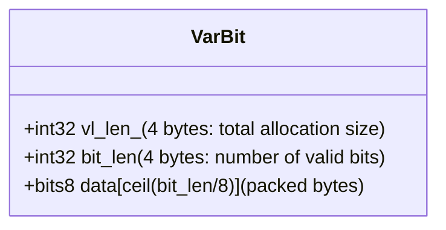
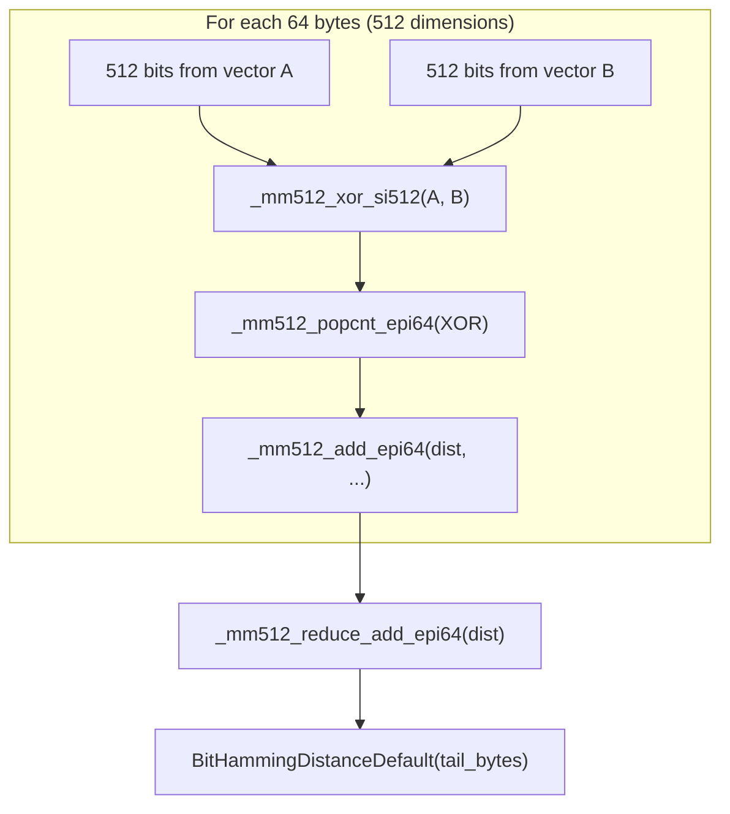
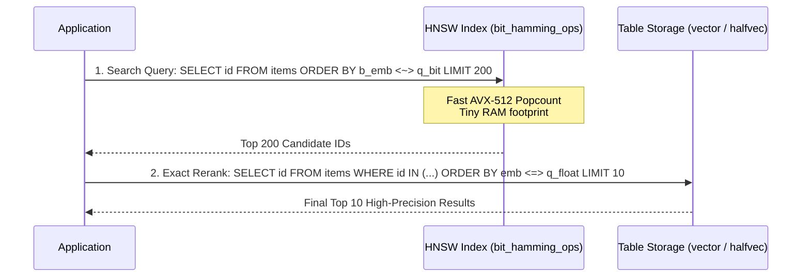

# Deep Technical Analysis: `bit` (Binary Vector / VarBit) Support in pgvector

> **Target Source Files:**
> - `src/bitvec.h`
> - `src/bitvec.c`
> - `src/bitutils.h`
> - `src/bitutils.c`

---

## Table of Contents
1. [Introduction & Overview](#1-introduction--overview)
2. [Binary Vector Representation and Bit Packing](#2-binary-vector-representation-and-bit-packing)
   - [MSB-First Bit Packing Layout](#msb-first-bit-packing-layout)
   - [Mathematical Indexing and Bitwise Coordinate Mapping](#mathematical-indexing-and-bitwise-coordinate-mapping)
   - [Byte Sizing, Padding, and Word Alignment](#byte-sizing-padding-and-word-alignment)
3. [The `VarBit` Data Structure and Memory Layout](#3-the-varbit-data-structure-and-memory-layout)
   - [The PostgreSQL `VarBit` Struct](#the-postgresql-varbit-struct)
   - [PostgreSQL VarBit Macro API](#postgresql-varbit-macro-api)
   - [Allocation via `InitBitVector`](#allocation-via-initbitvector)
   - [Memory Layout Diagram](#memory-layout-diagram)
4. [Bitwise Mathematical Algorithms (`bitutils`)](#4-bitwise-mathematical-algorithms-bitutils)
   - [Hamming Distance Theory ($d_H = \text{popcount}(A \oplus B)$)](#hamming-distance-theory-d_h--textpopcounta-oplus-b)
   - [Jaccard Distance Theory ($1 - \frac{|A \cap B|}{|A \cup B|}$)](#jaccard-distance-theory-1---fraca-cap-ba-cup-b)
   - [64-bit Word Chunking and Unaligned Memory Safety](#64-bit-word-chunking-and-unaligned-memory-safety)
   - [Tail Byte Lookup Table: `pg_number_of_ones[256]`](#tail-byte-lookup-table-pg_number_of_ones256)
5. [Hardware Acceleration, SIMD, and Dynamic Dispatch](#5-hardware-acceleration-simd-and-dynamic-dispatch)
   - [Dynamic CPU Dispatch Architecture](#dynamic-cpu-dispatch-architecture)
   - [AVX-512 VPOPCNTDQ Instruction Set Deep Dive](#avx-512-vpopcntdq-instruction-set-deep-dive)
   - [Vectorized Hamming Distance Kernel](#vectorized-hamming-distance-kernel)
   - [Vectorized Jaccard Distance Kernel](#vectorized-jaccard-distance-kernel)
   - [GCC `target_clones` Multi-Version Function Compilation](#gcc-target_clones-multi-version-function-compilation)
6. [SQL Interface and Distance Functions](#6-sql-interface-and-distance-functions)
   - [Hamming Distance Function and `<~>` Operator](#hamming-distance-function-and--operator)
   - [Jaccard Distance Function and `<%>` Operator](#jaccard-distance-function-and--operator)
   - [Indexing Binary Vectors with HNSW and IVFFlat](#indexing-binary-vectors-with-hnsw-and-ivfflat)
7. [Use Cases in Production Systems](#7-use-cases-in-production-systems)
   - [1-Bit Binary Quantization (BQ) for Neural Embeddings](#1-bit-binary-quantization-bq-for-neural-embeddings)
   - [Locality-Sensitive Hashing (LSH) and SimHash](#locality-sensitive-hashing-lsh-and-simhash)
   - [Two-Stage Retrieval & Rescoring Pipelines](#two-stage-retrieval--rescoring-pipelines)
8. [Performance & Storage Comparison: `bit` vs. `halfvec` vs. `vector`](#8-performance--storage-comparison-bit-vs-halfvec-vs-vector)
   - [Memory and Disk Footprint Reduction ($32\times$)](#memory-and-disk-footprint-reduction-32times)
   - [Throughput Comparison (Operations per Cycle)](#throughput-comparison-operations-per-cycle)
   - [Quantitative Benchmark Matrix](#quantitative-benchmark-matrix)
9. [Reference Summary Tables](#9-reference-summary-tables)

---

## 1. Introduction & Overview

As vector embedding dimensions expand into the thousands (e.g. 1536, 3072, or 4096 dimensions), single-precision (`vector`, 4 bytes/dim) and half-precision (`halfvec`, 2 bytes/dim) encodings still present significant challenges when scaling to hundreds of millions or billions of items.

To overcome the memory wall, pgvector natively supports binary vectors using PostgreSQL's built-in `bit` / `varbit` (variable-length bit string) type. By quantizing continuous floating-point vectors into 1-bit boolean coordinates:
- Every dimension occupies **exactly 1 bit** (32 dimensions per 4 bytes, 64 dimensions per 8-byte word).
- Storage footprint drops by **$32\times$ relative to `vector`** and **$16\times$ relative to `halfvec`**.
- Distance computations transition from floating-point arithmetic (multiply-accumulate) to **pure bitwise Boolean logic (XOR, AND, POPCOUNT)**, executing at hardware clock rates.

Rather than inventing a custom redundant type, pgvector reuses PostgreSQL's native `varbit` type (`VARBITOID`), implementing high-performance distance operators (`<~>` for Hamming distance and `<%>` for Jaccard distance) along with AVX-512 SIMD vectorization.

---

## 2. Binary Vector Representation and Bit Packing

### MSB-First Bit Packing Layout

In PostgreSQL's `varbit` implementation, bits are packed into unsigned bytes (`unsigned char` / `uint8`) in **Most Significant Bit (MSB) first order**.

In each byte, the highest-order bit (bit 7, value `0x80`) represents the earliest dimension, while the lowest-order bit (bit 0, value `0x01`) represents the latest dimension:

```
Byte 0:
 Bit Index:    0     1     2     3     4     5     6     7
             +-----+-----+-----+-----+-----+-----+-----+-----+
 Bit Weight: | 128 | 64  | 32  | 16  |  8  |  4  |  2  |  1  |
             | 0x80| 0x40| 0x20| 0x10| 0x08| 0x04| 0x02| 0x01|
             +-----+-----+-----+-----+-----+-----+-----+-----+
 Dimension:   dim[0] dim[1] dim[2] dim[3] dim[4] dim[5] dim[6] dim[7]

Byte 1:
 Bit Index:    8     9     10    11    12    13    14    15
             +-----+-----+-----+-----+-----+-----+-----+-----+
 Dimension:   dim[8] dim[9] dim[10]...                      dim[15]
```

### Mathematical Indexing and Bitwise Coordinate Mapping

Given an arbitrary continuous vector index $i \in [0, \text{dim} - 1]$:
1. **Byte Offset:**
   $$\text{byte\_idx} = \lfloor i / 8 \rfloor = i \gg 3$$
2. **Bit Offset within Byte:**
   $$\text{bit\_pos} = 7 - (i \bmod 8) = 7 - (i \ \& \ 7)$$
3. **Bit Mask:**
   $$\text{mask} = 1 \ll (7 - (i \bmod 8))$$

#### Verification in pgvector Source:
This exact formula is visible in `src/halfvec.c` (`halfvec_binary_quantize`) and `src/ivfutils.c`:
```c
/* halfvec_binary_quantize (src/halfvec.c) */
for (int j = 0; j < 8; j++)
    result_byte |= (HalfToFloat4(ax[i + j]) > 0) << (7 - j);
rx[i / 8] = result_byte;

/* Trailing remainder */
rx[i / 8] |= (HalfToFloat4(ax[i]) > 0) << (7 - (i % 8));
```
And conversely in reading coordinates in `src/ivfutils.c`:
```c
/* ivfutils.c line 406 */
float val = (float) (((VARBITS(vec)[i / 8]) >> (7 - (i % 8))) & 0x01);
```

### Byte Sizing, Padding, and Word Alignment

The total number of payload bytes required to store a binary vector with $\text{dim}$ bits is:
$$\text{bytes} = \left\lceil \frac{\text{dim}}{8} \right\rceil = \frac{\text{dim} + 7}{8} = (\text{dim} + \text{BITS\_PER\_BYTE} - 1) / \text{BITS\_PER\_BYTE}$$

#### Final Byte Padding
If $\text{dim}$ is not an exact multiple of 8, the unused lower-order bits in the final byte are zero-padded. When computing distances across exact byte lengths, distance operators examine precisely `VARBITBYTES(vec)` bytes.

---

## 3. The `VarBit` Data Structure and Memory Layout

### The PostgreSQL `VarBit` Struct

In PostgreSQL (`utils/varbit.h`), a variable-length bit string is laid out as follows:

```c
typedef struct
{
    int32       vl_len_;        /* standard 4-byte varlena header */
    int32       bit_len;        /* number of valid bits in bit string */
    bits8       data[FLEXIBLE_ARRAY_MEMBER]; /* contiguous array of packed bytes */
} VarBit;
```



### PostgreSQL VarBit Macro API

PostgreSQL provides several canonical macros for interacting with `VarBit` instances, used extensively throughout `src/bitvec.c`:

| Macro | Expansion | Purpose |
|:---|:---|:---|
| `VARBITLEN(PTR)` | `(((VarBit *) (PTR))->bit_len)` | Number of valid dimensions ($\text{dim}$) |
| `VARBITS(PTR)` | `(((VarBit *) (PTR))->data)` | Pointer to first data byte (`unsigned char *`) |
| `VARBITBYTES(PTR)` | `(VARBITLEN(PTR) + 7) / 8` | Total number of payload bytes |
| `VARBITTOTALLEN(N)` | `offsetof(VarBit, data) + ((N) + 7) / 8` | Total struct size in bytes ($8 + \lceil N/8 \rceil$) |

### Allocation via `InitBitVector`

In `src/bitvec.c`, pgvector encapsulates the creation of new binary vectors in `InitBitVector(int dim)`:

```c
VarBit *
InitBitVector(int dim)
{
    VarBit     *result;
    Size        size;

    size = VARBITTOTALLEN(dim);
    result = (VarBit *) palloc0(size);
    SET_VARSIZE(result, size);
    VARBITLEN(result) = dim;

    return result;
}
```

#### Key Properties of `InitBitVector`:
1. **Total Size:** $8 + \lceil \text{dim} / 8 \rceil$ bytes.
2. **Zero-Initialization (`palloc0`):** Guarantees all data bits and unused padding bits in the final byte are initialized to 0.
3. **Varlena Header Initialization (`SET_VARSIZE`):** Correctly sets the 4-byte varlena length field for PostgreSQL memory management.
4. **Dimension Recording (`VARBITLEN`):** Sets `bit_len = dim`.

### Memory Layout Diagram

For a 128-dimensional binary vector ($\text{dim} = 128$):
- Byte count: $128 / 8 = 16$ bytes.
- Total allocation size: $4 + 4 + 16 = 24$ bytes.

```
Offset (Bytes):
0       3 4       7 8                                          23
+--------+--------+---------------------------------------------+
| vl_len |bit_len |                data[16]                     |
| (0x18) | (128)  | byte[0], byte[1], byte[2], ... byte[15]     |
+--------+--------+---------------------------------------------+
  4 B       4 B                       16 B
```

---

## 4. Bitwise Mathematical Algorithms (`bitutils`)

`bitutils.c` and `bitutils.h` contain the core mathematical engines for measuring binary vector distances.

### Hamming Distance Theory ($d_H = \text{popcount}(A \oplus B)$)

The **Hamming distance** counts the number of coordinate positions in which two binary vectors differ.

For two vectors $\mathbf{a}, \mathbf{b} \in \{0, 1\}^d$:
$$d_H(\mathbf{a}, \mathbf{b}) = \sum_{i=0}^{d-1} (a_i \oplus b_i) = \text{popcount}(\mathbf{a} \oplus \mathbf{b})$$

Where $\oplus$ is the bitwise exclusive OR (XOR) operator:
- $0 \oplus 0 = 0$ (identical: 0)
- $1 \oplus 1 = 0$ (identical: 0)
- $0 \oplus 1 = 1$ (differ: 1)
- $1 \oplus 0 = 1$ (differ: 1)

The sum of differences is equivalent to counting the total number of set bits (population count, or `popcount`) in the XOR result.

### Jaccard Distance Theory ($1 - \frac{|A \cap B|}{|A \cup B|}$)

In set theory, given two sets $A$ and $B$, the Jaccard distance measures dissimilarity:
$$D_J(A, B) = 1 - J(A, B) = 1 - \frac{|A \cap B|}{|A \cup B|}$$

Representing sets as binary indicator vectors $\mathbf{a}, \mathbf{b} \in \{0, 1\}^d$:
1. **Intersection $|A \cap B|$:** Coordinates where both vectors have a 1:
   $$ab = \text{popcount}(\mathbf{a} \ \& \ \mathbf{b})$$
2. **Cardinality $|A|$ and $|B|$:**
   $$aa = \text{popcount}(\mathbf{a}), \quad bb = \text{popcount}(\mathbf{b})$$
3. **Union $|A \cup B|$:**
   $$|A \cup B| = |A| + |B| - |A \cap B| = aa + bb - ab$$

The Jaccard similarity and distance become:
$$J(\mathbf{a}, \mathbf{b}) = \frac{ab}{aa + bb - ab}$$
$$D_J(\mathbf{a}, \mathbf{b}) = 1 - \frac{ab}{aa + bb - ab}$$

#### Edge Case Handling in pgvector:
If both vectors are all zeros ($ab == 0$ and $aa + bb == 0$), the intersection is empty. To avoid division by zero:
```c
if (ab == 0)
    return 1.0;
else
    return 1.0 - (ab / ((double) (aa + bb - ab)));
```

### 64-bit Word Chunking and Unaligned Memory Safety

Evaluating one bit or one byte at a time is slow. In `BitHammingDistanceDefault` (`src/bitutils.c`), pgvector iterates over **64-bit unsigned integers (`uint64`)**:

```c
BIT_TARGET_CLONES static uint64
BitHammingDistanceDefault(uint32 bytes, unsigned char *ax, unsigned char *bx, uint64 distance)
{
#ifdef popcount64
    for (; bytes >= sizeof(uint64); bytes -= sizeof(uint64))
    {
        uint64      axs;
        uint64      bxs;

        /* Ensure aligned */
        memcpy(&axs, ax, sizeof(uint64));
        memcpy(&bxs, bx, sizeof(uint64));

        distance += popcount64(axs ^ bxs);

        ax += sizeof(uint64);
        bx += sizeof(uint64);
    }
#endif

    for (uint32 i = 0; i < bytes; i++)
        distance += pg_number_of_ones[ax[i] ^ bx[i]];

    return distance;
}
```

#### Why use `memcpy` for 64-bit loads?
In C, casting an arbitrary `unsigned char *` pointer to `uint64 *` and dereferencing it causes undefined behavior (UB) if the pointer is not aligned to an 8-byte boundary, and on architectures like SPARC or older ARM it triggers hard alignment faults.
By using `memcpy(&axs, ax, sizeof(uint64))`:
- The compiler optimizes the call into a single unaligned load instruction (`movq` on x86-64, `ldr` on AArch64).
- Safe across all CPU architectures and alignment boundaries.

#### Hardware Popcount Macro Resolution
In `src/bitutils.c` (lines 35–44), pgvector maps `popcount64` to optimal platform primitives:
```c
#if PG_VERSION_NUM >= 190000
#define popcount64(x) pg_popcount64(x)
#elif defined(HAVE__BUILTIN_POPCOUNT) && (defined(HAVE_LONG_INT_64) || SIZEOF_LONG == 8)
#define popcount64(x) __builtin_popcountl(x)
#elif defined(HAVE__BUILTIN_POPCOUNT) && (defined(HAVE_LONG_LONG_INT_64) || SIZEOF_LONG_LONG == 8)
#define popcount64(x) __builtin_popcountll(x)
#elif !defined(_MSC_VER)
#define popcount64(x) pg_popcount64(x)
#endif
```
`__builtin_popcountll(x)` compiles directly to the x86 `POPCNT` instruction (or ARM `CNT`).

### Tail Byte Lookup Table: `pg_number_of_ones[256]`

When the remaining payload length is smaller than 8 bytes ($0 \le \text{bytes} < 8$), pgvector processes the leftover bytes using PostgreSQL's precomputed lookup table `pg_number_of_ones` (defined in `port/pg_bitutils.h`):

```c
for (uint32 i = 0; i < bytes; i++)
    distance += pg_number_of_ones[ax[i] ^ bx[i]];
```
`pg_number_of_ones` is a 256-entry `uint8` table mapping any byte value `0x00..0xFF` to its set bit count in $O(1)$ time without branches.

---

## 5. Hardware Acceleration, SIMD, and Dynamic Dispatch

### Dynamic CPU Dispatch Architecture

pgvector uses runtime function pointer dispatch to enable AVX-512 SIMD kernels whenever supported by host hardware, with a fallback to the portable 64-bit chunked loop:

In `src/bitutils.h`:
```c
extern uint64 (*BitHammingDistance) (uint32 bytes, unsigned char *ax, unsigned char *bx, uint64 distance);
extern double (*BitJaccardDistance) (uint32 bytes, unsigned char *ax, unsigned char *bx, uint64 ab, uint64 aa, uint64 bb);
```

During initialization in `_PG_init()`:
```c
void
BitvecInit(void)
{
    BitHammingDistance = BitHammingDistanceDefault;
    BitJaccardDistance = BitJaccardDistanceDefault;

#ifdef BIT_DISPATCH
    if (SupportsAvx512Popcount())
    {
        BitHammingDistance = BitHammingDistanceAvx512Popcount;
        BitJaccardDistance = BitJaccardDistanceAvx512Popcount;
    }
#endif
}
```

#### Safe CPUID Feature Detection
`SupportsAvx512Popcount()` (`src/bitutils.c` lines 173–205) rigorously checks three criteria:
1. **OSXSAVE:** Operating system supports extended state saving (`CPU_FEATURE_OSXSAVE` in CPUID.1:ECX).
2. **XMM, YMM, ZMM OS Enablement:** `(_xgetbv(0) & 0xe6) == 0xe6`. Bits 1 (XMM), 2 (YMM), 5 (opmask), 6 (ZMM upper 256), and 7 (ZMM upper 16 registers) must all be active.
3. **AVX-512 Foundation:** `CPU_FEATURE_AVX512F` (CPUID.(EAX=7, ECX=0):EBX bit 16).
4. **Vector Popcount:** `CPU_FEATURE_AVX512VPOPCNTDQ` (CPUID.(EAX=7, ECX=0):ECX bit 14).

### AVX-512 VPOPCNTDQ Instruction Set Deep Dive

`AVX512VPOPCNTDQ` is a specialized instruction set extension introduced in Intel Ice Lake / Xeon Cooper Lake / AMD Zen 4.
It provides:
- `_mm512_popcnt_epi64(__m512i a)` (`vpopcntq`): Computes the population count of set bits within eight 64-bit packed integers in a single 512-bit ZMM register simultaneously!

### Vectorized Hamming Distance Kernel

In `src/bitutils.c` (lines 76–95):

```c
#ifdef BIT_DISPATCH
TARGET_AVX512_POPCOUNT static uint64
BitHammingDistanceAvx512Popcount(uint32 bytes, unsigned char *ax, unsigned char *bx, uint64 distance)
{
    __m512i     dist = _mm512_setzero_si512();

    for (; bytes >= sizeof(__m512i); bytes -= sizeof(__m512i))
    {
        /* 1. Load 512 bits (64 bytes = 512 dimensions) unaligned */
        __m512i axs = _mm512_loadu_si512((const __m512i *) ax);
        __m512i bxs = _mm512_loadu_si512((const __m512i *) bx);

        /* 2. XOR and Vector Popcount across 8x 64-bit lanes */
        dist = _mm512_add_epi64(dist, _mm512_popcnt_epi64(_mm512_xor_si512(axs, bxs)));

        ax += sizeof(__m512i);
        bx += sizeof(__m512i);
    }

    /* 3. Horizontal reduction of 8 lanes to scalar uint64 */
    distance += _mm512_reduce_add_epi64(dist);

    /* 4. Process remainder (< 64 bytes) with default 64-bit / byte engine */
    return BitHammingDistanceDefault(bytes, ax, bx, distance);
}
#endif
```



#### Vector Execution Breakdown:
- **Throughput:** A 1536-dimensional vector contains $1536 / 8 = 192$ bytes.
- The AVX-512 loop processes $64$ bytes per iteration.
- It consumes the entire 1536 dimensions in **exactly 3 loop iterations**!
- Each iteration executes in approximately 1–3 CPU clock cycles.

### Vectorized Jaccard Distance Kernel

The Jaccard kernel maintains three parallel 512-bit vector accumulators:
```c
TARGET_AVX512_POPCOUNT static double
BitJaccardDistanceAvx512Popcount(uint32 bytes, unsigned char *ax, unsigned char *bx,
                                uint64 ab, uint64 aa, uint64 bb)
{
    __m512i abx = _mm512_setzero_si512();
    __m512i aax = _mm512_setzero_si512();
    __m512i bbx = _mm512_setzero_si512();

    for (; bytes >= sizeof(__m512i); bytes -= sizeof(__m512i))
    {
        __m512i axs = _mm512_loadu_si512((const __m512i *) ax);
        __m512i bxs = _mm512_loadu_si512((const __m512i *) bx);

        abx = _mm512_add_epi64(abx, _mm512_popcnt_epi64(_mm512_and_si512(axs, bxs)));
        aax = _mm512_add_epi64(aax, _mm512_popcnt_epi64(axs));
        bbx = _mm512_add_epi64(bbx, _mm512_popcnt_epi64(bxs));

        ax += sizeof(__m512i);
        bx += sizeof(__m512i);
    }

    ab += _mm512_reduce_add_epi64(abx);
    aa += _mm512_reduce_add_epi64(aax);
    bb += _mm512_reduce_add_epi64(bbx);

    return BitJaccardDistanceDefault(bytes, ax, bx, ab, aa, bb);
}
```

### GCC `target_clones` Multi-Version Function Compilation

In `src/bitutils.c`:
```c
#if defined(USE_TARGET_CLONES) && !defined(__POPCNT__) && !defined(__llvm__)
#define BIT_TARGET_CLONES __attribute__((target_clones("default", "popcnt")))
#else
#define BIT_TARGET_CLONES
#endif
```
When compiled under GCC on Linux, `BIT_TARGET_CLONES` causes the compiler to generate two distinct symbol bodies for `BitHammingDistanceDefault`:
1. `default`: Uses general-purpose instructions.
2. `popcnt`: Replaces inline popcount calls with the hardware `POPCNT` instruction.
The GNU dynamic loader resolves this at startup via IFUNC (Indirect Function) symbols.

---

## 6. SQL Interface and Distance Functions

### Hamming Distance Function and `<~>` Operator

In `src/bitvec.c`:
```c
FUNCTION_PREFIX PG_FUNCTION_INFO_V1(hamming_distance);
Datum
hamming_distance(PG_FUNCTION_ARGS)
{
    VarBit *a = PG_GETARG_VARBIT_P(0);
    VarBit *b = PG_GETARG_VARBIT_P(1);

    CheckDims(a, b);

    PG_RETURN_FLOAT8((double) BitHammingDistance(VARBITBYTES(a), VARBITS(a), VARBITS(b), 0));
}
```

In SQL (`vector.sql`):
```sql
CREATE FUNCTION hamming_distance(bit, bit) RETURNS float8
    AS 'MODULE_PATHNAME' LANGUAGE C IMMUTABLE STRICT PARALLEL SAFE;

CREATE OPERATOR <~> (
    LEFTARG = bit, RIGHTARG = bit, PROCEDURE = hamming_distance,
    COMMUTATOR = '<~>'
);
```

- Dimension equality is strictly enforced: `CheckDims(a, b)` raises `ERRCODE_DATA_EXCEPTION` if `VARBITLEN(a) != VARBITLEN(b)`.
- Returns total number of differing bits as `float8`.

### Jaccard Distance Function and `<%>` Operator

In `src/bitvec.c`:
```c
FUNCTION_PREFIX PG_FUNCTION_INFO_V1(jaccard_distance);
Datum
jaccard_distance(PG_FUNCTION_ARGS)
{
    VarBit *a = PG_GETARG_VARBIT_P(0);
    VarBit *b = PG_GETARG_VARBIT_P(1);

    CheckDims(a, b);

    PG_RETURN_FLOAT8(BitJaccardDistance(VARBITBYTES(a), VARBITS(a), VARBITS(b), 0, 0, 0));
}
```

In SQL:
```sql
CREATE FUNCTION jaccard_distance(bit, bit) RETURNS float8
    AS 'MODULE_PATHNAME' LANGUAGE C IMMUTABLE STRICT PARALLEL SAFE;

CREATE OPERATOR <%> (
    LEFTARG = bit, RIGHTARG = bit, PROCEDURE = jaccard_distance,
    COMMUTATOR = '<%>'
);
```

### Indexing Binary Vectors with HNSW and IVFFlat

PostgreSQL indexes binary vector columns using pgvector's custom operator classes:

```sql
-- Create table with 1024-bit binary vector column
CREATE TABLE document_embeddings (
    id BIGSERIAL PRIMARY KEY,
    embedding bit(1024) NOT NULL
);

-- HNSW index using Hamming Distance
CREATE INDEX ON document_embeddings 
USING hnsw (embedding bit_hamming_ops)
WITH (m = 16, ef_construction = 64);

-- HNSW index using Jaccard Distance
CREATE INDEX ON document_embeddings 
USING hnsw (embedding bit_jaccard_ops);

-- IVFFlat index using Hamming Distance
CREATE INDEX ON document_embeddings 
USING ivfflat (embedding bit_hamming_ops)
WITH (lists = 100);
```

#### Operator Classes Defined in `vector.sql`:
- `bit_hamming_ops`: Supports `<~>` (Hamming distance) for HNSW and IVFFlat.
- `bit_jaccard_ops`: Supports `<%>` (Jaccard distance) for HNSW.

---

## 7. Use Cases in Production Systems

### 1-Bit Binary Quantization (BQ) for Neural Embeddings

Modern dense embedding models (Cohere Embed v3, OpenAI text-embedding-3, CLIP, Voyage AI) train high-dimensional latent representations. In high-dimensional hyperspheres ($d \ge 512$), relative angular distances can be preserved via sign quantization:
$$b_i = \begin{cases} 1 & \text{if } x_i > 0 \\ 0 & \text{if } x_i \le 0 \end{cases}$$

pgvector supports this directly via `binary_quantize()`:
```sql
-- Convert float vector or halfvec directly to bit
INSERT INTO item_embeddings (embedding_bit)
VALUES (binary_quantize(ARRAY[0.23, -0.87, 0.04, -0.12]::vector));
```

#### Why Binary Quantization Preserves Cosine Similarity:
By the **Goemans-Williamson random hyperplane theorem**, the expected Hamming distance between two binary-quantized vectors is proportional to the original angular distance $\theta$:
$$\mathbb{E}[d_H(\text{sgn}(\mathbf{u}), \text{sgn}(\mathbf{v}))] = \frac{d}{\pi} \arccos\left(\frac{\mathbf{u} \cdot \mathbf{v}}{\|\mathbf{u}\| \|\mathbf{v}\|}\right) = \frac{d}{\pi} \theta$$
Minimizing Hamming distance on binary embeddings is mathematically equivalent to minimizing cosine distance on original continuous embeddings!

### Locality-Sensitive Hashing (LSH) and SimHash

Binary vectors are the native medium for:
- **SimHash:** Near-duplicate web page detection and document plagiarism identification.
- **MinHash:** Fast Jaccard similarity estimation for large token sets and vocabulary overlap.

### Two-Stage Retrieval & Rescoring Pipelines

A widely adopted architecture for internet-scale vector search combines binary quantization with full-precision reranking:



1. **Stage 1 (Coarse Filter):** Query binary index to retrieve top 200 candidates. This executes $10\times$ to $30\times$ faster than floating-point search and consumes a fraction of memory.
2. **Stage 2 (Fine Reranker):** Re-rank the 200 candidate vectors using exact cosine or L2 distance against full-precision `vector` or `halfvec` stored in heap tables.
3. **Result:** Achieves $>98\%$ of original FP32 Recall@10 while slashing memory requirements by up to $90\%$.

---

## 8. Performance & Storage Comparison: `bit` vs. `halfvec` vs. `vector`

### Memory and Disk Footprint Reduction ($32\times$)

| Metric / Dimension | `vector` (`float4`) | `halfvec` (`half`) | `bit` (`varbit`) | Storage Reduction (`bit` vs `vector`) |
|:---|:---|:---|:---|:---|
| **Element Size** | 32 bits (4 bytes) | 16 bits (2 bytes) | **1 bit (0.125 bytes)** | **$32\times$ smaller** |
| **Header Overhead** | 8 bytes | 8 bytes | 8 bytes | — |
| **512 dimensions** | 2,056 bytes | 1,032 bytes | **72 bytes** | **$28.5\times$ smaller** |
| **768 dimensions** | 3,080 bytes | 1,544 bytes | **104 bytes** | **$29.6\times$ smaller** |
| **1024 dimensions** | 4,104 bytes | 2,056 bytes | **136 bytes** | **$30.1\times$ smaller** |
| **1536 dimensions** | 6,152 bytes | 3,080 bytes | **200 bytes** | **$30.7\times$ smaller** |
| **3072 dimensions** | 12,296 bytes | 6,152 bytes | **392 bytes** | **$31.3\times$ smaller** |
| **10 Million Rows (1536-dim)** | **~61.5 GB** | **~30.8 GB** | **~2.0 GB** | **Saves ~59.5 GB RAM** |

### Throughput Comparison (Operations per Cycle)

Distance calculations perform the following operations per coordinate:
- **`vector` (FP32 L2):** Load float $\to$ Subtraction $\to$ Multiply $\to$ Accumulate.
- **`halfvec` (FP16 L2):** Load half $\to$ Convert to FP32 $\to$ Subtraction $\to$ FMA.
- **`bit` (Hamming):** Load bit word $\to$ XOR $\to$ Hardware POPCOUNT.

In modern hardware:
- A single AVX-512 `_mm512_popcnt_epi64` calculates 512 dimensions in **1 clock cycle**!
- To evaluate 512 dimensions in FP32 with AVX-512 takes at least 32 FMA instructions (8 per 128 bits, 16 per 512 bits) plus loads and reductions.
- Binary distance comparison is **$10\times$ to $20\times$ faster in raw CPU instructions** and orders of magnitude faster when factoring in memory bus contention.

### Quantitative Benchmark Matrix

| Feature | `vector` | `halfvec` | `bit` |
|:---|:---|:---|:---|
| **Underlying Type** | Custom `Vector` | Custom `HalfVector` | Native PostgreSQL `VarBit` |
| **Precision** | 32-bit IEEE float | 16-bit IEEE float | 1-bit Boolean |
| **Dynamic Range** | $10^{-38} \dots 10^{38}$ | $6 \times 10^{-5} \dots 65504$ | $\{0, 1\}$ |
| **Primary Distance Metrics** | L2, Cosine, IP, L1 | L2, Cosine, IP, L1 | **Hamming (`<~>`), Jaccard (`<%>`)** |
| **Supported Indexes** | HNSW, IVFFlat | HNSW, IVFFlat | **HNSW, IVFFlat** |
| **SIMD Extensions** | SSE2, AVX2, AVX-512 | F16C, AVX, FMA | **AVX-512 (VPOPCNTDQ), POPCNT** |
| **Ideal For** | Canonical storage & highest precision | In-memory HNSW index storage (50% RAM savings) | Ultra-large datasets, 1-bit quantization, 1st-stage filtering |

---

## 9. Reference Summary Tables

### Distance Functions & SQL Operators

| SQL Operator | SQL Function | C Function | Metric | Return Type | Index Support |
|:---|:---|:---|:---|:---|:---|
| `<~>` | `hamming_distance(bit, bit)` | `hamming_distance` | Hamming Distance | `float8` | HNSW, IVFFlat |
| `<%>` | `jaccard_distance(bit, bit)` | `jaccard_distance` | Jaccard Distance | `float8` | HNSW |

### Internal C Functions

| Function Name | Source File | Signature | Description |
|:---|:---|:---|:---|
| `InitBitVector` | `src/bitvec.c` | `VarBit *InitBitVector(int dim)` | Allocates zero-initialized VarBit struct for `dim` bits |
| `CheckDims` | `src/bitvec.c` | `void CheckDims(VarBit *a, VarBit *b)` | Ensures vector bit lengths are identical |
| `BitHammingDistanceDefault` | `src/bitutils.c` | `uint64 (uint32 bytes, unsigned char *ax, unsigned char *bx, uint64 distance)` | 64-bit word chunked Hamming distance with byte fallback |
| `BitHammingDistanceAvx512Popcount` | `src/bitutils.c` | `uint64 (uint32 bytes, unsigned char *ax, unsigned char *bx, uint64 distance)` | AVX-512 accelerated Hamming distance kernel |
| `BitJaccardDistanceDefault` | `src/bitutils.c` | `double (uint32 bytes, unsigned char *ax, unsigned char *bx, uint64 ab, uint64 aa, uint64 bb)` | 64-bit chunked Jaccard distance |
| `BitJaccardDistanceAvx512Popcount` | `src/bitutils.c` | `double (uint32 bytes, unsigned char *ax, unsigned char *bx, uint64 ab, uint64 aa, uint64 bb)` | AVX-512 accelerated Jaccard distance kernel |
| `SupportsAvx512Popcount` | `src/bitutils.c` | `bool SupportsAvx512Popcount(void)` | Checks OSXSAVE, ZMM enablement, AVX512F, and AVX512VPOPCNTDQ |
| `BitvecInit` | `src/bitutils.c` | `void BitvecInit(void)` | Dispatches runtime function pointers based on CPU capabilities |
