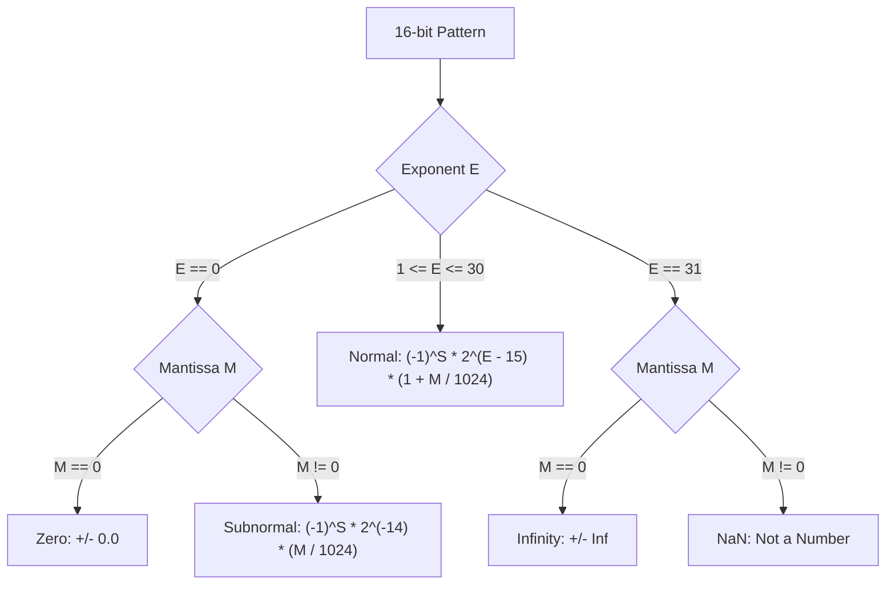
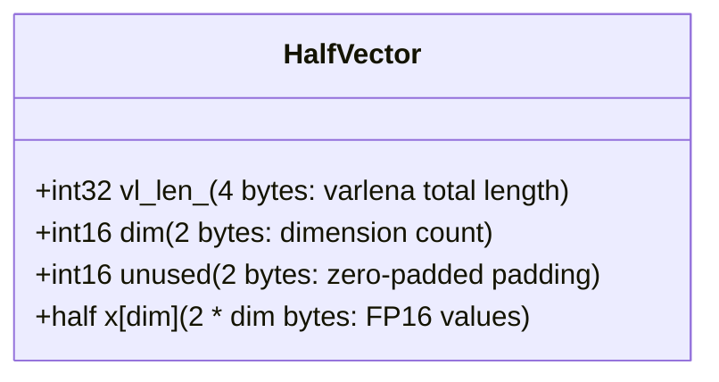
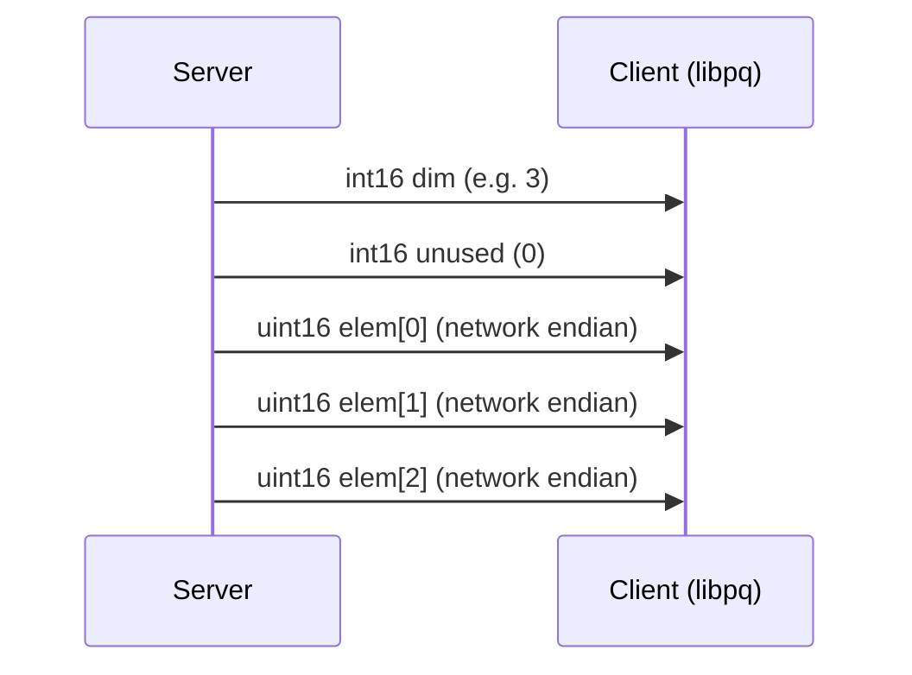
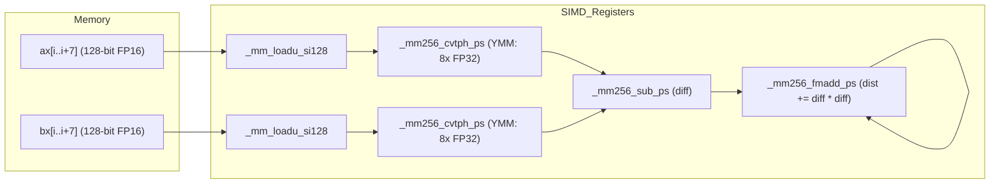

# Deep Technical Analysis: `halfvec` (Half-Precision Floating-Point Vector) Type in pgvector

> **Target Source Files:**
> - `src/halfvec.h`
> - `src/halfvec.c`
> - `src/halfutils.h`
> - `src/halfutils.c`

---

## Table of Contents
1. [Introduction & Overview](#1-introduction--overview)
2. [IEEE 754 Half-Precision (`binary16`) Specification](#2-ieee-754-half-precision-binary16-specification)
   - [Bit Field Breakdown](#bit-field-breakdown)
   - [Value Regimes: Normal, Subnormal, Zero, Infinity, and NaN](#value-regimes-normal-subnormal-zero-infinity-and-nan)
   - [Precision and Dynamic Range Limits](#precision-and-dynamic-range-limits)
3. [Memory Layout and Struct Representation](#3-memory-layout-and-struct-representation)
   - [The `HalfVector` Struct](#the-halfvector-struct)
   - [The `half` Type Abstraction](#the-half-type-abstraction)
   - [Varlena Header and Byte Alignment](#varlena-header-and-byte-alignment)
   - [Memory Layout Diagram](#memory-layout-diagram)
4. [Conversion Algorithms: FP16 ↔ FP32 (`halfutils`)](#4-conversion-algorithms-fp16--fp32-halfutils)
   - [Hardware-Accelerated Path (F16C & Native `_Float16`)](#hardware-accelerated-path-f16c--native-_float16)
   - [Software Bit-Manipulation Path: FP16 → FP32 (`HalfToFloat4`)](#software-bit-manipulation-path-fp16--fp32-halfvec_to_float4)
   - [Software Bit-Manipulation Path: FP32 → FP16 (`Float4ToHalfUnchecked`)](#software-bit-manipulation-path-fp32--fp16-float4tohalfunchecked)
   - [Error Handling and Range Checks (`Float4ToHalf`)](#error-handling-and-range-checks-float4tohalf)
5. [Input, Output, and Serialization Pipeline](#5-input-output-and-serialization-pipeline)
   - [Textual Parser: `halfvec_in`](#textual-parser-halfvec_in)
   - [Textual Formatter: `halfvec_out`](#textual-formatter-halfvec_out)
   - [Binary Wire Protocol: `halfvec_recv` and `halfvec_send`](#binary-wire-protocol-halfvec_recv-and-halfvec_send)
   - [Type Modifiers and Dimension Enforcement](#type-modifiers-and-dimension-enforcement)
6. [Type Conversions and Transformations](#6-type-conversions-and-transformations)
   - [Array Casts (`array_to_halfvec`, `halfvec_to_float4`)](#array-casts-array_to_halfvec-halfvec_to_float4)
   - [Cross-Type Vector Casts (`vector_to_halfvec`, `sparsevec_to_halfvec`)](#cross-type-vector-casts-vector_to_halfvec-sparsevec_to_halfvec)
   - [Binary Quantization (`halfvec_binary_quantize`)](#binary-quantization-halfvec_binary_quantize)
   - [Vector Slicing (`halfvec_subvector`)](#vector-slicing-halfvec_subvector)
7. [Distance Metrics and Arithmetic Operations](#7-distance-metrics-and-arithmetic-operations)
   - [Preserving Arithmetic Precision During Distance Calculations](#preserving-arithmetic-precision-during-distance-calculations)
   - [L2 Distance & Squared L2 Distance](#l2-distance--squared-l2-distance)
   - [Inner Product & Negative Inner Product](#inner-product--negative-inner-product)
   - [Cosine Distance & Spherical Angular Distance](#cosine-distance--spherical-angular-distance)
   - [L1 (Taxicab / Manhattan) Distance](#l1-taxicab--manhattan-distance)
   - [Vector Arithmetic & SQL Operators](#vector-arithmetic--sql-operators)
   - [Aggregate Functions (`halfvec_accum`, `halfvec_avg`)](#aggregate-functions-halfvec_accum-halfvec_avg)
8. [Hardware Acceleration, SIMD, and Dynamic Dispatch](#8-hardware-acceleration-simd-and-dynamic-dispatch)
   - [CPU Feature Detection and Runtime Dispatch Mechanism](#cpu-feature-detection-and-runtime-dispatch-mechanism)
   - [x86-64 F16C + AVX + FMA Kernels Deep Dive](#x86-64-f16c--avx--fma-kernels-deep-dive)
   - [Auto-Vectorization Considerations & ARM Architecture](#auto-vectorization-considerations--arm-architecture)
   - [Future Opportunities: Native AVX-512 FP16](#future-opportunities-native-avx-512-fp16)
9. [Architectural Rationale: Why `halfvec`?](#9-architectural-rationale-why-halfvec)
   - [Storage & Memory Bandwidth Comparison](#storage--memory-bandwidth-comparison)
   - [Accuracy vs. Performance Trade-Off Analysis](#accuracy-vs-performance-trade-off-analysis)
10. [Function and Operator Reference Tables](#10-function-and-operator-reference-tables)

---

## 1. Introduction & Overview

Modern deep learning embedding models (such as those from OpenAI, Cohere, Google, Mistral, and HuggingFace) traditionally output embeddings as 32-bit single-precision IEEE 754 floats (`float4` / `vector` in pgvector). However, dense vectors spanning 768, 1536, or 3072 dimensions impose immense storage overhead, memory footprint, and memory bandwidth pressure on relational database instances.

To solve this, `pgvector` introduced the `halfvec` data type. Storing vector dimensions as 16-bit half-precision floats (`binary16`):
- Cuts raw vector storage in half (2 bytes per dimension instead of 4 bytes).
- Halves memory bandwidth consumption during sequential scans and graph traversals.
- Doubles L1/L2/L3 cache residency of index nodes in HNSW graphs and IVFFlat inverted lists.
- Retains greater than 99% of retrieval accuracy for semantic search without retraining models.

In this deep dive, we examine every layer of the `halfvec` implementation in pgvector: its data structures, binary encoding, conversion routines, mathematical kernels, and hardware SIMD dispatch.

---

## 2. IEEE 754 Half-Precision (`binary16`) Specification

The `halfvec` type adheres to the IEEE 754-2008 standard for 16-bit floating-point numbers (`binary16`).

### Bit Field Breakdown

A 16-bit half-precision float occupies exactly 2 bytes (16 bits), partitioned into three discrete fields:

```
 15  14          10 9                                    0
+---+--------------+--------------------------------------+
| S |    E (5)     |               M (10)                 |
+---+--------------+--------------------------------------+
```

| Field | Bit Offset | Width | Description |
|:------|:-----------|:------|:------------|
| **Sign ($S$)** | Bit 15 | 1 bit | `0` = Positive ($+$), `1` = Negative ($-$) |
| **Exponent ($E$)** | Bits 14–10 | 5 bits | Biased exponent with bias $B = 15$ ($2^{5-1} - 1$) |
| **Mantissa / Significand ($M$)** | Bits 9–0 | 10 bits | Fractional bits of the significand |

### Value Regimes: Normal, Subnormal, Zero, Infinity, and NaN

The bit pattern maps to real numbers across five distinct regimes:



1. **Normal Numbers ($1 \le E \le 30$):**
   The exponent is neither all zeros nor all ones. An implicit leading 1 is assumed:
   $$v = (-1)^S \times 2^{E - 15} \times \left(1 + \frac{M}{1024}\right)$$

2. **Subnormal / Denormal Numbers ($E = 0, M \ne 0$):**
   When the exponent bits are all zero, gradual underflow occurs. The implicit leading bit becomes 0:
   $$v = (-1)^S \times 2^{-14} \times \left(0 + \frac{M}{1024}\right)$$

3. **Zero ($E = 0, M = 0$):**
   Represented by all zeros in the exponent and mantissa. Supports signed zero ($+0.0$ at `0x0000`, $-0.0$ at `0x8000`).

4. **Infinity ($E = 31, M = 0$):**
   Positive infinity is `0x7C00`; negative infinity is `0xFC00`.

5. **Not a Number / NaN ($E = 31, M \ne 0$):**
   Exponent is all ones with a non-zero mantissa (`0x7C01` through `0x7FFF`, `0xFC01` through `0xFFFF`).

### Precision and Dynamic Range Limits

| Property | Formula / Expression | Decimal Value |
|:---|:---|:---|
| **Maximum Representable Value (`HALF_MAX`)** | $2^{15} \times (1 + \frac{1023}{1024})$ | **65,504** |
| **Minimum Normalized Positive Value** | $2^{-14}$ | $\approx 6.10352 \times 10^{-5}$ |
| **Minimum Subnormal Positive Value** | $2^{-14} \times \frac{1}{1024} = 2^{-24}$ | $\approx 5.96046 \times 10^{-8}$ |
| **Significand Bits** | $10\text{ (explicit)} + 1\text{ (implicit)}$ | $11\text{ bits}$ |
| **Decimal Precision** | $\log_{10}(2^{11}) \approx 11 \times 0.30103$ | **$\approx 3.31$ decimal digits** |

### pgvector Element Validation Rules

In `src/halfutils.h` and `src/halfvec.c`, pgvector strictly bans non-finite values from vectors:

```c
/* src/halfutils.h */
static inline bool
HalfIsNan(half num)
{
#ifdef FLT16_SUPPORT
    return isnan(num);
#else
    return (num & 0x7C00) == 0x7C00 && (num & 0x7FFF) != 0x7C00;
#endif
}

static inline bool
HalfIsInf(half num)
{
#ifdef FLT16_SUPPORT
    return isinf(num);
#else
    return (num & 0x7FFF) == 0x7C00;
#endif
}
```

Whenever vector elements are parsed or computed, `CheckElement(half value)` is invoked:
```c
static inline void
CheckElement(half value)
{
    if (HalfIsNan(value))
        ereport(ERROR,
                (errcode(ERRCODE_DATA_EXCEPTION),
                 errmsg("NaN not allowed in halfvec")));

    if (HalfIsInf(value))
        ereport(ERROR,
                (errcode(ERRCODE_DATA_EXCEPTION),
                 errmsg("infinite value not allowed in halfvec")));
}
```

---

## 3. Memory Layout and Struct Representation

### The `HalfVector` Struct

In `src/halfvec.h`, the internal representation of a half-precision vector is declared as a C struct utilizing PostgreSQL's variable-length attribute (`varlena`) convention:

```c
typedef struct HalfVector
{
    int32       vl_len_;        /* varlena header (do not touch directly!) */
    int16       dim;            /* number of dimensions (1 to 16,000) */
    int16       unused;         /* reserved for future use, always zero */
    half        x[FLEXIBLE_ARRAY_MEMBER];
} HalfVector;
```

### The `half` Type Abstraction

To ensure cross-platform compatibility across various compilers (GCC, Clang, MSVC) and C standards, pgvector conditionally defines `half`:

```c
#ifdef FLT16_SUPPORT
#define half _Float16
#define HALF_MAX FLT16_MAX
#else
#define half uint16
#define HALF_MAX 65504
#endif
```

- When the compiler and hardware natively support ISO C `_Float16` (via `#if defined(__FLT16_MAX__)`), arithmetic can take advantage of compiler-generated floating-point instructions.
- When `_Float16` is not available, `half` is defined as an unsigned 16-bit integer (`uint16`). In this fallback mode, all conversions and arithmetic are performed via bitwise manipulation functions in `halfutils.h`.
- In both cases, `sizeof(half)` is guaranteed to be **2 bytes** (16 bits).

### Varlena Header and Byte Alignment

The memory consumption and alignment characteristics are:

1. **`vl_len_` (4 bytes):** Standard PostgreSQL 4-byte header (`struct varlena`). Encodes total allocation size including header and payload. Supports TOAST compression and out-of-line storage.
2. **`dim` (2 bytes, `int16`):** Number of active vector elements ($1 \le \text{dim} \le 16,000$).
3. **`unused` (2 bytes, `int16`):** Reserved field initialized to 0. It serves two purposes:
   - Alignment: Ensures the array `x` begins at an 8-byte aligned offset ($4 + 2 + 2 = 8$).
   - Future expansion: Available for flags (e.g., sparsity, normalization tags).
4. **`x` (Variable size, $2 \times \text{dim}$ bytes):** Contiguous payload array of 16-bit floating-point numbers.



Total on-disk and in-memory byte size is computed using:
```c
#define HALFVEC_SIZE(_dim) \
    add_size(offsetof(HalfVector, x), mul_size(sizeof(half), _dim))
```
Because `offsetof(HalfVector, x)` is 8 bytes, the size equation is:
$$\text{Size}(\text{dim}) = 8 + 2 \times \text{dim}\quad\text{bytes}$$

#### Maximum Size & Limit
`HALFVEC_MAX_DIM` is fixed at **16,000**:
$$\text{Max Size} = 8 + 2 \times 16000 = 32,008\quad\text{bytes}$$
This fits comfortably inside PostgreSQL's 1 GB varlena limit and allows inline storage within 8 KB pages if $\text{dim} \le 4000$ (or compressed via TOAST).

---

## 4. Conversion Algorithms: FP16 ↔ FP32 (`halfutils`)

Because standard PostgreSQL math is executed in 32-bit (`float4`) or 64-bit (`float8`), and CPUs historically lacked direct FP16 ALUs, fast bidirectional conversion between 16-bit and 32-bit floating point is essential.

### Comparison of IEEE 754 Binary16 vs Binary32

```
Binary32 (float / float4):
 31 30         23 22                                                 0
+--+-------------+----------------------------------------------------+
|S |    E (8)    |                      M (23)                        |
+--+-------------+----------------------------------------------------+
Bias = 127

Binary16 (half):
 15 14     10 9                  0
+--+---------+--------------------+
|S |  E (5)  |       M (10)       |
+--+---------+--------------------+
Bias = 15
```

### Hardware-Accelerated Path (F16C & Native `_Float16`)

When compiling with hardware support (`F16C_SUPPORT` enabled via `-mf16c`), pgvector uses x86 hardware intrinsics:
- **FP16 → FP32:** `_cvtsh_ss(num)` — compiles to `vcvtph2ps`.
- **FP32 → FP16:** `_cvtss_sh(num, 0)` — compiles to `vcvtps2ph` with round-to-nearest-even (`0`).

```c
#if defined(F16C_SUPPORT)
static inline float HalfToFloat4(half num) {
    return _cvtsh_ss(num);
}
static inline half Float4ToHalfUnchecked(float num) {
    return _cvtss_sh(num, 0);
}
#endif
```

### Software Bit-Manipulation Path: FP16 → FP32 (`HalfToFloat4`)

When hardware conversion is unavailable, pgvector executes pure bitwise manipulation (`src/halfutils.h` lines 62–141):

```c
static inline float
HalfToFloat4(half num)
{
    union { float f; uint32 i; } swapfloat;
    union { half h; uint16 i; } swaphalf;

    uint16 bin;
    uint32 exponent;
    uint32 mantissa;
    uint32 result;

    swaphalf.h = num;
    bin = swaphalf.i;
    exponent = (bin & 0x7C00) >> 10;
    mantissa = bin & 0x03FF;

    /* 1. Extract Sign: bit 15 shifted to bit 31 */
    result = (bin & 0x8000) << 16;

    if (unlikely(exponent == 31))
    {
        /* Infinity or NaN */
        if (mantissa == 0)
            result |= 0x7F800000;   /* float32 Infinity */
        else
            result |= 0x7FC00000;   /* float32 Quiet NaN */
    }
    else if (unlikely(exponent == 0))
    {
        /* Subnormal half -> normalized float32 */
        if (mantissa != 0)
        {
            exponent = -14;

            for (int i = 0; i < 10; i++)
            {
                mantissa <<= 1;
                exponent -= 1;

                if ((mantissa >> 10) % 2 == 1)
                {
                    mantissa &= 0x03ff;
                    break;
                }
            }
            result |= (exponent + 127) << 23;
        }
    }
    else
    {
        /* Normal number: adjust bias (15 -> 127) */
        result |= (exponent - 15 + 127) << 23;
    }

    /* Mantissa: 10 bits shifted left by 13 to occupy 23-bit position */
    result |= mantissa << 13;

    swapfloat.i = result;
    return swapfloat.f;
}
```

#### Step-by-Step Logic:
1. **Sign extraction:** The 15th bit is shifted 16 places left into the 31st bit.
2. **Special values ($E = 31$):** If the mantissa is 0, it maps to `0x7F800000` (float $\pm\infty$); if non-zero, to `0x7FC00000` (float NaN).
3. **Subnormal expansion ($E = 0$):** A subnormal FP16 number has non-zero mantissa bits without an implicit leading 1 ($2^{-14} \times 0.m$). In 32-bit float, the exponent range is much wider (down to $2^{-126}$), so **all FP16 subnormals become normalized FP32 numbers**. The bit-loop normalizes the mantissa by shifting left until bit 10 becomes 1, decrementing the unbiased exponent accordingly, and then re-biasing by $+127$.
4. **Normal values:** Unbias exponent ($-15$) and re-bias ($+127$), then shift to bit 23: `(exponent - 15 + 127) << 23`.
5. **Mantissa alignment:** Shifts the 10-bit mantissa left by 13 positions ($23 - 10 = 13$) into bits 22–0.

### Software Bit-Manipulation Path: FP32 → FP16 (`Float4ToHalfUnchecked`)

Converting from a 32-bit float to a 16-bit float requires rounding and potential overflow/underflow handling (`src/halfutils.h` lines 146–239):

```c
static inline half
Float4ToHalfUnchecked(float num)
{
    union { float f; uint32 i; } swapfloat;
    union { half h; uint16 i; } swaphalf;

    uint32 bin;
    int    exponent;
    int    mantissa;
    uint16 result;

    swapfloat.f = num;
    bin = swapfloat.i;
    exponent = (bin & 0x7F800000) >> 23;
    mantissa = bin & 0x007FFFFF;

    /* Extract sign: bit 31 shifted to bit 15 */
    result = (bin & 0x80000000) >> 16;

    if (isinf(num))
    {
        result |= 0x7C00;
    }
    else if (isnan(num))
    {
        result |= 0x7E00;
        result |= mantissa >> 13;
    }
    else if (exponent > 98) /* Exponent threshold: 98 - 127 = -29 (half min subnormal is 2^-24) */
    {
        int m;
        int gr;
        int s;

        exponent -= 127;
        s = mantissa & 0x00000FFF;  /* sticky bits */

        /* Subnormal handling for half */
        if (exponent < -14)
        {
            int diff = -exponent - 14;
            mantissa >>= diff;
            mantissa += 1 << (23 - diff);
            s |= mantissa & 0x00000FFF;
        }

        m = mantissa >> 13;

        /* Round to nearest, ties to even (guard, round, sticky bits) */
        gr = (mantissa >> 12) % 4;
        if (gr == 3 || (gr == 1 && s != 0))
            m += 1;

        if (m == 1024)  /* Mantissa overflow due to rounding */
        {
            m = 0;
            exponent += 1;
        }

        if (exponent > 15)  /* Exponent overflow -> Infinity */
        {
            result |= 0x7C00;
        }
        else
        {
            if (exponent >= -14)
                result |= (exponent + 15) << 10;
            result |= m;
        }
    }
    swaphalf.i = result;
    return swaphalf.h;
}
```

#### Rounding Mode: Round-to-Nearest-Even
The algorithm extracts Guard ($G$), Round ($R$), and Sticky ($S$) bits:
- $G$ = Bit 12 of the 23-bit mantissa.
- $R$ = Bit 11.
- $S$ = Logical OR of bits 10 through 0.
- `gr = (mantissa >> 12) % 4` extracts the lowest bit of the truncated mantissa ($L$) and Guard ($G$).
- If $G=1$ and either $L=1$ or $S \ne 0$, rounding increments the mantissa: `m += 1`.
- If `m == 1024` ($2^{10}$), mantissa overflow occurs; $m$ wraps to 0 and exponent is incremented.

### Error Handling and Range Checks (`Float4ToHalf`)

`Float4ToHalfUnchecked` may saturate large numbers to infinity. When converting user inputs or performing strict casts, `Float4ToHalf` validates that finite numbers do not silently overflow:

```c
static inline half
Float4ToHalf(float num)
{
    half result = Float4ToHalfUnchecked(num);

    if (unlikely(HalfIsInf(result)) && !isinf(num))
    {
        char *buf = palloc(FLOAT_SHORTEST_DECIMAL_LEN);
        float_to_shortest_decimal_buf(num, buf);
        ereport(ERROR,
                (errcode(ERRCODE_NUMERIC_VALUE_OUT_OF_RANGE),
                 errmsg("\"%s\" is out of range for type halfvec", buf)));
    }
    return result;
}
```

---

## 5. Input, Output, and Serialization Pipeline

### Textual Parser: `halfvec_in`

The input function `halfvec_in` parses string literals formatted as `[v1, v2, v3, ...]`:

```
"[1.23, -4.56, 7.89]"  ───►  halfvec_in()  ───►  HalfVector in memory
```

#### Parsing Steps (`src/halfvec.c` lines 182–286):
1. **Whitespace skipping:** Custom fast whitespace function `halfvec_isspace(ch)`.
2. **Left bracket validation:** Checks for `[`; raises `ERRCODE_INVALID_TEXT_REPRESENTATION` if missing.
3. **Empty check:** Rejects `[]` with `ERRCODE_DATA_EXCEPTION` ("halfvec must have at least 1 dimension").
4. **Tokenization loop:**
   - Parses each floating-point string using `strtof(pt, &stringEnd)`.
   - Converts to FP16 with `Float4ToHalfUnchecked(val)`.
   - Detects numeric overflow:
     ```c
     if ((errno == ERANGE && isinf(val)) || (HalfIsInf(x[dim]) && !isinf(val)))
         ereport(ERROR, (errcode(ERRCODE_NUMERIC_VALUE_OUT_OF_RANGE), ...));
     ```
   - Checks finite element rules (`CheckElement(x[dim])`).
   - Verifies comma separator or terminating `]`.
5. **Junk character check:** Ensures only trailing whitespace exists after `]`.
6. **Dimensional bounds check:** Enforces $1 \le \text{dim} \le 16,000$, and verifies compatibility with `typmod` if specified.
7. **Allocation:** Calls `InitHalfVector(dim)` and copies elements into struct.

### Textual Formatter: `halfvec_out`

Formatting back to textual strings (`src/halfvec.c` lines 295–336) requires fast, exact decimal conversion:

```c
Datum
halfvec_out(PG_FUNCTION_ARGS)
{
    HalfVector *vector = PG_GETARG_HALFVEC_P(0);
    int         dim = vector->dim;
    char       *buf;
    char       *ptr;

    /* Buffer sizing using PostgreSQL Ryu algorithm */
    buf = (char *) palloc(add_size(mul_size(FLOAT_SHORTEST_DECIMAL_LEN, dim), 3));
    ptr = buf;

    AppendChar(ptr, '[');
    for (int i = 0; i < dim; i++)
    {
        if (i > 0)
            AppendChar(ptr, ',');
        /* Convert FP16 to float, then format with shortest decimal representation */
        AppendFloat(ptr, HalfToFloat4(vector->x[i]));
    }
    AppendChar(ptr, ']');
    *ptr = '\0';

    PG_FREE_IF_COPY(vector, 0);
    PG_RETURN_CSTRING(buf);
}
```
Uses `float_to_shortest_decimal_bufn`, utilizing the Ryu shortest-decimal algorithm for single-precision floats.

### Binary Wire Protocol: `halfvec_recv` and `halfvec_send`

For client-server binary communication (`libpq` binary mode):

#### `halfvec_send` (Serialization)
Transmits vector in network byte order:
1. `dim` (2 bytes, big-endian `int16`).
2. `unused` (2 bytes, big-endian `int16`, set to 0).
3. Payload: `dim * 2` bytes, each `half` written as a 16-bit big-endian integer using `pq_sendint16`.



#### `halfvec_recv` (Deserialization)
1. Reads `dim` and `unused` via `pq_getmsgint(buf, 2)`.
2. Validates `unused == 0`; raises an error otherwise.
3. Checks dimension limits against `typmod`.
4. Reads each 16-bit element with `pq_getmsghalf` and validates via `CheckElement`.

### Type Modifiers and Dimension Enforcement

PostgreSQL supports typed columns with fixed dimensions, e.g., `halfvec(1536)`:
- `halfvec_typmod_in` validates that the dimension modifier is between 1 and 16,000.
- When an untyped vector is inserted into a column with `typmod`, the cast function `halfvec(HalfVector *vec, int32 typmod)` calls `CheckExpectedDim(typmod, vec->dim)`.

---

## 6. Type Conversions and Transformations

pgvector provides rich bidirectional casting between standard PostgreSQL arrays, 32-bit `vector`, `sparsevec`, and `halfvec`.

### Array Casts (`array_to_halfvec`, `halfvec_to_float4`)

`array_to_halfvec` allows direct conversion from SQL array literals like `ARRAY[1.0, 2.0]::halfvec`:
- Supports `INT4OID` (integers), `FLOAT4OID` (single precision), `FLOAT8OID` (double precision), and `NUMERICOID` (arbitrary precision numeric).
- Deconstructs array via `deconstruct_array`.
- Validates 1-D structure and rejection of null elements.
- Converts each scalar element to FP16 with range check `Float4ToHalf(...)`.

`halfvec_to_float4` casts a `HalfVector` to a PostgreSQL `real[]` (`float4[]`) array.

### Cross-Type Vector Casts (`vector_to_halfvec`, `sparsevec_to_halfvec`)

- **`vector_to_halfvec`:** Converts `vector` (FP32) $\to$ `halfvec` (FP16). Iterates through `dim` calling `Float4ToHalf(vec->x[i])`.
- **`sparsevec_to_halfvec`:** Converts `sparsevec` $\to$ `halfvec`. Allocates a zero-initialized `HalfVector` of size `svec->dim` and scatters non-zero values (`Float4ToHalf(values[i])`) into indices `svec->indices[i]`.

### Binary Quantization (`halfvec_binary_quantize`)

Binary quantization maps continuous float vectors into 1-bit binary vectors (`varbit`), where each coordinate is mapped to 1 if $x_i > 0$ and 0 otherwise:

```c
Datum
halfvec_binary_quantize(PG_FUNCTION_ARGS)
{
    HalfVector *a = PG_GETARG_HALFVEC_P(0);
    half       *ax = a->x;
    VarBit     *result = InitBitVector(a->dim);
    unsigned char *rx = VARBITS(result);
    int         i = 0;
    int         count = (a->dim / 8) * 8;

    /* Unrolled 8 dimensions per byte */
    for (; i < count; i += 8)
    {
        unsigned char result_byte = 0;
        for (int j = 0; j < 8; j++)
            result_byte |= (HalfToFloat4(ax[i + j]) > 0) << (7 - j);
        rx[i / 8] = result_byte;
    }

    /* Trailing dimensions */
    for (; i < a->dim; i++)
        rx[i / 8] |= (HalfToFloat4(ax[i]) > 0) << (7 - (i % 8));

    PG_RETURN_VARBIT_P(result);
}
```
This is essential for multi-stage retrieval pipelines: indexing with 1-bit binary vectors via Hamming distance for ultra-fast candidate retrieval, followed by reranking with `halfvec`.

### Vector Slicing (`halfvec_subvector`)

Extracts a subvector slice using 1-based indexing (`subvector(halfvec, start, count)`):
- Guarantees absence of integer overflows: `if (start > a->dim - count) end = a->dim + 1; else end = start + count;`.
- Returns a new contiguous `HalfVector`.

---

## 7. Distance Metrics and Arithmetic Operations

### Preserving Arithmetic Precision During Distance Calculations

A naive implementation of half-precision vector operations would perform accumulation in `_Float16`. **This is avoided in pgvector**:
1. **Dynamic range limitation:** The maximum representable FP16 number is 65,504. In an L2 distance or inner product over 1536 dimensions, if components have magnitude $\approx 10$, each squared difference is $100$. Accumulating 1536 elements yields $153,600$, **causing catastrophic FP16 overflow**.
2. **Cancellation and underflow:** The 10-bit mantissa loses precision rapidly during iterative sums.

> [!IMPORTANT]
> **Key Architectural Decision:**
> pgvector stores vectors in memory as FP16, but **unpacks and computes all dot products, L2 squared differences, and L1 norms in 32-bit float (`float`) or 64-bit float (`double`)**.

### L2 Distance & Squared L2 Distance

- Operator: `<->` (`halfvec_l2_distance`)
- Squared operator: `<+>` (`halfvec_l2_squared_distance`)
- Formula:
  $$D_{L2}^2(\mathbf{u}, \mathbf{v}) = \sum_{i=1}^d (\text{float}(u_i) - \text{float}(v_i))^2$$
  $$D_{L2}(\mathbf{u}, \mathbf{v}) = \sqrt{D_{L2}^2(\mathbf{u}, \mathbf{v})}$$

### Inner Product & Negative Inner Product

- Operator: `<#>` (`halfvec_negative_inner_product`, returns $-(\mathbf{u} \cdot \mathbf{v})$ for min-heap indexing)
- Function: `inner_product` (`halfvec_inner_product`)
- Formula:
  $$\mathbf{u} \cdot \mathbf{v} = \sum_{i=1}^d \text{float}(u_i) \times \text{float}(v_i)$$

### Cosine Distance & Spherical Angular Distance

- Operator: `<=>` (`halfvec_cosine_distance`)
- Implementation (`src/halfutils.c`):
  Accumulates three terms simultaneously: $\sum u_i v_i$, $\sum u_i^2$, $\sum v_i^2$.
  Computes similarity as:
  $$\text{sim} = \frac{\sum u_i v_i}{\sqrt{\sum u_i^2 \times \sum v_i^2}}$$
  Distance is returned as:
  $$D_{cos} = 1.0 - \text{sim}$$
- Notice that pgvector computes `sqrt((double) norma * (double) normb)` instead of `sqrt(norma) * sqrt(normb)` to save a costly square root call.
- **Spherical Distance (`halfvec_spherical_distance`):** Used for spherical k-means clustering. Assumes unit vectors and returns normalized angular distance:
  $$\text{dist} = \frac{\arccos(\text{clamp}(\mathbf{u} \cdot \mathbf{v}, -1, 1))}{\pi}$$

### L1 (Taxicab / Manhattan) Distance

- Operator: `<+>` (`halfvec_l1_distance`)
- Formula:
  $$D_{L1}(\mathbf{u}, \mathbf{v}) = \sum_{i=1}^d |\text{float}(u_i) - \text{float}(v_i)|$$

### Vector Arithmetic & SQL Operators

pgvector defines vector-vector elementwise operations:
- `+` (`halfvec_add`): $r_i = a_i + b_i$
- `-` (`halfvec_sub`): $r_i = a_i - b_i$
- `*` (`halfvec_mul`): $r_i = a_i \times b_i$
- `||` (`halfvec_concat`): Concatenates two vectors $\mathbf{a} \in \mathbb{R}^n, \mathbf{b} \in \mathbb{R}^m \to \mathbf{c} \in \mathbb{R}^{n+m}$

Overflow checks are performed after arithmetic:
```c
for (int i = 0, imax = a->dim; i < imax; i++)
{
    if (HalfIsInf(rx[i]))
        float_overflow_error();
}
```

### Aggregate Functions (`halfvec_accum`, `halfvec_avg`)

Computes `AVG(halfvec_column)` across table rows:
- `halfvec_accum` creates or updates an internal PostgreSQL array of `float8` (`FLOAT8OID`).
- Index 0 stores the count $N$.
- Indices $1 \dots \text{dim}$ store the accumulated sums as 64-bit double precision numbers.
- `halfvec_avg` divides each accumulated double-precision sum by $N$, validates with `CheckElement`, and casts back into a newly allocated `HalfVector`.

---

## 8. Hardware Acceleration, SIMD, and Dynamic Dispatch

Vector distance operations dominate execution time in approximate nearest neighbor (ANN) search. pgvector features an optimized x86-64 SIMD engine with runtime CPU feature dispatch.

### CPU Feature Detection and Runtime Dispatch Mechanism

pgvector does not require the entire PostgreSQL binary or extension to be compiled with specific CPU architecture flags (like `-march=native`), which would break binary packages on older machines. Instead, it uses **runtime function pointer dispatch**.

In `src/halfutils.h`:
```c
extern float  (*HalfvecL2SquaredDistance) (int dim, half * ax, half * bx);
extern float  (*HalfvecInnerProduct) (int dim, half * ax, half * bx);
extern double (*HalfvecCosineSimilarity) (int dim, half * ax, half * bx);
extern float  (*HalfvecL1Distance) (int dim, half * ax, half * bx);
```

During extension initialization in `_PG_init()`:
```c
void
HalfvecInit(void)
{
    /* Set default portable implementation */
    HalfvecL2SquaredDistance = HalfvecL2SquaredDistanceDefault;
    HalfvecInnerProduct = HalfvecInnerProductDefault;
    HalfvecCosineSimilarity = HalfvecCosineSimilarityDefault;
    HalfvecL1Distance = HalfvecL1DistanceDefault;

#ifdef HALFVEC_DISPATCH
    if (SupportsCpuFeature(CPU_FEATURE_AVX | CPU_FEATURE_F16C | CPU_FEATURE_FMA))
    {
        HalfvecL2SquaredDistance = HalfvecL2SquaredDistanceF16c;
        HalfvecInnerProduct = HalfvecInnerProductF16c;
        HalfvecCosineSimilarity = HalfvecCosineSimilarityF16c;
        HalfvecL1Distance = HalfvecL1DistanceF16c;
    }
#endif
}
```

#### Safe CPUID & XSAVE Verification:
Before executing any AVX instructions, `SupportsCpuFeature` checks that:
1. The CPUID leaf indicates OSXSAVE support (`CPU_FEATURE_OSXSAVE`).
2. The operating system has enabled XMM and YMM state saving via `(_xgetbv(0) & 6) == 6`.
3. The CPU supports AVX, F16C, and FMA.

### x86-64 F16C + AVX + FMA Kernels Deep Dive

When AVX, F16C, and FMA are available, pgvector routes distance calls to specialized kernels tagged with `__attribute__((target("avx,f16c,fma")))`.

#### L2 Squared Distance F16C Kernel:
```c
TARGET_F16C static float
HalfvecL2SquaredDistanceF16c(int dim, half * ax, half * bx)
{
    float       distance;
    int         i;
    float       s[8];
    int         count = (dim / 8) * 8;
    __m256      dist = _mm256_setzero_ps();

    for (i = 0; i < count; i += 8)
    {
        /* 1. Load 8 half-floats (128 bits) unaligned */
        __m128i axi = _mm_loadu_si128((__m128i *) (ax + i));
        __m128i bxi = _mm_loadu_si128((__m128i *) (bx + i));

        /* 2. Unpack & convert 8x FP16 to 8x FP32 in YMM registers */
        __m256  axs = _mm256_cvtph_ps(axi);
        __m256  bxs = _mm256_cvtph_ps(bxi);

        /* 3. Compute vector difference */
        __m256  diff = _mm256_sub_ps(axs, bxs);

        /* 4. Fused Multiply-Add: dist = (diff * diff) + dist */
        dist = _mm256_fmadd_ps(diff, diff, dist);
    }

    /* 5. Horizontal sum across 8 lanes */
    _mm256_storeu_ps(s, dist);
    distance = s[0] + s[1] + s[2] + s[3] + s[4] + s[5] + s[6] + s[7];

    /* 6. Clean up trailing dimensions */
    for (; i < dim; i++)
    {
        float diff = HalfToFloat4(ax[i]) - HalfToFloat4(bx[i]);
        distance += diff * diff;
    }

    return distance;
}
```



#### Cosine Similarity Kernel:
Processes 8 dimensions per loop cycle, keeping three 256-bit accumulators in YMM registers:
- `sim` for dot product: `_mm256_fmadd_ps(axs, bxs, sim)`
- `na` for norm of $A$: `_mm256_fmadd_ps(axs, axs, na)`
- `nb` for norm of $B$: `_mm256_fmadd_ps(bxs, bxs, nb)`

#### L1 Distance Kernel:
Computes absolute differences $|u_i - v_i|$ using sign masking:
```c
__m256 sign = _mm256_set1_ps(-0.0);
dist = _mm256_add_ps(dist, _mm256_andnot_ps(sign, _mm256_sub_ps(axs, bxs)));
```
The bitwise `andnot` clears the sign bit of the difference vector, yielding `fabsf` in a single clock cycle without branching!

### Auto-Vectorization Considerations & ARM Architecture

In the default portable implementations (`HalfvecL2SquaredDistanceDefault`), the loops are written with simple loop counters and marked `/* Auto-vectorized */`.
- On ARM64 (AArch64 / Apple Silicon / AWS Graviton), GCC and Clang with `-O3` auto-vectorize the loop using NEON instructions.
- If native compiler `_Float16` is enabled, the compiler emits ARMv8.2-A FP16 vector instructions (`fadd`, `fmla.8h`).

### Future Opportunities: Native AVX-512 FP16

On modern Intel Xeon (Sapphire Rapids, Emerald Rapids, Granite Rapids) and AMD Zen 4/5 architectures, the **AVX-512 FP16** instruction set is available (`_mm512_fmadd_ph`).
- Current F16C code converts FP16 to FP32, performing 8 fused multiply-adds per 256-bit vector.
- With AVX-512 FP16, a single 512-bit register holds **32 half-precision floats**, executing 32 operations per clock cycle natively without unpacking to single-precision float. This offers up to $4\times$ throughput improvement for future pgvector releases.

---

## 9. Architectural Rationale: Why `halfvec`?

### Storage & Memory Bandwidth Comparison

| Dimension ($d$) | Metric | `vector` (`float4`) | `halfvec` (`half`) | Reduction |
|:---|:---|:---|:---|:---|
| **768** (e.g. BERT / nomic) | Row Size | $8 + 3,072 = 3,080$ B | $8 + 1,536 = 1,544$ B | **50.0%** |
| | 1 Million Rows | 3.08 GB | 1.54 GB | **1.54 GB saved** |
| **1536** (OpenAI small/large) | Row Size | $8 + 6,144 = 6,152$ B | $8 + 3,072 = 3,080$ B | **50.0%** |
| | 1 Million Rows | 6.15 GB | 3.08 GB | **3.07 GB saved** |
| **3072** (OpenAI large) | Row Size | $8 + 12,288 = 12,296$ B | $8 + 6,144 = 6,152$ B | **50.0%** |
| | 1 Million Rows | 12.30 GB | 6.15 GB | **6.15 GB saved** |

### Memory Bandwidth and Cache Impact

Vector nearest neighbor search is heavily **memory-bandwidth bound**:
- In HNSW graph traversal, visiting a candidate requires reading its vector from RAM or disk to compute distance to the query vector.
- Standard 64-byte CPU cache lines can store **32 half-precision dimensions** versus only **16 single-precision dimensions**.
- Because memory bus transfers are halved, random-access index traversals and sequential scans execute up to **$1.6\times$ to $2\times$ faster**.

### Accuracy vs. Performance Trade-Off Analysis

Neural network embedding models are trained using loss functions that maximize relative angular or Euclidean margins. Individual coordinate noise within $[-2^{-11}, 2^{-11}]$ produces negligible disturbance in top-$K$ rankings:
- **Recall@10:** Empirical benchmarks across standard datasets (MS MARCO, BEIR, Cohere Wikipedia) consistently demonstrate $>99.5\%$ overlap in Recall@10 between FP32 `vector` and FP16 `halfvec`.
- **Dynamic Range:** Normalized vectors have components strictly inside $[-1.0, 1.0]$. The FP16 range of $[-65504, 65504]$ easily encompasses this without precision clipping or exponent saturation.

---

## 10. Function and Operator Reference Tables

### SQL Distance Operators

| Operator | Function Name | Distance Metric | Description |
|:---|:---|:---|:---|
| `<->` | `halfvec_l2_distance` | Euclidean ($L_2$) | $\sqrt{\sum (u_i - v_i)^2}$ |
| `<#>` | `halfvec_negative_inner_product` | Negative Dot Product | $-\sum u_i v_i$ (for min-heap indexing) |
| `<=>` | `halfvec_cosine_distance` | Cosine Distance | $1 - \frac{\mathbf{u}\cdot\mathbf{v}}{\|\mathbf{u}\|\|\mathbf{v}\|}$ |
| `<+>` | `halfvec_l1_distance` | Manhattan ($L_1$) | $\sum \|u_i - v_i\|$ |
| `<+>` (alt) | `halfvec_l2_squared_distance` | Squared Euclidean | $\sum (u_i - v_i)^2$ |

### Mathematical and Utility Functions

| SQL Function | C Implementation | Return Type | Description |
|:---|:---|:---|:---|
| `vector_dims(halfvec)` | `halfvec_vector_dims` | `int4` | Returns dimension count ($dim$) |
| `l2_norm(halfvec)` | `halfvec_l2_norm` | `float8` | Computes Euclidean norm $\|\mathbf{u}\|_2$ |
| `l2_normalize(halfvec)` | `halfvec_l2_normalize` | `halfvec` | Scales vector to unit length $\|\mathbf{u}\|_2 = 1$ |
| `binary_quantize(halfvec)` | `halfvec_binary_quantize` | `bit` | 1-bit quantization ($x_i > 0 \implies 1, x_i \le 0 \implies 0$) |
| `subvector(halfvec, start, len)` | `halfvec_subvector` | `halfvec` | Slices a subvector from 1-based offset |
| `inner_product(halfvec, halfvec)` | `halfvec_inner_product` | `float8` | Returns dot product $\mathbf{u} \cdot \mathbf{v}$ |
| `cosine_distance(halfvec, halfvec)` | `halfvec_cosine_distance` | `float8` | Computes cosine distance |

### Arithmetic Operators

| Operator | Function Name | Return Type | Description |
|:---|:---|:---|:---|
| `+` | `halfvec_add` | `halfvec` | Elementwise addition |
| `-` | `halfvec_sub` | `halfvec` | Elementwise subtraction |
| `*` | `halfvec_mul` | `halfvec` | Elementwise multiplication |
| `\|\|` | `halfvec_concat` | `halfvec` | Vector concatenation |

### Comparison Operators (B-Tree Support)

| Operator | Function Name | Semantics |
|:---|:---|:---|
| `<` | `halfvec_lt` | Element-by-element lexicographical less-than |
| `<=` | `halfvec_le` | Lexicographical less-than or equal |
| `=` | `halfvec_eq` | Exact elementwise equality |
| `<>` | `halfvec_ne` | Inequality |
| `>=` | `halfvec_ge` | Lexicographical greater-than or equal |
| `>` | `halfvec_gt` | Lexicographical greater-than |
| `cmp` | `halfvec_cmp` | Returns `-1`, `0`, or `1` for B-Tree indexing |
