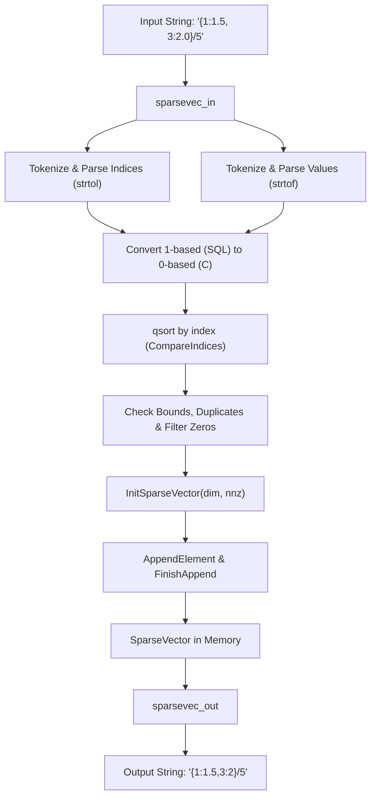
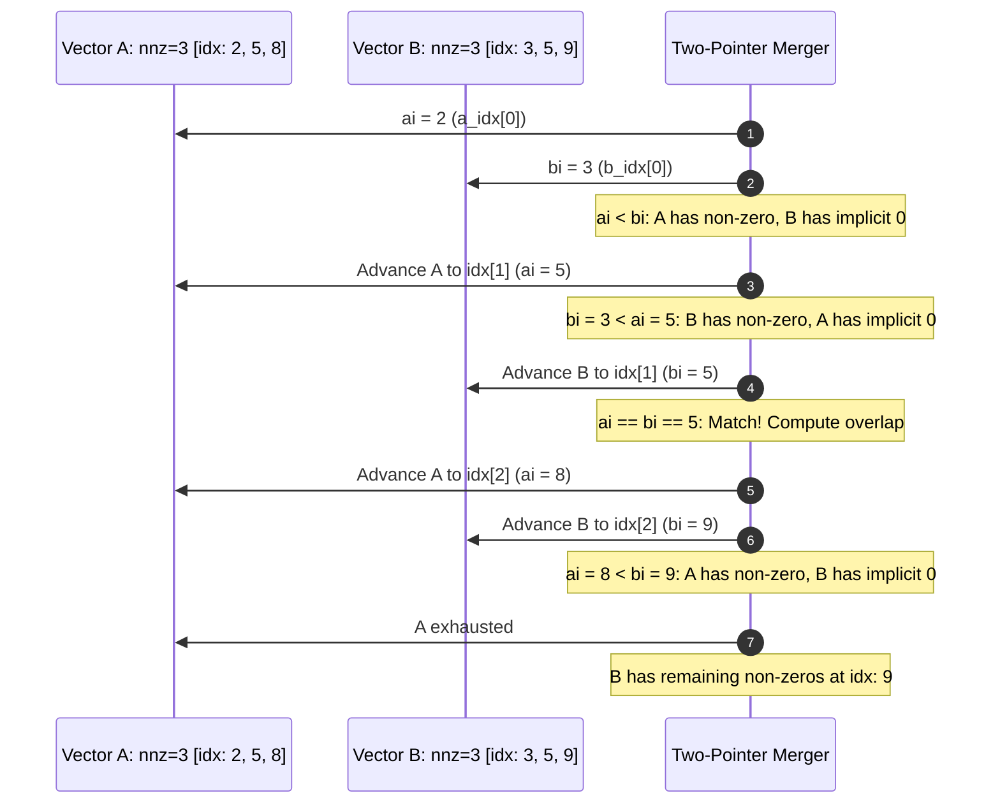
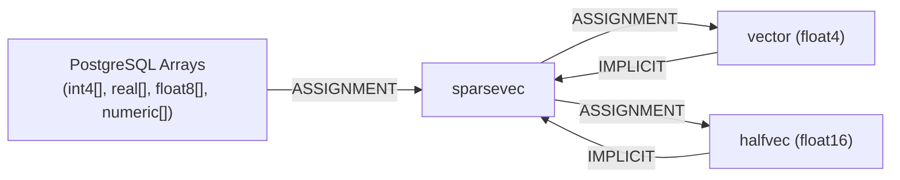

# Sparse Vector Type (`sparsevec`) Architecture & Implementation

> Comprehensive technical analysis of the `sparsevec` data type in pgvector, covering the in-memory/on-disk storage layout, parsing pipeline, distance algorithms, memory efficiency proofs, and production use cases.

---

## Table of Contents

1. [Overview & Design Motivation](#1-overview--design-motivation)
2. [Data Structure & Memory Layout](#2-data-structure--memory-layout)
   - [SparseVector Struct Definition](#sparsevector-struct-definition)
   - [Memory Alignment & Byte-Level Layout](#memory-alignment--byte-level-layout)
   - [Storage Strategy & TOAST Characteristics](#storage-strategy--toast-characteristics)
3. [Input / Output & Serialization Pipeline](#3-input--output--serialization-pipeline)
   - [Textual Input Format & Parsing Pipeline (`sparsevec_in`)](#textual-input-format--parsing-pipeline-sparsevec_in)
   - [Textual Output Formatting (`sparsevec_out`)](#textual-output-formatting-sparsevec_out)
   - [Binary Serialization (`sparsevec_send` / `sparsevec_recv`)](#binary-serialization-sparsevec_send--sparsevec_recv)
   - [Type Modifier Handling (`sparsevec_typmod_in` & `sparsevec`)](#type-modifier-handling-sparsevec_typmod_in--sparsevec)
4. [Distance Metrics & Two-Pointer Merge Algorithms](#4-distance-metrics--two-pointer-merge-algorithms)
   - [Inner Product & Negative Inner Product](#inner-product--negative-inner-product)
   - [Euclidean Distance (L2) & Squared L2](#euclidean-distance-l2--squared-l2)
   - [Cosine Distance](#cosine-distance)
   - [Taxicab / Manhattan Distance (L1)](#taxicab--manhattan-distance-l1)
   - [Algorithmic Complexity Summary](#algorithmic-complexity-summary)
5. [Vector Operations & Transformations](#5-vector-operations--transformations)
   - [L2 Norm & In-Place L2 Normalization](#l2-norm--in-place-l2-normalization)
   - [Vector Dimensions](#vector-dimensions)
   - [B-Tree Ordering & Lexicographical Comparison](#b-tree-ordering--lexicographical-comparison)
6. [Type Conversions & Casting Infrastructure](#6-type-conversions--casting-infrastructure)
   - [Dense to Sparse (`vector_to_sparsevec`, `halfvec_to_sparsevec`)](#dense-to-sparse)
   - [Sparse to Dense (`sparsevec_to_vector`, `sparsevec_to_halfvec`)](#sparse-to-dense)
   - [Array Conversions (`array_to_sparsevec`)](#array-conversions)
7. [Memory Efficiency & Sparsity Analysis](#7-memory-efficiency--sparsity-analysis)
   - [Mathematical Formulae](#mathematical-formulae)
   - [Break-Even Analysis vs `vector` and `halfvec`](#break-even-analysis)
   - [Concrete Storage Comparison Matrix](#concrete-storage-comparison-matrix)
8. [Production Use Cases & Indexing](#8-production-use-cases--indexing)
   - [Learned Sparse Embeddings (SPLADE, BGE-M3)](#learned-sparse-embeddings-splade-bge-m3)
   - [Classical Information Retrieval (TF-IDF, BM25)](#classical-information-retrieval-tf-idf-bm25)
   - [Hybrid Dense-Sparse Retrieval Architectures](#hybrid-dense-sparse-retrieval-architectures)
   - [HNSW Indexing on `sparsevec` & System Constraints](#hnsw-indexing-on-sparsevec--system-constraints)

---

## 1. Overview & Design Motivation

In machine learning and information retrieval, feature vectors often span high-dimensional vocabularies (e.g., 30,000 to tens of millions of features), while only a minute fraction of elements contain non-zero weights. Storing such vectors in dense format ($4 \text{ bytes} \times \text{dimensions}$) wastes orders of magnitude of memory, storage, and I/O bandwidth, and limits maximum dimensionality to Postgres page constraints.

To address this, pgvector introduced the `sparsevec` data type in **v0.7.0**. Key attributes:
- **Maximum Dimensions**: Up to $1,000,000,000$ (`SPARSEVEC_MAX_DIM = 1000000000`).
- **Maximum Non-Zero Elements (NNZ)**: Up to $16,000$ (`SPARSEVEC_MAX_NNZ = 16000`) for table storage, and up to $1,000$ (`HNSW_MAX_NNZ = 1000`) for HNSW index entries.
- **Value Precision**: IEEE 754 single-precision `float4` (32-bit floating point).
- **Index Precision**: 32-bit integer (`int32`), 1-based in SQL syntax, 0-based in binary and internal storage.

```
+-------------------------------------------------------------------------------+
|                               pgvector Types                                  |
+---------------------+-------------------+------------------+------------------+
| Type                | vector            | halfvec          | sparsevec        |
+---------------------+-------------------+------------------+------------------+
| Format              | Dense float4      | Dense float16    | Sparse float4    |
| Max Dimensions      | 16,000            | 16,000           | 1,000,000,000    |
| Element Storage     | 4 bytes / dim     | 2 bytes / dim    | 8 bytes / nnz    |
| Zero Representation | Explicit (0.0f)   | Explicit (0.0h)  | Implicit (none)  |
| Primary Use Case    | Dense embeddings  | Half-mem dense   | SPLADE / Lexical |
+---------------------+-------------------+------------------+------------------+
```

---

## 2. Data Structure & Memory Layout

### SparseVector Struct Definition

The `sparsevec` type is defined in [`src/sparsevec.h`](file:///mnt/Data/Coding/arkivector/pgvector/src/sparsevec.h#L22-L29):

```c
typedef struct SparseVector
{
	int32		vl_len_;		/* varlena header (do not touch directly!) */
	int32		dim;			/* number of dimensions */
	int32		nnz;			/* number of non-zero elements */
	int32		unused;			/* reserved for future use, always zero */
	int32		indices[FLEXIBLE_ARRAY_MEMBER];
}			SparseVector;
```

Notice that `SparseVector` is a contiguous variable-length PostgreSQL object (`varlena`). Rather than using a multi-pointer structure (such as linked lists or dynamic pointer arrays), all data resides in a **single contiguous heap chunk**.

### Memory Alignment & Byte-Level Layout

Following the flexible array member `indices`, the non-zero `float` values are placed immediately after the `nnz` integer indices:

```
+------------------------------------------------------------------------------------------+
|                               SparseVector Memory Layout                                 |
+---------------+---------------+---------------+---------------+--------------+-----------+
| Offset (B)    | Field         | Type          | Size (Bytes)  | Alignment    | Value     |
+---------------+---------------+---------------+---------------+--------------+-----------+
| 0 .. 3        | vl_len_       | int32 (header)| 4             | 4-byte       | Total Len |
| 4 .. 7        | dim           | int32         | 4             | 4-byte       | Dimension |
| 8 .. 11       | nnz           | int32         | 4             | 4-byte       | Count NNZ |
| 12 .. 15      | unused        | int32         | 4             | 4-byte       | 0         |
| 16 .. 16+4K-1 | indices[0..K] | int32[nnz]    | 4 * nnz       | 4-byte       | 0-based idx
| 16+4K .. End  | values[0..K]  | float[nnz]    | 4 * nnz       | 4-byte       | IEEE float|
+---------------+---------------+---------------+---------------+--------------+-----------+
  Where K = nnz - 1. Total byte size = 16 + 8 * nnz.
```

The memory size is calculated by the inline helper [`SPARSEVEC_SIZE`](file:///mnt/Data/Coding/arkivector/pgvector/src/sparsevec.h#L33-L41):

```c
static inline Size
SPARSEVEC_SIZE(int nnz)
{
	Size		size = offsetof(SparseVector, indices);

	size = add_size(size, mul_size(sizeof(int32), nnz));
	size = add_size(size, mul_size(sizeof(float), nnz));
	return size;
}
```

The pointer to the values array is retrieved using [`SPARSEVEC_VALUES`](file:///mnt/Data/Coding/arkivector/pgvector/src/sparsevec.h#L43-L47):

```c
static inline float *
SPARSEVEC_VALUES(SparseVector * x)
{
	return (float *) (((char *) x) + offsetof(SparseVector, indices) + (x->nnz * sizeof(int32)));
}
```

#### Why Separate Arrays Instead of Array of Structs?
A naive sparse format might use an array of pairs:
```c
struct Element { int32 index; float value; }; // 8 bytes per pair
```
While an array of structs requires the same 8 bytes per non-zero element, pgvector's separated structure (`indices[]` followed by `values[]`):
1. **Cache Locality during Index Intersection**: When checking which features overlap or when searching for an index match, the CPU scans sequential 4-byte integers in `indices[]` without polluting cache lines with floating-point values.
2. **SIMD Alignment for Values**: The `values[]` array is packed contiguously as a sequence of `float4` floats, enabling auto-vectorized SIMD instructions for operations like norm calculation ($\sum v_i^2$).
3. **Zero Padding Overhead**: Because both `int32` and `float` are 4 bytes, `values[]` immediately follows `indices[nnz - 1]` with zero internal padding bytes required for 4-byte CPU architecture alignment.

### Storage Strategy & TOAST Considerations

In [`sql/vector.sql`](file:///mnt/Data/Coding/arkivector/pgvector/sql/vector.sql#L943-L951), `sparsevec` is registered with:
```sql
CREATE TYPE sparsevec (
	INPUT     = sparsevec_in,
	OUTPUT    = sparsevec_out,
	TYPMOD_IN = sparsevec_typmod_in,
	RECEIVE   = sparsevec_recv,
	SEND      = sparsevec_send,
	STORAGE   = external
);
```

#### Why `STORAGE = external`?
PostgreSQL provides four storage strategies for variable-length types:
- `PLAIN`: Inlined only, uncompressed.
- `EXTENDED`: Compressed with pglz/lz4 and allows out-of-line storage via TOAST.
- `EXTERNAL`: Uncompressed, allows out-of-line storage via TOAST.
- `MAIN`: Inlined prioritized, compression allowed.

Using `STORAGE = external` is a deliberate optimization:
1. **Decompression Overhead in Queries**: Vector distance calculations (L2, Inner Product, Cosine) are CPU-bound and execute over thousands or millions of vectors. If vectors were compressed via pglz/lz4, every tuple fetched would require decompressing before running distance functions, severely bottlenecking scan speeds.
2. **Predictable Memory Footprint**: Bypassing compression prevents unexpected memory allocation spikes during parallel query execution.
3. **Out-of-Line TOAST Compatibility**: For large sparse vectors ($16 + 8 \times 16,000 = 128,016 \text{ bytes}$), the value exceeds the 2KB TOAST threshold of Postgres 8KB pages and is safely stored out-of-line in the table's auxiliary TOAST relation.

---

## 3. Input / Output & Serialization Pipeline



### Textual Input Format & Parsing Pipeline (`sparsevec_in`)

The textual representation uses the syntax:
```
'{index_1:value_1, index_2:value_2, ...}/dimensions'
```
*Note: SQL syntax uses **1-based index numbering** (standard SQL convention), whereas internal C storage uses **0-based indexing**.*

#### Complete Parsing Pipeline ([`src/sparsevec.c:236-444`](file:///mnt/Data/Coding/arkivector/pgvector/src/sparsevec.c#L236-L444)):

1. **Initial Parsing State**:
   - Accepts `cstring` lit and `typmod`.
   - Dynamic buffer `elements` initialized to capacity 1 of `SparseInputElement`:
     ```c
     typedef struct SparseInputElement {
         int32 index;
         float value;
     } SparseInputElement;
     ```
2. **Whitespace Stripping & Brace Verification**:
   - `sparsevec_isspace(*pt)` skips whitespace characters (`' '`, `'\t'`, `'\n'`, `'\r'`, `'\v'`, `'\f'`). On Postgres 17+, uses `scanner_isspace`.
   - Requires leading `{`. Empty `{}` is supported.
3. **Token Loop**:
   - Grows dynamic array exponentially (`elementsCapacity = mul_size(elementsCapacity, 2)`).
   - Reads integer index using `strtol(pt, &stringEnd, 10)`. Checks for empty string, validates parsing progress, bounds index to `[INT_MIN + 1, INT_MAX]`.
   - Expects colon delimiter `:`.
   - Reads float value using `strtof(pt, &stringEnd)`.
     - *Design Note*: `strtof` is chosen over `strtod` specifically to avoid the classic **double-rounding** problem (rounding from decimal to double, then casting double to float4 can yield incorrect least-significant bits).
     - Checks `errno == ERANGE` for overflow or underflow.
   - Converts index to 0-based: `elements[elementsLength].index = index - 1`.
   - Verifies finite element: `CheckElement(value, false)` prohibits `NaN` and `Infinity`.
   - Expects comma `,` or closing brace `}`.
4. **Dimension Suffix `/dim`**:
   - After `}`, expects slash `/` followed by integer dimension.
   - Enforces `dim >= 1` and `dim <= 1,000,000,000` via `CheckDim(dim)`.
   - Verifies typmod compliance via `CheckExpectedDim(typmod, dim)`.
   - Rejects any trailing non-whitespace characters ("junk after closing").
5. **Sorting & Canonicalization**:
   - Elements may be provided out of order by the user. The parser invokes `qsort`:
     ```c
     qsort(elements, elementsLength, sizeof(SparseInputElement), CompareIndices);
     ```
6. **Zero-Stripping & Validation**:
   - Validates that `0 <= index < dim`.
   - Rejects duplicate indices: `index == elements[i - 1].index`.
   - Counts non-zero elements (`elements[i].value != 0`). Explicit zeros entered by the user (e.g. `{1:0.0, 2:3.5}/5`) are pruned, ensuring canonical sparse representation.
   - Validates `CheckNnz(nnz, dim)` ($0 \le \text{nnz} \le 16000$ and $\text{nnz} \le \text{dim}$).
7. **Allocation & Packing**:
   - Calls `InitSparseVector(dim, nnz)`.
   - Employs `AppendElement` and verifies completion with `FinishAppend`.

### Textual Output Formatting (`sparsevec_out`)

Located in [`src/sparsevec.c:453-501`](file:///mnt/Data/Coding/arkivector/pgvector/src/sparsevec.c#L453-L501):

#### Exact Buffer Size Computation:
To prevent multiple `repalloc` calls and guarantee safe single-pass formatting:
```c
/*
 * Need:
 * nnz * 11 bytes for index (includes sign for extra safety)
 * nnz bytes for :
 * nnz * (FLOAT_SHORTEST_DECIMAL_LEN - 1) bytes for float_to_shortest_decimal_bufn
 * max(nnz - 1, 0) bytes for ,
 * 11 bytes for dimensions (includes sign for extra safety)
 * 4 bytes for {, }, /, and \0
 */
buf = (char *) palloc(add_size(mul_size(12 + FLOAT_SHORTEST_DECIMAL_LEN, sparsevec->nnz), 15));
```

#### Formatting Logic:
- Employs PostgreSQL's `float_to_shortest_decimal_bufn` (from `common/shortest_dec.h`) for exact, round-trip lossless float formatting with minimal digits.
- Increments 0-based internal index back to 1-based SQL index (`sparsevec->indices[i] + 1`) via `pg_ltoa`.
- Formats to `{1:1.5,3:2}/5`.

### Binary Serialization (`sparsevec_send` / `sparsevec_recv`)

For high-speed `COPY ... WITH (FORMAT BINARY)` and client protocol interaction:

#### Send Format (`sparsevec_send`):
1. `pq_sendint32(&buf, svec->dim)` (4 bytes)
2. `pq_sendint32(&buf, svec->nnz)` (4 bytes)
3. `pq_sendint32(&buf, svec->unused)` (4 bytes)
4. For $i = 0 \dots \text{nnz} - 1$:
   - `pq_sendint32(&buf, svec->indices[i])` (4 bytes each)
5. For $i = 0 \dots \text{nnz} - 1$:
   - `pq_sendfloat4(&buf, values[i])` (4 bytes each)

#### Receive Validation (`sparsevec_recv`):
- Reads network byte order integers and floats.
- Checks `unused == 0` (reserved field integrity).
- Validates dimensions and non-zero counts.
- Enforces strict ascending index order and bounds via `CheckIndex`:
  ```c
  if (index < 0 || index >= dim) ereport(ERROR, ...);
  if (i > 0 && index < indices[i - 1]) ereport(ERROR, "must be in ascending order");
  if (i > 0 && index == indices[i - 1]) ereport(ERROR, "must not contain duplicates");
  ```
- Prohibits zero values: Unlike text input (which cleans explicit zeros), binary input rejects zeros immediately via `CheckElement(value, true)`.

### Type Modifier Handling (`sparsevec_typmod_in` & `sparsevec`)

- When declaring a column as `sparsevec(1000000)`, Postgres parses the typmod array via `sparsevec_typmod_in`:
  ```c
  tl = ArrayGetIntegerTypmods(ta, &n);
  if (n != 1 || *tl < 1 || *tl > SPARSEVEC_MAX_DIM)
      ereport(ERROR, ...);
  PG_RETURN_INT32(*tl);
  ```
- The function `sparsevec(sparsevec, int32, bool)` acts as the typmod-enforcement cast function, validating that an inserted vector matches the column's configured dimension.

---

## 4. Distance Metrics & Two-Pointer Merge Algorithms

All distance functions between sparse vectors must evaluate non-zero elements while accounting for the implicit zeros in all omitted dimensions.

Because both vector $a$ and vector $b$ maintain their non-zero elements in **strictly ascending index order**, pgvector computes distances using **two-pointer merge-scan algorithms**.



### Inner Product & Negative Inner Product

The dot product of two sparse vectors:
$$\langle a, b \rangle = \sum_{k=0}^{\text{dim}-1} a_k b_k = \sum_{k \in \text{indices}_a \cap \text{indices}_b} a_k b_k$$

Any index not present in *both* vectors multiplies with an implicit zero, contributing zero to the sum. Thus, the inner product only needs to evaluate the **intersection** of the index sets:

```c
static float
SparsevecInnerProduct(SparseVector * a, SparseVector * b)
{
	float	   *ax = SPARSEVEC_VALUES(a);
	float	   *bx = SPARSEVEC_VALUES(b);
	float		distance = 0.0;
	int			bpos = 0;

	for (int i = 0; i < a->nnz; i++)
	{
		int32		ai = a->indices[i];

		for (int j = bpos; j < b->nnz; j++)
		{
			int32		bi = b->indices[j];

			/* Only update when the same index */
			if (ai == bi)
				distance += ax[i] * bx[j];

			/* Update start for next iteration */
			if (ai >= bi)
				bpos = j + 1;

			/* Found or passed it */
			if (bi >= ai)
				break;
		}
	}

	return distance;
}
```

#### Why Negative Inner Product?
The operator `<#>` binds to `sparsevec_negative_inner_product`, which returns `-SparsevecInnerProduct(a, b)`.
In Postgres, `ORDER BY ... ASC` is standard. In nearest-neighbor search:
- Greater inner product = greater similarity.
- To sort the most similar items first with an ascending index scan, the distance metric must be minimized:
  $$\arg\max \langle a, b \rangle \iff \arg\min (-\langle a, b \rangle)$$

### Euclidean Distance (L2) & Squared L2

Euclidean squared distance is defined as:
$$\|a - b\|_2^2 = \sum_{k=0}^{\text{dim}-1} (a_k - b_k)^2$$

For indices:
1. $k \in \text{indices}_a \cap \text{indices}_b$: $(a_k - b_k)^2$
2. $k \in \text{indices}_a \setminus \text{indices}_b$: $(a_k - 0)^2 = a_k^2$
3. $k \in \text{indices}_b \setminus \text{indices}_a$: $(0 - b_k)^2 = b_k^2$

Implementation in [`SparsevecL2SquaredDistance`](file:///mnt/Data/Coding/arkivector/pgvector/src/sparsevec.c#L825-L868):
```c
static float
SparsevecL2SquaredDistance(SparseVector * a, SparseVector * b)
{
	float	   *ax = SPARSEVEC_VALUES(a);
	float	   *bx = SPARSEVEC_VALUES(b);
	float		distance = 0.0;
	int			bpos = 0;

	for (int i = 0; i < a->nnz; i++)
	{
		int32		ai = a->indices[i];
		int32		bi = -1;

		for (int j = bpos; j < b->nnz; j++)
		{
			bi = b->indices[j];

			if (ai == bi)
			{
				float		diff = ax[i] - bx[j];
				distance += diff * diff;
			}
			else if (ai > bi)
				distance += bx[j] * bx[j];  /* b element missing in a */

			if (ai >= bi)
				bpos = j + 1;

			if (bi >= ai)
				break;
		}

		if (ai != bi)
			distance += ax[i] * ax[i];      /* a element missing in b */
	}

	/* Add any remaining elements in b after a is exhausted */
	for (int j = bpos; j < b->nnz; j++)
		distance += bx[j] * bx[j];

	return distance;
}
```

- `sparsevec_l2_squared_distance` directly returns `distance` (used by index scans to avoid unnecessary `sqrt`).
- `sparsevec_l2_distance` returns `sqrt((double) distance)`.

### Cosine Distance

Cosine distance is defined as:
$$D_{\cos}(a, b) = 1.0 - \frac{\langle a, b \rangle}{\|a\|_2 \|b\|_2} = 1.0 - \frac{\sum a_k b_k}{\sqrt{\sum a_k^2} \sqrt{\sum b_k^2}}$$

Implementation in [`sparsevec_cosine_distance`](file:///mnt/Data/Coding/arkivector/pgvector/src/sparsevec.c#L972-L1010):
```c
Datum
sparsevec_cosine_distance(PG_FUNCTION_ARGS)
{
	...
	similarity = SparsevecInnerProduct(a, b);

	/* Auto-vectorized norms */
	for (int i = 0; i < a->nnz; i++)
		norma += ax[i] * ax[i];

	for (int i = 0; i < b->nnz; i++)
		normb += bx[i] * bx[i];

	/* Use sqrt(a * b) over sqrt(a) * sqrt(b) for performance */
	similarity /= sqrt((double) norma * (double) normb);

	/* Clamping to [-1.0, 1.0] against precision overflow */
	if (similarity > 1.0)
		similarity = 1.0;
	else if (similarity < -1.0)
		similarity = -1.0;

	PG_RETURN_FLOAT8(1.0 - similarity);
}
```
*Key Optimization*: The norms $\sum a_i^2$ and $\sum b_i^2$ are computed over contiguous float arrays `ax` and `bx`, allowing compilers (GCC/Clang) to auto-vectorize with AVX2/AVX-512 FMA instructions. Computing `sqrt(norma * normb)` executes a single `sqrt` instead of two.

### Taxicab / Manhattan Distance (L1)

L1 distance is defined as:
$$\|a - b\|_1 = \sum_{k=0}^{\text{dim}-1} |a_k - b_k|$$

In [`sparsevec_l1_distance`](file:///mnt/Data/Coding/arkivector/pgvector/src/sparsevec.c#L1015-L1060):
- Overlapping elements: `fabsf(ax[i] - bx[j])`
- Non-overlapping elements in $b$: `fabsf(bx[j])`
- Non-overlapping elements in $a$: `fabsf(ax[i])`
- Remaining tail elements in $b$: `fabsf(bx[j])`

### Algorithmic Complexity Summary

| Distance Function | Time Complexity | Auxiliary Space | Operations per Overlap | Operations per Disjoint Element |
| :--- | :--- | :--- | :--- | :--- |
| **Inner Product** | $\mathcal{O}(\text{nnz}_A + \text{nnz}_B)$ | $\mathcal{O}(1)$ | 1 mult, 1 add | 0 (skipped) |
| **Squared L2** | $\mathcal{O}(\text{nnz}_A + \text{nnz}_B)$ | $\mathcal{O}(1)$ | 1 sub, 1 mult, 1 add | 1 mult, 1 add |
| **Cosine Distance**| $\mathcal{O}(\text{nnz}_A + \text{nnz}_B)$ | $\mathcal{O}(1)$ | 1 dot + 2 norm mult/add | 1 norm mult/add |
| **L1 Distance** | $\mathcal{O}(\text{nnz}_A + \text{nnz}_B)$ | $\mathcal{O}(1)$ | 1 sub, 1 abs, 1 add | 1 abs, 1 add |

Because $bpos$ only moves monotonically forward, each element of $a$ and $b$ is examined at most once, guaranteeing strict linear time $\mathcal{O}(\text{nnz}_A + \text{nnz}_B)$ regardless of the vector dimension $\text{dim}$ (even if $\text{dim} = 1,000,000,000$).

---

## 5. Vector Operations & Transformations

### L2 Norm & In-Place L2 Normalization

- `sparsevec_l2_norm(sparsevec)`:
  Calculates $\sqrt{\sum_{i=0}^{\text{nnz}-1} \text{values}[i]^2}$. Auto-vectorized over the contiguous float buffer.
- `sparsevec_l2_normalize(sparsevec)`:
  Normalizes the vector to unit length ($\|x\|_2 = 1.0$).
  
  *Subtle Edge Case Handling in pgvector*:
  When dividing a tiny non-zero float value by a very large norm, floating-point underflow can round the quotient to exact zero:
  ```c
  if (rx[i] == 0)
      zeros++;
  ```
  If any element underflows to `0.0f`, `sparsevec_l2_normalize` dynamically allocates a replacement `SparseVector` with size `result->nnz - zeros`, prunes the zeros, calls `FinishAppend`, and frees the original intermediate allocation.

### Vector Dimensions

- `sparsevec_vector_dims(sparsevec)` (introduced in v0.9.0):
  Retrieves `a->dim`. Essential for schema introspection and dimensional checks in SQL.

### B-Tree Ordering & Lexicographical Comparison

PostgreSQL requires comparison operators (`<`, `<=`, `=`, `<>`, `>=`, `>`) and a comparison function (`sparsevec_cmp`) to build standard B-tree indexes and support `ORDER BY`, `DISTINCT`, and `UNION`.

Implemented in [`sparsevec_cmp_internal`](file:///mnt/Data/Coding/arkivector/pgvector/src/sparsevec.c#L1159-L1195):
1. **Value-by-Index Comparison**:
   Iterates through elements up to $\min(\text{nnz}_A, \text{nnz}_B)$:
   - If index $a_i < b_i$: compares $a_i$'s value against 0 (if $ax[i] < 0$ return -1, else 1).
   - If index $a_i > b_i$: compares 0 against $b_i$'s value (if $bx[i] < 0$ return 1, else -1).
   - If index $a_i == b_i$: compares $ax[i]$ with $bx[i]$.
2. **Trailing Non-Zeros vs Dimensions**:
   If one vector has more non-zero elements, checks if the remaining index is within the other vector's dimension.
3. **Dimension Comparison**:
   If all non-zero elements are identical, compares total dimensions: `a->dim < b->dim ? -1 : 1`.

---

## 6. Type Conversions & Casting Infrastructure

pgvector provides a comprehensive casting matrix connecting `sparsevec`, `vector`, `halfvec`, and PostgreSQL native arrays.



### Dense to Sparse

- `vector_to_sparsevec(vector, int32, bool)`:
  Scans dense float array. Counts non-zero elements, allocates `InitSparseVector(dim, nnz)`, and copies only non-zero values with their indices. Cast is **IMPLICIT**.
- `halfvec_to_sparsevec(halfvec, int32, bool)`:
  Checks `!HalfIsZero(vec->x[i])`, converts half floats using `HalfToFloat4()`, and populates `sparsevec`. Cast is **IMPLICIT**.

### Sparse to Dense

- `sparsevec_to_vector(sparsevec, int32, bool)`:
  Allocates a zeroed dense vector via `InitVector(dim)` and populates `result->x[index] = values[i]`. Cast is **ASSIGNMENT** (preventing unintentional memory expansion during automatic query coercion).
- `sparsevec_to_halfvec(sparsevec, int32, bool)`:
  Allocates a zeroed half vector via `InitHalfVector(dim)` and populates `result->x[index] = Float4ToHalf(values[i])`. Cast is **ASSIGNMENT**.

### Array Conversions

`array_to_sparsevec` handles conversions from 1D PostgreSQL arrays:
- Supported input array types: `INT4OID`, `FLOAT4OID`, `FLOAT8OID`, `NUMERICOID`.
- Cast context: **ASSIGNMENT** (registered in v0.8.0).
- Implementation: Deconstructs array via Postgres `deconstruct_array()`, verifies absence of nulls, counts non-zeros via macro `IS_NOT_ZERO`, and generates compact `SparseVector`.

---

## 7. Memory Efficiency & Sparsity Analysis

### Mathematical Formulae

Let:
- $D$ = Total dimensions (`dim`).
- $K$ = Number of non-zero elements (`nnz`).
- $S = 1 - \frac{K}{D}$ = Sparsity ratio ($0 \le S \le 1$).

#### 1. On-Disk / Memory Byte Sizes:
$$\text{Size}_{\text{vector}} = 8 + 4D \text{ bytes}$$
*(4-byte varlena header + 4-byte dim + $4D$ bytes for `float4`)*

$$\text{Size}_{\text{halfvec}} = 8 + 2D \text{ bytes}$$
*(4-byte varlena header + 4-byte dim + $2D$ bytes for `half`)*

$$\text{Size}_{\text{sparsevec}} = 16 + 8K \text{ bytes}$$
*(4-byte varlena + 4-byte dim + 4-byte nnz + 4-byte unused + $4K$ bytes for `indices` + $4K$ bytes for `values`)*

### Break-Even Analysis

#### Sparsevec vs Dense Vector:
$$\text{Size}_{\text{sparsevec}} < \text{Size}_{\text{vector}}$$
$$16 + 8K < 8 + 4D \iff 8K < 4D - 8 \iff K < \frac{D}{2} - 1$$
**Conclusion**: `sparsevec` consumes less memory than `vector` whenever non-zero elements constitute **less than 50%** of total dimensions (Sparsity > 50%).

#### Sparsevec vs Dense Halfvec:
$$\text{Size}_{\text{sparsevec}} < \text{Size}_{\text{halfvec}}$$
$$16 + 8K < 8 + 2D \iff 8K < 2D - 8 \iff K < \frac{D}{4} - 1$$
**Conclusion**: `sparsevec` consumes less memory than `halfvec` whenever non-zero elements constitute **less than 25%** of total dimensions (Sparsity > 75%).

### Concrete Storage Comparison Matrix

| Dimension ($D$) | NNZ ($K$) | Sparsity ($S$) | `vector` Size | `halfvec` Size | `sparsevec` Size | Memory Savings vs `vector` |
| :--- | :--- | :--- | :--- | :--- | :--- | :--- |
| **1,000** | 100 | 90.0% | 4,008 B | 2,008 B | **816 B** | **79.6%** |
| **1,000** | 20 | 98.0% | 4,008 B | 2,008 B | **176 B** | **95.6%** |
| **10,000** | 250 | 97.5% | 40,008 B | 20,008 B | **2,016 B** | **95.0%** |
| **10,000** | 50 | 99.5% | 40,008 B | 20,008 B | **416 B** | **99.0%** |
| **30,522 (BERT)**| 150 | 99.5% | 122,096 B | 61,052 B | **1,216 B** | **99.0%** |
| **100,000** | 300 | 99.7% | 400,008 B | 200,008 B | **2,416 B** | **99.4%** |
| **1,000,000** | 500 | 99.95% | *Unsupported* | *Unsupported* | **4,016 B** | **~99.9%** |
| **100,000,000**| 1,000 | 99.999% | *Unsupported* | *Unsupported* | **8,016 B** | **>99.99%** |

*Note*: For dimensions $D > 16,000$, `vector` and `halfvec` cannot be used at all because PostgreSQL caps them at 16,000 dimensions (`VECTOR_MAX_DIM`). `sparsevec` supports up to $1,000,000,000$ dimensions.

---

## 8. Production Use Cases & Indexing

### Learned Sparse Embeddings (SPLADE, BGE-M3)

Modern neural search has evolved beyond dense-only embeddings (which suffer from the "lexical gap" and struggle with exact keyword matching, part numbers, and rare entities). Models such as **SPLADE** (Sparse Lexical and Anisotropic Document Embeddings) and **BGE-M3** project text onto the entire vocabulary space (typically 30,522 to 250,000 dimensions), assigning learned term weights to relevant concepts.

A typical SPLADE representation contains:
- Dimension = 30,522
- Non-zero weights = 80 to 250 terms
- Sparsity = 99.3% to 99.7%

In PostgreSQL:
```sql
CREATE TABLE documents (
    id bigserial PRIMARY KEY,
    content text,
    splade_vector sparsevec(30522)
);

-- Insert a SPLADE sparse vector
INSERT INTO documents (content, splade_vector)
VALUES (
    'pgvector supports high-dimensional sparse representations',
    '{2401:1.82, 3105:2.41, 14209:3.15, 29811:0.94}/30522'
);
```

### Classical Information Retrieval (TF-IDF, BM25)

Traditional inverted index weights (e.g. TF-IDF or BM25) can be represented directly as sparse vectors across a global dictionary of $N$ terms. This unifies vector similarity queries and lexical queries inside a single database engine.

### Hybrid Dense-Sparse Retrieval Architectures

The combination of dense embeddings (capturing semantic intent) and sparse embeddings (capturing keyword precision) achieves state-of-the-art retrieval accuracy:

```sql
CREATE TABLE hybrid_docs (
    id bigserial PRIMARY KEY,
    content text,
    dense_embedding halfvec(1536),      -- OpenAI / Cohere semantic vector
    sparse_embedding sparsevec(250000)  -- BGE-M3 / SPLADE lexical vector
);

-- Reciprocal Rank Fusion (RRF) query
WITH dense_search AS (
    SELECT id, RANK() OVER (ORDER BY dense_embedding <=> '[...]'::halfvec) AS rank
    FROM hybrid_docs
    ORDER BY dense_embedding <=> '[...]'::halfvec
    LIMIT 20
),
sparse_search AS (
    SELECT id, RANK() OVER (ORDER BY sparse_embedding <#> '{...}/250000'::sparsevec) AS rank
    FROM hybrid_docs
    ORDER BY sparse_embedding <#> '{...}/250000'::sparsevec
    LIMIT 20
)
SELECT COALESCE(d.id, s.id) AS doc_id,
       COALESCE(1.0 / (60 + d.rank), 0.0) +
       COALESCE(1.0 / (60 + s.rank), 0.0) AS rrf_score
FROM dense_search d
FULL OUTER JOIN sparse_search s ON d.id = s.id
ORDER BY rrf_score DESC
LIMIT 10;
```

### HNSW Indexing on `sparsevec` & System Constraints

pgvector supports Hierarchical Navigable Small World (HNSW) indexing on `sparsevec` columns using four operator classes:
1. `sparsevec_l2_ops` (L2 distance `<->`)
2. `sparsevec_ip_ops` (Negative Inner Product `<#>`)
3. `sparsevec_cosine_ops` (Cosine distance `<=>`)
4. `sparsevec_l1_ops` (L1 distance `<+>`)

```sql
CREATE INDEX ON documents USING hnsw (splade_vector sparsevec_ip_ops);
```

#### Key Implementation Details:
1. **The 1,000 NNZ Limit (`HNSW_MAX_NNZ`)**:
   While tables support `sparsevec` values with up to 16,000 non-zero elements, HNSW index tuples enforce a strict maximum:
   ```c
   /* src/hnsw.h */
   #define HNSW_MAX_NNZ 1000

   /* src/hnswutils.c */
   static void
   SparsevecCheckValue(Pointer v)
   {
       SparseVector *vec = (SparseVector *) v;
       if (vec->nnz > HNSW_MAX_NNZ)
           ereport(ERROR,
                   (errcode(ERRCODE_PROGRAM_LIMIT_EXCEEDED),
                    errmsg("sparsevec cannot have more than %d non-zero elements for hnsw index", HNSW_MAX_NNZ)));
   }
   ```
   *Rationale*: Index pages in PostgreSQL are 8KB. HNSW graph nodes store neighbors, locks, and vector data. Allowing 16,000 non-zero elements (128KB) would overflow page buffers and degrade graph traversal performance.
2. **Variable Length Support (`useFsm = true`)**:
   Dense vectors have fixed page entry sizes. Sparse vectors have variable byte sizes depending on `nnz`. Thus, `hnsw_sparsevec_support` configures `.useFsm = true`, enabling Postgres Free Space Map (FSM) tracking to find pages with sufficient free space during graph updates.
3. **No IVFFlat Index Support**:
   pgvector currently does not provide an IVFFlat operator class for `sparsevec`. IVFFlat relies on $k$-means clustering, which computes arithmetic centroids (`avg`). Computing centroids over sparse vectors produces dense centroids, destroying sparsity and rendering cluster center comparisons inefficient. HNSW graph indexing avoids this centroid problem.

---

*Authored for the Arkivector Architecture & Code Research Series.*
