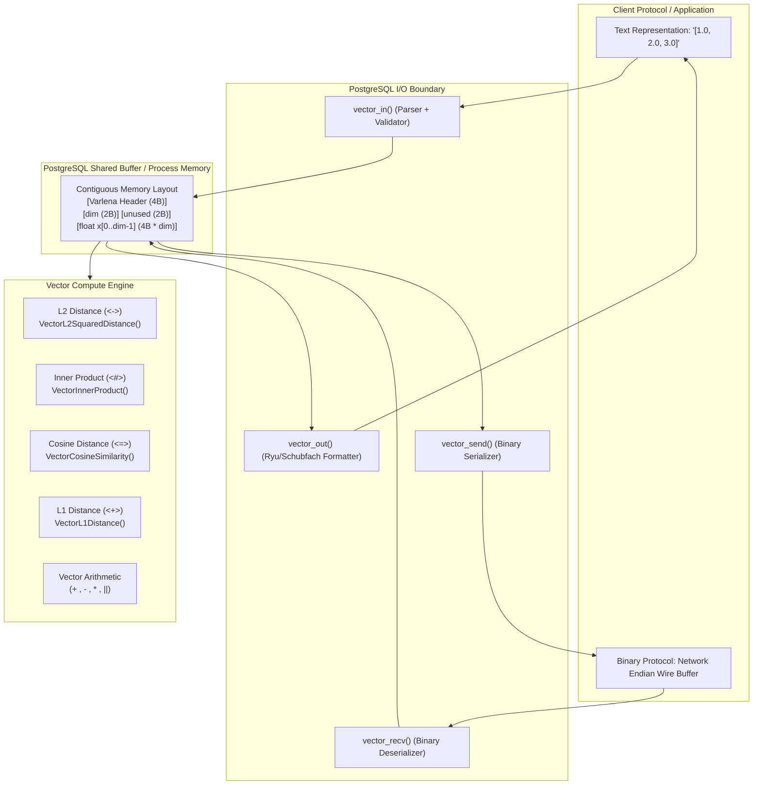
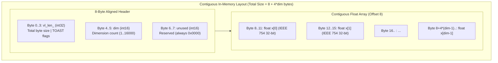
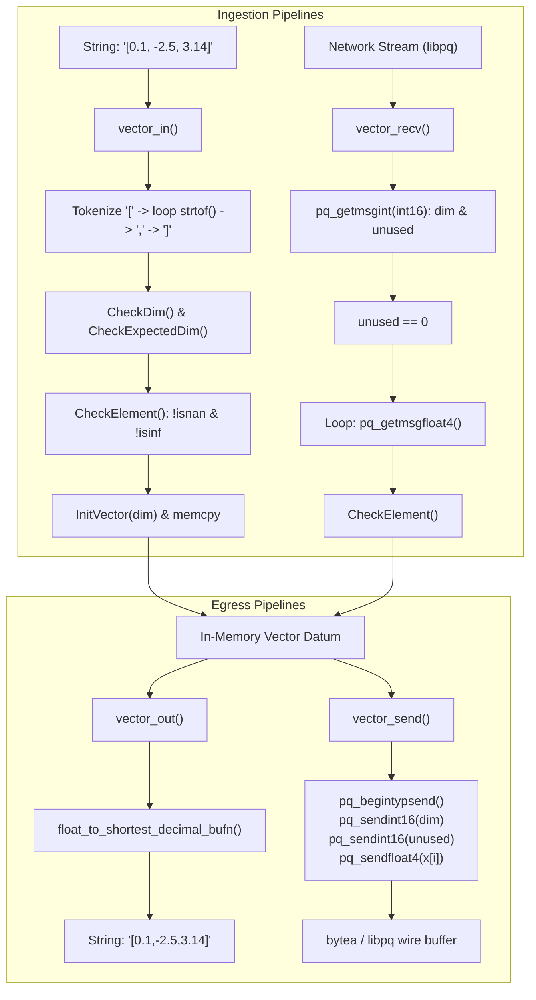
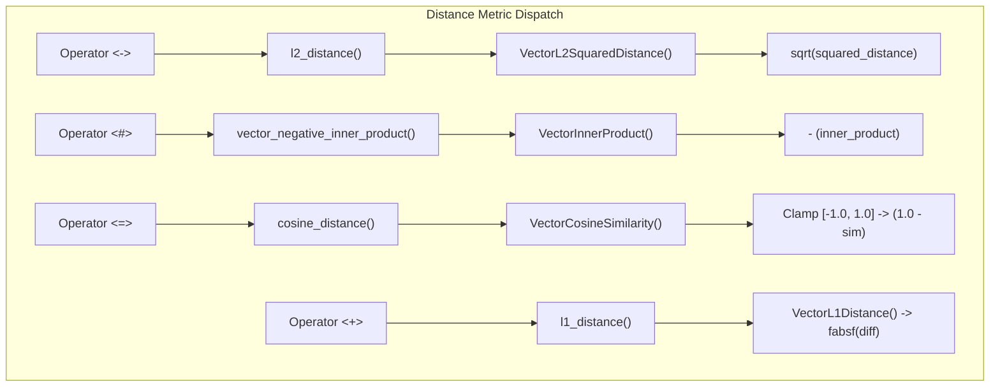
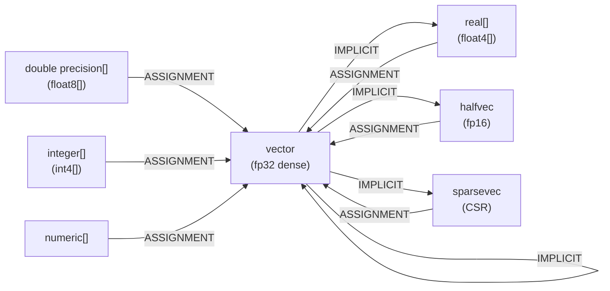
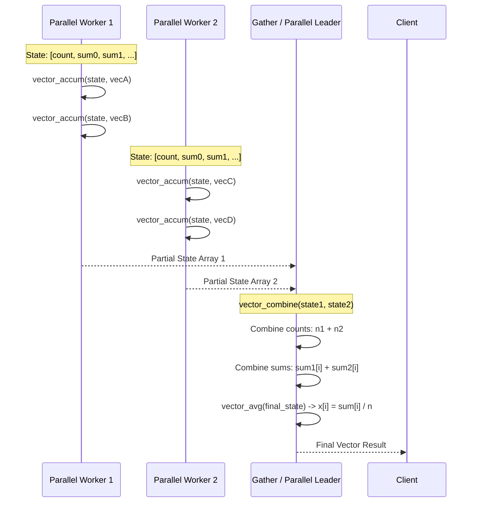

# Core Type Architecture: `vector` (Single-Precision Dense Float Vector)

> **Target Codebase:** `pgvector`  
> **Source Files Analyzed:**  
> - [`src/vector.h`](file:///mnt/Data/Coding/arkivector/pgvector/src/vector.h)  
> - [`src/vector.c`](file:///mnt/Data/Coding/arkivector/pgvector/src/vector.c)  
> - [`sql/vector.sql`](file:///mnt/Data/Coding/arkivector/pgvector/sql/vector.sql)  
> **Target Audience:** Systems Engineers, Database Kernel Developers, Vector Search Architects

---

## Table of Contents

1. [Executive Summary & Architectural Overview](#1-executive-summary--architectural-overview)
2. [Data Structures & C Type Definitions](#2-data-structures--c-type-definitions)
3. [Memory Layout & Binary Wire Representation](#3-memory-layout--binary-wire-representation)
4. [Input / Output Engine & Serialization Pipeline](#4-input--output-engine--serialization-pipeline)
5. [Dimension Limits, Constraints & Typmod Framework](#5-dimension-limits-constraints--typmod-framework)
6. [Hardware Acceleration, SIMD & Target-Clones Strategy](#6-hardware-acceleration-simd--target-clones-strategy)
7. [Distance Metrics & Similarity Functions (Comprehensive Mathematical & C Analysis)](#7-distance-metrics--similarity-functions)
8. [Vector Arithmetic, Linear Algebra & Geometric Utilities](#8-vector-arithmetic-linear-algebra--geometric-utilities)
9. [Operator Overloading & PostgreSQL System Catalog Registration](#9-operator-overloading--postgresql-system-catalog-registration)
10. [Cross-Type Casting Architecture & Conversions](#10-cross-type-casting-architecture--conversions)
11. [Parallel-Safe Aggregate Functions (`avg` & `sum`)](#11-parallel-safe-aggregate-functions-avg--sum)
12. [PostgreSQL Extension Plumbing & Module Lifecycle](#12-postgresql-extension-plumbing--module-lifecycle)
13. [Architectural Insights & Lessons for Vector Engine Builders](#13-architectural-insights--lessons-for-vector-engine-builders)

---

## 1. Executive Summary & Architectural Overview

The `vector` type in `pgvector` represents a dense, single-precision (IEEE 754 32-bit floating-point) fixed- or variable-length array designed specifically for high-performance vector search in PostgreSQL. Unlike PostgreSQL's native `ARRAY` type (`float4[]`), which incurs substantial overhead due to multi-dimensional descriptors, null bitmaps, slice bookkeeping, and pointer indirection, `vector` is engineered as a zero-overhead, contiguous, cache-line-friendly C struct.



### Key Architectural Pillars

1. **Flat Memory Layout:** Employs a standard 4-byte PostgreSQL `varlena` header, followed by a 2-byte dimension counter, a 2-byte zeroed padding field (total 8-byte header), and a contiguous flexible array member of 32-bit floats.
2. **Deterministic 8-Byte Alignment:** The 8-byte header naturally aligns the subsequent `float` array to an 8-byte boundary, guaranteeing 32-bit float alignment and optimal alignment for 64-bit and SIMD memory accesses.
3. **Storage Strategy (`STORAGE = external`):** Bypasses PostgreSQL's standard compression engines (PGLZ / LZ4). Compression of high-entropy floating-point embeddings achieves minimal compression while introducing severe decompression latency during index and sequential scans. However, out-of-line TOAST storage is retained for vectors exceeding page thresholds.
4. **Auto-Vectorization & Target Clones:** Utilizes GCC/Clang `__attribute__((target_clones("default", "fma")))` to generate runtime-dispatched multi-versioned SIMD paths using GNU indirect functions (IFUNC) without requiring manual assembly.
5. **Rigorous Numeric Sanitation:** Zero tolerance for non-finite values (`NaN`, `+Inf`, `-Inf`). Every ingestion and arithmetic step enforces strict numeric integrity to protect index tree and graph topologies.

---

## 2. Data Structures & C Type Definitions

The core type declarations are located in [`src/vector.h`](file:///mnt/Data/Coding/arkivector/pgvector/src/vector.h).

```c
#ifndef VECTOR_H
#define VECTOR_H

#include "fmgr.h"
#include "utils/palloc.h"

#if PG_VERSION_NUM < 190000
#include "storage/shmem.h"		/* for add_size()/mul_size() in some versions */
#endif

#define VECTOR_MAX_DIM 16000

#define VECTOR_SIZE(_dim)		add_size(offsetof(Vector, x), mul_size(sizeof(float), _dim))
#define DatumGetVector(x)		((Vector *) PG_DETOAST_DATUM(x))
#define PG_GETARG_VECTOR_P(x)	DatumGetVector(PG_GETARG_DATUM(x))
#define PG_RETURN_VECTOR_P(x)	PG_RETURN_POINTER(x)

typedef struct Vector
{
	int32		vl_len_;		/* varlena header (do not touch directly!) */
	int16		dim;			/* number of dimensions */
	int16		unused;			/* reserved for future use, always zero */
	float		x[FLEXIBLE_ARRAY_MEMBER];
}			Vector;

Vector	   *InitVector(int dim);

#if PG_VERSION_NUM >= 160000
#define FUNCTION_PREFIX
#else
#define FUNCTION_PREFIX PGDLLEXPORT
#endif

#endif
```

### Detailed Struct Field Analysis

#### `int32 vl_len_`
- **Standard Varlena Header:** PostgreSQL's universal variable-length data header.
- **Internal Bit Packing:** In PostgreSQL disk tuples, `vl_len_` is a union that encodes whether the datum is stored in-line 1-byte header (`varattrib_1b`, for data up to 126 bytes), 4-byte uncompressed header, 4-byte compressed header, or an out-of-line TOAST pointer.
- **Direct Access Prohibition:** The comment `/* varlena header (do not touch directly!) */` signifies that developers must never read or mutate this field directly. Instead, macros like `VARSIZE(ptr)`, `SET_VARSIZE(ptr, len)`, and `VARHDRSZ` must be used.
- **Detoasting Guarantees:** Through the macro `DatumGetVector(x)` (`((Vector *) PG_DETOAST_DATUM(x))`), PostgreSQL detoasts any 1-byte, compressed, or out-of-line datum into a standard 4-byte uncompressed in-memory varlena before any vector function executes.

#### `int16 dim`
- **Vector Dimensionality:** The logical number of elements in the vector.
- **Range:** Constrained strictly between $1 \le \text{dim} \le 16,000$ (defined by `VECTOR_MAX_DIM`).
- **Storage Economy:** Uses an unsigned/signed 16-bit integer (2 bytes), saving 2 bytes over an `int32`.

#### `int16 unused`
- **Architectural Padding & Future Compatibility:** A 2-byte reserved field, strictly initialized to `0` and verified during wire deserialization (`vector_recv`).
- **Memory Alignment Role:** By placing an `int16` after `int16 dim`, the total header size becomes:
  $$\text{sizeof}(\text{int32}) + \text{sizeof}(\text{int16}) + \text{sizeof}(\text{int16}) = 4 + 2 + 2 = 8 \text{ bytes}$$
  This guarantees that the flexible array member `float x[]` begins at byte offset 8 (`offsetof(Vector, x) == 8`). On 64-bit architectures, this aligns the floating-point array with 8-byte word boundaries, eliminating unaligned memory access penalties when loading 64-bit vector registers or double-words.

#### `float x[FLEXIBLE_ARRAY_MEMBER]`
- **Payload Array:** Contiguous array of single-precision IEEE 754 floats (`float`, 4 bytes each).
- **C99 Flexible Array Member:** Zero additional struct padding. The elements follow immediately in contiguous memory.

---

## 3. Memory Layout & Binary Wire Representation

### In-Memory PostgreSQL Layout

The in-memory footprint of a `Vector` instance is calculated by `VECTOR_SIZE(_dim)`:
$$\text{Allocated Bytes} = 8 + (4 \times \text{dim})$$



### Concrete Layout Dimensions for Standard Embeddings

| Model / Use-Case | Dimensions (`dim`) | Header (Bytes) | Float Array (Bytes) | Total On-Disk / In-Memory (Bytes) |
|---|---|---|---|---|
| Tiny / Test Vector | 3 | 8 | 12 | 20 |
| All-MiniLM-L6-v2 | 384 | 8 | 1,536 | 1,544 |
| Cohere Embed / Nomic | 768 | 8 | 3,072 | 3,080 |
| OpenAI `text-embedding-3-small` | 1,536 | 8 | 6,144 | 6,152 |
| OpenAI `text-embedding-3-large` | 3,072 | 8 | 12,288 | 12,296 (Triggers TOAST) |
| Maximum Allowed (`VECTOR_MAX_DIM`) | 16,000 | 8 | 64,000 | 64,008 (Triggers TOAST) |

### Memory Allocation: `InitVector`

Memory instantiation is handled by `InitVector` in [`src/vector.c`](file:///mnt/Data/Coding/arkivector/pgvector/src/vector.c#L128-L140):

```c
Vector *
InitVector(int dim)
{
	Vector	   *result;
	Size		size;

	size = VECTOR_SIZE(dim);
	result = (Vector *) palloc0(size);
	SET_VARSIZE(result, size);
	result->dim = dim;

	return result;
}
```

1. **Overflow-Checked Size Arithmetic:** `VECTOR_SIZE` relies on PostgreSQL's `add_size` and `mul_size`. If $(4 \times \text{dim})$ overflows `Size` (`size_t`), PostgreSQL aborts with an overflow error.
2. **Zero-Initialization (`palloc0`):** `palloc0` allocates from PostgreSQL's current `MemoryContext` and zeroes every byte. This ensures:
   - `unused` is explicitly `0x0000`.
   - Any floating-point fields not immediately written are `+0.0f` (`0x00000000` in IEEE 754).
3. **Varlena Size Registration:** `SET_VARSIZE` writes the full size ($8 + 4d$) into `vl_len_`.

---

## 4. Input / Output Engine & Serialization Pipeline

PostgreSQL requires four fundamental I/O subroutines for any complete base type:
- `vector_in`: Parses human-readable C-string literals into the in-memory binary `Vector`.
- `vector_out`: Formats an in-memory `Vector` into a human-readable C-string.
- `vector_recv`: Deserializes network-endian binary buffers from the PostgreSQL wire protocol (`libpq`).
- `vector_send`: Serializes an in-memory `Vector` into a network-endian byte buffer.



### 4.1. Text Parser: `vector_in`

The text ingestion parser in [`src/vector.c`](file:///mnt/Data/Coding/arkivector/pgvector/src/vector.c#L177-L281) parses string literals matching the grammar:
$$\text{Vector} \Coloneqq \text{Whitespace}^* \text{'['} \text{Whitespace}^* \text{Float} (\text{Whitespace}^* \text{','} \text{Whitespace}^* \text{Float})^* \text{Whitespace}^* \text{']'} \text{Whitespace}^*$$

```c
FUNCTION_PREFIX PG_FUNCTION_INFO_V1(vector_in);
Datum
vector_in(PG_FUNCTION_ARGS)
{
	char	   *lit = PG_GETARG_CSTRING(0);
	int32		typmod = PG_GETARG_INT32(2);
	float		x[VECTOR_MAX_DIM];
	int			dim = 0;
	char	   *pt = lit;
	Vector	   *result;

	while (vector_isspace(*pt))
		pt++;

	if (*pt != '[')
		ereport(ERROR,
				(errcode(ERRCODE_INVALID_TEXT_REPRESENTATION),
				 errmsg("invalid input syntax for type vector: \"%s\"", lit),
				 errdetail("Vector contents must start with \"[\".")));

	pt++;

	while (vector_isspace(*pt))
		pt++;

	if (*pt == ']')
		ereport(ERROR,
				(errcode(ERRCODE_DATA_EXCEPTION),
				 errmsg("vector must have at least 1 dimension")));

	for (;;)
	{
		float		val;
		char	   *stringEnd;

		if (dim == VECTOR_MAX_DIM)
			ereport(ERROR,
					(errcode(ERRCODE_PROGRAM_LIMIT_EXCEEDED),
					 errmsg("vector cannot have more than %d dimensions", VECTOR_MAX_DIM)));

		while (vector_isspace(*pt))
			pt++;

		if (*pt == '\0')
			ereport(ERROR,
					(errcode(ERRCODE_INVALID_TEXT_REPRESENTATION),
					 errmsg("invalid input syntax for type vector: \"%s\"", lit)));

		errno = 0;
		val = strtof(pt, &stringEnd);

		if (stringEnd == pt)
			ereport(ERROR,
					(errcode(ERRCODE_INVALID_TEXT_REPRESENTATION),
					 errmsg("invalid input syntax for type vector: \"%s\"", lit)));

		if (errno == ERANGE && isinf(val))
			ereport(ERROR,
					(errcode(ERRCODE_NUMERIC_VALUE_OUT_OF_RANGE),
					 errmsg("\"%s\" is out of range for type vector", pnstrdup(pt, stringEnd - pt))));

		CheckElement(val);
		x[dim++] = val;

		pt = stringEnd;

		while (vector_isspace(*pt))
			pt++;

		if (*pt == ',')
			pt++;
		else if (*pt == ']')
		{
			pt++;
			break;
		}
		else
			ereport(ERROR,
					(errcode(ERRCODE_INVALID_TEXT_REPRESENTATION),
					 errmsg("invalid input syntax for type vector: \"%s\"", lit)));
	}

	while (vector_isspace(*pt))
		pt++;

	if (*pt != '\0')
		ereport(ERROR,
				(errcode(ERRCODE_INVALID_TEXT_REPRESENTATION),
				 errmsg("invalid input syntax for type vector: \"%s\"", lit),
				 errdetail("Junk after closing right brace.")));

	CheckDim(dim);
	CheckExpectedDim(typmod, dim);

	result = InitVector(dim);
	for (int i = 0; i < dim; i++)
		result->x[i] = x[i];

	PG_RETURN_POINTER(result);
}
```

#### Step-by-Step Validation & Design Decisions

1. **Stack Staging Buffer:** A local stack array `float x[VECTOR_MAX_DIM]` ($16,000 \times 4 = 64\text{ KB}$) buffers dimensions during parsing. This eliminates reallocations (`repalloc`) while parsing tokens.
2. **Double-Rounding Prevention via `strtof()`:** The parser uses `strtof()` directly rather than `strtod()` followed by a cast to `float`. Casting a `double` to `float` introduces potential double-rounding anomalies where rounding to 64-bit float and then to 32-bit float changes the least-significant bit.
3. **Locale Independence:** PostgreSQL forces `LC_NUMERIC` to `"C"` on startup. Hence, `.` is always the decimal point, regardless of system locale.
4. **Strict Range Checks:** Checks `errno == ERANGE && isinf(val)` to throw `ERRCODE_NUMERIC_VALUE_OUT_OF_RANGE`.
5. **No Trailing Garbage:** Explicitly ensures only whitespace exists between `]` and string termination `\0`. Any trailing characters throw an error with `errdetail("Junk after closing right brace.")`.
6. **Typmod Verification:** After dimension parsing completes, it validates against the column's defined typmod via `CheckExpectedDim(typmod, dim)`.

### 4.2. Text Formatter: `vector_out`

`vector_out` converts the vector to its canonical text representation:

```c
#define AppendChar(ptr, c) (*(ptr)++ = (c))
#define AppendFloat(ptr, f) ((ptr) += float_to_shortest_decimal_bufn((f), (ptr)))

FUNCTION_PREFIX PG_FUNCTION_INFO_V1(vector_out);
Datum
vector_out(PG_FUNCTION_ARGS)
{
	Vector	   *vector = PG_GETARG_VECTOR_P(0);
	int			dim = vector->dim;
	char	   *buf;
	char	   *ptr;

	buf = (char *) palloc(add_size(mul_size(FLOAT_SHORTEST_DECIMAL_LEN, dim), 3));
	ptr = buf;

	AppendChar(ptr, '[');

	for (int i = 0; i < dim; i++)
	{
		if (i > 0)
			AppendChar(ptr, ',');

		AppendFloat(ptr, vector->x[i]);
	}

	AppendChar(ptr, ']');
	*ptr = '\0';

	PG_FREE_IF_COPY(vector, 0);
	PG_RETURN_CSTRING(buf);
}
```

#### Memory Exactness & Schubfach Algorithm
- **Exact Buffer Calculation:**
  $$\text{Allocation} = (\text{dim} \times \text{FLOAT\_SHORTEST\_DECIMAL\_LEN}) + 3$$
  Where `FLOAT_SHORTEST_DECIMAL_LEN` (typically 16 bytes for 32-bit floats) guarantees sufficient space for the shortest round-trip decimal representation, plus 1 byte for `[`, 1 byte for `]`, and 1 byte for `\0`.
- **Ryu / Schubfach Algorithm:** `float_to_shortest_decimal_bufn` uses PostgreSQL's implementation of modern shortest decimal conversion algorithms (Schubfach/Ryu). This generates the shortest decimal string that rounds back to the exact same IEEE 754 float under `strtof()`, without trailing zeroes or precision corruption.

### 4.3. Binary Wire Serialization: `vector_recv` and `vector_send`

The binary protocol is critical for high-throughput client drivers (`pgvector-python`, `asyncpg`, `pgx`, `jdbc`).

```c
FUNCTION_PREFIX PG_FUNCTION_INFO_V1(vector_recv);
Datum
vector_recv(PG_FUNCTION_ARGS)
{
	StringInfo	buf = (StringInfo) PG_GETARG_POINTER(0);
	int32		typmod = PG_GETARG_INT32(2);
	Vector	   *result;
	int16		dim;
	int16		unused;

	dim = pq_getmsgint(buf, sizeof(int16));
	unused = pq_getmsgint(buf, sizeof(int16));

	CheckDim(dim);
	CheckExpectedDim(typmod, dim);

	if (unused != 0)
		ereport(ERROR,
				(errcode(ERRCODE_DATA_EXCEPTION),
				 errmsg("expected unused to be 0, not %d", unused)));

	result = InitVector(dim);
	for (int i = 0; i < dim; i++)
	{
		result->x[i] = pq_getmsgfloat4(buf);
		CheckElement(result->x[i]);
	}

	PG_RETURN_POINTER(result);
}

FUNCTION_PREFIX PG_FUNCTION_INFO_V1(vector_send);
Datum
vector_send(PG_FUNCTION_ARGS)
{
	Vector	   *vec = PG_GETARG_VECTOR_P(0);
	StringInfoData buf;

	pq_begintypsend(&buf);
	pq_sendint16(&buf, vec->dim);
	pq_sendint16(&buf, vec->unused);
	for (int i = 0; i < vec->dim; i++)
		pq_sendfloat4(&buf, vec->x[i]);

	PG_RETURN_BYTEA_P(pq_endtypsend(&buf));
}
```

#### Wire Protocol Frame Structure

The wire format emitted by `vector_send` and parsed by `vector_recv` is completely platform-independent (big-endian / network byte order):

```
+--------------------+--------------------+-------------------------------------------+
| Field              | Data Type          | Description                               |
+--------------------+--------------------+-------------------------------------------+
| dim                | uint16 / int16 (2B)| Big-endian dimension count (1..16000)     |
| unused             | uint16 / int16 (2B)| Big-endian reserved flag (must be 0)      |
| x[0]               | float32 (4B)       | IEEE 754 float in network byte order      |
| x[1]               | float32 (4B)       | IEEE 754 float in network byte order      |
| ...                | ...                | ...                                       |
| x[dim-1]           | float32 (4B)       | IEEE 754 float in network byte order      |
+--------------------+--------------------+-------------------------------------------+
```

Total wire payload size: $4 + (4 \times \text{dim})$ bytes.

---

## 5. Dimension Limits, Constraints & Typmod Framework

### 5.1. Maximum Dimension Ceiling (`VECTOR_MAX_DIM = 16000`)

In [`src/vector.h`](file:///mnt/Data/Coding/arkivector/pgvector/src/vector.h#L11), `pgvector` establishes:
```c
#define VECTOR_MAX_DIM 16000
```

#### Why 16,000 Dimensions?
1. **Historical Evolution:** In earlier versions (pre-0.5.0), `pgvector` had a 1,024-dimension cap for IVFFlat. Version 0.5.0 increased the type ceiling to 16,000 dimensions to support modern high-dimensional dense embeddings (such as multi-modal representations and text models like Voyage and BM25 dense representations).
2. **Stack Allocation Safety:** In `vector_in`, staging uses `float x[VECTOR_MAX_DIM]`. At 16,000 floats, this occupies $16,000 \times 4 = 64\text{ KB}$ on the C call stack. In PostgreSQL backends (which typically have a 2MB or 8MB stack limit via `max_stack_depth`), a 64 KB stack frame is safe from stack overflow while avoiding dynamic heap allocations.
3. **Index Tuple Size Constraints vs. Heap Storage:**
   - **Heap Tuple Storage:** A 16,000-dimension vector is $64,008$ bytes, which easily fits into PostgreSQL tables via out-of-line TOAST tables (up to 1 GB).
   - **Index Tuple Limits:** HNSW and IVFFlat index tuples cannot span multiple pages. In standard PostgreSQL, table pages are $8\text{ KB}$ (`BLCKSZ = 8192`). PostgreSQL's B-tree and custom AMs restrict single index tuples to roughly $1/3$ page size ($\approx 2,712$ bytes). Therefore:
     - For **HNSW** and **IVFFlat** indexes, dense `vector` columns are capped at **2,000 dimensions** ($8 + 4 \times 2000 = 8008$ bytes, which with index overhead requires compression or index-specific limits). In pgvector, HNSW and IVFFlat reject indexes on `vector` columns with $\text{dim} > 2000$.
     - For columns requiring up to 16,000 dimensions, users must perform sequential scans or use `halfvec` (up to 4,000 indexed dimensions) or dimensionality reduction.

### 5.2. Typmod Enforcement Mechanism

PostgreSQL columns can be defined with dimension modifiers, such as `vector(1536)`:

```c
FUNCTION_PREFIX PG_FUNCTION_INFO_V1(vector_typmod_in);
Datum
vector_typmod_in(PG_FUNCTION_ARGS)
{
	ArrayType  *ta = PG_GETARG_ARRAYTYPE_P(0);
	int32	   *tl;
	int			n;

	tl = ArrayGetIntegerTypmods(ta, &n);

	if (n != 1)
		ereport(ERROR,
				(errcode(ERRCODE_INVALID_PARAMETER_VALUE),
				 errmsg("invalid type modifier")));

	if (*tl < 1)
		ereport(ERROR,
				(errcode(ERRCODE_INVALID_PARAMETER_VALUE),
				 errmsg("dimensions for type vector must be at least 1")));

	if (*tl > VECTOR_MAX_DIM)
		ereport(ERROR,
				(errcode(ERRCODE_INVALID_PARAMETER_VALUE),
				 errmsg("dimensions for type vector cannot exceed %d", VECTOR_MAX_DIM)));

	PG_RETURN_INT32(*tl);
}
```

When an assignment or cast occurs, PostgreSQL invokes the cast function `vector(vector, integer, boolean)`:

```c
FUNCTION_PREFIX PG_FUNCTION_INFO_V1(vector);
Datum
vector(PG_FUNCTION_ARGS)
{
	Vector	   *vec = PG_GETARG_VECTOR_P(0);
	int32		typmod = PG_GETARG_INT32(1);

	CheckExpectedDim(typmod, vec->dim);

	PG_RETURN_POINTER(vec);
}
```

If a user inserts a 512-dimension vector into a `vector(1536)` column, `CheckExpectedDim` triggers:
```
ERROR: expected 1536 dimensions, not 512
SQLSTATE: 22000 (ERRCODE_DATA_EXCEPTION)
```

---

## 6. Hardware Acceleration, SIMD & Target-Clones Strategy

Vector similarity search is predominantly bound by floating-point arithmetic throughput and memory bandwidth.

### The `target_clones` Multi-Version Compilation Strategy

In [`src/vector.c`](file:///mnt/Data/Coding/arkivector/pgvector/src/vector.c#L42-L46):

```c
#if defined(USE_TARGET_CLONES) && !defined(__FMA__)
#define VECTOR_TARGET_CLONES __attribute__((target_clones("default", "fma")))
#else
#define VECTOR_TARGET_CLONES
#endif
```

#### How It Operates

1. **Compiler Function Multi-Versioning (FMV):** When `__attribute__((target_clones("default", "fma")))` decorates a function, GCC / Clang compiles two complete versions of the machine code:
   - `default`: Baseline x86-64 SSE2 instructions (guaranteed to execute on all 64-bit x86 CPUs).
   - `fma`: Specialized version emitting AVX2 and Fused Multiply-Add (FMA3) instructions (`vfmadd213ps` / `vfmadd231ps`).
2. **Dynamic Resolver (GNU IFUNC):** The compiler generates an IFUNC resolver routine. Upon the very first function call in a backend process, the ELF loader checks CPUID capability bits. If the CPU supports FMA/AVX2, it resolves the function pointer directly to the `fma` clone; otherwise, it links to `default`.
3. **Zero Runtime Overhead:** Subsequent invocations call the target-specific clone directly without branch penalties.
4. **Auto-Vectorization Without Assembly Fragility:** By writing clean, stride-1 loops:
   ```c
   /* Auto-vectorized */
   for (int i = 0; i < dim; i++)
       distance += ax[i] * bx[i];
   ```
   The compiler's vectorizer unrolls the loop into 256-bit wide AVX registers processing 8 single-precision floats per instruction cycle with FMA:
   $$\text{acc} = (\text{vec}_a \times \text{vec}_b) + \text{acc}$$

---

## 7. Distance Metrics & Similarity Functions

`pgvector` provides five core distance / similarity primitives for dense float vectors:
1. **L2 Distance (Euclidean)**: `<->`
2. **Squared L2 Distance**: Index-internal metric
3. **Inner Product (Negative Inner Product)**: `<#>`
4. **Cosine Distance**: `<=>`
5. **L1 Distance (Manhattan / Taxicab)**: `<+>`
6. **Spherical Distance**: Angular distance on unit vectors for spherical k-means



---

### 7.1. L2 Distance (Euclidean Distance) & Squared L2 Distance

#### Mathematical Definition
For vectors $\mathbf{a}, \mathbf{b} \in \mathbb{R}^d$:
$$D_{L2}(\mathbf{a}, \mathbf{b}) = \|\mathbf{a} - \mathbf{b}\|_2 = \sqrt{\sum_{i=0}^{d-1} (a_i - b_i)^2}$$
$$\text{Squared } D_{L2}(\mathbf{a}, \mathbf{b}) = \sum_{i=0}^{d-1} (a_i - b_i)^2$$

#### C Implementation

```c
VECTOR_TARGET_CLONES static float
VectorL2SquaredDistance(int dim, float *ax, float *bx)
{
	float		distance = 0.0;

	/* Auto-vectorized */
	for (int i = 0; i < dim; i++)
	{
		float		diff = ax[i] - bx[i];

		distance += diff * diff;
	}

	return distance;
}

FUNCTION_PREFIX PG_FUNCTION_INFO_V1(l2_distance);
Datum
l2_distance(PG_FUNCTION_ARGS)
{
	Vector	   *a = PG_GETARG_VECTOR_P(0);
	Vector	   *b = PG_GETARG_VECTOR_P(1);

	CheckDims(a, b);

	PG_RETURN_FLOAT8(sqrt((double) VectorL2SquaredDistance(a->dim, a->x, b->x)));
}

FUNCTION_PREFIX PG_FUNCTION_INFO_V1(vector_l2_squared_distance);
Datum
vector_l2_squared_distance(PG_FUNCTION_ARGS)
{
	Vector	   *a = PG_GETARG_VECTOR_P(0);
	Vector	   *b = PG_GETARG_VECTOR_P(1);

	CheckDims(a, b);

	PG_RETURN_FLOAT8((double) VectorL2SquaredDistance(a->dim, a->x, b->x));
}
```

#### Performance Characteristics & Index Optimization
- **Square Root Elision in Indexes:** Computing $\sqrt{x}$ is monotonic. For any $u, v \ge 0$, $u < v \iff \sqrt{u} < \sqrt{v}$. Therefore, nearest neighbors ranked by $D_{L2}^2$ are identical to those ranked by $D_{L2}$.
- Both HNSW and IVFFlat index operators bind `vector_l2_squared_distance` directly as their ordering function, bypassing expensive CPU square root instructions across millions of candidate comparisons.
- `l2_distance` is reserved for explicit SQL queries where the true Euclidean metric is returned to the client.

---

### 7.2. Inner Product & Negative Inner Product

#### Mathematical Definition
$$\langle \mathbf{a}, \mathbf{b} \rangle = \sum_{i=0}^{d-1} a_i \cdot b_i$$

#### C Implementation

```c
VECTOR_TARGET_CLONES static float
VectorInnerProduct(int dim, float *ax, float *bx)
{
	float		distance = 0.0;

	/* Auto-vectorized */
	for (int i = 0; i < dim; i++)
		distance += ax[i] * bx[i];

	return distance;
}

FUNCTION_PREFIX PG_FUNCTION_INFO_V1(inner_product);
Datum
inner_product(PG_FUNCTION_ARGS)
{
	Vector	   *a = PG_GETARG_VECTOR_P(0);
	Vector	   *b = PG_GETARG_VECTOR_P(1);

	CheckDims(a, b);

	PG_RETURN_FLOAT8((double) VectorInnerProduct(a->dim, a->x, b->x));
}

FUNCTION_PREFIX PG_FUNCTION_INFO_V1(vector_negative_inner_product);
Datum
vector_negative_inner_product(PG_FUNCTION_ARGS)
{
	Vector	   *a = PG_GETARG_VECTOR_P(0);
	Vector	   *b = PG_GETARG_VECTOR_P(1);

	CheckDims(a, b);

	PG_RETURN_FLOAT8((double) -VectorInnerProduct(a->dim, a->x, b->x));
}
```

#### Why Negative Inner Product (`<#>`)?
PostgreSQL index access methods (B-tree, GiST, GIN, HNSW, IVFFlat) require distance metrics for `ORDER BY ... ASC` nearest-neighbor scans where smaller values represent closer elements.
- Higher inner product means higher similarity.
- To sort nearest neighbors in ascending order without modifying PostgreSQL's index scan core, `pgvector` negates the inner product:
  $$D_{\text{index}}(\mathbf{a}, \mathbf{b}) = - \langle \mathbf{a}, \mathbf{b} \rangle$$
- Minimizing $- \langle \mathbf{a}, \mathbf{b} \rangle$ maximizes $\langle \mathbf{a}, \mathbf{b} \rangle$.

---

### 7.3. Cosine Distance & Cosine Similarity

#### Mathematical Definition
$$\text{Cosine Similarity}(\mathbf{a}, \mathbf{b}) = \frac{\mathbf{a} \cdot \mathbf{b}}{\|\mathbf{a}\|_2 \|\mathbf{b}\|_2} = \frac{\sum_{i=0}^{d-1} a_i b_i}{\sqrt{\sum_{i=0}^{d-1} a_i^2} \sqrt{\sum_{i=0}^{d-1} b_i^2}}$$
$$D_{\text{cosine}}(\mathbf{a}, \mathbf{b}) = 1.0 - \text{Cosine Similarity}(\mathbf{a}, \mathbf{b})$$

#### C Implementation

```c
VECTOR_TARGET_CLONES static double
VectorCosineSimilarity(int dim, float *ax, float *bx)
{
	float		similarity = 0.0;
	float		norma = 0.0;
	float		normb = 0.0;

	/* Auto-vectorized */
	for (int i = 0; i < dim; i++)
	{
		similarity += ax[i] * bx[i];
		norma += ax[i] * ax[i];
		normb += bx[i] * bx[i];
	}

	/* Use sqrt(a * b) over sqrt(a) * sqrt(b) */
	return (double) similarity / sqrt((double) norma * (double) normb);
}

FUNCTION_PREFIX PG_FUNCTION_INFO_V1(cosine_distance);
Datum
cosine_distance(PG_FUNCTION_ARGS)
{
	Vector	   *a = PG_GETARG_VECTOR_P(0);
	Vector	   *b = PG_GETARG_VECTOR_P(1);
	double		similarity;

	CheckDims(a, b);

	similarity = VectorCosineSimilarity(a->dim, a->x, b->x);

#ifdef _MSC_VER
	/* /fp:fast may not propagate NaN */
	if (isnan(similarity))
		PG_RETURN_FLOAT8(NAN);
#endif

	/* Keep in range */
	if (similarity > 1)
		similarity = 1.0;
	else if (similarity < -1)
		similarity = -1.0;

	PG_RETURN_FLOAT8(1.0 - similarity);
}
```

#### Critical Optimizations & Numerical Guards
1. **Single Square Root Optimization:**  
   Notice line 653:
   ```c
   /* Use sqrt(a * b) over sqrt(a) * sqrt(b) */
   return (double) similarity / sqrt((double) norma * (double) normb);
   ```
   Computing $\sqrt{\|\mathbf{a}\|^2 \cdot \|\mathbf{b}\|^2}$ replaces two double-precision square root operations with a single multiplication and one square root.
2. **Single-Pass Loop:** The dot product and both L2 norms are accumulated in a single pass over memory, maximizing L1 cache locality.
3. **Precision Clamping:** In finite-precision floating-point arithmetic, identical vectors can yield $\text{similarity} = 1.00000005$, producing negative distances (e.g. $-5 \times 10^{-8}$). `pgvector` enforces:
   ```c
   if (similarity > 1) similarity = 1.0;
   else if (similarity < -1) similarity = -1.0;
   ```
   This guarantees that $D_{\text{cosine}} \in [0.0, 2.0]$.

---

### 7.4. L1 Distance (Manhattan / Taxicab Distance)

#### Mathematical Definition
$$D_{L1}(\mathbf{a}, \mathbf{b}) = \|\mathbf{a} - \mathbf{b}\|_1 = \sum_{i=0}^{d-1} |a_i - b_i|$$

#### C Implementation

```c
VECTOR_TARGET_CLONES static float
VectorL1Distance(int dim, float *ax, float *bx)
{
	float		distance = 0.0;

	/* Auto-vectorized */
	for (int i = 0; i < dim; i++)
		distance += fabsf(ax[i] - bx[i]);

	return distance;
}

FUNCTION_PREFIX PG_FUNCTION_INFO_V1(l1_distance);
Datum
l1_distance(PG_FUNCTION_ARGS)
{
	Vector	   *a = PG_GETARG_VECTOR_P(0);
	Vector	   *b = PG_GETARG_VECTOR_P(1);

	CheckDims(a, b);

	PG_RETURN_FLOAT8((double) VectorL1Distance(a->dim, a->x, b->x));
}
```

#### Performance Characteristics
- Uses `fabsf()` which compilers auto-vectorize via bitwise masking on IEEE 754 floats (clearing the sign bit with `vandps` on AVX/SSE).
- Does not require FMA units, making it extremely fast on integer/embedded pipelines.

---

### 7.5. Spherical Distance (Angular Distance)

Used by IVFFlat during spherical k-means clustering when building indexes for cosine distance:

```c
FUNCTION_PREFIX PG_FUNCTION_INFO_V1(vector_spherical_distance);
Datum
vector_spherical_distance(PG_FUNCTION_ARGS)
{
	Vector	   *a = PG_GETARG_VECTOR_P(0);
	Vector	   *b = PG_GETARG_VECTOR_P(1);
	double		distance;

	CheckDims(a, b);

	distance = (double) VectorInnerProduct(a->dim, a->x, b->x);

	/* Prevent NaN with acos with loss of precision */
	if (distance > 1)
		distance = 1;
	else if (distance < -1)
		distance = -1;

	PG_RETURN_FLOAT8(acos(distance) / M_PI);
}
```

- Assumes inputs are normalized unit vectors ($\|\mathbf{a}\| = \|\mathbf{b}\| = 1$).
- Calculates angular distance normalized to $[0, 1]$:
  $$D_{\text{spherical}}(\mathbf{a}, \mathbf{b}) = \frac{\arccos(\text{clamp}(\mathbf{a} \cdot \mathbf{b}, -1, 1))}{\pi}$$
- **Triangle Inequality:** Unlike raw cosine distance ($1 - \cos \theta$), angular distance satisfies the triangle inequality, which is required for metric space partitioning and convergence during spherical k-means clustering.

---

## 8. Vector Arithmetic, Linear Algebra & Geometric Utilities

`pgvector` implements full element-wise vector spaces and utility transforms.

### 8.1. Element-Wise Addition (`vector_add`, Operator `+`)

```c
FUNCTION_PREFIX PG_FUNCTION_INFO_V1(vector_add);
Datum
vector_add(PG_FUNCTION_ARGS)
{
	Vector	   *a = PG_GETARG_VECTOR_P(0);
	Vector	   *b = PG_GETARG_VECTOR_P(1);
	float	   *ax = a->x;
	float	   *bx = b->x;
	Vector	   *result;
	float	   *rx;

	CheckDims(a, b);

	result = InitVector(a->dim);
	rx = result->x;

	for (int i = 0, imax = a->dim; i < imax; i++)
		rx[i] = ax[i] + bx[i];

	for (int i = 0, imax = a->dim; i < imax; i++)
	{
		if (isinf(rx[i]))
			float_overflow_error();
	}

	PG_RETURN_POINTER(result);
}
```

- **Two-Pass Loop Design:** Computation and overflow checks are separated into two loops. This prevents loop-carried dependencies or branching inside the vector addition loop, enabling the compiler to emit uninhibited vector SIMD instructions for `rx[i] = ax[i] + bx[i]`.
- Enforces PostgreSQL's `float_overflow_error()` if any element overflows to infinity.

### 8.2. Element-Wise Subtraction (`vector_sub`, Operator `-`)

```c
FUNCTION_PREFIX PG_FUNCTION_INFO_V1(vector_sub);
Datum
vector_sub(PG_FUNCTION_ARGS)
{
	Vector	   *a = PG_GETARG_VECTOR_P(0);
	Vector	   *b = PG_GETARG_VECTOR_P(1);
	float	   *ax = a->x;
	float	   *bx = b->x;
	Vector	   *result;
	float	   *rx;

	CheckDims(a, b);

	result = InitVector(a->dim);
	rx = result->x;

	for (int i = 0, imax = a->dim; i < imax; i++)
		rx[i] = ax[i] - bx[i];

	for (int i = 0, imax = a->dim; i < imax; i++)
	{
		if (isinf(rx[i]))
			float_overflow_error();
	}

	PG_RETURN_POINTER(result);
}
```

### 8.3. Element-Wise Hadamard Multiplication (`vector_mul`, Operator `*`)

Computes $r_i = a_i \cdot b_i$:

```c
FUNCTION_PREFIX PG_FUNCTION_INFO_V1(vector_mul);
Datum
vector_mul(PG_FUNCTION_ARGS)
{
	Vector	   *a = PG_GETARG_VECTOR_P(0);
	Vector	   *b = PG_GETARG_VECTOR_P(1);
	float	   *ax = a->x;
	float	   *bx = b->x;
	Vector	   *result;
	float	   *rx;

	CheckDims(a, b);

	result = InitVector(a->dim);
	rx = result->x;

	for (int i = 0, imax = a->dim; i < imax; i++)
		rx[i] = ax[i] * bx[i];

	for (int i = 0, imax = a->dim; i < imax; i++)
	{
		if (isinf(rx[i]))
			float_overflow_error();

		if (rx[i] == 0 && !(ax[i] == 0 || bx[i] == 0))
			float_underflow_error();
	}

	PG_RETURN_POINTER(result);
}
```

- **Underflow Detection:** Checks `rx[i] == 0 && !(ax[i] == 0 || bx[i] == 0)`. If neither operand was zero, but the product flushed to zero (underflow), it raises `float_underflow_error()`.

### 8.4. Vector Concatenation (`vector_concat`, Operator `||`)

```c
FUNCTION_PREFIX PG_FUNCTION_INFO_V1(vector_concat);
Datum
vector_concat(PG_FUNCTION_ARGS)
{
	Vector	   *a = PG_GETARG_VECTOR_P(0);
	Vector	   *b = PG_GETARG_VECTOR_P(1);
	Vector	   *result;
	int			dim = a->dim + b->dim;

	CheckDim(dim);
	result = InitVector(dim);

	for (int i = 0, imax = a->dim; i < imax; i++)
		result->x[i] = a->x[i];

	for (int i = 0, imax = b->dim, start = a->dim; i < imax; i++)
		result->x[i + start] = b->x[i];

	PG_RETURN_POINTER(result);
}
```

- Enforces $\text{dim}_a + \text{dim}_b \le \text{VECTOR\_MAX\_DIM}$ (16,000) via `CheckDim(dim)`.

### 8.5. Euclidean Norm & L2 Normalization (`vector_norm` & `l2_normalize`)

```c
FUNCTION_PREFIX PG_FUNCTION_INFO_V1(vector_norm);
Datum
vector_norm(PG_FUNCTION_ARGS)
{
	Vector	   *a = PG_GETARG_VECTOR_P(0);
	float	   *ax = a->x;
	double		norm = 0.0;

	for (int i = 0; i < a->dim; i++)
		norm += (double) ax[i] * (double) ax[i];

	PG_RETURN_FLOAT8(sqrt(norm));
}

FUNCTION_PREFIX PG_FUNCTION_INFO_V1(l2_normalize);
Datum
l2_normalize(PG_FUNCTION_ARGS)
{
	Vector	   *a = PG_GETARG_VECTOR_P(0);
	float	   *ax = a->x;
	double		norm = 0;
	Vector	   *result;
	float	   *rx;

	result = InitVector(a->dim);
	rx = result->x;

	for (int i = 0; i < a->dim; i++)
		norm += (double) ax[i] * (double) ax[i];

	norm = sqrt(norm);

	if (norm > 0)
	{
		for (int i = 0; i < a->dim; i++)
			rx[i] = ax[i] / norm;

		for (int i = 0; i < a->dim; i++)
		{
			if (isinf(rx[i]))
				float_overflow_error();
		}
	}

	PG_RETURN_POINTER(result);
}
```

- If $\text{norm} == 0$, returns a zeroed vector without divide-by-zero errors.
- Accumulates norm in double precision (`double`) to prevent premature overflow when squaring large float values.

### 8.6. Binary Quantization (`binary_quantize`)

Converts a continuous dense float vector into a compact binary representation (`bit` / `varbit`):

```c
FUNCTION_PREFIX PG_FUNCTION_INFO_V1(binary_quantize);
Datum
binary_quantize(PG_FUNCTION_ARGS)
{
	Vector	   *a = PG_GETARG_VECTOR_P(0);
	float	   *ax = a->x;
	VarBit	   *result = InitBitVector(a->dim);
	unsigned char *rx = VARBITS(result);
	int			i = 0;
	int			count = (a->dim / 8) * 8;

	/* Auto-vectorized */
	for (; i < count; i += 8)
	{
		unsigned char result_byte = 0;

		for (int j = 0; j < 8; j++)
			result_byte |= (ax[i + j] > 0) << (7 - j);

		rx[i / 8] = result_byte;
	}

	for (; i < a->dim; i++)
		rx[i / 8] |= (ax[i] > 0) << (7 - (i % 8));

	PG_RETURN_VARBIT_P(result);
}
```

- Each dimension is mapped to 1 bit: `1` if $x_i > 0$, `0` otherwise.
- Achieves a $32\times$ compression factor (from 32 bits to 1 bit per dimension), enabling Hamming distance index filtering.

### 8.7. Subvector Slicing (`subvector`)

```c
FUNCTION_PREFIX PG_FUNCTION_INFO_V1(subvector);
Datum
subvector(PG_FUNCTION_ARGS)
{
	Vector	   *a = PG_GETARG_VECTOR_P(0);
	int32		start = PG_GETARG_INT32(1);
	int32		count = PG_GETARG_INT32(2);
	int32		end;
	float	   *ax = a->x;
	Vector	   *result;
	int			dim;

	if (count < 1)
		ereport(ERROR,
				(errcode(ERRCODE_DATA_EXCEPTION),
				 errmsg("vector must have at least 1 dimension")));

	if (start > a->dim - count)
		end = a->dim + 1;
	else
		end = start + count;

	if (start < 1)
		start = 1;
	else if (start > a->dim)
		ereport(ERROR,
				(errcode(ERRCODE_DATA_EXCEPTION),
				 errmsg("vector must have at least 1 dimension")));

	dim = end - start;
	CheckDim(dim);
	result = InitVector(dim);

	for (int i = 0; i < dim; i++)
		result->x[i] = ax[start - 1 + i];

	PG_RETURN_POINTER(result);
}
```

- **1-Based SQL Indexing:** Adheres strictly to SQL standard 1-based indexing (like `SUBSTRING`).
- **Integer Overflow Defense:** Implements `start > a->dim - count` rather than `start + count > a->dim`, defending against signed 32-bit integer overflow.

---

## 9. Operator Overloading & PostgreSQL System Catalog Registration

In PostgreSQL, operators (`<->`, `+`, `=`, etc.) are syntax bindings to underlying C functions registered in the `pg_operator` and `pg_proc` catalogs.

### Complete Operator Catalog for `vector`

| Operator | Left Arg | Right Arg | Returns | Procedure / C Function | Commutator | Negator | Semantic Description |
|---|---|---|---|---|---|---|---|
| `<->` | `vector` | `vector` | `float8` | `l2_distance` | `<->` | — | Euclidean distance |
| `<#>` | `vector` | `vector` | `float8` | `vector_negative_inner_product` | `<#>` | — | Negative inner product |
| `<=>` | `vector` | `vector` | `float8` | `cosine_distance` | `<=>` | — | Cosine distance |
| `<+>` | `vector` | `vector` | `float8` | `l1_distance` | `<+>` | — | Manhattan / L1 distance |
| `+` | `vector` | `vector` | `vector` | `vector_add` | `+` | — | Element-wise addition |
| `-` | `vector` | `vector` | `vector` | `vector_sub` | — | — | Element-wise subtraction |
| `*` | `vector` | `vector` | `vector` | `vector_mul` | `*` | — | Element-wise multiplication |
| `\|\|` | `vector` | `vector` | `vector` | `vector_concat` | — | — | Vector concatenation |
| `<` | `vector` | `vector` | `bool` | `vector_lt` | `>` | `>=` | Lexicographical less than |
| `<=` | `vector` | `vector` | `bool` | `vector_le` | `>=` | `>` | Lexicographical less or equal |
| `=` | `vector` | `vector` | `bool` | `vector_eq` | `=` | `<>` | Exact element-wise equality |
| `<>` | `vector` | `vector` | `bool` | `vector_ne` | `<>` | `=` | Inequality |
| `>=` | `vector` | `vector` | `bool` | `vector_ge` | `<=` | `<` | Lexicographical greater or equal |
| `>` | `vector` | `vector` | `bool` | `vector_gt` | `<` | `<=` | Lexicographical greater than |

### B-Tree Lexicographical Comparison Core

To support `ORDER BY`, `DISTINCT`, `GROUP BY`, and standard B-Tree indexing, `vector` defines a 3-way comparator in [`src/vector.c`](file:///mnt/Data/Coding/arkivector/pgvector/src/vector.c#L1018-L1040):

```c
static int
vector_cmp_internal(Vector * a, Vector * b)
{
	int			dim = Min(a->dim, b->dim);

	/* Check values before dimensions to be consistent with Postgres arrays */
	for (int i = 0; i < dim; i++)
	{
		if (a->x[i] < b->x[i])
			return -1;

		if (a->x[i] > b->x[i])
			return 1;
	}

	if (a->dim < b->dim)
		return -1;

	if (a->dim > b->dim)
		return 1;

	return 0;
}
```

- **Array-Consistent Semantics:** Checks element values before checking dimensions. For example, `[1.0, 2.0]` is smaller than `[1.0, 3.0]`, and `[1.0]` is smaller than `[1.0, 0.0]`.

### Operator Class Registration (B-tree, IVFFlat, HNSW)

From [`sql/vector.sql`](file:///mnt/Data/Coding/arkivector/pgvector/sql/vector.sql#L396-L447):

```sql
-- Standard B-Tree Operator Class
CREATE OPERATOR CLASS vector_ops
	DEFAULT FOR TYPE vector USING btree AS
	OPERATOR 1 < ,
	OPERATOR 2 <= ,
	OPERATOR 3 = ,
	OPERATOR 4 >= ,
	OPERATOR 5 > ,
	FUNCTION 1 vector_cmp(vector, vector);

-- HNSW L2 Operator Class
CREATE OPERATOR CLASS vector_l2_ops
	FOR TYPE vector USING hnsw AS
	OPERATOR 1 <-> (vector, vector) FOR ORDER BY float_ops,
	FUNCTION 1 vector_l2_squared_distance(vector, vector);

-- HNSW Cosine Operator Class
CREATE OPERATOR CLASS vector_cosine_ops
	FOR TYPE vector USING hnsw AS
	OPERATOR 1 <=> (vector, vector) FOR ORDER BY float_ops,
	FUNCTION 1 vector_negative_inner_product(vector, vector),
	FUNCTION 2 vector_norm(vector);
```

#### The `FOR ORDER BY float_ops` Keyword
Notice the declaration:
```sql
OPERATOR 1 <-> (vector, vector) FOR ORDER BY float_ops
```
This tells the PostgreSQL query planner and optimizer that `<->` is an **ordering operator** returning a `float8` sorted by `float_ops` (standard floating point comparison). This enables index-assisted k-NN queries of the form:
```sql
SELECT * FROM items ORDER BY embedding <-> '[1,2,3]' LIMIT 10;
```

---

## 10. Cross-Type Casting Architecture & Conversions

`vector` provides seamless bidirectional casts across arrays and other vector representations.



### 10.1. Casting Rules and Registration

In PostgreSQL, `CREATE CAST` supports three safety levels:
1. `AS IMPLICIT`: Applied automatically in expressions without explicit casts.
2. `AS ASSIGNMENT`: Applied automatically only in `INSERT ... VALUES` or `UPDATE` target lists.
3. `EXPLICIT` (default): Requires explicit syntax `x::vector` or `CAST(x AS vector)`.

From [`sql/vector.sql`](file:///mnt/Data/Coding/arkivector/pgvector/sql/vector.sql#L234-L250):

```sql
CREATE CAST (vector AS vector)
	WITH FUNCTION vector(vector, integer, boolean) AS IMPLICIT;

CREATE CAST (vector AS real[])
	WITH FUNCTION vector_to_float4(vector, integer, boolean) AS IMPLICIT;

CREATE CAST (integer[] AS vector)
	WITH FUNCTION array_to_vector(integer[], integer, boolean) AS ASSIGNMENT;

CREATE CAST (real[] AS vector)
	WITH FUNCTION array_to_vector(real[], integer, boolean) AS ASSIGNMENT;

CREATE CAST (double precision[] AS vector)
	WITH FUNCTION array_to_vector(double precision[], integer, boolean) AS ASSIGNMENT;

CREATE CAST (numeric[] AS vector)
	WITH FUNCTION array_to_vector(numeric[], integer, boolean) AS ASSIGNMENT;
```

### 10.2. Ingestion from Arrays: `array_to_vector`

```c
FUNCTION_PREFIX PG_FUNCTION_INFO_V1(array_to_vector);
Datum
array_to_vector(PG_FUNCTION_ARGS)
{
	ArrayType  *array = PG_GETARG_ARRAYTYPE_P(0);
	int32		typmod = PG_GETARG_INT32(1);
	Vector	   *result;
	int16		typlen;
	bool		typbyval;
	char		typalign;
	Datum	   *elemsp;
	int			nelemsp;

	if (ARR_NDIM(array) > 1)
		ereport(ERROR,
				(errcode(ERRCODE_DATA_EXCEPTION),
				 errmsg("array must be 1-D")));

	if (ARR_HASNULL(array) && array_contains_nulls(array))
		ereport(ERROR,
				(errcode(ERRCODE_NULL_VALUE_NOT_ALLOWED),
				 errmsg("array must not contain nulls")));

	get_typlenbyvalalign(ARR_ELEMTYPE(array), &typlen, &typbyval, &typalign);
	deconstruct_array(array, ARR_ELEMTYPE(array), typlen, typbyval, typalign, &elemsp, NULL, &nelemsp);

	CheckDim(nelemsp);
	CheckExpectedDim(typmod, nelemsp);

	result = InitVector(nelemsp);

	if (ARR_ELEMTYPE(array) == INT4OID)
	{
		for (int i = 0; i < nelemsp; i++)
			result->x[i] = DatumGetInt32(elemsp[i]);
	}
	else if (ARR_ELEMTYPE(array) == FLOAT8OID)
	{
		for (int i = 0; i < nelemsp; i++)
			result->x[i] = DatumGetFloat8(elemsp[i]);
	}
	else if (ARR_ELEMTYPE(array) == FLOAT4OID)
	{
		for (int i = 0; i < nelemsp; i++)
			result->x[i] = DatumGetFloat4(elemsp[i]);
	}
	else if (ARR_ELEMTYPE(array) == NUMERICOID)
	{
		for (int i = 0; i < nelemsp; i++)
			result->x[i] = DatumGetFloat4(DirectFunctionCall1(numeric_float4, elemsp[i]));
	}
	else
	{
		ereport(ERROR,
				(errcode(ERRCODE_DATA_EXCEPTION),
				 errmsg("unsupported array type")));
	}

	pfree(elemsp);

	for (int i = 0; i < result->dim; i++)
		CheckElement(result->x[i]);

	PG_RETURN_POINTER(result);
}
```

#### Critical Safeguards
1. **Dimension Flattening Defense:** Enforces `ARR_NDIM(array) <= 1`. Multi-dimensional matrix structures like `float4[][]` are rejected.
2. **Null Rejection:** High-performance vector distance routines cannot tolerate missing dimensions. `array_contains_nulls(array)` verifies that no `NULL` elements exist in the input array.
3. **Numeric Bridge via Direct Function Call:** `NUMERIC` datums (arbitrary precision) are converted directly using PostgreSQL's internal `numeric_float4` via `DirectFunctionCall1`.

---

## 11. Parallel-Safe Aggregate Functions (`avg` & `sum`)

In analytical workflows, users compute cluster centroids or average embeddings via SQL aggregates:
```sql
SELECT avg(embedding) FROM documents WHERE category = 'science';
SELECT sum(embedding) FROM documents;
```



### 11.1. Accumulator State Design

The accumulator state for `avg(vector)` is an array of `double precision[]` (`float8[]`) of size $\text{dim} + 1$:
- **Index 0:** Count of accumulated rows ($N$, stored as `float8`).
- **Index $1 \dots \text{dim}$:** Accumulated sum of elements ($\sum x_i$, stored in double precision to prevent float32 precision degradation over millions of rows).

From [`src/vector.c`](file:///mnt/Data/Coding/arkivector/pgvector/src/vector.c#L39-L41):
```c
#define STATE_DIMS(x) (ARR_DIMS(x)[0] - 1)
#define CreateStateDatums(dim) palloc_array_checked(Datum, (dim) + 1)
```

### 11.2. Aggregate Definition

From [`sql/vector.sql`](file:///mnt/Data/Coding/arkivector/pgvector/sql/vector.sql#L180-L198):

```sql
CREATE AGGREGATE avg(vector) (
	SFUNC = vector_accum,
	STYPE = double precision[],
	FINALFUNC = vector_avg,
	COMBINEFUNC = vector_combine,
	INITCOND = '{0}',
	PARALLEL = SAFE
);

CREATE AGGREGATE sum(vector) (
	SFUNC = vector_add,
	STYPE = vector,
	COMBINEFUNC = vector_add,
	PARALLEL = SAFE
);
```

### 11.3. State Transition Function: `vector_accum`

```c
FUNCTION_PREFIX PG_FUNCTION_INFO_V1(vector_accum);
Datum
vector_accum(PG_FUNCTION_ARGS)
{
	ArrayType  *statearray = PG_GETARG_ARRAYTYPE_P(0);
	Vector	   *newval = PG_GETARG_VECTOR_P(1);
	float8	   *statevalues;
	int			dim;
	bool		newarr;
	float8		n;
	Datum	   *statedatums;
	float	   *x = newval->x;
	ArrayType  *result;

	statevalues = CheckStateArray(statearray, "vector_accum");
	dim = STATE_DIMS(statearray);
	newarr = dim == 0;

	if (newarr)
		dim = newval->dim;
	else
		CheckExpectedDim(dim, newval->dim);

	n = statevalues[0] + 1.0;

	statedatums = CreateStateDatums(dim);
	statedatums[0] = Float8GetDatum(n);

	if (newarr)
	{
		for (int i = 0; i < dim; i++)
			statedatums[i + 1] = Float8GetDatum((double) x[i]);
	}
	else
	{
		for (int i = 0; i < dim; i++)
		{
			double		v = statevalues[i + 1] + x[i];

			if (isinf(v))
				float_overflow_error();

			statedatums[i + 1] = Float8GetDatum(v);
		}
	}

	result = construct_array(statedatums, dim + 1,
							 FLOAT8OID,
							 sizeof(float8), FLOAT8PASSBYVAL, TYPALIGN_DOUBLE);

	pfree(statedatums);

	PG_RETURN_ARRAYTYPE_P(result);
}
```

- **Dynamic Dimension Binding:** Initial condition `INITCOND = '{0}'` starts with dimension 0. On the first row, `newarr` is `true`, setting the accumulator dimension to match `newval->dim`. Subsequent rows must match this dimension, or `CheckExpectedDim` raises an error.

### 11.4. Parallel Aggregation Combine Function: `vector_combine`

Enables multi-worker parallel query execution (`PARALLEL = SAFE`):

```c
FUNCTION_PREFIX PG_FUNCTION_INFO_V1(vector_combine);
Datum
vector_combine(PG_FUNCTION_ARGS)
{
	ArrayType  *statearray1 = PG_GETARG_ARRAYTYPE_P(0);
	ArrayType  *statearray2 = PG_GETARG_ARRAYTYPE_P(1);
	float8	   *statevalues1;
	float8	   *statevalues2;
	float8		n1, n2;
	int			dim, dim1, dim2;
	Datum	   *statedatums;
	ArrayType  *result;

	statevalues1 = CheckStateArray(statearray1, "vector_combine");
	statevalues2 = CheckStateArray(statearray2, "vector_combine");

	n1 = statevalues1[0];
	n2 = statevalues2[0];

	dim1 = STATE_DIMS(statearray1);
	dim2 = STATE_DIMS(statearray2);

	if (dim1 == 0 && dim2 == 0)
	{
		dim = 0;
		statedatums = CreateStateDatums(dim);
	}
	else if (dim1 == 0)
	{
		dim = dim2;
		CheckDim(dim);
		statedatums = CreateStateDatums(dim);
		for (int i = 0; i < dim; i++)
			statedatums[i + 1] = Float8GetDatum(statevalues2[i + 1]);
	}
	else if (dim2 == 0)
	{
		dim = dim1;
		CheckDim(dim);
		statedatums = CreateStateDatums(dim);
		for (int i = 0; i < dim; i++)
			statedatums[i + 1] = Float8GetDatum(statevalues1[i + 1]);
	}
	else
	{
		dim = dim1;
		CheckDim(dim);
		CheckExpectedDim(dim, dim2);
		statedatums = CreateStateDatums(dim);
		for (int i = 0; i < dim; i++)
		{
			double		v = statevalues1[i + 1] + statevalues2[i + 1];

			if (isinf(v))
				float_overflow_error();

			statedatums[i + 1] = Float8GetDatum(v);
		}
	}

	statedatums[0] = Float8GetDatum(n1 + n2);

	result = construct_array(statedatums, dim + 1,
							 FLOAT8OID,
							 sizeof(float8), FLOAT8PASSBYVAL, TYPALIGN_DOUBLE);

	pfree(statedatums);

	PG_RETURN_ARRAYTYPE_P(result);
}
```

### 11.5. Final Calculation Function: `vector_avg`

```c
FUNCTION_PREFIX PG_FUNCTION_INFO_V1(vector_avg);
Datum
vector_avg(PG_FUNCTION_ARGS)
{
	ArrayType  *statearray = PG_GETARG_ARRAYTYPE_P(0);
	float8	   *statevalues;
	float8		n;
	int			dim;
	Vector	   *result;

	statevalues = CheckStateArray(statearray, "vector_avg");
	n = statevalues[0];

	if (n == 0.0)
		PG_RETURN_NULL();

	dim = STATE_DIMS(statearray);
	CheckDim(dim);
	result = InitVector(dim);
	for (int i = 0; i < dim; i++)
	{
		result->x[i] = statevalues[i + 1] / n;
		CheckElement(result->x[i]);
	}

	PG_RETURN_POINTER(result);
}
```

- When $N = 0$, returns SQL `NULL` adhering to ANSI SQL semantics for empty aggregates.

---

## 12. PostgreSQL Extension Plumbing & Module Lifecycle

### 12.1. Magic Handshake: `PG_MODULE_MAGIC`

In [`src/vector.c`](file:///mnt/Data/Coding/arkivector/pgvector/src/vector.c#L48-L52):

```c
#if PG_VERSION_NUM >= 180000
PG_MODULE_MAGIC_EXT(.name = "vector", .version = "0.8.7");
#else
PG_MODULE_MAGIC;
#endif
```

- Prevents dynamic library mismatch crashes. When PostgreSQL loads `vector.so` via `dlopen()`, it validates the `Pg_magic_struct` export to guarantee that the extension was compiled against the same server ABI, major version, index AM API, and block size configuration.
- In PostgreSQL 18+, `PG_MODULE_MAGIC_EXT` exposes explicit module name and version metadata.

### 12.2. Shared Initialization: `_PG_init`

```c
PGDLLEXPORT void _PG_init(void);
void
_PG_init(void)
{
	BitvecInit();
	HalfvecInit();
	HnswInit();
	IvfflatInit();
}
```

- Invoked automatically by PostgreSQL when `vector.so` is loaded into a backend's address space.
- Registers GUC variables (such as `hnsw.ef_search`, `ivfflat.probes`) and prepares custom RelOptions for index creation.

### 12.3. V1 Function Calling Convention

Every exported function uses:
```c
PG_FUNCTION_INFO_V1(function_name);
Datum function_name(PG_FUNCTION_ARGS)
```
- Passes arguments and execution context via `FunctionCallInfoBaseData*` (`fcinfo`).
- Provides safe access to arguments (`PG_GETARG_DATUM`, `PG_GETARG_VECTOR_P`) and clean return handling (`PG_RETURN_POINTER`, `PG_RETURN_FLOAT8`).

### 12.4. `CREATE TYPE` DDL Specification

From [`sql/vector.sql`](file:///mnt/Data/Coding/arkivector/pgvector/sql/vector.sql#L33-L40):

```sql
CREATE TYPE vector (
	INPUT     = vector_in,
	OUTPUT    = vector_out,
	TYPMOD_IN = vector_typmod_in,
	RECEIVE   = vector_recv,
	SEND      = vector_send,
	STORAGE   = external
);
```

#### Why `STORAGE = external`?
PostgreSQL provides four storage strategies for variable-length types:
1. `plain`: No out-of-line storage, no compression.
2. `extended`: Allows compression and out-of-line storage.
3. `external`: **Allows out-of-line storage in TOAST tables, but forbids compression.**
4. `main`: Prefers inline compressed storage, moving out-of-line only as a last resort.

Choosing `STORAGE = external` is a deliberate design choice:
- Dense floating-point vectors exhibit high entropy and compress poorly under standard dictionary/LZ algorithms.
- Attempting compression wastes CPU cycles during `INSERT`/`UPDATE` operations.
- Storing uncompressed vectors ensures predictable memory mapping, zero-copy pointer access, and direct SIMD vectorization without decompressing buffers into intermediate memory.

---

## 13. Architectural Insights & Lessons for Vector Engine Builders

For systems engineers constructing dedicated vector databases or storage engines, `pgvector`'s core `vector` implementation demonstrates several critical architectural principles:

### 1. Memory Density and Natural Alignment
By combining `int32 vl_len_` (4 bytes), `int16 dim` (2 bytes), and `int16 unused` (2 bytes), the struct header reaches exactly 8 bytes. The floating-point payload begins on an 8-byte boundary, satisfying requirements for both 32-bit float alignment and 64-bit word operations.

### 2. Monotonic Metric Transformations in Index Engines
Distance functions should not perform unnecessary operations inside tight inner loops. `pgvector` separates query-level functions (`l2_distance` returning $\sqrt{\sum \Delta^2}$) from indexing functions (`vector_l2_squared_distance` returning $\sum \Delta^2$). Because the square root is strictly monotonic, eliding it across millions of index comparisons provides substantial speedups without altering search recall.

### 3. Precision Preservation via Mixed-Precision Aggregation
When computing averages across millions of 32-bit float vectors, standard 32-bit accumulators quickly succumb to floating-point absorption errors ($A + \epsilon = A$). `pgvector` implements mixed-precision arithmetic: inputs are `float32`, but the accumulation state array is strictly `float64` (`double precision[]`), converting back to `float32` only in the finalizer.

### 4. Zero Tolerance for Non-Finite Floats
In vector search indexes (HNSW graphs and k-means Voronoi cells), a single `NaN` or `Inf` can corrupt cluster centroids or cause graph traversal comparisons to fail silently, degrading search recall across the entire index. Enforcing `CheckElement()` on all ingestion and mutation boundaries is essential for index resilience.

### 5. Multi-Version Compilation Over Handcrafted Assembly
Rather than maintaining brittle architecture-specific assembly routines for AVX-512, AVX2, and ARM Neon, modern vector systems can leverage compiler features like `__attribute__((target_clones("default", "fma")))`. This yields clean, maintainable C code while allowing optimizing compilers to generate target-specific vector instructions with automatic runtime CPU dispatch.
