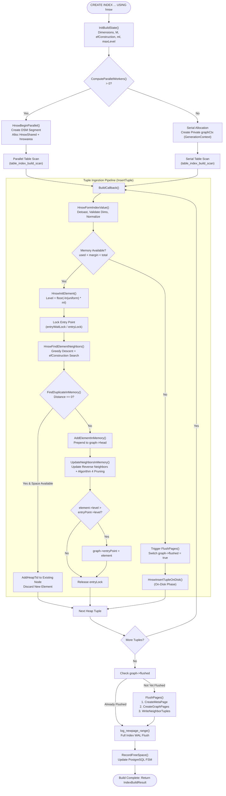

# pgvector HNSW Index: Construction and Parallel Build Architecture

## Table of Contents
1. [Overview of the HNSW Build Pipeline](#1-overview-of-the-hnsw-build-pipeline)
2. [Build Lifecycle & Orchestration](#2-build-lifecycle--orchestration)
   - [`hnswbuild` & `BuildIndex`](#hnswbuild--buildindex)
   - [Progress Reporting & Phase Tracking](#progress-reporting--phase-tracking)
   - [The Build Callback (`BuildCallback`)](#the-build-callback-buildcallback)
3. [Parallel Index Construction Architecture](#3-parallel-index-construction-architecture)
   - [Worker Coordination & DSM Topology](#worker-coordination--dsm-topology)
   - [Shared Memory Area (`hnswarea`) & Relative Pointer Fabric](#shared-memory-area-hnswarea--relative-pointer-fabric)
   - [Leader-Worker Synchronization (`ConditionVariable`)](#leader-worker-synchronization-conditionvariable)
   - [Concurrent In-Memory Insertion & Concurrency Control](#concurrent-in-memory-insertion--concurrency-control)
4. [Memory Management & The Two-Phase Build Strategy](#4-memory-management--the-two-phase-build-strategy)
   - [Why Graph Construction Cannot Use Tape Merging](#why-graph-construction-cannot-use-tape-merging)
   - [Phase 1: In-Memory Fast Construction](#phase-1-in-memory-fast-construction)
   - [Phase Transition: `FlushPages`](#phase-transition-flushpages)
   - [Phase 2: On-Disk Fallback Ingestion](#phase-2-on-disk-fallback-ingestion)
5. [Disk Page Allocation & Buffer Manager Interaction](#5-disk-page-allocation--buffer-manager-interaction)
   - [Page Allocation Priming (`HnswNewBuffer` & `ExtendBufferedRel`)](#page-allocation-priming-hnswnewbuffer--extendbufferedrel)
   - [Two-Pass Tuple Materialization (`CreateGraphPages` & `WriteNeighborTuples`)](#two-pass-tuple-materialization-creategraphpages--writeneighbortuples)
   - [Handling Cross-Page Tuples & Neighbor Overflow](#handling-cross-page-tuples--neighbor-overflow)
   - [Free Space Map (FSM) Recording & WAL Range Logging](#free-space-map-fsm-recording--wal-range-logging)
6. [Core Ingestion Logic: Walkthrough of `InsertTuple`](#6-core-ingestion-logic-walkthrough-of-inserttuple)
   - [Normalization & Dimension Validation](#normalization--dimension-validation)
   - [Duplicate Vector Deduplication (`FindDuplicateInMemory`)](#duplicate-vector-deduplication-findduplicateinmemory)
   - [Entry Point Lock Protocol (`entryLock` & `entryWaitLock`)](#entry-point-lock-protocol-entrylock--entrywaitlock)
   - [Neighbor Discovery & Backlink Creation](#neighbor-discovery--backlink-creation)
7. [Comprehensive Build Flow Diagram](#7-comprehensive-build-flow-diagram)

---

## 1. Overview of the HNSW Build Pipeline

Building an HNSW index involves ingesting high-dimensional vectors and constructing a navigable multi-layer proximity graph. In PostgreSQL, this operation is triggered by `CREATE INDEX ... USING hnsw`.

Unlike tree-structured indices (B-tree or GiST) or flat bucket indices (IVFFlat), HNSW construction is computationally expensive and memory-intensive. Every inserted vertex requires:
1. Multi-layer beam search across existing nodes to locate nearest neighbors.
2. Distance computations ($D$ float operations) across candidate vertices.
3. Updating bidirectional backlinks on neighboring nodes, which may trigger neighbor list pruning.

To maximize build speed on modern multicore systems while strictly respecting PostgreSQL's memory boundaries (`maintenance_work_mem`), `pgvector` implements an adaptive **two-phase parallel build architecture**:

```
                         ┌───────────────────────────────────────┐
                         │      CREATE INDEX ... USING hnsw      │
                         └──────────────────┬────────────────────┘
                                            │
                                ┌───────────▼───────────┐
                                │ ComputeParallelWorkers │
                                └───────────┬───────────┘
                                            │
                    ┌───────────────────────┴───────────────────────┐
             Workers > 0                                     Workers == 0
                    ▼                                               ▼
         ┌─────────────────────┐                         ┌─────────────────────┐
         │  HnswBeginParallel  │                         │ Serial Build Setup  │
         │ (DSM Shared Memory) │                         │ (Private graphCtx)  │
         └──────────┬──────────┘                         └──────────┬──────────┘
                    │                                               │
                    └───────────────────────┬───────────────────────┘
                                            │
                             ┌──────────────▼─────────────┐
                             │ PHASE 1: IN-MEMORY GRAPH   │
                             │ (Fast, lock-managed RAM)   │
                             └──────────────┬─────────────┘
                                            │
                       Did graph fit in maintenance_work_mem?
                                            │
                          ┌─────────────────┴─────────────────┐
                         YES                                  NO
                          │                                   │
                          │                     ┌─────────────▼─────────────┐
                          │                     │        FlushPages()       │
                          │                     │   (Materialize to disk)   │
                          │                     └─────────────┬─────────────┘
                          │                                   │
                          │                     ┌─────────────▼─────────────┐
                          │                     │  PHASE 2: ON-DISK BUILDS  │
                          │                     │ (InsertTupleOnDisk / WAL) │
                          │                     └─────────────┬─────────────┘
                          │                                   │
                          └─────────────────┬─────────────────┘
                                            │
                              ┌─────────────▼─────────────┐
                              │     Finalize Index:       │
                              │ - log_newpage_range (WAL) │
                              │ - RecordFreeSpace (FSM)   │
                              └───────────────────────────┘
```

---

## 2. Build Lifecycle & Orchestration

### `hnswbuild` & `BuildIndex`
The PostgreSQL access method callback for building a logged index is `hnswbuild` in `src/hnswbuild.c`:

```c
IndexBuildResult *
hnswbuild(Relation heap, Relation index, IndexInfo *indexInfo)
{
    IndexBuildResult *result;
    HnswBuildState buildstate;

    BuildIndex(heap, index, indexInfo, &buildstate, MAIN_FORKNUM);

    result = palloc_object(IndexBuildResult);
    result->heap_tuples = buildstate.reltuples;
    result->index_tuples = buildstate.indtuples;

    return result;
}
```

The underlying orchestrator `BuildIndex` manages state initialization, execution, WAL emission, and cleanup:

```c
static void
BuildIndex(Relation heap, Relation index, IndexInfo *indexInfo,
           HnswBuildState * buildstate, ForkNumber forkNum)
{
    InitBuildState(buildstate, heap, index, indexInfo, forkNum);

    BuildGraph(buildstate);

    if (RelationNeedsWAL(index) || forkNum == INIT_FORKNUM)
        log_newpage_range(index, forkNum, 0, RelationGetNumberOfBlocksInFork(index, forkNum), true);

    if (buildstate->typeInfo->useFsm && forkNum == MAIN_FORKNUM)
        RecordFreeSpace(index);

    FreeBuildState(buildstate);
}
```

### Progress Reporting & Phase Tracking
`pgvector` reports real-time indexing status to PostgreSQL's system view `pg_stat_progress_create_index`:

```c
pgstat_progress_update_param(PROGRESS_CREATEIDX_SUBPHASE, PROGRESS_HNSW_PHASE_LOAD);
```

During tuple insertion, the number of indexed tuples is atomically updated:
```c
SpinLockAcquire(&graph->lock);
pgstat_progress_update_param(PROGRESS_CREATEIDX_TUPLES_DONE, ++graph->indtuples);
SpinLockRelease(&graph->lock);
```

In `src/hnsw.c`, `hnswbuildphasename` resolves these phase identifiers for the user:
- `PROGRESS_CREATEIDX_SUBPHASE_INITIALIZE` (1) $\rightarrow$ `"initializing"`
- `PROGRESS_HNSW_PHASE_LOAD` (2) $\rightarrow$ `"loading tuples"`

### The Build Callback (`BuildCallback`)
PostgreSQL's table scanning engine (`table_index_build_scan`) reads tuples from the heap relation and invokes `BuildCallback` for every active physical heap tuple:

```c
static void
BuildCallback(Relation index, ItemPointer tid, Datum *values,
              bool *isnull, bool tupleIsAlive, void *state)
{
    HnswBuildState *buildstate = (HnswBuildState *) state;
    HnswGraph  *graph = buildstate->graph;
    MemoryContext oldCtx;

    /* Skip null values: HNSW does not index NULLs */
    if (isnull[0])
        return;

    /* Switch to per-tuple temporary memory context */
    oldCtx = MemoryContextSwitchTo(buildstate->tmpCtx);

    /* Insert vector into the in-memory graph or on disk */
    if (InsertTuple(index, values, isnull, tid, buildstate))
    {
        SpinLockAcquire(&graph->lock);
        pgstat_progress_update_param(PROGRESS_CREATEIDX_TUPLES_DONE, ++graph->indtuples);
        SpinLockRelease(&graph->lock);
    }

    /* Reset memory context to reclaim per-tuple allocations */
    MemoryContextSwitchTo(oldCtx);
    MemoryContextReset(buildstate->tmpCtx);
}
```

---

## 3. Parallel Index Construction Architecture

### Worker Coordination & DSM Topology
When `max_parallel_maintenance_workers > 0` and the table size justifies parallelism (`plan_create_index_workers`), `pgvector` establishes a Dynamic Shared Memory (DSM) segment:

```c
static void
HnswBeginParallel(HnswBuildState * buildstate, bool isconcurrent, int request)
{
    ParallelContext *pcxt;
    Snapshot    snapshot;
    Size        esthnswshared;
    Size        esthnswarea;
    HnswShared *hnswshared;
    char       *hnswarea;
    HnswLeader *hnswleader = palloc0_object(HnswLeader);
    ...
    EnterParallelMode();
    pcxt = CreateParallelContext("vector", "HnswParallelBuildMain", request);
    ...
```

The DSM segment contains a Table of Contents (TOC) with three distinct shared components:
1. **`PARALLEL_KEY_HNSW_SHARED`**: Points to `HnswShared`, an immutable coordinator header containing table OIDs, synchronization condition variables, and global build counters.
2. **`PARALLEL_KEY_HNSW_AREA`**: Points to `hnswarea`, a contiguous memory block dedicated entirely to holding the in-memory HNSW graph nodes and edge lists.
3. **`PARALLEL_KEY_QUERY_TEXT`**: Stores the raw SQL query string for `pg_stat_activity` reporting across worker processes.

```
Shared Memory (DSM Segment):
┌────────────────────────────────────────────────────────────────────────┐
│ Shared Memory TOC                                                      │
├────────────────────────────────────────────────────────────────────────┤
│ KEY 1: HnswShared                                                      │
│  - heaprelid, indexrelid, isconcurrent                                 │
│  - ConditionVariable workersdonecv                                     │
│  - slock_t mutex, int nparticipantsdone, double reltuples              │
│  - ParallelTableScanDescData (parallel table scan coordinate)          │
│  - HnswGraph graphData (locks, memory counters, entryPoint)            │
├────────────────────────────────────────────────────────────────────────┤
│ KEY 2: hnswarea (Bounded by maintenance_work_mem - 3MB)                │
│  [HnswElementData 1] [Neighbors 1] [Value 1]                           │
│  [HnswElementData 2] [Neighbors 2] [Value 2]                           │
│  ... (Carved contiguously by HnswSharedMemoryAlloc)                    │
├────────────────────────────────────────────────────────────────────────┤
│ KEY 3: debug_query_string                                              │
└────────────────────────────────────────────────────────────────────────┘
```

### Shared Memory Area (`hnswarea`) & Relative Pointer Fabric
The size of `hnswarea` is computed directly from `maintenance_work_mem`:

```c
esthnswarea = mul_size(maintenance_work_mem, 1024);
estother = 3 * 1024 * 1024;
if (esthnswarea > estother)
    esthnswarea -= estother;

esthnswarea = Min(esthnswarea, HNSW_MAX_GRAPH_MEMORY);
```

> [!IMPORTANT]
> 3MB (`estother`) is intentionally reserved out of `maintenance_work_mem`. Docker environments default `/dev/shm` to 64MB—which matches PostgreSQL's default `maintenance_work_mem`. Reserving 3MB prevents DSM allocations from failing due to operating-system shm exhaustion.

Because workers map this DSM segment at different virtual memory addresses, all inter-node linkages use relative pointers (`relptr`), storing the byte offset from `hnswarea`.

When an allocation is requested, `HnswSharedMemoryAlloc` performs atomic bump allocation:
```c
static void *
HnswSharedMemoryAlloc(Size size, void *state)
{
    HnswBuildState *buildstate = (HnswBuildState *) state;
    Size alignedSize = MAXALIGN(size);
    Size newMemoryUsed = add_size(buildstate->graph->memoryUsed, alignedSize);

    if (newMemoryUsed > buildstate->graph->memoryTotal)
        elog(ERROR, "hnsw allocator out of memory");

    void *chunk = buildstate->hnswarea + buildstate->graph->memoryUsed;
    buildstate->graph->memoryUsed = newMemoryUsed;
    return chunk;
}
```

### Leader-Worker Synchronization (`ConditionVariable`)
1. **Worker Launch**: The leader process launches parallel backends via `LaunchParallelWorkers(pcxt)` and attaches to the table scan as an active participant (`HnswLeaderParticipateAsWorker`).
2. **Parallel Table Scan**: Both leader and workers invoke `table_beginscan_parallel`, which coordinates block-level chunk distribution across processes using PostgreSQL's built-in parallel heap scan engine.
3. **Completion Signaling**: When a worker finishes its assigned table scan range:
   ```c
   SpinLockAcquire(&hnswshared->mutex);
   hnswshared->nparticipantsdone++;
   hnswshared->reltuples += reltuples;
   SpinLockRelease(&hnswshared->mutex);

   ConditionVariableSignal(&hnswshared->workersdonecv);
   ```
4. **Leader Wait Loop**: The leader blocks on `ConditionVariableSleep` until `nparticipantsdone == nparticipanttuplesorts`:
   ```c
   static double
   ParallelHeapScan(HnswBuildState * buildstate)
   {
       ...
       for (;;)
       {
           SpinLockAcquire(&hnswshared->mutex);
           if (hnswshared->nparticipantsdone == nparticipanttuplesorts) {
               ...
               break;
           }
           SpinLockRelease(&hnswshared->mutex);
           ConditionVariableSleep(&hnswshared->workersdonecv, WAIT_EVENT_PARALLEL_CREATE_INDEX_SCAN);
       }
       ConditionVariableCancelSleep();
       return reltuples;
   }
   ```

### Concurrent In-Memory Insertion & Concurrency Control
Multiple backends insert elements into the shared graph concurrently. Concurrency is protected by a multi-tiered locking scheme:
- `allocatorLock` (`LWLock`): Acquired exclusively only while allocating space in `hnswarea`. Released immediately before computing neighbors.
- `entryWaitLock` & `entryLock` (`LWLock`): Protects reading and upgrading the global entry point.
- `element->lock` (`LWLock`): Allocated per vertex from the shared LWLock tranche (`HnswInitLockTranche`). Held in shared mode while reading neighbors, and in exclusive mode while updating outgoing connections.

---

## 4. Memory Management & The Two-Phase Build Strategy

### Why Graph Construction Cannot Use Tape Merging
Traditional index builds (like B-trees) use an external merge sort: tuples are sorted in memory, spilled to disk as temporary files ("tapes"), and merged in a streaming pass.

This strategy is **impossible** for proximity graphs:
- HNSW construction is not an ordered sort; it requires random graph traversals to compute nearest neighbors for every new element.
- Spilling partially-connected vertices to tape files would require random disk I/O to traverse edges across un-materialized nodes, destroying performance.

### Phase 1: In-Memory Fast Construction
During Phase 1, the graph is constructed entirely in RAM:
- Memory operations avoid buffer manager overhead, page checksums, and WAL records.
- Distance computations occur on contiguous in-memory datum buffers.
- Speed is 5x–10x faster than on-disk index creation.

### Phase Transition: `FlushPages`
Before each element allocation, `InsertTuple` verifies that remaining memory accommodates the element plus a safety margin:

```c
/* In src/hnswbuild.c: InsertTuple */
memoryMargin = base == NULL ? 0 : 1024 * 1024; /* 1MB margin in parallel builds */

if (add_size(graph->memoryUsed, memoryMargin) >= graph->memoryTotal)
{
    LWLockRelease(&graph->allocatorLock);
    LWLockRelease(flushLock);
    LWLockAcquire(flushLock, LW_EXCLUSIVE);

    if (!graph->flushed)
    {
        ereport(NOTICE,
                (errmsg("hnsw graph no longer fits into maintenance_work_mem after " INT64_FORMAT " tuples", (int64) graph->indtuples),
                 errdetail("Building will take significantly more time."),
                 errhint("Increase maintenance_work_mem to speed up builds.")));

        FlushPages(buildstate);
    }
    LWLockRelease(flushLock);

    return HnswInsertTupleOnDisk(index, buildstate->typeInfo, support, value, heaptid, true);
}
```

When memory is exhausted:
1. The backend acquires `flushLock` in exclusive mode.
2. A user-visible `NOTICE` is emitted advising that `maintenance_work_mem` was exceeded.
3. `FlushPages` executes:
   - `CreateMetaPage`: Formats and writes Block 0.
   - `CreateGraphPages`: Allocates relation buffer blocks, writes all `HnswElementTuple`s, and inserts placeholder `HnswNeighborTuple`s.
   - `WriteNeighborTuples`: Performs a second pass, overwriting the neighbor placeholders with full edge lists.
   - Marks `graph->flushed = true`.
   - In serial builds, resets `buildstate->graphCtx` to free RAM back to PostgreSQL.

### Phase 2: On-Disk Fallback Ingestion
Once `graph->flushed` is true, all subsequent tuples bypass memory and are inserted via `HnswInsertTupleOnDisk`. 

Graph search and edge updates now operate directly through the PostgreSQL buffer manager:
- Edge lookups read buffer pages via `ReadBufferExtended`.
- Modifications write directly to shared buffer pages.
- WAL logging is suppressed (`building = true`), but pages are marked dirty with `MarkBufferDirty`.

---

## 5. Disk Page Allocation & Buffer Manager Interaction

### Page Allocation Priming (`HnswNewBuffer` & `ExtendBufferedRel`)
On PostgreSQL 16+, index extension uses the modern buffered extension API:

```c
Buffer
HnswNewBuffer(Relation index, ForkNumber forkNum)
{
#if PG_VERSION_NUM >= 160000
    return ExtendBufferedRel(BMR_REL(index), forkNum, NULL, EB_LOCK_FIRST | EB_SKIP_EXTENSION_LOCK);
#else
    Buffer buf = ReadBufferExtended(index, forkNum, P_NEW, RBM_NORMAL, NULL);
    LockBuffer(buf, BUFFER_LOCK_EXCLUSIVE);
    return buf;
#endif
}
```

Each page is initialized with `HnswInitPage`:
```c
void
HnswInitPage(Buffer buf, Page page)
{
    PageInit(page, BufferGetPageSize(buf), sizeof(HnswPageOpaqueData));
    HnswPageGetOpaque(page)->nextblkno = InvalidBlockNumber;
    HnswPageGetOpaque(page)->page_id = HNSW_PAGE_ID; /* 0xFF90 */
}
```

When appending a new page in `HnswBuildAppendPage`, the previous page's `opaque->nextblkno` is chained to the new block, maintaining a continuous forward-linked physical list.

### Two-Pass Tuple Materialization (`CreateGraphPages` & `WriteNeighborTuples`)
Materializing an in-memory graph to disk pages requires solving a cyclic dependency problem:
- **Neighbor pointers require physical block numbers and offset numbers** (`ItemPointerData` storing `(blkno, offno)`).
- But an element's physical block and offset are not known until it is placed onto a disk page.
- Furthermore, an element's neighbors may not have been assigned disk locations yet.

`pgvector` resolves this via an elegant **two-pass serialization protocol**:

```
PASS 1: CreateGraphPages
────────────────────────
Iterate graph->head:
  1. Calculate etupSize and ntupSize.
  2. Append page if required.
  3. Assign:
       element->blkno = BufferGetBlockNumber(buf)
       element->offno = OffsetNumberNext(...)
       element->neighborPage = ...
       element->neighborOffno = ...
  4. Write HnswElementTuple to page via PageAddItem().
  5. Write EMPTY PLACEHOLDER HnswNeighborTuple to page via PageAddItem().
  6. Repeat for all elements.

PASS 2: WriteNeighborTuples
───────────────────────────
Iterate graph->head:
  1. For each neighbor in memory, read its assigned (blkno, offno).
  2. Populate HnswNeighborTuple with valid ItemPointerData entries.
  3. Lock neighborPage buffer.
  4. Overwrite placeholder using PageIndexTupleOverwrite(page, offno, ntup).
  5. MarkBufferDirty(buf).
```

### Handling Cross-Page Tuples & Neighbor Overflow
For large vectors (e.g. 1536 dimensions) or high connectivity ($M = 64$):
- `etupSize`: $1536 \times 4 + \text{headers} \approx 6.2\text{ KB}$
- `ntupSize`: $(L + 2) \cdot M \cdot 6\text{ bytes} \approx 1\text{–}2\text{ KB}$

Since a PostgreSQL page is 8192 bytes (with effective usable space $\approx 8100$ bytes):
```c
combinedSize = etupSize + ntupSize + sizeof(ItemIdData);
if (combinedSize <= maxSize)
{
    /* Fits together: pack on same page */
    element->neighborPage = element->blkno;
    element->neighborOffno = OffsetNumberNext(element->offno);
}
else
{
    /* Overflow: element on current page, neighbor on next page */
    element->neighborPage = element->blkno + 1;
    element->neighborOffno = FirstOffsetNumber;
}
```

### Free Space Map (FSM) Recording & WAL Range Logging
Once all tuples and edges are written:
1. **FSM Recording**: If `useFsm` is enabled (used for variable-length types like `sparsevec`), `RecordFreeSpace` scans every page in the index and registers available free bytes with PostgreSQL's Free Space Map (`RecordPageWithFreeSpace`), followed by `FreeSpaceMapVacuum`.
2. **WAL Range Logging**: Instead of emitting thousands of individual WAL records during the build, `pgvector` logs the entire index relation as a consolidated block range at the very end of construction:
   ```c
   if (RelationNeedsWAL(index) || forkNum == INIT_FORKNUM)
       log_newpage_range(index, forkNum, 0, RelationGetNumberOfBlocksInFork(index, forkNum), true);
   ```
   This technique drastically reduces WAL volume and write amplification.

---

## 6. Core Ingestion Logic: Walkthrough of `InsertTuple`

### Normalization & Dimension Validation
Before insertion, `HnswFormIndexValue` processes the raw input datum:
1. Detoasts compressed or out-of-line TOAST values via `PG_DETOAST_DATUM`.
2. Invokes `typeInfo->checkValue` (e.g., ensuring `sparsevec` non-zero count does not exceed `HNSW_MAX_NNZ = 1000`).
3. If using cosine distance, invokes `HnswCheckNorm` to verify non-zero norm, and normalizes the vector to unit Euclidean length via `l2_normalize`.
4. Validates dimension equality against metadata dimensions via `HnswCheckDim`.

### Duplicate Vector Deduplication (`FindDuplicateInMemory`)
In production datasets, duplicate vectors (identical embeddings) frequently occur. Creating duplicate nodes in an HNSW graph is harmful: zero-distance edges cause clustering collapse and trap greedy routing in infinite loops or local minima.

`pgvector` detects duplicates at Level 0 during insertion:

```c
static bool
FindDuplicateInMemory(char *base, HnswElement element)
{
    HnswNeighborArray *neighbors = HnswGetNeighbors(base, element, 0);
    Datum value = HnswGetValue(base, element);

    for (int i = 0; i < neighbors->length; i++)
    {
        HnswCandidate *neighbor = &neighbors->items[i];
        HnswElement neighborElement = HnswPtrAccess(base, neighbor->element);
        Datum neighborValue = HnswGetValue(base, neighborElement);

        /* Exit early: neighbors are ordered ascending by distance */
        if (!datumIsEqual(value, neighborValue, false, -1))
            return false;

        /* Check for available slot in existing element's heaptids */
        if (AddDuplicateInMemory(element, neighborElement))
            return true;
    }
    return false;
}
```

If an existing neighbor has an identical vector datum and its `heaptidsLength < 10`, the new heap TID is simply appended to the existing element's `heaptids[10]` array under `dup->lock`. The newly created element is discarded, saving memory and graph edges.

### Entry Point Lock Protocol (`entryLock` & `entryWaitLock`)
Updating the graph's entry point requires strict synchronization to avoid race conditions:

```c
static void
InsertTupleInMemory(HnswBuildState * buildstate, HnswElement element)
{
    ...
    /* Wait if another process is acquiring an exclusive lock */
    LWLockAcquire(entryWaitLock, LW_EXCLUSIVE);
    LWLockRelease(entryWaitLock);

    /* Optimistic path: acquire shared lock on entry point */
    LWLockAcquire(entryLock, LW_SHARED);
    entryPoint = HnswPtrAccess(base, graph->entryPoint);

    /* Check if current element will become the new entry point */
    if (entryPoint == NULL || element->level > entryPoint->level)
    {
        LWLockRelease(entryLock);

        /* Signal intent to upgrade entry point */
        LWLockAcquire(entryWaitLock, LW_EXCLUSIVE);
        LWLockAcquire(entryLock, LW_EXCLUSIVE);
        LWLockRelease(entryWaitLock);

        /* Refresh entry point after acquiring exclusive lock */
        entryPoint = HnswPtrAccess(base, graph->entryPoint);
    }
    ...
```

By decoupling `entryWaitLock` from `entryLock`, backends that do not upgrade the entry point proceed in parallel under `entryLock` shared mode, while upgrades cleanly drain concurrent readers.

### Neighbor Discovery & Backlink Creation
Once the entry point is locked:
1. `HnswFindElementNeighbors` executes greedy descent from `entryPoint->level` down to `element->level + 1` with $ef = 1$.
2. For layers $lc = \min(\text{level}, \text{entryLevel}) \dots 0$:
   - Executes `HnswSearchLayer` with $ef = ef\_construction$.
   - Selects up to $M$ (or $2M$ at layer 0) diverse neighbors via `SelectNeighbors` (Algorithm 4).
   - Appends outgoing connections to `element`.
3. `UpdateNeighborsInMemory` iterates over selected neighbors and adds reverse backlinks (`HnswUpdateConnection`), shrinking neighbor lists that exceed layer capacity.

---

## 7. Comprehensive Build Flow Diagram


