# HNSW Index: Online Insertion Deep Dive

This document provides a comprehensive, expert-level architectural analysis of the **online insertion engine** in `pgvector`'s HNSW implementation (`pgvector/src/hnswinsert.c` and `pgvector/src/hnswutils.c`). It dissects the end-to-end lifecycle of an incoming tuple during standard SQL `INSERT`, contrast it with bulk construction, details page-level locking and concurrency invariants, explores the graph traversal and neighbor selection heuristics, documents physical on-disk storage allocation and Free Space Map (FSM) reuse, and analyzes WAL logging mechanics via PostgreSQL's `GenericXLog` facility.

---

## Table of Contents

1. [Overview & Execution Model](#1-overview--execution-model)
   - [Online Insertion vs. Bulk Construction](#online-insertion-vs-bulk-construction)
   - [Memory Context Architecture](#memory-context-architecture)
2. [Concurrency Control & Page Locking Architecture](#2-concurrency-control--page-locking-architecture)
   - [The Dummy Block Lock Protocol (`HNSW_UPDATE_LOCK`)](#the-dummy-block-lock-protocol-hnsw_update_lock)
   - [Interactions with Iterative Scans and VACUUM](#interactions-with-iterative-scans-and-vacuum)
   - [Entry Point Lock Escalation](#entry-point-lock-escalation)
3. [Element Level Generation & Initialization](#3-element-level-generation--initialization)
   - [Geometric Distribution & Normalization Factor $m_L$](#geometric-distribution--normalization-factor-m_l)
   - [Level Boundary Checks (`HNSW_MAX_LEVEL`)](#level-boundary-checks-hnsw_max_level)
   - [Memory Allocations & Relative Pointers](#memory-allocations--relative-pointers)
4. [Algorithm 1: Graph Traversal for Insertion](#4-algorithm-1-graph-traversal-for-insertion)
   - [Top-Down Greedy Search ($ef = 1$)](#top-down-greedy-search-ef--1)
   - [Bottom-Up Beam Search ($ef = ef\_construction$)](#bottom-up-beam-search-ef--ef_construction)
   - [Disk-Aware Candidate Evaluation](#disk-aware-candidate-evaluation)
5. [Algorithm 4: Heuristic Neighbor Selection (`SelectNeighbors`)](#5-algorithm-4-heuristic-neighbor-selection-selectneighbors)
   - [The Shrink & Diversity Principle (Shadowing Effect)](#the-shrink--diversity-principle-shadowing-effect)
   - [Evaluation of `CheckElementCloser`](#evaluation-of-checkelementcloser)
   - [Handling Pruned Connections (`keepPrunedConnections`)](#handling-pruned-connections-keepprunedconnections)
   - [State Caching and Incremental Optimization (`closerSet`)](#state-caching-and-incremental-optimization-closerset)
6. [Deduplication Engine on Disk](#6-deduplication-engine-on-disk)
   - [The Zero-Distance Trapping Vulnerability](#the-zero-distance-trapping-vulnerability)
   - [`FindDuplicateOnDisk` and `AddDuplicateOnDisk`](#findduplicateondisk-and-addduplicateondisk)
   - [Heap TID Array Saturation and Degenerate Splitting](#heap-tid-array-saturation-and-degenerate-splitting)
7. [Physical Disk Page Allocation & Tuple Materialization](#7-physical-disk-page-allocation--tuple-materialization)
   - [Dual Tuple Architecture: `HnswElementTuple` & `HnswNeighborTuple`](#dual-tuple-architecture-hnswelementtuple--hnswneighbortuple)
   - [Size Calculations and Page Boundaries](#size-calculations-and-page-boundaries)
   - [Free Space Map (FSM) Probe and Retry Loop](#free-space-map-fsm-probe-and-retry-loop)
   - [Deleted Slot Reclamation (`HnswFreeOffset` & `PageIndexTupleOverwrite`)](#deleted-slot-reclamation-hnswfreeoffset--pageindextupleoverwrite)
   - [Page Extension and Metapage Advance](#page-extension-and-metapage-advance)
8. [Bidirectional Backlink Propagation (`HnswUpdateNeighborsOnDisk`)](#8-bidirectional-backlink-propagation-hnswupdateneighborsondisk)
   - [Why HNSW Demands Reciprocal Edges](#why-hnsw-demands-reciprocal-edges)
   - [Disk-Based Neighbor Array Extraction (`HnswLoadNeighbors`)](#disk-based-neighbor-array-extraction-hnswloadneighbors)
   - [In-Place Edge Overwrite (`UpdateNeighborOnDisk`)](#in-place-edge-overwrite-updateneighborondisk)
   - [Handling Edge Saturation and Pruning on Remote Vertices](#handling-edge-saturation-and-pruning-on-remote-vertices)
9. [WAL Logging & Crash Recovery via GenericXLog](#9-wal-logging--crash-recovery-via-genericxlog)
   - [PostgreSQL `GenericXLog` Protocol](#postgresql-genericxlog-protocol)
   - [Multi-Buffer Delta Registration](#multi-buffer-delta-registration)
   - [Crash Consistency and Standby Replication (`010_hnsw_wal.pl`)](#crash-consistency-and-standby-replication-010_hnsw_walpl)
10. [End-to-End Workflow Diagram](#10-end-to-end-workflow-diagram)
11. [Performance Characteristics & Operational Guidance](#11-performance-characteristics--operational-guidance)
    - [I/O Amplification Analysis](#io-amplification-analysis)
    - [WAL Generation Rates](#wal-generation-rates)
    - [Tuning Recommendations for Online Insert Workloads](#tuning-recommendations-for-online-insert-workloads)

---

## 1. Overview & Execution Model

The entry point for single-row index maintenance in PostgreSQL is the standard Access Method routine `aminsert`. In `pgvector`, this is bound to `hnswinsert` in `pgvector/src/hnswinsert.c`.

### Online Insertion vs. Bulk Construction

There is a fundamental architectural bifurcation in `pgvector` between index creation (`CREATE INDEX`) and subsequent DML operations (`INSERT`, `UPDATE`):

| Property | Bulk Index Build (`hnswbuild.c`) | Online Insertion (`hnswinsert.c`) |
| :--- | :--- | :--- |
| **Execution Medium** | Primarily in-memory Dynamic Shared Memory (DSM) | Direct on-disk shared buffer pool pages (`BufferPool`) |
| **Parallelism** | Parallel worker processes coordinated by leader | Single backend process per SQL command |
| **Locking Overhead** | Minimal (LWLock across memory chunks, local buffers) | Dummy Page Lock (`HNSW_UPDATE_LOCK`), Buffer IO/Exclusive locks |
| **Neighbor Updates** | Fast pointer mutations in unified DSM arena | Buffer read, `LockBuffer(EXCLUSIVE)`, `GenericXLog`, dirty buffer write |
| **Memory Allocation** | Bounded strictly by `maintenance_work_mem` | Bounded by per-insert transient context (typically < 256 KB) |
| **Write Amplification** | Low (pages serialized sequentially at completion) | Extremely High (random reads/writes for backlink updates) |
| **WAL Protocol** | Full page WAL logging at commit or unlogged build | Fine-grained `GenericXLog` record per modified disk buffer |

### Memory Context Architecture

Because vector operations allocate intermediate working arrays, scratch queries, and temporary distance calculations, unbounded allocation inside PostgreSQL's transaction-scoped memory contexts (`MessageMemoryContext` or `ExecutorMemoryContext`) could lead to bloat or fragmentation.

`hnswinsert` enforces strict memory lifecycles:

```c
bool
hnswinsert(Relation index, Datum *values, bool *isnull, ItemPointer heap_tid,
           Relation heap, IndexUniqueCheck checkUnique, bool indexUnchanged, IndexInfo *indexInfo)
{
    MemoryContext oldCtx;
    MemoryContext insertCtx;

    /* Skip null values - HNSW does not index NULL */
    if (isnull[0])
        return false;

    /* Create short-lived memory context for the insert */
    insertCtx = AllocSetContextCreate(CurrentMemoryContext,
                                      "Hnsw insert temporary context",
                                      ALLOCSET_DEFAULT_SIZES);
    oldCtx = MemoryContextSwitchTo(insertCtx);

    /* Form vector datum and insert on disk */
    HnswInsertTuple(index, values, isnull, heap_tid);

    /* Reset and delete temporary context, freeing all scratch buffers */
    MemoryContextSwitchTo(oldCtx);
    MemoryContextDelete(insertCtx);

    return false;
}
```

Within `HnswUpdateNeighborsOnDisk`, an additional dedicated generation context (`GenerationContextCreate`) is allocated for edge recalculations, ensuring that variable-length array reallocations do not leak across graph levels:

```c
MemoryContext updateCtx = GenerationContextCreate(CurrentMemoryContext,
                                                  "Hnsw insert update context",
                                                  128 * 1024, 128 * 1024,
                                                  128 * 1024);
```

---

## 2. Concurrency Control & Page Locking Architecture

Concurrency in vector graph indexes cannot rely on simple B-Tree leaf/parent page lock coupling, because HNSW edges span arbitrarily distant pages in the relation file. Holding buffer pins or buffer locks across the entire neighbor discovery phase would cause catastrophic latch contention, buffer manager deadlocks, and severe concurrency degradation.

To resolve this, `pgvector` implements an elegant **Page-Locking Protocol on Dummy Block Numbers**.

### The Dummy Block Lock Protocol (`HNSW_UPDATE_LOCK`)

PostgreSQL provides relation-level page locks (`LockPage`) managed by the standard heavy-weight lock manager (`lmgr`). Rather than locking real buffer blocks, `pgvector` reserves fixed pseudo-block numbers defined in `hnsw.h`:

```c
#define HNSW_UPDATE_LOCK    0
#define HNSW_SCAN_LOCK      1
```

When an insertion begins in `HnswInsertTupleOnDisk`:

```c
LOCKMODE lockmode = ShareLock;
LockPage(index, HNSW_UPDATE_LOCK, lockmode);
```

1. **Shared Lock Acquisition**: Every inserting backend acquires `LockPage(index, HNSW_UPDATE_LOCK, ShareLock)`. Because `ShareLock` is mutually compatible with other `ShareLock` requests, **unlimited concurrent backends can insert into the index simultaneously**.
2. **Buffer Safety**: While traversing the graph or updating neighbor tuples, backends only hold transient buffer locks (`LockBuffer(buf, BUFFER_LOCK_SHARE)` or `BUFFER_LOCK_EXCLUSIVE`) for the microsecond duration of reading or mutating a single 8 KB page. No buffer locks are held during vector distance computation.

### Interactions with Iterative Scans and VACUUM

The dummy locks coordinate critical mutual exclusion boundaries without stalling normal index scans:

```
                  Concurrent Compatibility Matrix
                 ────────────────────────────────
Lock Held:              ShareLock(UPDATE)      ExclusiveLock(UPDATE)
Requested:
───────────────────────────────────────────────────────────────────
ShareLock(UPDATE)            ALLOWED                   BLOCKED
[Concurrent Inserts]

ExclusiveLock(UPDATE)        BLOCKED                   BLOCKED
[VACUUM RepairGraph]
[Entry Point Update]
```

- **VACUUM Protection**: When `hnswbulkdelete` enters its repair passes (modifying vertex links and deleting elements), it requests `LockPage(index, HNSW_UPDATE_LOCK, ExclusiveLock)`. This immediately waits for all in-flight inserts to complete, and prevents new inserts from modifying edges until the graph topology is structurally sanitized.
- **Iterative Scans**: Iterative index scans (`hnswgettuple` / `ResumeScanItems`) hold `LockPage(index, HNSW_SCAN_LOCK, ShareLock)`. When VACUUM reaches Pass 3 (`RepairDeleting`), it acquires `ExclusiveLock` on `HNSW_SCAN_LOCK`, ensuring that active iterative scans do not follow dangling outgoing edges of elements being pruned.

### Entry Point Lock Escalation

The HNSW entry point is stored on the index metapage (`HNSW_METAPAGE_BLKNO = 0`). If an inserting backend randomly samples a layer higher than the existing global entry point, it must promote its node to the new global entry point.

To prevent race conditions where two backends attempt to replace the entry point concurrently:

```c
/* Prevent concurrent inserts when likely updating entry point */
if (entryPoint == NULL || element->level > entryPoint->level)
{
    /* Release shared lock */
    UnlockPage(index, HNSW_UPDATE_LOCK, lockmode);

    /* Escalate to exclusive lock */
    lockmode = ExclusiveLock;
    LockPage(index, HNSW_UPDATE_LOCK, lockmode);

    /* Re-fetch latest entry point under exclusive lock */
    entryPoint = HnswGetEntryPoint(index);
}
```

If another backend already escalated and updated the entry point while this backend was waiting for `ExclusiveLock`, re-fetching `entryPoint` guarantees that the comparison is repeated with current catalog state.

---

## 3. Element Level Generation & Initialization

HNSW assigns each new vertex a maximum layer $l$ drawn from an exponential decay distribution. This creates a skip-list hierarchy where higher layers contain exponentially fewer nodes, providing $O(\log N)$ logarithmic search radius contraction.

### Geometric Distribution & Normalization Factor $m_L$

The probability that an element reaches layer $l$ is governed by:

$$P(\text{level} \ge l) = \exp(-l / m_L) = \left(\frac{1}{M}\right)^l$$

Where the scale parameter $m_L$ is defined as:

$$m_L = \frac{1}{\ln(M)}$$

In `pgvector/src/hnswutils.c`, level generation is implemented with integer-safe uniform sampling:

```c
double
HnswGetMl(int m)
{
    return 1.0 / log(m);
}

int
HnswGetRandomLevel(double ml, int maxLevel)
{
    /* Generate uniform random float in (0, 1] */
    double r = ((double) RandomNumber() + 1) / ((double) PG_UINT32_MAX + 1);

    int level = (int) (-log(r) * ml);

    return Min(level, maxLevel);
}
```

### Level Boundary Checks (`HNSW_MAX_LEVEL`)

To prevent pathological degenerate random seeds from exhausting disk space or exceeding fixed-width structure bounds, `pgvector` enforces strict upper limits:

```c
#define HNSW_MAX_LEVEL 64

int
HnswGetMaxLevel(int m)
{
    /* Cap maximum level based on M */
    return Min(HNSW_MAX_LEVEL, (int) (log(PG_INT32_MAX) / log(m)));
}
```

### Memory Allocations & Relative Pointers

The in-memory representation of an element being prepared for disk insertion is initialized via `HnswInitElement`:

```c
HnswElement
HnswInitElement(char *base, ItemPointer heaptid, int m, double ml, int maxLevel, HnswElement *dup)
{
    HnswElement element;
    int level = HnswGetRandomLevel(ml, maxLevel);

    element = HnswAlloc(base, sizeof(HnswElementData));
    element->level = level;
    element->heaptidsLength = 1;
    element->heaptids[0] = *heaptid;
    element->blkno = InvalidBlockNumber;
    element->offno = InvalidOffsetNumber;
    element->neighborPage = InvalidBlockNumber;
    element->neighborOffno = InvalidOffsetNumber;

    /* Initialize neighbor array slots for each active layer */
    for (int lc = 0; lc <= level; lc++)
    {
        int lm = HnswGetLayerM(m, lc);
        HnswPtrStore(base, element->neighbors[lc], HnswInitNeighborArray(lm, base));
    }

    return element;
}
```

Notice that inside the element, pointers to neighbor arrays and vector payloads are stored using `HnswPtrStore` and `HnswPtrAccess`. For online insertion where `base == NULL`, these macros collapse directly to native virtual memory pointers (`(char *) ptr`).

---

## 4. Algorithm 1: Graph Traversal for Insertion

Once an element $q$ is generated with target level $l$, `pgvector` must identify its nearest neighbors at all layers from $l$ down to 0. This is orchestrated by `HnswFindElementNeighbors` in `pgvector/src/hnswutils.c`, executing Algorithm 1 from Malkov & Yashunin (2018).

```
                         HNSW Hierarchical Routing
                         
 Layer 2:   [Entry Point] ───────────────► [Node A]
                  │                            │
                  ▼ (greedy ef=1)              ▼
 Layer 1:      [Node A] ───────► [Node B] ────► [Candidate 1]
                  │                                  │
                  ▼ (beam search ef=ef_construction) ▼
 Layer 0:   [Candidate 1] ───► [Candidate 2] ───────► [New Element q]
```

### Top-Down Greedy Search ($ef = 1$)

If the index already contains elements and the entry point's level $L_{ep} > l$, the algorithm starts at $L_{ep}$ and greedily steps toward $q$ using a beam width of $ef = 1$. It does not establish connections in these upper layers; its sole objective is to locate the nearest entry point into layer $l$:

```c
/* Traverse down from entryPoint->level to element->level + 1 */
for (int lc = entryPoint->level; lc > element->level; lc--)
{
    List *w;

    /* Greedy step: find single closest vertex at current layer */
    w = HnswSearchLayer(base, &q, ep, 1, lc, index, support, m, true, skipElement,
                        NULL, NULL, true, NULL, &searchState);

    /* Output candidate becomes the entry point for the layer below */
    ep = w;
}
```

### Bottom-Up Beam Search ($ef = ef\_construction$)

From $\min(l, L_{ep})$ down to layer 0, the element participates in the graph topology. At each layer $lc$, `pgvector` runs a full beam search with width $ef = ef\_construction$:

```c
for (int lc = Min(element->level, entryPoint->level); lc >= 0; lc--)
{
    List *w;
    List *neighbors;
    int lm = HnswGetLayerM(m, lc);

    /* Perform exploratory beam search collecting candidate set W */
    w = HnswSearchLayer(base, &q, ep, efConstruction, lc, index, support, m, true,
                        skipElement, NULL, NULL, true, NULL, &searchState);

    /* Heuristically select optimal neighbors from candidate set W */
    neighbors = SelectNeighbors(base, w, lm, support,
                                &HnswGetNeighbors(base, element, lc)->closerSet,
                                NULL, NULL, false);

    /* Bind selected neighbors to local element struct */
    AddConnections(base, element, neighbors, lc);

    /* Retain candidate set as entry points for the next lower layer */
    ep = w;
}
```

### Disk-Aware Candidate Evaluation

During online insert, `HnswSearchLayer` cannot simply traverse RAM pointers. Every hop from node $u$ to neighbor $v$ must:
1. Decode $v$'s `ItemPointerData` (`indextid`) containing `(block, offset)`.
2. Inspect `visited_hash` (an internal dynamic hash table of visited TIDs) to avoid redundant I/O.
3. Call `HnswLoadElement` to read the disk buffer corresponding to $v$'s element tuple.
4. Pin the buffer, extract the vector Datum from the disk page, and compute distance to query vector $q$.
5. Release the buffer pin immediately.

---

## 5. Algorithm 4: Heuristic Neighbor Selection (`SelectNeighbors`)

A naive algorithm would simply connect $q$ to the $M$ candidates with the smallest Euclidean or Cosine distance. However, simple nearest-neighbor clustering leads to clustered, highly redundant cliques with poor clustering diversity, severely impairing graph navigability.

`pgvector` implements Algorithm 4 from Malkov & Yashunin: **Heuristic Neighbor Selection with Diversity Pruning**.

### The Shrink & Diversity Principle (Shadowing Effect)

```
                    Geometric Shadowing Criterion
                    
                            Candidate e
                             ▲       ▲
                            ╱         ╲
                  d(q, e)  ╱           ╲  d(r_i, e)
                          ╱             ╲
                         ▼               ▼
                 Element q ────────────► Neighbor r_i
                                d(q, r_i)
                                
       If d(r_i, e) <= d(q, e), Candidate e is shadowed by r_i.
       Direct connection q -> e is rejected to maximize diversity.
```

When evaluating a candidate $e$ against the set of already selected neighbors $R$:
- If there exists any $r_i \in R$ such that the distance between $r_i$ and $e$ is **strictly less than or equal to** the distance between $q$ and $e$:
  $$d(r_i, e) \le d(q, e)$$
- Candidate $e$ is considered to be in the "shadow" of $r_i$. A search coming from $q$ can easily reach $e$ by routing through $r_i$. Adding a direct edge $q \to e$ wastes one of $q$'s limited edge slots without opening up a new exploratory direction in vector space.

### Evaluation of `CheckElementCloser`

This condition is implemented in `CheckElementCloser` (`pgvector/src/hnswutils.c`):

```c
static bool
CheckElementCloser(char *base, HnswCandidate *e, List *r, HnswSupport *support)
{
    HnswElement eElement = HnswPtrAccess(base, e->element);
    Datum eValue = HnswGetValue(base, eElement);
    ListCell *lc2;

    foreach(lc2, r)
    {
        HnswCandidate *ri = lfirst(lc2);
        HnswElement riElement = HnswPtrAccess(base, ri->element);
        Datum riValue = HnswGetValue(base, riElement);
        float distance = HnswGetDistance(eValue, riValue, support);

        /* If ri is closer to e than q is to e, reject e */
        if (distance <= e->distance)
            return false;
    }

    return true;
}
```

### Handling Pruned Connections (`keepPrunedConnections`)

If strict diversity filtering reduces the candidate set $R$ below the quota $M$ ($|R| < M$), leaving empty edge slots would harm graph connectivity.

`SelectNeighbors` saves all rejected candidates into a secondary array `wd` (pruned candidates). Once the candidate loop terminates, if $|R| < M$, it pulls elements from `wd` to backfill $R$ up to $M$:

```c
/* Keep pruned connections if needed to reach target degree lm */
while (wdoff < wdlen && list_length(r) < lm)
    r = lappend(r, wd[wdoff++]);
```

### State Caching and Incremental Optimization (`closerSet`)

In `SelectNeighbors`, calculating $d(r_i, e)$ for every candidate pair is an $O(|W| \cdot |R|)$ distance matrix operation. When an existing node's connections are updated (`HnswUpdateConnection`), only *one* new candidate $newCandidate$ is introduced to an already stabilized neighbor set.

`pgvector` employs an optimization:
1. `closerSet`: A boolean flag tracked inside `HnswNeighborArrayData`. If `closerSet == true`, the previous diversity evaluations for existing candidates remain valid.
2. `added` Tracking: If any new candidate is admitted to $R$, only those candidates not yet checked against $newCandidate$ are re-evaluated.
3. This reduces incremental neighbor updates during online inserts from $O(M^2)$ distance computations down to $O(M)$ or $O(1)$.

---

## 6. Deduplication Engine on Disk

A critical vulnerability of raw graph-based approximate nearest neighbor indexes is the **Zero-Distance Trapped Loop Problem**.

### The Zero-Distance Trapping Vulnerability

If a table receives multiple identical feature vectors (e.g., duplicate embeddings, default vectors, or recurring zero-padded tensors):
1. In a standard graph, duplicate vectors have distance $d(u, v) = 0$.
2. Greedy search will step into the cluster of zero-distance nodes and become trapped in cycles or localized clusters, failing to explore past them to find neighboring clusters.
3. Furthermore, multiple vertices for identical vectors consume precious edge capacity without providing geometrical span.

### `FindDuplicateOnDisk` and `AddDuplicateOnDisk`

`pgvector` solves this by decoupling **heap TIDs** from **graph vertices**. An HNSW vertex represents a unique point in vector space, which may point to multiple rows in the underlying heap table.

During `UpdateGraphOnDisk`, before allocating any new page or graph vertex:

```c
static bool
FindDuplicateOnDisk(Relation index, HnswElement element, bool building)
{
    char *base = NULL;
    HnswNeighborArray *neighbors = HnswGetNeighbors(base, element, 0);
    Datum value = HnswGetValue(base, element);

    for (int i = 0; i < neighbors->length; i++)
    {
        HnswCandidate *neighbor = &neighbors->items[i];
        HnswElement neighborElement = HnswPtrAccess(base, neighbor->element);
        Datum neighborValue = HnswGetValue(base, neighborElement);

        /* Exit early if distance > 0 (candidates ordered by distance) */
        if (!datumIsEqual(value, neighborValue, false, -1))
            return false;

        /* Attempt to append heap TID to the duplicate vertex on disk */
        if (AddDuplicateOnDisk(index, element, neighborElement, building))
            return true;
    }

    return false;
}
```

In `AddDuplicateOnDisk`:
1. The target vertex's page is locked in `BUFFER_LOCK_EXCLUSIVE`.
2. The `HnswElementTuple` is inspected.
3. `etup->heaptids` has fixed capacity `HNSW_HEAPTIDS` (10 slots).
4. If an empty slot `!ItemPointerIsValid(&etup->heaptids[i])` exists, the incoming tuple's heap TID is written directly into the tuple on page:

```c
etup->heaptids[i] = element->heaptids[0];
```

5. The buffer is dirtied, registered with `GenericXLogFinish(state)`, and unlocked.
6. The insert completes **without adding any new vertex or modifying any graph edges**.

### Heap TID Array Saturation and Degenerate Splitting

If more than 10 rows share the exact same vector:
- `AddDuplicateOnDisk` detects that slot 10 is full (`i == HNSW_HEAPTIDS`).
- It returns `false`.
- The insertion pipeline falls through and creates a fresh graph vertex for the 11th identical vector.
- This bounds the worst-case size of `HnswElementTuple` while providing robust deduplication for common duplicate workloads.

---

## 7. Physical Disk Page Allocation & Tuple Materialization

When deduplication cannot be used, the new element and its neighbor pointers must be persisted to 8 KB relation pages.

### Dual Tuple Architecture: `HnswElementTuple` & `HnswNeighborTuple`

`pgvector` separates each graph vertex into two physical tuples on disk:

```
┌────────────────────────────────────────────────────────┐
│                   HNSW Page Layout                     │
├────────────────────────────────────────────────────────┤
│ PageHeaderData (24 bytes)                              │
├────────────────────────────────────────────────────────┤
│ ItemIdData [1] ───┐                                    │
│ ItemIdData [2] ───┼──────────┐                         │
│ ...               │          │                         │
├───────────────────┼──────────┼─────────────────────────┤
│                   ▼          │                         │
│ HnswElementTupleData         │                         │
│ ┌──────────────────────────┐ │                         │
│ │ type = HNSW_ELEMENT_TUPLE│ │                         │
│ │ level                    │ │                         │
│ │ version                  │ │                         │
│ │ deleted                  │ │                         │
│ │ neighbortid (blk, off)   │ │                         │
│ │ heaptids[10]             │ │                         │
│ │ vector data [...]        │ │                         │
│ └──────────────────────────┘ │                         │
│                              ▼                         │
│ HnswNeighborTupleData                                  │
│ ┌──────────────────────────┐                           │
│ │ type = HNSW_NEIGHBOR_TUP│                           │
│ │ version                  │                           │
│ │ count                    │                           │
│ │ indextids[(level+2)*M]   │                           │
│ └──────────────────────────┘                           │
├────────────────────────────────────────────────────────┤
│ HnswPageOpaqueData (nextblkno, page_id)                │
└────────────────────────────────────────────────────────┘
```

1. **`HnswElementTuple`**: Contains the vector payload, metadata, flags, and heap TIDs. It points to the neighbor tuple via `neighbortid`.
2. **`HnswNeighborTuple`**: Contains a flat array of index pointers (`indextids`) representing edges at all layers up to `level`.

### Size Calculations and Page Boundaries

The byte footprint for both tuples is calculated at runtime:

```c
etupSize = HNSW_ELEMENT_TUPLE_SIZE(VARSIZE_ANY(HnswPtrAccess(base, e->value)));
ntupSize = HNSW_NEIGHBOR_TUPLE_SIZE(e->level, m);
combinedSize = etupSize + ntupSize + sizeof(ItemIdData);
minCombinedSize = etupSize + HNSW_NEIGHBOR_TUPLE_SIZE(0, m) + sizeof(ItemIdData);
```

- If `combinedSize <= PageGetFreeSpace(page)`: Both the element tuple and neighbor tuple are placed onto the **exact same page**.
- If `combinedSize > PageGetFreeSpace(page)`: The neighbor tuple is allocated on an adjacent or newly extended page, and linked via `neighbortid`.

### Free Space Map (FSM) Probe and Retry Loop

To prevent runaway append-only table growth when rows are deleted or updated, `AddElementOnDisk` queries PostgreSQL's Free Space Map:

```c
#define HNSW_MAX_FSM_TRIES 3

if (tryFsm && fsmTries < HNSW_MAX_FSM_TRIES)
{
    currentPage = GetPageWithFreeSpace(index, combinedSize);
    fsmHistory[fsmTries++] = currentPage;
    ...
}
```

If the FSM returns a page, but the page cannot accommodate the tuple layout (e.g., fragmentation or high line-pointer counts), `fsmHistory` tracks attempted blocks to prevent infinite loops, bounded by `HNSW_MAX_FSM_TRIES`.

### Deleted Slot Reclamation (`HnswFreeOffset` & `PageIndexTupleOverwrite`)

When inspecting candidate pages, `HnswFreeOffset` scans line pointers looking for elements marked `deleted = 1` by VACUUM:

```c
if (etup->deleted)
{
    ...
    pageFree = ItemIdGetLength(eitemid) + PageGetExactFreeSpace(page);
    npageFree = ItemIdGetLength(nitemid);
    ...
    if (pageFree >= etupSize && npageFree >= ntupSize)
    {
        *freeOffno = offno;
        *freeNeighborOffno = neighborOffno;
        *tupleVersion = etup->version;
        return true;
    }
}
```

If an obsolete element tuple of equal or greater size is found:
- Rather than appending a new line pointer, `AddElementOnDisk` calls `PageIndexTupleOverwrite`.
- It reuses the exact same `(block, offset)` tuple ID, preventing line pointer bloat.
- It inherits `tupleVersion`, which ensures that any concurrent index scan holding an obsolete iterator knows the underlying slot was recycled.

### Page Extension and Metapage Advance

If neither the current insert page nor the FSM provides sufficient free space, the relation is extended:

```c
static void
HnswInsertAppendPage(Relation index, Buffer *nbuf, Page *npage, GenericXLogState *state, Page page, bool building)
{
    /* Take extension lock on index relation */
    LockRelationForExtension(index, ExclusiveLock);
    *nbuf = HnswNewBuffer(index, MAIN_FORKNUM);
    UnlockRelationForExtension(index, ExclusiveLock);

    /* Initialize page with HNSW page id */
    *npage = GenericXLogRegisterBuffer(state, *nbuf, GENERIC_XLOG_FULL_IMAGE);
    HnswInitPage(*nbuf, *npage);

    /* Link previous page's nextblkno to maintain linear chain */
    HnswPageGetOpaque(page)->nextblkno = BufferGetBlockNumber(*nbuf);
}
```

The newly allocated block number is recorded in the metapage (`metap->insertPage`) via `HnswUpdateMetaPage`, directing subsequent inserts directly to the active head of the relation.

---

## 8. Bidirectional Backlink Propagation (`HnswUpdateNeighborsOnDisk`)

In HNSW, whenever a new vertex $q$ connects to an existing neighbor $v$ ($q \to v$), a reciprocal edge **must** be created ($v \to q$). Without reciprocal backlinks, nodes inserted later in time would be unreachable from pre-existing vertices during graph navigation.

### Why HNSW Demands Reciprocal Edges

Graph exploration starts from the global entry point (typically an older vertex). If older vertices do not possess outgoing edges pointing toward newly inserted vertices, the search algorithm will be physically unable to traverse down into newly populated vector clusters, degrading recall toward 0%.

### Disk-Based Neighbor Array Extraction (`HnswLoadNeighbors`)

To update $v$'s edge list, `pgvector` must first reconstruct $v$'s current connections from disk:

```c
static HnswNeighborArray *
HnswLoadNeighbors(HnswElement element, Relation index, int m, int lm, int lc)
{
    char *base = NULL;
    HnswNeighborArray *neighbors = HnswInitNeighborArray(lm, NULL);
    ItemPointerData indextids[HNSW_MAX_M * 2];

    if (!HnswLoadNeighborTids(element, indextids, index, m, lm, lc))
        return neighbors;

    for (int i = 0; i < lm; i++)
    {
        ItemPointer indextid = &indextids[i];
        if (!ItemPointerIsValid(indextid))
            break;

        HnswElement e = HnswInitElementFromBlock(ItemPointerGetBlockNumber(indextid),
                                                 ItemPointerGetOffsetNumber(indextid));
        HnswCandidate *hc = &neighbors->items[neighbors->length++];
        HnswPtrStore(base, hc->element, e);
    }

    return neighbors;
}
```

### In-Place Edge Overwrite (`UpdateNeighborOnDisk`)

Once `GetUpdateIndex` evaluates $v$'s neighbor list:
1. If $v$ has open edge slots ($length < M$), $q$ is simply appended.
2. If $v$ is already saturated ($length = M$), Algorithm 4 (`SelectNeighbors`) is invoked to select the weakest connection $pruned$ that $q$ replaces.
3. `UpdateNeighborOnDisk` locks $v$'s neighbor buffer in `BUFFER_LOCK_EXCLUSIVE`.
4. It resolves the exact offset inside `ntup->indextids`:
   $$index = (\text{element->level} - lc) \cdot M + \text{slot}$$
5. It overwrites the 6-byte `ItemPointerData`:
   ```c
   ItemPointer indextid = &ntup->indextids[idx];
   ItemPointerSet(indextid, newElement->blkno, newElement->offno);
   ```
6. The buffer mutation is registered with `GenericXLog` and committed.

```
                    Backlink Overwrite Operation
                    
 Buffer for Neighbor v (Page 42)
 ┌─────────────────────────────────────────────────────────────┐
 │ HnswNeighborTuple                                           │
 │ count: 16                                                   │
 │ indextids:                                                  │
 │   [0] (blk: 12, off: 1)                                     │
 │   [1] (blk: 15, off: 3)                                     │
 │   [2] (blk:  9, off: 2)  <─── Overwritten with (New Element)│
 │       ...                                                   │
 │   [15] (blk: 30, off: 4)                                    │
 └─────────────────────────────────────────────────────────────┘
```

---

## 9. WAL Logging & Crash Recovery via GenericXLog

Unlike core PostgreSQL index types (B-Tree, GiST, GIN) which implement custom, hard-coded Write-Ahead Logging (WAL) resource managers in the Postgres backend core, extension indexes like `pgvector` must use the **Generic WAL Interface** (`access/generic_xlog.h`).

### PostgreSQL `GenericXLog` Protocol

The `GenericXLog` framework allows extensions to make arbitrary page-level modifications to relation buffers with guaranteed ACID crash recovery and physical standby replication.

An online insert follows this sequence:

```
GenericXLogStart(relation)
       │
       ▼
GenericXLogRegisterBuffer(state, buffer, flags)
       │  (flags = 0 for delta logging; GENERIC_XLOG_FULL_IMAGE for new pages)
       ▼
[Apply byte modifications directly to Page returned by GenericXLogRegisterBuffer]
       │
       ├───────────────────────────────┐
       ▼                               ▼
GenericXLogFinish(state)      GenericXLogAbort(state)
[Emit XLOG record to WAL]     [Discard delta, unpin buffer]
```

### Multi-Buffer Delta Registration

When an insertion causes an edge update or allocates a new element across multiple pages, `GenericXLogState` can track up to 4 distinct buffer modifications atomically in a single WAL record:

```c
state = GenericXLogStart(index);
page = GenericXLogRegisterBuffer(state, buf, 0);
if (nbuf != buf)
    npage = GenericXLogRegisterBuffer(state, nbuf, 0);

/* Perform page updates */
...

/* Commit atomically to WAL buffer */
GenericXLogFinish(state);
```

During recovery:
- Redo inspects the page LSN and applies page image diffs recorded in the `GenericXLog` record.
- If a server crashes mid-insertion, any partially modified buffer registered before `GenericXLogFinish` is completely discarded upon replay, preventing on-disk corruption or broken graph pointers.

### Crash Consistency and Standby Replication (`010_hnsw_wal.pl`)

The reliability of `pgvector`'s `GenericXLog` implementation is validated in `test/t/010_hnsw_wal.pl`:

```perl
# Verify replication stream catch-up
$node_primary->poll_query_until('postgres', $caughtup_query);

# Execute vector searches simultaneously on Primary and Standby
my $primary_result = $node_primary->safe_psql("postgres", $queries);
my $replica_result = $node_replica->safe_psql("postgres", $queries);

# Exact topological and result match
is($primary_result, $replica_result, "standby returns identical nearest neighbors");
```

---

## 10. End-to-End Workflow Diagram

The complete control flow of `HnswInsertTupleOnDisk` is synthesized below:

```mermaid
flowchart TD
    Start(["hnswinsert(values, heap_tid)"]) --> Context["Create 'Hnsw insert temporary context'"]
    Context --> FormDatum["HnswFormIndexValue()"]
    FormDatum --> SharedLock["LockPage(HNSW_UPDATE_LOCK, ShareLock)"]
    
    SharedLock --> ReadMeta["Read Metapage: entryPoint, m, dimensions"]
    ReadMeta --> DimCheck{"Vector Dim Matches?"}
    DimCheck -- No --> ErrDim["elog(ERROR)"]
    DimCheck -- Yes --> GenLevel["HnswGetRandomLevel(ml, maxLevel)"]
    
    GenLevel --> CheckEP{"entryPoint == NULL ||<br/>element->level > entryPoint->level"}
    CheckEP -- Yes --> EscalateLock["UnlockPage(ShareLock)<br/>LockPage(ExclusiveLock)<br/>Re-read entryPoint"]
    CheckEP -- No --> FindNeighbors
    EscalateLock --> FindNeighbors
    
    subgraph Algorithm1 ["Algorithm 1: Neighbor Discovery"]
        FindNeighbors["HnswFindElementNeighbors()"]
        FindNeighbors --> Greedy["Loop lc = ep->level down to level+1:<br/>HnswSearchLayer(ef=1)"]
        Greedy --> BeamSearch["Loop lc = min(level, ep->level) down to 0:<br/>HnswSearchLayer(ef=ef_construction)"]
        BeamSearch --> Alg4["SelectNeighbors() [Algorithm 4 Diversity]"]
    end
    
    Alg4 --> CheckDup{"FindDuplicateOnDisk()?"}
    CheckDup -- Duplicate Found --> AddDup["AddDuplicateOnDisk():<br/>Append heap_tid to heaptids[10]"]
    AddDup --> ReleaseLock["UnlockPage(HNSW_UPDATE_LOCK)"]
    
    CheckDup -- No Duplicate --> AllocDisk["AddElementOnDisk()"]
    
    subgraph StorageAlloc ["Storage & Placement"]
        AllocDisk --> CheckFSM{"Try FSM / Free Offset?"}
        CheckFSM -- Reuse Deleted --> Overwrite["PageIndexTupleOverwrite()"]
        CheckFSM -- Fit Current --> AppendSlot["PageAddItem()"]
        CheckFSM -- Full --> AppendPage["HnswInsertAppendPage()<br/>LockRelationForExtension()"]
    end
    
    AppendSlot --> Backlinks["HnswUpdateNeighborsOnDisk()"]
    Overwrite --> Backlinks
    AppendPage --> Backlinks
    
    subgraph EdgeUpdate ["Reciprocal Edge Updates"]
        Backlinks --> LoadRemote["HnswLoadNeighbors(neighbor)"]
        LoadRemote --> UpdateIdx["GetUpdateIndex():<br/>Select pruned neighbor to replace"]
        UpdateIdx --> WriteEdge["UpdateNeighborOnDisk():<br/>LockBuffer(EXCLUSIVE)<br/>GenericXLog<br/>ItemPointerSet(indextids)"]
    end
    
    WriteEdge --> CheckNewEP{"element->level > entryPoint->level?"}
    CheckNewEP -- Yes --> UpdateMeta["HnswUpdateMetaPage(NEW_ENTRY_POINT)"]
    CheckNewEP -- No --> ReleaseLock
    UpdateMeta --> ReleaseLock
    
    ReleaseLock --> Cleanup["Delete Temporary Context"]
    Cleanup --> Done(["Return false (aminsert complete)"])
```



---

## 11. Performance Characteristics & Operational Guidance

### I/O Amplification Analysis

Online insertion in HNSW incurs significant write amplification compared to flat or tree-structured indexes:

1. **Neighbor Discovery Phase**: Requires reading $ef\_construction$ disk pages per layer.
2. **Element Materialization Phase**: 1 write to insert `HnswElementTuple`, 1 write to insert `HnswNeighborTuple`.
3. **Backlink Reciprocal Phase**: For an element inserted at level $l$, the algorithm updates:
   $$\text{Updates} \approx \sum_{lc=0}^{l} M_{lc} = 2M + l \cdot M$$
   Each backlink update requires an exclusive lock and `GenericXLog` write to a randomly distributed neighbor buffer.

For default parameters ($M = 16, ef\_construction = 64$):
- A single row insert typically dirties **32 to 50 distinct 8 KB shared buffers**.
- Under heavy concurrent insert volume, this manifests as random I/O thrashing in `shared_buffers`.

### WAL Generation Rates

Because each backlink update modifies a separate page via `GenericXLog`:
- Every online insert generates between **10 KB and 40 KB of WAL records**.
- Bulk-loading 100,000 vectors via single-row `INSERT` statements will generate several gigabytes of WAL.
- **Operational Rule**: Never ingest large vector datasets using individual `INSERT` statements into an existing HNSW index. Always populate the table first, then execute `CREATE INDEX` to leverage parallel in-memory construction.

### Tuning Recommendations for Online Insert Workloads

If an application requires continuous online ingestion (e.g., real-time streaming embeddings):

1. **Tune `ef_construction` vs. Latency**:
   - Lowering `ef_construction` from 128 to 32 or 64 reduces search layer traversal time by 50-70% with negligible loss in query recall.
2. **Buffer Pool Sizing**:
   - Ensure `shared_buffers` is large enough to contain the entire graph working set (Element and Neighbor pages). If neighbor buffer updates trigger physical disk reads, insert throughput drops precipitously.
3. **Partitioning Architecture**:
   - For high-volume streaming data, use time-partitioned tables (`pg_partman`). Ingest into an unindexed staging partition, and build the HNSW index once when the partition is closed.
