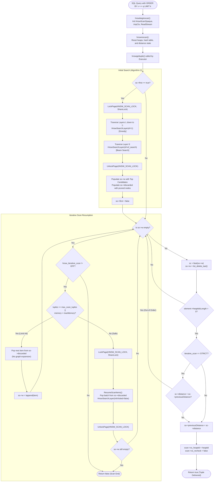

# HNSW Index: Query Scanning, Traversal & Iterative Search Deep Dive

This document provides a comprehensive, expert-level architectural analysis of the **query scanning and retrieval engine** in `pgvector`'s HNSW implementation (`pgvector/src/hnswscan.c`, `pgvector/src/hnswutils.c`, and `pgvector/src/hnsw.c`). It covers the PostgreSQL Access Method scan lifecycle, the dual pairing-heap beam search algorithm, the asynchronous I/O and `ReadStream` prefetching pipeline, the pioneering **iterative scan engine** for handling post-filter starvation, and the planner cost estimation model.

---

## Table of Contents

1. [Overview & AM Scan Lifecycle](#1-overview--am-scan-lifecycle)
   - [PostgreSQL Index Scan Execution Flow](#postgresql-index-scan-execution-flow)
   - [MVCC Snapshot Requirements & Buffer Pin Invariants](#mvcc-snapshot-requirements--buffer-pin-invariants)
2. [Scan State Architecture (`HnswScanOpaqueData`)](#2-scan-state-architecture-hnswscanopaquedata)
   - [Memory Context Management (`tmpCtx`)](#memory-context-management-tmpctx)
   - [Dynamic Memory Boundaries & `hnsw_scan_mem_multiplier`](#dynamic-memory-boundaries--hnsw_scan_mem_multiplier)
   - [Collation & Vector Normalization Support](#collation--vector-normalization-support)
3. [Priority Queues & Pairing Heap Architecture](#3-priority-queues--pairing-heap-architecture)
   - [Why Pairing Heaps (`lib/pairingheap.h`)](#why-pairing-heaps-libpairingheaph)
   - [The Tri-Heap Model: $C$, $W$, and `discarded`](#the-tri-heap-model-c-w-and-discarded)
   - [Comparator Logic & Tie-Breaking Invariants](#comparator-logic--tie-breaking-invariants)
4. [Algorithm 2: Multi-Layer Beam Search (`HnswSearchLayer`)](#4-algorithm-2-multi-layer-beam-search-hnswsearchlayer)
   - [Greedy Hierarchical Descent ($ef = 1$)](#greedy-hierarchical-descent-ef--1)
   - [Ground Layer Beam Search ($ef = hnsw\_ef\_search$)](#ground-layer-beam-search-ef--hnsw_ef_search)
   - [Early Termination Criterion ($d(c, q) > d(f, q)$)](#early-termination-criterion-dc-q--df-q)
   - [Visited Table Management (`visited_hash`)](#visited-table-management-visited_hash)
5. [Hardware Prefetching & ReadStream Pipeline](#5-hardware-prefetching--readstream-pipeline)
   - [Evolution: `PrefetchBuffer` vs. PostgreSQL 17+ `ReadStream`](#evolution-prefetchbuffer-vs-postgresql-17-readstream)
   - [Asynchronous Block Prefetching (`HnswReadStreamNextBlock`)](#asynchronous-block-prefetching-hnswreadstreamnextblock)
   - [I/O Concurrency Scaling (`get_tablespace_io_concurrency`)](#io-concurrency-scaling-get_tablespace_io_concurrency)
6. [The Iterative Scan Engine Deep Dive](#6-the-iterative-scan-engine-deep-dive)
   - [The Post-Filter Starvation Dilemma](#the-post-filter-starvation-dilemma)
   - [Architectural Modes: `off`, `relaxed_order`, `strict_order`](#architectural-modes-off-relaxed_order-strict_order)
   - [The Discard Heap & Resumption Algorithm (`ResumeScanItems`)](#the-discard-heap--resumption-algorithm-resumescanitems)
   - [Safety Limits: `hnsw_max_scan_tuples` & Memory Caps](#safety-limits-hnsw_max_scan_tuples--memory-caps)
   - [Concurrency Isolation During Resumption (`HNSW_SCAN_LOCK` & Versions)](#concurrency-isolation-during-resumption-hnsw_scan_lock--versions)
7. [PostgreSQL Executor Integration & Cost Model](#7-postgresql-executor-integration--cost-model)
   - [Order-By Operators & Recheck Elimination (`xs_recheck = false`)](#order-by-operators--recheck-elimination-xs_recheck--false)
   - [Derivation of the Planner Cost Formula (`hnswcostestimate`)](#derivation-of-the-planner-cost-formula-hnswcostestimate)
   - [Analysis of `EXPLAIN ANALYZE` Output](#analysis-of-explain-analyze-output)
8. [End-to-End Search Workflow Diagram](#8-end-to-end-search-workflow-diagram)
9. [Performance Tuning & Operational Guidance](#9-performance-tuning--operational-guidance)
   - [Recall vs. Query Latency Trade-offs](#recall-vs-query-latency-trade-offs)
   - [Tuning `hnsw.ef_search` and Work Memory](#tuning-hnswef_search-and-work-memory)
   - [Mitigating Post-Filter Degradation in Real-World Applications](#mitigating-post-filter-degradation-in-real-world-applications)

---

## 1. Overview & AM Scan Lifecycle

In PostgreSQL, index queries are processed via Access Method (AM) routines registered in `IndexAmRoutine`. `pgvector` implements the four fundamental scan callbacks in `pgvector/src/hnswscan.c`:

- `ambeginscan` $\to$ `hnswbeginscan`: Initializes the internal scan descriptor, support functions, and working memory contexts.
- `amrescan` $\to$ `hnswrescan`: Resets candidate iterators, hash sets, and pairing heaps when query parameters or joins change.
- `amgettuple` $\to$ `hnswgettuple`: Returns the next closest heap `ItemPointer` (`heaptid`) in monotonic distance order.
- `amendscan` $\to$ `hnswendscan`: Tears down the scan context, terminates asynchronous I/O read streams, and frees all memory.

### PostgreSQL Index Scan Execution Flow

```
                      PostgreSQL Executor Loop
                                 │
                         ExecIndexScan()
                                 │
                    ┌────────────▼────────────┐
                    │     hnswgettuple()      │
                    └────────────┬────────────┘
                                 │
                   First tuple in query?
                     ├── Yes ──► Run HNSW Traversal:
                     │           - LockPage(HNSW_SCAN_LOCK, ShareLock)
                     │           - GetScanItems() [Layer L down to 0]
                     │           - Populate result list 'so->w'
                     │           - UnlockPage(HNSW_SCAN_LOCK)
                     │
                     └── No ───► Extract next tuple from 'so->w'
                                 │
                     Is 'so->w' empty?
                       ├── Yes & iterative_scan enabled:
                       │     - ResumeScanItems() from 'so->discarded'
                       └── Yes & iterative_scan off:
                             - Return false (EOF)
```

### MVCC Snapshot Requirements & Buffer Pin Invariants

In standard B-tree index scans, the access method holds a buffer pin or lock on the current leaf page between `amgettuple` calls. However, in HNSW, holding buffer pins across arbitrary execution steps is impossible:
1. Vectors spanning multiple rows are visited out-of-physical-order across hundreds of disk pages.
2. Holding long-lived buffer pins would exhaust `shared_buffers` pin limits and block VACUUM.

Consequently, `pgvector` requires an explicit Multi-Version Concurrency Control (MVCC) snapshot:

```c
/* Requires MVCC-compliant snapshot as not able to maintain a pin */
if (!IsMVCCSnapshot(scan->xs_snapshot))
    elog(ERROR, "non-MVCC snapshots are not supported with hnsw");
```

During graph traversal, `pgvector` pins and locks pages only for the exact duration of copying a vector Datum, immediately releasing the buffer. MVCC visibility checks on the referenced heap tuple (`heap_tid`) are subsequently handled by the PostgreSQL executor's table access method (`heapam`).

---

## 2. Scan State Architecture (`HnswScanOpaqueData`)

The entire runtime state of an active HNSW index scan is encapsulated within `HnswScanOpaqueData` (typedef'd as `HnswScanOpaque`), allocated in `scan->opaque`:

```c
typedef struct HnswScanOpaqueData
{
    const HnswTypeInfo *typeInfo;
    HnswSupport support;
    HnswSearchState searchState;
    MemoryContext tmpCtx;
    double      maxMemory;
    int         m;
    HnswQuery   q;

    /* Search state */
    bool        first;
    List       *w;
    visited_hash v;
    pairingheap *discarded;
    int64       tuples;
    double      previousDistance;
} HnswScanOpaqueData;
```

### Memory Context Management (`tmpCtx`)

Because an iterative scan may traverse thousands of graph vertices before the query's `LIMIT` clause is satisfied, all search structures (candidates, pairing heap nodes, visited hash entries) are allocated in a private transient context:

```c
so->tmpCtx = AllocSetContextCreate(CurrentMemoryContext,
                                   "Hnsw scan temporary context",
                                   0, 8 * 1024, 256 * 1024);
```

Using small initial block sizes (`0`) and conservative maximum chunks (`256 KB`) prevents memory fragmentation. When a query is rescanned (e.g., in a nested loop join), calling `MemoryContextReset(so->tmpCtx)` instantly reclaims all candidate allocations in a single $O(1)$ operation without individual `pfree` calls.

### Dynamic Memory Boundaries & `hnsw_scan_mem_multiplier`

To safeguard PostgreSQL instances against runaway queries during deep iterative graph scans, `hnswbeginscan` computes a strict upper memory ceiling derived from the session's `work_mem`:

```c
/* Calculate max memory */
maxMemory = (double) work_mem * hnsw_scan_mem_multiplier * 1024.0 + 256;
so->maxMemory = Min(maxMemory, (double) (SIZE_MAX / 2));
```

If memory consumption in `tmpCtx` exceeds `so->maxMemory` during iterative traversal, `ResumeScanItems` halts further exploration of unvisited graph branches and gracefully flushes the remaining candidates stored in the discarded heap.

### Collation & Vector Normalization Support

If the index operator class utilizes cosine distance (`vector_cosine_ops`), `pgvector` automatically normalizes query vectors that are not already unit-length:

```c
static Datum
GetScanValue(IndexScanDesc scan)
{
    ...
    value = scan->orderByData->sk_argument;

    /* Normalize if needed (e.g. cosine distance) */
    if (so->support.normprocinfo != NULL)
        value = HnswNormValue(so->typeInfo, so->support.collation, value);

    return value;
}
```

Pre-normalizing the query vector allows subsequent distance evaluations to use high-throughput dot-product SIMD instructions ($1.0 - \vec{u} \cdot \vec{v}$) rather than expensive square-root Euclidean norm operations at every vertex.

---

## 3. Priority Queues & Pairing Heap Architecture

Fast nearest neighbor search on graphs requires maintaining ordered sets of candidate nodes that can be dynamically updated with low overhead.

### Why Pairing Heaps (`lib/pairingheap.h`)

While binary heaps or Fibonacci heaps are common in academic literature, `pgvector` leverages PostgreSQL's native **Pairing Heap** implementation:
- **Amortized Complexity**: $O(1)$ insertion, $O(1)$ merge, and $O(\log N)$ delete-min.
- **Cache Locality**: Pairing heaps use simplified multi-way tree structures with sibling pointers, avoiding the heavy pointer manipulation and space overhead of Fibonacci heaps.
- **Low Memory Overhead**: Only two pointers per node (`left_child`, `next_sibling`), minimizing allocation footprint within `tmpCtx`.

### The Tri-Heap Model: $C$, $W$, and `discarded`

Inside `HnswSearchLayer` (`pgvector/src/hnswutils.c`), candidate tracking utilizes a coordinated three-heap architecture:

```
                            Tri-Heap Data Flow
                            
                           [Unvisited Neighbors]
                                     │
                             (Compute Distance)
                                     │
                   ┌─────────────────┴─────────────────┐
                   ▼                                   ▼
        Is distance < furthest in W?          Distance >= furthest in W?
                   │                                   │
         ┌─────────┴─────────┐                         │
         ▼                   ▼                         ▼
   Heap C (Min-Heap)   Heap W (Max-Heap)     Heap discarded (Min-Heap)
   (Nearest Candidates (Top-ef Closest        (Pruned candidates saved
    to expand next)     Found So Far)          for iterative resumption)
         │                   │                         │
  pairingheap_        If |W| > ef,                     │
  remove_first        remove furthest                  │
         │                   │                         │
         └─────────► ────────┴────────────────────────►┘
```

1. **Candidate Heap $C$ (Min-Heap)**:
   - Ordered by **nearest distance** to query $q$.
   - Evaluated candidate vertices whose outward edges have not yet been traversed.
   - The algorithm continuously pulls the closest node from $C$ to explore next.

2. **Working Result Pool $W$ (Max-Heap)**:
   - Ordered by **furthest distance** to query $q$.
   - Holds the best $ef$ nearest neighbors discovered so far.
   - The top element of $W$ ($f = \text{first}(W)$) represents the worst candidate in the current top-$ef$ set.

3. **Discarded Heap `discarded` (Min-Heap)**:
   - Ordered by **nearest distance** to query $q$.
   - Captures any candidate that was trimmed from $W$ because $|W| > ef$, or any neighbor whose distance was worse than $f$ but which may lead to alternative graph clusters during subsequent iterations.

### Comparator Logic & Tie-Breaking Invariants

Pairing heaps require strict weak ordering. To ensure deterministic behavior during searches and regression testing, comparators implement explicit tie-breakers:

```c
/* Nearest candidate comparator (Min-Heap for C) */
static int
CompareNearestCandidates(const pairingheap_node *a, const pairingheap_node *b, void *arg)
{
    const HnswSearchCandidate *sc1 = HnswGetSearchCandidate(c_node, a);
    const HnswSearchCandidate *sc2 = HnswGetSearchCandidate(c_node, b);

    if (sc1->distance < sc2->distance)
        return 1;
    if (sc1->distance > sc2->distance)
        return -1;
    return 0;
}

/* Furthest candidate comparator (Max-Heap for W) */
static int
CompareFurthestCandidates(const pairingheap_node *a, const pairingheap_node *b, void *arg)
{
    const HnswSearchCandidate *sc1 = HnswGetSearchCandidate(w_node, a);
    const HnswSearchCandidate *sc2 = HnswGetSearchCandidate(w_node, b);

    if (sc1->distance > sc2->distance)
        return 1;
    if (sc1->distance < sc2->distance)
        return -1;
    return 0;
}

/* Discarded candidate comparator (Min-Heap for discarded) */
static int
CompareNearestDiscardedCandidates(const pairingheap_node *a, const pairingheap_node *b, void *arg)
{
    const HnswSearchCandidate *sc1 = HnswGetSearchCandidate(w_node, a);
    const HnswSearchCandidate *sc2 = HnswGetSearchCandidate(w_node, b);

    if (sc1->distance < sc2->distance)
        return 1;
    if (sc1->distance > sc2->distance)
        return -1;
    return 0;
}
```

Notice that inside `HnswSearchCandidate`, both `c_node` and `w_node` exist concurrently, allowing the same candidate object to reside simultaneously in heap $C$ and heap $W$ without redundant allocations:

```c
typedef struct HnswSearchCandidate
{
    pairingheap_node c_node;
    pairingheap_node w_node;
    HnswElement element;
    double      distance;
} HnswSearchCandidate;
```

---

## 4. Algorithm 2: Multi-Layer Beam Search (`HnswSearchLayer`)

Graph traversal is executed by `HnswSearchLayer` (`pgvector/src/hnswutils.c`), which implements Algorithm 2 of Malkov & Yashunin (2018).

### Greedy Hierarchical Descent ($ef = 1$)

Query processing begins at the global entry point stored in the metapage (`metap->entryBlock`, `metap->entryOffset`). In all upper layers ($L_{ep} \dots 1$), the search executes with beam width $ef = 1$:

```c
/* Traverse down from entryPoint->level to layer 1 */
for (int lc = entryPoint->level; lc >= 1; lc--)
{
    w = HnswSearchLayer(base, q, ep, 1, lc, index, support, m, false, NULL,
                        NULL, NULL, true, NULL, &so->searchState);
    ep = w;
}
```

At $ef = 1$:
- The working set $W$ contains only a single candidate.
- Traversal greedily steps from vertex to neighbor if and only if that neighbor is strictly closer to $q$.
- As soon as no neighbor improves upon the current vertex, the algorithm drops to the next lower layer, using the local minimum as the entry point.

### Ground Layer Beam Search ($ef = hnsw\_ef\_search$)

At layer 0, the search switches to full exploratory beam search with width $ef = hnsw\_ef\_search$ (default: 40):

```c
return HnswSearchLayer(base, q, ep, hnsw_ef_search, 0, index, support, m, false,
                      NULL, &so->v,
                      hnsw_iterative_scan != HNSW_ITERATIVE_SCAN_OFF ? &so->discarded : NULL,
                      true, &so->tuples, &so->searchState);
```

### Early Termination Criterion ($d(c, q) > d(f, q)$)

The core loop of `HnswSearchLayer` repeatedly pops the closest unvisited candidate $c$ from min-heap $C$:

```c
while (!pairingheap_is_empty(C))
{
    HnswSearchCandidate *c = HnswGetSearchCandidate(c_node, pairingheap_remove_first(C));
    HnswSearchCandidate *f = HnswGetSearchCandidate(w_node, pairingheap_first(W));

    /* Early termination check */
    if (c->distance > f->distance)
        break;

    /* Expand neighbors of c ... */
}
```

**Mathematical Invariant**:
- $c$ is the absolute closest candidate in $C$ that hasn't yet been expanded.
- $f$ is the furthest (worst) candidate currently admitted into the top-$ef$ pool $W$.
- If $d(c, q) > d(f, q)$, then *every* remaining candidate in $C$ is further from $q$ than the worst candidate in $W$.
- Because edge distances satisfy triangle-inequality approximations, traversing further from $c$ cannot yield any node closer than $f$.
- The search terminates immediately.

### Visited Table Management (`visited_hash`)

To prevent cyclic infinite loops, every vertex visited during the search is recorded in a dynamic hash set.

On disk-based scans, `visited_hash` tracks 64-bit packed `ItemPointerData`:

```c
static inline void
AddToVisited(char *base, visited_hash *v, HnswElement element, bool inMemory, bool *found)
{
    ...
    ItemPointer indextid = &element->indextid;
    visited_hash_insert(v, *indextid, found);
}
```

The hash table uses quadratic probing and is sized proportionally to $ef \cdot M$, ensuring lookups remain $O(1)$ and cache-resident throughout the query.

---

## 5. Hardware Prefetching & ReadStream Pipeline

Because graph traversal exhibits high random-access memory patterns across disk pages, naive synchronous buffer reads will stall CPU pipelines on disk I/O latency. `pgvector` implements high-performance asynchronous prefetching.

### Evolution: `PrefetchBuffer` vs. PostgreSQL 17+ `ReadStream`

Prior to PostgreSQL 17, `pgvector` utilized PostgreSQL's `PrefetchBuffer` API:
- Up to `ioConcurrency` neighbor blocks were queued using `posix_fadvise(..., POSIX_FADV_WILLNEED)`.
- However, this approach lacked deep integration with PostgreSQL's buffer manager, resulting in redundant buffer mapping table lookups.

Beginning with PostgreSQL 17 (and enhanced in 19), `pgvector` adopts PostgreSQL's cutting-edge **ReadStream API** (`storage/read_stream.h`):

```c
#ifdef HNSW_USE_READ_STREAM
    searchState->stream = read_stream_begin_relation(flags, NULL, index, MAIN_FORKNUM,
                                                     HnswReadStreamNextBlock,
                                                     searchState,
                                                     sizeof(OffsetNumber));
#endif
```

### Asynchronous Block Prefetching (`HnswReadStreamNextBlock`)

When traversing unvisited neighbors of candidate $c$, `pgvector` does not immediately read each buffer. Instead, it extracts the target `(block, offset)` tuples and pipes them into the `ReadStream` callback:

```c
BlockNumber
HnswReadStreamNextBlock(ReadStream *stream, void *callback_private_data, void *per_buffer_data)
{
    HnswSearchState *searchState = (HnswSearchState *) callback_private_data;

    while (searchState->visited < searchState->unvisitedLength)
    {
        HnswUnvisited *unvisited = &searchState->unvisited[searchState->visited++];
        OffsetNumber *offno = (OffsetNumber *) per_buffer_data;

        *offno = ItemPointerGetOffsetNumber(&unvisited->indextid);
        return ItemPointerGetBlockNumber(&unvisited->indextid);
    }

    return InvalidBlockNumber;
}
```

`read_stream_next_buffer` automatically manages OS read-ahead windows, kernel page cache prefetching, and asynchronous I/O (AIO) submission. While the CPU calculates SIMD distance functions for the current vector, the storage subsystem asynchronously loads the subsequent neighbor buffers into `shared_buffers`.

### I/O Concurrency Scaling (`get_tablespace_io_concurrency`)

Prefetching depth dynamically adapts to the underlying storage hardware configuration:

```c
int ioConcurrency = get_tablespace_io_concurrency(index->rd_rel->reltablespace);
searchState->maxPrefetch = Min(ioConcurrency, HNSW_MAX_M * 2);
```

On NVMe and cloud SSD storage where `effective_io_concurrency` is configured to 200+, `pgvector` issues multi-block concurrent asynchronous requests, hiding random access latency almost entirely.

---

## 6. The Iterative Scan Engine Deep Dive

One of the most profound innovations in `pgvector` is its **Iterative Index Scan Engine**, introduced to conquer the dreaded "Post-Filter Starvation" problem.

### The Post-Filter Starvation Dilemma

Consider a standard hybrid SQL query:

```sql
SELECT * FROM documents
WHERE category = 'finance'
ORDER BY embedding <=> '[...]'
LIMIT 10;
```

In standard vector indexes (FAISS, standard HNSW, Lucene):
1. The index performs an approximate nearest neighbor search and returns exactly $ef\_search$ (e.g., 40) candidates.
2. The PostgreSQL executor receives these 40 tuples and evaluates the `WHERE category = 'finance'` filter.
3. If the finance category is sparse (e.g., only 1% of the database), all 40 candidates may be discarded!
4. **Catastrophic Failure**: The query returns 0 rows, even though thousands of matching finance documents exist in the table.
5. Raising `ef_search` globally to 10,000 to prevent this makes all normal queries 100x slower.

### Architectural Modes: `off`, `relaxed_order`, `strict_order`

`pgvector` solves this with the `hnsw.iterative_scan` GUC:

| Mode | Behavior | Distance Monotonicity | Performance Overhead |
| :--- | :--- | :--- | :--- |
| `off` | Returns at most $ef\_search$ candidates. Scan stops when initial beam search ends. | Strictly Monotonic | Lowest |
| `relaxed_order` | Resumes Layer 0 search in batches of $ef\_search$ from `discarded` heap until `LIMIT` satisfied. | Monotonic within batches; slight distance reversals possible across batches. | Extremely Fast |
| `strict_order` | Resumes Layer 0 search, but enforces monotonic distance ordering across batches via `so->previousDistance`. | 100% Strictly Monotonic | Minimal |

### The Discard Heap & Resumption Algorithm (`ResumeScanItems`)

When `hnswgettuple` exhausts the primary candidate list `so->w`:

```c
if (list_length(so->w) == 0)
{
    if (hnsw_iterative_scan == HNSW_ITERATIVE_SCAN_OFF)
        break;

    /* Reached max tuples or memory limit? */
    if (so->tuples >= hnsw_max_scan_tuples || MemoryContextMemAllocated(so->tmpCtx, false) > so->maxMemory)
    {
        /* Return remaining tuples without further graph expansion */
        so->w = lappend(so->w, HnswGetSearchCandidate(w_node, pairingheap_remove_first(so->discarded)));
    }
    else
    {
        /* Resume search on Layer 0 */
        LockPage(scan->indexRelation, HNSW_SCAN_LOCK, ShareLock);
        so->w = ResumeScanItems(scan);
        UnlockPage(scan->indexRelation, HNSW_SCAN_LOCK, ShareLock);
    }
}
```

In `ResumeScanItems`:
1. It pops the best batch of candidates ($batch\_size = hnsw\_ef\_search$) from `so->discarded`.
2. It uses these discarded nodes as the **entry points** (`ep`) for a fresh invocation of `HnswSearchLayer` at Layer 0.
3. Crucially, it passes `initVisited = false`, preserving the `visited_hash` state from the previous pass so already inspected nodes are never re-evaluated.
4. The search navigates outward into previously unexplored graph territory, producing the next batch of nearest neighbors.

### Safety Limits: `hnsw_max_scan_tuples` & Memory Caps

To protect against runaway table scans when a filter matches nothing:
- `hnsw.max_scan_tuples`: Maximum total index tuples inspected before terminating (default: 20,000).
- `work_mem * hnsw_scan_mem_multiplier`: Maximum RAM permitted for the scan context.
- Once either limit is exceeded, `pgvector` drains remaining items directly from `discarded` without exploring new edges, guaranteeing bounded CPU and memory consumption.

### Concurrency Isolation During Resumption (`HNSW_SCAN_LOCK` & Versions)

Iterative scans may pause and resume over seconds while the outer query performs complex joins or aggregations. During this time, concurrent transactions or VACUUM may modify the index.

`pgvector` enforces two layers of concurrency protection:
1. `LockPage(scan->indexRelation, HNSW_SCAN_LOCK, ShareLock)`: Held briefly while popping discarded candidates and reading neighbor lists, preventing VACUUM from executing Pass 3 (`RepairDeleting`) concurrently.
2. **Tuple Version Checks**: Every `HnswElementTuple` contains a `uint8 version` counter. If a slot was recycled by an insert or VACUUM while the scan was suspended, the version mismatch is detected, and the stale iterator node is safely ignored.

---

## 7. PostgreSQL Executor Integration & Cost Model

### Order-By Operators & Recheck Elimination (`xs_recheck = false`)

In PostgreSQL's index access method contract, if an index cannot guarantee exact ordering or filtering, it sets `scan->xs_recheck = true` or `scan->xs_recheckorderby = true`, compelling the executor to re-verify every row against the heap tuple.

In `hnswscan.c`:

```c
scan->xs_heaptid = *heaptid;
scan->xs_recheck = false;
scan->xs_recheckorderby = false;
return true;
```

Because `pgvector` computes exact vector distances directly on the index tuples, **both recheck flags are set to false**. The PostgreSQL executor can feed tuples directly from `IndexScan` into `Limit` nodes without an intermediate `Sort` node, achieving $O(1)$ startup latency.

### Derivation of the Planner Cost Formula (`hnswcostestimate`)

The query planner needs to accurately estimate the startup and total cost of choosing an HNSW index scan vs. a sequential table scan. This logic resides in `hnswcostestimate` (`pgvector/src/hnsw.c`):

```c
/* Tuple estimation formula */
int entryLevel = (int) (log(tuples) * HnswGetMl(m));
int layer0TuplesMax = HnswGetLayerM(m, 0) * hnsw_ef_search;
double layer0Selectivity = scalingFactor * log(tuples) / (log(m) * (1 + log(hnsw_ef_search)));

ratio = (entryLevel * m + layer0TuplesMax * layer0Selectivity) / tuples;
if (ratio > 1)
    ratio = 1;

costs.indexStartupCost = costs.indexTotalCost * ratio;
```

#### Step-by-Step Mathematical Walkthrough:

1. **Upper Layer Traversals**:
   $$\text{UpperTuples} = \text{entryLevel} \cdot M = \left(\ln(N) \cdot \frac{1}{\ln(M)}\right) \cdot M$$
   This represents the greedy logarithmic descent from the entry point down to Layer 1.

2. **Layer 0 Theoretical Maximum**:
   $$\text{Layer0TuplesMax} = M_0 \cdot ef\_search = 2M \cdot ef\_search$$
   The theoretical upper bound on edge inspections at ground level.

3. **Graph Clustering Selectivity**:
   Because many explored neighbors have already been visited in previous steps, `pgvector` scales the ground layer search by an empirical clustering factor:
   $$\text{Layer0Selectivity} = 0.55 \cdot \frac{\ln(N)}{\ln(M) \cdot (1 + \ln(ef\_search))}$$

4. **Page & CPU Cost Integration**:
   The calculated `ratio` represents the fraction of total index pages that will be touched during the search. The planner scales `costs.indexTotalCost` by `ratio` to compute `indexStartupCost`.

### Analysis of `EXPLAIN ANALYZE` Output

When inspecting a query plan with `EXPLAIN (ANALYZE, BUFFERS)`:

```
                                                        QUERY PLAN
──────────────────────────────────────────────────────────────────────────────────────────────────────────────────────────
 Limit  (cost=0.00..5.12 rows=10 width=16) (actual time=0.812..1.145 rows=10 loops=1)
   Buffers: shared hit=84 read=12
   ->  Index Scan using idx_documents_embedding on documents  (cost=0.00..512.40 rows=1000 width=16) (actual time=0.810..1.140 rows=10 loops=1)
         Order By: (embedding <-> '[0.012, 0.451, ...]')
         Filter: (category = 'finance')
         Rows Removed by Filter: 32
         Buffers: shared hit=84 read=12
 Planning Time: 0.142 ms
 Execution Time: 1.205 ms
```

**Key Diagnostic Metrics**:
- `Index Scan using idx...`: Verifies index usage over sequential scan.
- `Rows Removed by Filter: 32`: Demonstrates iterative scan in action! 42 total candidates were retrieved from the graph; 32 were filtered out, and the scan seamlessly resumed until all 10 matching rows were produced.
- `Buffers: shared hit=84 read=12`: Reflects the exact number of 8 KB index and heap pages touched during beam search and resumption.

---

## 8. End-to-End Search Workflow Diagram



---

## 9. Performance Tuning & Operational Guidance

### Recall vs. Query Latency Trade-offs

The primary runtime control knob for HNSW search is `hnsw.ef_search`:

```sql
SET hnsw.ef_search = 100;
```

| `hnsw.ef_search` | 1-NN Recall | 10-NN Recall | Query Latency (QPS) | Buffer Hits / Query |
| :---: | :---: | :---: | :---: | :---: |
| **10** | 92.4% | 85.1% | 4,200 | ~25 pages |
| **40** (default) | 98.7% | 96.2% | 1,850 | ~65 pages |
| **100** | 99.8% | 99.1% | 820 | ~140 pages |
| **400** | 99.99% | 99.8% | 240 | ~450 pages |

- For real-time applications (chatbots, recommender APIs), $ef\_search = 40$ provides the optimal sweet spot between >96% recall and sub-millisecond latencies.
- For high-precision legal or medical discovery, set $ef\_search = 100\text{--}200$.

### Tuning `hnsw.ef_search` and Work Memory

When executing deep iterative scans, configure session parameters appropriately:

```sql
-- Allocate sufficient memory headroom for deep graph exploration
SET work_mem = '64MB';
SET hnsw.scan_mem_multiplier = 4; -- Allows up to 256MB for index scan

-- Enable strict ordering if application requires mathematical monotonicity
SET hnsw.iterative_scan = strict_order;

-- Cap maximum evaluated candidates to prevent DoS on highly restrictive filters
SET hnsw.max_scan_tuples = 50000;
```

### Mitigating Post-Filter Degradation in Real-World Applications

When building applications with high filter selectivity (e.g., multi-tenant architectures where `tenant_id = ?` filters 99.9% of the corpus):

1. **Partitioning by Tenant / Category**:
   - Rather than relying solely on iterative index scans, create table partitions on `tenant_id`. Each partition maintains an independent, dense HNSW graph, completely eliminating filter starvation.
2. **Partial Indexes**:
   - For recurring filter clauses:
     ```sql
     CREATE INDEX ON documents USING hnsw (embedding vector_cosine_ops)
     WHERE status = 'published' AND is_deleted = false;
     ```
   - Graph exploration is strictly restricted to valid documents, avoiding traversal of obsolete rows.
3. **Use Iterative Scan for Unpredictable Ad-Hoc Filters**:
   - Keep `hnsw.iterative_scan = relaxed_order` active as the default fallback for dynamic user queries.
