# HNSW Index: VACUUM Lifecycle & 5-Pass Graph Repair Deep Dive

This document provides a comprehensive, expert-level architectural analysis of the **VACUUM and graph maintenance engine** in `pgvector`'s HNSW implementation (`pgvector/src/hnswvacuum.c`). It analyzes why graph-based vector indexes present unprecedented challenges for database garbage collection, dissects the state machine of the pioneering **5-Pass Vacuum Algorithm**, details page-level locking and concurrency boundaries, examines tuple versioning mechanics, and evaluates the long-term recall implications and REINDEX trade-offs.

---

## Table of Contents

1. [The Graph Garbage Collection Challenge](#1-the-graph-garbage-collection-challenge)
   - [Why Classical Index Pruning Fails for Graphs](#why-classical-index-pruning-fails-for-graphs)
   - [The Four Failure Modes of Naive Vertex Deletion](#the-four-failure-modes-of-naive-vertex-deletion)
2. [Vacuum State Architecture (`HnswVacuumState`)](#2-vacuum-state-architecture-hnswvacuumstate)
   - [The `deleting` Hash Table (`tidhash`)](#the-deleting-hash-table-tidhash)
   - [Tracking Highest Point and Fallback Point](#tracking-highest-point-and-fallback-point)
   - [Buffer Access Strategies & Memory Contexts](#buffer-access-strategies--memory-contexts)
3. [The 5-Pass Vacuum Algorithm Walkthrough](#3-the-5-pass-vacuum-algorithm-walkthrough)
   - [Pass 1: Heap TID Scavenging (`RemoveHeapTids`)](#pass-1-heap-tid-scavenging-removeheaptids)
   - [Pass 2: Topological Graph Repair (`RepairGraph`)](#pass-2-topological-graph-repair-repairgraph)
   - [Pass 3: Deleting Node Edge Severing (`RepairDeleting`)](#pass-3-deleting-node-edge-severing-repairdeleting)
   - [Pass 4: Integrity Verification Audit (`ConfirmRepaired`)](#pass-4-integrity-verification-audit-confirmrepaired)
   - [Pass 5: Physical Deletion & FSM Recycling (`MarkDeleted`)](#pass-5-physical-deletion--fsm-recycling-markdeleted)
4. [Entry Point Repair & Hierarchy Preservation](#4-entry-point-repair--hierarchy-preservation)
   - [The Entry Point Deletion Problem](#the-entry-point-deletion-problem)
   - [Promotion of `highestPoint` and `fallbackPoint`](#promotion-of-highestpoint-and-fallbackpoint)
   - [Lock Escalation Protocol During Entry Point Mutation](#lock-escalation-protocol-during-entry-point-mutation)
5. [Neighbor Rewiring & Edge Rebalancing](#5-neighbor-rewiring--edge-rebalancing)
   - [The `NeedsUpdated` Predicate](#the-needsupdated-predicate)
   - [Algorithm 1 Re-Execution in Repair Mode](#algorithm-1-re-execution-in-repair-mode)
   - [Backlink Synchronization on Surviving Nodes](#backlink-synchronization-on-surviving-nodes)
6. [Concurrency, Locking & Versioning Invariants](#6-concurrency-locking--versioning-invariants)
   - [Coordination via Dummy Locks: `HNSW_UPDATE_LOCK` & `HNSW_SCAN_LOCK`](#coordination-via-dummy-locks-hnsw_update_lock--hnsw_scan_lock)
   - [Buffer Cleanup Locks (`LockBufferForCleanup`)](#buffer-cleanup-locks-lockbufferforcleanup)
   - [The Tuple Version Counter (1 to 15) & Iterative Scan Protection](#the-tuple-version-counter-1-to-15--iterative-scan-protection)
7. [Post-Vacuum Cleanup & Space Reclamation](#7-post-vacuum-cleanup--space-reclamation)
   - [`hnswvacuumcleanup` & Page Count Accounting](#hnswvacuumcleanup--page-count-accounting)
   - [Free Space Map Updates (`FreeSpaceMapVacuum`)](#free-space-map-updates-freespacemapvacuum)
   - [Insert Head Realignment (`insertPage`)](#insert-head-realignment-insertpage)
8. [Recall Degradation & REINDEX Considerations](#8-recall-degradation--reindex-considerations)
   - [Structural Graph Erosion Over Churn Cycles](#structural-graph-erosion-over-churn-cycles)
   - [Measuring Recall Decay](#measuring-recall-decay)
   - [When to Trigger `REINDEX CONCURRENTLY`](#when-to-trigger-reindex-concurrently)
9. [End-to-End Vacuum Lifecycle Flowchart](#9-end-to-end-vacuum-lifecycle-flowchart)

---

## 1. The Graph Garbage Collection Challenge

In relational database systems, dead tuple cleanup during `VACUUM` is predominantly a localized operation:
- In heap tables, dead line pointers are marked `LP_DEAD` or redirected.
- In B-trees, leaf page items are excised, and pages are merged or freed if empty.
- In IVFFlat, dead entries are removed from list pages with zero impact on centroid partitions.

However, in an **approximate nearest neighbor graph index like HNSW**, nodes are vertices connected by bidirectional edges forming a navigable small-world network.

### Why Classical Index Pruning Fails for Graphs

Vertices are not merely storage containers for data points—they are **navigational waypoints**. Search queries entering the graph at the top layer must traverse intermediate vertices to reach target clusters.

If a database simply frees a page or nullifies an offset:
1. Every other vertex with an outgoing pointer to that offset now holds a **dangling pointer**.
2. Traversing a dangling pointer causes physical memory faults, invalid buffer pin panics, or reads uninitialized garbage bytes.
3. Simply zeroing out pointers severs graph pathways, fragmenting the network into isolated sub-graphs and causing query recall to drop toward 0%.

### The Four Failure Modes of Naive Vertex Deletion

```
  1. Dangling Edges                  2. Network Partitioning
     Node A ───► [DEAD POINTER]          Sub-graph 1 <── [DEAD] ──> Sub-graph 2
     (Crash / Segfault on read)          (Sub-graph 2 permanently unreachable)

  3. Entry Point Void                4. Iterative Scan Trapping
     [Entry Point = DEAD]                Scan paused on Node X ──► [DEAD]
     (All future searches abort)         (Resumed scan aborts mid-query)
```

To eliminate all four failure modes without requiring table-wide locks or taking the index offline, `pgvector` implements an intricate **5-Pass Bulk Deletion Engine** in `hnswvacuum.c`.

---

## 2. Vacuum State Architecture (`HnswVacuumState`)

During `hnswbulkdelete`, all context, temporary heap arrays, lock descriptors, and repair queues are managed within `HnswVacuumState`:

```c
typedef struct HnswVacuumState
{
    /* Index information */
    Relation    index;
    IndexBulkDeleteResult *stats;
    IndexBulkDeleteCallback callback;
    void       *callback_state;
    int         m;
    int         efConstruction;

    /* Strategy and buffer contexts */
    BufferAccessStrategy bas;
    HnswNeighborTuple ntup;
    MemoryContext tmpCtx;
    HnswSupport support;

    /* Repair state */
    tidhash_hash *deleting;
    HnswElementData highestPoint;
    HnswElementData fallbackPoint;
} HnswVacuumState;
```

### The `deleting` Hash Table (`tidhash`)

The set of index elements marked for complete eradication is tracked in `vacuumstate->deleting`, a high-performance hash table keyed by `ItemPointerData`:

```c
vacuumstate->deleting = tidhash_create(CurrentMemoryContext, 256, NULL);
```

During Pass 1, any element tuple whose heap references have all been deleted is added to this hash table. Subsequent passes perform $O(1)$ lookups via `DeletingElement(vacuumstate->deleting, indextid)` to determine whether an edge needs rewiring.

### Tracking Highest Point and Fallback Point

If the global entry point is deleted, VACUUM must promote a surviving vertex to take its place. To preserve the hierarchical properties of HNSW, the new entry point must reside at the highest possible layer among all surviving nodes.

`HnswVacuumState` maintains:
- `highestPoint`: The surviving element with the highest `level` found during Pass 1.
- `fallbackPoint`: The second highest surviving element, utilized if `highestPoint` is itself the entry point being reconfigured.

### Buffer Access Strategies & Memory Contexts

To avoid flushing the entire database's working set from `shared_buffers` during large table vacuums, `InitVacuumState` allocates a **Bulk Read Buffer Access Strategy** (`BAS_BULKREAD`):

```c
vacuumstate->bas = GetAccessStrategy(BAS_BULKREAD);
```

All disk page reads use `ReadBufferExtended(..., bas)`, restricting VACUUM's shared buffer ring to 256 KB. Transient objects generated during graph repair are allocated within `tmpCtx`, which is reset at every block boundary to strictly cap process memory usage.

---

## 3. The 5-Pass Vacuum Algorithm Walkthrough

```
                      The 5-Pass VACUUM State Machine
                      
   Pass 1: RemoveHeapTids
   Scavenge dead heap TIDs from etup->heaptids.
   If all TIDs dead, register (blkno, offno) in deleting hash table.
   Track highestPoint and fallbackPoint among surviving nodes.
              │
              ▼
   Pass 2: RepairGraph
   LockPage(HNSW_UPDATE_LOCK, ExclusiveLock) to drain in-flight inserts.
   Repair entry point (promote highestPoint if entry point is deleting).
   Scan all surviving elements; if NeedsUpdated(element), run Algorithm 1
   to find new valid neighbors and rewire backlinks on disk.
              │
              ▼
   Pass 3: RepairDeleting
   LockPage(HNSW_UPDATE_LOCK, ExclusiveLock);
   LockPage(HNSW_SCAN_LOCK, ExclusiveLock) to drain in-flight scans.
   Zero out outgoing edges on all deleting nodes to prevent resumed
   iterative scans from jumping into dead pathways.
              │
              ▼
   Pass 4: ConfirmRepaired
   Read every surviving element across the entire index relation.
   Assert: Zero outgoing edges point to elements in deleting hash table.
   If any dangling pointer detected -> elog(ERROR, "hnsw graph not repaired").
              │
              ▼
   Pass 5: MarkDeleted
   LockBufferForCleanup() on each page.
   Set etup->deleted = 1; zero vector payload; clear neighbor tuples.
   Increment etup->version (1..15) to invalidate stale scan iterators.
   Register page with Free Space Map (FSM) and advance metapage insertPage.
```

---

### Pass 1: Heap TID Scavenging (`RemoveHeapTids`)

Pass 1 sequentially scans all index blocks starting from `HNSW_HEAD_BLKNO = 1`. For each `HnswElementTuple` on page:

```c
if (ItemPointerIsValid(&etup->heaptids[0]))
{
    for (int i = 0; i < HNSW_HEAPTIDS; i++)
    {
        if (!ItemPointerIsValid(&etup->heaptids[i]))
            break;

        /* Invoke heap vacuum callback to check if tuple is dead */
        if (vacuumstate->callback(&etup->heaptids[i], vacuumstate->callback_state))
        {
            itemUpdated = true;
            stats->tuples_removed++;
        }
        else
        {
            etup->heaptids[idx++] = etup->heaptids[i];
            stats->num_index_tuples++;
        }
    }
    ...
}
```

#### Element Deletion Criterion:
- If *some* heap TIDs are dead but at least one remains valid: The array is compacted in place, dead TIDs are cleared, and the element remains alive in the graph.
- If *all* heap TIDs are dead (`!ItemPointerIsValid(&etup->heaptids[0])`):
  1. The element has no surviving rows in the underlying table.
  2. Its index location `(blkno, offno)` is inserted into `vacuumstate->deleting`.
  3. It will be pruned from the graph in Pass 2 and destroyed in Pass 5.

Surviving elements update `highestPoint` and `fallbackPoint` to identify entry point replacement candidates.

---

### Pass 2: Topological Graph Repair (`RepairGraph`)

Pass 2 restores graph navigability so that no surviving vertex points to an element slated for deletion.

#### Insert Drain:
```c
/* Wait for inserts to complete */
LockPage(index, HNSW_UPDATE_LOCK, ExclusiveLock);
UnlockPage(index, HNSW_UPDATE_LOCK, ExclusiveLock);
```
Taking and immediately releasing `ExclusiveLock` on `HNSW_UPDATE_LOCK` ensures that all concurrent inserts that started before Pass 2 have completed their backlink updates.

#### Entry Point Repair:
`RepairGraphEntryPoint` executes under `ExclusiveLock`. If the existing entry point is present in `vacuumstate->deleting`, the metapage is updated immediately to point to `highestPoint`:
```c
HnswUpdateMetaPage(index, HNSW_UPDATE_ENTRY_ALWAYS, highestPoint, InvalidBlockNumber, MAIN_FORKNUM, false);
```

#### Surviving Node Repair:
Pass 2 scans all blocks. For each surviving element:
1. It calls `NeedsUpdated(vacuumstate, element)`.
2. If `NeedsUpdated` returns `true`, `RepairGraphElement` is invoked:
   - Allocates scratch neighborhood in memory.
   - Executes `HnswFindElementNeighbors` (Algorithm 1) from the entry point down to Layer 0 with beam width $ef = ef\_construction$.
   - **Crucial Rule**: The deletion list is respected during traversal; no deleting element can be selected as a new neighbor.
   - The updated neighbor list is written to the element's neighbor tuple via `PageIndexTupleOverwrite`.
   - `HnswUpdateNeighborsOnDisk` is invoked to update reciprocal backlinks on newly selected neighbors.

---

### Pass 3: Deleting Node Edge Severing (`RepairDeleting`)

Why is Pass 3 necessary if all surviving nodes were already rewired in Pass 2?

Consider an **Iterative Scan** (`hnswgettuple`):
- A query backend began an iterative scan before Pass 2.
- It paused mid-scan, retaining several candidate nodes in its local `so->discarded` pairing heap.
- Some of those candidates happen to be elements currently being deleted!
- If that scan resumes, it might pop a deleting node and attempt to traverse outward along its outgoing edges.

To prevent this:
```c
/* Wait for active scans to complete */
LockPage(index, HNSW_SCAN_LOCK, ExclusiveLock);
UnlockPage(index, HNSW_SCAN_LOCK, ExclusiveLock);
```
Pass 3 severs all outgoing connections on deleting elements:
```c
static void
RepairDeletingNeighbors(HnswVacuumState *vacuumstate, ItemPointer neighbortid)
{
    ...
    /* Clear neighbors, effectively marking tuple as deleted for resumed iterative scans */
    for (int i = 0; i < ntup->count; i++)
        ItemPointerSetInvalid(&ntup->indextids[i]);

    GenericXLogFinish(state);
    UnlockReleaseBuffer(nbuf);
}
```
When a resumed iterative scan inspects a deleting candidate, it finds an empty neighbor array and halts navigation harmlessly.

---

### Pass 4: Integrity Verification Audit (`ConfirmRepaired`)

Pass 4 is an **uncompromising safety check** that guarantees database consistency.

It iterates through every surviving element in the entire index and checks every single one of its `indextids`:

```c
for (int i = 0; i < ntup->count; i++)
{
    ItemPointer indextid = &ntup->indextids[i];
    if (!ItemPointerIsValid(indextid))
        continue;

    /* Check if any edge points to an element in the deletion list */
    if (DeletingElement(vacuumstate->deleting, indextid))
        elog(ERROR, "hnsw graph not repaired");
}
```

If even a single dangling pointer remains across millions of vectors, `elog(ERROR)` aborts the transaction before any page modifications can be finalized in Pass 5, ensuring that on-disk graph corruption is impossible.

---

### Pass 5: Physical Deletion & FSM Recycling (`MarkDeleted`)

Having proven in Pass 4 that zero active references point to the deleting elements, Pass 5 commits the deletions to physical storage.

```c
/* ambulkdelete cannot delete entries from pages that are pinned by other backends */
LockBufferForCleanup(buf);
```

1. **Cleanup Pin**: Acquires `LockBufferForCleanup`, ensuring no backend has an active pin on the page.
2. **Zero Tuple Payload**:
   ```c
   etup->deleted = 1;
   memset(&etup->data, 0, VARSIZE_ANY(&etup->data));
   ```
   Zeroing the vector payload frees up storage space on the page and prevents data leakage.
3. **Tuple Version Bump**:
   ```c
   etup->version++;
   if (etup->version > 15)
       etup->version = 1;
   ntup->version = etup->version;
   ```
4. **FSM Registration**:
   `HnswRecordPageWithFreeSpace` records the freed bytes in PostgreSQL's Free Space Map.
5. **Metapage Advance**:
   `HnswUpdateMetaPage` updates `metap->insertPage` to point to the newly recycled page, ensuring subsequent inserts reuse the space.

---

## 4. Entry Point Repair & Hierarchy Preservation

### The Entry Point Deletion Problem

The global entry point is the root from which every query descent begins. If the entry point row is deleted:
- A naive vacuum would leave `metap->entryBlock = InvalidBlockNumber`.
- Any subsequent query would return 0 rows immediately.
- Online inserts would assume the index is empty, resetting the entry point to a randomly leveled new node and leaving the pre-existing graph disconnected.

### Promotion of `highestPoint` and `fallbackPoint`

`pgvector` ensures uninterrupted hierarchy continuity:

```
 Entry Point Replacement Topology
 
 Layer 3:   [Old Entry Point (DELETED)]
                    │
                    ▼  Promote highestPoint
 Layer 2:    [Node X (Level 2)]  ◄─── NEW GLOBAL ENTRY POINT
                    │
                    ▼  Promote fallbackPoint (if Node X also deleted)
 Layer 1:    [Node Y (Level 1)]
```

If Pass 1 reveals that the entry point is in the deletion list:
1. `highestPoint` is verified to ensure it is not also in `vacuumstate->deleting`.
2. If `highestPoint` is valid, `HnswUpdateMetaPage` replaces the entry point tuple ID atomically.
3. If `highestPoint` was the entry point itself, `fallbackPoint` is promoted instead.
4. If *all* nodes in the table were deleted, the entry point is safely reset to `InvalidBlockNumber`.

---

## 5. Neighbor Rewiring & Edge Rebalancing

### The `NeedsUpdated` Predicate

A surviving element requires rewiring if:
1. **Dangling Edge**: At least one of its `indextids` points to an element in `vacuumstate->deleting`.
2. **Undersaturated Layer 0**: Its Layer 0 edge count is below capacity:
   ```c
   if (!needsUpdated && ntup->count > 0)
       needsUpdated = !ItemPointerIsValid(&ntup->indextids[ntup->count - 1]);
   ```
   This ensures that nodes whose edge counts eroded during earlier insert prunings or partial deletions are restored to full degree $M_0 = 2M$.

### Algorithm 1 Re-Execution in Repair Mode

When `RepairGraphElement` executes, it sets `existing = true` and `maintenance = true`:

```c
HnswFindElementNeighbors(base, element, entryPoint, index, support,
                         m, efConstruction, true, true);
```

- `existing = true`: Prevents the element from evaluating distance against itself.
- `maintenance = true`: Instructs `ReadStream` and distance routines to use maintenance I/O configurations (`READ_STREAM_MAINTENANCE` and `maintenance_work_mem` scaling).

The element performs a fresh hierarchical beam search across the surviving graph, identifies replacement candidates, applies Algorithm 4 diversity pruning (`SelectNeighbors`), and overwrites its on-disk neighbor slot.

---

## 6. Concurrency, Locking & Versioning Invariants

### Coordination via Dummy Locks: `HNSW_UPDATE_LOCK` & `HNSW_SCAN_LOCK`

| Phase | Lock Requested | Mode | Purpose |
| :--- | :--- | :--- | :--- |
| **Pass 2 Entry** | `HNSW_UPDATE_LOCK` | `ExclusiveLock` (Instant) | Drains all concurrent inserts so no active insert points to deleting nodes. |
| **Pass 2 EP Repair**| `HNSW_UPDATE_LOCK` | `ExclusiveLock` (Held) | Prevents concurrent inserts from updating the metapage while the entry point changes. |
| **Pass 2 Node Repair**| `HNSW_UPDATE_LOCK` | `ShareLock` (Held) | Allows concurrent inserts, but blocks another VACUUM or entry point shift. |
| **Pass 3 Entry** | `HNSW_UPDATE_LOCK` | `ExclusiveLock` (Instant) | Drains inserts before severing deleting node edges. |
| **Pass 3 Entry** | `HNSW_SCAN_LOCK` | `ExclusiveLock` (Instant) | Drains active scan steps before clearing neighbor arrays. |
| **Pass 5 Entry** | `HNSW_SCAN_LOCK` | `ExclusiveLock` (Instant) | Drains iterative scan batch iterations before recycling slots. |

### Buffer Cleanup Locks (`LockBufferForCleanup`)

In Pass 5, `LockBufferForCleanup(buf)` is required by PostgreSQL Access Method rules. A cleanup lock guarantees:
- No other PostgreSQL backend holds an exclusive or shared buffer pin on the block.
- No reader is in the middle of extracting a vector Datum from the page.
- It is physically safe to zero out the tuple data and overwrite line pointer attributes.

### The Tuple Version Counter (1 to 15) & Iterative Scan Protection

Because `pgvector` reuses line pointer slots (`HnswFreeOffset` / `PageIndexTupleOverwrite`), a critical race condition could arise with long-running iterative scans:
1. Scan $S$ visits vertex $V$ at `(Block 12, Offset 4)` and queues its neighbors.
2. VACUUM deletes $V$ in Pass 5.
3. An incoming INSERT immediately re-occupies `(Block 12, Offset 4)` with a brand new, unrelated vector $V'$.
4. Scan $S$ resumes and reads `(Block 12, Offset 4)`, mistaking $V'$ for $V$.

To prevent this:
- Every `HnswElementTuple` and `HnswNeighborTuple` contains a 4-bit `uint8 version` field.
- During Pass 5, `etup->version` is incremented:
  $$version = (version \pmod{15}) + 1$$
- When an iterative scan pauses, it records the tuple versions of its queued candidates.
- Upon resumption, if `candidate->version != page_etup->version`, the candidate is recognized as an obsolete recycled slot and is discarded immediately.

---

## 7. Post-Vacuum Cleanup & Space Reclamation

### `hnswvacuumcleanup` & Page Count Accounting

Once all 5 bulkdelete passes complete, PostgreSQL calls `amvacuumcleanup` (`hnswvacuumcleanup` in `hnswvacuum.c`):

```c
IndexBulkDeleteResult *
hnswvacuumcleanup(IndexVacuumInfo *info, IndexBulkDeleteResult *stats)
{
    Relation rel = info->index;

    if (info->analyze_only)
        return stats;

    if (stats == NULL)
        return NULL;

    /* Update relation page count for planner statistics */
    stats->num_pages = RelationGetNumberOfBlocks(rel);

    return stats;
}
```

Updating `stats->num_pages` ensures that the PostgreSQL query planner (`hnswcostestimate`) has accurate page metrics for subsequent cost evaluations.

### Free Space Map Updates (`FreeSpaceMapVacuum`)

At the conclusion of Pass 5, `FreeSpaceMapVacuum(index)` is invoked to propagate the page-level free space numbers recorded via `HnswRecordPageWithFreeSpace` up the FSM binary tree. Subsequent online inserts can immediately locate these recycled blocks via `GetPageWithFreeSpace`.

---

## 8. Recall Degradation & REINDEX Considerations

### Structural Graph Erosion Over Churn Cycles

While `pgvector`'s 5-pass repair algorithm guarantees topological validity and crash safety, **continuous delete and insert cycles inevitably degrade HNSW graph quality over time**:

1. **Suboptimal Heuristic Pruning**: When Pass 2 rewires edges for a surviving node, it searches among remaining nodes with beam width $ef\_construction$. However, because the graph has lost nodes, the diversity of paths is restricted compared to a fresh global build.
2. **Layer Depletion**: If higher-layer nodes are repeatedly deleted, upper layers become sparse. Even though `highestPoint` is promoted, the exponential skip-list hierarchy ($M, M^2, M^3$) loses its balanced distribution.
3. **Dead Edge Bloat**: Although deleted element tuples are reused via FSM, neighbor tuples may experience internal line pointer fragmentation.

```
                   Graph Quality Over Delete Cycles
                   
   100% ┌───────────────────────┐
        │                       │
        │                       └───────┐  Suboptimal rewiring
 Recall │                               └────────┐
        │                                        └──────────
     0% └────────────────────────────────────────────────────
        0%                     50%                         90%
                        Cumulative Churn Rate
```

### Measuring Recall Decay

To monitor index degradation in production:
1. Sample 100 random vectors from your production dataset.
2. Compute the exact Ground Truth 10-nearest neighbors using exact sequential scan (`SET enable_indexscan = off`).
3. Execute the same query with `SET enable_indexscan = on` and compare the intersection of returned IDs:
   $$\text{Recall@10} = \frac{|\text{Results}_{\text{HNSW}} \cap \text{Results}_{\text{Exact}}|}{10}$$
4. If `Recall@10` drops below your operational threshold (e.g., from 98% down to < 90%), graph erosion has occurred.

### When to Trigger `REINDEX CONCURRENTLY`

When a table undergoes substantial churn (> 20-30% of rows deleted or updated):
```sql
REINDEX INDEX CONCURRENTLY idx_documents_embedding;
```

**Why `REINDEX CONCURRENTLY` Restores Optimal Performance**:
- Builds a fresh HNSW graph from scratch using parallel workers and in-memory DSM.
- Perfectly rebalances the geometric level distribution ($m_L = 1 / \ln(M)$).
- Recomputes optimal Algorithm 4 diversity neighborhoods across 100% of the active data points.
- Eliminates on-disk page fragmentation, shrinking the index size on disk.
- Runs concurrently without blocking incoming reads (`SELECT`) or writes (`INSERT` / `UPDATE`).

---

## 9. End-to-End Vacuum Lifecycle Flowchart

```mermaid
flowchart TD
    Start(["VACUUM / autovacuum triggers hnswbulkdelete()"]) --> InitState["InitVacuumState():<br/>Init tidhash, BAS_BULKREAD, tmpCtx"]
    
    subgraph Pass1 ["Pass 1: RemoveHeapTids"]
        InitState --> ScanBlocks1["Scan Blocks from HNSW_HEAD_BLKNO"]
        ScanBlocks1 --> CheckHeaptids["For each etup: callback(heaptids[i])"]
        CheckHeaptids --> AnyLive{"Any heaptid alive?"}
        AnyLive -- No (All Dead) --> MarkDeleting["Insert (blkno, offno) into deleting hash table"]
        AnyLive -- Yes (Partial) --> CompactTids["Compact heaptids array in-place"]
        CompactTids --> TrackHighest["Update highestPoint & fallbackPoint"]
        MarkDeleting --> NextBlock1["blkno = page->nextblkno"]
        TrackHighest --> NextBlock1
    end
    
    NextBlock1 --> Pass2Lock["LockPage(HNSW_UPDATE_LOCK, ExclusiveLock)<br/>UnlockPage(HNSW_UPDATE_LOCK) [Drain Inserts]"]
    
    subgraph Pass2 ["Pass 2: RepairGraph"]
        Pass2Lock --> CheckEP{"Is entryPoint in deleting table?"}
        CheckEP -- Yes --> PromoteEP["Promote highestPoint as new entryPoint via HnswUpdateMetaPage()"]
        CheckEP -- No --> CheckEPNeed["Repair entryPoint if NeedsUpdated()"]
        PromoteEP --> ScanBlocks2["Scan all surviving blocks"]
        CheckEPNeed --> ScanBlocks2
        ScanBlocks2 --> Predicate{"NeedsUpdated(element)?"}
        Predicate -- Yes --> RepairElem["RepairGraphElement():<br/>Run HnswFindElementNeighbors()<br/>SelectNeighbors() -> PageIndexTupleOverwrite()<br/>HnswUpdateNeighborsOnDisk()"]
        Predicate -- No --> NextBlock2["Next block"]
        RepairElem --> NextBlock2
    end
    
    NextBlock2 --> Pass3Lock["LockPage(HNSW_UPDATE_LOCK, ExclusiveLock)<br/>LockPage(HNSW_SCAN_LOCK, ExclusiveLock) [Drain Scans]"]
    
    subgraph Pass3 ["Pass 3: RepairDeleting"]
        Pass3Lock --> ScanDeleting["Iterate over deleting elements"]
        ScanDeleting --> ZeroOut["RepairDeletingNeighbors():<br/>Set all indextids to InvalidItemPointer"]
        ZeroOut --> DonePass3["Edges on deleting nodes severed"]
    end
    
    DonePass3 --> ScanBlocks4["Scan every surviving block across index"]
    
    subgraph Pass4 ["Pass 4: ConfirmRepaired"]
        ScanBlocks4 --> CheckDangling{"Any indextid in deleting table?"}
        CheckDangling -- Yes --> Panic["elog(ERROR, 'hnsw graph not repaired')"]
        CheckDangling -- No --> Verified["Graph topological integrity verified"]
    end
    
    Verified --> Pass5Lock["LockPage(HNSW_SCAN_LOCK, ExclusiveLock) [Drain Scans]"]
    
    subgraph Pass5 ["Pass 5: MarkDeleted"]
        Pass5Lock --> ScanBlocks5["Scan blocks with LockBufferForCleanup()"]
        ScanBlocks5 --> Mutate["etup->deleted = 1<br/>Zero vector payload<br/>version = (version % 15) + 1<br/>Update FSM via HnswRecordPageWithFreeSpace"]
        Mutate --> UpdateInsertHead["HnswUpdateMetaPage(insertPage)"]
    end
    
    UpdateInsertHead --> FreeState["FreeVacuumState(): Destroy hash table, free contexts"]
    FreeState --> Cleanup["hnswvacuumcleanup(): Update num_pages stats"]
    Cleanup --> Done(["VACUUM Complete"])
```


