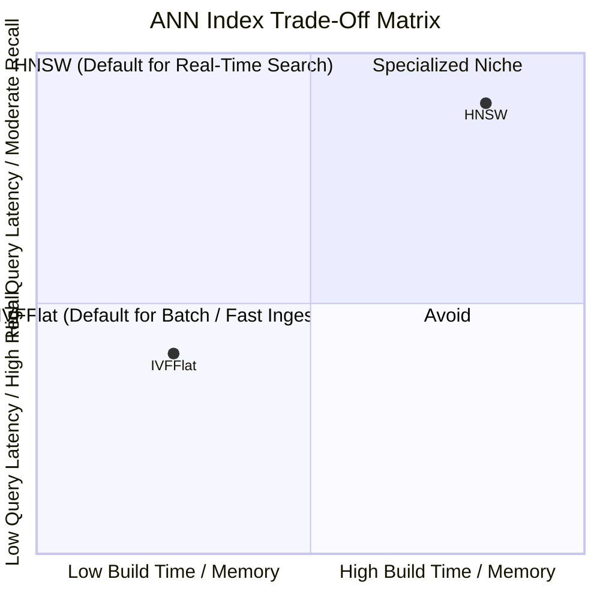
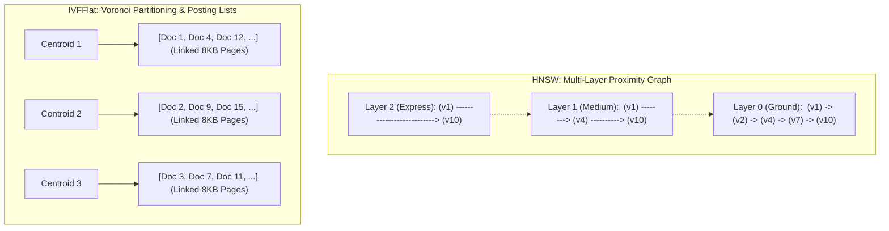
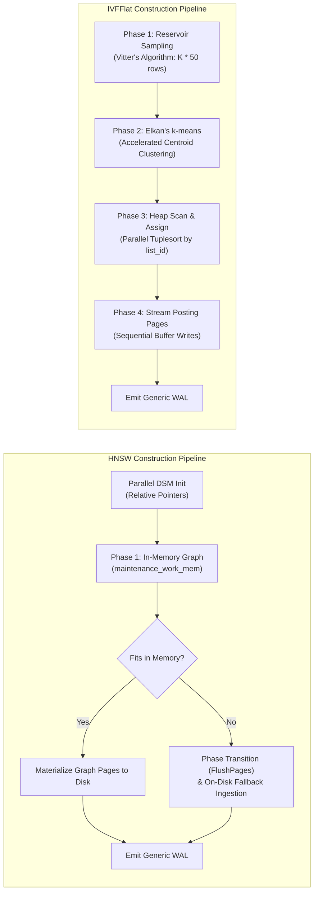
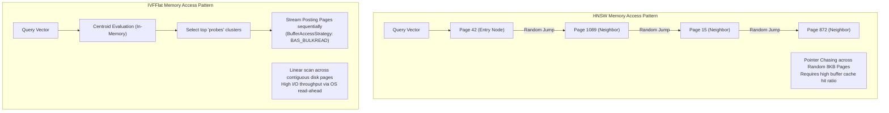
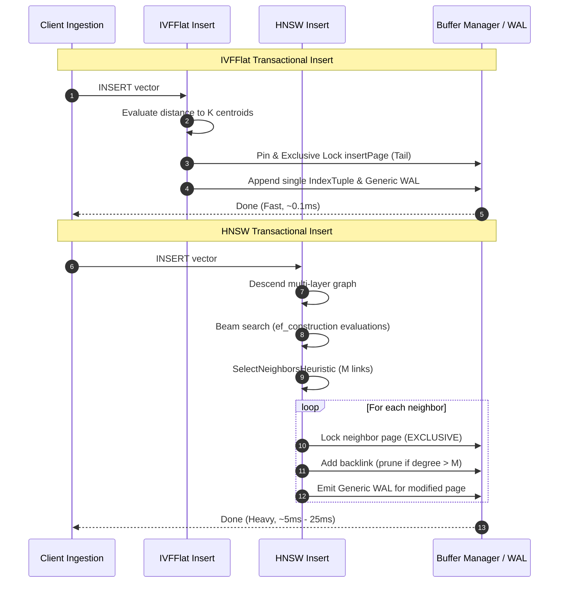
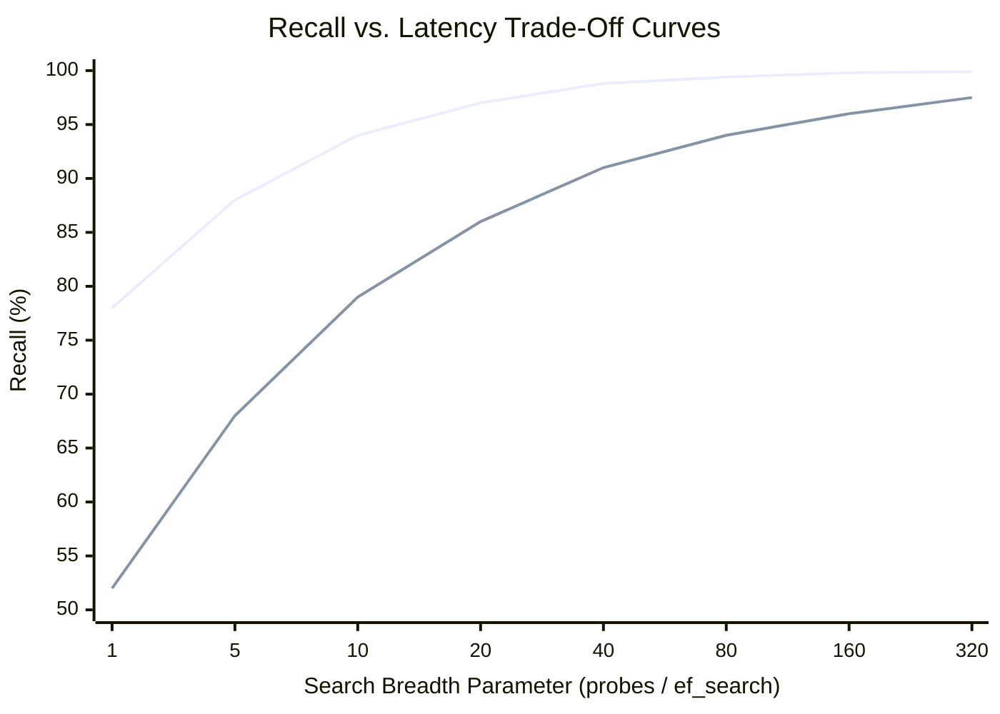
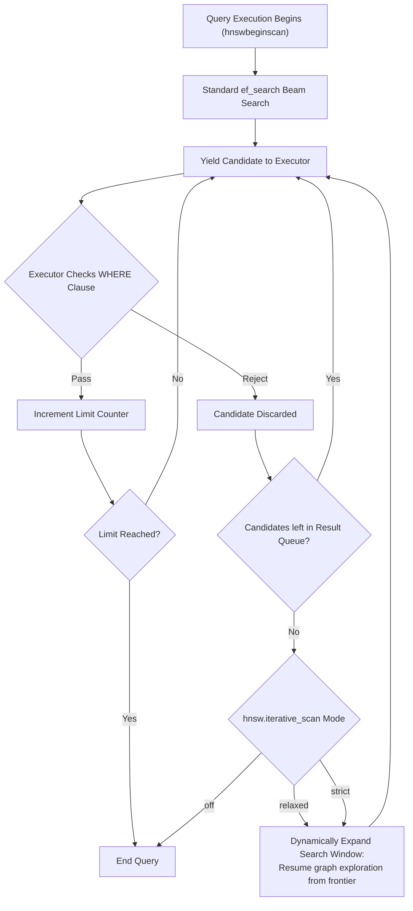

# Deep Comparative Analysis: HNSW vs. IVFFlat in pgvector

> **Document Version:** 1.0.0  
> **Target Subsystem:** PostgreSQL Index Access Methods (`src/hnsw*.c` vs. `src/ivf*.c`)  
> **Audience:** Database Administrators, Search Architects, ML Infrastructure Engineers

---

## Table of Contents

1. [Executive Summary & Algorithmic Paradigms](#1-executive-summary--algorithmic-paradigms)
2. [Algorithm Fundamentals: Graph Skip-Lists vs. Voronoi Inverted Files](#2-algorithm-fundamentals-graph-skip-lists-vs-voronoi-inverted-files)
3. [Build Architecture & Complexity Analysis](#3-build-architecture--complexity-analysis)
   - [Theoretical Computational Complexity](#theoretical-computational-complexity)
   - [PostgreSQL Construction Pipelines](#postgresql-construction-pipelines)
   - [Memory Constraints & Spill-to-Disk Behavior](#memory-constraints--spill-to-disk-behavior)
4. [Query Execution & Complexity Analysis](#4-query-execution--complexity-analysis)
   - [Query Complexity Formulations](#query-complexity-formulations)
   - [Memory Access Patterns: Random Graph Traversal vs. Sequential Scanning](#memory-access-patterns-random-graph-traversal-vs-sequential-scanning)
5. [Storage Architecture & Memory Footprint](#5-storage-architecture--memory-footprint)
   - [Disk Page Formats and Sizing Overhead](#disk-page-formats-and-sizing-overhead)
   - [Buffer Cache (`shared_buffers`) Working Set Requirements](#buffer-cache-shared_buffers-working-set-requirements)
6. [Transactional Insert Performance (Write-Heavy Workloads)](#6-transactional-insert-performance-write-heavy-workloads)
7. [Recall vs. Latency Performance Profiles](#7-recall-vs-latency-performance-profiles)
8. [Filtered Vector Search & Iterative Scan Mechanics](#8-filtered-vector-search--iterative-scan-mechanics)
   - [The Over-Filtering Problem in Vector Search](#the-over-filtering-problem-in-vector-search)
   - [`hnsw.iterative_scan` Mechanics](#hnswiterative_scan-mechanics)
   - [`ivfflat.iterative_scan` Mechanics](#ivfflatiterative_scan-mechanics)
9. [Vacuum Lifecycle, Maintenance & Index Degradation](#9-vacuum-lifecycle-maintenance--index-degradation)
   - [Dead Tuple Handling & Graph Rewiring in HNSW](#dead-tuple-handling--graph-rewiring-in-hnsw)
   - [List Compaction & Zombie Clusters in IVFFlat](#list-compaction--zombie-clusters-in-ivfflat)
10. [Comprehensive Decision Matrix](#10-comprehensive-decision-matrix)
11. [Parameter Tuning Guide & Production Heuristics](#11-parameter-tuning-guide--production-heuristics)

---

## 1. Executive Summary & Algorithmic Paradigms

PostgreSQL’s `pgvector` extension provides two production-grade approximate nearest neighbor (ANN) index access methods: **HNSW** (Hierarchical Navigable Small World) and **IVFFlat** (Inverted File Flat).

While both indices solve the $k$-nearest neighbor ($k$-NN) retrieval problem for high-dimensional embeddings, they represent fundamentally opposite trade-offs across the engineering spectrum:



- **HNSW (Graph Paradigm):** Prioritizes **query performance and recall**. It constructs a multi-layer geometric skip-graph. Builds are computationally expensive and memory-intensive, but query execution achieves sub-millisecond latencies with $99\%+$ recall, even under large datasets.
- **IVFFlat (Clustering / Inverted File Paradigm):** Prioritizes **build speed and minimal memory footprint**. It clusters vectors into Voronoi cells via k-means. Builds are $10\times\text{--}50\times$ faster than HNSW and require minimal disk/RAM overhead, but query latency scales linearly with the number of probed lists, making high recall ($>95\%$) expensive to achieve at runtime.

---

## 2. Algorithm Fundamentals: Graph Skip-Lists vs. Voronoi Inverted Files

| Dimension | HNSW (`hnsw`) | IVFFlat (`ivfflat`) |
| :--- | :--- | :--- |
| **Mathematical Basis** | Hierarchical Navigable Small World Graphs (Malkov & Yashunin, 2018) | Inverted File Index with Voronoi Cell Discretization (Jégou et al., 2011) |
| **Structure** | Multi-layer proximity graph with long-range express links at top layers and dense ground graph at Layer 0. | Inverted list where space is partitioned into $K$ Voronoi cells defined by centroid vectors $\mathbf{c}_1, \dots, \mathbf{c}_K$. |
| **Routing Mechanism** | Greedy routing from sparse top layer to Layer 1; beam search with priority queue at Layer 0. | Direct distance evaluation to all $K$ centroids; selective scan of posting lists for top `probes` clusters. |
| **Metric Space Requirement** | Metric and non-metric spaces (L2, Inner Product, Cosine, L1, Hamming, Jaccard). | Continuous geometric spaces partitioned via centroid clustering. |
| **Quantization** | Flat (unquantized) vector coordinates stored on element tuples. | Flat (unquantized) vector coordinates stored on entry tuples. |



---

## 3. Build Architecture & Complexity Analysis

### Theoretical Computational Complexity

- **HNSW Build Complexity:**
  $$O(N \log N \cdot ef\_construction \cdot M \cdot d)$$
  Every inserted vector performs a multi-layer beam search across existing nodes, evaluates distances against $ef\_construction$ candidates, selects up to $M$ diverse neighbors via heuristic pruning, and rewires backlinks on neighboring nodes.
  
- **IVFFlat Build Complexity:**
  $$O(S \cdot K \cdot I \cdot d + N \cdot K \cdot d + N \log N)$$
  Where $S$ is the sample size ($S = K \times 50$), $K = \text{lists}$, $I$ is k-means iterations (typically 10–20 iterations via Elkan's accelerated k-means), and $N \log N$ is PostgreSQL’s parallel Tuplesort phase.

### PostgreSQL Construction Pipelines



1. **HNSW Adaptive Two-Phase Build:**
   - **Phase 1 (In-Memory Fast Build):** While the graph fits within `maintenance_work_mem`, vectors and neighbor arrays are maintained in memory (or Dynamic Shared Memory across parallel workers) using relative pointers (`relptr`). This avoids buffer manager contention and WAL logging.
   - **Phase 2 (On-Disk Spilling):** When memory is exhausted, `FlushPages()` materializes the graph constructed so far onto disk buffers. Subsequent tuples are inserted via `InsertTupleOnDisk()`, which performs random buffer page fetches, acquires buffer content locks, and writes WAL records for every edge modification.

2. **IVFFlat Four-Phase Build:**
   - **Phase 1 (Sampling):** Uses Vitter's reservoir sampling to extract $K \times 50$ rows directly from the heap.
   - **Phase 2 (Centroid Clustering):** Executes Elkan’s accelerated k-means in memory. Elkan’s algorithm leverages the triangle inequality to prune distance calculations between vectors and centroids, accelerating convergence by $3\times\text{--}5\times$ over standard Lloyd’s algorithm.
   - **Phase 3 (Partition & Tuplesort):** Scans the heap in parallel, assigns each tuple to its nearest centroid, and feeds virtual tuples `(list_id, tid, vector)` into PostgreSQL's standard `tuplesort` infrastructure.
   - **Phase 4 (Clustered Page Writing):** Reads tuples pre-sorted by `list_id` and writes sequentially linked 8 KB posting list pages.

> [!IMPORTANT]
> **Build Speed Contrast:** IVFFlat builds are typically **$10\times$ to $50\times$ faster** than HNSW builds on the same dataset. For a 1-million vector dataset (768-dim), IVFFlat builds in minutes, whereas HNSW may require hours if `maintenance_work_mem` is insufficient to prevent on-disk spilling.

---

## 4. Query Execution & Complexity Analysis

### Query Complexity Formulations

- **HNSW Search Complexity:**
  $$O(\log N \cdot d + ef\_search \cdot M \cdot d)$$
  - Top-down greedy descent takes $O(\log N)$ hops.
  - Layer 0 beam search inspects at most $ef\_search \times M$ neighbor candidates.
  - Search complexity scales logarithmically with dataset size $N$.

- **IVFFlat Search Complexity:**
  $$O(K \cdot d + \frac{probes}{K} \cdot N \cdot d)$$
  - Centroid ranking evaluates $K$ distance computations.
  - Posting list scan evaluates all vectors in the probed Voronoi cells ($\frac{probes}{K}$ fraction of dataset $N$).
  - Search complexity scales linearly with dataset size $N$.

### Memory Access Patterns: Random Graph Traversal vs. Sequential Scanning



- **HNSW (Pointer Chasing):** Involves non-sequential memory accesses across graph pages. If the index does not fit into PostgreSQL's `shared_buffers` or operating system page cache, performance degrades significantly due to random NVMe read latency.
- **IVFFlat (Bulk Sequential Read):** Employs a dedicated PostgreSQL buffer access strategy (`BAS_BULKREAD`), allowing the operating system to prefetch sequential index pages without displacing general relational tables from `shared_buffers`.

---

## 5. Storage Architecture & Memory Footprint

### Disk Page Formats and Sizing Overhead

| Storage Characteristic | HNSW | IVFFlat |
| :--- | :--- | :--- |
| **Metapage Overhead** | Block 0 (`HnswMetaPageData`) | Block 0 (`IvfflatMetaPageData`) |
| **Auxiliary Structures** | Element tuples (`HnswElementTupleData`) + Neighbor tuples (`HnswNeighborTupleData`) per layer | Centroid list pages (`IvfflatListData`) |
| **Raw Tuple Payload** | Heap TID + Vector + Neighbor Link Offsets | Heap TID + Vector |
| **Disk Size Multiplier** | $\mathbf{1.5\times\text{--}2.5\times}$ of raw vector data size | $\mathbf{1.05\times\text{--}1.15\times}$ of raw vector data size |
| **Page Special Space** | `HnswPageOpaqueData` (flags, cycle counter) | `IvfflatPageOpaqueData` (next page block pointer) |

### Buffer Cache (`shared_buffers`) Working Set Requirements

1. **HNSW Cache Sensitivity:**
   To maintain sub-5ms query response times, **the entire HNSW index must fit in RAM** (`shared_buffers` + OS filesystem cache). A 1-million vector dataset (1536-dim, `halfvec`) generates $\approx 3.5\text{ GB}$ of raw data and an HNSW index of $\approx 5.5\text{--}7\text{ GB}$. If cached, latency is $<2\text{ ms}$; if reading from disk, latency can climb to $50\text{--}150\text{ ms}$.

2. **IVFFlat Cache Resilience:**
   Only the $K$ centroid vectors (typically a few megabytes) must remain pinned in cache. The posting list pages can be streamed from disk as needed, making IVFFlat significantly more practical for memory-constrained deployments.

---

## 6. Transactional Insert Performance (Write-Heavy Workloads)

When executing continuous transactional `INSERT` statements into an already-indexed table:



- **IVFFlat Insert Mechanics:** Finds the closest centroid via simple Euclidean distance, pins the cluster's current tail page (`insertPage`), appends the tuple, and emits a single WAL record. Online inserts are **lightweight and scale to high ingestion rates**.
- **HNSW Insert Mechanics:** Performs a full beam search at construction quality ($ef\_construction$), locks multiple neighbor pages, updates bidirectional backlinks, potentially triggers neighbor pruning on remote vertices, and writes multiple WAL records per inserted row. High insert rates cause **severe buffer lock contention**.

> [!TIP]
> **Bulk Ingestion Best Practice:** If inserting large batches of data ($>100,000$ rows), **drop the HNSW index before loading**, insert via binary `COPY`, and recreate the index with parallel workers. Never perform large bulk loads against an active HNSW index.

---

## 7. Recall vs. Latency Performance Profiles

The trade-off between search recall (fraction of true nearest neighbors retrieved) and query latency depends directly on the configuration parameters:



- **HNSW Characteristics:**
  - Recall rapidly approaches $98\%+$ as `ef_search` reaches $40\text{--}80$.
  - Latency scales gently ($O(\log N + ef \log ef)$), remaining in the $1\text{--}5\text{ ms}$ range.
  - Provides a predictable performance ceiling.

- **IVFFlat Characteristics:**
  - Standard configurations (`probes = 10`) frequently yield only $80\text{--}85\%$ recall.
  - To achieve $>95\%$ recall on high-dimensional embeddings (due to the "curse of dimensionality" blurring Voronoi cell boundaries), `probes` must be increased to $10\%\text{--}30\%$ of total `lists`.
  - At high `probes`, IVFFlat approaches brute-force scan latency, with queries taking $20\text{--}100\text{ ms}$.

---

## 8. Filtered Vector Search & Iterative Scan Mechanics

### The Over-Filtering Problem in Vector Search

A frequent failure mode in vector search occurs when relational predicates are combined with $k$-NN queries:
```sql
SELECT id FROM products 
WHERE category = 'electronics' AND in_stock = true 
ORDER BY embedding <-> $1 LIMIT 10;
```
If an ANN index returns a fixed set of $k$ nearest candidates (e.g., $k=10$), and the relational filter eliminates all 10 candidates, the query returns an empty result set, even if matching items exist in the database!

### `hnsw.iterative_scan` Mechanics

`pgvector` introduces **iterative scanning** to resolve filtered vector queries:



- **`hnsw.iterative_scan = 'relaxed'` (Default):** Dynamically widens the graph search horizon if candidate tuples are rejected by relational filters, balancing recall recovery with execution time limits.
- **`hnsw.iterative_scan = 'strict'`:** Continues expanding the beam search frontier until the entire graph is explored or the requested `LIMIT` is fulfilled.
- **`hnsw.max_scan_tuples`:** Caps the maximum number of graph vertices visited to protect against runaway queries on over-restrictive filters.

### `ivfflat.iterative_scan` Mechanics

- In IVFFlat, if the tuples within the initial `ivfflat.probes` lists are exhausted by relational filters before satisfying the query `LIMIT`, the scanner dynamically fetches the **next nearest centroid lists** from the pairing heap.
- Controlled via `ivfflat.iterative_scan = relaxed | strict | off` and bounded by `ivfflat.max_probes`.

---

## 9. Vacuum Lifecycle, Maintenance & Index Degradation

### Dead Tuple Handling & Graph Rewiring in HNSW

1. **Topology Degradation:** When an application deletes rows, `hnswbulkdelete` removes the corresponding vertices from the graph.
2. **Rewiring Overhead:** To prevent the graph from fragmenting into disconnected sub-graphs, the algorithm inspects inbound edges and attempts to bridge gaps using `SelectNeighborsHeuristic`.
3. **Index Bloat:** Frequent `UPDATE` operations (which PostgreSQL executes as `DELETE` + `INSERT`) result in heavy graph rewiring, bloated pages, and suboptimal graph routing paths. Over time, search recall degrades, necessitating a `REINDEX INDEX CONCURRENTLY`.

### List Compaction & Zombie Clusters in IVFFlat

1. **Page Compaction:** `ivfbulkdelete` scans inverted list pages, marks deleted line pointers, and unlinks empty 8 KB blocks from the cluster chain.
2. **Zombie Clusters:** If all vectors belonging to a specific Voronoi cell are deleted, the centroid remains registered in the metapage, but its posting list is empty. The index continues computing distances to this "zombie centroid" during queries, wasting compute cycles.
3. **Data Drift:** Over time, the distribution of vectors in the table may drift significantly from the original sample used during k-means clustering, leading to severe cluster imbalance (some lists holding millions of vectors, others empty). Periodic `REINDEX` is required to re-cluster the space.

---

## 10. Comprehensive Decision Matrix

Use the following decision matrix to choose the optimal index for production workloads:

| Workload / Operational Constraint | Recommended Index | Architectural Rationale |
| :--- | :--- | :--- |
| **Real-time User-Facing Search** | **HNSW** | Sub-millisecond latency, predictable response times, and $99\%+$ recall. |
| **Strict SLA Latency (< 5ms)** | **HNSW** | Graph beam search evaluates minimal nodes compared to large posting lists. |
| **High Recall Criticality (> 95%)** | **HNSW** | IVFFlat requires probing too many lists ($>20\%$) to match HNSW recall. |
| **Memory-Constrained Hardware (RAM < Dataset Size)** | **IVFFlat** | IVFFlat streams sequentially from disk; HNSW thrashes under random I/O. |
| **High Write Ingestion Rate (> 2,000 writes/sec)** | **IVFFlat** | Lightweight centroid append vs. heavy HNSW multi-page lock rewiring. |
| **Batch / Offline Analytical Queries** | **IVFFlat** | Build speed is $20\times$ faster; query latency is acceptable in batch jobs. |
| **Frequent Table Rebuilds / Ephemeral Data** | **IVFFlat** | Minimal CPU cost during index creation; fast pipeline teardown. |
| **Filtered Search with Selective Relational Predicates** | **HNSW** (with `iterative_scan`) | HNSW iterative scan navigates connected graph topology efficiently. |

---

## 11. Parameter Tuning Guide & Production Heuristics

### HNSW Parameter Tuning

| Parameter | Recommended Default | High Recall Target | Fast Build Target | Production Heuristic & Formula |
| :--- | :--- | :--- | :--- | :--- |
| **`m`** (Max links/vertex) | `16` | `24` – `32` | `8` – `12` | Controls graph density. Higher `m` increases recall and memory usage. For $D > 1000$, use `m = 24`. |
| **`ef_construction`** | `64` | `128` – `200` | `32` | Build-time beam search size. Doubling `ef_construction` doubles build time but improves graph quality. |
| **`hnsw.ef_search`** | `40` | `100` – `200` | `20` | Query-time beam search width. Tune dynamically in transaction: `SET LOCAL hnsw.ef_search = 100;`. |
| **`maintenance_work_mem`** | `1GB` | `8GB` – `16GB` | `2GB` | Size to fit entire graph in memory during build: $\approx 1.5 \times \text{table vector size}$. |
| **`max_parallel_maintenance_workers`** | `4` | `8` | `2` | Scale with available physical CPU cores to accelerate Phase 1 parallel DSM build. |

### IVFFlat Parameter Tuning

| Parameter | Small Table ($< 100\text{K}$) | Medium Table ($100\text{K}\text{--}1\text{M}$) | Large Table ($> 1\text{M}$) | Production Heuristic & Formula |
| :--- | :--- | :--- | :--- | :--- |
| **`lists`** | `rows / 1000` | `rows / 1000` | `sqrt(rows)` | Number of Voronoi clusters. For $1\text{M}$ rows, `lists = 1000`. For $10\text{M}$ rows, `lists = 3162`. |
| **`ivfflat.probes`** | `10` | `sqrt(lists)` | `2 * sqrt(lists)` | Number of lists scanned at query time. Higher values trade linear latency for higher recall. |
| **`ivfflat.iterative_scan`** | `relaxed` | `relaxed` | `relaxed` | Set to `relaxed` to automatically probe additional lists when filters eliminate matches. |
| **`ivfflat.max_probes`** | `50` | `lists / 10` | `lists / 10` | Safety ceiling preventing runaway scans on heavily filtered queries. |
