# IVFFlat Index Construction & Build Pipeline

## Table of Contents
1. [Overview & High-Level Architecture](#1-overview--high-level-architecture)
2. [End-to-End Build Process Flowchart](#2-end-to-end-build-process-flowchart)
3. [Phase 1: Sampling (`SampleRows`)](#3-phase-1-sampling-samplerows)
   - [Reservoir Sampling Mechanics (Vitter's Algorithm)](#reservoir-sampling-mechanics-vitters-algorithm)
   - [Target Sample Sizing Heuristic](#target-sample-sizing-heuristic)
   - [Under-Populated Table Notice](#under-populated-table-notice)
   - [Normalization Preprocessing](#normalization-preprocessing)
4. [Phase 2: Centroid Computation (`ComputeCenters`)](#4-phase-2-centroid-computation-computecenters)
   - [Memory Allocation Verification](#memory-allocation-verification)
   - [k-means Dispatch](#k-means-dispatch)
   - [Metapage & Centroid Page Generation](#metapage--centroid-page-generation)
5. [Phase 3: Tuple Assignment (`AssignTuples`)](#5-phase-3-tuple-assignment-assigntuples)
   - [Centroid Distance Minimization Loop](#centroid-distance-minimization-loop)
   - [Virtual Tuples for Sorting](#virtual-tuples-for-sorting)
   - [Tuplesort Infrastructure](#tuplesort-infrastructure)
6. [Phase 4: Clustered Entry Page Loading (`InsertTuples`)](#6-phase-4-clustered-entry-page-loading-inserttuples)
   - [Streaming Inverted Lists from Tuplesort](#streaming-inverted-lists-from-tuplesort)
   - [Page Allocation and Linking](#page-allocation-and-linking)
   - [Updating Centroid References (`IvfflatUpdateList`)](#updating-centroid-references-ivfflatupdatelist)
7. [Parallel Index Build Architecture](#7-parallel-index-build-architecture)
   - [Dynamic Shared Memory (DSM) Layout](#dynamic-shared-memory-dsm-layout)
   - [Worker Dispatch & Coordination State](#worker-dispatch--coordination-state)
   - [Leader Participation Mechanics](#leader-participation-mechanics)
   - [Shared Tuplesort Merge](#shared-tuplesort-merge)
8. [Unlogged Tables and WAL Invariants](#8-unlogged-tables-and-wal-invariants)

---

## 1. Overview & High-Level Architecture

Building an IVFFlat index in PostgreSQL transforms an unorganized table of high-dimensional vectors into an inverted file structure partitioned into $K$ Voronoi cells. The implementation in [ivfbuild.c](file:///mnt/Data/Coding/arkivector/pgvector/src/ivfbuild.c) follows a four-phase pipeline:

```
[ Heap Relation ]
       |
       v
+-----------------------------------------------------------------+
| Phase 1: Sampling (Vitter's Reservoir Sampling)                 |
| Gathers representative sample of S rows (default: K * 50)       |
+-----------------------------------------------------------------+
       |
       v
+-----------------------------------------------------------------+
| Phase 2: Centroid Clustering (Elkan's k-means)                  |
| Computes K cluster centroids from sampled vectors               |
+-----------------------------------------------------------------+
       |
       v
+-----------------------------------------------------------------+
| Phase 3: Tuple Assignment & Parallel Sort                       |
| Scans entire heap; assigns each vector to closest centroid;     |
| Spools virtual tuples (list_id, tid, vector) into Tuplesort     |
+-----------------------------------------------------------------+
       |
       v
+-----------------------------------------------------------------+
| Phase 4: Sequential Posting List Loading                        |
| Reads sorted tuples list-by-list; packs into 8KB entry pages;   |
| Chained per centroid; updates startPage/insertPage in list pages|
+-----------------------------------------------------------------+
       |
       v
[ Final IVFFlat Index ]
```

This multi-phase design decouples centroid discovery from full dataset indexing. By computing centroids over a compact statistical sample, $k$-means converges in seconds or minutes even for multi-gigabyte relations. Subsequently, assigning the full dataset relies on PostgreSQL's parallel query and external merge sort facilities.

---

## 2. End-to-End Build Process Flowchart

```mermaid
flowchart TD
    Start(["ivfflatbuild(heap, index, indexInfo)"]) --> InitBuildState["InitBuildState()<br>Read dimensions, lists, typeInfo<br>Allocate VectorArray centers"]
    
    subgraph Phase1 ["Phase 1: Sampling"]
        InitBuildState --> CalcSamples["Compute sample count:<br>numSamples = clamp(lists * 50, 10000, maxTuples)"]
        CalcSamples --> BlockSampler["BlockSampler_Init() & reservoir_init_selection_state()"]
        BlockSampler --> ScanSample["SampleRows()<br>Scan sampled blocks via table_index_build_range_scan()"]
        ScanSample --> NormCheck{"Requires Normalization?<br>(kmeansnormprocinfo)"}
        NormCheck -- Yes --> NormVectors["IvfflatNormVectors()"]
        NormCheck -- No --> CheckSampleCount{"samples < lists?"}
        NormVectors --> CheckSampleCount
        CheckSampleCount -- Yes --> EmitNotice["ereport(NOTICE): little data warning"]
        CheckSampleCount -- No --> Phase2KMeans
        EmitNotice --> Phase2KMeans
    end

    subgraph Phase2 ["Phase 2: k-means"]
        Phase2KMeans["IvfflatKmeans()<br>Elkan's accelerated k-means<br>Find K centroids"]
        Phase2KMeans --> FreeSamples["VectorArrayFree(samples)"]
        FreeSamples --> AllocPages["CreateMetaPage() (Block 0)<br>CreateListPages() (Block 1..M)"]
    end

    subgraph Phase3 ["Phase 3: Tuple Assignment & Parallel Sort"]
        AllocPages --> CheckParallel{"Parallel Workers > 0?"}
        CheckParallel -- Yes --> LaunchDSM["IvfflatBeginParallel()<br>Init DSM, Sharedsort, copy centers"]
        LaunchDSM --> ParallelScan["Workers scan heap &<br>assign nearest centroid"]
        CheckParallel -- No --> SerialScan["Serial table_index_build_scan() &<br>assign nearest centroid"]
        ParallelScan --> WorkerSort["tuplesort_performsort(worker)"]
        WorkerSort --> LeaderWait["ParallelHeapScan(): Leader waits on CV"]
        SerialScan --> TuplesortRun["tuplesort_performsort(leader)"]
        LeaderWait --> TuplesortRun
    end

    subgraph Phase4 ["Phase 4: Loading Entry Pages"]
        TuplesortRun --> InsertTuples["InsertTuples()<br>Fetch sorted tuples: (list_id, tid, vector)"]
        InsertTuples --> PackPages["Pack IndexTuples into entry pages<br>Allocate new page when full via IvfflatAppendPage()"]
        PackPages --> LinkCentroid["IvfflatUpdateList()<br>Write startPage & insertPage to ListInfo"]
        LinkCentroid --> EndParallel{"Parallel Build Used?"}
        EndParallel -- Yes --> EndDSM["IvfflatEndParallel()<br>Shutdown workers & destroy DSM"]
        EndParallel -- No --> Cleanup
        EndDSM --> Cleanup["FreeBuildState()<br>Return IndexBuildResult"]
    end

    Cleanup --> Finish(["Done"])
```



---

## 3. Phase 1: Sampling (`SampleRows`)

To prevent memory exhaustion and excessive build durations on massive tables, pgvector does not run $k$-means across the entire table. Instead, it extracts an independent, identically distributed (i.i.d.) random sample of vectors using PostgreSQL's native sampling routines from `utils/sampling.h`.

### Reservoir Sampling Mechanics (Vitter's Algorithm)
Defined in [ivfbuild.c](file:///mnt/Data/Coding/arkivector/pgvector/src/ivfbuild.c#L48-L147), sampling proceeds in two stages:
1. **Block Sampling:** `BlockSampler_Init(&buildstate->bs, totalblocks, targsamples, RandomInt())` determines which disk blocks of the heap table to inspect.
2. **Reservoir Selection:** `reservoir_init_selection_state(&buildstate->rstate, targsamples)` executes **Vitter's Algorithm $Z$** (1985).

```c
static void
AddSample(Datum *values, IvfflatBuildState * buildstate)
{
    VectorArray samples = buildstate->samples;
    int         targsamples = samples->maxlen;
    Datum       value = PointerGetDatum(PG_DETOAST_DATUM(values[0]));

    IvfflatCheckDim(buildstate->dimensions, buildstate->typeInfo, buildstate->collation, value);

    if (buildstate->kmeansnormprocinfo != NULL)
    {
        if (!IvfflatCheckNorm(buildstate->kmeansnormprocinfo, buildstate->collation, value))
            return;
    }

    /* Fill initial reservoir slots */
    if (samples->length < targsamples)
    {
        VectorArraySet(samples, samples->length, DatumGetPointer(value));
        samples->length++;
    }
    else
    {
        /* Reservoir full: calculate skip interval S */
        if (buildstate->rowstoskip < 0)
            buildstate->rowstoskip = reservoir_get_next_S(&buildstate->rstate, buildstate->samplerows, targsamples);

        if (buildstate->rowstoskip <= 0)
        {
            /* Replace a randomly chosen element in the reservoir */
            int k = (int) (targsamples * sampler_random_fract(&buildstate->rstate.randstate));
            Assert(k >= 0 && k < targsamples);
            VectorArraySet(samples, k, DatumGetPointer(value));
        }

        buildstate->rowstoskip -= 1;
    }

    buildstate->samplerows += 1;
}
```

### Target Sample Sizing Heuristic
The number of sample vectors $S$ gathered is computed in `ComputeCenters`:
$$S = \max\left(1, \min\left(\max(K \times 50, 10000), \text{maxTuples}\right)\right)$$
where $\text{maxTuples} = \text{totalBlocks} \times \text{MaxHeapTuplesPerPage}$.

- **Minimum Bound:** 10,000 vectors. Even with `lists = 10`, at least 10,000 vectors are sampled to ensure robust cluster convergence.
- **Scaling Rule:** 50 samples per list centroid ($K \times 50$). For `lists = 1000`, $S = 50,000$ samples.
- **Memory Ceiling:** Memory is pre-calculated via `VECTOR_ARRAY_SIZE(numSamples, itemsize)` and checked against `maintenance_work_mem`.

### Under-Populated Table Notice
If the total number of sampled vectors is less than the requested number of lists $K$, an explicit warning is raised:
```c
if (buildstate->samples->length < buildstate->lists)
{
    ereport(NOTICE,
            (errmsg("ivfflat index created with little data"),
             errdetail("This will cause low recall."),
             errhint("Drop the index until the table has more data.")));
}
```
In this scenario, $k$-means cannot identify $K$ distinct clusters; multiple centroids will collapse to empty or duplicate vectors, severely degrading subsequent search recall.

### Normalization Preprocessing
If the operator class defines a spherical normalization procedure (such as `vector_cosine_ops`), vectors are normalized in-place before $k$-means:
```c
if (buildstate->kmeansnormprocinfo != NULL)
    IvfflatNormVectors(buildstate->typeInfo, buildstate->collation, buildstate->samples, buildstate->tmpCtx);
```

---

## 4. Phase 2: Centroid Computation (`ComputeCenters`)

Once the reservoir sample is populated, `ComputeCenters` computes the $K$ centroids using `IvfflatKmeans` (see [ivfflat_kmeans.md](file:///mnt/Data/Coding/arkivector/RESEARCH/pgvector/indexes/ivfflat_kmeans.md) for the internal mechanics of Elkan's algorithm).

### Memory Allocation Verification
Before executing $k$-means or building structures, memory requirements are audited against PostgreSQL's `maintenance_work_mem`:
```c
void
IvfflatCheckMemoryUsage(Size totalSize)
{
    if (totalSize / 1024 > (Size) maintenance_work_mem)
        ereport(ERROR,
                (errcode(ERRCODE_PROGRAM_LIMIT_EXCEEDED),
                 errmsg("memory required is %zu MB, maintenance_work_mem is %d MB",
                        totalSize / (1024 * 1024) + 1, maintenance_work_mem / 1024)));
}
```

### Freeing Samples
Immediately following $k$-means convergence, the sample array is freed:
```c
VectorArrayFree(buildstate->samples);
```
This reclaims memory before allocating the sorting buffers and index pages in Phase 3.

### Metapage & Centroid Page Generation
Before assigning tuples, the persistent skeleton of the index is written to disk:

#### 1. Metapage Initialization (`CreateMetaPage`)
Block 0 is initialized with magic number `0x14FF1A7`, format version `1`, dimensionality, and list count:
```c
static void
CreateMetaPage(Relation index, int dimensions, int lists, ForkNumber forkNum)
{
    Buffer buf = IvfflatNewBuffer(index, forkNum);
    Page page;
    GenericXLogState *state;
    IvfflatMetaPage metap;

    IvfflatInitRegisterPage(index, &buf, &page, &state);

    metap = IvfflatPageGetMeta(page);
    metap->magicNumber = IVFFLAT_MAGIC_NUMBER;
    metap->version = IVFFLAT_VERSION;
    metap->dimensions = dimensions;
    metap->lists = lists;
    ((PageHeader) page)->pd_lower = ((char *) metap + sizeof(IvfflatMetaPageData)) - (char *) page;

    IvfflatCommitBuffer(buf, state);
}
```

#### 2. List Pages Allocation (`CreateListPages`)
List pages start at Block 1 (`IVFFLAT_HEAD_BLKNO`). For each centroid $i \in \{0, \dots, K-1\}$, an `IvfflatListData` struct is allocated and added to the page:
```c
list->startPage = InvalidBlockNumber;
list->insertPage = InvalidBlockNumber;
memcpy(&list->center, VectorArrayGet(centers, i), VARSIZE_ANY(VectorArrayGet(centers, i)));
```
If the list pages overflow an 8KB block, a new page is allocated via `IvfflatAppendPage` and chained via `IvfflatPageOpaqueData->nextblkno`. Each centroid's block number and line offset are recorded in the `buildstate->listInfo` array for fast lookup during Phase 4.

---

## 5. Phase 3: Tuple Assignment (`AssignTuples`)

Phase 3 assigns **every** row in the heap table to its nearest centroid.

### Centroid Distance Minimization Loop
In `AddTupleToSort` ([ivfbuild.c](file:///mnt/Data/Coding/arkivector/pgvector/src/ivfbuild.c#L152-L214)), each vector is compared against all $K$ centroids:

```c
for (int i = 0; i < centers->length; i++)
{
    distance = DatumGetFloat8(FunctionCall2Coll(buildstate->procinfo, 
                                                buildstate->collation, 
                                                value, 
                                                PointerGetDatum(VectorArrayGet(centers, i))));

    if (distance < minDistance)
    {
        minDistance = distance;
        closestCenter = i;
    }
}
```

### Virtual Tuples for Sorting
Rather than writing directly to index pages during the scan (which would cause random I/O thrashing across thousands of separate posting list page chains), pgvector constructs a 3-attribute **virtual tuple**:
1. `list` (`INT4OID`): Index of the closest centroid ($0 \le \text{closestCenter} < K$).
2. `tid` (`TIDOID`): Heap tuple ID (`ItemPointerData`).
3. `vector` (`vector` / `halfvec` / `bit`): Detoasted (and optionally normalized) vector datum.

```c
ExecClearTuple(slot);
slot->tts_values[0] = Int32GetDatum(closestCenter);
slot->tts_isnull[0] = false;
slot->tts_values[1] = PointerGetDatum(tid);
slot->tts_isnull[1] = false;
slot->tts_values[2] = value;
slot->tts_isnull[2] = false;
ExecStoreVirtualTuple(slot);

tuplesort_puttupleslot(buildstate->sortstate, slot);
```

### Tuplesort Infrastructure
The sorting state is initialized with `InitBuildSortState`:
```c
static Tuplesortstate *
InitBuildSortState(TupleDesc tupdesc, int memory, SortCoordinate coordinate)
{
    AttrNumber attNums[] = {1};                    /* Sort primarily by column 1: list */
    Oid sortOperators[] = {Int4LessOperator};      /* Ascending integer comparison */
    Oid sortCollations[] = {InvalidOid};
    bool nullsFirstFlags[] = {false};

    return tuplesort_begin_heap(tupdesc, 1, attNums, sortOperators, 
                                sortCollations, nullsFirstFlags, 
                                memory, coordinate, false);
}
```
All tuples are sorted by `list ASC`. This clusters all items belonging to centroid 0 together, followed by centroid 1, through centroid $K-1$.

---

## 6. Phase 4: Clustered Entry Page Loading (`InsertTuples`)

In `InsertTuples` ([ivfbuild.c](file:///mnt/Data/Coding/arkivector/pgvector/src/ivfbuild.c#L265-L325)), pgvector reads the sorted tuples in a single sequential pass and packs them onto entry pages.

```c
for (int i = 0; i < buildstate->centers->length; i++)
{
    Buffer            buf;
    Page              page;
    GenericXLogState *state;
    BlockNumber       startPage;
    BlockNumber       insertPage;

    CHECK_FOR_INTERRUPTS();

    buf = IvfflatNewBuffer(index, forkNum);
    IvfflatInitRegisterPage(index, &buf, &page, &state);
    startPage = BufferGetBlockNumber(buf);

    /* Drain all sorted tuples belonging to list i */
    while (list == i)
    {
        Size itemsz = MAXALIGN(IndexTupleSize(itup));

        if (PageGetFreeSpace(page) < itemsz)
            IvfflatAppendPage(index, &buf, &page, &state, forkNum);

        if (PageAddItem(page, (Item) itup, itemsz, InvalidOffsetNumber, false, false) == InvalidOffsetNumber)
            elog(ERROR, "failed to add index item to \"%s\"", RelationGetRelationName(index));

        pfree(itup);
        pgstat_progress_update_param(PROGRESS_CREATEIDX_TUPLES_DONE, ++inserted);

        GetNextTuple(buildstate->sortstate, tupdesc, slot, &itup, &list);
    }

    insertPage = BufferGetBlockNumber(buf);
    IvfflatCommitBuffer(buf, state);

    /* Update list page with entry chain start and insertion targets */
    IvfflatUpdateList(index, buildstate->listInfo[i], insertPage, InvalidBlockNumber, startPage, forkNum);
}
```

### Key Properties of Phase 4
1. **Sequential Allocation:** Entry pages for a given centroid are allocated contiguously.
2. **Dense Page Packing:** Entry pages are packed to capacity. A new page is appended via `IvfflatAppendPage` only when `PageGetFreeSpace(page) < itemsz`.
3. **Chain Pointer Maintenance:**
   - `startPage`: Block number of the first page of the inverted list.
   - `insertPage`: Block number of the final page in the chain that still has free space. Future inserts route directly to `insertPage`.

---

## 7. Parallel Index Build Architecture

PostgreSQL 17+ supports parallel index builds for custom access methods (`amcanbuildparallel = true`). IVFFlat implements this by dividing the Phase 3 heap scan and centroid distance calculation among parallel background workers.

```
                         Parallel Build DSM Architecture
+-----------------------------------------------------------------------------+
| Leader Process                                                              |
|   1. Creates ParallelContext & DSM Segment                                  |
|   2. Populates Shared Memory TOC:                                           |
|      - PARALLEL_KEY_IVFFLAT_SHARED   --> IvfflatShared (mutex, counters, CV)|
|      - PARALLEL_KEY_TUPLESORT         --> Sharedsort (shared run coordination)|
|      - PARALLEL_KEY_IVFFLAT_CENTERS   --> Read-only array of K centroids    |
|   3. Launches N Parallel Workers                                            |
|   4. Participates as worker (IvfflatLeaderParticipateAsWorker)              |
|   5. Waits on ConditionVariable workersdonecv                               |
|   6. Merges worker sorted runs via tuplesort_performsort                    |
+-----------------------------------------------------------------------------+
               |                                              |
               v                                              v
+-------------------------------+             +-------------------------------+
| Parallel Worker 1             |             | Parallel Worker 2             |
| - Scans heap block chunk      |             | - Scans heap block chunk      |
| - Finds argmin D(x, c_k)      |             | - Finds argmin D(x, c_k)      |
| - Puts slot into local spool  |             | - Puts slot into local spool  |
| - Signals workersdonecv       |             | - Signals workersdonecv       |
+-------------------------------+             +-------------------------------+
```

### Dynamic Shared Memory (DSM) Layout
During `IvfflatBeginParallel` ([ivfbuild.c](file:///mnt/Data/Coding/arkivector/pgvector/src/ivfbuild.c#L823-L960)), the leader calculates shared memory requirements:
```c
estivfshared = ParallelEstimateShared(buildstate->heap, snapshot);
shm_toc_estimate_chunk(&pcxt->estimator, estivfshared);
estsort = tuplesort_estimate_shared(scantuplesortstates);
shm_toc_estimate_chunk(&pcxt->estimator, estsort);
estcenters = mul_size(buildstate->centers->itemsize, buildstate->centers->maxlen);
shm_toc_estimate_chunk(&pcxt->estimator, estcenters);
shm_toc_estimate_keys(&pcxt->estimator, 3);
```

### Shared Data Structures
1. **`IvfflatShared`:**
   ```c
   typedef struct IvfflatShared
   {
       Oid               heaprelid;
       Oid               indexrelid;
       bool              isconcurrent;
       int               scantuplesortstates;
       ConditionVariable workersdonecv;
       slock_t           mutex;
       int               nparticipantsdone;
       double            reltuples;
       double            indtuples;
   } IvfflatShared;
   ```
2. **`Sharedsort`:** PostgreSQL's tuplesort coordination structure managing shared temporary files.
3. **`ivfcenters`:** Contiguous memory buffer holding the $K$ centroid vectors. Workers perform read-only lookups against this buffer without contention.

### Worker Execution (`IvfflatParallelScanAndSort`)
Workers run in parallel, reading heap blocks allocated by `table_beginscan_parallel`. For each tuple, the worker:
1. Normalizes the vector if required.
2. Computes the distance to all $K$ centroids using the shared `ivfcenters`.
3. Pushes `(closestCenter, tid, vector)` into its private sort coordinate.
4. Completes local sort via `tuplesort_performsort`.
5. Updates shared counters under spinlock and signals the leader:
   ```c
   SpinLockAcquire(&ivfshared->mutex);
   ivfshared->nparticipantsdone++;
   ivfshared->reltuples += reltuples;
   ivfshared->indtuples += buildstate.indtuples;
   SpinLockRelease(&ivfshared->mutex);

   ConditionVariableSignal(&ivfshared->workersdonecv);
   ```

### Leader Coordination & Merge
The leader participates directly in scanning and sorting via `IvfflatLeaderParticipateAsWorker`. When finished, it waits in `ParallelHeapScan`:
```c
for (;;)
{
    SpinLockAcquire(&ivfshared->mutex);
    if (ivfshared->nparticipantsdone == nparticipanttuplesorts)
    {
        buildstate->indtuples = ivfshared->indtuples;
        reltuples = ivfshared->reltuples;
        SpinLockRelease(&ivfshared->mutex);
        break;
    }
    SpinLockRelease(&ivfshared->mutex);

    ConditionVariableSleep(&ivfshared->workersdonecv, WAIT_EVENT_PARALLEL_CREATE_INDEX_SCAN);
}
ConditionVariableCancelSleep();
```
Once all participants finish, the leader executes `tuplesort_performsort(buildstate->sortstate)`. PostgreSQL merges the pre-sorted runs from each worker, after which the leader executes `InsertTuples` serially to emit the final entry pages.

---

## 8. Unlogged Tables and WAL Invariants

PostgreSQL relations support logged, unlogged, and temporary persistence profiles. IVFFlat handles these via fork numbers:

- **Logged Tables (`MAIN_FORKNUM`):** All page mutations use PostgreSQL's `GenericXLog` interface (`GenericXLogStart`, `GenericXLogRegisterBuffer`, `GenericXLogFinish`). WAL records are written during build and inserts, ensuring full crash-recovery and streaming replication support (tested in `001_ivfflat_wal.pl`).
- **Unlogged Tables (`INIT_FORKNUM`):** When creating an index on an unlogged table, `ivfflatbuildempty(Relation index)` initializes an empty index on the `INIT_FORKNUM` fork:
  ```c
  void
  ivfflatbuildempty(Relation index)
  {
      IndexInfo *indexInfo = BuildIndexInfo(index);
      IvfflatBuildState buildstate;

      BuildIndex(NULL, index, indexInfo, &buildstate, INIT_FORKNUM);
  }
  ```
  Because `GenericXLog` does not write WAL for initialization forks, `BuildIndex` flushes dirty initialization fork buffers directly to disk via:
  ```c
  if (forkNum == INIT_FORKNUM)
      log_newpage_range(index, forkNum, 0, RelationGetNumberOfBlocksInFork(index, forkNum), true);
  ```
  Upon post-crash recovery, PostgreSQL resets the main fork of the unlogged index by copying the empty template from `INIT_FORKNUM`.
