# IVFFlat Incremental Insert Mechanics

## Table of Contents
1. [Overview of Incremental Insertion](#1-overview-of-incremental-insertion)
2. [End-to-End Insertion Flowchart](#2-end-to-end-insertion-flowchart)
3. [Centroid Discovery (`FindInsertPage`)](#3-centroid-discovery-findinsertpage)
   - [Scanning Centroid List Pages](#scanning-centroid-list-pages)
   - [Distance Evaluation Against Centroids](#distance-evaluation-against-centroids)
   - [Extracting Target `insertPage` and `ListInfo`](#extracting-target-insertpage-and-listinfo)
4. [Tuple Formation & Preparation](#4-tuple-formation--preparation)
   - [Detoasting & Normalization](#detoasting--normalization)
   - [Dimension Verification](#dimension-verification)
   - [Index Tuple Construction (`IndexTupleData`)](#index-tuple-construction-indextupledata)
5. [Page Insertion & Overflow Chaining](#5-page-insertion--overflow-chaining)
   - [Finding Free Space on `insertPage`](#finding-free-space-on-insertpage)
   - [Relation Extension & Page Allocation](#relation-extension--page-allocation)
   - [Page Chaining via `IvfflatPageOpaqueData`](#page-chaining-via-ivfflatpageopaquedata)
   - [Atomic Page Commit via Generic WAL](#atomic-page-commit-via-generic-wal)
6. [Updating Inverted List Metadata (`IvfflatUpdateList`)](#6-updating-inverted-list-metadata-ivfflatupdatelist)
   - [Updating `list->insertPage`](#updating-list-insertpage)
   - [Insert vs. VACUUM Race Prevention Invariant](#insert-vs-vacuum-race-prevention-invariant)
7. [Concurrency & Locking Hierarchy](#7-concurrency--locking-hierarchy)
   - [Buffer Lock Types (`BUFFER_LOCK_SHARE` vs `BUFFER_LOCK_EXCLUSIVE`)](#buffer-lock-types-buffer_lock_share-vs-buffer_lock_exclusive)
   - [Extension Locking (`LockRelationForExtension`)](#extension-locking-lockrelationforextension)
   - [Short-Lived Temporary Memory Contexts](#short-lived-temporary-memory-contexts)
8. [Impact of Inserts on ANN Recall & Index Health](#8-impact-of-inserts-on-ann-recall--index-health)
   - [The Static Centroid Problem](#the-static-centroid-problem)
   - [Cluster Drift & Distribution Shift](#cluster-drift--distribution-shift)
   - [List Imbalance & Skewed Scan Times](#list-imbalance--skewed-scan-times)
   - [Mitigation: When to `REINDEX`](#mitigation-when-to-reindex)

---

## 1. Overview of Incremental Insertion

In PostgreSQL, whenever a `INSERT` or `UPDATE` transaction adds a row to an indexed table, the storage manager calls the access method's `aminsert` function. For IVFFlat, this invokes `ivfflatinsert` in [ivfinsert.c](file:///mnt/Data/Coding/arkivector/pgvector/src/ivfinsert.c).

Unlike tree-based indexes (such as B-Tree) that split pages hierarchically, or graph-based indexes (such as HNSW) that perform bidirectional edge rewiring, IVFFlat performs an **append-only assignment**:
1. It compares the new vector to all $K$ pre-existing centroids in the index to find the closest centroid $\mathbf{c}_k$.
2. It looks up the cached `insertPage` for that centroid.
3. It appends the index tuple to that entry page (or allocates a new overflow page if full).
4. It updates the cached `insertPage` pointer in the list page if a new page was chained.

Crucially, **centroids are never modified or recomputed during insertion**. The $K$ Voronoi cell boundaries established during initial index construction remain fixed.

---

## 2. End-to-End Insertion Flowchart

```mermaid
flowchart TD
    Start(["ivfflatinsert(index, values, isnull, heap_tid)"]) --> NullCheck{"isnull[0] == true?"}
    NullCheck -- Yes --> ReturnFalse["return false (Skip NULLs)"]
    NullCheck -- No --> CreateCtx["AllocSetContextCreate(insertCtx)<br>Switch to temporary context"]
    
    CreateCtx --> PrepValue["Detoast vector via PG_DETOAST_DATUM()<br>Normalize if needed (IVFFLAT_NORM_PROC)<br>Validate dimensions match index"]
    
    subgraph Discovery ["Centroid Routing"]
        PrepValue --> ReadHead["ReadBuffer(IVFFLAT_HEAD_BLKNO)<br>Acquire BUFFER_LOCK_SHARE"]
        ReadHead --> IterateLists["Loop over all centroids across list pages:<br>dist = distance(value, list->center)"]
        IterateLists --> FindMin["Track closest centroid:<br>listInfo (blkno, offno)<br>insertPage = list->insertPage"]
        FindMin --> UnlockListBuf["Unlock & release centroid buffer"]
    end
    
    subgraph Storage ["Posting List Append"]
        UnlockListBuf --> FormTuple["index_form_tuple()<br>Bind heap_tid to itup->t_tid"]
        FormTuple --> LockInsert["ReadBuffer(insertPage)<br>LockBuffer(EXCLUSIVE)<br>GenericXLogStart()"]
        LockInsert --> SpaceCheck{"PageGetFreeSpace(page) >= itemsz?"}
        
        SpaceCheck -- Yes --> AddItem["PageAddItem(page, itup)<br>GenericXLogFinish()<br>UnlockReleaseBuffer()"]
        
        SpaceCheck -- No --> CheckNextPage{"nextblkno is valid?"}
        CheckNextPage -- Yes --> FollowChain["insertPage = nextblkno<br>GenericXLogAbort()<br>UnlockReleaseBuffer()<br>Retry with next page"]
        FollowChain --> LockInsert
        
        CheckNextPage -- No --> ExtendRel["LockRelationForExtension(ExclusiveLock)<br>IvfflatNewBuffer() (Allocate new block)<br>UnlockRelationForExtension()"]
        ExtendRel --> LinkPages["GenericXLogRegisterBuffer(newpage, FULL_IMAGE)<br>IvfflatInitPage(newpage)<br>oldpage->opaque->nextblkno = newblkno<br>GenericXLogFinish(oldpage)"]
        LinkPages --> NewBufReady["Switch target buffer to newbuf<br>insertPage = newblkno"]
        NewBufReady --> AddItem
    end
    
    subgraph MetadataUpdate ["List State Update"]
        AddItem --> PageChanged{"insertPage != originalInsertPage?"}
        PageChanged -- Yes --> CallUpdate["IvfflatUpdateList()<br>Lock list page EXCLUSIVE<br>if insertPage >= originalInsertPage:<br>  list->insertPage = insertPage"]
        PageChanged -- No --> CleanupCtx
        CallUpdate --> CleanupCtx["Switch back memory context<br>MemoryContextDelete(insertCtx)"]
    end

    CleanupCtx --> Done(["return false"])
```



---

## 3. Centroid Discovery (`FindInsertPage`)

The routing stage finds the nearest centroid for the newly inserted vector. Implemented in `FindInsertPage` ([ivfinsert.c](file:///mnt/Data/Coding/arkivector/pgvector/src/ivfinsert.c#L19-L67)), the engine reads all centroid list pages sequentially starting at `IVFFLAT_HEAD_BLKNO` (Block 1).

```c
static void
FindInsertPage(Relation index, Datum *values, BlockNumber *insertPage, ListInfo * listInfo)
{
    double      minDistance = DBL_MAX;
    BlockNumber nextblkno = IVFFLAT_HEAD_BLKNO;
    FmgrInfo   *procinfo;
    Oid         collation;

    listInfo->blkno = nextblkno;
    listInfo->offno = FirstOffsetNumber;

    procinfo = index_getprocinfo(index, 1, IVFFLAT_DISTANCE_PROC);
    collation = index->rd_indcollation[0];

    /* Search all list pages */
    while (BlockNumberIsValid(nextblkno))
    {
        Buffer       cbuf;
        Page         cpage;
        OffsetNumber maxoffno;

        cbuf = ReadBuffer(index, nextblkno);
        LockBuffer(cbuf, BUFFER_LOCK_SHARE);
        cpage = BufferGetPage(cbuf);
        maxoffno = PageGetMaxOffsetNumber(cpage);

        for (OffsetNumber offno = FirstOffsetNumber; offno <= maxoffno; offno = OffsetNumberNext(offno))
        {
            IvfflatList list;
            double      distance;

            list = (IvfflatList) PageGetItem(cpage, PageGetItemId(cpage, offno));
            distance = DatumGetFloat8(FunctionCall2Coll(procinfo, collation, values[0], PointerGetDatum(&list->center)));

            if (distance < minDistance || !BlockNumberIsValid(*insertPage))
            {
                *insertPage = list->insertPage;
                listInfo->blkno = nextblkno;
                listInfo->offno = offno;
                minDistance = distance;
            }
        }

        nextblkno = IvfflatPageGetOpaque(cpage)->nextblkno;
        UnlockReleaseBuffer(cbuf);
    }
}
```

### Key Observations:
1. **$\mathcal{O}(K)$ Centroid Scan:** Because $K$ is typically between 100 and 10,000, all centroids fit within a few 8KB pages (e.g., at 1536 dimensions, each list item takes $\approx 6160$ bytes, requiring one page per list; at 128 dimensions, dozens of centroids fit on a single page).
2. **Buffer Lock Sharing:** Each centroid buffer is held under a shared read lock (`BUFFER_LOCK_SHARE`) only while inspecting items on that page, and immediately released before reading the next block.
3. **Tracking Origin Location:** The function records both the target `insertPage` and the precise physical location of the chosen centroid (`listInfo->blkno` and `listInfo->offno`).

---

## 4. Tuple Formation & Preparation

Before appending to disk, the incoming tuple is verified and formatted:

### Detoasting & Normalization
```c
value = PointerGetDatum(PG_DETOAST_DATUM(values[0]));

normprocinfo = IvfflatOptionalProcInfo(index, IVFFLAT_NORM_PROC);
if (normprocinfo != NULL)
{
    if (!IvfflatCheckNorm(normprocinfo, collation, value))
        return;

    value = IvfflatNormValue(typeInfo, collation, value);
}
```
If the vector is compressed or out-of-line (TOAST), it is detoasted into RAM. If the index operator class uses cosine distance, the vector is verified to ensure its norm is non-zero and scaled to unit length ($L_2 = 1.0$).

### Dimension Verification
```c
IvfflatGetMetaPageInfo(index, NULL, &dimensions);
IvfflatCheckDim(dimensions, typeInfo, collation, value);
```
The dimensions of the incoming vector are verified against the metapage's registered dimensionality. Mismatches throw `ERRCODE_DATA_EXCEPTION`.

### Index Tuple Construction (`IndexTupleData`)
```c
itup = index_form_tuple(RelationGetDescr(index), &value, isnull);
itup->t_tid = *heap_tid;
itemsz = MAXALIGN(IndexTupleSize(itup));
```
PostgreSQL's standard `index_form_tuple` packages the vector payload alongside the line pointer to the heap table row (`ItemPointerData`).

---

## 5. Page Insertion & Overflow Chaining

Once the target `insertPage` is known, `InsertTuple` enters the page insertion loop ([ivfinsert.c](file:///mnt/Data/Coding/arkivector/pgvector/src/ivfinsert.c#L122-L173)):

```c
for (;;)
{
    buf = ReadBuffer(index, insertPage);
    LockBuffer(buf, BUFFER_LOCK_EXCLUSIVE);

    state = GenericXLogStart(index);
    page = GenericXLogRegisterBuffer(state, buf, 0);

    /* Case A: Page has enough free space */
    if (PageGetFreeSpace(page) >= itemsz)
        break;

    insertPage = IvfflatPageGetOpaque(page)->nextblkno;

    /* Case B: Existing chained page exists downstream */
    if (BlockNumberIsValid(insertPage))
    {
        GenericXLogAbort(state);
        UnlockReleaseBuffer(buf);
    }
    else
    {
        /* Case C: End of chain reached; extend relation with new block */
        Buffer newbuf;
        Page   newpage;

        LockRelationForExtension(index, ExclusiveLock);
        newbuf = IvfflatNewBuffer(index, MAIN_FORKNUM);
        UnlockRelationForExtension(index, ExclusiveLock);

        newpage = GenericXLogRegisterBuffer(state, newbuf, GENERIC_XLOG_FULL_IMAGE);
        IvfflatInitPage(newbuf, newpage);

        insertPage = BufferGetBlockNumber(newbuf);

        /* Link old page to new page */
        IvfflatPageGetOpaque(page)->nextblkno = insertPage;

        /* Commit the link on old page and initialization of new page */
        GenericXLogFinish(state);
        UnlockReleaseBuffer(buf);

        /* Prepare new buffer for tuple insertion */
        state = GenericXLogStart(index);
        buf = newbuf;
        page = GenericXLogRegisterBuffer(state, buf, 0);
        break;
    }
}

/* Insert item onto page */
if (PageAddItem(page, (Item) itup, itemsz, InvalidOffsetNumber, false, false) == InvalidOffsetNumber)
    elog(ERROR, "failed to add index item to \"%s\"", RelationGetRelationName(index));

IvfflatCommitBuffer(buf, state);
```

### Three Page-Fill Scenarios:
1. **Case A (Direct Placement):** `PageGetFreeSpace(page) >= itemsz`. The item is placed directly at the next available offset using `PageAddItem`.
2. **Case B (Follow Chain):** The cached `insertPage` was filled by concurrent backends, but an existing `nextblkno` was already allocated. The loop aborts the current Generic WAL transaction, releases the lock, and follows the chain forward.
3. **Case C (Chain Extension):** The current page is completely full and `nextblkno` is invalid (`InvalidBlockNumber`). The backend acquires `LockRelationForExtension`, allocates a new block via `IvfflatNewBuffer`, initializes the new block, and updates the preceding block's `opaque->nextblkno` pointer.

---

## 6. Updating Inverted List Metadata (`IvfflatUpdateList`)

When relation extension occurs (`insertPage != originalInsertPage`), the centroid's cached `insertPage` must be updated so subsequent inserts jump straight to the new page rather than traversing the entire posting list chain from the beginning.

This is executed in `IvfflatUpdateList` ([ivfutils.c](file:///mnt/Data/Coding/arkivector/pgvector/src/ivfutils.c#L243-L285)):

```c
void
IvfflatUpdateList(Relation index, ListInfo listInfo,
                  BlockNumber insertPage, BlockNumber originalInsertPage,
                  BlockNumber startPage, ForkNumber forkNum)
{
    Buffer buf;
    Page page;
    GenericXLogState *state;
    IvfflatList list;
    bool changed = false;

    buf = ReadBufferExtended(index, forkNum, listInfo.blkno, RBM_NORMAL, NULL);
    LockBuffer(buf, BUFFER_LOCK_EXCLUSIVE);
    state = GenericXLogStart(index);
    page = GenericXLogRegisterBuffer(state, buf, 0);
    list = (IvfflatList) PageGetItem(page, PageGetItemId(page, listInfo.offno));

    if (BlockNumberIsValid(insertPage) && insertPage != list->insertPage)
    {
        /* Skip update if insert page is lower than original insert page */
        /* This is needed to prevent insert from overwriting vacuum */
        if (!BlockNumberIsValid(originalInsertPage) || insertPage >= originalInsertPage)
        {
            list->insertPage = insertPage;
            changed = true;
        }
    }

    if (BlockNumberIsValid(startPage) && startPage != list->startPage)
    {
        list->startPage = startPage;
        changed = true;
    }

    if (changed)
        IvfflatCommitBuffer(buf, state);
    else
    {
        GenericXLogAbort(state);
        UnlockReleaseBuffer(buf);
    }
}
```

### Insert vs. VACUUM Race Prevention Invariant
Notice the guard condition:
```c
if (!BlockNumberIsValid(originalInsertPage) || insertPage >= originalInsertPage)
```
**Why is this essential?**
When `VACUUM` cleans up dead tuples from an IVFFlat index (via `ivfflatbulkdelete`), it resets `list->insertPage` backwards to an earlier page in the chain that has newly reclaimed free space. If a concurrent `INSERT` was already in progress referencing an older `originalInsertPage`, writing an obsolete forward block number could overwrite VACUUM's reclaimed page pointer, causing reclaimed space to be stranded. This inequality check ensures that an insert never clobbers a concurrent VACUUM pointer.

---

## 7. Concurrency & Locking Hierarchy

To guarantee transactional consistency without deadlocks, IVFFlat adheres to a strict lock ordering hierarchy:

1. **Relation Extension Lock (`ExclusiveLock`):** Acquired via `LockRelationForExtension(index, ExclusiveLock)` strictly during physical file extension, and released immediately after block allocation.
2. **Buffer Content Locks:**
   - `BUFFER_LOCK_SHARE` on list pages during centroid search.
   - `BUFFER_LOCK_EXCLUSIVE` on target entry pages during `PageAddItem`.
   - `BUFFER_LOCK_EXCLUSIVE` on list pages during `IvfflatUpdateList`.
3. **Lock Ordering:** Entry buffer locks are always committed and released **before** acquiring exclusive locks on list buffers in `IvfflatUpdateList`. No backend ever holds an entry page lock and a list page lock simultaneously, eliminating buffer deadlocks.
4. **Memory Management:** Memory for detoasting, normalization, and tuple formation is encapsulated inside a dedicated temporary context:
   ```c
   insertCtx = AllocSetContextCreate(CurrentMemoryContext,
                                     "Ivfflat insert temporary context",
                                     ALLOCSET_DEFAULT_SIZES);
   oldCtx = MemoryContextSwitchTo(insertCtx);
   InsertTuple(index, values, isnull, heap_tid);
   MemoryContextSwitchTo(oldCtx);
   MemoryContextDelete(insertCtx);
   ```
   This prevents backend memory leaks during bulk `INSERT` statements inserting millions of rows.

---

## 8. Impact of Inserts on ANN Recall & Index Health

While inserting into an IVFFlat index is fast ($\mathcal{O}(K)$ centroid comparisons + single page write), continuous insertions after index creation gradually degrade search recall.

```
       Initial Clustering (Build Time)             Post-Insertion Drift (Chrun)
       
       Voronoi Cell A      Voronoi Cell B          Voronoi Cell A      Voronoi Cell B
       +----------------+----------------+         +----------------+----------------+
       |   *        *   |  o        o    |         |   *   +  +     |  o        o    |
       |     * c_A *    |    o c_B    o  |         |     * c_A * +  |    o c_B    o  |
       |   *    *       |  o     o       |         |   *    *   + + |  o     o       |
       |                |                |         |         +  + + |                |
       +----------------+----------------+         +----------------+----------------+
       Centroids c_A and c_B are optimal.          New data (+) clustered near boundary,
                                                   assigned to A, but closer to new mean.
```

### The Static Centroid Problem
In IVFFlat, **centroids are immutable**. They reflect the vector distribution that existed at the moment `CREATE INDEX` was run. If new vectors represent new semantic categories, embeddings from updated models, or drift in user behavior:
- New vectors are forced into historical Voronoi partitions.
- Centroids are no longer the true geometric centers of their posting lists.

### List Imbalance & Skewed Scan Times
Under non-uniform insertion patterns, certain inverted lists grow much faster than others. A query that probes an oversized list will read dozens or hundreds of disk pages, inflating query latency.

### Boundary Misalignment
Vectors near the boundaries of Voronoi cells are the most vulnerable. If the true cluster center moves, query routing directed by the stale centroid will fail to probe the list containing the true nearest neighbors, causing recall to drop.

### Mitigation: When to `REINDEX`
Unlike B-trees which stay balanced through node splits, IVFFlat requires periodic re-indexing to restore optimal recall:
```sql
REINDEX INDEX CONCURRENTLY items_embedding_idx;
```
**Recommended Practice:**
1. Populate the table with substantial data before creating the initial IVFFlat index.
2. Schedule a `REINDEX` whenever table size doubles or when measured recall drops below application thresholds.
