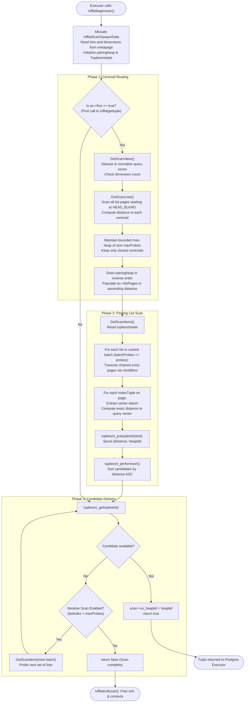

# IVFFlat Query Execution & Scan Engine

## Table of Contents
1. [Overview of ANN Search in IVFFlat](#1-overview-of-ann-search-in-ivfflat)
2. [End-to-End Query Execution Flowchart](#2-end-to-end-query-execution-flowchart)
3. [Phase 1: Centroid Routing & Probe List Selection (`GetScanLists`)](#3-phase-1-centroid-routing--probe-list-selection-getscanlists)
   - [Pairing Heap as a Bounded Max-Heap](#pairing-heap-as-a-bounded-max-heap)
   - [Iterating Centroid List Pages](#iterating-centroid-list-pages)
   - [Extracting Sorted Probe Target Pages](#extracting-sorted-probe-target-pages)
4. [Phase 2: Inverted List Traversal & Distance Recomputation (`GetScanItems`)](#4-phase-2-inverted-list-traversal--distance-recomputation-getscanitems)
   - [Chained Entry Page Traversal](#chained-entry-page-traversal)
   - [Shared Buffer Protection (`BAS_BULKREAD`)](#shared-buffer-protection-bas_bulkread)
   - [Exact Vector Distance Evaluation](#exact-vector-distance-evaluation)
   - [Spooling Candidate Tuples into Tuplesort](#spooling-candidate-tuples-into-tuplesort)
5. [Phase 3: Candidate Merging & Delivery (`ivfflatgettuple`)](#5-phase-3-candidate-merging--delivery-ivfflatgettuple)
   - [Sorting Candidates with `Float8LessOperator`](#sorting-candidates-with-float8lessoperator)
   - [Returning Heap TIDs to Executor](#returning-heap-tids-to-executor)
   - [Snapshot Isolation & MVCC Enforcement](#snapshot-isolation--mvcc-enforcement)
6. [The Iterative Scan Engine (`ivfflat.iterative_scan`)](#6-the-iterative-scan-engine-ivfflatiterative_scan)
   - [The Filter-Starvation Problem in Approximate Search](#the-filter-starvation-problem-in-approximate-search)
   - [Progressive List Expansion Architecture](#progressive-list-expansion-architecture)
   - [Batch Processing Mechanics](#batch-processing-mechanics)
   - [What `relaxed_order` Means in Practice](#what-relaxed_order-means-in-practice)
7. [Query Planning & Execution Plans](#7-query-planning--execution-plans)
   - [Cost Estimation (`ivfflatcostestimate`)](#cost-estimation-ivfflatcostestimate)
   - [Annotated `EXPLAIN (ANALYZE, BUFFERS)` Walkthrough](#annotated-explain-analyze-buffers-walkthrough)

---

## 1. Overview of ANN Search in IVFFlat

In an IVFFlat index, approximate nearest neighbor (ANN) search reduces the search space from $N$ total vectors down to the vectors contained in a small subset of inverted lists ($P = \text{probes}$). Implemented in [ivfscan.c](file:///mnt/Data/Coding/arkivector/pgvector/src/ivfscan.c), query execution proceeds through three phases:

1. **Centroid Routing (`GetScanLists`):** The query vector is compared against all $K$ centroids stored on the index's list pages. The closest $P$ centroids are selected using a bounded pairing heap.
2. **Posting List Scan & Recomputation (`GetScanItems`):** The engine reads the entry pages corresponding to the selected centroids. It computes the exact distance between the query vector and every vector in those lists, spooling candidates into a PostgreSQL `Tuplesortstate`.
3. **Sorted Stream Delivery (`ivfflatgettuple`):** The executor extracts candidates in ascending order of distance and verifies visibility against the MVCC snapshot.

---

## 2. End-to-End Query Execution Flowchart



---

## 3. Phase 1: Centroid Routing & Probe List Selection (`GetScanLists`)

The goal of `GetScanLists` ([ivfscan.c](file:///mnt/Data/Coding/arkivector/pgvector/src/ivfscan.c#L48-L118)) is to identify which inverted lists to probe, ordered by increasing centroid distance.

### Pairing Heap as a Bounded Max-Heap
pgvector utilizes PostgreSQL's native `pairingheap` data structure (`lib/pairingheap.h`). To retain the $M$ closest centroids, it configures the comparator as a **max-heap**:

```c
static int
CompareLists(const pairingheap_node *a, const pairingheap_node *b, void *arg)
{
    if (GetScanListConst(a)->distance > GetScanListConst(b)->distance)
        return 1;

    if (GetScanListConst(a)->distance < GetScanListConst(b)->distance)
        return -1;

    return 0;
}
```
Because `CompareLists` returns `1` when `a->distance > b->distance`, the element at the top of the heap (`pairingheap_first`) is the **farthest** centroid currently retained in the candidate set.

```c
for (OffsetNumber offno = FirstOffsetNumber; offno <= maxoffno; offno = OffsetNumberNext(offno))
{
    IvfflatList list = (IvfflatList) PageGetItem(cpage, PageGetItemId(cpage, offno));
    double distance = DatumGetFloat8(so->distfunc(so->procinfo, so->collation, 
                                                 PointerGetDatum(&list->center), value));

    if (listCount < so->maxProbes)
    {
        IvfflatScanList *scanlist = &so->lists[listCount];
        scanlist->startPage = list->startPage;
        scanlist->distance = distance;
        listCount++;

        pairingheap_add(so->listQueue, &scanlist->ph_node);

        if (listCount == so->maxProbes)
            maxDistance = GetScanList(pairingheap_first(so->listQueue))->distance;
    }
    else if (distance < maxDistance)
    {
        /* Eject the worst candidate and insert the closer one */
        IvfflatScanList *scanlist = GetScanList(pairingheap_remove_first(so->listQueue));
        scanlist->startPage = list->startPage;
        scanlist->distance = distance;
        pairingheap_add(so->listQueue, &scanlist->ph_node);

        maxDistance = GetScanList(pairingheap_first(so->listQueue))->distance;
    }
}
```

### Extracting Sorted Probe Target Pages
Once all centroids across all list pages have been evaluated, `listQueue` contains the `maxProbes` closest centroids. Because removing from the max-heap yields items in descending order of distance, draining the heap from back to front produces an array sorted in **ascending order of distance**:

```c
for (int i = listCount - 1; i >= 0; i--)
    so->listPages[i] = GetScanList(pairingheap_remove_first(so->listQueue))->startPage;

Assert(pairingheap_is_empty(so->listQueue));
```
`so->listPages[0]` points to the `startPage` of the single closest cluster, `so->listPages[1]` to the second closest, and so forth.

---

## 4. Phase 2: Inverted List Traversal & Distance Recomputation (`GetScanItems`)

In `GetScanItems` ([ivfscan.c](file:///mnt/Data/Coding/arkivector/pgvector/src/ivfscan.c#L124-L187)), the engine probes candidate lists and computes exact vector distances.

```c
static void
GetScanItems(IndexScanDesc scan, Datum value)
{
    IvfflatScanOpaque so = (IvfflatScanOpaque) scan->opaque;
    TupleDesc         tupdesc = RelationGetDescr(scan->indexRelation);
    TupleTableSlot   *slot = so->vslot;
    int               batchProbes = 0;

    tuplesort_reset(so->sortstate);

    /* Search closest probes lists */
    while (so->listIndex < so->maxProbes && (++batchProbes) <= so->probes)
    {
        BlockNumber searchPage = so->listPages[so->listIndex++];

        /* Search all entry pages for this list */
        while (BlockNumberIsValid(searchPage))
        {
            Buffer buf = ReadBufferExtended(scan->indexRelation, MAIN_FORKNUM, 
                                            searchPage, RBM_NORMAL, so->bas);
            LockBuffer(buf, BUFFER_LOCK_SHARE);
            Page page = BufferGetPage(buf);
            OffsetNumber maxoffno = PageGetMaxOffsetNumber(page);

            for (OffsetNumber offno = FirstOffsetNumber; offno <= maxoffno; offno = OffsetNumberNext(offno))
            {
                IndexTuple itup;
                Datum      datum;
                bool       isnull;
                ItemId     itemid = PageGetItemId(page, offno);

                itup = (IndexTuple) PageGetItem(page, itemid);
                datum = index_getattr(itup, 1, tupdesc, &isnull);

                /* Compute exact distance and store in virtual slot */
                ExecClearTuple(slot);
                slot->tts_values[0] = so->distfunc(so->procinfo, so->collation, datum, value);
                slot->tts_isnull[0] = false;
                slot->tts_values[1] = PointerGetDatum(&itup->t_tid);
                slot->tts_isnull[1] = false;
                ExecStoreVirtualTuple(slot);

                tuplesort_puttupleslot(so->sortstate, slot);
            }

            searchPage = IvfflatPageGetOpaque(page)->nextblkno;
            UnlockReleaseBuffer(buf);
        }
    }

    tuplesort_performsort(so->sortstate);
}
```

### Shared Buffer Protection (`BAS_BULKREAD`)
To prevent large posting list scans from flushing hot relational tables out of PostgreSQL's `shared_buffers`, `ivfflatbeginscan` allocates a ring buffer access strategy:
```c
so->bas = GetAccessStrategy(BAS_BULKREAD);
```
All calls to `ReadBufferExtended` pass `so->bas`, restricting buffer churn to a tiny 256KB ring cache.

### Exact Distance Evaluation
Because IVFFlat maintains full-precision vectors on entry pages, distance computation:
```c
slot->tts_values[0] = so->distfunc(so->procinfo, so->collation, datum, value);
```
invokes SIMD-accelerated distance kernels (AVX2, AVX-512, NEON) directly over the raw vector payload. Candidates have zero distance distortion.

---

## 5. Phase 3: Candidate Merging & Delivery (`ivfflatgettuple`)

Once `GetScanItems` completes sorting, `ivfflatgettuple` delivers items to the PostgreSQL query executor:

```c
bool
ivfflatgettuple(IndexScanDesc scan, ScanDirection dir)
{
    IvfflatScanOpaque so = (IvfflatScanOpaque) scan->opaque;
    ItemPointer       heaptid;
    bool              isnull;

    Assert(ScanDirectionIsForward(dir));

    if (so->first)
    {
        Datum value;
        pgstat_count_index_scan(scan->indexRelation);

        if (scan->orderByData == NULL)
            elog(ERROR, "cannot scan ivfflat index without order");

        if (!IsMVCCSnapshot(scan->xs_snapshot))
            elog(ERROR, "non-MVCC snapshots are not supported with ivfflat");

        value = GetScanValue(scan);
        GetScanLists(scan, value);
        GetScanItems(scan, value);
        so->first = false;
        so->value = value;
    }

    /* Pull next closest tuple from tuplesort */
    while (!tuplesort_gettupleslot(so->sortstate, true, false, so->mslot, NULL))
    {
        /* Exhausted current batch: check if more lists can be probed */
        if (so->listIndex == so->maxProbes)
            return false;

        /* Iterative scan: fetch next batch of lists */
        GetScanItems(scan, so->value);
    }

    heaptid = (ItemPointer) DatumGetPointer(slot_getattr(so->mslot, 2, &isnull));
    scan->xs_heaptid = *heaptid;
    scan->xs_recheck = false;
    scan->xs_recheckorderby = false;
    return true;
}
```

### Snapshot Isolation & MVCC Enforcement
Notice the check:
```c
if (!IsMVCCSnapshot(scan->xs_snapshot))
    elog(ERROR, "non-MVCC snapshots are not supported with ivfflat");
```
**Why is an MVCC snapshot mandatory?**
Unlike a B-Tree index scan that pins leaf index buffers while returning rows, IVFFlat spools all candidate tuples into an in-memory `Tuplesortstate` and releases all buffer pins before returning the first row. If a non-MVCC snapshot were used, tuples could be deleted or updated concurrently, causing dead heap tuples to be returned.

---

## 6. The Iterative Scan Engine (`ivfflat.iterative_scan`)

A long-standing limitation of approximate vector search in relational databases occurs when vector similarity is combined with restrictive metadata filters:

```sql
SELECT * FROM documents 
WHERE category = 'confidential' 
ORDER BY embedding <-> '[...]' 
LIMIT 5;
```

### The Filter-Starvation Problem
In standard IVFFlat (`ivfflat_iterative_scan = 'off'`), the index probes exactly `ivfflat.probes` lists (e.g., 5 lists). If the `category = 'confidential'` filter is highly selective, it is possible that **none** of the vectors in those 5 lists match the filter. The index scan exhausts all tuples in those lists, returns zero rows to the executor, and terminates—even if thousands of matching documents exist in list 6 or list 7!

```
Standard IVFFlat (Starvation):
[ Probed Lists 1..5 ]  ---> [ Filter: category='confidential' ] ---> 0 rows returned!
(Search stops prematurely, missing available matches in list 6..K)

Iterative Scan (Progressive Expansion):
[ Batch 1: Lists 1..5 ] ---> [ Filter ] ---> 0 rows
               | (Exhausted: fetch next batch)
               v
[ Batch 2: Lists 6..10] ---> [ Filter ] ---> 3 rows
               | (Need 2 more: fetch next batch)
               v
[ Batch 3: Lists 11..15]---> [ Filter ] ---> 2 rows ---> LIMIT 5 Satisfied!
```

### Progressive List Expansion Architecture
When enabled (`SET ivfflat.iterative_scan = 'relaxed_order';`), pgvector changes its scan engine:

1. **Wide Centroid Queue:** `ivfflatbeginscan` allocates `listPages` and `lists` to hold up to `ivfflat.max_probes` (default: 32,768, clamped to `lists`):
   ```c
   if (ivfflat_iterative_scan != IVFFLAT_ITERATIVE_SCAN_OFF)
       maxProbes = Max(ivfflat_max_probes, probes);
   else
       maxProbes = probes;
   ```
2. **Chunked Probing:** `GetScanItems` only processes `so->probes` lists at a time:
   ```c
   while (so->listIndex < so->maxProbes && (++batchProbes) <= so->probes)
   ```
3. **Reactive Re-fill:** When `tuplesort_gettupleslot` returns false (all candidates in the current batch were rejected by the executor's heap filter), `ivfflatgettuple` invokes `GetScanItems` again for the next batch of `probes` lists:
   ```c
   while (!tuplesort_gettupleslot(so->sortstate, true, false, so->mslot, NULL))
   {
       if (so->listIndex == so->maxProbes)
           return false;

       GetScanItems(scan, so->value);
   }
   ```

### What `relaxed_order` Means in Practice
In strict mathematical nearest-neighbor search, candidates must be emitted in global distance order. With iterative scanning, candidates are strictly sorted **within each probed batch of lists**. Across successive batches, a vector in Batch 2 could theoretically have a slightly lower distance than a vector in Batch 1 if Voronoi cell boundaries overlap or centroids are slightly displaced.

PostgreSQL labels this mode `relaxed_order` to signal that distance order is monotonic per batch, prioritizing finding matching rows over strict global order.

---

## 7. Query Planning & Execution Plans

### Cost Estimation (`ivfflatcostestimate`)
Defined in [ivfflat.c](file:///mnt/Data/Coding/arkivector/pgvector/src/ivfflat.c#L95-L167), the optimizer models IVFFlat costs based on the ratio of probed lists:

```c
/* Get the ratio of lists that we need to visit */
ratio = ((double) ivfflat_probes) / lists;
if (ratio > 1.0)
    ratio = 1.0;

get_tablespace_page_costs(indexInfo->reltablespace, NULL, &spc_seq_page_cost);

/* Change some page cost from random to sequential */
costs.indexTotalCost -= sequentialRatio * costs.numIndexPages * (costs.spc_random_page_cost - spc_seq_page_cost);

/* Startup cost is cost before returning the first row */
costs.indexStartupCost = costs.indexTotalCost * ratio;
```

Because posting lists are stored sequentially on disk, IVFFlat treats 50% (`sequentialRatio = 0.5`) of page accesses as sequential I/O rather than random I/O, reducing cost estimates relative to arbitrary tree traversals.

### Annotated `EXPLAIN (ANALYZE, BUFFERS)` Walkthrough

```sql
SET enable_seqscan = off;
SET ivfflat.probes = 10;
EXPLAIN (ANALYZE, BUFFERS)
SELECT id, val <-> '[1.0, 2.0, 3.0]' AS dist
FROM items
ORDER BY val <-> '[1.0, 2.0, 3.0]'
LIMIT 5;
```

**Output Breakdown:**

```text
Limit  (cost=12.50..12.52 rows=5 width=16) (actual time=0.412..0.415 rows=5 loops=1)
  Buffers: shared hit=42
  ->  Index Scan using items_val_idx on items  (cost=12.50..251.20 rows=100000 width=16) 
                                               (actual time=0.410..0.413 rows=5 loops=1)
        Order By: (val <-> '[1,2,3]'::vector)
        Buffers: shared hit=42
Planning Time: 0.125 ms
Execution Time: 0.448 ms
```

- **`Index Scan using items_val_idx`:** Confirms the IVFFlat access method was chosen.
- **`Order By: (val <-> '[1,2,3]'::vector)`:** Demonstrates `amcanorderbyop = true`. The index produces pre-ordered distance tuples, allowing the planner to avoid an expensive top-level `Sort` node.
- **`Buffers: shared hit=42`:** 
  - ~2 buffers to read the Metapage and Centroid List pages.
  - ~40 buffers to read the entry page chains across the 10 probed inverted lists (`ivfflat.probes = 10`).
